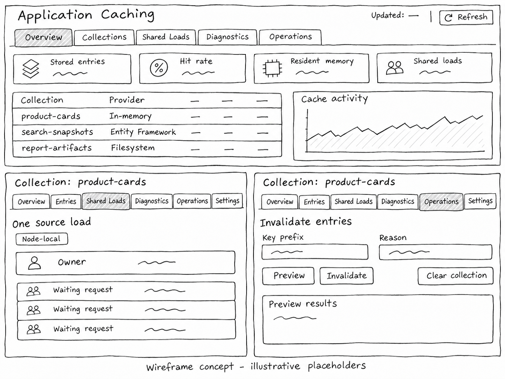
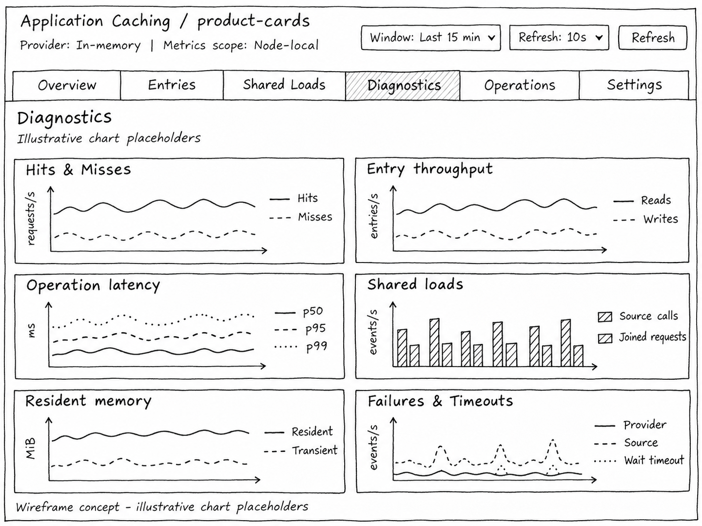

# Dashboard mockup visual references

These are generated design wireframes from the Application Caching specification, with illustrative placeholders. They are examples of the default visual language, not runtime screenshots or benchmark results. Copies are bundled with the skill so the reference images remain available when the skill is reused.

Open only the relevant image with an image-viewing tool before using it as a visual reference. Use it as a style/composition reference, not as an edit target unless the user asks to revise that design. Derive the actual tabs, entity names, providers, scope, and operations from the current task; the examples do not prescribe caching concepts for other features.

## Overview, scope, and operations

Use this example for compact overview cards, routed tabs, a bounded list, and separate scoped detail/operation views. It shows active tabs with hatching and values with scribbles. The owner/waiting-request view is node-local; do not reinterpret it as several nodes sharing work without an explicit cross-node contract.

## Diagnostics and metric charts

Use this example for a focused Diagnostics page: explicit selected scope, time-window and refresh controls, readable chart titles, units, legends, and schematic strokes rather than numerical performance claims. Keep different denominators distinct, such as requests/s versus entries/s and event counts versus latency. Use the feature's real metric definitions and unavailable states instead of copying this exact chart inventory everywhere.
