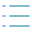

=====================================
[](https://github.com/bridgingIT/bITdevKit/actions/workflows/github-actions.yml)
[](https://www.nuget.org/packages?q=bitdevkit)
[](https://sonarcloud.io/summary/new_code?id=bitdevkit)
[](./LICENSE)

> Empowering developers with modular components for modern application development, centered around Domain-Driven Design principles.

<!-- TOC -->

- [](#)
  - [Introduction](#introduction)
  - [Documentation](#documentation)
  - [Features](#features)
    - [Common Infrastructure](#common-infrastructure)
    - [Core Domain and Application](#core-domain-and-application)
    - [Execution, Messaging and Modularity](#execution-messaging-and-modularity)
    - [Security and Access](#security-and-access)
    - [Presentation and Host](#presentation-and-host)
    - [Storage, Scheduling and Utilities](#storage-scheduling-and-utilities)
    - [Testing and Test Utilities](#testing-and-test-utilities)
  - [Libraries used (excerpt):](#libraries-used-excerpt)
  - [Example projects](#example-projects)
  - [Performance Benchmarks](#performance-benchmarks)
  - [CI/CD](#cicd)
  - [Continuous AI](#continuous-ai)
  - [GitHub Pages](#github-pages)
    - [Source structure](#source-structure)
    - [Which Markdown files get into the site](#which-markdown-files-get-into-the-site)
    - [Add a new documentation page](#add-a-new-documentation-page)
    - [Local preview and build](#local-preview-and-build)
    - [Publishing through GitHub Actions](#publishing-through-github-actions)
    - [Typical workflow for docs updates](#typical-workflow-for-docs-updates)
  - [Collaboration](#collaboration)
  - [Commit Policy](#commit-policy)
  - [License](#license)

<!-- TOC -->

## Introduction

The `bITdevKit` provides modular building blocks for modern .NET applications. It is centered around
clean architecture, Domain-Driven Design, modular vertical slices and reusable infrastructure for
real-world application concerns such as requests, messaging, queueing, storage, scheduling and
presentation.

This repository contains the full source code, supporting docs and several example applications in
`./examples` that show how the framework can be composed in practice. The components are published as
[NuGet packages](https://www.nuget.org/packages?q=bitDevKit&packagetype=&prerel=true&sortby=relevance).

For the latest updates and release notes, please refer to
the [CHANGELOG](https://raw.githubusercontent.com/bridgingIT/bITdevKit/main/CHANGELOG.md).

## Documentation

The documentation site is available at
[bridgingit-gmbh.github.io/bITdevKit](https://bridgingit-gmbh.github.io/bITdevKit/).

The best entry point into the current documentation set is the
[Documentation](./docs/INDEX.md) and [Introduction to DDD in bITdevKit](./docs/introduction-ddd-guide.md).

## Features

### Common Infrastructure

-  [Common Extensions](./docs/common-extensions.md)
-  [Common Utilities](./docs/common-utilities.md)
-  [Common Serialization](./docs/common-serialization.md)
-  [Common Options Builders](./docs/common-options-builders.md)
-  [Common Mapping](./docs/common-mapping.md)
-  [Common Caching](./docs/common-caching.md)
-  [Common Observability Tracing](./docs/common-observability-tracing.md)
-  [Metrics](./docs/features-metrics.md)

### Core Domain and Application

-  [Domain](./docs/features-domain.md)
-  [Domain Events](./docs/features-domain-events.md)
-  [Event Sourcing](./docs/features-event-sourcing.md)
-  [Domain Repositories](./docs/features-domain-repositories.md)
  - Includes the preview Domain-owned entity bulk-insert capability, explicit decorators, and transaction/outbox guidance.
-  [Domain Specifications](./docs/features-domain-specifications.md)
-  [ActiveEntity](./docs/features-domain-activeentity.md)
-  [Domain Policies](./docs/features-domain-policies.md)
-  [Rules](./docs/features-rules.md)
-  [Results](./docs/features-results.md)
-  [Application Commands and Queries](./docs/features-application-commands-queries.md)
-  [Application Events](./docs/features-application-events.md)
-  [DataPorter](./docs/features-application-dataporter.md)

### Execution, Messaging and Modularity

-   [Requester and Notifier](./docs/features-requester-notifier.md)
-  [Messaging](./docs/features-messaging.md)
-  [Queueing](./docs/features-queueing.md)
-  [Broadcasting](./docs/features-broadcasting.md)
-  [Notifications](./docs/features-notifications.md)
-  [Modules](./docs/features-modules.md)
-  [Pipelines](./docs/features-pipelines.md)
-  [Filtering](./docs/features-filtering.md)
-  [Extensions](./docs/features-extensions.md)

### Security and Access

-  [Presentation Authentication](./docs/features-presentation-authentication.md)
-  [Entity Permissions](./docs/features-entitypermissions.md)
-  [Fake Identity Provider](./docs/features-identityprovider.md)

### Presentation and Host

-  [Presentation Host](./docs/features-presentation.md)
-  [Presentation Configuration](./docs/features-presentation-configuration.md)
-  [Presentation Logging](./docs/features-presentation-logging.md)
-  [Presentation Correlation IDs](./docs/features-presentation-correlationid.md)
-  [Presentation Endpoints](./docs/features-presentation-endpoints.md)
-  [DevKit CLI](./docs/features-cli.md)
-  [DevKit MCP](./docs/features-cli-mcp.md)
-  [Console Commands](./docs/features-presentation-console-commands.md)
-  [CORS Configuration](./docs/features-presentation-cors.md)
-  [Exception Handling](./docs/features-presentation-exception-handling.md)
-  [AppState](./docs/features-presentation-appstate.md)

### Storage, Scheduling and Utilities

-  [StartupTasks](./docs/features-startuptasks.md)
-  [Jobs](./docs/features-jobs.md)
-  [JobScheduling](./docs/features-jobscheduling.md) (legacy Quartz-backed feature)
-  [DocumentStorage](./docs/features-storage-documents.md) - typed documents with concurrency, integrity, transforms, expiration/retention, and managed provider resources
-  [FileStorage](./docs/features-storage-files.md)
-  [Storage Monitoring](./docs/features-storage-monitoring.md)
-  [Log Entries](./docs/features-log-entries.md)

### Testing and Test Utilities

-  [Fake Authentication for Integration Tests](./docs/testing-fake-authentication.md)
-  [Testing Common XUnit](./docs/testing-common-xunit.md)

## Libraries used (excerpt):

- [Xunit](https://github.com/xunit/xunit)
- [EnsureThat](https://github.com/danielwertheim/Ensure.That)
- [Mapster](https://github.com/MapsterMapper/Mapster)
- [FluentValidation](https://github.com/FluentValidation/FluentValidation)
- [FluentAssertions](https://github.com/fluentassertions/fluentassertions)
- [Humanizer](https://github.com/Humanizr/Humanizer)
- [Microsoft.Extensions.Resilience](https://learn.microsoft.com/en-us/dotnet/core/resilience/) (Polly)
- [Scrutor](https://github.com/khellang/Scrutor)
- [Serilog](https://github.com/serilog/serilog)
- [Quartz](https://github.com/quartz-scheduler/quartz)
- [Shouldly](https://github.com/shouldly/shouldly)
- [Testcontainer](https://github.com/testcontainers)
- EntityFramework
- Azure Storage
- Azure ServiceBus
- Azure CosmosDb
- RabbitMQ

## Example projects

- [GettingStarted (Basic)](https://github.com/bridgingIT/bITdevKit.Examples.GettingStarted)
- [BookFiesta (DDD)](https://github.com/BridgingIT-GmbH/bITdevKit.Examples.BookFiesta)
- [EventStore (CQRS)](https://github.com/bridgingit/bitdevkit/examples)
- [WeatherFiesta](https://github.com/bridgingIT/bITdevKit/tree/main/examples/WeatherFiesta)

## Performance Benchmarks

The bITDevKit includes a dedicated benchmark project using [BenchmarkDotNet](https://benchmarkdotnet.org/) to measure the performance of core components such as the `Requester` (CQRS/MediatR alternative).

**How to run benchmarks:**

```sh
dotnet run -c Release --project benchmarks/Common.Benchmarks/Common.Benchmarks.csproj
```

- This will execute all benchmarks and generate detailed reports in the `BenchmarkDotNet.Artifacts/results/` directory (HTML, Markdown, CSV).
- The default benchmark covers the baseline request/response pipeline. You can extend the benchmarks to cover additional scenarios and compare different configurations.

**Why benchmarks?**

- Ensure high performance and low allocations for core infrastructure.
- Detect regressions and compare with other libraries (e.g., MediatR).
- Guide optimization and architectural decisions.

For more details, see the `Common.Benchmarks` project in the `benchmarks/` folder.

## CI/CD

Builds, tests and releases run on GitHub Actions. Details for each pipeline are in the
[workflows README](./.github/workflows/README.md).

| Workflow | Runs | Purpose |
| --- | --- | --- |
| [CI](./.github/workflows/github-actions.yml) | every push | calculates the version with MinVer, builds, runs the unit tests, and on `main` and `releases/dotnet9` can pack and push the NuGet packages |
| [Pages](./.github/workflows/pages.yml) | push to `main` | builds and publishes the documentation site, see [GitHub Pages](#github-pages) |
| [CodeQL](./.github/workflows/codeql-analysis.yml) | push and pull requests to `main`, daily | code scanning |

Dependency updates are configured in [dependabot.yml](./.github/dependabot.yml).

## Continuous AI

Recurring, repetitive repository chores are handled by agentic workflows, an approach GitHub Next calls
[Continuous AI](https://githubnext.com/projects/continuous-ai/): AI automation for collaboration, next to
CI/CD and not a replacement for it. The workflows are written in Markdown, compiled with the
[GitHub Agentic Workflows](https://github.github.com/gh-aw/) CLI (`gh aw compile`) into regular Actions
workflows, and run Copilot in a sandbox.

| Workflow | Runs | Result |
| --- | --- | --- |
| [Weekly Repo Status](./.github/workflows/weekly-repo-status.md) | Mondays | status report issue for maintainers |
| [Weekly Package Update](./.github/workflows/weekly-package-update.md) | Mondays | draft PR that applies the [update-packages](./.agents/skills/update-packages/SKILL.md) skill, only when build and unit tests are green |
| [CI Fault Analysis](./.github/workflows/ci-fault-analysis.md) | failed CI on `main` or `releases/*` | issue with the likely root cause |
| [Continuous Docs](./.github/workflows/continuous-docs.md) | Wednesdays | draft PR with fixes that keep `docs/` and the mkdocs site in line with the code |
| [Continuous Test Improvement](./.github/workflows/continuous-test-improvement.md) | Tuesdays and Fridays | draft PR with a few new unit tests for one under-covered class |

Guardrails:

- Agents run read-only. Issues and pull requests are created through [safe outputs](https://github.github.com/gh-aw/reference/safe-outputs/), and pull requests are drafts that a human reviews and merges.
- Each run is capped in AI credits and time. Usage is billed to the organization Copilot plan, see [cost management](https://github.github.com/gh-aw/reference/cost-management/) and check spend with `gh aw logs`.
- The Markdown file is the source. Edit it, run `gh aw compile`, and commit the generated `.lock.yml` with it.

Further reading: [Automate repository tasks with GitHub Agentic Workflows](https://github.blog/ai-and-ml/automate-repository-tasks-with-github-agentic-workflows/).

## GitHub Pages

The repository includes a MkDocs-based GitHub Pages site with:

- a landing page under `docs/site/`
- curated technical docs synced from `./docs`

Public site:
[https://bridgingit-gmbh.github.io/bITdevKit/](https://bridgingit-gmbh.github.io/bITdevKit/)

### Source structure

- `docs/site/`
  - the site-specific source pages such as the landing page, getting started pages, templates page, styling, and helper scripts
- `docs/`
  - the framework documentation source that is selectively imported into the public site
- `.github/pages/`
  - the generated static MkDocs output

### Which Markdown files get into the site

The sync step currently imports these files from `./docs` into the public site:

- `INDEX.md`
- `introduction-ddd-guide.md`
- `common-*.md`
- `features-*.md`
- `testing-*.md`

The following are intentionally excluded from GitHub Pages:

- `docs/adr/`
- `docs/presentations/`
- `docs/specs/`
- `src/**`

### Add a new documentation page

For a new Markdown page from `./docs` to appear in GitHub Pages:

1. Add or update the Markdown file under `./docs`.
2. Make sure its filename matches one of the currently imported patterns above.
3. If it should appear in navigation, add it to [mkdocs.yml](./mkdocs.yml) under the appropriate section.
4. Regenerate the site locally or push to `main` so GitHub Actions publishes it.

### Local preview and build

MkDocs is run through Docker. You do not need a local Python or MkDocs installation; you only need Docker Desktop or another Docker engine.

Preview the full site locally:

```powershell
pwsh -File ./docs/site/scripts/serve-pages.ps1
```

The preview script synchronizes the public docs into `docs/site/reference/`, then starts the `squidfunk/mkdocs-material:9` container and serves the site at [http://localhost:8000](http://localhost:8000).

Build the full static site locally:

```powershell
pwsh -File ./docs/site/scripts/build-pages.ps1
```

That build command performs these steps:

1. Synchronize the selected public docs from `./docs` into `docs/site/reference/`
2. Build the MkDocs site in Docker with `squidfunk/mkdocs-material:9`
3. Write the generated static site to `./.github/pages/`

For troubleshooting, the build script is equivalent to:

```powershell
pwsh -File ./docs/site/scripts/sync-docs.ps1
docker run --rm -v "${PWD}:/docs" squidfunk/mkdocs-material:9 build --clean
```

Successful output should include `Documentation built` and generate `./.github/pages/index.html`. Docker may print informational warnings from Material for MkDocs; link warnings should be treated as documentation issues and fixed before publishing.

### Publishing through GitHub Actions

The Pages workflow is defined in [pages.yml](./.github/workflows/pages.yml).

On each push to `main`, it:

1. checks out the repository
2. runs `./docs/site/scripts/build-pages.ps1`
3. verifies that `./.github/pages/index.html` was generated
4. publishes the generated site to the `gh-pages` branch

### Typical workflow for docs updates

Typical documentation workflow:

1. Edit or add Markdown under `./docs`
2. If needed, update [mkdocs.yml](./mkdocs.yml) so the page is reachable in navigation
3. Run `pwsh -File ./docs/site/scripts/serve-pages.ps1` to preview the result
4. Run `pwsh -File ./docs/site/scripts/build-pages.ps1` to generate the final static output
5. Commit and push to `main` to publish via GitHub Actions

## Collaboration

Simply create a pull request with your ideas or contact us.
Please refer to the [Contribution Guide](./CONTRIBUTION.md) for more information.

## Commit Policy

To keep history clear and searchable, contributions should use semantic commit messages based on the Conventional Commits specification.

Format:

`<type>[optional scope]: <description>`

Examples:

- `feat(modules): add startup task registration`
- `fix(jobs): prevent duplicate scheduling on startup`
- `docs(readme): clarify contribution workflow`

Policy:

- Use the Conventional Commits format for all repository contributions
- Keep the description in imperative mood and under 72 characters
- Prefer one logical change per commit
- Review `git diff --staged` before committing, or `git diff` if nothing is staged
- Check `git status --porcelain` to confirm the exact files included
- Never commit secrets or credentials

---
## License

This project is licensed under the MIT License - see the [LICENSE](./LICENSE) file for details.
