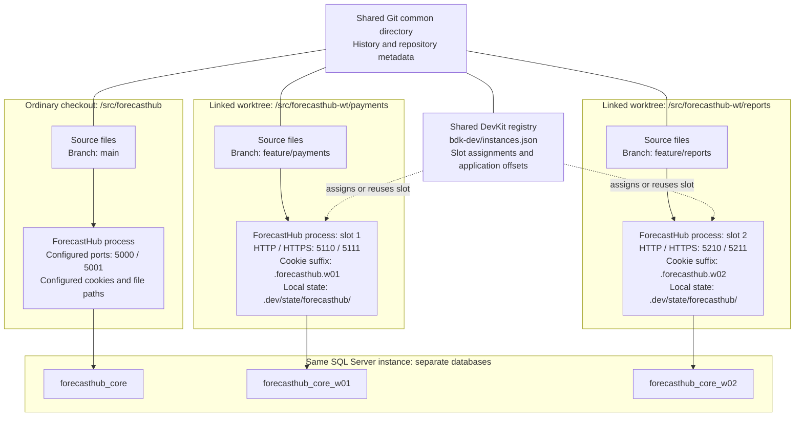
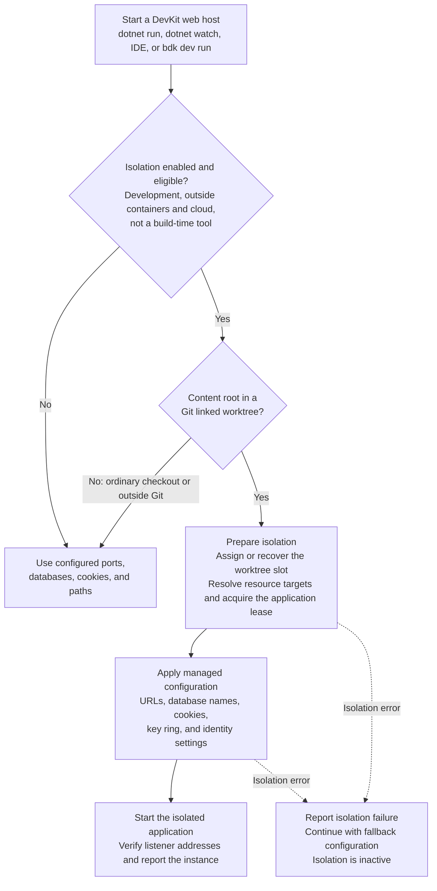
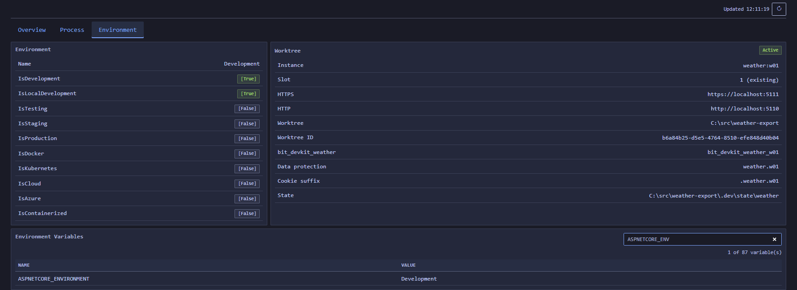

# Worktree Development Isolation

> Run one development instance per Git linked worktree, each with its own ports, databases, cookies and files.

[TOC]

## Overview

Worktree development isolation lets several checkouts of the same repository run side by side on one machine. Each Git linked worktree gets a persistent slot. The slot decides the instance's URLs, its database names, its cookie names, its data-protection key ring and its local file roots.

Isolation is on by default for every host built with `DevKitWebApplication.CreateBuilder`. `dotnet run`, `dotnet watch`, `bdk host run`, workspace tasks and IDE launches all work unchanged. The host detects a linked worktree on its own and needs no launcher, wrapper script or manual slot assignment. Call `AddDevAppInstance` only to change the defaults or to turn isolation off.

The ordinary checkout, the main working tree of the repository, keeps its configured ports and databases. Nothing changes there.

## Challenges

Parallel branches are common with `git worktree`, and coding agents create worktrees on their own. Two checkouts of one web application normally collide:

- Both bind the same Kestrel ports, so the second start fails.
- Both use the same development database, and `DeleteOnStartup` in one checkout drops the other checkout's data.
- Browser cookies are scoped by host name, not port, so two instances on `localhost` overwrite each other's authentication and antiforgery cookies.
- OIDC authorities and redirect URIs point at the original port.
- Uploads, logs and key rings land in the same directories.

## Solution

The feature runs during host bootstrap, before Kestrel, EF Core and authentication read their settings:

1. Eligibility is checked first. Inactive hosts never touch the registry.
2. Git detects whether the content root belongs to a linked worktree.
3. A registry in the repository's Git common directory assigns the worktree a slot, or reuses its slot.
4. The host derives URLs, database names and paths from the slot and adds them as a managed configuration source.
5. A lease file guards against a second instance of the same application in the same worktree.

There is no AI-agent detection and no extra permission. A linked worktree is the only trigger, whoever created it.

## Key Features

- Automatic, persistent slot per linked worktree, stored in `<git-common-dir>/bdk-dev/instances.json`.
- Deterministic port blocks per slot with per-application offsets.
- Automatic database names `<database>_wNN` for SQL Server, PostgreSQL and SQLite. Connection strings are discovered, so no key mapping is needed. A guard stops startup when another key still points at the ordinary database.
- Worktree-local state under `.dev/state/<appId>/` for payload files, logs and the data-protection key ring.
- Instance-suffixed names for every authentication, session, antiforgery and temp-data cookie.
- Authority and issuer alignment for the fake identity provider, plus a public browser configuration endpoint for hosted Blazor WebAssembly clients.
- Design-time EF Core support in the DevKit SQL Server, PostgreSQL and SQLite factories.
- `bdk dev` commands for status, verified stop, reset, release and prune.

## Architecture

### Separate checkouts and runtime resources

Git gives each worktree its own source files and checked-out branch. The worktrees share Git history and repository metadata. DevKit adds runtime isolation when you start a supported host in an eligible linked worktree.

This example runs the fictional ForecastHub host in an ordinary checkout and two linked worktrees. It uses the default port policy, explicit HTTP and HTTPS offsets `10/11`, and slots `1` and `2`.



The solid lines show Git relationships and resource use. The dashed arrows show slot coordination through the shared registry.

The two `.dev/state/forecasthub/` paths are relative to different worktree roots, so they contain separate files and key rings. Each worktree also keeps its assignment in `.dev/instance.json`. The ordinary checkout receives no slot or managed configuration.

A slot belongs to a worktree, rather than a branch or process. Restarts and branch switches reuse it. Several applications in one worktree share that slot and use different port offsets and application IDs. Database names use the configured base name and slot suffix, so applications that need separate databases must configure different base names.

The SQL Server process and credentials stay shared. DevKit changes the database name and does not copy the ordinary database's data. Startup tasks create or migrate the worktree database according to their existing configuration.

Isolation covers the resources described in [Isolated resources](#isolated-resources). Redis, message brokers, external APIs, and absolute file paths stay shared unless you configure their isolation. Cookies written directly through `Response.Cookies` keep their names. All processes still run on the same machine with the launching user's permissions.

### From host startup to an isolated instance

The host resolves isolation during bootstrap, before application services consume the managed settings:



The application lease permits one running process per application ID in a worktree. The shared registry coordinates assignments across worktrees without sharing their application state.

An isolation failure makes the host fall back and log the reason. A late failure can leave already resolved database connections pointing at instance databases. Check the startup log or the dashboard Worktree card before relying on isolation, then fix the cause and restart. See [Isolation fell back to defaults](#isolation-fell-back-to-defaults).

## Packages and support

| Package | Required | Purpose |
| ---- | ---- | ---- |
| `BridgingIT.DevKit.Presentation.Web` | Yes | `AddDevAppInstance`, managed configuration, leases, cookie and identity alignment. |
| `BridgingIT.DevKit.Common.Utilities` | Yes (transitive) | Resolver, registry, builder, context and the adapter contract. |
| `BridgingIT.DevKit.Infrastructure.EntityFramework` | For SQL Server | `WithSqlServerDatabases`, the shared database adapter base and design-time resolution. |
| `BridgingIT.DevKit.Infrastructure.EntityFramework.Postgres` | For PostgreSQL | PostgreSQL database adapter, `WithPostgresDatabases`; `PostgresModuleDbContextFactory` resolves instance databases at design time. |
| `BridgingIT.DevKit.Infrastructure.EntityFramework.Sqlite` | For SQLite | SQLite database adapter, `WithSqliteDatabases`; `SqliteModuleDbContextFactory` resolves instance files at design time. |
| `BridgingIT.DevKit.Infrastructure.EntityFramework.SqlServer` | For SQL Server | Declares the SQL Server adapter for automatic discovery. `SqlServerModuleDbContextFactory` resolves instance databases at design time. |
| `BridgingIT.DevKit.Cli` (`bdk` tool) | Optional | `bdk dev` management commands. |

Supported hosts are ASP.NET Core applications built with `DevKitWebApplication.CreateBuilder`. Windows and Linux are supported. Worker services and plain `WebApplication.CreateBuilder` hosts are not supported in this release.

Initial adapter support:

| Resource | Declaration | Isolated as |
| ---- | ---- | ---- |
| Kestrel URLs | Always, through the application's port offsets | Port block per slot |
| SQL Server | Automatic with the provider package | `<database>_wNN` per discovered database |
| PostgreSQL | Automatic with the provider package | `<database>_wNN` per discovered database |
| SQLite | Automatic with the provider package | `<file>_wNN.<ext>` next to the configured file |
| Data protection | Always | Key ring under `.dev/state/<appId>/keys`, application name `<appId>.wNN` |
| Cookies | Always | Name suffix `.<appId>.wNN` |
| Other resources | `WithResource` and a custom adapter | Whatever the adapter implements |

Undeclared resources stay shared. Redis, message brokers, blob containers and external APIs are not isolated unless you declare them through an adapter.

## Basic Usage

ForecastHub is a fictional web host with one SQL Server module. It needs no isolation code at all:

```csharp
var builder = DevKitWebApplication.CreateBuilder(args)
    .AddConfiguration()
    .AddLogging()
    .AddModules(c => c
        .WithModule<CoreModule>());
```

The first call that reads configuration activates isolation with the defaults. That is `AddLogging`, `AddModules`, a DbContext registration such as `AddSqlServerDbContext`, `GetDevAppInstance` or `Build`. The ID comes from the host application name, the registry assigns the port offsets, and the database adapters of the referenced EF Core provider packages are found automatically.

To change the defaults, call `AddDevAppInstance` right after `AddConfiguration`:

```csharp
var builder = DevKitWebApplication.CreateBuilder(args)
    .AddConfiguration()
    .AddDevAppInstance(o => o
        .WithAppId("forecasthub")              // optional
        .WithHttpOffset(http: 10, https: 11))  // optional
    .AddLogging()
    .AddModules(c => c
        .WithModule<CoreModule>());
```

Both settings are optional:

- `WithAppId` sets the application ID. Without it, the ID comes from the host application name. See [Application ID](#application-id).
- `WithHttpOffset` fixes the port offsets inside the slot block. Without it, the registry assigns them, and a repository with one host always gets `0/1`. `https` defaults to `http + 1`. See [Ports](#ports).

Registration order matters:

1. `AddConfiguration()` first, so the feature sees the final ordinary values.
2. `AddDevAppInstance(...)` next, when you call it. It adds the managed source on top.
3. Logging, modules, authentication, EF Core and storage registrations after it, so they read the managed values.

Code that reads `builder.Configuration` directly before the first of these calls sees the ordinary values. Call `AddDevAppInstance()` early in that case, which activates isolation on the spot.

`AddDevAppInstance` can be called once per host, and only before activation. A call after `AddLogging`, `AddModules`, a DbContext registration or `Build` throws `InvalidOperationException`. The application ID names the state directory, cookies and leases, so it must stay stable. Database names do not use it. They come from the configured database name plus the slot suffix.

### Turning isolation off

Two switches keep a host on its configured ports and databases, even in a linked worktree:

```csharp
.AddDevAppInstance(o => o.Enabled(false))
```

The code switch fits a host that must never isolate. The configuration switch `DevAppInstance:Mode=Disabled` fits one developer or one run, for example through an environment variable `DevAppInstance__Mode=Disabled`. Both report `inactiveReason=disabled`. The only other mode is `Auto`, the default.

Isolation does not depend on the `DEBUG` symbol. DevKit ships as Release packages, so a `#if DEBUG` inside DevKit reflects the DevKit build and not yours. The feature uses the Development environment instead, together with a linked worktree, and stays off in containers, cloud hosts and build-time tools.

### Application ID

Without `WithAppId`, the ID comes from the host application name, which is the entry assembly name. The feature drops trailing `Server`, `Web`, `Presentation`, `Api`, `WebApi`, `Host` and `Service` segments, lowercases the last remaining segment and turns other characters into hyphens. `Contoso.ForecastHub.Presentation.Web.Server` becomes `forecasthub`. IDs match `^[a-z][a-z0-9-]{0,62}$`. A derived ID longer than 63 characters is cut and ends with an 8-character hash of the full name. A name that starts with a digit gets the prefix `app-`.

Renaming the host project changes a derived ID. The new ID gets a new state directory and new cookies, and the old entry stays in the registry until `bdk dev configure --forget-app <id>`. When two hosts of a repository derive the same ID, the second start fails with `configuration_conflict`. Declare an ID in one of them:

```csharp
.AddDevAppInstance(o => o.WithAppId("forecasthub"))
```

Read the resolved context through `builder.GetDevAppInstance()` during bootstrap, or inject `DevAppInstanceContext` from DI later.

## Startup behavior

### Ordinary checkout

The host detects the main working tree, reports `inactiveReason=ordinary_checkout`, and applies no managed values. Ports from `launchSettings.json` or `--urls`, databases and cookie names stay as configured.

### First start in a linked worktree

```text
[BDK] worktree detected (app=forecasthub, worktreeRoot=/src/forecasthub-wt/payments)
[BDK] worktree slot 2 assigned (app=forecasthub, worktreeId=..., selection=new)
[BDK] worktree urls resolved (http=http://localhost:5210, https=https://localhost:5211)
[BDK] worktree baseline urls replaced (replaced=https://localhost:5001;http://localhost:5000, source=urls/ASPNETCORE_URLS)
[BDK] worktree resource resolved (resource=forecasthub_core, kind=sqlserver, target=forecasthub_core_w02)
[BDK] worktree data protection configured (applicationName=forecasthub.w02, keys=.../.dev/state/forecasthub/keys)
[BDK] worktree identity provider aligned (issuer=https://localhost:5211, relativeRedirectUris=3)
[BDK] worktree listener verified (addresses=https://localhost:5211;http://localhost:5210)
[BDK] worktree instance ready (app=forecasthub, slot=2, worktree=...)
```

The host takes the lowest free slot, writes `.dev/instance.json` in the worktree and records the assignment in the registry under a file lock. Logs never contain connection strings or credentials.

### Later starts

The host reads `.dev/instance.json` and reuses the slot (`selection=existing`). If the local file is missing but the registry still knows the worktree path, the host recovers the slot (`selection=recovered`). Addresses and databases stay stable across restarts, branch switches and reboots.

### Startup cost

An ordinary checkout pays for an environment check and a short file walk to find `.git`, well under a millisecond once warm. The host does not load or scan assemblies for database adapters there. That discovery runs only in a linked worktree. A restart in a worktree adds under 20 milliseconds of file and registry work. The first start in a new worktree also probes the slot's ports and, on Windows, reads the excluded port ranges once, which adds tens of milliseconds.

### Ports

The default policy is base port `5000`, block size `100` and `49` slots. The ports of an application are:

```text
http  = basePort + slot * blockSize + httpOffset
https = basePort + slot * blockSize + httpsOffset
```

Without `WithHttpOffset`, the registry assigns the offsets. The first managed start of a host records the lowest free pair, `0/1`, then `2/3` and so on, and later starts reuse the recorded pair. A repository with one host always gets `0/1`. With several hosts, the pairs follow the order of first starts in each clone, so two developers can see different ports for the same host. Declare offsets when a host needs the same ports everywhere:

```csharp
.AddDevAppInstance(o => o.WithAppId("forecasthub").WithHttpOffset(http: 10, https: 11))
```

ForecastHub (offsets 10 and 11) gets `5210` and `5211` in slot 2. TaskHarbor, a second host in the same repository with automatic offsets, gets `5200` and `5201` in the same slot. When `https` is omitted, it is `http + 1`. Declared offsets that collide with a recorded host fail with `configuration_conflict`.

The allocator skips slots whose ports collide with the built-in denylist (`5341`, `5432`, `5672`), with ports added through `WithReservedPorts`, or with OS-reserved ranges. `WithPortPolicy(basePort, blockSize, slotCount)` changes the policy, and every host of the repository must declare the same one.

The managed source replaces `urls`, `http_ports`, `https_ports` and `https_port`, including values from `--urls` and `ASPNETCORE_URLS`. Explicit `Kestrel:Endpoints` configuration fails startup with `configuration_conflict`, because it would override the managed URLs. Remove it from development configuration, or turn isolation off for that host. Port checks before startup are advisory. A later bind failure still fails startup. The feature never kills a conflicting process and never retries with other ports.

### Choosing a slot

Reserve a specific slot before the first start:

```bash
bdk dev configure --slot 4
```

Setting `DevAppInstance:Slot` in configuration does the same at startup. In an ordinary checkout that setting is ignored with a warning.

## Isolated resources

### Databases

Each EF Core provider package brings a database adapter. In the Development environment activation loads the SQL Server, PostgreSQL and SQLite provider assemblies the host references and reads their `[assembly: DevAppInstanceDatabaseAdapter(...)]` attributes. No `With<Provider>Databases()` call is needed. Production hosts skip this lookup.

The adapter scans every configuration key whose path contains `ConnectionString` and that holds a connection string of its provider with a database name. It needs no key list. Keys that point at the same server and database form one resource and get the same instance database, so a SQL logging sink under `Serilog:WriteTo:<n>:Args:connectionString` follows the module key automatically.

`AddSqlServerDbContext`, `AddPostgresDbContext` and `AddSqliteDbContext` check the resolved connection string too. When a DbContext registration brings an adapter kind the session does not know yet, the host plans that database on the spot and adds the managed values. Code that read configuration before that point, such as the Serilog sink, still sees the ordinary value. Adapter lookup at activation avoids that gap, so keep the provider package referenced by the host.

Adapters run in this order: adapters declared with `WithDatabases(adapter)` or `With<Provider>Databases()`, then SQL Server, PostgreSQL and SQLite, then other attributed assemblies. The first adapter that accepts a key claims it. An explicit declaration settles a key that two providers would both accept.

A third-party provider takes part by deriving from `DevAppInstanceDatabaseAdapterBase`, exposing a static `Instance` property or a parameterless constructor, and declaring itself in its assembly:

```csharp
[assembly: DevAppInstanceDatabaseAdapter(typeof(OracleDevAppInstanceAdapter))]
```

The host loads only the three DevKit provider assemblies by name. Other attributed assemblies count when they are already loaded at activation. Otherwise declare their adapter with `WithDatabases(adapter)`.

Only the database name changes. Credentials and all other options stay as configured.

| Provider | Ordinary value | Instance value in slot 2 | Reset |
| ---- | ---- | ---- | ---- |
| SQL Server | `Database=forecasthub_core` | `Database=forecasthub_core_w02` | `DROP DATABASE` after `SINGLE_USER` |
| PostgreSQL | `Database=forecasthub_core` | `Database=forecasthub_core_w02` | `DROP DATABASE ... WITH (FORCE)` |
| SQLite | `Data Source=data/forecasthub.db` | `Data Source=data/forecasthub_w02.db` | Deletes the file and its `-wal`, `-shm` and `-journal` files |

The name must fit the provider limit, 128 characters for SQL Server and 63 bytes for PostgreSQL, or startup fails with `configuration_conflict`. SQLite in-memory databases and `file:` URIs are not discovered. A SQL Server adapter ignores PostgreSQL and SQLite strings, because they fail its parser or name no database.

Startup fails with `configuration_conflict` when a key outside the discovered set, for example `HealthChecks:Sql`, still points at the same server and ordinary database. That guard keeps `DeleteOnStartup`, `EnsureTruncated` and similar callers away from the ordinary database. Rename such keys to contain `ConnectionString`, or use `ShareConnectionString(key)` for a connection that should stay shared on purpose, such as a read-only reporting database.

```csharp
.AddDevAppInstance(o => o
    .ShareConnectionString("ConnectionStrings:Reporting"))
```

Database startup tasks keep their configured behavior and now target the instance database. A new worktree starts with no database, so a creator or migrator task creates it on first start. A creator that skips existing databases is fine for unchanged models. After a model change, combine the creator with `DeleteOnStartup`, or use the migrator.

### Files

File paths are not rewritten. A relative path such as `data/uploads` resolves inside the worktree checkout, so each worktree already has its own directory. An absolute path stays shared by every worktree. Use relative paths for local development files and keep them out of Git through `.gitignore`.

The feature keeps its own state in `.dev/`. Add it to `.gitignore`:

```gitignore
.dev/
```

### Cookies and data protection

In an active instance:

- Every cookie authentication scheme gets the suffix `.<appId>.wNN`. That includes your own schemes, `.AspNetCore.Identity`, the DevKit dashboard (`.Bdk.Dashboard.<appId>.wNN`) and the fake identity provider (`.Bdk.FakeIdentityProvider.<appId>.wNN`). A scheme without a configured name gets `.AspNetCore.<scheme>.<appId>.wNN`.
- The session, antiforgery and cookie temp-data cookies get the same suffix.
- Data protection uses application name `<appId>.wNN` and keys under `.dev/state/<appId>/keys`.

Two worktrees can stay signed in side by side without extra code. OpenID Connect correlation and nonce cookies keep their names, because each challenge already gets a unique one. Cookies you write yourself through `Response.Cookies` keep their names too.

### Authorities and callbacks

`Authentication:Authority` is managed when its ordinary value is a loopback URL. In an instance it becomes the public origin, the HTTPS URL of the slot. Declare additional keys with `WithAuthorityKey(key)`. Non-loopback authorities, such as a shared external identity provider, stay unchanged.

When the fake identity provider is registered, its issuer follows the same rule. Register origin-relative redirect URIs such as `/authentication/login-callback`. Absolute loopback callbacks on another origin fail startup with `configuration_conflict`. The DevKit redirect URI normalizer accepts a relative URI at authorization, token exchange and logout.

CORS origin lists are not rewritten. If an allowed origin points at the ordinary port, derive it from `Authentication:Authority` or the context's `PublicOrigin`.

### Hosted Blazor WebAssembly clients

The host that serves the client also issues its tokens, so the authority is simply the origin the client came from. Store it as a relative value and resolve it against `HostEnvironment.BaseAddress`. Each worktree slot then talks to its own server. No endpoint, helper package or extra request is involved.

```json
{
  "Authentication": {
    "Authority": "/",
    "ClientId": "forecasthub-web"
  }
}
```

```csharp
var builder = WebAssemblyHostBuilder.CreateDefault(args);
builder.Services.AddOidcAuthentication(o =>
{
    builder.Configuration.Bind("Authentication", o.ProviderOptions);
    o.ProviderOptions.Authority = new Uri(
        new Uri(builder.HostEnvironment.BaseAddress), o.ProviderOptions.Authority).ToString();
});
```

The client ID stays the same in every worktree. An absolute authority, such as a shared external identity provider, resolves to itself and works as before.

## Consuming the context

`DevAppInstanceContext` is immutable. Its main members are `IsActive`, `InactiveReason`, `AppId`, `Slot`, `SlotName`, `WorktreeId`, `HttpUrl`, `HttpsUrl`, `PublicOrigin`, `StateRoot`, `PayloadRoot`, `LogsRoot`, `KeysRoot` and `GetInstanceDatabaseName(database)`.

`ManagedValues` can contain secrets. Never log or return it. Use the sanitized status projection:

```csharp
app.MapGet("/diagnostics/instance", (DevAppInstanceContext instance) =>
    Results.Ok(instance.ToStatus()));
```

`ToStatus()` returns `DevAppInstanceStatus` with `schemaVersion` `1`, mode, reason, application ID, worktree ID, slot, selection, URLs and sanitized resource targets.

Running hosts add a `devAppInstance` object to their host runtime descriptor with `appId`, `worktreeId`, `slot`, `worktreeRoot`, `httpUrl`, `httpsUrl`, `processStartedAt` and `leasePath`. Every host descriptor also lists its bound `urls` once the server has started. `bdk dev status` and `bdk dev stop` use this data to verify the running process. `bdk hosts list` shows the URL and slot of each host, and the `bdk mcp` runtime tools (`bdk_runtimes_list`, `bdk_runtimes_current`) return `url`, `urls` and `devAppInstance`. An agent working in a worktree therefore selects the host of that worktree and gets its URL, for example `https://localhost:5111`, without guessing ports.

## Custom resources

Implement `IDevAppInstanceResourceAdapter` for a resource the DevKit does not cover, and declare it with `WithResource(new DevAppInstanceResourceDeclaration(resourceId, adapter, [keys]))`.

The adapter:

- plans the managed values for the declared keys from the context,
- reports undeclared keys that still reference the ordinary resource,
- drops its targets during reset,
- validates orphan targets for `prune` when `RequiresOrphanCleanup` is `true`.

Planning must not perform I/O against the resource. Reset runs inside the application host, so the adapter can use the application's own credentials and packages. Use `WithSharedResource(resourceId, adapter, key)` for keys that stay shared on purpose. Shared resources show up in status output with `shared=true`.

For another database provider, derive from `DevAppInstanceDatabaseAdapterBase` and register it with `WithDatabases(adapter)`. The base class handles discovery, naming, the ordinary-database guard, orphan checks and design-time resolution. The provider implements parsing, rewriting and reset.

## Managing instances

Startup never needs the CLI. The `bdk dev` commands manage slots and resources afterwards. They resolve the worktree from the current directory and accept the global `--output json` option.

```bash
bdk dev status
bdk dev run [--app forecasthub,forecastadmin] [--no-build]
bdk dev stop --app forecasthub [--force] [--timeout 60]
bdk dev reset --app forecasthub --confirm-instance forecasthub:w02
bdk dev release --confirm-slot 2
bdk dev prune [--confirm]
bdk dev configure --slot 2
bdk dev configure --forget-app forecasthub
```

| Command | Behavior |
| ---- | ---- |
| `status` | Shows the slot, URLs, databases and the process state of each registered application. A free lease reports `stopped`. A descriptor whose process ID or start time no longer matches is not counted as running. |
| `run` | Builds and starts DevKit web hosts of the current checkout and prefixes each output line with `[appId]`. Without `--app` it starts every host it finds. It works in linked worktrees and in the ordinary checkout. See [Starting hosts](#starting-hosts). |
| `stop` | Writes a stop request next to the lease. The host shuts down gracefully within the timeout (default 45 seconds). `--force` terminates the process only after its process ID and start time match the lease holder. |
| `reset` | Starts the application project with the reserved reset argument. The host drops its own instance databases and payload root, then exits. The application must be stopped first. |
| `release` | Frees the worktree's slot. Refuses while instance databases or payload roots remain. Logs and key rings do not block release. |
| `prune` | Finds assignments whose worktree was deleted or is no longer listed by `git worktree list`. A worktree moved with `git worktree move` or locked on an unplugged drive is kept. Without `--confirm` it lists them. With `--confirm` it starts each application from the current checkout in orphan-reset mode, drops the recorded databases and frees the slot. |
| `configure` | Reserves a slot before first start, or removes an application from the registry after its declaration changed. |

The reset and prune hosts need a buildable project and take as long as `dotnet run` takes to build. Reset and prune report each dropped and remaining target. When a target cannot be dropped, the assignment stays and the output names what remains (`reset_incomplete`).

`bdk dev` exit codes follow the CLI table in [DevKit CLI](./features-cli.md#exit-codes). Reset and prune pass through the host's own codes: `2` when the host refused the request, `3` when targets remain.

### Starting hosts

`bdk dev run` is a convenience. `dotnet run`, `dotnet watch`, workspace tasks and IDE launches isolate a host just as well.

```bash
bdk dev run
bdk dev run --app forecasthub,forecastadmin
```

The command finds hosts in two ways. It reads the project path that each registered application recorded at its last start, so a `WithAppId` override keeps its ID. It also scans the checkout for `Microsoft.NET.Sdk.Web` projects whose top-level C# files call `DevKitWebApplication.CreateBuilder`, and derives the ID from the assembly name. The scan skips `bin`, `obj`, `node_modules`, dot folders and nested checkouts. A host with a `WithAppId` override that never started shows up under its derived ID until its first start.

An unknown ID in `--app` fails with `app_not_found` and lists the available IDs. A host whose lease is held is skipped with `already running`.

The hosts build one after another, because parallel builds of shared projects collide on `obj` files. A failed build stops the command before any host starts (`build_failed`). `--no-build` skips this step. The hosts then run together with `dotnet run --no-build` and their launch profile. In a linked worktree each host replaces the launch profile ports with its slot ports. The ordinary checkout keeps the launch profile ports.

The first Ctrl+C reaches every host through the shared console. The command also writes a stop request for each managed instance, then waits 30 seconds. A second Ctrl+C, or the timeout, terminates the remaining process trees. The command exits with `1` and `host_failed` when a host exited with an error before Ctrl+C. With `--output json`, the host output goes to standard error and the result to standard output.

### Recovery

- A crashed host leaves a stale lease file. The OS releases the lock with the process, so the next start or `status` sees a free lease.
- A worktree deleted with `git worktree remove` leaves its assignment and databases. Run `bdk dev prune --confirm` from any checkout.
- A provisioning failure during startup leaves the slot assigned. Fix the cause and start again, or run `reset`.
- The startup allocator never reclaims slots on its own.

## Existing lifecycles

Container-based integration tests, `WebApplicationFactory` fixtures, build-time generation (OpenAPI, EF tools that build the host), and production configuration keep their behavior. The feature activates only when all of these hold:

- the environment is `Development`,
- the host is not in a container (`DOTNET_RUNNING_IN_CONTAINER`, `KUBERNETES_SERVICE_HOST`) or Azure App Service (`WEBSITE_SITE_NAME`),
- the process is not a build-time tool,
- the content root is inside a Git linked worktree.

There are no new opt-out flags to set for these cases.

## Design-time EF Core tooling

`SqlServerModuleDbContextFactory`, `PostgresModuleDbContextFactory` and `SqliteModuleDbContextFactory` resolve the instance database when `dotnet ef` runs inside a linked worktree. They look up the connection-string key in `.dev/state/<appId>/inventory.json` (schema version 1) to find the slot, then apply the same `_wNN` suffix. Detection is file-based and starts no Git process.

Start the application once from the worktree before running `dotnet ef`, so the inventory exists. Without it the factory fails with a message that says so. Pass `--connection-string=` to the factory arguments to bypass resolution:

```bash
dotnet ef database update -- --connection-string="Server=localhost;Database=forecasthub_core_w02;..."
```

Custom `IDesignTimeDbContextFactory` implementations are not covered. Call `SqlServerDevAppInstanceAdapter.Instance.ResolveDesignTime(connectionString, key, Directory.GetCurrentDirectory(), configuration)` from them to get the same behavior. `PostgresDevAppInstanceAdapter.Instance` and `SqliteDevAppInstanceAdapter.Instance` have the same method.

## Adopting in an existing application

Install the packages and the tool at the same version. The `bdk` tool must match the DevKit packages of the application.

```bash
dotnet add package BridgingIT.DevKit.Presentation.Web
dotnet add package BridgingIT.DevKit.Infrastructure.EntityFramework
dotnet new tool-manifest
dotnet tool install BridgingIT.DevKit.Cli
```

The feature ships with the first DevKit release after `10.0.119`. Check the changelog for the exact preview version.

Updating DevKit is enough to turn isolation on. A host built with `DevKitWebApplication.CreateBuilder` isolates the next time it starts in the Development environment from a linked worktree. Ordinary checkouts are unaffected. Add `.AddDevAppInstance(o => o.Enabled(false))` to hosts that should keep their configured ports and databases everywhere.

Review these settings:

- **`Kestrel:Endpoints`.** Explicit endpoints in development configuration fail startup in a linked worktree. Remove them, or turn isolation off for the host.
- **Connection-string keys.** Discovery only looks at keys whose path contains `ConnectionString`. Module keys such as `Modules:<Module>:ConnectionStrings:*` and SQL logging sinks under `Serilog:WriteTo` are found automatically. A key with another name that points at the same database stops startup.
- **`DeleteOnStartup` and `EnsureTruncated`.** They stay as configured and now hit only the instance database. The ordinary-database guard refuses startup while another key still points at the ordinary database.
- **Issuers and callbacks.** Derive issuers from `Authentication:Authority`. Register relative redirect URIs.
- **CORS origins.** Derive them from the authority or the context.
- **`launchBrowser`.** The browser opens the URL from `launchSettings.json`, which is the ordinary port. Disable it, or rely on the `[BDK] worktree urls resolved` line. VS Code `serverReadyAction` patterns should match any `https://localhost:\d+` URL.
- **IIS Express profiles.** IIS Express ignores Kestrel URLs. Use the project profile in worktrees.

## Troubleshooting

Isolation never changes an ordinary checkout, a test host or a non-Development host. A wrong `DevAppInstance:Mode` or `DevAppInstance:Slot` there is ignored with a warning. In a linked worktree a failed startup never blocks the host. It writes one `[BDK] worktree isolation failed, the host uses its configured ports and databases:` line to the console with the error code and a recovery action, then starts with the ports, databases and cookie names from its own configuration. The context reports `inactiveReason=fallback`. To skip the attempt and the warning, start without isolation:

```powershell
$env:DevAppInstance__Mode = "Disabled"; dotnet run
```

`Disabled` skips all isolation work before anything else runs: no Git detection, no slot lease, no shared state. The host starts with the ports, databases and cookie names from its own configuration, exactly as in an ordinary checkout. A fallback does the same, so the worktree can share the main checkout's database and ports until you fix the cause. Stop the main checkout's instance first if both use the same ports.

The **Environment** tab of the DevKit dashboard **System** page has a **Worktree** card for a running host. It shows whether isolation is active and why not. In a linked worktree it also lists the instance, slot, URLs, worktree path, database targets, data protection name, cookie suffix and state folder. It never shows connection strings.

[](assets/dashboard/system/environment.png)

### Isolation fell back to defaults

`[BDK] worktree isolation failed` means the host started with its configured ports, databases and cookie names. The line carries the error code, such as `port_in_use` or `configuration_conflict`, and the recovery action. The Worktree card shows the same code and message. Fix the cause and restart. Connection strings that were already resolved when the failure happened keep their `_wNN` database names, so a late failure can leave a mix of instance and configured databases. Treat a fallback as a signal to restart. `bdk dev reset` and `bdk dev prune` stay strict and still fail on errors.

### Isolation is not active

In Development, an inactive host logs `[BDK] worktree isolation inactive` at Debug level with the reason, for example `OrdinaryCheckout` or `Disabled`. Raise the log level for the `BridgingIT.DevKit` category to see it. Once the host has started, an Information line `[BDK] worktree isolation inactive, host listening` lists the URLs it listens on (Open, Also, Dashboard), so the address is still easy to find.

### No Git repository or no Git installed

A host outside any repository, for example an extracted archive, starts unchanged with reason `OutsideGit`. Healthy checkouts and worktrees are detected from files alone, so they need no Git installation. Git runs only when worktree metadata looks damaged, and at most once. A stray or unreadable `.git` file is ignored: the host starts unchanged and logs a warning naming the file. Damaged metadata of a linked worktree logs `worktree_detection_failed` and starts the host with its configured defaults. Run `git worktree repair` there, or start with `DevAppInstance__Mode=Disabled`.

### Unexpected failure

`unexpected_failure` wraps an exception the feature did not anticipate, such as a file system error in the shared `bdk-dev` directory. The line names the exception type and message, and the host continues with its configured defaults. Fix the cause, or start with `DevAppInstance__Mode=Disabled`.

### Database adapter skipped

`[BDK] worktree database adapter skipped` means an adapter in the output folder failed to load or to create itself. Startup continues with the other adapters. DevKit Entity Framework registrations still resolve their own adapter, so their databases stay isolated. Other readers of that provider's connection strings are not rewritten until the load error is fixed. Declaring the adapter with `WithDatabases(adapter)` makes it independent of discovery.

### Port in use

`port_in_use` names the port and whether it is in an OS-reserved range. Stop the other process. To move the worktree to another slot, stop and reset its applications, then run `bdk dev release` and `bdk dev configure --slot <n>`. On Windows, check reserved ranges with `netsh interface ipv4 show excludedportrange protocol=tcp`.

### Instance already running

`instance_running` means the lease is held. Use the running instance, or stop it with `bdk dev stop --app <appId>`.

### Identity redirect errors

A login that returns to the ordinary port means an absolute callback or a hard-coded authority. Use relative redirect URIs and the managed `Authentication:Authority`. For WASM clients, store a relative authority and resolve it against `HostEnvironment.BaseAddress`. See [Hosted Blazor WebAssembly clients](#hosted-blazor-webassembly-clients).

### Unsupported or unmapped resources

`configuration_conflict` lists the keys that still reference the ordinary database. Rename them so their path contains `ConnectionString`, or declare them shared with `ShareConnectionString`.

### Registry and assignment disagreement

`assignment_invalid` and `slot_in_use` mean `.dev/instance.json` and the registry disagree, for example after copying a worktree. Delete `.dev/instance.json` to allocate a new slot. If the message says the shared registry file is not valid JSON, restore it from a backup or delete it; each worktree recovers its slot from local state on its next start where possible. `registry_locked` means another process held the registry lock for more than 10 seconds.

### File-system ownership

`resource_not_owned` means a state directory or reset token belongs to another instance. Run the command from the worktree that owns the instance.

### Slots exhausted

`slots_exhausted` means all slots are claimed or blocked. Run `bdk dev prune` for deleted worktrees, then `bdk dev release` for unused ones.

## Related documentation

- [Presentation Host](./features-presentation.md)
- [Presentation Configuration](./features-presentation-configuration.md)
- [DevKit CLI](./features-cli.md)
- [Fake Identity Provider](./features-identityprovider.md)
- [Startup Tasks](./features-startuptasks.md)
- [Worktree development isolation specification](./specs/spec-worktree-development-isolation.md)
