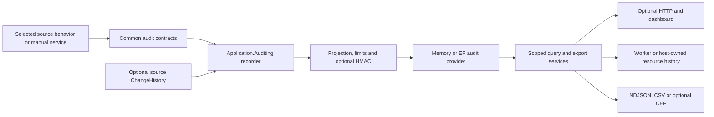

# Application auditing

> Record a bounded business execution, its actual actions, and optional confirmed change evidence.

[TOC]

## Overview

Auditing records what an application observed during a finite execution. An execution can be an authenticated HTTP request, a manually instrumented service call, a job attempt, or a message handler. Nested actions retain their own identities, parents, outcomes, resources, and captured context.

`AddAuditing()` supplies the recorder, bounded memory storage, query services, default NDJSON/CSV formatters, and diagnostics. It enables no Requester, repository, worker, email, storage, or other source behavior. Select each contributor on that feature's own builder.

The optional EF provider supports SQL Server, PostgreSQL, and SQLite. The web package adds optional public read routes, automatically discovered dashboard pages, and a reusable resource-history fragment. The core package includes the opt-in CEF formatter.

## Challenges

- A successful request can contain recovered failures, reused entities, or unchanged values. A single success flag cannot describe those events.
- Jobs and deferred messages execute after the originating request. Retaining its service scope or trusting actor fields in a payload gives incorrect attribution.
- Calling a repository or completing an import does not prove that a business transaction committed. Change evidence needs its own source confirmation.
- Queue admission, database persistence, server output, and client receipt are different acknowledgments.
- Live users, resources, source-history rows, and application types can disappear while retained evidence must remain readable.

## Solution

The recorder owns one immutable document per completed root. Admitted nested scopes become action occurrences. An optional ChangeHistory bridge copies source-confirmed evidence; an unobservable transaction remains Unknown and carries no old/new snapshots.

Storage owns delivery and extraction. The EF provider writes complete graphs in independent audit-store transactions and publishes committed positions under a store transaction gate. Queries apply trusted host constraints before selection and counting. Exports verify original records, apply current exposure restrictions, and format one graph at a time.

Failures in audit capture or delivery follow ReportOnly behavior. They produce safe diagnostics without replacing business results or exceptions. This permits evidence loss under failure; it is not a guarantee that every business operation has a persisted audit record.

## Key features

- Separate root outcome, failed actions, source persistence evidence, capture completeness, and audit delivery state.
- Explicit safe metadata projection and shared exclude/redact/hash policies.
- Source-local behavior selection, optional no-op injection, and finite independent worker roots.
- Bounded memory storage or durable relational storage, with optional provider-owned buffering.
- Versioned original documents and optional HMAC-SHA-256 authentication using external keys.
- Scoped FilterModel search, exact detail, related executions, aggregates, facets, and resource history.
- Whole-record NDJSON/CSV exports, optional CEF, protected continuation, and access-scoped companion metadata.
- Automatic dashboard discovery under existing dashboard access, plus standalone host-owned history views.

## Architecture



| Component | Responsibility |
|---|---|
| Common contracts | `IAuditContext`, `IAuditScope`, descriptors, values, no-op behavior, worker handoff contracts |
| `Application.Auditing` | Recording, freezing, privacy, versioned reading, memory storage, queries, integrity, exports and diagnostics |
| `Infrastructure.EntityFramework` | Audit-DbSet persistence, publication, buffering, readiness, retention and epoch rotation |
| `Presentation.Web.Auditing` | Host-access integration, optional read routes, native downloads, dashboard and resource-history rendering |
| `Application.Auditing/Formatters` | Opt-in file-oriented CEF projection; no SIEM transport |

Core auditing has no EF, source-feature, HTTP, or ASP.NET hosting/framework dependency. Its Data Protection library references protect copied worker links without requiring a web host. Common and Domain contributors reference Common contracts rather than the recorder implementation.

The default EF mapping contains three audit data tables and one singleton technical table:

- `__Auditing_Records`
- `__Auditing_Actions`
- `__Auditing_EntityChanges`
- `__Auditing_StoreState`

The control row retains store identity, epoch, publication progress, lifecycle and retention boundaries even in an empty store. It is not an audit execution. Business actors/resources and causal links are non-owning references, so deleting a live resource does not cascade into retained evidence. See [ADR-0031](adr/0031-audit-store-publication-and-control-state.md).

## Use cases

Use Auditing for customer maintenance trails, actual worker attempts, operational evidence, and bounded auditor review. Preserve meaningful business labels and resource identities at the code that knows them.

Keep logging for diagnostic messages and tracing for performance/call relationships. Use ChangeHistory for source-owned property changes. Auditing can incorporate that evidence but does not manufacture a diff from method names. Event sourcing, digital signatures, deletion detection, immutable external storage, legal retention policy, and SIEM delivery remain separate concerns.

## Basic usage

Install/reference `BridgingIT.DevKit.Application.Auditing`. The following service-only recipe uses memory storage and needs no web host:

```csharp
using BridgingIT.DevKit.Application.Auditing;
using BridgingIT.DevKit.Common;
using Microsoft.Extensions.DependencyInjection;

var services = new ServiceCollection();
services.AddLogging();
services.AddAuditing(options => options.Application("CustomerPortal"));

await using var host = services.BuildServiceProvider();
await using var request = host.CreateAsyncScope();
var audit = request.ServiceProvider.GetRequiredService<IAuditContext>();
Guid auditId = default;

var result = await audit.RunAsync(
    options => options.Key("customers.rename").DisplayName("Rename customer"),
    (scope, cancellationToken) =>
    {
        auditId = scope.AuditId;
        scope.AddResource(new("Customer", "C-42", "Example customer"));
        scope.SetDetail("changed", AuditValue.From(false));
        // Execute the real business operation here.
        return Task.FromResult(Result<string>.Success("Unchanged"));
    });

var provider = host.GetRequiredService<IAuditingStorageProvider>();
using var timeout = new CancellationTokenSource(TimeSpan.FromSeconds(10));
var flush = await provider.FlushAsync(timeout.Token);
if (flush.IsFailure) throw new InvalidOperationException("Audit delivery is incomplete.");
var stored = await provider.FindAsync(auditId, timeout.Token);
if (stored.IsFailure) throw new InvalidOperationException("Audit evidence is unavailable.");
```

Expect one execution with a Customer reference, a successful outcome, and no entity-change evidence. Memory presence is process-local, even when its receipt says Persisted.

### Scope ownership and outcomes

Derived names use qualified type/operation identities. Constructed-generic types retain their arguments without assembly-version metadata, avoiding oversized keys caused by assembly-qualified job names. Explicit business keys and existing non-generic names remain unchanged.

Use `await using` for explicit scopes whose finalization must be observed:

```csharp
await using var execution = audit.BeginScope(options =>
    options.Key("customers.membership").DisplayName("Maintain customer membership"));
execution.AddResource(new("Customer", customerId));

await using (var action = audit.BeginScope(options =>
    options.Key("customers.membership.reuse").DisplayName("Reuse existing membership")))
{
    // Only instrument this branch after the real lookup found the membership.
    action.Complete(AuditOutcome.Succeeded);
}

execution.Complete(AuditOutcome.Succeeded);
```

A nested `JoinOrStart` scope joins the live root. `RequiresNew` creates an independent execution with explicit causation. Worker boundaries additionally clear inherited ambient state, suppression and executing-user lookup before resolving scoped work.

`RunAsync` closes its scope around the delegate and understands returned Result failures. Explicit scopes must call `Complete` with the observed outcome. Closing without a known completion retains Unknown/incomplete evidence. Recovered child failures do not replace a successful root outcome. Capture expiry stops recording without canceling business work; late code cannot reopen the frozen document.

A create-or-reuse request may retain its intended create dispatch. Record an actual business `customers.create` action only in the branch that creates a customer. Reuse and no-effective-change branches should say so and must not invent deltas.

### Optional no-op injection

A library can depend on `IAuditContext` while its host chooses whether to record:

```csharp
services.AddNoOpAuditContext(); // No provider, endpoint or behavior is installed.
```

The built-in no-op skips metadata callbacks and still executes the business delegate. `AddAuditing()` replaces that built-in fallback in either registration order. An explicitly supplied custom context remains the host's choice. Never use a test helper to insert hidden scopes that make missing application instrumentation appear covered.

### Plain worker host

Create a fresh DI scope for each occurrence and detach it from inherited execution state:

```csharp
await using var occurrence = rootServices.CreateAsyncScope();
using var boundary = occurrence.ServiceProvider
    .GetRequiredService<IAuditExecutionBoundary>().DetachExecution();
var workerAudit = occurrence.ServiceProvider.GetRequiredService<IAuditContext>();
await using var execution = workerAudit.BeginScope(options =>
    options.Key("customers.reconcile").DisplayName("Reconcile customer memberships"));
// Perform this occurrence's work, honoring its cancellation token.
execution.Complete(AuditOutcome.Succeeded);
```

This records a service actor. An initiating user exists only when an authenticated protected handoff supplied one. Do not retain the scope during an idle wait or for the host lifetime.

## HTTP and Requester setup

Reference `BridgingIT.DevKit.Presentation.Web.Auditing` in an existing authenticated ASP.NET Core host:

```csharp
using BridgingIT.DevKit.Presentation.Web;
using BridgingIT.DevKit.Presentation.Web.Auditing;

builder.Services.AddAuditing(options => options.Application("CustomerPortal"))
    .WithHttpRequests()
    .WithEndpoints(); // Optional public read API; host authorization is required by default.
builder.Services.AddRequester().WithAuditing();
builder.Services.AddExceptionHandler<AuditExceptionHandler>();
builder.Services.AddExceptionHandler(new GlobalExceptionHandlerOptions
{
    IncludeExceptionDetails = false
});
builder.Services.AddProblemDetails();

var app = builder.Build();
app.UseRouting();
app.UseAuthentication();
app.UseAuditing();
app.UseExceptionHandler();
app.UseAuthorization();
app.MapAuditingEndpoints();
```

Register real Requester handlers as usual. Requester auditing creates a dispatch action and only creates handler actions for handlers that actually run. Default Requester selection captures Command names; selecting Query types is explicit. A custom `Select` replaces the default selector, so retain Command selection when adding particular queries.

Install auditing after routing/authentication so endpoint and actor metadata are available, and outside exception handling/authorization so it observes their final status. `AuditExceptionHandler` reports handled exceptions and lets the host's normal handler produce the response. Do not rely solely on a response status to reconstruct every recovered exception.

Routine reads are omitted. Select meaningful reads through `AuditHttpOptions.SelectBusinessRead`, Requester options, or a source's own read selector. The shared HTTP path blacklist suppresses nested capture, including `RequiresNew`; replacing it is a host decision. Built-in audit review/download routes additionally carry explicit suppression metadata, so custom prefixes or blacklist replacement do not make them recursively audit themselves.

Captured HTTP paths use the route template, or `/[unmatched]`, without raw query strings, bodies, headers, cookies or authorization tokens. The optional `X-Audit-Id` header is correlation information, not an authorization grant.

## Explicit contributor selection

Each row adds behavior to an already configured source. Keep its normal handlers, providers, clients, transport and lifecycle configuration.

| Source | Selection | Observed boundary |
|---|---|---|
| Requester | `services.AddRequester().WithAuditing()` | Dispatch plus actual handler attempts; Commands by default |
| Notifier | `services.AddNotifier().WithAuditing()` | Notification dispatch and actual handlers; detached handlers use independent roots |
| Repository | `services.AddEntityFrameworkRepository<Customer, CustomerDbContext>().WithAuditing()` | Complete mutation/decorator operation; reads require `RepositoryAuditOptions.SelectRead` |
| Active Entity | `configuration.For<Customer, Guid>().UseInMemoryProvider().WithAuditing()` | Actual entity operation and lifecycle hooks; no inferred delta |
| Bulk insertion | `services.AddEntityFrameworkBulkInserter<Customer, CustomerDbContext>().WithAuditing()` | Finite operation, known counts and native operation identity |
| ChangeHistory | `history.WithAuditing<CustomerDbContext>(options => options with { SourceStoreKey = "customers" })` | Source-owned evidence and observable commit confirmation |
| Jobs | `services.AddJobScheduler().WithAuditing(dispatch: true, execution: true)` | Dispatch acceptance separately from actual worker attempts |
| Messaging | `services.AddMessaging().WithAuditing(producing: true, consuming: true)` | Publish and independent consumption; outbox transport is separate work |
| Queueing | `services.AddQueueing().WithAuditing(producing: true, consuming: true)` | Enqueue acceptance and actual independent consumption |
| Pipelines | `definition.AddBehavior<PipelineAuditingBehavior>()` | Complete run and actual step attempts |
| Orchestrations | `services.AddOrchestrations().WithAuditingBehavior()` | Finite executor slice and actual activities, including resumed work |
| File storage | Named provider builder `.WithAuditing()` | Native operation; safe provider alias/counts |
| Blob storage | `services.AddBlobStorage().WithAuditing()` | Named client operations; reads explicitly selected |
| Document storage | `services.AddDocumentStorage().WithAuditing<CustomerDocument>()` | Selected document-type operations; partial batch failures remain visible |
| Email | Notification-service builder `.WithAuditing(operations: true, workers: true)` | Queue/send admission, actual SMTP attempts and outbox execution |
| DataPorter | `services.AddDataPorter().WithAuditing()` | Complete aggregate or enumerator lifetime, safe counts and partial results |
| StartupTasks | `services.AddStartupTasks().WithBehavior<AuditingStartupTaskBehavior>()` | Actual task invocations under existing behavior order |
| File monitoring | Global/location builder `.WithAuditing(options)` or processor `.WithAuditing()` | Accepted event, actual processors, and separately selected explicit scans |

Read selectors and qualifications:

- Repository read names include `FindOne`, `FindAll`, `FindAllPaged`, `ProjectAll`, and `Count`.
- Storage read selectors receive safe operation names. File examples include `read`, `exists`, `checksum`, `metadata-get` and `list-files`; blob includes `download`, `exists`, `get_properties`, `list_page`; document includes `get`, `get-many`, `find-page`, `list-page`, `count`, `exists`.
- Storage summaries omit raw paths, keys, queries and contents. Optional `StorageAuditOptions.Resource` receives services, client alias and operation, not those omitted values. Returning a stream records Acquired, not completed transfer or later disposal.
- Bulk insertion does not enumerate an input twice or read a baseline. Auditing does not add backend bulk capabilities absent from the source provider.
- StartupTask behavior order matters. Put auditing inside retry to observe repeated native invocations. Its native contract has no attempt number, so auditing does not invent one.
- File-monitoring events/processors default selected after opt-in; automatic scans remain omitted. Capturing a scan additionally requires `Scans = true` and `new FileScanOptions { CaptureAudit = true }` or `FileScanOptionsBuilder.WithAuditing()` for that invocation.
- Email queueing without an outbox is Ignored. Outbox acceptance, SMTP acceptance and recipient delivery are different facts. Disconnect cleanup can fail after SMTP accepted a message. Addresses, subject, body, headers and attachments are excluded by default.
- DataPorter preserves partial/error/cancellation and early-disposal outcomes. Accepted rows do not prove imported business entities committed.
- A durable orchestration wait retains no live audit scope. Resumption owns a new finite execution; snapshot concurrency version is not a workflow-definition version.

Known audit registrations are idempotent and preserve custom behavior order. Passing false on a later selecting call is not a general unregistration API. Dynamic factories can remain Unknown in diagnostics.

### Worker causation

Common `AuditHandoffMetadata` protects a bounded copy of origin/causation, initiating actor/module and correlation under a feature/operation-specific purpose. Native IDs remain authoritative. Source payload fields cannot assert a trusted user or bypass capture. Missing/invalid handoff still permits independent service work without an invented initiator. No live HttpContext, execution collector or scoped service crosses the boundary.

## Optional source change evidence

Configure source ChangeHistory normally, including its schema and repository/direct-mutation capture strategy, then select the bridge:

```csharp
services.AddChangeHistory(options => options.Track<Customer>()
        .CaptureDirectMutations(ChangeHistoryCaptureStrategy.RepositorySnapshot))
    .WithAuditing<CustomerDbContext>(options => options with
    {
        SourceStoreKey = "customers",
        Mode = AuditChangeHistoryMode.Snapshot
    });
```

Source evidence remains optional. Repository/Active Entity/bulk summaries alone do not contain property deltas. The bridge confirms surviving source row IDs after observed save/transaction completion. Rollback discards staged evidence; savepoint rollback preserves only surviving rows. Unconfirmed evidence freezes as Unknown references with no old/new values. `ReferenceOnly` retains identifiers without copied values, and source HashOnly/redaction policies cannot be relaxed by Auditing.

Copied evidence remains readable after source-history removal. Current read exposure can still hide copied values. Source and audit storage transactions are independent; there is no atomic business/audit commit guarantee.

## EF persistence and deployment

Reference the existing EF infrastructure and chosen relational provider. Enrich the application's own context with `IAuditingDbContext` and its four sets:

```csharp
using BridgingIT.DevKit.Infrastructure.EntityFramework.Auditing;
using Microsoft.EntityFrameworkCore;

public sealed class CustomerDbContext(DbContextOptions<CustomerDbContext> options)
    : DbContext(options), IAuditingDbContext
{
    // Keep the application's existing business DbSets.
    public DbSet<AuditRecordEntity> AuditRecords { get; set; }

    public DbSet<AuditActionEntity> AuditActions { get; set; }

    public DbSet<AuditEntityChangeEntity> AuditEntityChanges { get; set; }

    public DbSet<AuditStoreStateEntity> AuditStoreState { get; set; }
}

services.AddDbContext<CustomerDbContext>(options => options.UseSqlite(connectionString));
services.AddAuditing().WithEntityFrameworkProvider<CustomerDbContext>();
```

Audit background work follows host startup, its configured `StartupDelay`, and the optional `IDatabaseReadyService` signal named after the context type. Configure the delay with `WithEntityFrameworkProvider<CustomerDbContext>(options => options.StartupDelay(TimeSpan.FromSeconds(2)))`. Host database creation or migration services own that readiness signal. Schema validation still checks the audit tables and control row after readiness; the signal alone does not prove that the audit schema is installed. Without readiness coordination or a startup delay, schema validation remains a startup check. Buffered delivery retains its bounded shutdown drain after producers stop.

The optional retention worker uses the shared `PeriodicBackgroundService`. It waits for application startup and `AuditRetentionOptions.StartupDelay` before its first sweep. EF maintenance operations use the same named database-readiness gate as other provider operations; memory retention needs no database signal.

The entity classes own table names, keys, indexes, required values, lengths and foreign-key mappings through attributes. Required ownership relationships cascade to retained children. The control entity also attaches its singleton check-constraint configuration. [EF applies these mappings when it discovers the DbSets](https://learn.microsoft.com/en-us/ef/core/modeling/#using-entitytypeconfigurationattribute-on-entity-types); auditing needs no `OnModelCreating` call or assembly scan. The feature supplies the context interface and entities, with no concrete DbContext or migration API.

Use `UseSqlServer`, `UseNpgsql` or `UseSqlite` with the appropriate existing backend package. Generate and review migrations from the consuming application's context, then deploy them through its normal process. Optional host table/schema overrides use ordinary EF mapping; SQLite ignores schemas. The feature supplies no migrations and performs no automatic schema deployment.

The client's creation migration must also initialize the single technical control row, with Singleton = 1, independently generated StoreId and StoreEpoch, and all five progress/watermark counters set to zero. Use database-generated GUIDs so a deployment script reused for different databases still creates distinct store identities. For example, a SQL Server client adds this SQL operation after its generated table creation:

```sql
INSERT INTO [__Auditing_StoreState]
    ([Singleton], [StoreId], [StoreEpoch], [PublishedPosition], [LifecycleGeneration],
     [RemovedThroughPosition], [RejectCompletedBeforeUtcTicks], [ArchiveCompletedBeforeUtcTicks])
VALUES (1, NEWID(), NEWID(), 0, 0, 0, 0, 0);
```

PostgreSQL clients use `gen_random_uuid()` and quoted identifiers. SQLite clients can construct a GUID with `lower(hex(randomblob(4)) || '-' || hex(randomblob(2)) || '-' || hex(randomblob(2)) || '-' || hex(randomblob(2)) || '-' || hex(randomblob(6)))`. Use the client's actual table/schema names. Keep initialization in the client-owned creation/deployment transaction and run it once. Never reseed a missing control row during ordinary startup or change an existing store identity.

Deploy before producers start. Runtime readiness checks report missing/incompatible tables or control state; they never create schema, seed missing state, or fall back to memory. A plain `EnsureCreated` is not the production deployment recipe.

### Delivery modes and receipts

| Mode | Append acknowledgment | Limits and failure boundary |
|---|---|---|
| Memory | Immediate process-local presence | Not crash durable or shared; whole-graph count/byte eviction can lose retained records |
| EF inline | Confirmed audit-store transaction | Root finalization includes storage latency; business/audit transactions remain independent |
| EF buffered, default | Volatile bounded queue acceptance | Accepted queued/in-flight records can be lost on abrupt termination; successful flush confirms covered persistence |

Select inline explicitly with `options => options.Inline()`. Tune the queue through `options.Buffered(value => value with { ... })` or `Configure`.

Default EF limits are 1,000 queued plus in-flight records, 64 MiB encoded bytes, batch size 100, one-second batch interval, three additional retries with 250 ms exponential delay capped at two seconds, ten-second database operation timeout and ten-second shutdown budget. Each graph has its own transaction; a scheduled batch is not one atomic multi-record commit.

`AuditAppendReceipt` separates Queued, Persisted and AlreadyPresent. `ReceiptEpoch`/`AcceptanceSequence` identify local delivery observations, not extraction progress. `FlushAsync` covers the acceptance boundary at invocation and reports persisted/failed/pending counts. A timeout or historical terminal loss does not become success on a later cumulative flush. Inspect `AuditFlushIncompleteError` and retain loss information.

Stop producers before final drain. Finalization has its own bounded budget, independent of a disconnected client. Dependencies that ignore cancellation can continue owning a bounded slot until they actually settle. ReportOnly preserves business behavior while exposing the audit failure.

## Query and access contracts

`IAuditQueryService` is independent of HTTP and EF. It provides search, exact verified detail, related executions, aggregates, facets, resource history and validated extraction plans.

```csharp
var filter = new FilterModel
{
    Page = 1,
    PageSize = 25,
    Filters = [new("Outcome", FilterOperator.Equal, "Failed")],
    Orderings = [new() { Field = "StartedUtc", Direction = OrderDirection.Descending }]
};
var page = await queries.SearchAsync(filter, cancellationToken);
```

Ordinary queries default to Active, the last day of StartedUtc, and at most a 31-day range. Query work is bounded to ten seconds by default. Exact AuditId detail/export can retrieve older records without an implicit date cutoff; a broad OR containing an ID cannot bypass the range bound. Explicit filters remain effective.

Use `StorageState == "Archived"` for archives. `StorageState IsNotNull` selects All; the scalar state values are Active and Archived, not a literal All value. Child collection predicates retain same-child semantics. Approved named helpers include `audit.action-match` and `audit.change-match`; flags include `HasErrors`, `HasCommittedChanges`, `HasUnknownChanges` and `HasTruncation`. Unsupported fields/operators/helpers fail validation rather than being ignored.

### Trusted read scope

Without `WithReadScope`, row access is unrestricted inside ordinary host route/service authorization. An actor filter is not tenant authorization.

A tenant host must capture an approved searchable key and compose a trusted constraint outside client-controlled groups:

```csharp
services.AddAuditing()
    .WithSearchableDetail(new() { Name = "tenantId", Kind = "String" })
    .WithReadScope((services, cancellationToken) =>
    {
        var tenant = services.GetRequiredService<ITenantContext>().Id;
        if (string.IsNullOrWhiteSpace(tenant))
            return Task.FromResult(Result<AuditReadScope>.Failure(
                new AuditError("AuditReadScopeUnavailable")));
        return Task.FromResult(Result<AuditReadScope>.Success(new(
            new FilterModel { Filters = [new("Details.tenantId", FilterOperator.Equal, tenant)] },
            "tenant-policy-v1")));
    });
```

`ITenantContext` is the host's own abstraction. Resolve it in the active scope. Changing constraints/revision invalidates incompatible progress. Once selected, null/invalid/failed scope resolution closes access before an unscoped provider read.

Scope applies to exact detail, related work, counts, facets, exports and companion metadata. Restricted diagnostics omit process-wide activity counters and report Restricted/Unavailable instead of zero. Restricted exports omit numeric global publication positions; actual boundaries remain inside protected progress and server validation state.

## Privacy and protection

Capture only explicit `AuditValue` projections. `IAuditDetails`, typed `IAuditDetailsProvider<T>` and `IAuditContributor` can add approved facts; they do not enable the source boundary. Metadata callbacks are synchronous, guarded against recursion, and skipped under no-op/suppression. Do not retain the scope/service provider or execute business work from a contributor.

Default exclusions include password, secret, token, authorization, cookie, access/refresh token, email, subject, body, content and connectionString. Exclusion wins over redaction and hashing. Add names through immutable `AuditCapturePolicyOptions` sets. Hashing a low-entropy value does not establish anonymity.

`AuditValue.Policy("Hashed", digest)` accepts a 64-character hexadecimal SHA-256 digest. An omitted digest retains the marker without exposing the hash. Malformed marked values fail validation; supplying a marker does not bypass the hash policy.

Default capture limits include a 1 MiB finalized document, 500 actions, depth 32, 128 active children, 32 details per occurrence, 4 KiB per value, 100 change groups, 1,000 changed properties, 20 safe errors, 1,024 active roots and a 30-minute lifetime. Limits produce completeness notes and omitted counts. Invalid partial JSON is never stored. Prefer the actual options types for the complete configuration reference.

### HMAC-SHA-256

```csharp
services.AddAuditing().WithHmacSha256<HostAuditKeys>();
```

`HostAuditKeys` implements `IAuditIntegrityKeyProvider`. Resolve the active key for sealing and historical IDs for verification; return an owned `AuditIntegrityKey` containing at least 32 random bytes. Unknown/unavailable keys must fail, and returned copies are cleared on disposal. Keep key material outside the audit database and retain historical keys for the required reading period.

The source tag authenticates the complete canonical original document with its versioned profile. Reads verify that original before returning a restricted projection. Unknown original fields remain part of authentication. Do not reserialize or re-sign history to make a changed projection appear original. Enabling protection has no silent unsigned fallback; any allowed unsigned-history policy must be explicit.

HMAC does not detect deletion, privileged rollback, or key compromise and is not a digital signature. Export SHA-256 is a byte-integrity digest, not a substitute for source authentication. Formatters receive permitted projections, no source key access, and no source HMAC envelope. `OriginalContentHash` is explicitly a reference to the original document.

## Retention, readability and restore

```csharp
services.AddAuditing().WithRetention(new()
{
    ArchiveAfter = TimeSpan.FromDays(30),
    RemoveAfter = TimeSpan.FromDays(365),
    BatchSize = 100
});
```

Both ages are total age from CompletedUtc. Removal requires already archived graphs and a later threshold than archive. Maintenance is off until configured. Memory count/byte limits apply across active and archived records; capacity eviction is separate from retention.

Retention updates availability/lifecycle state atomically with graph movement/removal. Delayed expired writes cannot recreate removed evidence; the durable archive watermark routes late eligible records directly to archive. Retention never removes the singleton control row.

Schema-v1 readers retain source IDs, labels, UTC times, outcomes, markers and original authentication independently of live resources and CLR instances. A new reader/canonical profile needs explicit compatibility or reviewed lossless migration; unsupported history fails safely. Retain required readers and keys alongside database backups.

EF host migrations must allow 1,024 characters for `ActorUserId` and `InitiatingUserId`, and 512 for `ModuleName`. Widen existing columns before deploying this version. Audit IDs and actor identifiers remain exact; storage does not shorten them to fit a column. New search projections use version 2 for complete truncation detection. Version-1 projections remain readable and searchable without rewriting protected source documents or rebuilding their indexes.

A compatible host restart preserves EF store identity/epoch and can resume protected progress when host Data Protection keys/application identity are retained. Memory restart invalidates old store progress. After restoring a database in a way that changes position meaning, explicitly rotate its epoch before reopening producers/extraction:

```csharp
var rotated = await provider.RotateStoreEpochAsync(expectedOldEpoch, cancellationToken);
```

Here `provider` is the configured `EntityFrameworkAuditStorageProvider<TContext>`. Rotation is operator-controlled and rejects an unexpected epoch. Native backup/restore procedures, database permissions, key/backup custody, host clocks and legal retention policy remain deployment responsibilities. See [ADR-0031](adr/0031-audit-store-publication-and-control-state.md).

## Export contracts

The application export API is `IAuditExportService.OpenAsync(AuditExportRequest)`. It owns authorization binding, source verification, fixed-window extraction, whole-record admission, exact byte accounting and final source checks. `IAuditExportFormatter` owns only a pinned projection/framing profile. Custom formatters receive a permitted graph and finite budgets; they cannot select rows, advance cursors, resolve source keys or assert client delivery.

```csharp
var exportFilter = new FilterModel
{
    Page = 1,
    Filters = [new("Outcome", FilterOperator.Equal, "Failed")]
};
var opened = await exports.OpenAsync(new() { Filter = exportFilter, Format = "csv" }, cancellationToken);
if (opened.IsFailure) return;
await using var session = opened.Value;
var completion = await session.WriteAsync(destination, cancellationToken);
if (completion.IsFailure) return; // Preserve the previous verified progress.
```

Export rejects search ordering and Page greater than one. Extraction uses provider publication order. It does not flush producers or scan the whole result for an exact total count.

Default chunk limits are 10,000 source graphs, 64 MiB total response bytes, 30 seconds for normal source/format/output work, ten seconds per provider read, one source graph and 8 MiB formatted expansion at a time, and four active exports per instance. Metadata and completion each reserve 32 KiB before data admission. Serializer reservation slack is bounded separately from exact formatted bytes. One graph never splits across chunks; an oversized first graph fails, and a later non-fitting graph leaves its cursor unconsumed.

Companion storage retains at most 100 descriptors of at most 32 KiB, for 30 minutes after termination. Tokens are at most 8,192 characters and expire after 24 hours by default. Cleanup and observer waits have independent finite budgets; they do not extend normal output. Host routing/shared token keys are required when distributing requests across instances; companion descriptors are instance-local.

### NDJSON and CSV

`ndjson-v1` emits raw `metadata`, `record`, `completion` entries using the shared pre-encoded NDJSON writer. There is no generic stream envelope or heartbeat. SHA-256 covers only exact framed record entries, including LF; metadata and terminal bytes are excluded. Encoded bytes are measured and hashed once, then sent unchanged. Shared HTTP execution uses Raw mode, per-record flushing, no batching and compression disabled by its endpoint descriptor. Use the shared NDJSON-aware compression middleware when the host enables response compression.

The in-band terminal is prospective. It cannot know final flush/cleanup outcome and contains no usable progress. Confirmed tokens are published in the access-scoped companion after transport and final source checks succeed.

`csv-v1` uses UTF-8, CRLF and fixed columns:

```text
SourceStoreId,AuditId,SchemaVersion,StartedUtc,CompletedUtc,UserId,InitiatingUserId,ModuleName,Key,DisplayName,Outcome,Completeness,StorageState,IntegrityStatus,ActionsJson,EntityChangesJson,DetailsJson
```

Nested permitted values retain JSON/null/policy markers in quoted cells. Scalar untrusted cells with a formula prefix after whitespace/control inspection receive a leading apostrophe. Quotes, commas and line breaks use CSV quoting. SHA-256 covers the header and every exact row including CRLF. Completion metadata is outside CSV rows.

### Optional CEF

Register the CEF formatter included in `Application.Auditing` explicitly:

```csharp
using BridgingIT.DevKit.Application.Auditing;

services.AddAuditing().WithExportFormatter(_ => new CefAuditExportFormatter(new()
{
    Vendor = "Northwind",
    Product = "CustomerPortal",
    Version = "1"
}));
```

`cef-v1` emits file-oriented CEF:0, one root event plus retained-action events, with stable source/output identities. Severity is zero unless the host explicitly maps outcomes. Header/extension escaping follows the [OpenText CEF standard](https://docs.microfocus.com/doc/2097/25.4/siemcefimplementationstandard). UTF-8 field limits, standard header limits and a 16 KiB line cap prevent split scalars and injected events; loss is counted. Structured deltas/details are declared omissions. The digest covers every CEF line including LF. The adapter installs no Syslog/SIEM transport and makes no delivery, export-signing or compliance claim.

### Continuation and client confirmation

A partial continuation retains the same committed upper boundary and absolute event range. An exhausted confirmed checkpoint opens a new committed window under that same absolute filter. A record buffered earlier but persisted later receives a later publication position and can appear in the next window; event time is not the cursor.

Before advancing application progress, the client must verify all downloaded bytes, the profile's digest/counts, and final/companion metadata. Server `OutputConfirmed` is not `ClientConfirmed`. Missing/truncated output, failed flush, failed cleanup, unavailable metadata, changed scope/profile/exposure, epoch mismatch, affected archive/removal window or expired token gives no usable new checkpoint. Retry the previous verified progress and deduplicate by source store/AuditId and profile output identity. This is at-least-once extraction.

## Public routes and dashboard

`WithEndpoints()` is optional. Map with `MapAuditingEndpoints()` or normal `MapEndpoints()`; repeated mapping uses the same endpoint instance. The default prefix is `/_bdk/api/auditing` and options follow existing endpoint authorization/prefix conventions.

| Route | Request/result |
|---|---|
| `GET /records` | Standard `filter` JSON query parameter; paged summaries |
| `POST /records/search` | Direct FilterModel JSON body; standard paged response |
| `GET /records/{id}` | Exact verified permitted detail, including archive |
| `GET /records/{id}/changes` | Permitted evidence from that verified detail |
| `GET /records/{id}/related` | Explicitly related scoped executions |
| `POST /aggregates` | Direct FilterModel body and approved `field` query parameter |
| `GET /facets` | Approved field/prefix and standard filter |
| `GET /capabilities` | Declared provider, field and formatter capabilities |
| `POST /records/export` | Direct FilterModel body; `format`, `continuationToken` or `checkpoint` query parameters |
| `GET /exports/{id}` | Current principal/scope-bound companion metadata |
| `GET /diagnostics` | Bounded instance/as-of operational visibility |
| `POST /diagnostics/explain` | Bounded `AuditCaptureProbe`; predicted eligibility only |

There are no built-in public mutation, delete, arbitrary script, restore or clear-all routes. Tokens and export IDs do not grant access. Do not log token query values.

With the web package referenced, `AddAuditing()` plus `AddDashboard(...)` discovers one Auditing page/card/navigation item in either registration order. It uses the global dashboard prefix and authorization. No feature-specific dashboard setup/policy or public audit API is required. Use normal `MapEndpoints()`.

The dashboard presents actor roles, UTC/lifecycle/module/outcome controls, approved advanced filters, actual action hierarchy/attempts, source changes, related work, and completeness/integrity warnings. A bottom Load more button appends executions while retaining the applied filters and batch size. Failed loads retain existing rows and can be retried. Historical views remain paused until explicit reload/filter application. Provider failure is shown as unavailable, not an empty list.

Execution links open the complete permitted detail view in a scrollable dialog, preserving the list's filters, loaded rows, and scroll position. Related executions load in the same dialog. Closing restores focus to the original execution link. Correlation identifiers link to the filtered Logs dashboard using the shared correlation helper. The dialog has no new-tab action; existing direct URLs remain available. Detail fragments use the same dashboard authorization, trusted read scope, integrity checks, and capture suppression as full pages.

Native POST attachment forms carry short-lived principal/scope/instance-bound tickets. The browser streams the attachment directly; JavaScript polls only bounded companion JSON. It does not buffer the export in a Blob or store an export file. The download menu offers a format selector and Download, with Download next chunk for a bounded continuation. It has no manual verification checkbox or completion-metadata panel. Programmatic clients retain the checkpoint verification contract described above. Tickets cannot be reused across instances or after their validity/retention period.

## Console investigations

Register the read-only command group independently of HTTP capture, public routes, and the dashboard:

```csharp
services.AddAuditing().AddConsoleCommands();
```

Use the host's existing console-command setup and access rules. The `audit` alias also selects the `auditing` group.

```text
auditing list --outcome Failed --take 25
auditing list --correlation customer-42 --lifecycle All
auditing list --action customers.save --failed-actions --truncated
auditing show 235283d5-43ac-4ed1-a7c8-e7251aa27d0b --json
auditing related 235283d5-43ac-4ed1-a7c8-e7251aa27d0b --lifecycle All
auditing history Customer C-42 --from 2026-10-31 --to 2026-11-01
auditing stats --field Outcome --take 10
auditing diagnostics
```

`list`, `related`, `history`, and `stats` accept `--key`, `--action`, `--actor`, `--module`, `--correlation`, `--outcome`, `--from`, `--to`, `--lifecycle`, `--page`, `--take`, `--failed-actions`, and `--truncated`. Dates without an offset use UTC. Lifecycle defaults to Active, page size to 25, and the normal query range and timeout limits apply. Page size is bounded to 200; `stats` accepts at most 100 groups and counts the complete scoped selection before limiting groups. Related reads follow explicit causation links rather than correlation alone.

Use `--json` for the permitted structured response. Human detail output shows at most 20 actions; JSON includes the complete permitted detail response. Summary reads report NotChecked integrity. Exact `show` reads include retained archives, verify original evidence according to the configured integrity policy, and apply current exposure rules before rendering. Diagnostics always prints structured, bounded process observations and preserves restricted/unavailable visibility.

Commands use `IAuditQueryService` and the existing diagnostics service. Trusted `WithReadScope` restrictions and value redaction apply to console reads. Registration is explicit and does not add another access policy; the host must protect its terminal, forwarded commands, and web console. Reads suppress their own capture and restore any surrounding business scope. The command set contains no write, flush, archive, remove, restore, or export operation.

## Standalone resource history

A host-owned page can render history without Dashboard or public audit endpoints:

```csharp
app.MapGet("/customers/{id}/history", async (
    HttpContext http, string id, IAuditQueryService queries) =>
{
    // Keep the resource type and row authorization under host control.
    var model = await ResourceHistoryModel.LoadAsync(
        queries, new("Customer", id), AuditReviewFilter.FromRequest(http));
    return Results.RazorSlice<
        BridgingIT.DevKit.Presentation.Web.Auditing.ResourceHistory.Pages.ResourceHistory,
        ResourceHistoryModel>(model with { ShowFilters = true });
}).RequireAuthorization();
```

The fragment includes exact resource matches, occurrence counts, outcomes, UTC/archive/page controls and optional safe host links. `DetailLink` accepts host-owned paths or HTTP(S) links, with normal Razor encoding. Mandatory resource constraints and trusted scope remain outside caller filters. Only the query is suppressed, so unrelated surrounding business capture remains intact.

The dashboard and resource-history row selectors offer 25, 50, 100, 250, and 500 rows, defaulting to 50. Search and resource-history queries accept at most 500 rows per page. Export extraction batches retain their separate maximum of 200 records.

A .NET client UI can consume the same `AuditResourceHistoryItem` projection through a host-owned endpoint returning `MapHttpOkPaged()`, using `PagedResponse<AuditResourceHistoryItem>` and ordinary HttpClient JSON support. The component creates no public audit routes.

## Diagnostics and application coverage

`AuditDiagnosticsService.GetSnapshotAsync` separates static selected/omitted/unknown declarations from bounded observed admissions, local receipt counters and safe failures. Missing metadata and opaque factories remain Unknown. `ExplainAsync` shares pure admission policy and executes no business/detail callbacks, flush, storage query, schema change or audit write. A prediction is not proof that a handler ran or evidence persisted.

Snapshots are scoped and instance-local. Restricted or unavailable host scope hides process-wide existence/activity counters. Provider capabilities are declarations, not schema-readiness or compliance attestations. Inspect explicit EF readiness and operating controls separately.

Maintain a host-owned entry-point/event plan: identify the business operations that matter, choose their source boundaries, state intentional omissions, and test real positive and negative evidence. Wait for actual scope finalization and a bounded successful flush when asserting buffered persistence. Assert original stored secret absence as well as response masking. Keep deployment clock, permissions, key custody, backup custody and retention-policy evidence separate from library tests.

### Health checks

Enabled `AddAuditing()` automatically registers one `Auditing` health check, tagged `ready`, `storage`, and `auditing`, with a ten-second timeout. It appears in the existing dashboard Health page and host health endpoints that include those tags. Disabled capture and `AddNoOpAuditContext()` do not register the check.

The check calls `IAuditingStorageProvider.CheckReadinessAsync` under capture suppression. Memory reports its process-local availability. EF checks the audit tables, columns, and initialized control state using the existing read-only readiness operation. Probing creates no schema or evidence and never flushes buffered writes. A custom provider must implement this method; the default implementation reports unsupported.

Unavailable or uninitialized storage reports `Unhealthy`. Ready storage with recent capture or terminal delivery failures reports `Degraded`. Health recovers after five quiet minutes by default, configured through `AuditingOptions.HealthFailureWindow`. The window uses monotonic time; another failure restarts it, while repeated health probes do not. Lifetime counters remain available in diagnostics after health recovers.

Pending writes alone remain `Healthy`, with pending and confirmed counts included when the provider supplies them. Health results expose operational metadata, without evidence or raw provider exceptions. A healthy memory provider still offers no crash durability.

Call `services.TryAddAuditingHealthCheck(failureStatus: HealthStatus.Degraded)` before `AddAuditing()` to change the default readiness-failure status. Registration is idempotent by name. Apply the host's normal health endpoint and dashboard access controls to this operational information.

### Test-owned evidence helpers

`AuditTestHarness` observes a real invocation, performs a bounded flush, and reads only explicit test-owned audit IDs. It returns the unchanged business result beside an `AuditObservation`:

```csharp
var harness = new AuditTestHarness(provider);
var observed = await harness.ObserveAsync(
    token => customerService.RenameAsync(customerId, "Revised name", token),
    () => capturedAuditIds,
    cancellationToken);

var present = observed.Observation.AssertPresent(record =>
    record.Key == "customers.rename" && record.Outcome == AuditOutcome.Succeeded);
var privateDataAbsent = observed.Observation.AssertNoValue("test-only-secret");
if (present.IsFailure || privateDataAbsent.IsFailure)
    throw new InvalidOperationException("Audit evidence did not meet the test expectations.");
```

The host/test supplies `customerService` and collects `capturedAuditIds` from actual instrumentation or the HTTP correlation header. The helper creates no hidden root and does not make missing instrumentation appear covered. Supply an `IAuditIntegrityVerifier` to verify protected original evidence. Absence assertions fail when flush/evidence is unconfirmed. Original-evidence access belongs to isolated tests and must never become a public payload route.

## Source and decisions

- [Core contracts and registration](../src/Application.Auditing/ServiceCollectionExtensions.cs)
- [Query contract](../src/Application.Auditing/Query/IAuditQueryService.cs)
- [Export contract](../src/Application.Auditing/Export/IAuditExportService.cs)
- [Formatter contract](../src/Application.Auditing/Export/IAuditExportFormatter.cs)
- [EF entity mappings](../src/Infrastructure.EntityFramework/Auditing/Entities/AuditRecordEntity.cs)
- [Auditing specification](specs/spec-application-auditing.md)
- [ADR-0031: publication/control state](adr/0031-audit-store-publication-and-control-state.md)
- [ADR-0032: business execution auditing](adr/0032-business-execution-auditing.md)
