# Application Caching

> Cache derived values and binary payloads in declared collections with bounded source loading, conditional publication, and explicit provider guarantees.

[TOC]

## Overview

`Application.Caching` is the advanced application cache. It supports typed values, generated files, explicit dependencies, coordinated loading, and complete in-memory, Entity Framework, or native filesystem stores. Each collection selects one provider and its own freshness, loading, and capacity policies.

The cache holds disposable copies. The authoritative source remains outside the cache, including when the selected cache provider persists across restarts. A valid cache entry means that its cache lifetime and invalidation conditions hold. It does not certify the freshness of the source snapshot used to create it.

Use [Common Caching](common-caching.md) for a small cache abstraction with basic get, set, and removal operations. Use Key/Value Storage for application-owned state and counters. Application Caching adds collection policies, coordinated source loading, dependency invalidation, and bounded streaming for disposable source copies.

| Choose | When you need | Ownership and consistency |
| --- | --- | --- |
| `Common.Caching` | Basic cache access through `ICacheProvider` and `AddCaching()` | The selected provider controls value storage and expiration |
| `Application.Caching` | Collections, source coalescing, dimensions, persistent cache providers, or bounded streams | Disposable source copies; optional local hot reuse validates the cache provider every time |
| Key/Value Storage | Application state, conditional exact-key updates, or counters | The selected backend owns application state and exact-key concurrency |

Call collection handles from application services. Independently enabled management adapters expose the registered collections through host authorization.

## Challenges

- Concurrent requests for an expensive missing value can repeat the same source operation on every web node.
- A load started before invalidation can otherwise publish an obsolete result after invalidation completes.
- Persistent datasets can exceed RAM, while serialization, compression, streaming, and local acceleration still consume process memory.
- A returned null, confirmed source absence, cache miss, provider failure, and failed publication require different application responses.
- Background refresh and operational inspection need bounded work, trusted identities, and accurate scopes without loading every payload.

## Solution

`IApplicationCache` resolves declared `ICacheCollection<T>` and `ICacheBinaryCollection` handles. `GetOrLoadAsync` owns source execution, captures a publication fence before source access, and publishes conditionally. Shared loading coalesces callers within a selected node-local or shared-store scope.

Providers own both payload and metadata. The engine controls policy and resource admission; providers implement native validity, snapshots, indexes, ownership, conditional publication, and recovery. Optional collection-owned hot entries can avoid payload transfer or decoding, while authoritative validation preserves cross-instance visibility.

`CacheLookup<T>` separates the returned value from the actual storage outcome. Bounded hosted workers handle maintenance, refresh, warm-up, and tracked operations. Optional HTTP, Dashboard, Console, and MCP adapters dispatch the same trusted Application requests.

## Key Features

- Typed direct access, read-through, explicit refresh, bypass, and ordered partial batches.
- Raw binary and encoded typed reads through independently positioned, disposable handles.
- Node-local single-flight by default; explicit shared-store ownership for capable persistent providers.
- Exact-key, prefix, bounded glob, dimension, publication-time, and stored-size selections without payload scans.
- Publication fencing, snapshot-version conditional replacement and removal, and atomic create-only publication.
- Finite process, provider, and collection memory, source, I/O, transfer, query, and entry budgets.
- Optional negative caching, sliding expiry, downward expiry jitter, refresh-ahead, warm-up, compression, and strictly validated hot retention.
- Separate source dependency resilience and provider infrastructure circuit breaking.
- Node-local diagnostics, actual sampled latency quantiles, bounded optional history, and explicit unavailable observations.
- Independent management registration with host authorization and redacted metadata.

## Architecture

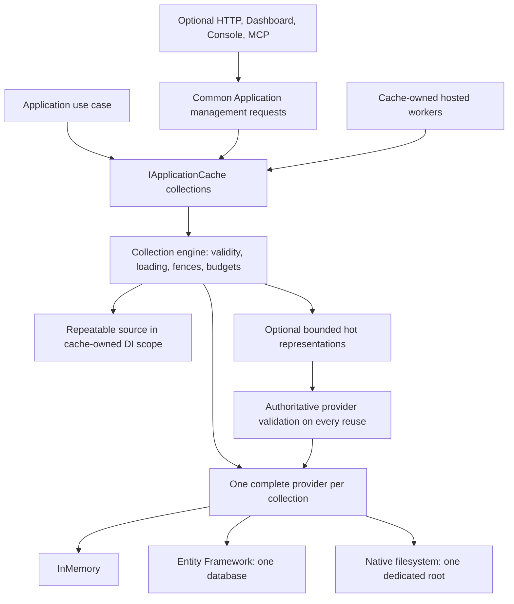

| Package | Responsibility |
| --- | --- |
| `Common.Serialization` | Cache-independent `IValueCodec<T>`, capabilities, validation, and persisted-format reader registry |
| `Common.Options` | Explicit option patches, configuration overlays, and property provenance |
| `Common.Utilities` | Hierarchical resource budgets, disposable reservations, stream wrappers, and byte-size helpers |
| `Application.Caching` | Public collections, immutable startup catalog, engine, in-memory provider, policies, behaviors, workers, and management requests |
| `Infrastructure.EntityFramework` | Complete SQL Server, PostgreSQL, and local SQLite cache provider; annotated persistence capability |
| `Infrastructure.FileSystem` | Complete native filesystem cache provider and explicit offline recovery |
| `Presentation.Web.Caching` | Independent HTTP, RazorSlice Dashboard, Console, and MCP registrations |

The cache catalog, collection handles, native provider registry, resource hierarchy, and local coordination state live for the host lifetime. A source execution creates its own DI scope. Resolve scoped source dependencies through `CacheLoadContext.Services`; do not capture an HTTP request's scoped services, principal, or cancellation token in a loader.

Optional behaviors surround collection operations, owned source executions, or payload transformations. Their configured order is outermost first. `WithLogging()`, `WithMetrics()`, `WithProfiling()`, and `WithAuditing()` select the corresponding trusted aliases. Intrinsic bounded diagnostics do not depend on selecting these wrappers. Required validity, fencing, admission, ownership, and stream-integrity checks remain in the engine.

## Use Cases

Use a typed collection for immutable report summaries, reference catalogs, or reusable computations. Use a binary collection for a generated report file when callers need independent streams and the complete payload should not live in process RAM.

Use shared-store coordination when several web nodes share a provider and one source load is expensive enough to justify cross-node ownership. A central database alone does not select that policy. Keep node-local loading when one execution per node is acceptable and cross-node coordination would add unnecessary source latency.

Use dimensions to invalidate declared dependencies after an authoritative source transaction commits. Use ordinary application authorization and boundary rate limits to control random-key demand. Per-key coalescing and negative caching do not eliminate distinct-key source work.

Use persistent application storage for authoritative documents or files. Use the Key/Value Storage feature for its independent state-management contract. This cache does not perform source write-through, source write-behind, business mutations, automatic dependency discovery, or stale-serving fallback.

## Basic Usage

This complete in-memory example caches an immutable reporting summary from a repeatable source. The first call loads and stores it; a later call reads the retained value.

```csharp
using BridgingIT.DevKit.Application.Caching;
using BridgingIT.DevKit.Common;
using Microsoft.Extensions.DependencyInjection;
using Microsoft.Extensions.Hosting;

var builder = Host.CreateApplicationBuilder(args);
builder.Services.AddScoped<ReportSource>();

// Declare a collection; JSON and the in-memory provider are the defaults.
builder.Services.AddApplicationCaching(cache => cache
	.WithCollection<ReportSummary>("summaries", collection => collection
		.Dimensions(d => d.Scalar<string>("region"))
		.ExpireAfter(TimeSpan.FromMinutes(5))));

using var host = builder.Build();
await host.StartAsync();

// Resolve a typed handle to the declared collection.
var summaries = host.Services.GetRequiredService<IApplicationCache>()
	.GetCollection<ReportSummary>("summaries");

// Dimensions identify dependencies for selective invalidation.
var item = new CacheItem("quarter:2026-q1:region:west")
	.WithScalarDimension("region", "west");

// A miss starts or joins one source load within the configured sharing scope.
var result = await summaries.GetOrLoadAsync(item, static async (context, token) =>
{
	var source = context.Services.GetRequiredService<ReportSource>();
	return new CacheLoadResult<ReportSummary>(await source.GetAsync(token));
});

if (result.IsFailure)
{
	throw new InvalidOperationException(string.Join("; ", result.Errors.Select(error => error.Message)));
}

if (result.Value.Found)
{
	Console.WriteLine($"{result.Value.Value.Title}: {result.Value.Value.Rows} rows");
}

// Source success and confirmed cache storage are separate result facts.
Console.WriteLine($"Access: {result.Value.LookupOutcome}; storage: {result.Value.StorageOutcome}");
await host.StopAsync();

public sealed record ReportSummary(string Title, int Rows);

public sealed class ReportSource
{
	public Task<ReportSummary> GetAsync(CancellationToken cancellationToken)
	{
		cancellationToken.ThrowIfCancellationRequested();
		return Task.FromResult(new ReportSummary("Western region", 120));
	}
}
```

`WithCollection<T>` supplies a JSON contract with the collection's name when no compatible contract is already registered. A single compatible explicit contract is reused; select `UseContract` when several contracts match. Custom codecs and immutable decoded retention use an explicit `WithValueContract<T>` declaration. Configuration-only collections select a code-registered contract alias. The default provider is in memory, and all resource limits are finite. Compression and hot retention are off.

The async loader returns `CacheLoadResult<T>` directly through its implicit conversion to `Result<CacheLoadResult<T>>`. Resolve source dependencies from `context.Services` and pass the supplied owned token. Source reads and computations must be repeatable. Retry, refresh, lease recovery, restart, or a later uncached attempt can execute them again.

### Use a standalone service provider

A standalone service provider can resolve and use collections without starting hosted workers. Use a Generic Host when automatic refresh, warm-up, and maintenance are required.

This alternative uses `ReportSource` and `ReportSummary` from the preceding example:

```csharp
using BridgingIT.DevKit.Application.Caching;
using BridgingIT.DevKit.Common;
using Microsoft.Extensions.DependencyInjection;

var services = new ServiceCollection();
services.AddScoped<ReportSource>();

// Declare the collection; JSON and in-memory storage are the defaults.
services.AddApplicationCaching(cache => cache
	.Namespace("reporting")
	.WithCollection<ReportSummary>("summaries", collection => collection
		.ExpireAfter(TimeSpan.FromMinutes(5))
		.Dimensions(d => d.Scalar<string>("region"))));

await using var provider = services.BuildServiceProvider();
// Resolve the typed collection before reading or loading values.
var summaries = provider.GetRequiredService<IApplicationCache>()
	.GetCollection<ReportSummary>("summaries");
var item = new CacheItem("quarter:2026-q1:west").WithScalarDimension("region", "west");
// The configured sharing scope coalesces source work for this key.
var result = await summaries.GetOrLoadAsync(item, static async (context, token) =>
{
	var source = context.Services.GetRequiredService<ReportSource>();
	return new CacheLoadResult<ReportSummary>(await source.GetAsync(token));
});

if (result.IsSuccess && result.Value.Found)
{
	Console.WriteLine(result.Value.Value.Title);
	Console.WriteLine(result.Value.StorageOutcome);
}
```

## Patterns and collection policies

These policies are collection-specific unless the scope column says otherwise. A supported policy is not necessarily enabled.

| Pattern or concern | Implemented contract | Scope and default |
| --- | --- | --- |
| Cache-aside | `GetAsync`, source access, and `SetAsync` remain explicit | Per operation; manual source access does not acquire an earlier publication fence |
| Read-through | `GetOrLoadAsync` captures ownership and a fence before source access | Per collection; shared loading, node-local scope |
| Invalidate-on-write and write-around | Commit the authoritative source first, then invalidate affected keys or dimensions | Application-owned; no atomic source/cache transaction |
| Same-key stampede | One admitted owned load and bounded followers | Per selected coordination scope |
| Many-key avalanche | Source admission, optional jitter, and bounded warm-up | Collection plus process limits; process limits multiply across hosts |
| Repeated confirmed absence | `CacheLoadResult<T>.NotFound()` and negative retention | Off; enabled marker TTL defaults to 30 seconds |
| Absolute TTL | Expired entries miss before cleanup | 15 minutes from confirmed publication |
| Sliding expiry | Valid access renews idle expiry within a fixed absolute cap | Off; 5-minute idle and 1-hour cap when selected |
| Explicit refresh | Source work runs while an independently valid old version remains readable | Explicit `RefreshAsync` |
| Refresh-ahead | Active positive entries near absolute expiry use a registered loader | Off; best effort, bounded background sublimits |
| Warm-up | Declared seed keys or an approved asynchronous key source use normal loading | Off; startup-only unless an interval is configured |
| Expiry jitter | One downward-only sample is persisted at publication | Off; ratio zero |
| Repeated payload or decode work | Binary, immutable decoded, or combined hot representations | Off; every reuse validates provider authority |
| One-time scans | Second-access hot admission; separate provider eviction policy | Two successful accesses within one minute by default |
| Obsolete load publication | Ownership, invalidation fences, and conditional publication | Mandatory for engine-managed loading |
| Source outage | Optional named source policy with a shared attempt/deadline budget | Off; one attempt by default |
| Provider outage | Explicit failures, bounded typed node-local degradation, optional infrastructure breaker | Breaker off; no authority downgrade in shared-store scope |
| Stale-while-revalidate or stale-if-error | Excluded: new callers never receive expired or invalidated entries | No option enables stale reads |
| Source write-through or write-behind | Excluded: cache writes never mutate the source | Use the owning application transaction |

TTL, retention grace, eviction, and hot retention solve different problems. TTL ends logical reuse. Retention grace delays physical cleanup. Eviction reclaims disposable storage under pressure. A hot-entry idle limit releases a local representation while leaving its provider entry intact.

`ExpireAfter(ttl)` sets a fixed absolute TTL and disables sliding expiry. With sliding enabled, `AbsoluteCap` supplies the maximum publication age instead of the fixed `AbsoluteTtl`; the idle timeout can renew only within that cap. An entry descriptor can shorten those policy bounds, not extend them. Negative markers never renew sliding idle time.

## Identity, results, and safe writes

An entry identity contains namespace, collection, logical contract version, and exact key. Names and keys use bounded invariant-uppercase canonicalization across providers. Keys are opaque; wildcard characters are literal outside explicit pattern selections. The hard key ceiling is 4,096 UTF-8 bytes and a collection may lower it.

Include every source input that changes the answer in the key, including tenant, permission scope, locale, and query parameters. Dimensions select invalidation targets; they do not distinguish values sharing one key. A namespace is an isolation identifier, not a substitute for application authorization.

### Distinguish value, absence, miss, and failure

| Observation | Meaning |
| --- | --- |
| `result.IsFailure` | Validation, admission, source, provider, or protocol failure; inspect errors |
| `lookup.Found` | A positive value is available, including permitted null, empty string, empty collection, or empty stream |
| `lookup.IsNotFound` | The source explicitly confirmed absence; a negative marker may have been retained |
| Neither flag | A successful cache miss from a direct read |
| `lookup.StorageOutcome` | `None`, `Stored`, `Suppressed`, `Rejected`, `Failed`, `Indeterminate`, or `Conflict`, independently of typed source success |
| `lookup.Version` | The acquired or confirmed published opaque snapshot token; absent without a confirmed stored snapshot |

Return `CacheLoadResult<ReportSummary>.NotFound()` for confirmed absence. Return a failed `Result` for an unavailable source. A failure never creates a negative marker. After source creation, invalidate any relevant negative marker so the next lookup can find the new value.

Explicit `RefreshAsync` also checks the source when a valid negative marker exists. It conditionally replaces that marker using the acquired version, so a concurrent publication is protected. Background refresh selects only positive entries.

### Treat returned typed values as read-only

All returned typed instances are read-only by contract and may be shared with other callers. The engine does not clone them, and reference identity is not guaranteed. Copy before editing. For a record with nested mutable collections, a `with` expression alone is only a shallow copy; copy those collections too.

`WithImmutableSharing` is a trusted promise that the whole returned graph supports shared read-only retention. Its conservative estimator must account for the complete retained graph. `WithDecodedSize` supplies accounting without approving decoded hot sharing.

### Use a snapshot token for conditional replacement

```csharp
var current = await summaries.GetAsync(item.Key, cancellationToken);
if (current.IsSuccess && current.Value.Found && current.Value.Version is { } version)
{
	var edited = current.Value.Value with { Rows = 125 };
	var written = await summaries.SetAsync(item, edited, version,
		cancellationToken: cancellationToken);
	if (written.IsFailure)
	{
		// Surface the conflict or failure. Do not retry unconditionally.
	}
}
```

Typed conditional removal accepts the same acquired token: `RemoveAsync(key, version, cancellationToken)`. Binary removal accepts `new CacheWriteCondition(ExpectedVersion: version)`. Create-only publication uses `new CacheWriteCondition(CreateOnly: true)`: valid positive null and empty values block creation; a confirmed negative marker does not.

A manual get/source/set sequence cannot prove that invalidation did not happen during the source read. Its `SetAsync` fence starts when publication begins. Use `GetOrLoadAsync` for the managed pre-source fence, or manage an acquired version and explicit concurrency semantics yourself.

## Source loading across nodes

A shared provider and shared source coordination are separate choices. With the default `NodeLocal`, two web nodes can each execute one expensive load for the same key. Select `ShareLoadsAcrossNodes()` to acquire confirmed store ownership across nodes. InMemory rejects shared-store scope; EF and native filesystem expose it according to their selected capabilities.

Only the owner invokes its captured loader. Followers cannot replace the owner's dimensions, TTL, loader, or source-result metadata. Known dependencies belong in `CacheItem` before source work. Owner-discovered dimensions can be returned in `CacheEntryDescriptor`; they are checked against the publication fence before storage.

Nested cache source work is rejected while a source delegate runs, across keys and collections. Compute dependencies in the source service or load them before entering the cache loader. This prevents ownership cycles rather than attempting an implicit recursive cache graph.

The following diagrams describe the protocol and its scope. Runtime tests and deployment qualification provide the evidence; a diagram alone does not establish correctness.

### Node-local sharing over a central provider

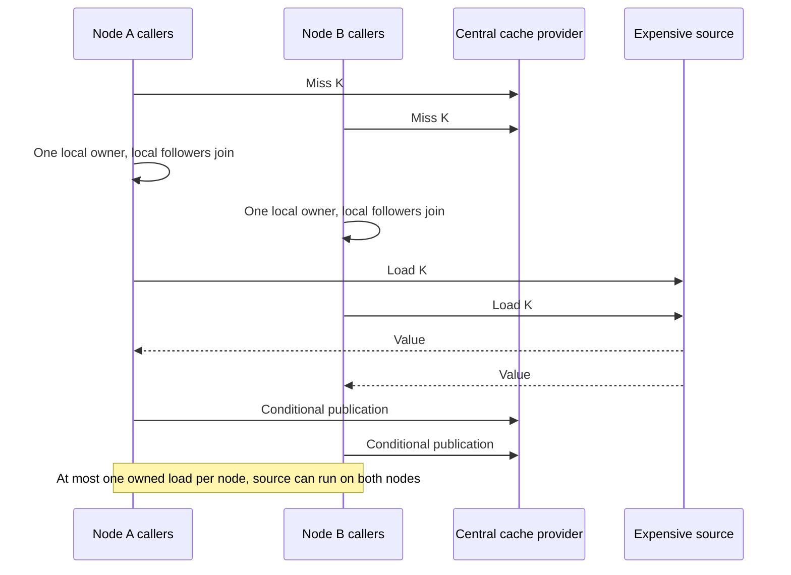

### Shared-store loading across web nodes

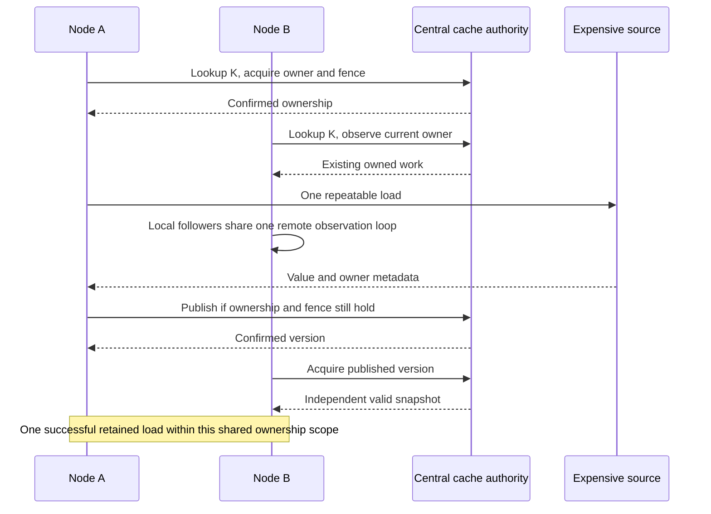

An EF-backed central provider stores owner/fence state in the same database as entries and payloads. Lease renewal and final conditional publication prevent an expired or superseded owner from publishing. A timeout does not prove that a native operation stopped, and an uncertain owner does not authorize a replacement source execution.

### Explicit independent loading

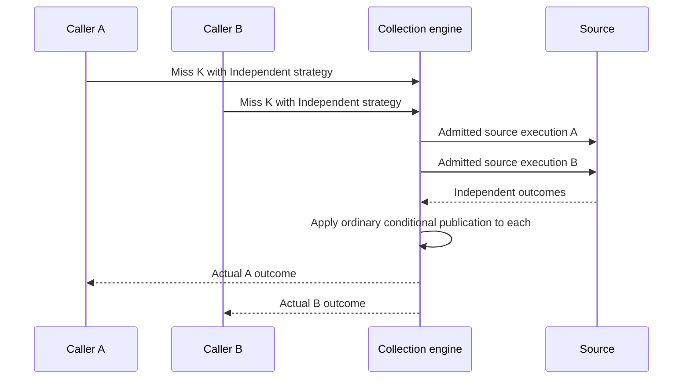

Independent loading avoids joining; it does not bypass source admission, deadlines, or publication conditions. Use it deliberately when duplicate source reads are acceptable.

### Successful typed load without retention

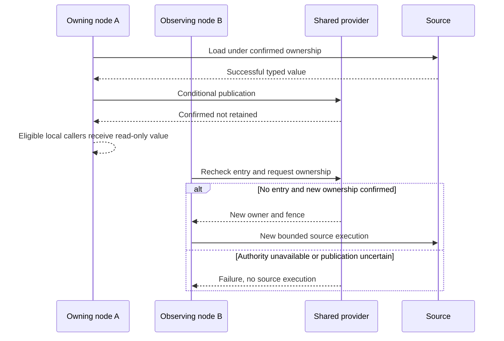

There is no cross-node transport for an unretained typed object, including an unretained not-found result. The observing node rechecks storage and requests a new confirmed ownership grant within the same local flight. Its followers, original source deadline, and caller wait budgets continue through that handoff. A stored result can satisfy the recheck without another source call. Repeated unretained completions stop after 32 handoffs with `CoordinationTimeout`.

An indeterminate publication must reconcile before reassignment. Payload-producing binary work requires confirmed publication and cannot return an uncached stream.

### Caller departure and last-interest cancellation

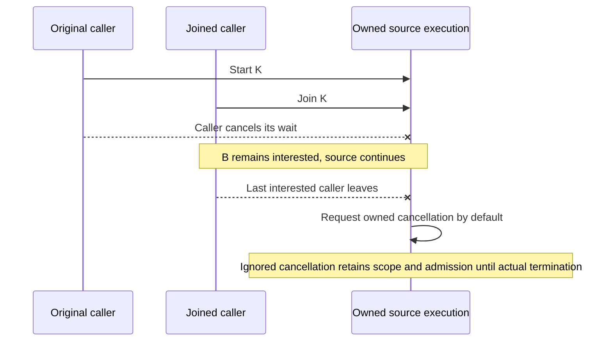

`WaitTimeout` and the caller token bound one caller's wait. `SourceTimeout` bounds the owned execution, including queueing, attempts, backoff, and publication. `ContinueWithoutWaiters` is an explicit opt-in to continue within that original deadline after the last caller leaves. It does not grant a new deadline or release occupied resources early.

### Shared failure and optional source resilience

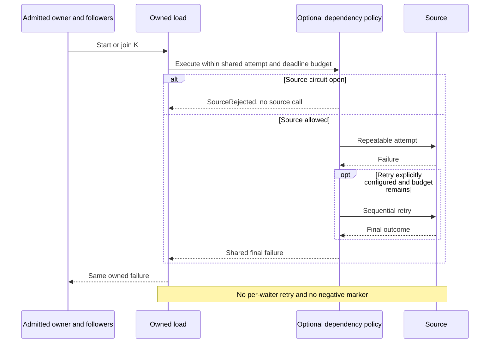

### Overlapping batches

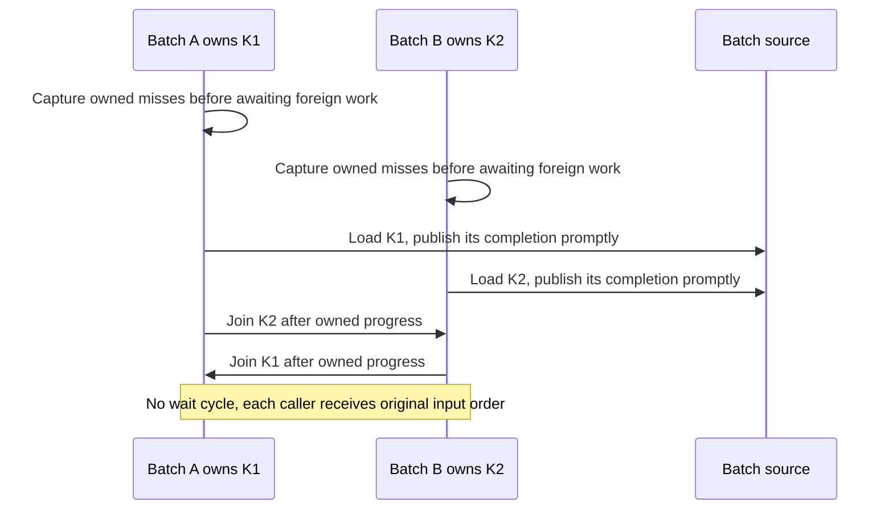

`GetOrLoadManyAsync` returns an outer result plus ordered per-item results. A batch source sees only misses it owns, not hits or another flight's keys. Yield each completion promptly. Unknown, duplicate, or omitted completions produce explicit contract or incomplete outcomes; they do not silently become confirmed absence.

### Shared-load success and publication fencing

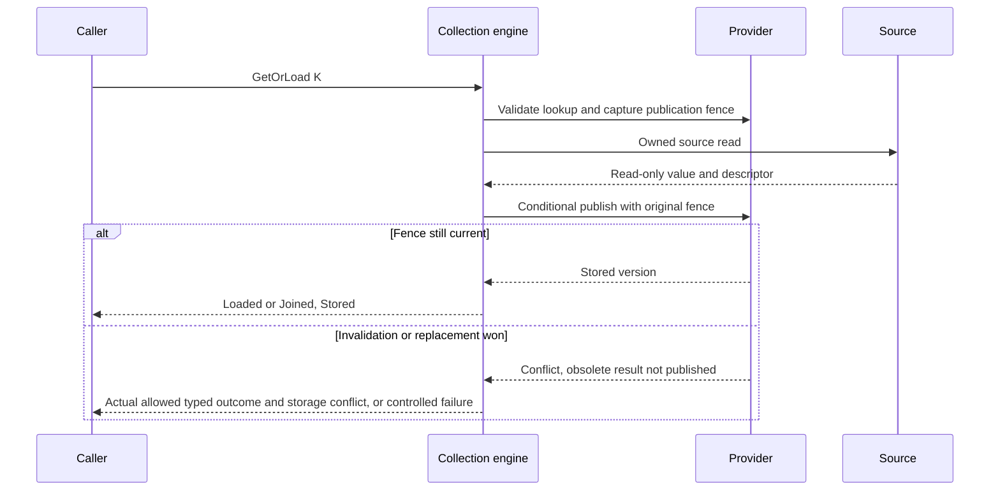

An invalidation acknowledgement prevents earlier source work from publishing into its scope. It cannot revoke a typed value already returned or an independently opened immutable stream. It also cannot make a lagging source replica current.

An already interested local typed caller can still receive its successfully computed read-only source value with `StorageOutcome.Conflict` after invalidation blocked publication. That is an outcome for the existing operation, not permission for a new caller to read invalidated stored data. Remote callers cannot receive that unretained object through the cache.

## Dimensions and bounded invalidation

Declare schemas before publishing dependencies. Supported scalar kinds are String, Boolean, signed Integer normalized to Int64, Identifier (`Guid`), and Timestamp (`DateTimeOffset`, compared in UTC). Floating point, decimal, arbitrary object, enum, and culture-dependent comparisons are excluded. Forms are scalar, same-kind set, and half-open Integer or Timestamp interval. Missing dimensions, explicit typed null, and an empty present set are distinct. Scalar/set nulls require the declared null policy; intervals have nonnull ordered endpoints and cannot be empty.

```csharp
cache.WithCollection<ReportSummary>("summaries", collection => collection
	.Dimensions(d => d
		.Scalar<string>("region")
		.Set<string>("categories")
		.Interval<DateTimeOffset>("coverage")));

var item = new CacheItem("report:west:2026-q1")
	.WithScalarDimension("region", "west")
	.WithSetDimension("categories", "sales", "returns")
	.WithIntervalDimension("coverage",
		new DateTimeOffset(2026, 1, 1, 0, 0, 0, TimeSpan.Zero),
		new DateTimeOffset(2026, 4, 1, 0, 0, 0, TimeSpan.Zero));

var selection = CacheSelection.And(
	CacheSelection.Dimension("region").EqualTo("west"),
	CacheSelection.Dimension("categories").Contains("sales"));
var preview = await summaries.PreviewInvalidationAsync(selection, cancellationToken);
var invalidated = await summaries.InvalidateAsync(selection, cancellationToken);
```

Use this schema declaration in place of the Basic Usage collection declaration; do not register the same collection twice in one builder. Select an interval with `CacheSelection.Dimension("coverage").Overlaps(lower, upper)`. Adjacent `[a,b)` and `[b,c)` intervals do not overlap.

`Dimensions` configures one collection's schema. Its `Scalar<T>`, `Set<T>`, and `Interval<T>` methods append declarations in order. Calls can be repeated and mixed with individual schema helpers. Duplicate normalized names fail immediately, ignoring case.

`Scalar<T>` and `Set<T>` default `allowNull` to `false`. Pass `allowNull: true` to allow typed nulls. A nullable `T` selects the same scalar kind without changing that policy. Intervals always require non-null endpoints.

Use `Key`, `Prefix`, and `Pattern` deliberately. Patterns match the whole key using `*`, `?`, and backslash escapes for those characters and backslash. A prefix is literal. Selections also support explicit conjunction/disjunction, publication ranges, and stored-size ranges. An empty selection matches nothing; `ClearAsync` is the explicit whole-collection operation across retained contract versions.

Providers walk indexes with finite page, candidate, depth, clause, and work limits. A result can be incomplete and carry a continuation. Preview counts state whether they are exact. A large invalidation is not one fleet-wide transaction: use per-collection outcomes and tracked operation status rather than interpreting an accepted submission as completed removal.

## Configuration and finite defaults

The conventional configuration section is `Caching:Application`. `AddApplicationCaching()` and `AddApplicationCaching(cache => ...)` use the host's registered `IConfiguration`; Generic Host supplies it. Pass a root configuration, with or without a setup callback, when composing outside that host. Each call contributes its selected configuration source to the shared startup catalog, read when the catalog is finalized. The feature does not open environment-specific JSON itself or hot-reload active collection policy.

| Registration | Configuration source |
| --- | --- |
| `AddApplicationCaching()` or `AddApplicationCaching(cache => ...)` | The host's `Caching:Application` section |
| `AddApplicationCaching(configuration)` or `AddApplicationCaching(configuration, cache => ...)` | `Caching:Application` under the supplied root configuration |
| `AddApplicationCaching("Modules.Catalog.Caching", cache => ...)` | The named host section; dot and colon separators are supported |
| `AddApplicationCaching(configuration.GetSection("Custom:Cache"))` | The supplied section verbatim, without appending the convention path |

An explicitly supplied `IConfigurationSection` is used verbatim even when a setup callback is supplied. Named section paths accept `Modules.Catalog.Caching` and `Modules:Catalog:Caching` equivalently.

Collection precedence, lowest to highest, is built-in provider-aware defaults, global fluent defaults, named fluent collection settings, configured `Defaults`, and configured named collection settings. Provider and integration configuration similarly overlays explicit code defaults. An omitted property inherits; an explicit `false`, zero where valid, or empty list remains explicit. Configured ordered behavior lists replace the whole stage list. Fluent global and collection behavior selections compose in order.

Configuration can declare a collection selecting a code-registered contract alias. It cannot activate CLR types, codec factories, source loaders, provider kinds, custom behaviors, or a missing presentation capability. Unknown names and unsupported capability combinations fail catalog validation.

```csharp
using BridgingIT.DevKit.Common;

var cache = services.AddApplicationCaching(configuration, caching => caching
	.WithValueContract<ReportSummary>("report-summary", contract => contract
		.WithImmutableSharing(value => value is null ? 0L : 256L + (value.Title?.Length ?? 0) * 2L))
	.WithInMemoryProvider("memory", provider => provider.Capacity(ByteSize.Megabytes(128)).MaxEntries(100000))
	.Defaults(collection => collection.ExpireAfter(TimeSpan.FromMinutes(10)))
	.WithCollection<ReportSummary>("summaries", collection => collection
		.UseContract("report-summary")
		.Dimensions(d => d.Scalar<string>("region"))));
```

```json
{
	"Caching": {
		"Application": {
			"Namespace": "reporting",
			"Limits": { "MaxResidentBytes": 268435456, "MaxTransientBytes": 67108864 },
			"Defaults": { "Expiration": { "AbsoluteTtl": "00:10:00" } },
			"Collections": {
				"summaries": {
					"Provider": "memory",
					"Expiration": { "AbsoluteTtl": "00:05:00", "JitterRatio": 0.1 },
					"Loading": { "CoordinationScope": "NodeLocal", "MaxAttempts": 1 },
					"NegativeCaching": { "Enabled": true, "Ttl": "00:00:30" },
					"HotEntries": { "Enabled": true, "Representation": "Decoded", "MaxEntries": 1000 },
					"Limits": { "MaxEntries": 10000 }
				}
			},
			"Diagnostics": { "HistoryEnabled": true }
		}
	}
}
```

The memory provider is implicit only when no named provider declarations exist. If you declare other providers and still need memory collections, declare a named InMemory provider too.

### Module-owned registrations

Modules can call `AddApplicationCaching(sectionName, configure)` independently on the same `IServiceCollection`. Those calls reuse one startup builder, catalog, runtime, and set of background workers. Finish all contributions before resolving cache services. The first catalog resolution validates and freezes the complete registration for the host lifetime.

Contract, provider, and collection aliases are globally unique within their respective categories. Use module-qualified names such as `catalog.card`, `catalog.db`, and `catalog.cards`. Duplicate code definitions fail registration. Keep global options such as `Namespace`, `Diagnostics`, and `Defaults` in host composition because they affect every module. Put a module's collection policy in `WithCollection` or its configuration's `Collections` section.

The following host combines two modules with separate EF contexts. Each module enables an independent factory on its SQL Server context registration with `WithDbContextFactory()`. Both contexts implement the [cache context capability](#entity-framework-and-host-owned-migrations), and the host deploys their migrations before readiness:

```csharp
using BridgingIT.DevKit.Application.Caching;
using BridgingIT.DevKit.Infrastructure.EntityFramework.Caching;
using Microsoft.Extensions.DependencyInjection;

// The host owns shared options and defaults.
services.AddApplicationCaching(caching => caching
	.Namespace("operations")
	.Diagnostics(diagnostics => diagnostics.HistoryRetention(TimeSpan.FromHours(1)))
	.Defaults(collection => collection.ExpireAfter(TimeSpan.FromMinutes(15))));

// The Catalog module owns its contract, provider, and collection.
services.AddSqlServerDbContext<CatalogDbContext>(options => options.UseConnectionString(catalogConnectionString))
	.WithDbContextFactory();
services.AddApplicationCaching("Modules.Catalog.Caching", caching => caching
	.WithEntityFrameworkProvider<CatalogDbContext>("catalog.db")
	.WithCollection<CatalogCard>("catalog.cards", collection => collection
		.UseProvider("catalog.db")
		.ExpireAfter(TimeSpan.FromMinutes(30))
		.ShareLoadsAcrossNodes()));

// The Billing module contributes to the same catalog with its own context factory.
services.AddSqlServerDbContext<BillingDbContext>(options => options.UseConnectionString(billingConnectionString))
	.WithDbContextFactory();
services.AddApplicationCaching("Modules.Billing.Caching", caching => caching
	.WithEntityFrameworkProvider<BillingDbContext>("billing.db")
	.WithCollection<InvoiceTotals>("billing.totals", collection => collection
		.UseProvider("billing.db")
		.ExpireAfter(TimeSpan.FromMinutes(2))
		.ShareLoadsAcrossNodes()));

public sealed record CatalogCard(string Sku, string Title);
public sealed record InvoiceTotals(string InvoiceNumber, decimal Total);
```

Configuration sources apply in registration order: later scalar values override earlier values, and later ordered lists replace earlier lists. Configured collection-specific settings retain precedence over configured global `Defaults`, regardless of which source supplied each. Namespace, process limits, diagnostics, and global defaults are host-wide settings even when supplied through a module section.

### Process and collection budgets

Use `ByteSize` from `BridgingIT.DevKit.Common` for configuration sizes, such as `ByteSize.Megabytes(8)`. `Kilobytes`, `Megabytes`, and `Gigabytes` use binary units based on 1,024. They return nonnegative `long` byte counts and throw for negative inputs or overflow. Use `ByteSize.Bytes` for raw byte counts and a checked cast when an API requires `int`.

| Limit | Process default | Collection default |
| --- | --- | --- |
| Cache-owned resident charge | 256 MiB | 128 MiB |
| Transient reservations | 64 MiB | Charged through the shared process and collection hierarchy |
| Active / queued source work | 32 / 256 | 8 / 64 |
| Active / queued provider operations | 64 / 256 | 16 / 64 |
| Concurrent metadata queries | 4 | 2 |
| Occupied transfers | 8 | 4 |
| Decode or promotion concurrency | 4 | Shared process ceiling |
| Background refresh source sublimit | 4 | 2 |
| Stored bytes / entries, InMemory collection | Applicable process/provider ceiling | 128 MiB / 100,000 |
| Stored bytes / entries, persistent collection | Named provider ceiling | 10 GiB / 1,000,000 |
| Encoded / logical value, InMemory | Applicable admission | 4 MiB / 4 MiB |
| Encoded / logical value, persistent | Applicable admission | 256 MiB / 256 MiB |
| Approved decoded graph | Applicable admission | 16 MiB |
| Followers per local key | Applicable source limits | 128 |
| Batch target / maximum | Applicable admission | 128 / 1,024 |
| Metadata page / hard page | Applicable query limits | 100 / 1,000 records and 4 MiB |
| Selection clauses / nesting / membership | Applicable query limits | 32 / 8 / 256 |
| Query candidate / work budget | Applicable query limits | 100,000 / 2 seconds |
| Entry dependencies / serialized metadata | Applicable admission | 16 / 64 KiB |
| Transfer buffer / idle / lifetime | Applicable transfer admission | 64 KiB / 30 seconds / 5 minutes |

The smallest applicable ceiling wins. Resident accounting covers cache-owned state, buffers, metadata, and conservative declared graph or native-workspace reservations. It is not a hard managed-heap or operating-system working-set cap. Application-retained results, database server memory, runtime overhead, and unrelated process work remain separate.

Omitted collection resident, storage, and entry ceilings adapt to smaller provider and process budgets. Omitted payload ceilings fit the resulting storage capacity, and inactive hot-entry defaults fit the resident budget. These adjustments apply only to inherited defaults. Explicit incompatible limits fail startup validation rather than being silently reduced. Effective Settings shows the resolved finite limits.

The default chart window and sampling interval fit the configured diagnostic history retention. Explicit timing settings take precedence and must remain within the supported limits.

Known item dimensions are validated against the total metadata limit before lookup or source execution. EF reads also bound persisted text and binary fields before materialization. Oversized stored fields produce a controlled corruption failure before their values can drive identities, cursors, or resource accounting.

In-memory providers default to 128 MiB resident and stored capacity and 100,000 entries. EF and filesystem providers default to 128 MiB resident capacity, 10 GiB stored capacity, and 10,000,000 entries. All start with a 16 MiB metadata cache sublimit and a 5% metadata/reclamation reserve; an omitted metadata sublimit scales down with a smaller resident capacity. A smaller collection or process budget limits effective capacity. Staged, current, retired, and pinned payload ownership can consume storage until safe cleanup.

### Other defaults

| Group | Defaults |
| --- | --- |
| Loading | Shared, NodeLocal; 30-second source and wait budgets; one attempt; 100-ms base retry delay; no continuation after last waiter |
| Remote observation | One local observer per remote flight; delay between 50 ms and 1 second |
| Expiration | 15-minute absolute TTL; sliding off; 5-minute retention grace; zero jitter |
| Compression | Off; explicit algorithm and level required; 4-KiB threshold; 10% minimum stored saving |
| Hot entries | Off; Binary; strict validation; 64 MiB, 10,000 entries, 256 KiB combined per entry, 2-minute idle |
| Hot admission | Two accesses in one minute; at most 20,000 evidence entries; process hot sublimit 128 MiB within resident accounting |
| Refresh | Off; 15-second sweep interval; at most 1-minute lead and 20% of actual lifetime; 10-minute foreground activity window |
| Refresh failures | 5-second initial and 1-minute maximum backoff; three failures pause the version for 5 minutes |
| Workers | 15-second startup delay; 30-second readiness wait; 10-second stop wait; maintenance every minute, 256 entries per batch, four batches per collection |
| New background work | 5-second sweep admission budget; already admitted work retains its own deadline and accounting |
| Provider attempts | 5-second attempt budget; 30-second ownership lease with 10-second renewal |
| Provider breaker | Off; five consecutive infrastructure failures; 10-second cooldown and one readiness probe |
| Diagnostics | Intrinsic counters on; history off; 5-second sampling; 15-minute retention and chart window; 180 points; 256 series; two concurrent queries |
| Latency observations | 256 retained actual duration samples per collection and latency kind, within a 15-minute sample window |
| Tracked operations | At most 1,000 retained records; terminal retention 24 hours; active records are not silently evicted |

Use typed policy callbacks such as `collection.Limits(limits => limits.MaxEntries(10000).MaxPayloadBytes(ByteSize.Megabytes(1)))` for routine limits. `Dimensions`, `Loading`, `Expiration`, `Streaming`, `Warmup`, `Refresh`, and `Behaviors` group their related policies. The option-record builders retain a low-level `With` override for advanced settings; final catalog validation still applies. Effective policy and provenance are available through the immutable catalog and authorized management APIs.

## Behaviors and extension lifetimes

| Stage | Contract | Execution boundary |
| --- | --- | --- |
| `CollectionOperations` | `ICacheCollectionBehavior`; forwarding bases `CacheCollectionBehaviorBase<T>` and `CacheBinaryCollectionBehaviorBase` | Each public caller operation, including individual callers that join shared work |
| `SourceExecution` | `ICacheLoadBehavior` | One owned source work unit after admission, authority capture, and cache-owned scope creation; source attempts are measured separately |
| `PayloadTransformation` | `ICachePayloadBehavior` | After the single original encode/input pass and before engine-owned publication |

Register an alias in code with `WithBehavior<TBehavior>(alias, stage)`, then select it in the collection's ordered stage list. Instances are resolved when the collection's chains are built and reused concurrently. Keep them thread safe and free of request-scoped captured state. Source services belong to the owned load context, not a behavior constructor captured from a departing request.

This optional observer logs bounded aliases and preserves the actual continuation result:

```csharp
using BridgingIT.DevKit.Application.Caching;
using BridgingIT.DevKit.Common;
using Microsoft.Extensions.Logging;

cache.WithBehavior<ReportObservationBehavior>("report-observer", CacheBehaviorStage.CollectionOperations)
	.WithCollection<ReportSummary>("observed-summaries", collection => collection
		.UseContract("report-summary")
		.Behaviors(behaviors => behaviors.CollectionOperations("report-observer")));

/// <summary>Observes reporting cache calls without capturing keys or request state.</summary>
/// <param name="logger">The host logger; only bounded collection and operation labels are recorded.</param>
public sealed class ReportObservationBehavior(ILogger<ReportObservationBehavior> logger)
	: CacheCollectionBehaviorBase<ReportSummary>
{
	/// <inheritdoc />
	public override async ValueTask<Result<TResult>> ExecuteAsync<TResult>(CacheOperationContext context,
		CacheOperationContinuation<TResult> next, CancellationToken cancellationToken = default)
	{
		var result = await next(context, cancellationToken);
		logger.LogInformation("[{LogKey}] cache operation (Collection={Collection}, Operation={Operation}, Success={Success})",
			"Reporting", context.Collection, context.Operation, result.IsSuccess);
		return result;
	}
}
```

Apply registration before catalog finalization; the normal Generic Host supplies logging. Stage compatibility is validated for the selected typed or binary contract. Invoke `next` at most once with its original context/token. A behavior can reject before work, but cannot fabricate a hit, replay a mutation, extend an owned deadline, hide an engine failure, or turn an observer exception after publication into a false no-effect result.

Observer selection does not configure an external telemetry exporter or replace the host's Common profiling/auditing setup. Compose those services through their existing feature registrations. Intrinsic bounded cache diagnostics remain available independently of these optional observer lists.

Payload behaviors can call `CompressAsync` or `ApplyTransformAsync` for an approved transform. Enabling compression includes its required payload stage even when an optional configured list omits it; turn compression off through its Enabled flag. Custom `ICachePayloadTransform` instances declare stable persisted format/version and finite state, remain thread safe, and return per-transfer streams. At most eight persisted transform descriptors apply sequentially, with at most 256 parameter bytes each. Decoding reverses encode order. Unknown reader formats fail compatibility; no type activation or second provider is introduced. The engine owns final publication and can retain an intact original when an eligible compression candidate is declined.

## Codecs, compression, and hot entries

A value contract can be an array, a list, or a time-series model containing many points. The JSON codec encodes the complete value as one cache entry. A custom `IValueCodec<T>` can encode a time series with deltas and reconstruct it during decoding; register that profile with `WithCodec` and select it with `UseCodec`. Supply a conservative decoded-size estimate for the complete returned graph. Cache-managed compression can run after the custom codec.

`SystemTextJsonValueCodec<T>` is the default typed representation and uses `DefaultJsonSerializerOptions` from Common Serialization. Select `UseJson()` explicitly when needed. To supply JSON settings directly, configure the value contract:

```csharp
cache.WithValueContract<ReportSummary>("report-summary", contract => contract
	.WithJsonOptions(System.Text.Json.JsonSerializerOptions.Web));
```

`WithJsonOptions` snapshots the supplied options during registration. Later changes to the options or its converter list do not change the cache codec. Converter and resolver objects remain shared references and must support concurrent use. This method replaces the default JSON profile and any associated validator for this contract. It leaves host JSON settings and other contracts unchanged. Use conventions compatible with retained JSON entries, or change the collection's logical contract version.

Register another approved `IValueCodec<T>` with `WithCodec`, or use `WithJsonCodec` when you need a codec factory or an exact-format validator. Persisted codec ID and version determine the reader; unknown formats fail compatibility checks without activating a type named in stored data.

Resolved codec instances are reused by their collection. Custom codecs must support concurrent calls, keep per-call state with the transfer, and avoid captured request-scoped dependencies.

Codec capabilities declare forward-only support, seek requirements, and finite scratch requirements. `SerializerValueCodec<T>` adapts an existing serializer when its stream contract is appropriate. `SetEncodedAsync` requires an explicit exact-format `IValueCodecValidator<T>`; it does not deserialize arbitrary public input into the application value automatically. Common codec contracts remain independent of the cache. See [Common Serialization](common-serialization.md).

Keep approved legacy reader profiles registered while their persisted entries remain readable, and select the desired writer profile with `UseCodec`. Profiles for one value contract must not duplicate the same persisted format/version. Use `WithJsonCodec` to replace the default JSON profile explicitly rather than registering a second reader for identical format bytes.

Compression is a per-collection opt-in with an explicit algorithm and BCL level:

```csharp
collection.Compression(CacheCompressionAlgorithm.GZip,
	System.IO.Compression.CompressionLevel.Fastest);
```

The original codec/raw bytes are produced once. The engine may create a compressed candidate in the same provider and retains it only when the minimum saving is met. It does not rerun the source or codec to fall back. A failed candidate cannot replace an unverified original. Brotli workspace reservations can exceed the default transient budget; configure sufficient finite capacity or expect compression to retain the original representation. Compression changes storage cost, not the typed value or its source freshness.

### Opt into hot retention

```csharp
using BridgingIT.DevKit.Common;

collection.WithHotEntries(hot => hot
	.WithRepresentation(CacheHotEntryRepresentation.BinaryAndDecoded)
	.WithMaxResidentBytes(ByteSize.Megabytes(32))
	.WithMaxEntryBytes(ByteSize.Kilobytes(128))
	.WithMaxEntries(1000));
```

Decoded and combined modes require a typed contract approved with `WithImmutableSharing` and a conservative decoded-size estimator. Unknown, oversized, negative, or partially consumed candidates decline retention without failing an otherwise valid ordinary read. Binary retention owns fully validated bytes. InMemory can share its existing immutable buffer ownership without charging a duplicate ordinary resident copy; a hot sublimit remains visible.

`MaxEntryBytes` covers the combined retained binary and decoded representations, metadata, identity strings, and bookkeeping. Metadata and promotion tracking also consume their resident and hot budgets. A payload that fits by itself can therefore be too large for hot retention.

Promotion and decoding coalesce for one version separately from source-load coordination. Pins keep actively used representations alive. Bounded second-access evidence, recency/idle eviction, and pressure hysteresis control retention. Evicting a local representation does not remove the provider entry.

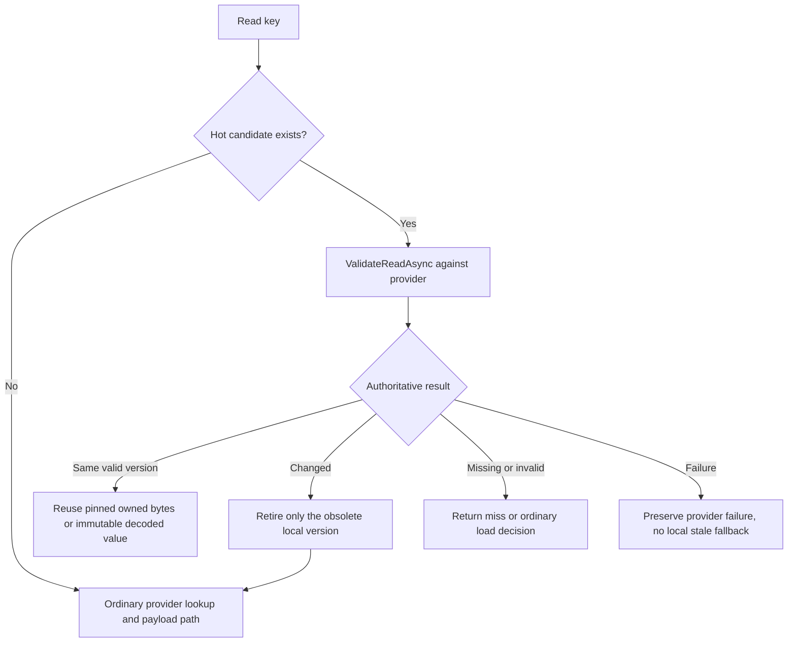

Sliding validation renews only the exact authoritative snapshot within its hard cap. There is no timed trust window or offline hot fallback. A persistent hot hit can avoid payload I/O and decoding while still incurring provider metadata, reader, or sliding-renewal work. With hot retention off, the ordinary read path adds no hot lookup state or validation preflight.

## Binary streams and completion

```csharp
cache.WithBinaryContract("report-file")
	.WithBinaryCollection("report-files");

var files = applicationCache.GetBinaryCollection("report-files");
var loaded = await files.GetOrLoadAsync(new CacheItem("quarter:2026-q1"),
	static async (context, destination, token) =>
	{
		var source = context.Services.GetRequiredService<IReportFileSource>();
		await source.WriteAsync(context.Item.Key, destination, token);
		return Result<CacheBinaryLoadResult>.Success(new(new CacheEntryDescriptor
		{
			ContentType = "application/octet-stream"
		}));
	}, cancellationToken);

if (loaded.IsSuccess && loaded.Value.Found)
{
	await using var handle = loaded.Value.Value;
	await handle.Stream.CopyToAsync(destinationStream, cancellationToken);
	var terminal = await handle.WaitForCompletionAsync(cancellationToken);
	if (terminal.IsFailure || terminal.Value != CacheReadCompletion.Validated)
	{
		// The source did not establish complete-entry integrity.
	}
}
```

`IReportFileSource` and `destinationStream` are application-owned dependencies in this example. Leave the loader's cache-owned destination open. For direct `SetAsync`, the caller owns the input stream; the cache does not dispose it. Every returned read handle belongs to its caller and must be disposed even when consumption fails or stops early. Followers receive independent handles rather than sharing a consumable stream.

Binary loading stores, confirms publication, then opens the selected version. Enabled binary collections do not deliver uncached output after failed, rejected, or indeterminate publication. Explicit binary bypass is unsupported. A disabled binary collection cannot execute a payload-producing loader; a direct open returns a miss. Typed disabled/bypass loading remains bounded and unretained.

`WaitForCompletionAsync` observes existing completion; it never drains, rewinds, or reads the stream. Canceling that observation stops only its wait. Source integrity completion and destination success differ: a verified source can still fail to flush to an HTTP client or output file.

Streams enforce idle and absolute lifetimes. A canceled caller can stop waiting while a native read that ignores cancellation continues into a cache-owned buffer. That buffer, native admission, source scope, and reservations remain occupied until actual termination. A timeout does not release them early.

Uncompressed binary representations support ranges when the provider advertises range positioning. Seeking is explicit and requires a seekable acquired representation. Default typed JSON/raw reads are forward-only; compressed or transformed representations reject unsupported range/seek combinations before delivery. Successful partial completion reports `RangeCompleted` and affected-frame integrity, not a full-entry checksum claim. An already acquired immutable stream remains bounded by its own lifetime after later invalidation.

## Providers and deployment

| Provider/profile | Persistence and coordination | Selection considerations |
| --- | --- | --- |
| InMemory | Process-local; restart empties the store; NodeLocal loading | Lowest native I/O overhead; retained dataset must fit applicable memory budgets |
| EF SQL Server / PostgreSQL | One database owns entries, chunks, indexes, fences, readers, and shared source ownership | Central shared authority; include network round trips and database transaction costs in measurements |
| EF SQLite | One local-host database file; shared loading across local instances | Local-host profile; bounded busy budget and occupied native calls; no multi-host SQLite or filesystem-share database |
| Native filesystem Local | Dedicated provider-owned Windows or Linux root; same-host processes | Direct immutable payloads plus checked metadata/index/journal format; choose and qualify the actual device/filesystem |
| Native filesystem Smb / Nfs | Shared root with qualified native authority and persistence semantics | SMB targets Windows and Linux; NFS targets Linux; deployment qualification remains separate |

These are architectural choices, not a hardware-independent throughput ranking. Compare measured complete operations under the same payload, concurrency, durability, codec, and retention settings.

### Entity Framework and host-owned migrations

Register the context once and enable an independently owned factory. `AddSqlServerDbContext<TContext>(...).WithDbContextFactory()` adds `IDbContextFactory<TContext>` alongside the regular scoped context registration. The cache provider obtains a fresh cache-capable context from that factory for each bounded native call and owns its disposal.

The host references its selected EF engine package and configures `UseSqlServer`, `UseNpgsql`, or `UseSqlite`. Named EF providers infer their engine from the matching DevKit DbContext registration, including registrations contributed later by another module. With standard EF registration, select it explicitly through `provider.SqlServer()`, `provider.PostgreSql()`, or `provider.Sqlite()`. Engine selection configures the cache profile; the DbContext owns its driver and database deployment.

```csharp
using BridgingIT.DevKit.Application.Caching;
using BridgingIT.DevKit.Infrastructure.EntityFramework.Caching;
using Microsoft.Extensions.DependencyInjection;

services.AddSqlServerDbContext<CatalogDbContext>(options => options.UseConnectionString(connectionString))
	.WithDbContextFactory();

var cache = services.AddApplicationCaching(caching => caching
	.WithEntityFrameworkProvider<CatalogDbContext>("central")
	.WithCollection<ReportSummary>("central-summaries", collection => collection
		.UseProvider("central")
		.ShareLoadsAcrossNodes()));
```

The optional SQL factory shares the engine, resolved connection string, migrations, logging, and warning configuration. Factory contexts are caller-owned and use independently configured native options. Request-scoped interceptor registrations apply to the scoped context, not factory contexts. Additional context constructor dependencies must be singleton-compatible. Standard EF hosts can register `AddDbContextFactory<TContext>` directly with the same ownership and lifetime requirements.

Named EF providers infer their engine from the matching DevKit SQL Server, PostgreSQL, or SQLite context registration without constructing a context. For a standard EF factory without that registration metadata, select `provider.SqlServer()`, `provider.PostgreSql()`, or `provider.Sqlite()` explicitly. `Engine(CacheDatabaseEngine.SqlServer)` is the equivalent typed selector.

Repeating `WithDbContextFactory()` on the same registration has no effect. If another factory is already registered, the helper keeps it and logs a startup warning. A manually constructed SQL builder without native configuration also logs a warning and skips factory registration. Configure a valid factory before using an EF cache provider.

Do not enable automatic mutation execution-strategy replay or apply migrations inside cache request handling. The provider rejects an automatic retry strategy because a consumed stream or uncertain mutation cannot be replayed blindly.

For custom context selection, the `WithEntityFrameworkProvider((services, name, options) => ...)` overload receives the current service provider, cache provider name, and finalized `CacheProviderOptions`. Its callback must also return a fresh independently owned context for each call.

Use `WithEntityFrameworkProvider<TContext>(providerName, configure)` when modules use different context types. Each named provider resolves its own registered `IDbContextFactory<TContext>`. The parameterless overload supplies a kind-wide fallback for one context type. Repeating that fallback for the same type is idempotent; a different fallback context type requires named provider registration.

`CatalogDbContext` implements `IApplicationCachingContext`. A `ModuleDbContextBase` implementation is enriched automatically through that interface; a plain `DbContext` calls `CacheModelConfiguration.Configure(modelBuilder, provider: Database.ProviderName)` in `OnModelCreating`. The following module context shows the complete capability:

```csharp
using BridgingIT.DevKit.Infrastructure.EntityFramework;
using BridgingIT.DevKit.Infrastructure.EntityFramework.Caching;
using Microsoft.EntityFrameworkCore;

public sealed class CatalogDbContext(DbContextOptions<CatalogDbContext> options)
	: ModuleDbContextBase(options), IApplicationCachingContext
{
	public DbSet<CacheStoreEntity> CacheStores { get; set; }
	public DbSet<CacheCollectionEntity> CacheCollections { get; set; }
	public DbSet<CacheContractEntity> CacheContracts { get; set; }
	public DbSet<CacheKeyEntity> CacheKeys { get; set; }
	public DbSet<CacheEntryEntity> CacheEntries { get; set; }
	public DbSet<CachePayloadEntity> CachePayloads { get; set; }
	public DbSet<CacheChunkEntity> CacheChunks { get; set; }
	public DbSet<CacheDimensionEntity> CacheDimensions { get; set; }
	public DbSet<CacheFenceEntity> CacheFences { get; set; }
	public DbSet<CacheOwnershipEntity> CacheOwnerships { get; set; }
	public DbSet<CacheReaderEntity> CacheReaders { get; set; }
	public DbSet<CacheOperationEntity> CacheOperations { get; set; }
}
```

The model has twelve annotated `__Caching_*` tables: Stores, Collections, Contracts, Keys, Entries, Payloads, Chunks, Dimensions, Fences, Ownerships, Readers, and Operations. Annotations declare keys, required fields, lengths, indexes, and relationships. Provider transactions enforce publication fencing and operation revisions. Model enrichment applies physical naming, canonical-token conversions, and the store-format seed. `CacheSchemaOptions` supports bounded custom schema/table-prefix choices; those choices require matching host deployment artifacts.

**The runtime library contains no migrations or deployment SQL.** Scaffold and deploy migrations for the consumer's cache-capable context and selected engine, then mark the named `IDatabaseReadyService` gate ready when configured. The convenience `CacheDbContext` can be used with a host migrations assembly; module contexts normally keep their cache tables in their existing migration stream. Changing the physical prefix/schema or selected engine requires an explicit consumer migration decision.

Entries use deterministic canonical identity digests. The immutable `PayloadId` generation supplies the opaque entry token; there is no redundant separate entry-version column. Collection publication counters and tracked-operation revisions protect concurrent publication and operation continuation. Do not mutate these tables through application repositories or reuse them as authoritative key/value storage.

SQL Server and PostgreSQL use their native transaction semantics. SQLite's native asynchronous calls can execute synchronously and its busy timeout cannot guarantee prompt native interruption. The caller's deadline and occupied-work accounting remain distinct: ignored or synchronous native work stays charged until it actually finishes. SQLite is a local-host option, not a substitute for a multi-host database.

### Native filesystem registration

```csharp
using BridgingIT.DevKit.Application.Caching;
using BridgingIT.DevKit.Common;
using BridgingIT.DevKit.Infrastructure.FileSystem;
using BridgingIT.DevKit.Infrastructure.FileSystem.Caching;
using Microsoft.Extensions.DependencyInjection;

var cache = services.AddApplicationCaching(caching => caching
	.WithFileSystemProvider("report-disk", provider => provider
		.Root(absoluteDedicatedCacheRoot)
		.AccessKind(FileSystemStorageAccessKind.Local)
		.Durability(FileSystemStorageDurability.Durable)
		.MaxResidentBytes(ByteSize.Megabytes(128))
		.MaxStorageBytes(ByteSize.Gigabytes(10))
		.MaxEntries(1000000))
	.WithBinaryContract("report-file")
	.WithBinaryCollection("disk-reports", collection => collection
		.UseContract("report-file")
		.UseProvider("report-disk")));
```

The named overload registers both the filesystem provider kind and its named settings. Its `FileSystemCacheProviderOptionsBuilder` offers named methods for the filesystem profile and finite resource policies:

| Concern | Builder methods |
| --- | --- |
| Root and native profile | `Root`, `AccessKind`, `Durability` |
| Memory and storage capacity | `MaxResidentBytes`, `MaxStorageBytes`, `MaxEntries`, `MetadataCacheBytes`, `MetadataReserveRatio` |
| Attempts and authority | `AttemptTimeout`, `LeaseLifetime`, `LeaseRenewalInterval`, `LockAcquireTimeout` |
| Bounded persisted format | `ChunkSize`, `MetadataBlockBytes`, `CheckpointBytes`, `MaximumJournalTailBytes`, `QuotaCreditBytes` |

`AccessKind` and `Durability` also accept `FileSystemStorageAccessKind` and `FileSystemStorageDurability` enum values.

For kind-only registration, call `WithFileSystemProvider()` and declare named providers separately with `WithProvider`. Select each named provider from its collections with `UseProvider`. Host configuration overlays still apply to the finalized provider settings.

These provider examples are alternative startup declarations. When combining providers in one host, declare every named provider, including memory when used. The root must be absolute, dedicated to this provider, and accessed only through the cache protocol. Logical keys do not become caller-controlled physical paths. No hidden SQLite metadata database, FileStorage composition, or BlobStorage adapter is involved.

Format one uses 256 lazy shards, 64-KiB metadata/index blocks, immutable payload chunks up to 1 MiB, checked manifests/journals, commit receipts, reader protection, and provider quota credits. Defaults checkpoint at 16 MiB, reject an uncheckpointed journal tail beyond 32 MiB, and bound a quota credit to 8 MiB. Normal exact-key paths do not scan or materialize the entire store.

Ordinary writes leave the configured metadata/reclamation reserve available for control progress. Bounded maintenance retires eligible receipts and ended credits after collection retention grace and compaction prunes obsolete index pointers and uncaptured absent key state. Shared reader protection never expires merely because time passed. Local orphan-reader reclamation requires the existing exclusive native-owner proof; elapsed time is not that proof.

`Durable` is the default acknowledgement profile. Successful publication includes the selected profile's native data and namespace persistence barriers. `Buffered` is an explicit alternative that accepts loss of recent acknowledged changes after storage or host failure; it preserves atomicity, conditional writes, fencing, and integrity checks. A failed durable barrier does not become buffered success.

Native capability probes and authority rules can reject unsupported environments. A declared SMB/NFS profile, successful local test, or benchmark does not qualify a server, mount, reconnect, mixed-host, kernel-crash, or power-loss deployment. Windows local, Linux local, SMB, and NFS evidence must be recorded separately. External share and power-loss qualification is not claimed by this guide.

Readiness checks the actual root access kind before creating the store. A remote root declared `Local`, an SMB/NFS mismatch, or an unsupported observed filesystem fails readiness. Declare the access kind that matches the deployment and qualify that server and mount.

### Offline recovery and reset

An uncertain publication, ownership marker, or Buffered journal tail must not reopen an older generation as if acknowledged invalidation had never happened. Recovery can verify exact committed state and reconcile proven prepared work. It cannot invent missing payload metadata, adopt an uncertain older entry, or infer native termination from elapsed time.

1. Inspect the checked root identity with `FileSystemCacheRecovery.GetStateAsync` and record its exact `StoreId`.
2. Stop or independently fence **every** reader, writer, sweeper, and recovery process on **every** host. Drain server-side replays. Establish that proof outside this API.
3. Run `RecoverQuiescentAsync` with the inspected identity and the explicit stopped-participant acknowledgement.
4. Inspect the result. `Completed` authorizes reopening with newly constructed providers. `RequiresReset` leaves the root fenced; decide separately whether discarding the disposable cache is acceptable.
5. If discarding is explicitly selected, run `ResetQuiescentAsync` under the same global maintenance proof. It creates a new empty store identity. Recreate provider instances; old generations and continuations remain excluded.

```csharp
var recovery = new FileSystemCacheRecovery(providerOptions);
var inspected = await recovery.GetStateAsync(cancellationToken);
if (inspected.IsFailure)
{
	return; // Inspect the controlled failure before proceeding.
}

// Establish the maintenance window and global termination/fencing proof first.
var recovered = await recovery.RecoverQuiescentAsync(
	inspected.Value.StoreId, allParticipantsStopped: true, cancellationToken);
if (recovered.IsSuccess && recovered.Value.RequiresReset)
{
	// Leave the root fenced. A whole-cache reset is a separate explicit decision.
}
```

The boolean records an operator-established fact; passing `true` does not stop participants or create that proof. Recovery first persists a new generation/fence. Cancellation, failed verification, or interrupted cleanup does not silently reopen partially verified state. Do not delete authority or journal files manually to force availability.

Both recovery and reset require a valid checked root identity and matching profile. If `cache-root.json` itself cannot be verified, do not guess a StoreId or adopt its contents. Select a new dedicated empty cache root and rewarm, or manage disposal of the unidentified directory independently outside these APIs. Reset handles damaged or uncertain data/control shards beneath a verified root; it does not reset an arbitrary unidentifiable directory.

The repository's existing [filesystem probe executable](../tests/Infrastructure.FileSystem.Probes/README.md) exposes the production recovery API for controlled operator checks. `ROOT` and `INSPECTED_GUID_N` below are placeholders; use the actual dedicated root and independently inspected identity.

```powershell
dotnet run --project tests/Infrastructure.FileSystem.Probes -- cache-inspect --root ROOT --access Local --durability Durable
```

After establishing the global maintenance proof, request recovery:

```powershell
dotnet run --project tests/Infrastructure.FileSystem.Probes -- cache-recover --root ROOT --store-id INSPECTED_GUID_N --quiescent true --access Local --durability Durable
```

Only after a separate explicit decision to discard this disposable cache, request whole-store reset:

```powershell
dotnet run --project tests/Infrastructure.FileSystem.Probes -- cache-reset --root ROOT --store-id INSPECTED_GUID_N --quiescent true --reset true --access Local --durability Durable
```

Match the root's actual access and acknowledgement profile, using Buffered when that is its established profile. For custom root quotas, also pass `--max-storage-bytes BYTES` and `--max-entries COUNT`; defaults are the provider defaults of 10 GiB and 10,000,000 entries. `--quiescent true` records external proof and never creates it.

For isolated verification rather than operator recovery, `dotnet run --project tests/Infrastructure.FileSystem.Probes -- cache-contract` exercises ordinary production APIs and `cache-crash` terminates independent workers at production publication boundaries. Their evidence is local process-termination evidence. It does not qualify mounted shares, independent hosts, reconnect, or power loss.

## Refresh, warm-up, and maintenance

Exactly two cache-owned hosted workers handle refresh/warm-up and maintenance/operation progress. They use the host lifecycle, `TimeProvider`, readiness gates, and existing background health monitoring. Jobs, JobScheduling, and StartupTasks are not scheduler dependencies.

Register trusted loaders with `WithRefreshLoader<T,TLoader>(alias)` or `WithBinaryRefreshLoader<TLoader>(alias)`. A typed loader implements `ICacheRefreshLoader<T>.LoadAsync`. Select its alias with `collection.Refresh(refresh => refresh.UseLoader(alias))`. Use `Warmup` to select a loader and bounded items or a `WithWarmupSource<TSource>` key-source alias.

```csharp
cache.WithRefreshLoader<ReportSummary, ReportRefreshLoader>("report-source")
	.WithCollection<ReportSummary>("active-summaries", collection => collection
		.UseContract("report-summary")
		.Refresh(refresh => refresh.UseLoader("report-source")
			.Ahead(TimeSpan.FromSeconds(30)))
		.Warmup(warmup => warmup.UseLoader("report-source")
			.Items(new CacheItem("quarter:2026-q1"))));
```

`ReportRefreshLoader` is a scoped application class implementing the same repeatable source read as the foreground use case. Background calls do not count as foreground activity. Warm-up does not scan or preload the whole store. Refresh candidates must be existing valid positive entries with recent foreground activity; negative markers are ineligible.

A refresh that confirms absence conditionally replaces the selected version with a negative marker when negative retention is enabled. Otherwise it removes only that expected positive version. An explicitly storage-suppressed typed result leaves an independently valid old entry untouched. None of these outcomes authorizes extending the old expiry or overwriting a concurrent replacement.

### Refresh while a valid old version remains readable

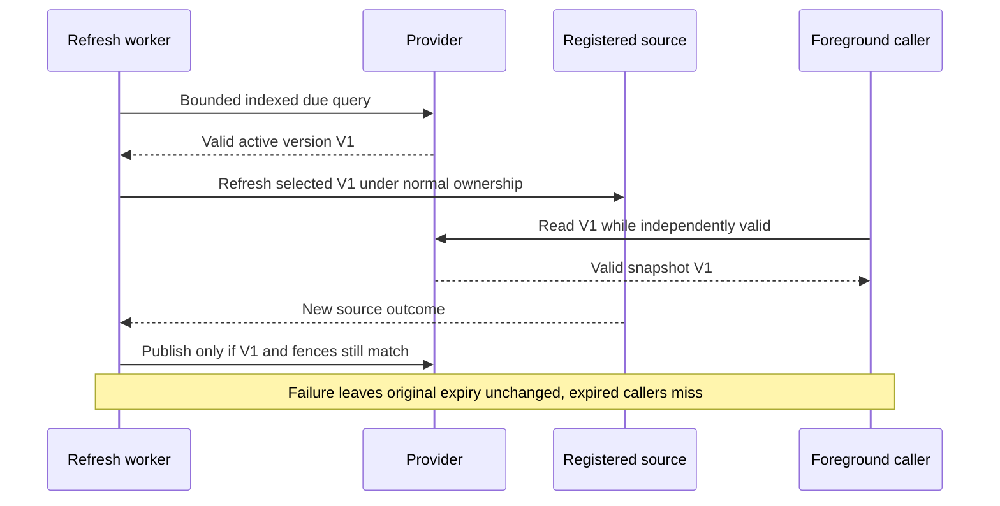

### Readiness and bounded warm-up

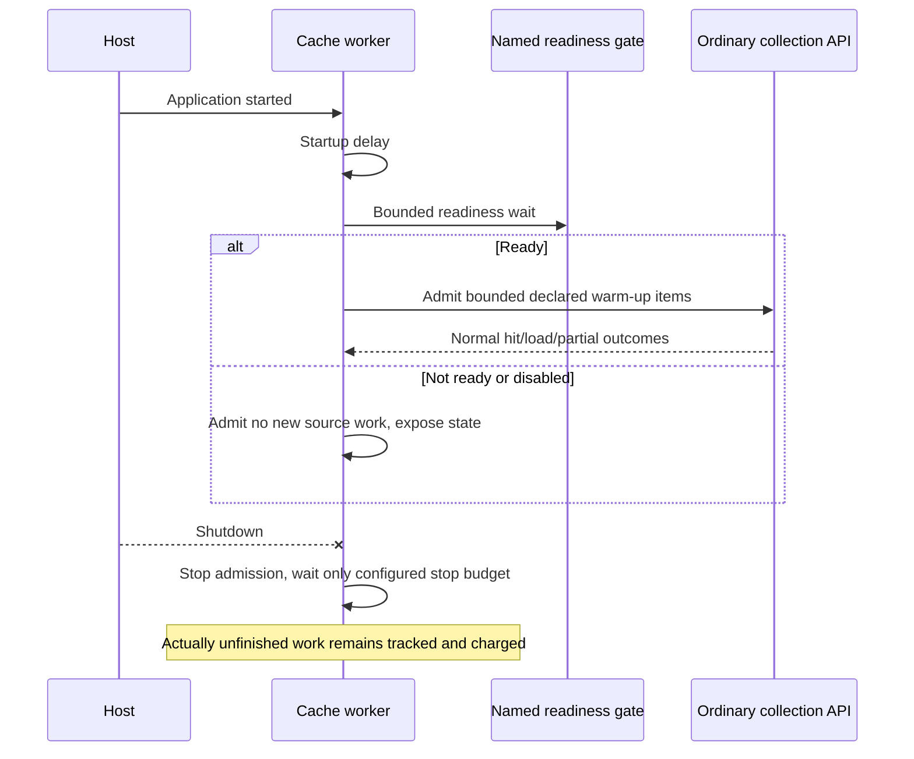

Maintenance purges eligible expired/retired state and advances tracked operations in bounded batches. Foreground validity never depends on waiting for a cleanup sweep. Pause/resume changes new automatic admission on this node; it does not cancel every already running source, pause other nodes, or change startup configuration.

## Resilience and failure handling

Shared source attempts and followers use one owned attempt budget. The default is one attempt. Explicit retry/backoff and a source resilience pipeline share `Loading.MaxAttempts` and the original owned deadline. Parallel hedging or recursive source execution is rejected rather than granting unaccounted work.

The source policy is process-local and shared by dependency alias, not by cache key or follower. A source circuit should protect the external dependency shared by several collections. A provider breaker protects the selected cache infrastructure. Their failures and states remain separate.

```csharp
using Polly;
using Polly.CircuitBreaker;

cache.WithSourceResilience("report-database", _ =>
	new ResiliencePipelineBuilder().AddCircuitBreaker(new CircuitBreakerStrategyOptions
	{
		ShouldHandle = new PredicateBuilder().Handle<CacheSourceException>(),
		FailureRatio = 1,
		MinimumThroughput = 5,
		SamplingDuration = TimeSpan.FromMinutes(1),
		BreakDuration = TimeSpan.FromSeconds(20)
	}).Build())
	.Defaults(collection => collection.Loading(loading => loading.UseResilience("report-database")));
```

This recipe adds no retry. Add only sequential retry policies appropriate to a repeatable source and set a finite shared attempt ceiling. Source failures and source-open rejections never become negative markers or open the provider breaker. Cache validation, admission, ownership, and publication failures do not enter the source policy as dependency failures.

The optional named-provider breaker counts consecutive infrastructure failures, returns typed unavailability while open, and permits one nonmutating readiness probe after cooldown. It never retries a mutation or replays a consumed stream. InMemory omits that infrastructure breaker chain.

| Situation | Result contract |
| --- | --- |
| Explicit get, set, remove, or invalidation provider failure | Failure; no implicit source invocation |
| NodeLocal typed read-through provider outage | Eligible bounded source completion can return an unretained read-only typed result under normal load protection |
| SharedStore authority unavailable or uncertain | Failure before new source work; no downgrade to node-local ownership |
| Typed source succeeds but retention is confirmed rejected/suppressed | Eligible local callers can receive the value with its actual nonstored outcome |
| Publication indeterminate | Report uncertainty; reconcile before replacement ownership or confirmed binary delivery |
| Binary publication failed, rejected, or unconfirmed | Failure; no uncached payload-producing fallback |
| Expired or invalidated value after any failure | New callers miss or fail; stale fallback is unavailable |

## Operations and diagnostics

`CacheOperationService` submits explicit bounded invalidation/clear targets and returns per-provider/collection child submissions. Each handle supports `GetStatusAsync`, `ResumeAsync`, and `CancelAsync`. Accepted background work is distinct from completed logical invalidation; committed counts and count accuracy remain explicit. Cancellation stops remaining work at safe boundaries and does not undo committed chunks. Terminal status can expire under the configured finite retention; an unavailable handle is not reconstructed from guesses.

`CacheBackgroundControl` exposes current node-local refresh/warm-up pause state. `CacheDiagnosticsQueryService` reports declared collections, node-local execution observations, owned memory, effective policy, and provider quota/breaker observations. It never initializes an unused native provider or opens payloads to produce a dashboard count.

Diagnostics distinguish positive hits, negative hits, misses, actual source invocations, joins, active owners/waiters, validation and payload work, decode/compression outcomes, and source versus downstream HTTP transfer completion. Metric labels use declared aliases and controlled outcome names; keys, payloads, connection strings, native paths, and request principals are excluded.

History is explicitly enabled. It retains actual timestamps, duration-weighted counter rates, current gauges, and last actual sampled quantiles. Quantiles are calculated from bounded actual duration samples, not fabricated from averages. `LookupHitRatio` is a percentage of positive plus negative lookup hits over hits plus misses since process observations began; it is unavailable before any lookup outcomes. It is not a fleet ratio or a ratio inferred from the displayed chart window.

Provider storage scope is separate from node-local owned RAM. Provider quota is managed-store accounting, not database-file size, physical volume usage, or free disk space. Hot bytes are a resident sublimit and must not be added again to resident totals. Binary hot bytes are exact owned capacities; decoded and pinned hot capacities are conservative estimates with that accuracy label. Retired versions remain counted while an actual pin still owns them. Empty enabled state is a real zero. Disabled or declined observations remain unavailable with null values, not zero. Every capacity observation carries availability, accuracy, observation time, and reason.

Tracked administration records requested invalidation separately from actual committed units and their completion/failure outcomes. Acceptance does not increment completed work. Optional diagnostics can be disabled or declined when their own finite bookkeeping budget cannot be admitted.

## Optional management integrations

HTTP, Dashboard, Console, and MCP adapters compose independently around the registered collection catalog and common Application requests. Register source loaders through the collection configuration. The host supplies authentication, authorization policies, and the Dashboard, Console, or MCP facilities selected for use.

### Register the required integrations

The following registration assumes that the host already configures authentication and the named authorization policies.

```csharp
using BridgingIT.DevKit.Application.Caching;
using BridgingIT.DevKit.Presentation.Web.Caching;
using Microsoft.Extensions.DependencyInjection;

var cache = services.AddApplicationCaching(caching => caching
	.WithBinaryContract("report-file")
	.WithBinaryCollection("reports")
	.WithBinaryCollection("private-reports", collection => collection.WithoutEndpoints())
	.WithEndpoints(options => options
		.WithPath("/api/caches")
		.WithReadPolicy("Cache.Read")
		.WithWritePolicy("Cache.Write")
		.WithInvalidationPolicy("Cache.Administer")));

// Select these independently when their host capabilities are present.
cache.WithDashboard(options => options.WithInvalidationPolicy("Cache.Administer"));
cache.WithConsoleCommands();
cache.WithMcpHandlers();

// Map the host's registered endpoint sets after authentication and authorization.
app.MapEndpoints();
```

`WithDashboard` contributes pages to a separately registered DevKit Dashboard. `WithConsoleCommands` contributes an `IConsoleCommand`. `WithMcpHandlers` contributes an `IMcpHandler` to the host's existing MCP discovery. Neither method enables another integration.

An omitted action policy uses the host's default authorization policy. An explicit HTTP action policy replaces that default for the selected action. A Dashboard read policy adds a restriction to the Dashboard host's own access rules. Dashboard mutations require current authorization and antiforgery validation even when the host allows anonymous Dashboard reads.

`WithoutEndpoints()` excludes a collection from the external API. The in-process collection and independently registered management integrations remain available according to their own policies. Console and MCP have independent collection settings through `WithConsoleCommands(false)` and `WithMcpHandlers(false)`. Configuration cannot register a missing integration or introduce CLR types.

### HTTP

The default prefix is `/api/caches`. Collection names select trusted startup declarations; `key` is a query parameter so opaque keys do not become route segments.

| Method and relative route | Action | Result |
| --- | --- | --- |
| `GET /collections` | Read | Exposed authorized collection declarations |
| `GET /{collection}/entries?key=...` | Read | Protected logical representation, without a source load |
| `PUT /{collection}/entries?key=...` | Write | Confirmed publication result |
| `DELETE /{collection}/entries?key=...` | Invalidate | Exact-key removal and publication fence |
| `GET /{collection}/metadata?key=...` | Read | Compatible authoritative metadata without payload bytes |
| `GET /{collection}/metadata/entries` | Read | Bounded metadata page |
| `POST /{collection}/invalidate/preview` | Read | Bounded selection count and redacted sample |
| `POST /{collection}/invalidate` | Invalidate | Selection result or accepted tracked work |
| `POST /{collection}/clear` | Invalidate | Explicit collection clear result or accepted tracked work |
| `GET /{collection}/operations/{id}` | Read | Retained operation progress |
| `POST /{collection}/operations/{id}/resume` | Invalidate | Continue the recorded remainder |
| `POST /{collection}/operations/{id}/cancel` | Invalidate | Request cancellation at a safe boundary |

Multi-collection preview, invalidation, and clear select at most 32 targets and use `/invalidate/preview`, `/invalidate`, and `/clear` with repeated `collections` query parameters. Every explicit target must be declared, authorized, and exposed. One excluded target rejects the entire request before the server reads its body or calls a provider. Implicit collection listings omit excluded targets.

Metadata pages accept `prefix`, `take`, `continuation`, and `cutoff`. Return the original `cutoff` with its continuation. The cutoff bounds publication time during the walk; expiry and concurrent changes can still affect later observations.

#### Read and publish binary values

```http
PUT /api/caches/reports/entries?key=quarter%3A2026-Q1
Content-Type: application/octet-stream
If-None-Match: *
X-Cache-Descriptor: {"absoluteTtl":"00:05:00","itemCount":120}

<binary report bytes>
```

Binary bodies flow through the ordinary bounded single-pass collection write path. The compact optional `X-Cache-Descriptor` JSON header is limited to 16 KiB and the configured metadata-body limit. It accepts collection-bounded TTL, dependencies, priority, and item metadata. A caller-supplied decoded-memory estimate is ignored. The registered value contract supplies trusted memory estimates.

GET streams the logical representation with a strong opaque `ETag`, `Last-Modified`, and known `Content-Length`. A supported single byte range returns `206`. An unsatisfiable range returns `416` with `Content-Range: bytes */length`. Cache-managed compression is reversed before delivery. The response uses identity content encoding so a host compression middleware cannot change the representation under its validator.

The result owns its read handle through transfer and disposal. It reserves one finite transfer buffer and awaits downstream writes. Successful source validation and successful downstream flush are separate observations. After response delivery starts, a failure aborts the response; it does not append Problem Details or replay the source.

The collection transfer budget covers response start, source reads, destination writes, and the final flush. Only a completed destination write advances idle progress. An expired transfer aborts the response; a destination that ignores cancellation keeps its buffer and read ownership until the actual write ends.

#### Expose a typed write model

Typed values require either an explicit public boundary model or an exact-format streaming validator registered on their value contract. A CLR cache type does not become a public JSON contract automatically.

```csharp
using BridgingIT.DevKit.Common;

cache.WithValueContract<ReportSummary>("report-summary")
	.WithCollection<ReportSummary>("summaries")
	.WithHttpModel<ReportSummary, ReportSummaryInput>(
		"report-summary",
		input => input is null ? null : new ReportSummary(input.Title, input.Rows),
		input => input is null ? 0L : 256L + (input.Title?.Length ?? 0) * 2L,
		maximumBodyBytes: checked((int)ByteSize.Kilobytes(16)),
		maximumDecodedBytes: ByteSize.Kilobytes(64));

public sealed record ReportSummary(string Title, int Rows);
public sealed record ReportSummaryInput(string Title, int Rows);
```

The host registers mappings in code. Startup validates type compatibility and finite limits, then freezes profile registration. Typed JSON requests use `application/json` and System.Text.Json web defaults with a maximum depth of 32. These settings are independent of the collection codec and host JSON options.

`estimate` receives the deserialized `ReportSummaryInput`, before `map` runs. It must account conservatively for the complete input DTO graph, including its nested objects, collections, and strings. A null, negative, or excessive estimate produces a `Capacity` failure and skips the mapper. When the model type permits JSON `null`, the estimator receives null and the mapper receives null if that estimate passes. Each callback must handle or reject null deliberately. The default serialized body limit is 64 KiB and the default decoded graph limit is 1 MiB. Neither limit may exceed the bound of any collection using the contract. Internal application types and source-loader selection cannot come from request data.

The HTTP mapper transfers its DTO reservation to `CacheResourceLeaseContext` while publishing. If a codec ignores cancellation after the caller's timeout, tracked work retains that reservation until encoding actually ends. Returning an HTTP timeout releases the caller's wait; it does not free memory still owned by the encoder.

#### Apply HTTP conditions

The default response policy is `Cache-Control: no-store`. Select `.WithCachePolicy(CacheHttpCachePolicy.Revalidate)` for `private, no-cache` responses that require revalidation.

Conditional GET evaluates current validity and representation compatibility before returning `304`. That path reads metadata without acquiring payload bytes. Ordinary GET adds no metadata preflight.

`If-Match` and `If-Unmodified-Since` become atomic publication conditions on PUT and DELETE. `If-None-Match: *` on PUT is an atomic create-only condition. A missing, expired, or confirmed-negative entry permits creation. A valid positive null, empty string, or empty stream counts as present. A concurrent winning publication produces `412` rather than being overwritten.

#### Submit invalidation

Structured POST requests require `application/json` and a bounded body. Omitted invalidation selection matches nothing. Clear has its own explicit route.

```http
POST /api/caches/invalidate?collections=reports&collections=summaries
Content-Type: application/json

{
	"selection": { "kind": "Prefix", "text": "quarter:" },
	"background": true
}
```

Accepted background work returns `202` and each child's status location. Acceptance does not claim that entries were removed. Synchronous completion returns `200`. Partial child failures remain explicit in the response. Status, resume, and cancel use the retained handle; an unavailable or expired handle returns `404`. Mutations and progress responses use `no-store`.

Shared Result mapping supplies Problem Details for validation, unsupported capability, precondition, capacity, timeout, corruption, and provider-unavailability failures. Authorization failures remain host-controlled. No HTTP operation runs an arbitrary application loader.

Application endpoints using the shared cache error mapper return `502` for a failed source, `503` for provider unavailability or source-policy rejection, and `504` for a source or coordination timeout.

### Dashboard, Console, and MCP

#### Dashboard

The navigation label is **Caching**. The stable page key is `application.caching`, under the host's configured Dashboard path plus `/caching`. Global tabs are Overview, Collections, Shared Loads, Diagnostics, and Operations. Collection tabs add Entries and read-only Settings.

Collections shows a bounded retained-entry metadata count for each collection. Counts cover retained contract versions and may include expired entries awaiting cleanup. Partial counts are labelled observed; failed or disabled inspection shows Unavailable. Entry counts are not copied from provider-wide totals.

Each Entries row has an icon button to invalidate that acquired entry. The form uses its exact key and version, current mutation authorization and antiforgery validation. A newer replacement is preserved if the displayed version has changed. Per-entry actions are disabled when metadata settings hide the keys.

Info icons explain memory accounting, metric scope, chart series, settings, and operation semantics on hover or keyboard focus. Memory tooltips distinguish cache accounting on the current node from total process RAM and explain overlapping hot-memory totals. Explanations use plain-text tooltips; labels, values, statuses, and errors are visible in the page. Tooltip instances are initialized after refresh and disposed before their content is replaced.

Keys and dimensions are redacted by default. An administrator dashboard can display them with `.WithDashboard(options => options.WithSensitiveMetadata())`. This uses the dashboard's existing authorization rules. Extension settings such as credentials remain redacted. Size cards, entry tables and memory charts use explicit binary units such as KiB and MiB.

Refresh replaces data fragments and leaves tabs, filters, and operation forms intact. Entries use the shared growing-list continuation controls. Shared browser state is scoped to the feature and route. Mutation forms pause refresh, require antiforgery tokens, and display confirmed, accepted, partial, and failed outcomes separately.

Entries display dimension names and typed values, including sets, explicit nulls, and half-open intervals. The first three dimensions appear inline; additional dimensions expand within the row. `None` means no dimensions were attached; `Hidden` means the current scope does not disclose them. Filter by a declared dimension alongside **Key starts with** to require both predicates. Conditions follow the schema: scalar equality, set membership, interval overlap, presence, absence, and permitted null values. Integer inputs retain Int64 precision; timestamp inputs use UTC. Filters and their selection-bound continuations share the same query scope.

Long entry keys show a leading ellipsis followed by their final 77 characters; the full key is available on hover. Logical size counts serialized content before cache-managed compression. Stored size includes the payload envelope, framing and integrity checks, so it can exceed logical size for small values even without compression. Provider indexes, dimension metadata and decoded object memory are accounted separately.

In Operations, a blank **Key prefix** selects all current-contract entries in the selected collections for both Preview and Invalidate. Nonempty prefixes are literal. **Exact key** requires a value. **Clear selected collections** removes entries across retained contract versions.

Diagnostics opens with four overview charts: requests and hit ratio, operation p95 latency, memory usage, and errors/timeouts. **Advanced diagnostics** is collapsed initially and expands the six full families: traffic and hit ratio, successful entry throughput, sampled latency, shared loading, owned capacity, and reliability. Advanced charts render when expanded and use the latest loaded samples. Refresh preserves the current expansion state.

Charts retain actual sample timestamps, null gaps, units, and source availability. Overview charts select a few metrics from the same history as the full families. A family selects at most 16 declared series; a truncated global selection says so and directs you to a collection. The default display window is 15 minutes with at most 180 points. History must be explicitly enabled in the core diagnostics policy.

Execution counters and owned RAM describe the current process. Provider storage observations carry their actual store scope, accuracy, and observation time. Provider quota inspection does not initialize an unused native provider or open a payload. Unknown observations display as unavailable, not zero. Shared source attempts and joined callers remain separate measurements. Lookup hit ratio uses actual positive plus negative hits over hits plus misses since process observations began; its displayed history window does not turn it into a fleet or interval ratio.

Binary hot capacity is exact; decoded and pinned hot capacities are conservative estimates with their accuracy labels. Retired versions stay counted until the last actual pin is disposed. Hot bytes are part of resident ownership, so adding them to resident totals would count them twice.

Settings place codec and compression cards above the effective startup policy. The cards identify the configured codec profile and compression state. Enabled compression shows the algorithm, level, minimum entry size, and minimum saving. The remaining read-only settings include provider capabilities and behavior order. Keys, dimension values, and warm-up items require explicit disclosure permission. Extension settings show enablement flags and redact other values.

#### Console and MCP authorization

Both integrations deny access until the host supplies `ICacheManagementAccessContextFactory` through `WithManagementAccessContext<TFactory>()`. Implement that factory using the current trusted caller or process identity. Authorize `request.RequiredAction`, enforce the requested collection subset, and return the configured namespace. Tool arguments do not establish identity or grant actions.

The command name is `application-caching`. It supports help, collection inspection, bounded metadata entries, status, diagnostics, preview, exact removal, invalidation, clear, node-local background pause and resume, and tracked operation status, resume, and cancel.

```text
application-caching entries --collection reports --take 50
application-caching preview --collection reports --prefix quarter:
application-caching clear --collection reports --background
application-caching operation-status --collection reports --id <retained-id>
```

MCP uses `application-caching.*` operation names. Read tools use the diagnostics toolset. Clear and invalidate use the admin toolset. Exact removal, background controls, and tracked-operation mutations use the operations toolset. Both adapters dispatch common Application requests and return bounded structured results with scope, accuracy, continuation, completion, and child failures. They expose no bulk payload or loader tools.

#### Customize the trusted access boundary

HTTP uses `ICacheHttpAccessContextFactory`; Dashboard uses `ICacheDashboardAccessContextFactory`. Replace either with a scoped host implementation when tenant or collection authorization depends on the current request. The factory receives the action already required by the endpoint. Return only the namespace, subject, actions, and collection subset that the host has authorized.

The common `CacheManagementAccessValidator` checks that context again before collection access. The HTTP filter also runs it before body consumption. A continuation, descriptor, collection name, or source-looking field cannot broaden the caller's authority.

HTTP, Dashboard, and Console/MCP have separate trusted access-context factories and disclosure settings. A host can restrict collection selection. Restricted contexts must choose an authorized collection for diagnostics/history instead of querying global aggregates; provider quota observations still carry their actual provider/store scope, which can span collections.

## Verification and measured provider selection

Run provider and engine tests sequentially in one worktree. Real SQL Server/PostgreSQL tests, local SQLite tests, native filesystem tests, and independent-instance coordination tests prove different scopes. A deterministic ownership barrier test does not supply throughput or network-failure evidence.

### Loading-flow verification map

These test groups exercise the contracts illustrated by the ten loading diagrams. Each group identifies the provider and process scope of its checks.

| Loading diagram | Test group and scope |
| --- | --- |
| Node-local sharing over a central provider | [CacheMultiInstanceTests](../tests/Infrastructure.IntegrationTests/EntityFramework/Caching/CacheMultiInstanceTests.cs), `NodeLocal_CentralPersistenceDoesNotImplicitlyEnableSharedSourceOwnership` on real local SQLite; [CacheMultiProcessTests](../tests/Infrastructure.UnitTests/FileSystem/Caching/CacheMultiProcessTests.cs) covers separate local native processes |
| Shared-store loading across web nodes | [CacheMultiInstanceTests](../tests/Infrastructure.IntegrationTests/EntityFramework/Caching/CacheMultiInstanceTests.cs), `SharedStore_OneSourceServesAllNodesAndTheirLocalFollowers`; independent application containers share a real local SQLite file. [CacheMultiProcessTests](../tests/Infrastructure.UnitTests/FileSystem/Caching/CacheMultiProcessTests.cs) covers two/four local native OS processes, not independent hosts |
| Explicit independent loading | [Portable CacheProviderContractTestsBase](../tests/Shared/Caching/CacheProviderContractTestsBase.cs), `IndependentLoading_SeparatesSourceExecutionsAndFencesBothLatePublications`, reused by complete provider hosts |
| Successful typed load without retention | [CacheMultiInstanceTests](../tests/Infrastructure.IntegrationTests/EntityFramework/Caching/CacheMultiInstanceTests.cs), `UncachedPositiveCompletion_DoesNotHandOffAnOwnerGraphToAnotherNode` |
| Caller departure and last-interest cancellation | [CacheEngineTests](../tests/Application.UnitTests/Caching/CacheEngineTests.cs), initiating-caller cancellation; [CacheLoadingLifetimeTests](../tests/Application.UnitTests/Caching/CacheLoadingLifetimeTests.cs), default versus opt-in continuation and unchanged deadline; [CacheApplicationCoordinationTests](../tests/Infrastructure.UnitTests/EntityFramework/Caching/CacheApplicationCoordinationTests.cs), all-node interest and actual source termination |
| Shared failure and optional source resilience | [CacheSourceResilienceTests](../tests/Application.UnitTests/Caching/CacheSourceResilienceTests.cs), shared dependency policy and total attempt budget; [CacheProviderResilienceTests](../tests/Infrastructure.IntegrationTests/EntityFramework/Caching/CacheProviderResilienceTests.cs), separate source/provider failure domains |
| Overlapping batches | [CacheBatchTests](../tests/Application.UnitTests/Caching/CacheBatchTests.cs), `OverlappingGroupedBatches_CompleteOwnedKeysBeforeJoiningForeignWork` |
| Shared success and publication fencing | [CacheEngineTests](../tests/Application.UnitTests/Caching/CacheEngineTests.cs), retained owner metadata and removal during source; [CacheMultiInstanceTests](../tests/Infrastructure.IntegrationTests/EntityFramework/Caching/CacheMultiInstanceTests.cs), owner loss fencing |
| Refresh with a valid old version | [CacheRefreshTests](../tests/Application.UnitTests/Caching/CacheRefreshTests.cs), selected version and expiry during refresh; [CacheMultiInstanceTests](../tests/Infrastructure.IntegrationTests/EntityFramework/Caching/CacheMultiInstanceTests.cs), cross-instance valid reads during refresh |
| Readiness and bounded warm-up | [CacheBackgroundServiceTests](../tests/Application.UnitTests/Caching/CacheBackgroundServiceTests.cs), host/startup gating; [CacheWarmupTests](../tests/Application.UnitTests/Caching/CacheWarmupTests.cs), unready loader isolation and bounded warm-up |

The additional hot diagram maps to [CacheHotEntryTests](../tests/Application.UnitTests/Caching/CacheHotEntryTests.cs), [CacheHotEntryOwnershipTests](../tests/Application.UnitTests/Caching/CacheHotEntryOwnershipTests.cs), [CacheHotFootprintTests](../tests/Application.UnitTests/Caching/CacheHotFootprintTests.cs), and the real cross-instance strict-hot case in `CacheMultiInstanceTests`.

The benchmark suite includes ordinary provider reads/writes, misses and negative hits, batches, streams, metadata queries, shared bursts, hot retention, and maintenance. Setup and prefill stay outside timed work; decoding, integrity, publication, and Result handling remain inside the measured operation.

```powershell
dotnet run -c Release --project benchmarks/Application.Benchmarks -- --filter '*CacheProviderBenchmarks.GetHitAsync*'
dotnet run -c Release --project benchmarks/Application.Benchmarks -- --filter '*CacheHotEntryBenchmarks*'
dotnet run -c Release --project benchmarks/Application.Benchmarks -- --filter '*CacheSharedLoadBenchmarks*'
```

See the [provider benchmark instructions](https://github.com/bridgingIT/bITdevKit/blob/main/benchmarks/Application.Benchmarks/Caching/README.md) and [HTTP benchmark instructions](https://github.com/bridgingIT/bITdevKit/blob/main/benchmarks/Presentation.Benchmarks/Caching/README.md) for profiles, commands, and result accounting. The [recorded local results](https://github.com/bridgingIT/bITdevKit/blob/main/benchmarks/Application.Benchmarks/Caching/RESULTS.md) identify measured provider, codec, hot, stream, and HTTP cohorts and the limits of each comparison. Generated test and benchmark artifacts are local and Git-ignored. Compare rows with the same workload and admitted work. A dry run establishes workload execution, not performance qualification. Numeric reports must identify revision, runtime, host, storage/database placement, durability, dataset, payload, concurrency, policy, errors, successful entry counts, and run variation.

Operations/s, successful entries/s, actual source invocations, and joined caller results are different quantities. A metadata page, miss, token getter, retained decoded hit, provider read with decode, and complete binary transfer must not be compared as interchangeable work. Persistent hot-hit measurements include strict authority validation. InMemory shared-buffer retention does not justify a duplicate-copy speedup claim.

Use the operating system's temporary directory for isolated local Windows/Linux checks. A Linux container qualifies the filesystem actually exposed inside that container. Record its kernel and filesystem type. Results from local temporary storage do not establish behavior on an ext4/XFS device, an SMB/NFS share, another host, or during power loss. Each deployment profile requires its own measurements and recovery checks. Select a provider by its required ownership and deployment contract first, then compare matching measured workloads. Do not fill an unmeasured profile with inferred throughput.

## Source and decisions

- [Cache contracts](../src/Application.Caching/IApplicationCache.cs) and [registration](../src/Application.Caching/Configuration/ServiceCollectionExtensions.cs).
- [Complete provider contract](../src/Application.Caching/Providers/ICacheStoreProvider.cs) and [EF context capability](../src/Infrastructure.EntityFramework/Caching/IApplicationCachingContext.cs).
- [Value codec contract](../src/Common.Serialization/Codecs/IValueCodec.cs) and [Common Serialization](common-serialization.md) for typed representation, serializer adapters, and [continuation token protection](common-serialization.md#continuation-token-protection).
- [Results](features-results.md) for explicit cache, provider, source, and partial-operation outcomes.
- [Requester and Notifier](features-requester-notifier.md) for the common management request pipeline used by presentation adapters.
- [Common Utilities: storage-neutral utilities](common-utilities.md#storage-neutral-utilities) for periodic worker hosting and background-service health checks.
- [Common Options Builders: presence-aware composition](common-options-builders.md#presence-aware-composition) for explicit assignments, configuration overlays, and provenance.
- [Common Utilities: resource capacity budgets](common-utilities.md#resource-capacity-budgets), [stream operations](common-utilities.md#stream-operations-and-temporary-files), and [ByteSize](common-utilities.md#bytesize) for capacity ownership, stream wrappers, and size formatting.
- [Common Utilities: operation admission](common-utilities.md#hierarchical-operation-admission), [deadlines](common-utilities.md#fixed-and-transfer-deadlines), and [resource and task lifetimes](common-utilities.md#resource-lifetimes-and-owned-tasks) for shared bounded execution mechanisms. Cache adapters apply collection limits, cache errors, logging and shutdown policy.
- [Bounded time-series history](common-utilities.md#bounded-time-series-history) and [sample quantiles](common-utilities.md#sample-quantiles) for fixed-capacity sample retention and nearest-rank selection. Cache diagnostics supplies duration-weighted rates, actual quantile observations and availability.
- [Common matching](common-extensions.md) for the Unicode-scalar glob matcher used behind cache identity validation.
- [Streaming payload transforms](common-serialization.md#streaming-payload-transforms) for shared gzip streams and the reversible transform contract; the cache owns its checked envelope and trusted-reader policy.
- [Application Auditing](features-application-auditing.md) for optional cache execution evidence.
- [Profiling](features-profiling.md) for optional operation and transfer profiling.
- [Metrics](features-metrics.md) for shared measurement concepts and .NET/OpenTelemetry export patterns.
- [Dashboard](features-presentation-dashboard.md) for page hosting, authorization, refresh, and shared controls.
- [HTTP representation conditions and byte ranges](features-presentation-endpoints.md#http-representation-conditions-and-byte-ranges) for shared header evaluation. Cache HTTP adapters retain authoritative reads, representation validators and atomic write conditions.
- [Console Commands](features-presentation-console-commands.md) and [DevKit MCP](features-cli-mcp.md) for optional operational access to cache management.
- [Common Caching](common-caching.md) for the separate basic cache API and providers.
- [ADR-0039: independent advanced caching](adr/0039-independent-advanced-application-caching.md) records the boundaries between advanced caching, Common Caching, and Key/Value Storage.
- [ADR-0040: complete provider ownership](adr/0040-complete-cache-provider-per-collection.md) records publication, resource, stream, and recovery guarantees within one selected store.
- [ADR-0041: authoritative hot validation](adr/0041-strict-authoritative-hot-cache-validation.md) records validation, admission, and memory ownership for local retained representations.
- [ADR-0042: cache-owned workers](adr/0042-cache-owned-background-workers.md) records refresh, warm-up, maintenance, and host lifecycle ownership.
- [ADR-0038: shared filesystem infrastructure](adr/0038-shared-filesystem-infrastructure-for-file-storage.md) records the filesystem primitives reused by the native cache provider.