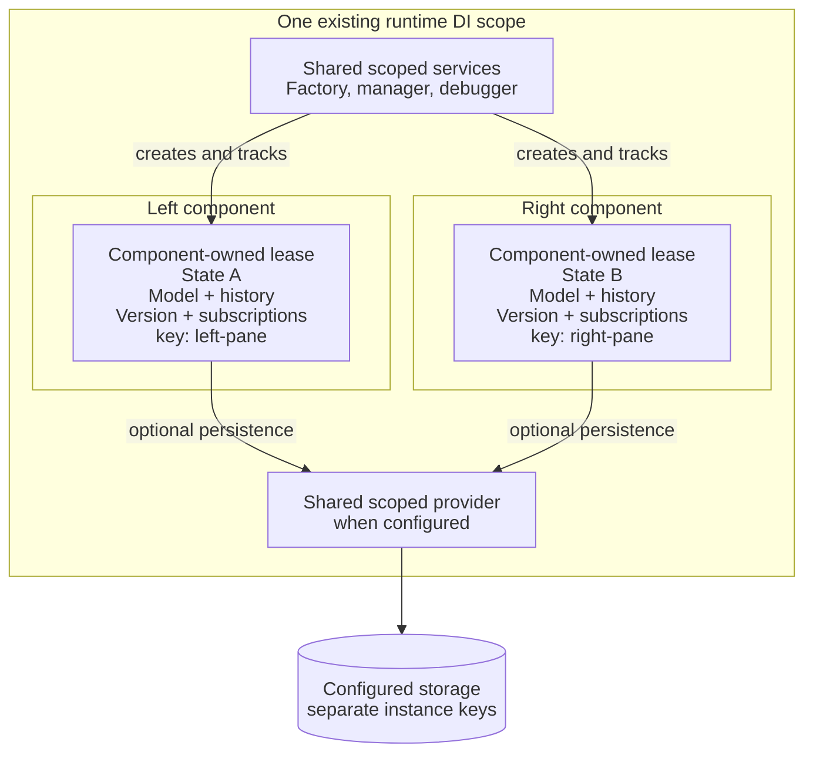
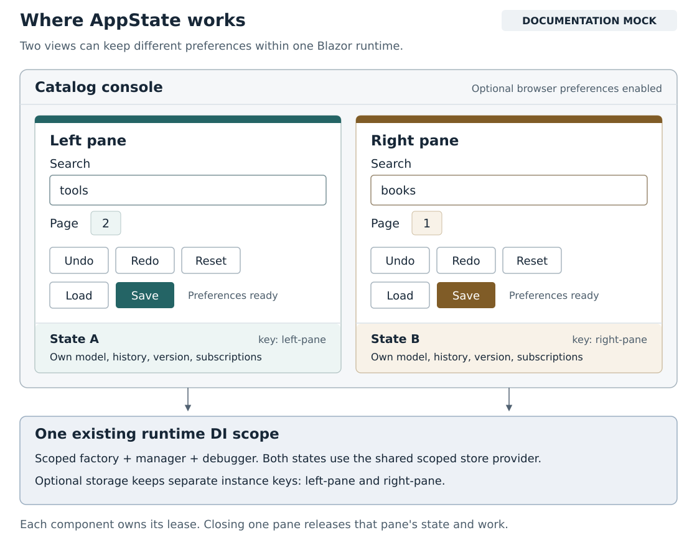
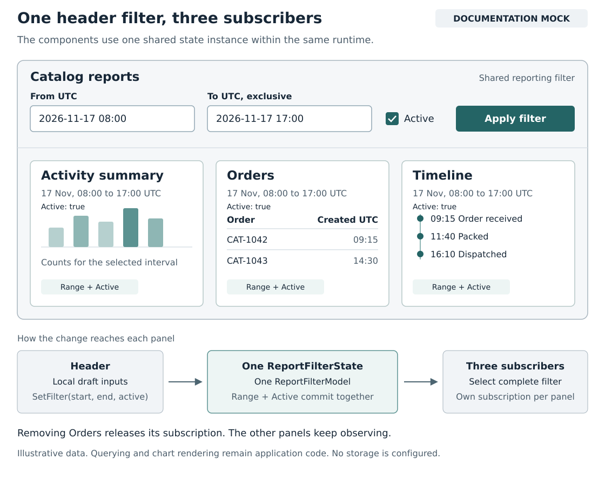
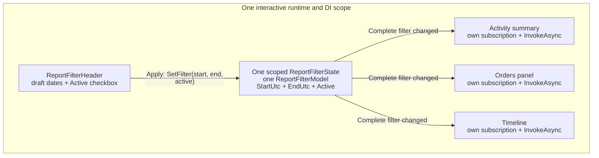
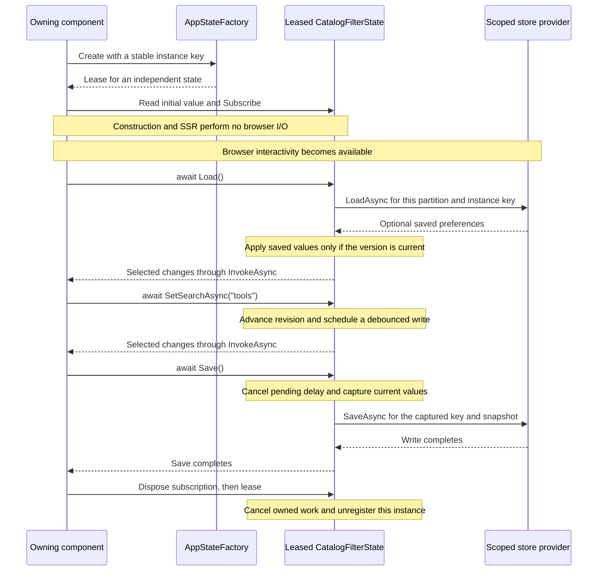
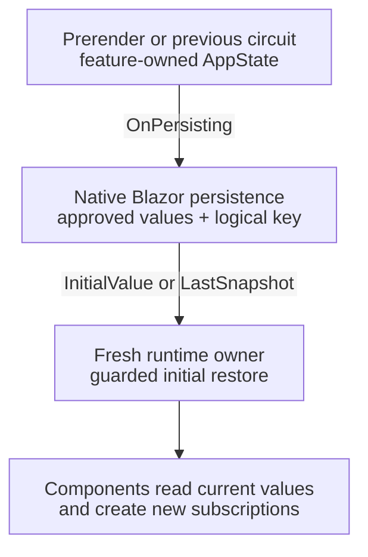

# AppState

> Own typed Blazor state with independent snapshots, bounded history, optional persistence, and disposable subscriptions.

[TOC]

## Overview

`AppState<TState>` is a base class for a feature-owned model. It supplies snapshot/restore, undo/redo, change events, revision checks, and optional storage. It works independently of a presentation shell, component library, authentication provider, or event bus.

Blazor already supplies component state, binding, dependency injection, cascading notifications and lifecycle persistence. AppState builds on those mechanisms with reusable policies for feature state. Its optional `AppStateLifecycle` adapter connects approved model values to native prerender handoff and circuit restoration. See [AppState and Blazor state management](#appstate-and-blazor-state-management) for the boundaries and trade-offs.

State belongs to its resolving runtime. On Server, scoped services normally belong to the circuit or SSR request. In WebAssembly, they normally belong to the application runtime. A component can own a separate instance through `AppStateFactory` without creating another DI scope.

## Challenges

A state service must keep component instances and users separate, release subscriptions when their owner disappears, and reject delayed results from obsolete edits or contexts. Persistence adds ordering problems: a load can finish after an edit, a delayed save can race a reset, and browser storage can be unavailable during prerendering. Undo/redo must preserve independent values rather than mutable references.

## Solution

Keep the model and feature methods in an ordinary derived state class. Register it through `AddAppState()`, choose persistence explicitly, and use disposable leases for independent component state. Selectors observe accepted transitions. Version tokens guard asynchronous completion. Serialized per-instance I/O keeps old writes ahead of reset cleanup and preserves their captured storage partition.

## Key Features

- Independent snapshots, including when `Enabled(false)` disables optional persistence and history.
- Bounded undo/redo with copied history values.
- Scoped inventories that distinguish live instances of the same logical state.
- Concrete/interface aliases resolving the same scoped object.
- Leases owning newly created state without disposing injected services.
- Changed-value subscriptions with explicit renderer dispatch and cancellation.
- Immediate awaited saves, shared load attempts, and coalesced automatic writes.
- Application, module, state, instance, principal, workspace, and schema storage dimensions.
- Bounded diagnostics with no model values or mutation reasons by default.
- Source-generated JSON metadata for trimmed browser consumers.
- Opt-in native Blazor prerender handoff and circuit-snapshot restoration with fresh runtime ownership.

## Architecture

A derived class owns its current model. `AppState<TState>` owns revisions, history, observers, and its persistence work. `AppStateManager` tracks live objects by reference and assigns separate runtime identities to custom states. The factory uses the originating runtime's DI services and returns an independently disposable lease.

The two components below share runtime services. Each lease owns a separate state instance and its subscriptions:



The manager and providers remain in the originating scope when either component unmounts. Disposing one lease releases that instance and its work. The other instance keeps its model and history. No component creates another DI scope.

`StateId` is the existing logical name. `InstanceId` identifies a live object. `AppStateVersion` combines that instance ID, its edit revision, and its context revision. Runtime IDs are not persisted keys, credentials, or permission grants.

`IAppStateStoreProvider` is the persistence boundary. Providers implement `SaveAsync<T>`, `LoadAsync<T>`, `ClearAsync` and `ClearAllAsync`. Cancellation and typed-JSON overloads have default implementations that forward to the basic methods. A provider without cancellation support can continue I/O after cancellation; the state awaits that underlying operation before clearing its captured key.

`IAppStateRuntime` is the documented integration contract for advanced owner adapters. Ordinary pages use their concrete state, the factory, and subscription handles. No runtime module system or global service locator is required.

## Use Cases

Use AppState for shared UI filters, safe preferences, independently mounted views, or a feature-owned editable model that needs bounded history. Ordinary component fields remain suitable for local transient state.

The following documentation mock shows two catalog views with independent filters. Each view owns a lease, so a search, undo, or reset in the left pane changes only its state. The mock assumes bounded history and optional browser persistence are configured. These controls are illustrative application UI; AppState does not supply this page or a presentation shell.

[](assets/appstate/component-ownership-mock.svg)

The stable keys `left-pane` and `right-pane` identify separate persisted preferences. Each live state also has its own runtime `InstanceId`. The labels A and B in the mock distinguish those live instances; they are not storage keys. Load and save apply to the owning pane's preferences. Business queries and result rendering remain application code.

For intentionally shared filters, an app header and several panels can inject one scoped state instance. See [Shared filter from an app header](#shared-filter-from-an-app-header) for a visual and complete component example.

AppState does not implement backend authorization, URL precedence, draft recovery, UI action execution, business transactions, remote invalidation, or Server/WASM synchronization. Persisted values do not establish access. Sensitive business data and credentials should not be stored as browser preferences.

## Basic Usage

Define a small model and a state service using the existing constructor pattern:

```csharp
using BridgingIT.DevKit.Presentation.Web.Client;
using Microsoft.Extensions.Logging;

/// <summary>Contains optional catalog filter preferences.</summary>
public sealed class CatalogFilterModel
{
    /// <summary>Gets or sets the search text.</summary>
    public string Search { get; set; } = string.Empty;

    /// <summary>Gets or sets the current page.</summary>
    public int Page { get; set; } = 1;
}

/// <summary>Owns the catalog's independently mutable filter state.</summary>
public sealed class CatalogFilterState : AppState<CatalogFilterModel>
{
    private CatalogFilterModel current = new();

    /// <summary>Creates a filter state using dependencies from the current runtime.</summary>
    /// <param name="logger">The diagnostic logger.</param>
    /// <param name="options">The per-instance configuration.</param>
    /// <param name="storageProvider">The optional preference store.</param>
    /// <param name="userContextProvider">The optional user partition provider.</param>
    /// <param name="debugger">The optional state observer.</param>
    public CatalogFilterState(
        ILogger<CatalogFilterState> logger,
        AppStateOptions options,
        IAppStateStoreProvider storageProvider = null,
        IUserContextProvider userContextProvider = null,
        AppStateDebugger debugger = null)
        : base(logger, options, storageProvider, userContextProvider, debugger)
    {
    }

    /// <summary>Changes the search text and returns to the first page.</summary>
    /// <param name="search">The requested search text.</param>
    /// <returns>The accepted transition.</returns>
    public Task SetSearchAsync(string search)
    {
        var next = this.TakeSnapshot();
        next.Search = search;
        next.Page = 1;
        return this.RestoreSnapshot(next);
    }

    /// <inheritdoc/>
    protected override CatalogFilterModel GetCurrentState() => this.current;

    /// <inheritdoc/>
    protected override void UpdateState(CatalogFilterModel state) => this.current = state;

    /// <inheritdoc/>
    protected override CatalogFilterModel CreateDefaultState() => new();
}
```

Register without storage, authentication, or browser dependencies:

```csharp
using Microsoft.Extensions.DependencyInjection;

var services = new ServiceCollection();
services.AddLogging();
services.AddAppState()
    .AddState<CatalogFilterState>()
        .AsComponentScoped()
        .WithHistory(10)
        .Done();
```

An ordinary component can inject `CatalogFilterState` and await `SetSearchAsync("tools")`. A standalone .NET consumer can resolve one runtime scope and exercise the same state:

```csharp
using var provider = services.BuildServiceProvider();
using var scope = provider.CreateScope();
var filters = scope.ServiceProvider.GetRequiredService<CatalogFilterState>();

await filters.SetSearchAsync("tools");
await filters.Undo();
await filters.Redo();
```

The current model now has `Search == "tools"` and `Page == 1`. Undo restores the preceding independent values; redo restores the edit. Mutating a snapshot or returned history entry does not mutate live state. The state methods `Load`, `Save`, `Reset`, `Undo` and `Redo` return Tasks despite having no `Async` suffix.

`AsComponentScoped()` selects no persistence. It does not change DI lifetime or automatically create a separate state for every component. Scoped concrete and `IAppState` resolutions share one instance. Scoped and Transient registrations are supported; Singleton state registration is rejected.

## AppState and Blazor state management

Blazor provides several state mechanisms. Component fields hold local values. Parameters, binding and `EventCallback` coordinate related components. Cascading values distribute values through a component hierarchy, and a shared DI service can connect components elsewhere in the same runtime. A custom service can publish ordinary C# events. The header filter in this guide can be implemented using those mechanisms alone. [Blazor state management](https://learn.microsoft.com/en-us/aspnet/core/blazor/state-management/?view=aspnetcore-10.0)

Native `CascadingValueSource<T>` also supports change notifications. Its consumers observe the cascaded value; property-specific subscriptions require additional application wiring or separately cascaded values. AppState's `Subscribe(model => model.Active, ...)` observes one selected value within a single shared filter model. Components can instead select the complete model. Both approaches still use Blazor's renderer. [Cascading notifications](https://learn.microsoft.com/en-us/aspnet/core/blazor/components/cascading-values-and-parameters?view=aspnetcore-10.0#root-level-cascading-values-with-notifications)

AppState supplies policies that a small custom state container would otherwise need to implement:

- Independent snapshots and accepted transitions, including one update for a date range and `Active` together.
- Changed-value subscriptions with disposable ownership, explicit renderer dispatch and cancellation of obsolete callback work.
- Bounded undo/redo and version checks for conditional acceptance of asynchronous results.
- Shared scoped state or independent component-owned leases without opening another DI scope.
- Optional preference storage with explicit saves, coalesced writes, targeted reset, context-qualified keys and I/O status.

Components still call `InvokeAsync` for renderer work, dispose their subscriptions and check version/cancellation after asynchronous work. AppState does not fetch business data, authenticate users or synchronize independent circuits, tabs or Server/WASM runtimes automatically. Its host context keys partition state after the application establishes identity and workspace access.

Blazor's `[PersistentState]` and `PersistentComponentState` preserve selected values across prerendering and interactive activation. Configured Interactive Server circuit persistence can also restore selected data into a new circuit. `AppStateLifecycle` uses those native mechanisms for approved snapshots. `IAppStateStoreProvider` separately owns feature preferences and durable-storage policy; it does not replace Blazor's circuit persistence infrastructure. [Prerender persistence](https://learn.microsoft.com/en-us/aspnet/core/blazor/state-management/prerendered-state-persistence?view=aspnetcore-10.0), [circuit persistence](https://learn.microsoft.com/en-us/aspnet/core/blazor/state-management/server?view=aspnetcore-10.0#circuit-state-persistence)

Use ordinary fields or a small state service when local values and simple notifications are sufficient. AppState adds configuration and snapshot allocations. It offers consistent behavior across features rather than an inherent speed advantage. Use URL parameters for filters that must be bookmarkable or shareable; the application coordinates URL precedence explicitly.

## Component ownership

Register the state once, then create independent instances from the component's existing runtime. This `CatalogFilterPanel.razor` component owns its lease and subscription:

```razor
@using BridgingIT.DevKit.Presentation.Web.Client
@implements IAsyncDisposable
@inject AppStateFactory StateFactory

<section>
    <label>
        Search
        <input value="@this.lease.State.CurrentState.Search" @oninput="ChangeSearch" />
    </label>
    <p>Search: @this.searchSummary</p>
    <p>Page: @this.lease.State.CurrentState.Page</p>
</section>

@code {
    /// <summary>Gets or sets this view's stable persistence key within its runtime.</summary>
    [Parameter]
    public string InstanceKey { get; set; } = "catalog-panel";

    private AppStateLease<CatalogFilterState> lease = default!;
    private AppStateSubscription subscription = default!;
    private string searchSummary = string.Empty;
    private bool disposed;

    /// <inheritdoc/>
    protected override void OnInitialized()
    {
        this.lease = this.StateFactory.Create<CatalogFilterState>(this.InstanceKey);
        this.searchSummary = this.lease.State.CurrentState.Search;
        this.subscription = this.lease.State.Subscribe(
            model => model.Search,
            (change, token) =>
            {
                this.searchSummary = change.Current;
                this.StateHasChanged();
                return Task.CompletedTask;
            },
            dispatch: work => this.InvokeAsync(work));
    }

    private Task ChangeSearch(ChangeEventArgs args) =>
        this.disposed ? Task.CompletedTask
            : this.lease.State.SetSearchAsync(args.Value?.ToString() ?? string.Empty);

    /// <inheritdoc/>
    public async ValueTask DisposeAsync()
    {
        this.disposed = true;
        this.subscription?.Dispose();
        if (this.lease is not null)
        {
            await this.lease.DisposeAsync();
        }
    }
}
```

The component reads its initial value explicitly because subscriptions do not replay it. Renderer dispatch uses the component's native `InvokeAsync`. Disposing the lease removes its state registration and cancels owned work; DI retains ownership of JS, logging, authentication and shared storage services.

Use `DisposeAsync` or `await using` when a custom state implements only `IAsyncDisposable`. Calling the lease's `Dispose()` in that case throws `InvalidOperationException` and retains the registration. A later `DisposeAsync()` can still release the state. States supporting synchronous disposal keep their synchronous cleanup path.

Mount independent views with different stable keys:

```razor
<CatalogFilterPanel InstanceKey="left-pane" />
<CatalogFilterPanel InstanceKey="right-pane" />
```

Stable instance keys are required when persistence is configured. Competing active persisted instances with the same identity are rejected. A remounted view can reuse its released key with a new runtime ID. Components use their existing runtime services rather than opening a DI scope per view.

## Changed-value subscriptions

A selector can observe one value without reacting to unrelated changes. For an observer that does not update UI, direct dispatch is sufficient:

```csharp
var observedPage = filters.CurrentState.Page;
using var subscription = filters.Subscribe(
    model => model.Page,
    (change, token) =>
    {
        observedPage = change.Current;
        return Task.CompletedTask;
    });

var next = filters.TakeSnapshot();
next.Page = 2;
await filters.RestoreSnapshot(next);
```

`observedPage` is now `2`. The default comparer is `EqualityComparer<TSelected>.Default`; use a structural comparer when selecting mutable collections by value. Selectors must be pure. The component example above supplies renderer dispatch before updating its UI.

Dispose the subscription when the consumer unmounts. New selected values cancel obsolete callback work. Renderer dispatch rechecks ownership before starting queued callbacks. A callback that ignores cancellation must still check cancellation and version after awaiting work. Subscription disposal does not dispose a shared injected state.

The existing `StateChanged` and `StateChangeWithMetadata` events remain available. Their handlers are synchronous observers. Exceptions from one observer do not undo the committed transition or prevent other observers. Use the typed Task-based subscription API for asynchronous reactions. No automatic Notifier bridge or network reload is introduced.

## Shared filter from an app header

An app header can publish an accepted date/time range and an `Active` checkbox value through one scoped state service. An activity summary, an orders panel and a timeline subscribe to that same instance. They each own their subscription and renderer dispatch. The state service belongs to DI.

This documentation mock shows one shared filter applied to three panels. The panel content is illustrative application UI, not a supplied presentation shell or an automatic query engine.

[](assets/appstate/shared-date-range-mock.svg)



The header writes to the state service. Other components subscribe to that service, so they do not need a reference to the header component. Apply accepts both bounds and `Active` in one transition when any value changes. The example uses UTC and an exclusive end bound, so a record belongs to the range when `StartUtc <= timestamp && timestamp < EndUtc`. Each panel displays the accepted boolean; its application query decides how to use that filter.

Define one immutable filter model and its shared state in `ReportFilterState.cs`:

```csharp
namespace Catalog.Reporting;

using BridgingIT.DevKit.Presentation.Web.Client;
using Microsoft.Extensions.Logging;

/// <summary>Contains the accepted UTC reporting bounds and Active filter value.</summary>
public sealed record ReportFilterModel
{
    /// <summary>Gets the inclusive start instant, initially a fictional reporting day.</summary>
    public DateTimeOffset StartUtc { get; init; } =
        new(2026, 11, 17, 8, 0, 0, TimeSpan.Zero);

    /// <summary>Gets the exclusive end instant.</summary>
    public DateTimeOffset EndUtc { get; init; } =
        new(2026, 11, 17, 17, 0, 0, TimeSpan.Zero);

    /// <summary>Gets the accepted Active checkbox value.</summary>
    public bool Active { get; init; } = true;
}

/// <summary>Shares one accepted reporting filter within the resolving runtime scope.</summary>
/// <param name="logger">The diagnostic logger.</param>
/// <param name="options">The per-instance state options.</param>
/// <param name="storageProvider">The selected optional store.</param>
/// <param name="userContextProvider">The optional preference partition provider.</param>
/// <param name="debugger">The optional diagnostic observer.</param>
public sealed class ReportFilterState(ILogger<ReportFilterState> logger, AppStateOptions options,
    IAppStateStoreProvider? storageProvider = null, IUserContextProvider? userContextProvider = null,
    AppStateDebugger? debugger = null)
    : AppState<ReportFilterModel>(logger, options, storageProvider, userContextProvider, debugger)
{
    private ReportFilterModel current = new();

    /// <summary>Accepts the range bounds and Active value as one transition.</summary>
    /// <param name="startUtc">The inclusive start instant.</param>
    /// <param name="endUtc">The exclusive end instant.</param>
    /// <param name="active">The accepted Active checkbox value.</param>
    /// <returns>Completion of the in-memory change.</returns>
    public Task SetFilter(DateTimeOffset startUtc, DateTimeOffset endUtc, bool active)
    {
        if (endUtc <= startUtc)
        {
            throw new ArgumentOutOfRangeException(nameof(endUtc), "The end must be after the start.");
        }

        var next = new ReportFilterModel
        {
            StartUtc = startUtc.ToUniversalTime(),
            EndUtc = endUtc.ToUniversalTime(),
            Active = active
        };
        if (next == this.CurrentState) { return Task.CompletedTask; }

        return this.RestoreSnapshot(next);
    }

    /// <inheritdoc/>
    protected override ReportFilterModel GetCurrentState() => this.current;

    /// <inheritdoc/>
    protected override void UpdateState(ReportFilterModel state) => this.current = state;

    /// <inheritdoc/>
    protected override ReportFilterModel CreateDefaultState() => new();

    /// <inheritdoc/>
    protected override ReportFilterModel CloneState(ReportFilterModel value) =>
        value is null ? null! : value with { };
}
```

`ReportFilterModel` contains all three values in one immutable record. `CloneState` creates a record copy of that complete filter. Snapshots and subscriptions use this explicit copy, so this in-memory example needs no JSON metadata.

Register this type once in the existing host service collection. This is an additional state registration alongside other feature state:

```csharp
using Catalog.Reporting;
using Microsoft.Extensions.DependencyInjection;

services.AddAppState()
    .AddState<ReportFilterState>()
        .AsComponentScoped()
        .Done();
```

The default registration is scoped. Here `AsComponentScoped()` disables persistence while keeping that lifetime. Header and panels inject the same `ReportFilterState` from the same runtime scope. They do not call `AppStateFactory.Create` for this shared filter, since separate leases create separate instances. A component-owned state can also be shared by passing its actual state reference through a parameter or cascading value; its owner then retains responsibility for the lease lifetime.

The header buffers the dates and checkbox locally until Apply. Both date inputs are explicitly UTC because a `datetime-local` input carries no timezone. Keep Blazor's default input format so event normalization and parsing agree. This `ReportFilterHeader.razor` component validates and commits all three values:

```razor
@using Catalog.Reporting
@inject ReportFilterState FilterState

<header aria-label="Shared reporting filter">
    <form @onsubmit="Apply" @onsubmit:preventDefault>
        <label>
            From UTC
            <input type="datetime-local" required @bind="this.fromUtc" />
        </label>
        <label>
            To UTC, exclusive
            <input type="datetime-local" required @bind="this.toUtc" />
        </label>
        <label>
            <input type="checkbox" @bind="this.active" />
            Active
        </label>
        <button type="submit">Apply filter</button>
        @if (this.error is not null)
        {
            <p role="alert">@this.error</p>
        }
    </form>
</header>

@code {
    private DateTime fromUtc;
    private DateTime toUtc;
    private bool active;
    private string? error;

    /// <inheritdoc/>
    protected override void OnInitialized()
    {
        var filter = this.FilterState.CurrentState;
        this.fromUtc = filter.StartUtc.UtcDateTime;
        this.toUtc = filter.EndUtc.UtcDateTime;
        this.active = filter.Active;
    }

    private Task Apply()
    {
        if (this.toUtc <= this.fromUtc)
        {
            this.error = "The end must be after the start.";
            return Task.CompletedTask;
        }

        this.error = null;
        return this.FilterState.SetFilter(
            new DateTimeOffset(DateTime.SpecifyKind(this.fromUtc, DateTimeKind.Utc)),
            new DateTimeOffset(DateTime.SpecifyKind(this.toUtc, DateTimeKind.Utc)),
            this.active);
    }
}
```

Each consuming component reads the current filter on mount and attaches its own subscription. The `model => model` selector observes the complete `ReportFilterModel`, so changing a date or only the checkbox notifies the component. This reusable `ReportFilterPanel.razor` displays the accepted filter for one panel:

```razor
@using Catalog.Reporting
@using BridgingIT.DevKit.Presentation.Web.Client
@implements IDisposable
@inject ReportFilterState FilterState

<article>
    <h2>@this.Title</h2>
    <p>@this.filter.StartUtc.ToString("yyyy-MM-dd HH:mm") to @this.filter.EndUtc.ToString("yyyy-MM-dd HH:mm") UTC</p>
    <p>Active: @(this.filter.Active ? "true" : "false")</p>
</article>

@code {
    /// <summary>Gets or sets the consuming panel's title.</summary>
    [Parameter]
    public string Title { get; set; } = string.Empty;

    private ReportFilterModel filter = default!;
    private AppStateSubscription subscription = default!;

    /// <inheritdoc/>
    protected override void OnInitialized()
    {
        this.filter = this.FilterState.CurrentState;
        this.subscription = this.FilterState.Subscribe(
            model => model,
            (change, token) =>
            {
                this.filter = change.Current;
                this.StateHasChanged();
                return Task.CompletedTask;
            },
            dispatch: work => this.InvokeAsync(work));
    }

    /// <inheritdoc/>
    public void Dispose() => this.subscription?.Dispose();
}
```

Mount the header and panels in one interactive area using the host's native render-mode configuration:

```razor
<ReportFilterHeader />
<ReportFilterPanel Title="Activity summary" />
<ReportFilterPanel Title="Orders" />
<ReportFilterPanel Title="Timeline" />
```

After Apply, all three panels show the same accepted interval and `Active` value. Record value equality compares all three properties, so applying identical filter values causes no callback. Both dates and `Active` belong to the same model, state instance and revision. Removing one panel disposes only its subscription; the other panels keep observing the shared state. Components do not dispose the DI-owned state service.

The example displays the filter without fetching data. A real panel chooses whether its declared query depends on the range, `Active`, or both. For asynchronous reads, use the callback's cancellation token and check the captured version after the await, as shown in [Asynchronous results and revisions](#asynchronous-results-and-revisions). AppState does not start those queries automatically. Sharing remains local to the resolving runtime; communication between circuits, browser tabs or Server and WASM requires an explicit integration.

### Subscribe only to Active

A component can select only `model => model.Active` from the same `ReportFilterModel`. It injects the existing `ReportFilterState` and needs no additional state registration. During ordinary edits, changing only the dates does not invoke this callback; changing `Active` does.

For example, `ActiveFilterIndicator.razor` reads the initial boolean and owns an Active-only subscription:

```razor
@using Catalog.Reporting
@using BridgingIT.DevKit.Presentation.Web.Client
@implements IDisposable
@inject ReportFilterState FilterState

<aside aria-label="Active filter indicator">
    Active filter: @(this.active ? "true" : "false")
</aside>

@code {
    private bool active;
    private AppStateSubscription subscription = default!;

    /// <inheritdoc/>
    protected override void OnInitialized()
    {
        this.active = this.FilterState.CurrentState.Active;
        this.subscription = this.FilterState.Subscribe(
            model => model.Active,
            (change, token) =>
            {
                this.active = change.Current;
                this.StateHasChanged();
                return Task.CompletedTask;
            },
            dispatch: work => this.InvokeAsync(work));
    }

    /// <inheritdoc/>
    public void Dispose() => this.subscription?.Dispose();
}
```

Mount it alongside the existing header and panels:

```razor
<ActiveFilterIndicator />
```

The panels observe the complete filter with `model => model`; the indicator observes just its boolean with `model => model.Active`. Both subscriptions use the same state instance. Reset and context-reset notifications also reach the indicator even when the selected boolean is unchanged.

## Asynchronous results and revisions

Capture the version before asynchronous work that may replace shared state. This fictional preferences endpoint returns the same filter model; the generated JSON context is defined in the persistence section:

```csharp
using System.Net.Http.Json;

var version = filters.Version;
var next = filters.TakeSnapshot();
var saved = await httpClient.GetFromJsonAsync("/api/catalog/view-preferences",
    CatalogJson.Default.CatalogFilterModel, cancellationToken);
if (saved is not null)
{
    next.Page = saved.Page;
    var accepted = await filters.TryRestoreSnapshot(next, version,
        cancellationToken: cancellationToken);
    if (!accepted)
    {
        return; // A newer edit, context change or disposal superseded this result.
    }
}
```

`accepted` is false after another edit, reset, context change, or owner disposal. The check and commit are atomic. Cancellation alone does not prove a result is still applicable.

Updates, conditional restores, loads, undo, redo, and resets advance the edit revision when accepted. Reset and context invalidation also advance the context revision. Direct edits to `CurrentState` bypass these mechanisms and are unsupported change notification.

## Persistence and browser lifecycle

Select storage explicitly. For browser publishing, provide generated metadata:

```csharp
/// <summary>Preserves the filter model's JSON metadata when publishing.</summary>
[System.Text.Json.Serialization.JsonSerializable(typeof(CatalogFilterModel))]
public partial class CatalogJson : System.Text.Json.Serialization.JsonSerializerContext
{
}
```

Use this registration instead of the Basic Usage registration when browser preferences are required. Register each state type once; repeated `AddAppState()` calls reuse infrastructure, while duplicate `AddState<TState>()` declarations are rejected:

```csharp
services.AddAppState()
    .WithApplicationId("catalog-console")
    .AddState<CatalogFilterState>()
        .WithIdentity("catalog", "filters", schemaVersion: 1)
        .WithJsonTypeInfo(CatalogJson.Default.CatalogFilterModel)
        .AsLocalStorageScoped()
        .WithDebounceDelay(TimeSpan.FromMilliseconds(500))
        .Done();
```

Call `Load()` after the relevant interactive lifecycle becomes available, normally the first `OnAfterRenderAsync`. Registration, construction, and SSR do not perform browser I/O. Prerender data transfer uses native `PersistentComponentState`; AppState does not serialize live owners across runtimes.

This sequence shows a successful load and an explicit save for one pane. Each pane has its own lifecycle and storage key:



Without an explicit `Save()`, the configured debounce schedules automatic persistence after a successful initial load. Unmounting releases the owner without a final browser flush. A deferred load needs a later explicit retry.

For the leased component above, add this lifecycle method when enabling persistence:

```csharp
/// <inheritdoc/>
protected override async Task OnAfterRenderAsync(bool firstRender)
{
    if (firstRender)
    {
        await this.lease.State.Load();
        if (!this.disposed)
        {
            this.StateHasChanged();
        }
    }
}
```

Expose an explicit retry when the status is `Deferred`. Handle a failed load at the owning view and show its optional-preferences status while keeping in-memory input usable.

Concurrent initial loads share one attempt. A load cannot overwrite an intervening edit. Missing or corrupt optional preferences retain usable values. Browser unavailability reports `Deferred` and allows a later explicit load. Other storage failures report `Failed`; callers handle the explicit operation's exception without discarding accepted input.

After a successful initial load, accepted edits schedule automatic writes without waiting for the debounce interval. `await Save()` cancels the pending delay and awaits an immediate captured write. Load the partition before saving. A later edit remains separate from the saved snapshot.

```csharp
await filters.Load(cancellationToken);
await filters.SetSearchAsync("tools");
await filters.Save(cancellationToken);
```

Cancellation of `Load(token)` affects that caller's wait, while other callers can keep waiting for the shared attempt. `Save(token)` cancels admission or waiting and propagates cancellation to cooperative storage. A dispatched write from a provider that ignores cancellation can still complete.

When a write ends with cancellation, its status returns to the preceding settled status for the same context. A late cancellation from an invalidated context cannot replace the new context's status.

`PersistenceStatus` reports I/O readiness and outcomes. It is not a form dirty flag, a saved edit baseline, or a business-operation result. Cancellation and browser closure do not guarantee rollback or final delivery. Dispose does not perform a last browser flush.

`AsInMemoryScoped()` uses copied values within the runtime scope. `WithPersistence<TProvider>()` selects a custom provider. The built-in `CustomStorageStateStoreProvider` is copied in-memory sample storage; its name does not imply durable storage. Provider durability, serialization and cancellation guarantees remain the provider author's responsibility. Override `CloneState` for deliberate copying or immutable models; do not place callbacks, components or services in persisted models.

## Blazor lifecycle handoff

`AppStateLifecycle.Attach` opts one logical state instance into native Blazor persistence. It restores approved model values from prerendering or a persisted Server circuit into the current runtime. This is separate from `Load()` and `Save()` against a preference provider. A surviving Server circuit already retains its existing state; attaching the adapter does not change ordinary reconnection behavior.

The flow is:



The adapter transfers the model, not the state service. `InstanceId`, version tokens, undo/redo history, callbacks, component references and services stay in their originating runtime. Logical application, module, state, stable instance key, schema and host-established principal/workspace must match. Independent leased views need distinct stable instance keys in both phases.

### Shared filter handoff

The earlier date-range and `Active` example remains entirely in memory without JSON metadata. Opting that model into lifecycle transfer requires serialization because the values cross a native lifecycle boundary. Add generated metadata in `ReportFilterJson.cs`:

```csharp
namespace Catalog.Reporting;

using System.Text.Json.Serialization;

/// <summary>Describes the reporting filter explicitly approved for native lifecycle transfer.</summary>
[JsonSerializable(typeof(ReportFilterModel))]
public partial class ReportFilterJson : JsonSerializerContext;
```

One ancestor owns the lifecycle handle for the shared state. Each child still owns its own complete-model or Active-only subscription. This `ReportFilterLifecycle.razor` component attaches before rendering its children:

```razor
@using Catalog.Reporting
@using BridgingIT.DevKit.Presentation.Web.Client
@using Microsoft.AspNetCore.Components.Web
@implements IDisposable
@inject ReportFilterState FilterState
@inject PersistentComponentState PersistentState

@this.ChildContent

@code {
    /// <summary>Gets or sets the filter controls and consumers in the same interactive area.</summary>
    [Parameter]
    public RenderFragment? ChildContent { get; set; }

    private AppStateLifecycle lifecycle = default!;

    /// <inheritdoc/>
    protected override void OnInitialized()
    {
        this.lifecycle = AppStateLifecycle.Attach(this.FilterState, this.PersistentState,
            ReportFilterJson.Default.ReportFilterModel, RenderMode.InteractiveServer);
    }

    /// <inheritdoc/>
    public void Dispose() => this.lifecycle?.Dispose();
}
```

The host uses native `AddRazorComponents().AddInteractiveServerComponents()` and `MapRazorComponents<App>().AddInteractiveServerRenderMode()` alongside the existing AppState registration. This fictional `Reports.razor` page explicitly enables prerendering at its interactive boundary:

```razor
@page "/reports"
@using Microsoft.AspNetCore.Components.Web
@rendermode @(new InteractiveServerRenderMode(prerender: true))

<ReportFilterLifecycle>
    <ReportFilterHeader />
    <ReportFilterPanel Title="Activity summary" />
    <ReportFilterPanel Title="Orders" />
    <ReportFilterPanel Title="Timeline" />
    <ActiveFilterIndicator />
</ReportFilterLifecycle>
```

Keep the wrapper and children inside the same interactive boundary. Register the state once; children inject that same runtime instance. No `RegisterPersistentService<ReportFilterState>` call or singleton state registration is needed. Use one restoration mechanism for this model. Do not attach another handle in each consuming panel. For component-owned state, attach to the leased state and dispose the handle before disposing the lease. Attaching two owners for the same logical identity within one native persistence service reports a configuration error.

An owner that also performs a feature initial read can inspect `lifecycle.Restored` before starting it. Skip that read only when its required result is included in the transferred model. Transferring a filter alone does not transfer the corresponding report data or suppress every child's query automatically.

### Restore policy and preference ordering

Attachment captures the destination version before deserialization. A prior edit, context change, previous accepted handoff or mismatched logical key rejects restoration. Missing, corrupt or null optional payloads leave the current model usable and report `Restored == false`. Accepted initialization increments the destination revision but creates no undo entry and schedules no preference save.

An accepted native snapshot takes precedence over both in-flight and subsequent preference loads until reset. A later `Load()` can resolve its storage partition and become `Ready` without replacing the model. It does not automatically write the restored values. Subsequent ordinary edits and explicit saves follow the existing persistence contract. Browser-backed loads still run only after interactive activation.

Use this policy when the transferred model is the approved initial state. If saved browser preferences should replace server defaults, omit native handoff for that state or explicitly reconcile those values in the feature. Apply authoritative URL values after the chosen initial sources have settled. Existing cancellation and version checks protect asynchronous completion. `Reset()` or a context reset clears native-snapshot precedence and permits an explicit preference reload.

Circuit restoration is enabled by default for an attached handle. Passing `restoreCircuit: false` accepts prerender handoff while skipping native `LastSnapshot` restoration. Configure circuit persistence, retention and pause/resume through the Server host's normal Blazor options. The adapter does not automatically pause circuits, persist pending business operations or guarantee recovery after refresh or server failure. It does not opt into external `ValueUpdate` notifications or migrate a running Server owner into WASM. [Native circuit persistence](https://learn.microsoft.com/en-us/aspnet/core/blazor/state-management/server?view=aspnetcore-10.0#circuit-state-persistence)

Establish host context before attachment and transfer only explicitly approved data. WASM and Auto handoff can expose serialized values to the browser. Restored data never establishes authorization; revalidate permissions and feature inputs before executing actions. Native rendering chooses the transport and protection for the selected mode. [Native prerender persistence](https://learn.microsoft.com/en-us/aspnet/core/blazor/state-management/prerendered-state-persistence?view=aspnetcore-10.0)

The integration is verified against the repository's .NET 10.0.15 component APIs. Its imperative native persistence uses JSON strings and requires `JsonSerializerIsReflectionEnabledByDefault` to remain enabled in the host. The model itself uses the supplied generated metadata. A reflection-disabled host receives an explicit configuration error on attachment. AOT compilation is outside the required support scope. Plain in-memory AppState and explicit `CloneState` copying do not require this adapter or serialization.

Advanced owner adapters can use `CaptureHandoff()` and `TryRestoreHandoff(handoff, expectedVersion)` directly. They retain responsibility for approved serialization, native lifecycle placement, context establishment and cleanup.

## Storage provider contract

Provider implementations and storage-level tools use the `Async` method names and can supply generated metadata directly:

```csharp
IAppStateStoreProvider storage = new SessionScopedStateStoreProvider();
await storage.SaveAsync("catalog-filters", "anonymous:preview",
    new CatalogFilterModel { Search = "tools" },
    CatalogJson.Default.CatalogFilterModel, cancellationToken);
var restored = await storage.LoadAsync("catalog-filters", "anonymous:preview",
    CatalogJson.Default.CatalogFilterModel, cancellationToken);
await storage.ClearAsync("catalog-filters", "anonymous:preview", cancellationToken);
```

Built-in memory providers retain independent serialized values. Local storage writes and clears surface I/O failures. Basic custom providers implement `SaveAsync<T>(stateId, userContextId, state)`, `LoadAsync<T>(stateId, userContextId)`, `ClearAsync(stateId, userContextId)` and `ClearAllAsync()`. Default cancellation/metadata overloads forward to those methods; custom serializers decide how to use the metadata. `ClearAllAsync` is explicit provider-local maintenance and is never part of manager reset or context cleanup.

## Reset, context changes, and keys

`Reset()` invalidates old work, applies defaults, clears history, and clears only the captured state key after preceding writes. It does not automatically persist defaults. `AppStateManager.ResetAll()` uses the originating instances and retains their registrations. It never clears provider-wide storage or another runtime's inventory.

```csharp
await filters.Reset(cancellationToken);
await manager.ResetAll();
```

Cancellation of `Reset(token)` stops waiting; it does not reverse the already accepted invalidation. Reload explicitly before saving under a new context or after a reset.

A load requested while reset is still notifying observers waits for captured-key cleanup. Reentrant resets preserve that cleanup order, so a reload cannot revive the preferences being cleared.

Hosts establish identity and workspace access, then call:

```csharp
await manager.ChangeContext(
    new AppStateContext(principalKey, workspaceKey), cancellationToken);
```

This invalidates old versions and private values before asynchronous cleanup. Results from the previous context cannot update current state or status. Context-reset metadata does not expose previous private values. Hosts must wire their own authoritative authentication/workspace transitions; AppState does not implement sign-in or backend policy checks.

The manager's latest accepted context supersedes earlier propagation, including changes started by an observer. Reusing an earlier context value starts a new acceptance. Old version checks fail across registered instances as soon as the manager accepts the change. A delayed older default commit cannot erase edits made under the newer context.

If an observer changes context during a notification, delivery of that old-context notification stops before the next observer or diagnostic record. Undo and redo update their history stacks only when the corresponding state transition is accepted. A competing edit cannot consume history for a rejected transition.

A custom legacy `IAppState` implementation supplies its own reset behavior. If that reset fails during a context transition, the manager reports the failure and detaches the object. Its owner must reset it successfully before registering it again.

Canonical keys use `bdk:appstate:1:` and independently encode application, module, state, stable instance, principal kind/key, workspace kind/key, and schema. Set an application ID unique among applications sharing browser storage. Anonymous browser partitions remain stable across repeated calls and reloads while storage works.

Schema changes use a different key and safe defaults. Optional exact-key import is explicit:

```csharp
stateBuilder.WithLegacyStorageKey("previous.filters", confirmedUserKey,
    workspaceKey: confirmedWorkspaceKey);
```

The declared user and workspace must match. An omitted workspace permits only unscoped import. Import reads one key, writes the canonical value, and removes the old key only after acknowledgment. It does not scan other applications or recover unidentified anonymous keys. A corrupt canonical value does not revive a legacy preference. Feature-owned drafts require their own migration and recovery policy.

## Diagnostics and compatibility

`AppStateManager.GetInstances()` returns owner-local metadata. `GetAllStates()` remains available to code in that runtime. `AppStateDebugger` retains at most 100 metadata records by default when tracking is enabled. Logging and tracking are disabled by default. Values and mutation reasons are excluded; an explicit stateless projection can supply independent safe summaries. Do not capture components or scoped services in shared diagnostic configuration.

Configure diagnostics before resolving state. This optional projection retains only a page number:

```csharp
services.AddAppState().WithDebugging(options =>
{
    options.LoggingEnabled = false;
    options.StateChangesTracked = true;
    options.MaxTrackedChanges = 100;
    options.ValueProjection = value => (value as CatalogFilterModel)?.Page;
});
```

Omit `ValueProjection` for metadata-only records. `WithDefaultDebounceDelay` configures current and future registrations; per-state `WithDebounceDelay` can then override that default. `Enabled(false)` disables history and persistence while preserving transitions, snapshots and subscriptions.

```csharp
var inventory = manager.GetInstances();
var recentChanges = debugger.GetStateChanges();
```

State constructors, the derived-state pattern, fluent entry points and events remain supported. Update consumer calls and custom implementations or overrides to the current names. State operations use `Save`, `Load`, `Reset`, `Undo` and `Redo`; providers use `SaveAsync`, `LoadAsync`, `ClearAsync` and `ClearAllAsync`; the manager uses `ResetAll` and `ChangeContext`. Cancellation overloads retain their Task-based contracts.

Intentional corrections include singleton rejection, real awaited saves, independent disabled snapshots, corrected undo/redo, isolated observer failures and application-qualified persistence. Existing persisted preferences need an explicit confirmed import or start from defaults. The public API's XML comments contain additional validated examples for builders, leases, transitions and provider overloads.

AppState's Server and standalone browser fixtures validate the state abstraction. They do not establish presentation-shell composition, Auto/mixed-root coordination, production latency, or complete framework readiness. AOT support is not required. Shared Common packages currently need explicit trimming/configuration-binding settings for the trimmed browser validation; no broad trimming guarantee is implied.
