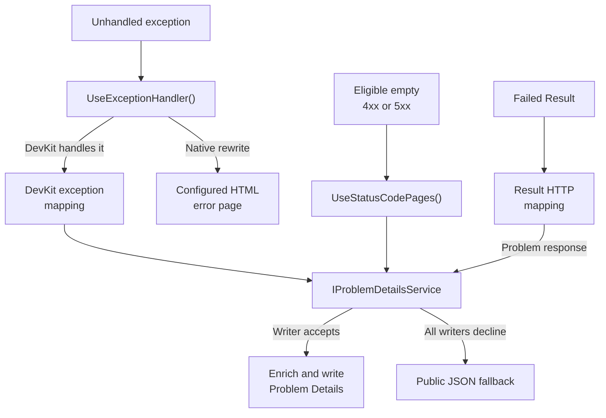

# Exception handling and HTTP Problem Details

> Convert exceptions into consistent Problem Details responses with configurable handlers and mappings.

[TOC]

## Overview

DevKit converts unhandled exceptions and failed Results into HTTP Problem Details in Minimal APIs and MVC. The combined feature uses ASP.NET Core's standard exception middleware, status-code pages, and Problem Details writers. [Problem Details for HTTP APIs](https://www.rfc-editor.org/rfc/rfc9457.html)

## Challenges

Unhandled exceptions need consistent HTTP responses without disclosing stack traces or infrastructure details. Applications also need predictable handler ordering, mappings for application-specific exceptions, database error handling, logging, and environment-specific diagnostics.

## Solution

`AddResponseProblemDetails(...)` configures automatic exception mapping, eligible empty-status responses, and failed Result responses. Use `UseResponseProblemDetails()` to activate both native middleware components. The standalone DevKit handler chain is available through `AddExceptionHandler(...)`.

## Key Features

- shared validation and opt-in exception diagnostics for Minimal APIs and MVC
- request scope for automatic API handling in mixed API and HTML hosts
- built-in handlers for validation, domain, security, module, and infrastructure exceptions
- fluent exception-to-status or exception-to-`ProblemDetails` mappings
- priority-ordered custom handlers and conditional registration
- exact-type ignore and rethrow filters
- optional logging and response enrichment
- Entity Framework Core handlers from `Presentation.Web.EntityFramework`
- development-only debug details and audit logging handlers

## Architecture

ASP.NET Core invokes registered `IExceptionHandler` implementations in order and stops at the first handler that returns true. In the combined setup, the DevKit handler evaluates mappings and writes the response through the same Problem Details service as failed Results. Native status-code pages invoke DevKit's default response for eligible empty statuses.



In a mixed host, `ShouldHandleRequest` can give DevKit first refusal for API exceptions even when ASP.NET Core has rewritten the request to an HTML error page. [Mixed-host setup](#preserve-html-error-pages-in-mixed-hosts)

## Use Cases

- map an application exception to a stable HTTP status and title
- return validation errors as a structured client response
- hide exception details in production while retaining server-side logs
- classify Entity Framework concurrency and constraint failures
- add audit or development diagnostics without replacing the standard middleware

## Basic Usage

Register the combined feature and activate its middleware. This inventory API shows a thrown exception and a validation failure returned as a Result.

```csharp
using BridgingIT.DevKit.Common;
using BridgingIT.DevKit.Presentation.Web;
using HttpResult = Microsoft.AspNetCore.Http.IResult;

var builder = WebApplication.CreateBuilder(args);
builder.Services.AddResponseProblemDetails(options =>
{
    options.IncludeExceptionDetails = builder.Environment.IsDevelopment();
    options.Map<KeyNotFoundException>(404, "Inventory item not found");
});

var app = builder.Build();
app.UseRouting();
app.UseRequestCorrelation();
app.UseResponseProblemDetails();

app.MapGet("/api/inventory/{id:int}", HttpResult (int id) =>
    throw new KeyNotFoundException($"Inventory item {id} was not found."));
app.MapPost("/api/inventory", () =>
    Result.Failure(new ValidationError("Name is required.", "Name")).MapHttpNoContent());

app.Run();
```

The GET returns 404. The POST returns 400 with validation messages at `data.errors.Name`. For an MVC controller, register and map controllers, then use `result.ToOkActionResult()` for a failed Result or let a mapped exception propagate. Both paths use the same HTTP mapping. Automatic `[ApiController]` model validation retains its top-level `errors` object.

`UseResponseProblemDetails()` calls `UseExceptionHandler()` followed by `UseStatusCodePages()`. Call the native methods directly to control pipeline placement or enable either behavior independently. For Results alone, register `AddResultHttpProblemDetails(bool)` and use the HTTP mapping helpers.

## Shared response format

A DevKit validation problem can return the following body. A failed Result can also include its public messages and typed errors at `data.result`.

```json
{
  "type": "https://developer.mozilla.org/en-US/docs/Web/HTTP/Status/400",
  "title": "Validation Error",
  "status": 400,
  "detail": "One or more validation errors occurred.",
  "data": {
    "errors": { "Name": ["Name is required."] }
  },
  "correlationId": "inventory-request",
  "traceId": "request-trace"
}
```

The validation map strips a leading `Entity.` and groups blank field names under `validation`. Exception-bearing Results omit `data.result`. A developer can opt in to `exceptionDetails`, an array of objects with string `type` and `message` fields and optional `stackTrace` and `innerExceptions` fields. Default exception messages stay fixed in public `detail`.

DevKit adds `correlationId` when it prepares a response. Request correlation middleware establishes the ID from the request. Exceptions otherwise use the request trace identifier. Failed Results can also use the ambient correlation ID or the current activity trace ID. `traceId` identifies the trace separately.

When a registered writer accepts a problem, DevKit applies native customization and then `OnBeforeWriteDetails`. Choose the status in a mapping or handler. Enrichment can change the other response fields. When all writers decline, a mapped exception or empty status still returns public `application/problem+json` with request identifiers. A mapped Result uses the native JSON fallback, which retains fields already on the mapper's problem. Both fallbacks skip write hooks and omit optional diagnostics.

## Configure response Problem Details

| Option | Default | Behavior |
| --- | --- | --- |
| `IncludeExceptionDetails` | `false` | Enables the shared diagnostic array for exceptions and exception-bearing Results. |
| `ShouldHandleRequest` | Unset | Overrides which requests get automatic exception or empty-status handling. By default, DevKit honors native exception-page rewrites. |
| `OnBeforeWriteDetails` | None | Enriches an accepted write after native customization and shared preparation. |
| `AllowedHeaderNames` | Correlation, authentication challenge, HSTS, and standard CORS headers | Retains selected response headers after native exception handling clears them. |
| `ShouldLogUnhandledException` | `true` | Writes a DevKit log for handled server exceptions. |
| `ShouldLogResultErrors` | `true` | Logs mapped 5xx Problem Details and custom MVC Result responses when they execute. An explicit mapper logger takes precedence. Set to `false` to disable HTTP Result logging. |

The default mappings preserve the established 400 validation, rule, and domain policy statuses, 401 security status, 404 not-found statuses, and 503 disabled-module status. Other exceptions return 500 unless an application or module maps them. An eligible empty 400–599 response uses its existing status and reason phrase. A declared body, content type, or content length keeps control with the endpoint.

Call `Map<TException>(status, title, typeUri)` for a host override or `MapDefault<TException>(...)` for a reusable module. Overloads accept a factory receiving the exception and optionally the request, with an optional predicate for the context-aware factory. Host overrides run before module defaults, then built-ins and the 500 catch-all. Within each group, the first matching mapping wins. Register more specific exceptions before base types.

Register an application `AddExceptionHandler<THandler>()` before `AddResponseProblemDetails()` when it should have first refusal. Return `false` to continue. To share DevKit enrichment, set the response status and write through `IProblemDetailsService` with the exception in `ProblemDetailsContext.Exception`. A handler that writes directly owns its response. ASP.NET Core handlers are singletons. Resolve scoped services from the current request.

An individually registered `ExceptionHandlerBase<TException>` uses public problem fields with the combined registration. Override `CreateSharedProblemDetails` to provide custom public fields. The combined options control the diagnostic extension and 5xx logging. Set `GlobalExceptionHandlerOptions.EnableLogging` for standalone handler logging.

For optional Entity Framework handlers, register `GlobalExceptionHandlerOptions` as a singleton for their constructor, then register `DbUpdateConcurrencyExceptionHandler`, `DbUpdateExceptionHandler`, and `DbExceptionHandler` individually before `AddResponseProblemDetails()`. The concurrency handler must precede the broader update handler. The combined feature and DevKit's full standalone `AddExceptionHandler(...)` chain are mutually exclusive.

The host can configure native `Microsoft.AspNetCore.Http.ProblemDetailsOptions.CustomizeProblemDetails`. Install a custom `IProblemDetailsWriter` ahead of the framework JSON writer if it should handle an accepted format first. DevKit logs through `ILogger` subject to host log levels. ASP.NET Core diagnostics for a handled exception are controlled separately by native `ExceptionHandlerOptions.SuppressDiagnosticsCallback`. If using framework logging for handled server errors, set `ShouldLogUnhandledException = false` to avoid double logging.

Use `ProblemHttpResult` as the Minimal API server error arm to get HTTP Result logging. If the endpoint declares the native `InternalServerError` arm, pass a logger to the mapper to log the failure.

### Preserve HTML error pages in mixed hosts

By default, DevKit leaves exceptions rewritten by `UseExceptionHandler("/Error")` to the native page. A host can keep that middleware and use `UseResponseProblemDetails()` at its API error boundary with the default options.

Set `ShouldHandleRequest` if one native exception middleware should handle both API and HTML routes. Use the original request path to identify an API request when ASP.NET Core substitutes the error page path. The application must serve `/Error` for the original HTTP methods it handles.

```csharp
using Microsoft.AspNetCore.Diagnostics;

builder.Services.AddResponseProblemDetails(options => options.ShouldHandleRequest = IsApiRequest);

var app = builder.Build();
app.UseExceptionHandler("/Error");
app.UseWhen(IsApiRequest, api => api.UseStatusCodePages());
app.UseWhen(context => !IsApiRequest(context), ui =>
    ui.UseStatusCodePages("text/html; charset=utf-8", "<h1>Request failed ({0})</h1>"));
app.UseRouting();

static bool IsApiRequest(HttpContext context)
{
    var original = context.Features.Get<IExceptionHandlerPathFeature>()?.Path;
    return (original is null ? context.Request.Path : new PathString(original)).StartsWithSegments("/api");
}
```

The API prefix controls scope independently of `Accept`. Place status-page re-execution before routing so the rewritten UI path is routed again. Explicitly mapped Result problems still use the shared policy outside the API prefix.

### Share a problem type URI

Register the same application-owned URI and status for two equivalent failure paths. Return `Result.Failure(new InventoryConflictError())` from a use case that reports an expected conflict.

```csharp
const string conflict = "https://inventory.example/problems/item-conflict";
const string title = "Inventory item conflict";

builder.Services.AddResponseProblemDetails(options =>
    options.Map<InventoryConflictException>(409, title, conflict));

ResultMapHttpExtensions.RegisterErrorHandler<InventoryConflictError>((_, _) =>
    TypedResults.Problem(statusCode: 409, type: conflict, title: title));
```

Here `InventoryConflictException` derives from `Exception`, and `InventoryConflictError` derives from `ResultErrorBase`. Clients can branch on the problem type URI even if the server changes the human-readable title.

### Document the response in OpenAPI

Register the shared schema transformer and declare the statuses the endpoint exposes. DevKit's schema describes grouped validation and optional recursive diagnostics. Use MVC's native validation schema for automatic model errors.

```csharp
builder.Services.AddOpenApi(options =>
    options.AddSchemaTransformer<ResultProblemDetailsSchemaTransformer>());

// After Build()
app.MapOpenApi();
app.MapPost("/api/inventory", CreateInventoryItem)
    .ProducesResultProblem(400)
    .ProducesResultProblem(500);
```

### Migrate from Hellang

Replace the Hellang service registration, `Configure.ProblemDetails(...)`, and `UseProblemDetails()` with the combined DevKit registration and middleware. The combined registration also supplies Result HTTP preparation. Set one disclosure policy, move exception mappings into `Map<TException>`, and transfer any custom header names and response enrichment into DevKit options. Use request scope for hosts with native HTML error pages. Update tests and generated clients for grouped validation, structured diagnostics, and the MVC Result status changes. [ADR-0046](adr/0046-shared-http-problem-details.md#breaking-changes)

## Key concepts

The sections below cover the standalone `AddExceptionHandler(...)` chain and its `GlobalExceptionHandlerOptions`.

- **Exception Handler**: A service that attempts to handle a specific exception type and produce an HTTP response
- **Handler Chain**: A sequence of handlers executed in priority order; the first to handle stops the chain
- **Problem Details**: A standardized JSON format for HTTP API error responses (RFC 9457)
- **Handler Priority**: Higher values execute first; enables fine-grained control over handler ordering

## Configuration schema

### `GlobalExceptionHandlerOptions` properties

| Property | Type | Required | Default | Description |
| ---------- | ------ | ---------- | --------- | ------------- |
| `IncludeExceptionDetails` | `bool` | No | `true` | Include exception details (type, message) in responses. Set to `false` in production. |
| `EnableLogging` | `bool` | No | `false` | Log exceptions to the logging system. Recommended: `true` in all environments. |
| `AdditionalHandlers` | `List<ExceptionHandlerRegistration>` | No | `[]` | Custom exception handlers with optional priority. |
| `Mappings` | `List<ExceptionMapping>` | No | `[]` | Fluent exception-to-response mappings. |
| `IgnoredExceptions` | `HashSet<Type>` | No | `{}` | Exception types to ignore (no response, no logging). |
| `RethrowExceptions` | `HashSet<Type>` | No | `{}` | Exception types to rethrow (bypass handler, propagate up). |
| `EnrichProblemDetails` | `Action<HttpContext, ProblemDetails, Exception>` | No | `null` | Callback to enrich problem details with additional data. |

## Configuration examples

### Example 1: Production configuration

Hide implementation details, enable logging:

```csharp
builder.Services.AddExceptionHandler(options =>
{
    options.IncludeExceptionDetails = false; // Hide technical details
    options.EnableLogging = true;            // Log all exceptions
    
    // Map common exceptions
    options.Map<NotFoundException>(StatusCodes.Status404NotFound, "Resource Not Found")
           .Map<ConflictException>(StatusCodes.Status409Conflict, "Conflict")
           .Map<UnauthorizedException>(StatusCodes.Status401Unauthorized, "Unauthorized");
    
    // Ignore operational cancellations
    options.Ignore<OperationCanceledException>()
           .Ignore<TaskCanceledException>();
    
    // Enrich responses with correlation ID
    options.EnrichProblemDetails = (context, problem, exception) =>
    {
        problem.Extensions["traceId"] = context.TraceIdentifier;
        problem.Extensions["timestamp"] = DateTimeOffset.UtcNow;
    };
});

app.UseExceptionHandler();
```

**Production response:**

```json
{
  "type": "https://httpstatuses.io/404",
  "title": "Resource Not Found",
  "status": 404,
  "traceId": "0HN4GBRMVDVP8:00000001",
  "timestamp": "2026-01-20T12:00:00Z"
}
```

### Example 2: Development configuration

Include full exception details for debugging:

```csharp
builder.Services.AddExceptionHandler(options =>
{
    options.IncludeExceptionDetails = true;  // Show full details
    options.EnableLogging = true;
    
    // Debug handler with highest priority in development
    options.AddHandler<DebugExceptionHandler>(priority: 999);
    
    // Audit handler to track errors
    options.AddHandler<AuditExceptionHandler>(priority: 1000);
    
    // Add database handlers
    options.AddEntityFrameworkHandlers();
    
    // Detailed enrichment for development
    options.EnrichProblemDetails = (context, problem, exception) =>
    {
        problem.Extensions["traceId"] = context.TraceIdentifier;
        problem.Extensions["timestamp"] = DateTimeOffset.UtcNow;
        problem.Extensions["environment"] = "Development";
    };
});

app.UseExceptionHandler();
```

**Development response:**

```json
{
  "type": "https://httpstatuses.io/500",
  "title": "Debug Information",
  "status": 500,
  "detail": "The object is already disposed.",
  "instance": "/api/users/123",
  "debugInfo": {
    "exceptionType": "System.ObjectDisposedException",
    "stackTrace": ["at MyService.GetUser(Int32 id) in MyService.cs:line 45", ...],
    "innerExceptions": [...],
    "requestInfo": { "method": "GET", "path": "/api/users/123", ... }
  },
  "traceId": "0HN4GBRMVDVP8:00000001",
  "timestamp": "2026-01-20T12:00:00Z",
  "environment": "Development"
}
```

### Example 3: Fluent exception mapping

Quick configuration without custom handlers:

```csharp
builder.Services.AddExceptionHandler(options =>
{
    options.IncludeExceptionDetails = builder.Environment.IsDevelopment();
    options.EnableLogging = true;
    
    // Map simple cases
    options.Map<NotFoundException>(StatusCodes.Status404NotFound, "Not Found")
           .Map<ConflictException>(StatusCodes.Status409Conflict, "Conflict")
           .Map<UnauthorizedException>(StatusCodes.Status401Unauthorized, "Unauthorized");
    
    // Map with custom factory for complex logic
    options.Map<ValidationException>((ex, context) => new ProblemDetails
    {
        Title = "Validation Failed",
        Status = StatusCodes.Status422UnprocessableEntity,
        Detail = ex.Message,
        Extensions = new Dictionary<string, object>
        {
            ["errors"] = ex.Errors
                .GroupBy(e => e.PropertyName)
                .ToDictionary(g => g.Key, g => g.Select(e => e.ErrorMessage).ToArray())
        }
    });
});

app.UseExceptionHandler();
```

### Example 4: Custom handlers with priority

Multiple custom handlers with controlled execution order:

```csharp
builder.Services.AddExceptionHandler(options =>
{
    options.IncludeExceptionDetails = builder.Environment.IsDevelopment();
    options.EnableLogging = true;
    
    // Audit handler runs first and returns false so handling can continue
    options.AddHandler<AuditExceptionHandler>(priority: 1100);

    // Security handler handles matching exceptions
    options.AddHandler<SecurityExceptionHandler>(priority: 1000);
    
    // Business logic handlers: medium priority
    options.AddHandler<BusinessRuleExceptionHandler>(priority: 500);
    options.AddHandler<ValidationExceptionHandler>(priority: 499);
    
    // Infrastructure handlers: lower priority
    options.AddHandler<ExternalServiceExceptionHandler>(priority: 99);
});

app.UseExceptionHandler();
```

### Example 5: Exception filtering

Control which exceptions are handled vs ignored:

```csharp
builder.Services.AddExceptionHandler(options =>
{
    options.IncludeExceptionDetails = builder.Environment.IsDevelopment();
    options.EnableLogging = true;
    
    // Ignore operational cancellations
    options.Ignore<OperationCanceledException>()
           .Ignore<TaskCanceledException>();
    
    // Rethrow critical system exceptions
    options.Rethrow<OutOfMemoryException>()
           .Rethrow<StackOverflowException>()
           .Rethrow<CriticalSystemException>();
    
    // Map common exceptions
    options.Map<NotFoundException>(StatusCodes.Status404NotFound);
});

app.UseExceptionHandler();
```

### Example 6: Conditional handler registration

Register handlers based on environment or feature flags:

```csharp
var environment = builder.Environment;
var featureFlags = builder.Configuration.GetSection("FeatureFlags");

builder.Services.AddExceptionHandler(options =>
{
    options.IncludeExceptionDetails = environment.IsDevelopment();
    options.EnableLogging = true;
    
    // Debug handler only in development
    options.AddHandler<DebugExceptionHandler>(
        when: environment.IsDevelopment(),
        priority: 1000);
    
    // Audit handler in all non-development environments
    options.AddHandler<AuditExceptionHandler>(
        when: !environment.IsDevelopment(),
        priority: 999);
    
    // Analytics handler if enabled
    options.AddHandler<AnalyticsExceptionHandler>(
        when: featureFlags.GetValue<bool>("EnableExceptionAnalytics"),
        priority: 500);
    
    // Add database handlers if using EF Core
    options.AddEntityFrameworkHandlers(
        when: featureFlags.GetValue<bool>("UseEntityFramework"));
});

app.UseExceptionHandler();
```

### Example 7: Complete production setup

Comprehensive configuration combining all features:

```csharp
builder.Services.AddExceptionHandler(options =>
{
    var isDevelopment = builder.Environment.IsDevelopment();
    
    options.IncludeExceptionDetails = isDevelopment;
    options.EnableLogging = true;
    
    // --- Handlers ---
    options.AddHandler<AuditExceptionHandler>(priority: 1000);
    options.AddHandler<DebugExceptionHandler>(when: isDevelopment, priority: 999);
    
    // --- Exception Mapping ---
    options.Map<NotFoundException>(StatusCodes.Status404NotFound, "Resource Not Found")
           .Map<ConflictException>(StatusCodes.Status409Conflict, "Conflict")
           .Map<UnauthorizedException>(StatusCodes.Status401Unauthorized, "Unauthorized")
           .Map<ForbiddenException>(StatusCodes.Status403Forbidden, "Forbidden");
    
    // --- Exception Filtering ---
    options.Ignore<OperationCanceledException>()
           .Ignore<TaskCanceledException>()
           .Rethrow<OutOfMemoryException>();
    
    // --- Database Handlers ---
    options.AddEntityFrameworkHandlers();
    
    // --- Problem Details Enrichment ---
    options.EnrichProblemDetails = (context, problem, exception) =>
    {
        problem.Extensions["traceId"] = context.TraceIdentifier;
        problem.Extensions["timestamp"] = DateTimeOffset.UtcNow;
        
        if (!isDevelopment)
        {
            return; // Don't expose additional info in production
        }
        
        problem.Extensions["path"] = context.Request.Path;
        problem.Extensions["method"] = context.Request.Method;
    };
});

app.UseExceptionHandler();
```

## Built-in exception handlers

### Domain and application exceptions

| Handler | Exception | Status | Use Case |
| --------- | ----------- | -------- | ---------- |
| `ValidationExceptionHandler` | `ValidationException` | 400 | FluentValidation errors |
| `DomainPolicyExceptionHandler` | `DomainPolicyException` | 400 | Policy violations |
| `DomainRuleExceptionHandler` | `RuleException` | 400 | Business rule violations |
| `AggregateNotFoundExceptionHandler` | `AggregateNotFoundException` | 404 | Domain aggregate not found |
| `EntityNotFoundExceptionHandler` | `EntityNotFoundException` | 404 | Entity not found |
| `SecurityExceptionHandler` | `SecurityException` | 401 | Security violations |
| `MappedExceptionHandler` | Configured exception types | Configured | Fluent exception mappings |
| `NotImplementedExceptionHandler` | `NotImplementedException` | 501 | Not implemented features |
| `HttpRequestExceptionHandler` | `HttpRequestException` | 503 | External service errors |
| `ModuleNotEnabledExceptionHandler` | `ModuleNotEnabledException` | 503 | Disabled modules |

### Diagnostic handlers

| Handler | Exception | When to Use |
| --------- | ----------- | ------------ |
| `DebugExceptionHandler` | `Exception` (catch-all) | Register explicitly in Development; writes full stack traces and context |
| `AuditExceptionHandler` | `Exception` (observes and returns `false`) | Register explicitly before handling handlers to log user, request, and exception context |

### Database exception handlers

Register with `options.AddEntityFrameworkHandlers()`:

| Handler | Exception | Status | Use Case |
| --------- | ----------- | -------- | ---------- |
| `DbUpdateConcurrencyExceptionHandler` | `DbUpdateConcurrencyException` | 409 | Optimistic concurrency violations |
| `DbUpdateExceptionHandler` | `DbUpdateException` | 422/409 | Constraint violations, FK errors |
| `DbExceptionHandler` | `DbException` | 503 | Connection errors, general DB errors |

#### `DbUpdateConcurrencyExceptionHandler`

Handles optimistic concurrency violations when multiple users modify the same entity simultaneously.

**Exception:** `DbUpdateConcurrencyException`  
**Status Code:** 409 Conflict

**Scenario:**

```csharp
// User A and B both fetch the same product with Version=1
var product = await dbContext.Products.FirstAsync(p => p.Id == 1);
product.Price = 19.99;
product.Version = 1; // Optimistic lock field

await dbContext.SaveChangesAsync(); // User B already saved with Version=2
// Throws DbUpdateConcurrencyException
```

**Production response:**

```json
{
  "type": "https://httpstatuses.io/409",
  "title": "Concurrency Conflict",
  "status": 409,
  "detail": "The record was modified by another user. Please refresh and try again.",
  "instance": "/api/products/1",
  "traceId": "0HN4GBRMVDVP8:00000001"
}
```

**In development** (when `IncludeExceptionDetails = true`), the detail and affected entities are included:

```json
{
  "detail": "[DbUpdateConcurrencyException] Concurrency conflict detected for: Product. Store update, insert, or delete statement affected an unexpected number of rows.",
  "affectedEntities": [
    {
      "entity": "Product",
      "state": "Modified"
    }
  ]
}
```

#### `DbUpdateExceptionHandler`

Handles database constraint violations including unique constraints, foreign key errors, and check constraints. Automatically classifies errors based on exception message to return appropriate status codes.

**Exception:** `DbUpdateException`  
**Status Code:** 409 (Unique/Duplicate) or 422 (Other violations)

**Unique Constraint Violation:**

```csharp
var user = new User { Email = "john@example.com" };
dbContext.Users.Add(user);
await dbContext.SaveChangesAsync(); // Email already exists (unique index)
// Throws DbUpdateException
```

**Response with exception details enabled (409 Conflict):**

```json
{
  "type": "https://httpstatuses.io/409",
  "title": "Database Update Failed",
  "status": 409,
  "detail": "Violation of UNIQUE KEY constraint 'UQ_Users_Email'.",
  "instance": "/api/users",
  "errorType": "UniqueConstraintViolation",
  "traceId": "0HN4GBRMVDVP8:00000001"
}
```

**Foreign Key Constraint Violation:**

```csharp
var order = new Order { CustomerId = 999 }; // CustomerId doesn't exist
dbContext.Orders.Add(order);
await dbContext.SaveChangesAsync();
// Throws DbUpdateException
```

**Response with exception details enabled (422 Unprocessable Entity):**

```json
{
  "type": "https://httpstatuses.io/422",
  "title": "Database Update Failed",
  "status": 422,
  "detail": "The INSERT, UPDATE, or DELETE statement conflicted with a FOREIGN KEY constraint.",
  "instance": "/api/orders",
  "errorType": "ForeignKeyViolation",
  "traceId": "0HN4GBRMVDVP8:00000001"
}
```

**Error type classification:**

| Classification | Keywords | Status |
| --- | --- | --- |
| `UniqueConstraintViolation` | UNIQUE, DUPLICATE, IX_, UK_, PRIMARY KEY | 409 |
| `ForeignKeyViolation` | FOREIGN KEY, REFERENCE, FK_ | 422 |
| `NotNullViolation` | NOT NULL, CANNOT INSERT NULL, NULL VALUE | 422 |
| `CheckConstraintViolation` | CHECK CONSTRAINT, CK_ | 422 |
| `DataTruncation` | TRUNCAT, TOO LONG, DATA TOO LONG | 422 |
| `DatabaseError` | (default/unrecognized) | 422 |

#### `DbExceptionHandler`

Handles general database errors including connection timeouts, deadlocks, and other infrastructure issues.

**Exception:** `DbException`  
**Status Code:** 503 Service Unavailable

**Scenario:**

```csharp
// Database connection timeout, deadlock, or other infrastructure error
await dbContext.Products.ToListAsync();
// Throws DbException (or derived class)
```

**Response:**

```json
{
  "type": "https://httpstatuses.io/503",
  "title": "Database Error",
  "status": 503,
  "detail": "A database error occurred. Please try again later.",
  "instance": "/api/products",
  "traceId": "0HN4GBRMVDVP8:00000001"
}
```

**In development:**

```json
{
  "detail": "[SqlException] Timeout expired. The timeout period elapsed prior to completion of the operation."
}
```

The handler writes the provider error code to the server log; it does not add that code to the response.

## Problem Details response format

Exception handlers produce Problem Details responses. Extension members such as `traceId` and `timestamp` appear only when a handler or `EnrichProblemDetails` adds them:

```json
{
  "type": "https://httpstatuses.io/400",
  "title": "Bad Request",
  "status": 400,
  "detail": "[ValidationException] A model validation error has occurred while executing the request",
  "instance": "/api/products",
  "errors": {
    "name": ["Name is required"],
    "price": ["Price must be greater than 0"]
  },
  "traceId": "0HN4GBRMVDVP8:00000001",
  "timestamp": "2026-01-20T12:00:00Z"
}
```

### Standard properties

- **type**: URI identifying the problem type (links to HTTP status documentation)
- **title**: Short human-readable summary
- **status**: HTTP status code
- **detail**: Detailed explanation; set `IncludeExceptionDetails = false` to omit exception details in production (the option defaults to `true`)
- **instance**: Request path that triggered the error
- **extension members**: Custom key-value pairs added through `ProblemDetails.Extensions`; JSON serialization places them beside the standard properties

## Using exception handlers in Minimal APIs

Exception handlers apply globally by default:

```csharp
var group = app.MapGroup("/api/products");

group.MapGet("/", GetProducts);
group.MapGet("/{id}", GetProduct);
group.MapPost("/", CreateProduct);

async Task<IResult> GetProducts() => Results.Ok(await _service.GetAllAsync());

async Task<IResult> GetProduct(int id)
    => Results.Ok(await _service.GetRequiredByIdAsync(id));

async Task<IResult> CreateProduct(CreateProductRequest request)
{
    var product = await _service.CreateAsync(request);
    return Results.Created($"/api/products/{product.Id}", product);
}
```

**How it works:**

1. `CreateProduct` validation throws `ValidationException`
2. `ValidationExceptionHandler` catches it
3. Returns 400 with validation errors
4. `GetProduct` throws `EntityNotFoundException` (not found)
5. `EntityNotFoundExceptionHandler` catches it
6. Returns 404 with "Entity Not Found"

## Custom exception handlers

Extend `ExceptionHandlerBase<TException>` to create custom handlers:

```csharp
using BridgingIT.DevKit.Domain;
using BridgingIT.DevKit.Presentation.Web;

public class MyBusinessException : DomainException
{
    public string ErrorCode { get; set; }
    public Dictionary<string, object> Context { get; set; }
}

public class MyBusinessExceptionHandler : ExceptionHandlerBase<MyBusinessException>
{
    public MyBusinessExceptionHandler(
        ILogger<MyBusinessExceptionHandler> logger,
        GlobalExceptionHandlerOptions options)
        : base(logger, options)
    {
    }

    protected override int StatusCode => StatusCodes.Status422UnprocessableEntity;

    protected override string Title => "Business Error";

    protected override string GetDetail(MyBusinessException exception)
    {
        return this.Options.IncludeExceptionDetails
            ? $"[{exception.ErrorCode}] {exception.Message}"
            : "A business error occurred.";
    }

    protected override ProblemDetails CreateProblemDetails(
        HttpContext httpContext,
        MyBusinessException exception)
    {
        var problemDetails = base.CreateProblemDetails(httpContext, exception);

        if (!string.IsNullOrEmpty(exception.ErrorCode))
        {
            problemDetails.Extensions["errorCode"] = exception.ErrorCode;
        }

        if (exception.Context?.Count > 0)
        {
            problemDetails.Extensions["context"] = exception.Context;
        }

        return problemDetails;
    }
}
```

Register custom handler:

```csharp
builder.Services.AddExceptionHandler(options =>
{
    options.AddHandler<MyBusinessExceptionHandler>(priority: 500);
});
```

## Security best practices

1. **Never include exception details in production**

   ```csharp
   options.IncludeExceptionDetails = builder.Environment.IsDevelopment();
   ```

2. **Always enable logging**

   ```csharp
   options.EnableLogging = true;
   ```

3. **Use meaningful but generic titles**

   Wrong:

   ```json
   {
     "detail": "SQL syntax error on line 45 of UserRepository.cs"
   }
   ```

   Correct:

   ```json
   {
     "detail": "A database error occurred. Please try again later."
   }
   ```

## Troubleshooting

### Issue: Exceptions are not being caught

**Symptoms:**

- Application crashes instead of returning 500 response
- No exception handler response

**Solutions:**

1. **Verify middleware is registered**

   ```csharp
   app.UseExceptionHandler();
   ```

2. **Check middleware order**
   - Place it before the middleware and endpoints whose exceptions it must handle
   - A common order is routing → exception handler → authorization → endpoints

   ```csharp
   app.UseRouting();
   app.UseExceptionHandler();      // ✅ Correct position
   app.UseAuthorization();
   ```

3. **Verify exception handler is registered in DI**

   ```csharp
   builder.Services.AddExceptionHandler(options => { /* ... */ });
   ```

### Issue: Wrong handler is executing

**Symptoms:**

- Exception returns unexpected status code
- Wrong error title/message

**Solution:**
Check handler priority and execution order:

```csharp
options.AddHandler<SpecificHandler>(priority: 100);    // Executes first
options.AddHandler<GenericHandler>(priority: 50);      // Executes second
// Built-in handlers execute after (priority 0)
```

Use highest priority for most specific handlers.

### Issue: Exception details showing in production

**Symptoms:**

- Stack traces and sensitive info in JSON responses

**Solution:**

```csharp
options.IncludeExceptionDetails = false; // Set explicitly
```

### Debugging tips

1. **Enable detailed logging**

   ```json
   {
     "Logging": {
       "LogLevel": {
         "BridgingIT.DevKit.Presentation.Web": "Debug"
       }
     }
   }
   ```

2. **Use development settings locally**

   ```csharp
   options.IncludeExceptionDetails = true;
   ```

3. **Test exception handlers directly**

   ```csharp
   var handler = new ValidationExceptionHandler(logger, options);
   var context = new DefaultHttpContext();
   var exception = new ValidationException("test error");
   
   var handled = await handler.TryHandleAsync(context, exception, CancellationToken.None);
   Assert.IsTrue(handled);
   Assert.Equal(StatusCodes.Status400BadRequest, context.Response.StatusCode);
   ```

## Additional resources

- [ASP.NET Core Error Handling](https://learn.microsoft.com/en-us/aspnet/core/fundamentals/error-handling)
- [Problem Details for HTTP APIs (RFC 9457)](https://www.rfc-editor.org/rfc/rfc9457.html)
