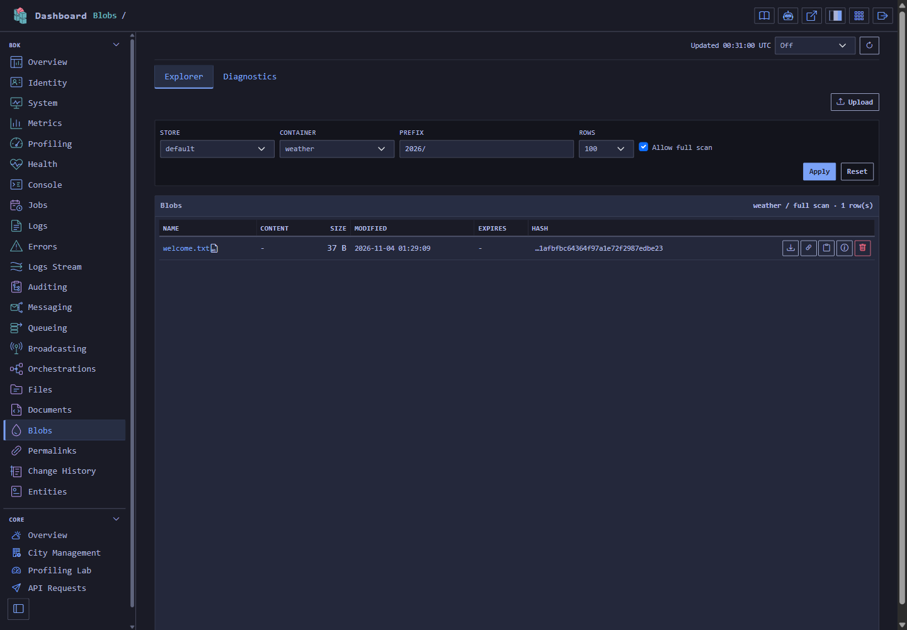

# Blob Storage

> Store binary content through Result-native, stream-first, provider-neutral blob clients.

[TOC]

## Overview

Blob Storage stores binary payloads such as reports, exports, attachments, images, and generated artifacts. It is separate from Document Storage: blob clients store streams under a `BlobKey`, while document clients store typed JSON-like documents.

The public API is provider-neutral and Result-native. Consumers resolve named clients through `IBlobStoreClientFactory`, then call upload, download, properties, exists, list, and delete operations that return `Result` or `Result<T>`.

Implemented providers:

- In-memory
- Filesystem through the optional `Infrastructure.FileSystem` package
- Entity Framework Core
- Azure Blob Storage

## Challenges

Binary content must remain stream-first while still supporting provider-neutral metadata, integrity, optimistic concurrency, bounded listing, and predictable ownership. Large transfers also need size limits and admission control without forcing application code to depend on a database or cloud SDK.

## Solution

Named `IBlobStoreClient` instances expose Result-native upload, download, property, existence, listing, and delete operations. The validating client enforces common rules before delegating to an in-memory, filesystem, Entity Framework, or Azure provider. Optional behaviors add logging, metrics, retry, timeout, caching, transforms, checksum verification, chaos, and upload admission.

## Key Features

- stream-first uploads and caller-disposed downloads
- provider-neutral keys, metadata, ETags, expiration, and SHA-256 hashes
- query-bound continuation tokens and guarded full scans
- named clients with in-memory, filesystem, Entity Framework, and Azure Blob providers
- compression, encryption, content-type detection, caching, and verification behaviors
- bounded upload concurrency and provider-native retention
- optional HTTP, dashboard, diagnostics, MCP, and maintenance-job integration

## Architecture

`IBlobStoreClientFactory` resolves a named decorated client. Client behaviors wrap `BlobStoreClient`, which validates provider-neutral requests and calls `IBlobStoreProvider`. Providers own persistence and native paging; the client and behaviors own cross-provider semantics. The retention service resolves providers directly so cleanup remains bounded and provider-native.

## Use Cases

- store reports, exports, images, attachments, and generated artifacts
- stream large content without materializing it in application memory
- serve public reads separately from protected maintenance endpoints
- transfer content between blob and file-storage providers
- retain temporary blobs and delete guarded prefixes
- persist blobs on application-owned local disks or configured file shares

## Basic Usage

This example registers an in-memory named client, uploads UTF-8 content, checks each result, disposes the returned download, and returns the stored content and metadata.

```csharp
using System.Text;
using BridgingIT.DevKit.Application.Storage;
using BridgingIT.DevKit.Common;

var builder = WebApplication.CreateBuilder(args);

builder.Services.AddBlobStorage()
    .WithInMemoryClient("reports");

var app = builder.Build();

app.MapPut("/blobs/reports/{name}", async (
    string name,
    IBlobStoreClientFactory factory,
    CancellationToken cancellationToken) =>
{
    var blobs = factory.CreateClient("reports");
    var content = Encoding.UTF8.GetBytes($"Report: {name}");
    await using var source = new MemoryStream(content, writable: false);

    var uploaded = await blobs.UploadAsync(new BlobUpload
    {
        Key = new BlobKey("reports", name),
        Content = source,
        ContentType = ContentType.TXT
    }, cancellationToken);

    if (uploaded.IsFailure)
    {
        return Results.Problem(string.Join(
            "; ",
            uploaded.Errors.Select(error => error.Message)));
    }

    var downloaded = await blobs.DownloadAsync(
        uploaded.Value.Key,
        cancellationToken);

    if (downloaded.IsFailure)
    {
        return Results.Problem(string.Join(
            "; ",
            downloaded.Errors.Select(error => error.Message)));
    }

    await using var download = downloaded.Value;
    using var reader = new StreamReader(
        download.Content,
        Encoding.UTF8,
        leaveOpen: true);
    var text = await reader.ReadToEndAsync(cancellationToken);

    return Results.Ok(new
    {
        download.Info.Key.Container,
        download.Info.Key.Name,
        download.Info.Length,
        download.Info.ContentHash,
        Content = text
    });
});

app.Run();
```

`PUT /blobs/reports/june.txt` returns the uploaded key, length, content hash, and `Report: june.txt`. The upload stream stays caller-owned; disposing `BlobDownload` closes the returned content stream.

## Rules and limits

- `BlobKey` contains `Container` and `Name`.
- Upload and download are stream-first.
- Caller-provided upload streams are not disposed by Blob Storage.
- Returned `BlobDownload` instances own the returned content stream and should be disposed by the caller.
- `ContentType?` is used in public models, with MIME conversion through `ContentTypeExtensions`.
- Content hashes use `sha256:<lowercase-64-character-hex>`.
- `ExpectedContentHash` is validated before content is committed.
- `BlobStoreOptions.MaxBlobSize` is enforced per named client.
- Properties, list, and exists operations do not download blob content.
- Listing returns `BlobInfo` only, never content streams.
- Full container scans require global client configuration and query-level approval.
- Delete is idempotent.
- Range downloads, resumable uploads, resumable downloads, and public lease APIs are not part of this feature.
- Optional HTTP endpoints live in `Presentation.Web.Storage` and are registered separately for maintenance metadata operations and read-only content downloads.
- Optional dashboard pages live in `Presentation.Web.Storage` and are discovered by the DevKit dashboard when Blob Storage has registered clients.

## Registration

Register Blob Storage once, then add named clients. The first registered behavior is the outermost decorator.

```csharp
using Azure.Storage.Blobs;
using BridgingIT.DevKit.Application.Storage;
using BridgingIT.DevKit.Common;
using Microsoft.Extensions.DependencyInjection;

services.AddMetrics(options => options.Enabled());
services.AddSingleton(new BlobServiceClient(connectionString));

services.AddBlobStorage(options => options
        .Enabled(true)
        .WithRetention(retention =>
        {
            retention.StartupDelay = TimeSpan.FromSeconds(15);
            retention.SweepInterval = TimeSpan.FromHours(1);
            retention.BatchSize = 1000;
        }))
    .WithLoggingBehavior()
    .WithMetricsBehavior()
    .WithContentTypeDetectionBehavior()
    .WithChecksumVerificationBehavior()
    .WithCacheBehavior(cache =>
    {
        cache.SlidingExpiration = TimeSpan.FromMinutes(10);
        cache.MaxCachedBlobSize = ByteSize.Megabytes(10);
    })
    .WithRetryBehavior()
    .WithTimeoutBehavior()
    .WithInMemoryClient("transient", options =>
    {
        options.MaxBlobSize = ByteSize.Megabytes(10);
    })
    .WithEntityFrameworkClient<AppDbContext>("reports", options =>
    {
        options.MaxBlobSize = ByteSize.Megabytes(50);
        options.ChunkSize = (int)ByteSize.Megabytes(4);
        options.AllowFullScans = true;
    })
    .WithAzureBlobClient("media", configure: options =>
    {
        options.MaxBlobSize = ByteSize.Megabytes(500);
        options.DefaultTake = 100;
        options.MaxTake = 500;
    });
```

`WithAzureBlobClient` maps `BlobKey.Container` to the native Azure container and `BlobKey.Name` to the native blob name. There is no registration-level container override.

`AddBlobStorage` also registers the provider-neutral `IBlobStorageDiagnosticsService` and the blob-retention background service, so diagnostics snapshots and expiration sweeping are available without additional registration calls.

## Filesystem provider

The optional `BridgingIT.DevKit.Infrastructure.FileSystem` package provides `FileSystemBlobStoreProvider`. It uses direct file I/O and the existing blob client pipeline. Registration does not require File Storage, a database, or a cloud SDK.

```csharp
using BridgingIT.DevKit.Application.Storage;
using BridgingIT.DevKit.Infrastructure.FileSystem;
using Microsoft.Extensions.DependencyInjection;

var storageRoot = Path.GetFullPath(
	Path.Combine(builder.Environment.ContentRootPath, "app-data", "storage"));

builder.Services.AddBlobStorage()
	.WithFileSystemClient("reports", storageRoot,
		configureFileSystem: options =>
		{
			options.AccessKind = FileSystemStorageAccessKind.Local;
			options.Durability = FileSystemStorageDurability.Durable;
		},
		configure: options =>
		{
			options.DefaultTake = 100;
			options.MaxTake = 500;
		});
```

Resolve `"reports"` through `IBlobStoreClientFactory` as in [Basic Usage](#basic-usage). The example stores files beneath the application's content root. Use an absolute persistent data path when deployment replaces the application directory. Retention, transforms, behaviors, diagnostics, and transfers use the same APIs as other blob providers.

### Platforms and access protocols

Set `AccessKind` to the actual protocol used to reach the root. A share mounted as a directory still requires `Smb` or `Nfs`.

| Host | Declared access kinds | Root |
|---|---|---|
| Windows | `Local`, `Smb` | Absolute local path or SMB share path |
| Linux | `Local`, `Smb`, `Nfs` | Absolute local path or mounted share path |

Windows NFS and other operating systems are unsupported. Each store records one access kind. All processes and hosts opening that store must use the same kind. Blob and document providers can share a root because they use separate namespaces.

The implementation includes the shared-access protocol, but SMB, NFS, independent-host recovery, and power-loss qualification remain pending. Required native filesystem operations fail clearly when unsupported. Linux publication requires atomic hard-link installation and directory flush support. Windows publication requires write-through moves and POSIX replacement support from the filesystem or server. Local test results do not qualify a remote deployment.

### Configuration

`configureFileSystem` sets physical storage options. The separate `configure` delegate sets the existing `BlobStoreOptions`, including size limits and scan approval.

| `FileSystemStorageOptions` member | Default | Meaning |
|---|---|---|
| `RootPath` | Required registration argument | Absolute provider-owned directory |
| `AccessKind` | `Local` | Actual access protocol |
| `CreateRoot` | `true` | Permit store creation. When false, an initialized compatible store must exist. |
| `Durability` | `Durable` | Required persistence before acknowledging mutations |
| `LockAcquireTimeout` | 5 seconds | Interruptible authority acquisition budget. Zero means no wait. An outstanding native I/O call can exceed this budget. |
| `TransferBufferSize` | 65,536 bytes | Pooled blob transfer buffer |
| `MaxManifestBytes` | 1,048,576 bytes | Maximum serialized record metadata |
| `MaxQueryMetadataEntries` | 100,000 | Maximum metadata entries examined by one query |
| `MaxRetentionMetadataEntries` | 10,000 | Discovery and metadata work budget per retention sweep |

### Layout, concurrency, and queries

The provider owns the directory layout. Ordinal logical keys map to hashed paths, with original identities checked in metadata. Key casing, Unicode, and logical path separators remain independent of OS filename rules. Do not edit, rename, or import files directly into this layout. Experimental format-1 roots are rejected without automatic migration. Back up the complete root with every participant quiesced. Live backups are unqualified.

Uploads stream into immutable payload generations. A per-key authority protects conditional publication of the current metadata file. Property updates reuse the payload generation. Deletes publish tombstones. Existing download handles remain readable through replacement or deletion, and callers still dispose `BlobDownload`.

Local access coordinates cooperating processes through exclusive file handles. Shared access uses persistent ownership markers that never expire by age. Different keys have separate authority. All participants need compatible OS permissions to create, read, flush, and delete files and directories.

Exact-key operations resolve their paths directly. Listing examines metadata, prunes by container, and returns ordinal key pages without opening payloads. Page tokens track a live key position. Concurrent inserts, updates, and deletes can affect subsequent pages. Queries that exceed `MaxQueryMetadataEntries` fail instead of returning an incomplete successful page. Existing full-scan approval rules still apply.

### Durability and recovery

`Durable` is the default. Before success, publication performs the platform's file and namespace persistence operations. A Durable property update also flushes its referenced payload, including payloads written previously in Buffered mode.

`Buffered` permits loss of recent acknowledged metadata changes after host failure while retaining atomic publication. Staging, initialization, and safe reclamation still perform persistence operations. Buffered mode does not promise zero flushes or higher throughput.

An uncertain mutation returns `BlobStoreIndeterminateOperationError` with a mutation identity. The standard retry behavior does not replay it. Shared uncertain operations retain ownership and can block later operations. Recovery requires quiescing every participant on every host, reconciling fresh server-confirmed metadata, and draining or cancelling old server operations before clearing ownership. A timeout or an old marker alone does not authorize takeover.

See the [filesystem provider guide](storage-filesystem-providers.md) for native persistence details, recovery tooling, benchmarks, and opt-in share tests. Share tests are inactive by default and skip host-inapplicable cases. Enable them later with actual disposable shares and external qualification configuration. Full performance qualification remains open.

### Public storage helpers

`FileSystemBlobStoreProvider.Store` exposes `FileSystemStore` for trusted diagnostics, maintenance, and explicit recovery. The store, authority, durability, staged-payload, retention, and diagnostic helpers are public and have XML documentation with examples. `Store.Options` returns a configuration copy, and `FileSystemStore.Json` is read-only. Authority handles and active configuration stay private.

Normal blob operations use `IBlobStoreClient`. Direct helper calls require the documented ownership and persistence rules. In particular, acquire key authority before selecting a payload or deciding a mutation, and keep authority through publication. See [public storage helpers](storage-filesystem-providers.md#public-storage-helpers) for the low-level API and recovery preconditions.

## Metrics

`WithMetricsBehavior()` emits these instruments through the `bdk` meter, all tagged with `operation` and `store` only:

| Instrument | Type | Meaning |
|---|---|---|
| `blobstorage_operations` | counter | Completed operations. |
| `blobstorage_operation_duration` | histogram (ms) | Operation duration. |
| `blobstorage_operation_failures` | counter | Failed operations. |
| `blobstorage_bytes` | counter | Cumulative bytes, taken from the blob metadata length. |
| `blobstorage_bytes_per_second` | histogram (`By/s`) | Transfer rate of one successful upload or download. |
| `blobstorage_list_items` | counter | Items returned by list operations. |

`blobstorage_bytes_per_second` is recorded for `upload` and `download` only, and only when bytes and elapsed time are both greater than zero. Failed and empty transfers are skipped. The `operation` tag separates write rates from read rates.

- **Upload:** bytes are the stored length and the duration is the whole call, including any wait for upload admission. The rate is lower than raw provider throughput while uploads queue.
- **Download of an in-memory result** (every EF blob up to `ChunkSize`): recorded when the download method returns, using the content length.
- **Streaming download** (larger blobs, Azure): the behavior wraps the content stream, counts the bytes the caller actually reads, and records once when the download is disposed. The duration is the time to open the stream plus the time spent inside reads, so a slow consumer does not lower the rate. A stream disposed without reading records nothing.
- **Batched reads** (`DownloadBytesManyAsync`): each key records its own sample, and each sample includes the wait on the shared batch read. Treat the per-key rate as a lower bound. The aggregate rate of a batch is higher.

The metrics service gives `By/s` histograms explicit bucket boundaries from 1 KB/s to 1 GB/s. Without them the default OpenTelemetry boundaries (up to 10,000) would put every sample in the overflow bucket. Use the rate of the `blobstorage_bytes` counter for sustained throughput and the histogram for the per-transfer distribution.

## Operation profiling

Register Profiling before other behaviors to measure their downstream work:

```csharp
services.AddBlobStorage()
    .WithProfilingBehavior()
    .WithInMemoryClient("archive");
```

All seven client methods join an existing operation or create a `BlobStorage` operation with key `blobstorage:{operation}`. Dimensions are `blobstorage.store`, `blobstorage.container` and `blobstorage.operation`. Container names come from the key, upload, property update or listing query; blob names, prefixes, tokens and content are omitted. Returned download streams retain caller ownership, and timing ends when the download method returns. See [Storage profiling behaviors](features-profiling.md#storage-behaviors) for optional registration, classification and dimension comparisons.

##  High-volume uploads

Use the optional upload-concurrency behavior when bursts must not open an unbounded number of provider operations, contexts, transactions, or database connections. Admission is shared by every DI scope in one process and isolated by case-insensitive named store.

```csharp
services.AddBlobStorage()
    .WithLoggingBehavior()
    .WithMetricsBehavior()
    .WithTimeoutBehavior(options => options.Timeout = TimeSpan.FromMinutes(2))
    .WithRetryBehavior(options => options.Attempts = 3)
    .WithUploadConcurrencyBehavior(options =>
    {
        options.MaxConcurrentUploads = 4;
        options.MaxQueuedUploads = 16;
        options.QueueWaitTimeout = TimeSpan.FromSeconds(30);
    })
    .WithEntityFrameworkClient<AppDbContext>("reports", options =>
    {
        options.ChunkSize = (int)ByteSize.Megabytes(4);
        options.ChunkFlushCount = 4;
        options.MaxPendingChunkBytes = ByteSize.Megabytes(16);
    });
```

`WithMetricsBehavior()` and the provider-level EF flush instruments resolve the optional shared `IMetricsService`. Register it once with `AddMetrics(options => options.Enabled())` to emit metrics through the `bdk` meter. When it is not registered, blob operations, upload admission, and EF flushing continue unchanged without emitting measurements.

The defaults above are also the built-in defaults. `MaxQueuedUploads = 0` disables waiting: an upload either starts immediately or returns `BlobStoreUploadOverloadedError`. A queued caller whose wait expires receives `BlobStoreUploadAdmissionTimeoutError`; caller cancellation continues to throw `OperationCanceledException`. Neither admission path reads, buffers, rewinds, or disposes the caller stream.

The first registered behavior is outermost. The shown order means operation metrics and the overall timeout include queue time. Retry is outside admission, so each failed attempt releases its permit before backoff and reacquires a permit for the next attempt.

Admission is deliberately process-local. With `N` application nodes, aggregate possible active uploads are approximately `N × MaxConcurrentUploads`; size database connection pools and server capacity accordingly.

The EF provider groups chunks inside the existing per-blob transaction. It flushes when either `ChunkFlushCount` or `MaxPendingChunkBytes` is reached, then detaches the flushed chunk entities. A final partial group is always flushed. Count four is default-on; use `ChunkFlushCount = 1` only when explicitly requiring one save per chunk. Approximate pending content memory per active upload is bounded by:

```text
MaxPendingChunkBytes + ChunkSize + EF/object overhead
```

Tune active uploads and pending bytes together. For example, four active uploads with the defaults may hold roughly `4 × (16 MB + 4 MB)` of chunk buffers before EF/object overhead. Every intermediate relational flush remains uncommitted until expected-hash validation, final metadata persistence, and the single transaction commit complete.

When Blob Storage is registered in a DevKit web host with local MCP enabled, `AddBlobStorage` contributes the Blob Storage MCP handler automatically. Local AI agents can inspect blob client registrations and probe status through `bdk mcp` without an additional blob-specific MCP registration call.

The MCP handler is diagnostics-only. It exposes registration, provider capability, and non-mutating health probe data; it does not expose blob content, raw provider clients, provider SDK types, or mutating blob operations. If MCP is disabled by the DevKit local tooling policy, the handler is not registered.

## HTTP endpoints

`Presentation.Web.Storage` can expose Blob Storage over Minimal API endpoints. Maintenance endpoints and read-only content endpoints are deliberately separate so applications can protect or expose them differently.

Both endpoint groups require authorization by default. Use the shared endpoint-options methods to select policies or roles. Call `AllowAnonymous()` explicitly only for content that is intentionally public.

```csharp
services.AddBlobStorage()
    .WithInMemoryClient("reports", options =>
    {
        options.AllowFullScans = true;
    })
    .AddMaintenanceEndpoints(options => options
        .GroupPath("/_bdk/api/storage/blobs")
        .RequireAuthorization())
    .AddReadEndpoints(options => options
        .GroupPath("/_bdk/api/storage/blobs")
        .AllowAnonymous());

app.MapEndpoints();
```

Maintenance endpoints do not upload or download blob content. They expose registered clients, provider capabilities, exact-key existence checks, properties, property updates, metadata listing, and idempotent deletes:

```http
GET    /_bdk/api/storage/blobs/clients
GET    /_bdk/api/storage/blobs/{storeName}/provider
GET    /_bdk/api/storage/blobs/{storeName}/blobs/exists?container=reports&name=2026/report.pdf
GET    /_bdk/api/storage/blobs/{storeName}/blobs/properties?container=reports&name=2026/report.pdf
PATCH  /_bdk/api/storage/blobs/{storeName}/blobs/properties
GET    /_bdk/api/storage/blobs/{storeName}/blobs?container=reports&prefix=2026/&take=100
DELETE /_bdk/api/storage/blobs/{storeName}/blobs?container=reports&name=2026/report.pdf
```

The read endpoint is content-only and streams a single exact-key blob through the configured named client:

```http
GET /_bdk/api/storage/blobs/{storeName}/content?container=reports&name=2026/report.pdf
```

Full scans through the list endpoint still require both global client approval and `allowFullScan=true` on the query. The HTTP response models stay provider-neutral and use MIME strings at the presentation boundary while the Application models continue to use `ContentType?`.

## Dashboard

`Presentation.Web.Storage` contributes a Blob Storage dashboard page when the DevKit dashboard is enabled and at least one blob client is registered.

```csharp
services.AddDashboard();

services.AddBlobStorage()
    .WithInMemoryClient("reports", options =>
    {
        options.AllowFullScans = true;
    });

app.MapEndpoints();
```

The page key is `storage.blobs` and the default route is:

```http
GET /_bdk/dashboard/storage/blobs
```

The dashboard page is provider-neutral and uses the configured `IBlobStoreClientFactory`. It lets operators:

- switch between registered named blob clients
- list `BlobInfo` metadata by container and prefix
- select discovered provider containers and retain prefix history per store and container
- opt into approved full scans with the same query-level approval required by the client API
- remember full-scan consent in local browser storage, selected by default
- upload a local file into a selected container and optional prefix, with optional UTC expiration
- download an exact blob through the selected client
- inspect content metadata, timestamps, ETags, hashes, and scalar properties in a compact details dialog
- conditionally delete an exact blob using the ETag shown by the current row

The compact list shows content type, size, modification time, expiration, and content hash. Manual and interval refreshes use the currently applied store, container, prefix, page size, full-scan consent, and continuation state. The standard refresh interval is off by default and remembered in browser-local storage. The dashboard renders metadata only and does not download blob content for list, exists, or property-style operations. The download action streams the selected blob and disposes the returned `BlobDownload`.

Open Blobs at `/_bdk/dashboard/storage/blobs`. Choose a store and container, then apply a name prefix and page size. An unfiltered query requires Allow full scan consent and a provider that permits it. The table shows content type, size, modification time, expiration and hash without downloading payloads.

[](assets/dashboard/19-storage-blobs-blobs.png)

Use Upload to add a file. Select a row's information button to edit properties and expiration, or download its content. Permalink download and copy actions appear for clients decorated with `WithPermalinks()`. Use Previous and Next when the query returns continuation pages. See the [shared dashboard setup](features-presentation-dashboard.md) for plugin discovery and authorization.

##   Compression and encryption behaviors

Blob Storage can transparently transform content with provider-neutral client behaviors. These behaviors do not change `IBlobStoreClient` or provider contracts.

Register compression before encryption when both are used. The first registered behavior is outermost, so upload content is compressed first and then encrypted; downloads are decrypted first and then decompressed.

```csharp
using System.IO.Compression;

services.AddSingleton<IEncryptionKeyProvider>(new DictionaryEncryptionKeyProvider(
    "primary",
    new Dictionary<string, byte[]>
    {
        ["primary"] = Convert.FromBase64String(configuration["BlobStorage:EncryptionKey"])
    }));

services.AddBlobStorage()
    .WithCompressionBehavior(compression =>
    {
        compression.Level = CompressionLevel.Optimal;
    })
    .WithEncryptionBehavior()
    .WithAzureBlobClient("media");
```

Compression uses GZip. Encryption uses AES with a random initialization vector per upload. Both behaviors write transformed bytes to the underlying provider and keep the logical blob shape visible to callers:

`IEncryptionKeyProvider.GetActiveKeyAsync` selects the key used for new uploads. Downloads resolve the key id stored with the encrypted blob through `GetKeyAsync`, so providers can retain old keys while rotating the active write key. Encrypted clients fail when the active key or a referenced historical key is unavailable.

- `DownloadAsync` returns decompressed and decrypted content.
- `BlobInfo.Length`, `ContentType`, and `ContentHash` describe the logical content, not the stored transformed bytes.
- `ExpectedContentHash` is checked against the caller-provided logical upload content before the transformed bytes are committed.
- Internal behavior metadata is removed from public `BlobInfo.Properties`.
- `UpdatePropertiesAsync` preserves the internal transform metadata so property updates do not make existing transformed blobs unreadable.
- Upload streams remain caller-owned. Returned download streams remain owned by `BlobDownload`.

Transform behaviors use temporary files while preparing transformed upload and download streams. They avoid loading full blobs into memory solely for compression or encryption, but they do require local temporary disk space for the transformed payload.

## Content-type detection and checksum verification

Use `WithContentTypeDetectionBehavior()` when uploads that omit `ContentType` should infer it from the blob name extension. The behavior uses `ContentTypeExtensions.FromFileName(...)` and does not inspect or sniff stream content. Extensionless blob names stay unchanged.

```csharp
services.AddBlobStorage()
    .WithContentTypeDetectionBehavior()
    .WithInMemoryClient("reports");

await blobs.UploadAsync(new BlobUpload
{
    Key = new BlobKey("reports", "2026/summary.pdf"),
    Content = source
}, cancellationToken);
```

Use `WithChecksumVerificationBehavior()` when every `DownloadAsync` call should verify downloaded bytes against `BlobInfo.ContentHash` before the caller receives a stream.

```csharp
services.AddBlobStorage()
    .WithChecksumVerificationBehavior()
    .WithInMemoryClient("reports");
```

Checksum verification returns `BlobStoreIntegrityError` when the stored hash is missing or when downloaded bytes do not match the hash. Set `AllowMissingContentHash` only for stores where missing hashes are accepted:

```csharp
services.AddBlobStorage()
    .WithChecksumVerificationBehavior(options =>
    {
        options.AllowMissingContentHash = true;
    });
```

The verification behavior copies the downloaded stream to a temporary stream while hashing, then returns the verified stream to the caller. It avoids buffering full blobs in memory, but it requires temporary disk space.

When combined with compression or encryption, register checksum verification before the transform behaviors so it verifies the logical caller-visible bytes:

```csharp
services.AddBlobStorage()
    .WithChecksumVerificationBehavior()
    .WithCompressionBehavior()
    .WithEncryptionBehavior()
    .WithAzureBlobClient("media");
```

## Download caching behavior

Use `WithCacheBehavior()` when repeated exact-key downloads should be served from an `ICacheProvider`. The behavior caches only successful `DownloadAsync` results and stores `BlobInfo` plus the downloaded bytes. Every cache hit returns a new read-only `MemoryStream`, so callers still own and dispose the returned `BlobDownload`.

```csharp
services.AddBlobStorage()
    .WithCacheBehavior(options =>
    {
        options.SlidingExpiration = TimeSpan.FromMinutes(10);
        options.MaxCachedBlobSize = ByteSize.Megabytes(10);
    })
    .WithInMemoryClient("reports");
```

Register an `ICacheProvider` before resolving blob clients. The same cache providers used by document storage can be reused for blob downloads.

Caching is exact-key only:

- `DownloadAsync` reads through the cache.
- `UploadAsync`, `UpdatePropertiesAsync`, and `DeleteAsync` invalidate the cached download for the affected blob.
- `GetPropertiesAsync`, `ExistsAsync`, and `ListPageAsync` do not cache or download content.
- Blobs larger than `MaxCachedBlobSize` keep normal streaming behavior and are not cached.

When combined with compression, encryption, or checksum verification, register cache first when you want to cache caller-visible logical bytes and avoid repeating downstream transforms:

```csharp
services.AddBlobStorage()
    .WithCacheBehavior()
    .WithChecksumVerificationBehavior()
    .WithCompressionBehavior()
    .WithEncryptionBehavior()
    .WithAzureBlobClient("media");
```

## Chaos behavior

Use `WithChaosBehavior()` in tests, local development, or controlled resilience drills to inject Result-native upload and download failures without changing providers or application code.

```csharp
services.AddBlobStorage()
    .WithChaosBehavior(options =>
    {
        options.UploadFailureRate = 0.05;
        options.DownloadFailureRate = 0.05;
    })
    .WithInMemoryClient("reports");
```

Injected failures return `BlobStoreProviderError`, so retry behavior treats them like transient provider failures when retry wraps chaos. Register retry first when you want injected failures to be retried because the first registered behavior is outermost:

```csharp
services.AddBlobStorage()
    .WithRetryBehavior(options => options.Attempts = 3)
    .WithChaosBehavior(options => options.DownloadFailureRate = 0.05);
```

Chaos injection short-circuits only `UploadAsync` and `DownloadAsync`; properties, exists, list, and delete operations are delegated unchanged.

For deterministic tests, fail every Nth upload or download instead of using probabilities:

```csharp
services.AddBlobStorage()
    .WithChaosBehavior(options =>
    {
        options.FailUploadsEvery = 2;
        options.FailDownloadsEvery = 3;
    });
```

Keep chaos behavior opt-in. Do not enable it for normal production traffic unless the deployment is explicitly running a resilience experiment.

## Entity Framework context

An EF Core context used for blob storage must implement `IBlobStoreContext`. Consuming applications own their migrations.

```csharp
using BridgingIT.DevKit.Infrastructure.EntityFramework.Storage;
using Microsoft.EntityFrameworkCore;

public sealed class AppDbContext(DbContextOptions<AppDbContext> options)
    : DbContext(options), IBlobStoreContext
{
    public DbSet<StorageBlob> StorageBlobs { get; set; }

    public DbSet<StorageBlobChunk> StorageBlobChunks { get; set; }
}
```

## Azure commit semantics

Azure uploads stage uniquely named blocks while streaming and hashing the caller content once. The provider enforces size and expected-hash constraints before committing the block list. Content type, custom metadata, content hash, expiration metadata/tags, overwrite conditions, and the staged block ids are applied in the final commit, so cancellation or validation failure does not replace the currently committed blob.

Azure property updates read a complete state snapshot and apply headers, metadata, and tags through ETag-conditional mutations. On an operation error or cancellation, the provider restores the original state with a non-cancelable cleanup token. If restoration also fails, the result contains `BlobStorePartialUpdateError` with both failure descriptions.

## Named clients

Resolve clients by configured store name only.

```csharp
var factory = serviceProvider.GetRequiredService<IBlobStoreClientFactory>();
var blobs = factory.CreateClient("reports");
```

`factory.GetRegistrations()` returns the configured names, provider names, capabilities, and lifetimes for diagnostics without exposing provider instances.

Named providers and clients are keyed DI services. Singleton, scoped, and transient lifetimes follow standard container semantics; the factory only performs keyed lookup and does not construct or cache clients itself. EF-backed singleton clients remain safe because each provider operation creates and owns a new DI scope and `DbContext`. A downloaded EF stream keeps its operation scope alive until the returned `BlobDownload` is disposed.

Register an `IContinuationTokenProtector` to require HMAC-protected paging tokens across all Blob Storage clients:

```csharp
services.AddSingleton<IContinuationTokenProtector>(
    new HmacContinuationTokenProtector(configuration.GetValue<byte[]>("Storage:ContinuationTokenKey")));
```

When protection is configured, unsigned, modified, incorrectly signed, and wrong-purpose tokens are rejected. Without a protector, Blob Storage emits unsigned opaque tokens.

##  Upload

```csharp
using BridgingIT.DevKit.Common;

await using var source = File.OpenRead("report.pdf");

var uploadResult = await blobs.UploadAsync(
    new BlobUpload
    {
        Key = new BlobKey("reports", "2026/06/report.pdf"),
        Content = source,
        ContentType = ContentType.PDF,
        ExpiresAt = DateTimeOffset.UtcNow.AddDays(30),
        Properties = new PropertyBag
        {
            ["customerId"] = "42",
            ["source"] = "monthly-export"
        },
        OverwriteMode = BlobOverwriteMode.Overwrite
    },
    cancellationToken);

if (uploadResult.IsFailure)
{
    return uploadResult;
}

var info = uploadResult.Value;
var mimeType = info.ContentType?.MimeType();
```

Blob Storage reads from the supplied stream but does not dispose it.

##  Expiration and retention

Set `BlobUpload.ExpiresAt` when a blob should be automatically deleted after a UTC timestamp. Providers normalize non-UTC `DateTimeOffset` values to UTC before storing metadata. The timestamp is returned through `BlobInfo.ExpiresAt`, can be replaced or cleared through `BlobPropertiesUpdate.ExpiresAt`, and is provider-neutral.

```csharp
var uploadResult = await blobs.UploadAsync(
    new BlobUpload
    {
        Key = new BlobKey("exports", "daily/report.csv"),
        Content = source,
        ContentType = ContentType.CSV,
        ExpiresAt = DateTimeOffset.UtcNow.AddDays(7)
    },
    cancellationToken);

var propertiesResult = await blobs.UpdatePropertiesAsync(
    new BlobPropertiesUpdate
    {
        Key = new BlobKey("exports", "daily/report.csv"),
        ContentType = ContentType.CSV,
        ExpiresAt = DateTimeOffset.UtcNow.AddDays(14),
        Properties = new PropertyBag
        {
            ["source"] = "daily-export"
        }
    },
    cancellationToken);
```

The hosted retention service is registered by `AddBlobStorage`. It starts after the host application has started, logs sweep progress, and calls provider-native retention sweep paths. It does not use public `ListPageAsync` scans. Providers that do not support retention are skipped.

Provider behavior:

- In-memory keeps expiration with the in-memory entry and deletes due entries under the context lock.
- Filesystem stores `ExpiresAt` in metadata and uses the existing background service. A persisted, bounded discovery cursor resumes across sweeps and restarts. Cleanup acquires key authority without waiting, rechecks expiration before deletion, and reclaims obsolete payload files. Open download handles can retain disk blocks until disposed. Tombstones and coordination directories remain on disk; offline compaction is not implemented.
- Entity Framework stores expiration in `StorageBlob.ExpiresAt` with an index. Sweeps query due rows by that index, acquire the existing internal blob lease, then delete chunks and metadata in batches.
- Azure Blob Storage stores expiration as metadata for property round-trips and as a fixed-width blob index tag for efficient native tag queries. The DevKit sweeper deletes blobs found through the tag index. Azure account-level lifecycle management can also be used for coarse retention classes, but exact per-blob `ExpiresAt` deletion is handled by the DevKit sweeper.

Multiple application nodes can run the background service at the same time. Provider sweeps must be idempotent and lease- or condition-protected; a blob already deleted by another node is treated as a successful cleanup outcome.

## Expected hash

Use the blob hash helper when the content stream is seekable. Reset the stream before upload because hashing reads from the current position.

```csharp
await using var source = File.OpenRead("report.pdf");

var hashResult = await BlobContentHash.ComputeSha256Async(source, cancellationToken);
if (hashResult.IsFailure)
{
    return hashResult;
}

source.Position = 0;

var uploadResult = await blobs.UploadAsync(
    new BlobUpload
    {
        Key = new BlobKey("reports", "2026/06/report.pdf"),
        Content = source,
        ContentType = ContentType.PDF,
        ExpectedContentHash = hashResult.Value
    },
    cancellationToken);
```

The expected value must use `sha256:<lowercase-64-character-hex>`. A mismatch returns `BlobStoreIntegrityError` and does not commit partial content.

##  Download

```csharp
var downloadResult = await blobs.DownloadAsync(
    new BlobKey("reports", "2026/06/report.pdf"),
    cancellationToken);

if (downloadResult.IsSuccess)
{
    await using var download = downloadResult.Value;
    await download.Content.CopyToAsync(targetStream, cancellationToken);
}
```

The caller owns and disposes the returned `BlobDownload`, which disposes the returned content stream.

### Entity Framework read path

The EF provider reads blobs up to `ChunkSize` (4 MB by default) with a single query that loads the metadata and the first chunk together. It releases its internal lease before returning, so the content stream is an in-memory stream that does not hold a database connection. Larger blobs return a forward-only stream that reads one chunk per query and keeps the lease until it is disposed. A missing chunk fails the read with `InvalidDataException` instead of returning truncated content.

`DownloadBytesAsync` returns the buffer of a small blob without an extra copy, and pre-sizes its buffer from the blob length for other streams. Blobs of at most 100 KB are the best case, because the read is dominated by the round trip, not the transfer.

This applies to SQL Server, PostgreSQL and SQLite. The read query is compiled once per provider instance. See [ADR-0031](adr/0031-single-query-ef-blob-read-for-small-blobs.md).

Blobs are found through a unique index on the SHA-256 hashes of the container and the name, so a lookup stays an index seek as the table grows. With a warm cache, 1,000,000 blobs read as fast as 1,000. New blob rows get time-ordered GUID ids, which keeps the clustered keys unfragmented and stores blobs written together close together. See [ADR-0033](adr/0033-time-ordered-ef-blob-row-ids.md).

##  Verified download

Use `DownloadVerifiedToAsync` when the destination should only be considered valid after the downloaded bytes match the stored SHA-256 content hash.

```csharp
await using var target = File.Create("report.pdf");

var verifiedResult = await blobs.DownloadVerifiedToAsync(
    new BlobKey("reports", "2026/06/report.pdf"),
    target,
    cancellationToken: cancellationToken);

if (verifiedResult.IsSuccess)
{
    var hash = verifiedResult.Value.CalculatedContentHash;
    var bytes = verifiedResult.Value.BytesTransferred;
}
```

By default the helper requires `BlobInfo.ContentHash`. Set `AllowMissingContentHash` only when the caller explicitly accepts an unverified copy.

The file-storage variant stages to a temporary provider path and promotes it only after verification succeeds:

```csharp
var verifiedFileResult = await blobs.DownloadVerifiedToFileAsync(
    new BlobKey("reports", "2026/06/report.pdf"),
    fileStorage,
    "incoming/report.pdf",
    cancellationToken: cancellationToken);
```

## File Storage integration

Blob Storage can transfer content to and from any `IFileStorageProvider` without changing the core blob client contract. This keeps blob operations provider-neutral while allowing files to come from local disk, in-memory storage, network shares, SQL-backed file storage, or any other configured file provider.

Upload a file-provider path into blob storage:

```csharp
var fileFactory = serviceProvider.GetRequiredService<IFileStorageProviderFactory>();
var fileStorage = fileFactory.CreateProvider("exports");

var uploadResult = await blobs.UploadFileAsync(
    fileStorage,
    "outgoing/report.pdf",
    new BlobKey("reports", "2026/06/report.pdf"),
    new BlobFileUploadOptions
    {
        InferContentTypeFromFileName = true,
        ExpectedContentHash = expectedHash,
        Properties = new PropertyBag
        {
            ["source"] = "file-storage"
        },
        OverwriteMode = BlobOverwriteMode.Overwrite
    },
    cancellationToken: cancellationToken);
```

`UploadFileAsync` opens and disposes the file-provider read stream after the blob upload completes. If `ContentType` is not supplied and `InferContentTypeFromFileName` is true, the content type is inferred through `ContentTypeExtensions.FromFileName`.

Download a blob into file storage:

```csharp
var transferResult = await blobs.DownloadToFileAsync(
    new BlobKey("reports", "2026/06/report.pdf"),
    fileStorage,
    "incoming/report.pdf",
    new BlobFileDownloadOptions
    {
        UseTemporaryWrite = true
    },
    cancellationToken: cancellationToken);

if (transferResult.IsSuccess)
{
    var filePath = transferResult.Value.FilePath;
    var bytes = transferResult.Value.BytesTransferred;
}
```

`DownloadToFileAsync` disposes the returned `BlobDownload` after the file write. When `UseTemporaryWrite` is true, the file provider can stage the write and publish it on successful close.

An existing `BlobDownload` can also be written to file storage:

```csharp
var downloadResult = await blobs.DownloadAsync(
    new BlobKey("reports", "2026/06/report.pdf"),
    cancellationToken);

if (downloadResult.IsSuccess)
{
    await using var download = downloadResult.Value;

    var saveResult = await download.SaveToFileAsync(
        fileStorage,
        "incoming/report.pdf",
        cancellationToken: cancellationToken);
}
```

`SaveToFileAsync` does not dispose the `BlobDownload`; ownership stays with the caller.

## Text and serialized content

Blob Storage also includes small convenience helpers for textual content and serialized class instances. These helpers are extension methods on `IBlobStoreClient`; they do not change the core stream-first blob client contract.

Use `UploadTextAsync` and `DownloadTextAsync` for text payloads:

```csharp
var uploadResult = await blobs.UploadTextAsync(
    new BlobKey("notes", "release-notes.txt"),
    "Released on 2026-07-14",
    new BlobTextUploadOptions
    {
        ContentType = ContentType.TXT,
        Properties = new PropertyBag
        {
            ["source"] = "release"
        },
        OverwriteMode = BlobOverwriteMode.Overwrite
    },
    cancellationToken);

var textResult = await blobs.DownloadTextAsync(
    new BlobKey("notes", "release-notes.txt"),
    cancellationToken: cancellationToken);

if (textResult.IsSuccess)
{
    var text = textResult.Value.Text;
    var info = textResult.Value.Info;
}
```

Text helpers use UTF-8 by default. Supply `Encoding` in `BlobTextUploadOptions` or `BlobTextDownloadOptions` when a different encoding is required.

Use `UploadObjectAsync<T>` and `DownloadObjectAsync<T>` for class instances:

```csharp
var uploadResult = await blobs.UploadObjectAsync(
    new BlobKey("profiles", "ada.json"),
    profile,
    new BlobObjectUploadOptions
    {
        ContentType = ContentType.JSON,
        ExpectedContentHash = expectedHash
    },
    cancellationToken);

var profileResult = await blobs.DownloadObjectAsync<UserProfile>(
    new BlobKey("profiles", "ada.json"),
    cancellationToken: cancellationToken);

if (profileResult.IsSuccess)
{
    var profile = profileResult.Value.Value;
    var info = profileResult.Value.Info;
}
```

Object helpers use `SystemTextJsonSerializer` by default. Supply an `ISerializer` through `BlobObjectUploadOptions.Serializer` or `BlobObjectDownloadOptions.Serializer` to use another DevKit serializer.

The text and object helpers use `ContentTypeExtensions.IsText()` and `IsBinary()` to reject binary content types by default. Missing content types are allowed for downloads unless `RequireTextContentType` is set. These helpers buffer the text or serialized object in memory; use `UploadAsync`, `DownloadAsync`, `UploadFileAsync`, and `DownloadToFileAsync` for large files and binary streams.

Use `UploadBytesAsync` and `DownloadBytesAsync` for small binary payloads that are already in memory:

```csharp
var uploadResult = await blobs.UploadBytesAsync(
    new BlobKey("assets", "thumbnail.bin"),
    bytes,
    new BlobBytesUploadOptions
    {
        ContentType = ContentType.BIN,
        Properties = new PropertyBag
        {
            ["kind"] = "thumbnail"
        }
    },
    cancellationToken);

var bytesResult = await blobs.DownloadBytesAsync(
    new BlobKey("assets", "thumbnail.bin"),
    cancellationToken);
```

The byte helpers intentionally buffer content in memory and are not a replacement for stream-first large blob operations.

### Reading many blobs at once

Use `DownloadBytesManyAsync` when a request needs many small blobs, for example all days of a set of ids:

```csharp
var keys = days.SelectMany(day => ids.Select(id => new BlobKey("telemetry", $"{id}/{day:yyyy-MM-dd}")));

var result = await blobs.DownloadBytesManyAsync(
    keys,
    new BlobBytesDownloadManyOptions
    {
        MaxDegreeOfParallelism = 16, // concurrent key workers
        MaxConcurrentBatches = 4,    // concurrent multi-key queries on a batching provider
        ContinueOnError = true       // report per-key failures instead of failing the whole call
    },
    cancellationToken);

foreach (var item in result.Value)
{
    if (item.Result.IsSuccess)
    {
        Process(item.Key, item.Result.Value.Bytes);
    }
    else if (item.Result.HasError<BlobStoreNotFoundError>())
    {
        // this key does not exist, the other keys are unaffected
    }
}
```

The result has one item per requested key in input order. A missing blob is a `BlobStoreNotFoundError` item, not a failed call. With `ContinueOnError = false` the first failure fails the whole result. All content is buffered in memory, so use it for many small blobs, not for large files.

A provider can implement the optional `IBlobStoreBatchDownloadProvider` capability. The Entity Framework provider does, and reads the keys with a few multi-key queries (`DownloadBatchSize` keys per query, 25 by default) instead of one query per key. Every key still passes through the complete client behavior pipeline on its own, so compression, encryption, caching, retry, and other behaviors keep working per blob. Providers without the capability, and blobs larger than `ChunkSize`, are read one key at a time with the same bounded parallelism. Duplicate keys are read once per occurrence, but only the first occurrence is batched.

Configure the batch size with `BlobStoreOptions.DownloadBatchSize` (1 to 1000). See [ADR-0032](adr/0032-batched-ef-blob-reads-for-many-keys.md).

## Properties

Properties operations return or update `BlobInfo` without downloading content.

```csharp
var propertiesResult = await blobs.GetPropertiesAsync(
    new BlobKey("reports", "2026/06/report.pdf"),
    cancellationToken);

if (propertiesResult.IsSuccess)
{
    var customerId = propertiesResult.Value.Properties.Get<string>("customerId");

    var updateResult = await blobs.UpdatePropertiesAsync(
        new BlobPropertiesUpdate
        {
            Key = propertiesResult.Value.Key,
            ContentType = ContentType.PDF,
            IfMatchETag = propertiesResult.Value.ETag,
            Properties = new PropertyBag
            {
                ["customerId"] = customerId,
                ["reviewed"] = true
            }
        },
        cancellationToken);
}
```

When supplied, `IfMatchETag` is used for optimistic property updates. A stale ETag returns a conflict Result failure.

For small property-only changes, patch helpers read current properties, apply a local mutation, and update with the current ETag:

```csharp
await blobs.SetPropertyAsync(
    new BlobKey("reports", "2026/06/report.pdf"),
    "reviewed",
    true,
    cancellationToken: cancellationToken);

await blobs.MergePropertiesAsync(
    new BlobKey("reports", "2026/06/report.pdf"),
    new PropertyBag
    {
        ["reviewer"] = "qa"
    },
    cancellationToken: cancellationToken);

await blobs.RemovePropertyAsync(
    new BlobKey("reports", "2026/06/report.pdf"),
    "temporary",
    cancellationToken: cancellationToken);
```

These helpers do not download or rewrite blob content.

## Exists

```csharp
var existsResult = await blobs.ExistsAsync(
    new BlobKey("reports", "2026/06/report.pdf"),
    cancellationToken);

if (existsResult.IsSuccess && existsResult.Value)
{
    // The blob exists.
}
```

## Listing

Use prefix listing for bounded reads. Continuation tokens are opaque and query-bound.

```csharp
var pageResult = await blobs.ListPageAsync(
    BlobQueries.Query()
        .InContainer("reports")
        .WithPrefix("2026/06/")
        .Take(100)
        .Build(),
    cancellationToken);

if (pageResult.IsSuccess)
{
    foreach (var blob in pageResult.Value.Items)
    {
        var name = blob.Key.Name;
        var length = blob.Length;
    }

    if (pageResult.Value.HasMore)
    {
        var nextPageResult = await blobs.ListPageAsync(
            BlobQueries.Query()
                .InContainer("reports")
                .WithPrefix("2026/06/")
                .Take(100)
                .ContinueWith(pageResult.Value.ContinuationToken)
                .Build(),
            cancellationToken);
    }
}
```

## Full scan

Full scans require both `BlobStoreOptions.AllowFullScans = true` on the named client and `.AllowFullScan()` on the query.

```csharp
var pageResult = await blobs.ListPageAsync(
    BlobQueries.Query()
        .InContainer("reports")
        .AllowFullScan()
        .Take(100)
        .Build(),
    cancellationToken);
```

Prefer prefix queries for normal workflows.

Use `EnumerateAsync` when a workflow should stream pages through an async sequence while preserving Result-native failures:

```csharp
await foreach (var item in blobs.EnumerateAsync(
    new BlobQuery
    {
        Container = "reports",
        Prefix = "2026/06/",
        Take = 100
    },
    cancellationToken: cancellationToken))
{
    if (item.IsFailure)
    {
        break;
    }

    var name = item.Value.Key.Name;
}
```

Use `ListAllAsync` only for bounded result sets that are safe to materialize:

```csharp
var allResult = await blobs.ListAllAsync(
    new BlobQuery
    {
        Container = "reports",
        Prefix = "2026/06/",
        Take = 100
    },
    new BlobEnumerationOptions
    {
        MaxItems = 500
    },
    cancellationToken);
```

## Delete

```csharp
var deleteResult = await blobs.DeleteAsync(
    new BlobKey("reports", "2026/06/report.pdf"),
    cancellationToken: cancellationToken);
```

Deleting a missing blob returns success.

Use `BlobDeleteOptions.IfMatchETag` when deletion must apply only to the version that was previously read:

```csharp
var deleteResult = await blobs.DeleteAsync(
    info.Key,
    new BlobDeleteOptions { IfMatchETag = info.ETag },
    cancellationToken);
```

An ETag mismatch returns `BlobStoreConflictError` and leaves the current blob unchanged.

##  Copy, move, and prefix delete

Blob-to-blob transfer helpers are extension methods over the public `IBlobStoreClient` contract. They can copy or move between different providers because they only depend on download, upload, and delete operations.

```csharp
var archiveResult = await blobs.CopyToAsync(
    new BlobKey("reports", "2026/06/report.pdf"),
    archiveBlobs,
    new BlobKey("archive", "2026/06/report.pdf"),
    cancellationToken: cancellationToken);

var moveResult = await blobs.MoveToAsync(
    new BlobKey("reports", "tmp/report.pdf"),
    archiveBlobs,
    new BlobKey("archive", "tmp/report.pdf"),
    cancellationToken: cancellationToken);
```

Copies and moves preserve the source expiration by default. Set `BlobCopyOptions.PreserveExpiration` to `false` to create a non-expiring target, or use `ExpiresAtOverride` to set a new expiration. The override wins when both are supplied.

`MoveToAsync` copies first and conditionally deletes the source using the ETag observed during the copy. If the source changes, the copied target remains and `BlobStoreTransferError` reports that the source was not deleted. Moving to the same client and key verifies that the blob exists and returns a successful no-op with `SourceDeleted = false`.

Use `DeleteByPrefixAsync` for guarded cleanup workflows:

```csharp
var dryRun = await blobs.DeleteByPrefixAsync(
    "reports",
    "tmp/",
    new BlobDeletePrefixOptions
    {
        DryRun = true,
        MaxItems = 1000
    },
    cancellationToken);

var deleteResult = await blobs.DeleteByPrefixAsync(
    "reports",
    "tmp/",
    cancellationToken: cancellationToken);
```

Prefix delete requires a non-empty prefix unless `AllowFullScan` is explicitly set. Use dry runs before scheduled cleanup jobs.

##  Health checks

When Blob Storage is enabled and at least one named client is registered, the package registers one aggregate health check named `BlobStorage`. The check probes every registered client with a non-mutating `ExistsAsync` probe. Missing probe blobs are healthy; provider failures make the aggregate health check unhealthy and identify failed client names in readable health-check data.

## Diagnostics snapshot

`IBlobStorageDiagnosticsService` returns a static provider-neutral snapshot of registered blob clients and their non-mutating probe status.

```csharp
var diagnostics = serviceProvider.GetRequiredService<IBlobStorageDiagnosticsService>();
var snapshotResult = await diagnostics.GetSnapshotAsync(cancellationToken);

if (snapshotResult.IsSuccess)
{
    foreach (var client in snapshotResult.Value.Clients)
    {
        var name = client.Name;
        var provider = client.ProviderName;
        var healthy = client.IsHealthy;
        var admissionEnabled = client.UploadAdmissionEnabled;
        var activeUploads = client.ActiveUploads;
        var queuedUploads = client.QueuedUploads;
    }
}
```

The snapshot includes client names, provider names, capabilities, and readable health details. When upload admission is enabled, it also includes configured active and queue limits with the current active and queued counts. It does not expose queued blob keys, provider instances, or provider-specific SDK types.

## MCP diagnostics

Blob Storage is exposed to local AI agents through the DevKit MCP runtime automatically when `AddBlobStorage()` runs in a DevKit web host with MCP enabled. The MCP adapter uses the diagnostics service that `AddBlobStorage` registers automatically.

| MCP tool | Runtime operation | Purpose |
| -------------------- | ----------------- | ------------------------------------------------------ |
| `bdk_blobs_summary` | `blobs.summary` | Summarizes registered blob clients and health counts. |
| `bdk_blobs_clients` | `blobs.clients` | Lists clients, provider names, capabilities and probe status. |
| `bdk_blobs_probe` | `blobs.probe` | Returns probe details for one named blob client. |

Example agent prompt:

```text
Use bdk MCP to inspect Blob Storage clients. Call bdk_blobs_summary first, then bdk_blobs_clients if any client is unhealthy.
```

The MCP operations use the same `IBlobStorageDiagnosticsService` as application diagnostics. They run non-mutating `ExistsAsync` probes against a reserved health probe key and treat a missing probe blob as healthy.

##  Maintenance jobs

`Application.Storage.Jobs` includes `BlobDeletePrefixMaintenanceJob` for deleting blobs by prefix through a named blob client.

```csharp
services.AddJobScheduler()
    .WithJob<BlobDeletePrefixMaintenanceJob>("blob-delete-prefix", job => job
        .Description("Deletes temporary report blobs.")
        .WithConcurrency(1)
        .WithRetry(retry => retry.MaxAttempts(3).FixedDelay(TimeSpan.FromSeconds(1)))
        .AddTrigger("nightly", trigger => trigger
            .Cron(CronExpressions.DailyAt2AM)
            .Data(new BlobDeletePrefixMaintenanceJobData
            {
                StoreName = "reports",
                Container = "reports",
                Prefix = "tmp/",
                DryRun = true,
                MaxItems = 1000
            })));
```

The job uses the new `Application.Jobs` feature. It receives `BlobDeletePrefixMaintenanceJobData`, resolves the named blob client through `IBlobStoreClientFactory`, and calls `DeleteByPrefixAsync` directly. The job writes candidate/deleted counts into the execution context items and returns Result failures for expected delete or query failures.

## Shared storage primitives

Blob Storage and Document Storage use the same `StorageRetentionOptions`, `ExpirationChange`/`ExpirationHelper`, `ContentHashHelper`, key-display strategies, Base64Url/token codecs, stream helpers, temporary-file leases, encryption-key resolution, and transform-envelope conventions. This alignment does not merge the APIs: Blob Storage remains stream-first binary storage, while Document Storage remains typed and queryable by partition/row key.

## Errors

Expected failures are Result failures, not exceptions. Common typed errors include:

- `BlobStoreValidationError`
- `BlobStoreNotFoundError`
- `BlobStoreQueryTooBroadError`
- `BlobStorePageSizeExceededError`
- `BlobStoreInvalidContinuationTokenError`
- `BlobStoreConflictError`
- `BlobStoreLeaseError`
- `BlobStoreSerializationError`
- `BlobStoreProviderError`
- `BlobStoreTransferError`
- `BlobStoreSizeLimitExceededError`
- `BlobStoreIntegrityError`
- `BlobStoreUploadOverloadedError`
- `BlobStoreUploadAdmissionTimeoutError`
- `BlobStoreTimeoutError`
- `BlobStoreIndeterminateOperationError`, an uncertain mutation that must be reconciled before replay

## Appendix: Entity Framework read performance

These figures come from the benchmarks in `benchmarks/Application.Benchmarks` (BenchmarkDotNet, 12 iterations, one request in flight). They show what the Entity Framework provider can do and how the read paths compare. They are not a guarantee for your hardware, network, or schema.

**Test setup.** AMD Ryzen 9 9900X, .NET 10, SQL Server 2022 in a local Docker container, so there is no network latency between the application and the database. Only SQL Server was benchmarked. PostgreSQL and SQLite are covered by the integration contract tests, not by timings. "Cold" means the SQL Server buffer pool was emptied with `DBCC DROPCLEANBUFFERS` before each iteration. The operating system file cache stayed warm, so real disks will be slower.

Each figure below is one request for 100 keys.

### Reading 100 blobs

Throughput is the payload bytes of the 100 blobs divided by the mean time. SQL Server, warm cache, blobs below `ChunkSize`. All sizes come from one benchmark run. The raw SQL column is the fastest hand-written multi-key query over the same data (25 keys per query, 4 queries in parallel), with no DevKit pipeline. It shows the ceiling for this setup.

| Blob size | 16 parallel `DownloadBytesAsync` | `DownloadBytesManyAsync` | Raw SQL ceiling | Batch vs parallel |
|---|---|---|---|---|
| 1 KB | 20.4 ms, 4,912 blobs/s, 4.8 MiB/s | 6.0 ms, 16,664 blobs/s, 16.3 MiB/s | 1.8 ms, 55,772 blobs/s, 54.5 MiB/s | 3.4x faster |
| 4 KB | 17.6 ms, 5,671 blobs/s, 22.2 MiB/s | 7.0 ms, 14,225 blobs/s, 55.6 MiB/s | 2.5 ms, 39,698 blobs/s, 155.1 MiB/s | 2.5x faster |
| 10 KB | 18.7 ms, 5,338 blobs/s, 52.1 MiB/s | 8.1 ms, 12,294 blobs/s, 120.1 MiB/s | 5.1 ms, 19,755 blobs/s, 192.9 MiB/s | 2.3x faster |
| 32 KB | 24.6 ms, 4,066 blobs/s, 127.0 MiB/s | 17.5 ms, 5,727 blobs/s, 179.0 MiB/s | 12.8 ms, 7,816 blobs/s, 244.3 MiB/s | 1.4x faster |
| 64 KB | 33.4 ms, 2,996 blobs/s, 187.3 MiB/s | 27.0 ms, 3,701 blobs/s, 231.3 MiB/s | 24.5 ms, 4,083 blobs/s, 255.2 MiB/s | 1.2x faster |
| 100 KB | 44.5 ms, 2,248 blobs/s, 219.6 MiB/s | 42.8 ms, 2,335 blobs/s, 228.0 MiB/s | 37.8 ms, 2,644 blobs/s, 258.2 MiB/s | 1.0x |
| 1 MB | 408.5 ms, 245 blobs/s, 244.8 MiB/s | 374.3 ms, 267 blobs/s, 267.2 MiB/s | 369.9 ms, 270 blobs/s, 270.3 MiB/s | 1.1x faster |

- **Small blobs (up to about 10 KB)** are limited by per-blob cost, not bandwidth. The batch API removes most of it: 2.3 to 3.4 times faster than parallel single reads with 67% to 75% less allocation. Its throughput in MiB/s rises with blob size because each blob costs about the same time.
- **Between 32 KB and 100 KB** the gain shrinks from 1.4x to none, as moving the bytes starts to dominate.
- **From about 64 KB** the batch API sits at roughly 230 to 270 MiB/s on this machine and within about 15% of raw SQL (1% at 1 MB).
- **Remaining overhead for tiny blobs.** At 1 KB the batch API is about three times slower than the raw SQL ceiling (6.0 ms against 1.8 ms) and allocates about 4.8 MB per 100 blobs against 0.4 MB. That is the cost of passing every key through the behavior pipeline, validation and a result object per blob. It is not a database limit.
- Figures vary by a few percent between runs. The ADR and changelog numbers for 10 KB (20.1 ms and 9.4 ms) come from an earlier run of the same benchmark.

A single read of a 10 KB blob went from 3.28 ms to 1.40 ms after the single-query read path (ADR-0031).

### Scaling to 1,000,000 blobs

The table was seeded with 1,000,000 blobs of 1 KB each. Each request read 100 random keys, rotating through a fixed set of precomputed random requests. SQL Server, random keys.

| Read path | Warm, 1,000 rows | Warm, 1,000,000 rows | Cold, 1,000,000 rows | Warm MiB/s at 1M | Cold MiB/s at 1M |
|---|---|---|---|---|---|
| One by one | 125.6 ms | 116.2 ms | 302.2 ms | 0.84 | 0.32 |
| 16 parallel | 17.0 ms | 18.9 ms | 49.6 ms | 5.2 | 2.0 |
| `DownloadBytesManyAsync` | 6.1 ms | 5.8 ms | 31.4 ms | 17 | 3.1 |

- With a warm cache the table size does not matter. Lookups use the unique index on the hashes of container and name and stay index seeks.
- With a cold cache every key needs its own page reads, so time is spent on I/O and not on the DevKit. The batch API still reads 100 keys about 10 times faster than one by one.
- 1 KB blobs measure per-blob overhead, not bandwidth. Throughput in MiB/s rises with blob size, as the table above shows.

### Row ids

New blob rows use time-ordered GUIDs (ADR-0033). Random ids fragment the clustered primary key because every insert lands on a random page.

| At 1,000,000 blobs | Random ids | Time-ordered ids |
|---|---|---|
| Blob primary key | 135,464 pages, 99% fragmented | 90,910 pages, 0.1% fragmented |
| Chunk primary key | 215,698 pages, 98.8% fragmented | 142,858 pages, 0% fragmented |
| Data file size | 4.1 GB | 3.0 GB |
| Cold read of recently written blobs, one by one | 307 ms | 196 ms |
| Cold read of recently written blobs, batch API | 34.5 ms | 26.4 ms |

Reads of random keys do not change (32 ms either way), because they are decided by the hash index, which stays random. Warm reads do not change either.

### Measuring in production

Use `blobstorage_bytes_per_second` and `blobstorage_operation_duration` from the metrics behavior (see [Metrics](#metrics)), split by `operation`. Compare the two rates with your own blob sizes, since the same store reads 1 KB blobs at a few MiB/s and 1 MB blobs at hundreds of MiB/s.

### Limits of these figures

- One request was in flight at a time, except for the parallel rows. A sustained load test with many concurrent workers reading the full 1,000,000 blobs was not run.
- There was no network between the application and SQL Server. Over a network each query adds a round trip, which favors the batch API, but this was not measured.
- Only SQL Server was benchmarked.
- Blob sizes above `ChunkSize` stream chunk by chunk and are not part of these figures.

See [ADR-0031](adr/0031-single-query-ef-blob-read-for-small-blobs.md), [ADR-0032](adr/0032-batched-ef-blob-reads-for-many-keys.md) and [ADR-0033](adr/0033-time-ordered-ef-blob-row-ids.md) for the design decisions behind these results.


## Dashboard throughput tests

The Diagnostics tab provides read/write throughput tests and live metric charts for the configured providers. See [Storage dashboard throughput tests](storage-load-testing.md) for controls, measurement semantics, and temporary-item cleanup.
