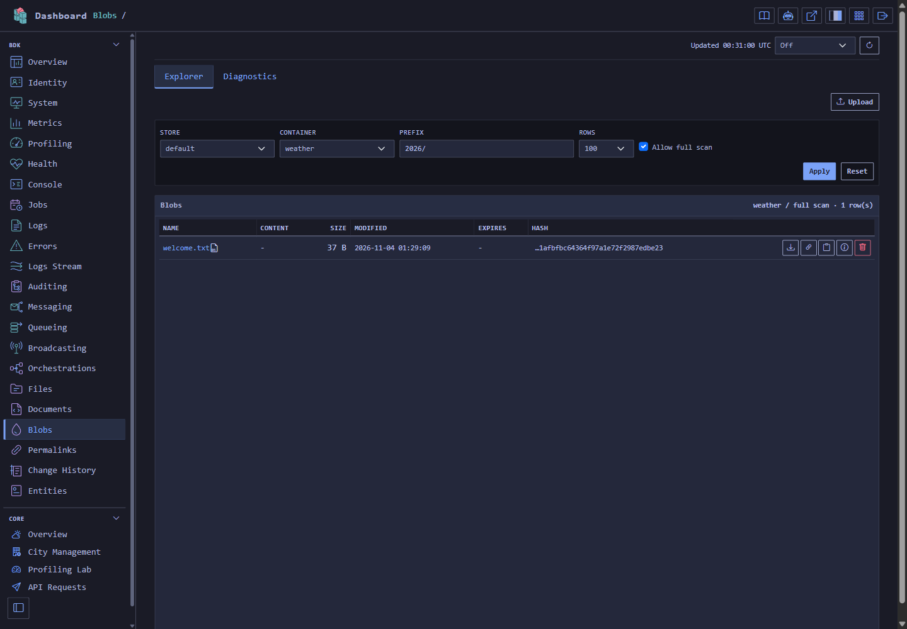
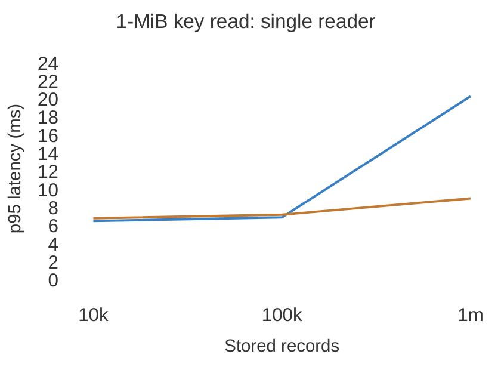
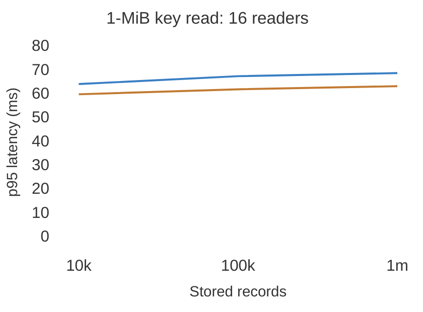
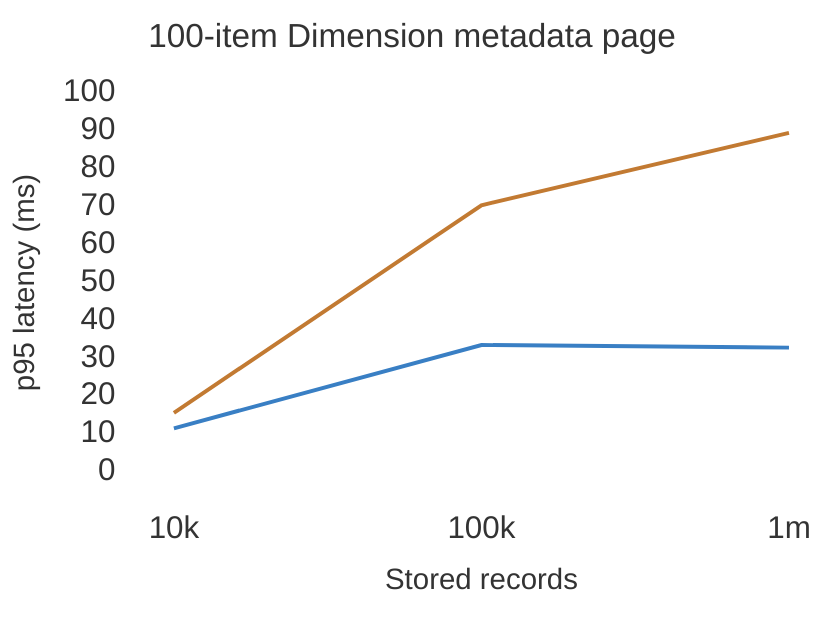
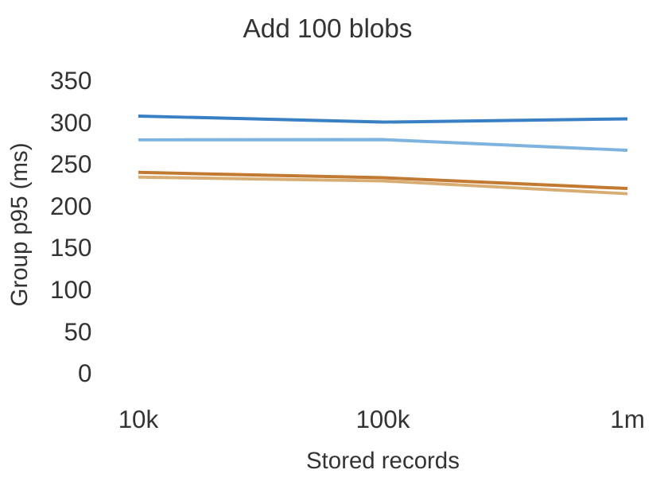
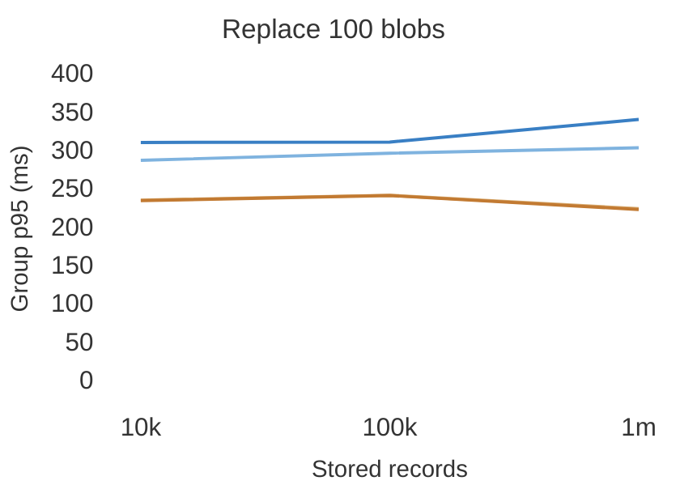

# Blob Storage

> Store binary content through Result-native, stream-first, provider-neutral blob clients.

[TOC]

## Overview

Blob Storage stores binary payloads such as reports, exports, attachments, images, and generated artifacts. It is separate from Document Storage: blob clients store streams under a `BlobKey`, while document clients store typed JSON-like documents.

The public API is provider-neutral and Result-native. Consumers resolve named clients through `IBlobStoreClientFactory`, then call upload, download, properties, exists, list, and delete operations that return `Result` or `Result<T>`.

Implemented providers:

- In-memory
- Filesystem through the optional `Infrastructure.FileSystem` package
- Entity Framework Core
- Azure Blob Storage

## Challenges

Binary content must remain stream-first while still supporting provider-neutral metadata, integrity, optimistic concurrency, bounded listing, and predictable ownership. Large transfers also need size limits and admission control without forcing application code to depend on a database or cloud SDK.

## Solution

Named `IBlobStoreClient` instances expose Result-native upload, download, property, existence, listing, and delete operations. The validating client enforces common rules before delegating to an in-memory, filesystem, Entity Framework, or Azure provider. Optional behaviors add logging, metrics, retry, timeout, caching, transforms, checksum verification, chaos, and upload admission.

## Key Features

- stream-first uploads and caller-disposed downloads
- provider-neutral keys, metadata, ETags, expiration, and SHA-256 hashes
- optional ETag conditions for content replacement, property updates, and exact deletes
- query-bound continuation tokens and guarded full scans
- named clients with in-memory, filesystem, Entity Framework, and Azure Blob providers
- compression, encryption, content-type detection, caching, and verification behaviors
- bounded upload concurrency and provider-native retention
- optional HTTP, dashboard, diagnostics, MCP, and maintenance-job integration

## Architecture

`IBlobStoreClientFactory` resolves a named decorated client. Client behaviors wrap `BlobStoreClient`, which validates provider-neutral requests and calls `IBlobStoreProvider`. Providers own persistence and native paging; the client and behaviors own cross-provider semantics. The retention service resolves providers directly so cleanup remains bounded and provider-native.

## Use Cases

- store reports, exports, images, attachments, and generated artifacts
- stream large content without materializing it in application memory
- serve public reads separately from protected maintenance endpoints
- transfer content between blob and file-storage providers
- retain temporary blobs and delete guarded prefixes
- persist blobs on application-owned local disks or configured file shares

## Basic Usage

This example registers an in-memory named client, uploads UTF-8 content, checks each result, disposes the returned download, and returns the stored content and metadata.

```csharp
using System.Text;
using BridgingIT.DevKit.Application.Storage;
using BridgingIT.DevKit.Common;

var builder = WebApplication.CreateBuilder(args);

builder.Services.AddBlobStorage()
    .WithInMemoryClient("reports");

var app = builder.Build();

app.MapPut("/blobs/reports/{name}", async (
    string name,
    IBlobStoreClientFactory factory,
    CancellationToken cancellationToken) =>
{
    var blobs = factory.CreateClient("reports");
    var content = Encoding.UTF8.GetBytes($"Report: {name}");
    await using var source = new MemoryStream(content, writable: false);

    var uploaded = await blobs.UploadAsync(new BlobUpload
    {
        Key = new BlobKey("reports", name),
        Content = source,
        ContentType = ContentType.TXT
    }, cancellationToken);

    if (uploaded.IsFailure)
    {
        return Results.Problem(string.Join(
            "; ",
            uploaded.Errors.Select(error => error.Message)));
    }

    var downloaded = await blobs.DownloadAsync(
        uploaded.Value.Key,
        cancellationToken);

    if (downloaded.IsFailure)
    {
        return Results.Problem(string.Join(
            "; ",
            downloaded.Errors.Select(error => error.Message)));
    }

    await using var download = downloaded.Value;
    using var reader = new StreamReader(
        download.Content,
        Encoding.UTF8,
        leaveOpen: true);
    var text = await reader.ReadToEndAsync(cancellationToken);

    return Results.Ok(new
    {
        download.Info.Key.Container,
        download.Info.Key.Name,
        download.Info.Length,
        download.Info.ContentHash,
        Content = text
    });
});

app.Run();
```

`PUT /blobs/reports/june.txt` returns the uploaded key, length, content hash, and `Report: june.txt`. The upload stream stays caller-owned; disposing `BlobDownload` closes the returned content stream.

## Rules and limits

- `BlobKey` contains `Container` and `Name`.
- Upload and download are stream-first.
- Caller-provided upload streams are not disposed by Blob Storage.
- Returned `BlobDownload` instances own the returned content stream and should be disposed by the caller.
- `ContentType?` is used in public models, with MIME conversion through `ContentTypeExtensions`.
- Content hashes use `sha256:<lowercase-64-character-hex>`.
- `ExpectedContentHash` is validated before content is committed.
- `BlobStoreOptions.MaxBlobSize` is enforced per named client.
- Properties, list, and exists operations do not download blob content.
- Listing returns `BlobInfo` only, never content streams.
- Full container scans require global client configuration and query-level approval.
- Delete is idempotent.
- Range downloads, resumable uploads, resumable downloads, and public lease APIs are not part of this feature.
- Optional HTTP endpoints live in `Presentation.Web.Storage` and are registered separately for content and metadata maintenance and read-only content downloads.
- Optional dashboard pages live in `Presentation.Web.Storage` and are discovered by the DevKit dashboard when Blob Storage has registered clients.

## Registration

Register Blob Storage once, then add named clients. The first registered behavior is the outermost decorator.

```csharp
using Azure.Storage.Blobs;
using BridgingIT.DevKit.Application.Storage;
using BridgingIT.DevKit.Common;
using Microsoft.Extensions.DependencyInjection;

services.AddMetrics(options => options.Enabled());
services.AddSingleton(new BlobServiceClient(connectionString));

services.AddBlobStorage(options => options
        .Enabled(true)
        .WithRetention(retention =>
        {
            retention.StartupDelay = TimeSpan.FromSeconds(15);
            retention.SweepInterval = TimeSpan.FromHours(1);
            retention.BatchSize = 1000;
        }))
    .WithLoggingBehavior()
    .WithMetricsBehavior()
    .WithTracingBehavior()
    .WithContentTypeDetectionBehavior()
    .WithChecksumVerificationBehavior()
    .WithCacheBehavior(cache =>
    {
        cache.SlidingExpiration = TimeSpan.FromMinutes(10);
        cache.MaxCachedBlobSize = ByteSize.Megabytes(10);
    })
    .WithRetryBehavior()
    .WithTimeoutBehavior()
    .WithInMemoryClient("transient", options =>
    {
        options.MaxBlobSize = ByteSize.Megabytes(10);
    })
    .WithEntityFrameworkClient<AppDbContext>("reports", options =>
    {
        options.MaxBlobSize = ByteSize.Megabytes(50);
        options.ChunkSize = (int)ByteSize.Megabytes(4);
        options.AllowFullScans = true;
    })
    .WithAzureBlobClient("media", configure: options =>
    {
        options.MaxBlobSize = ByteSize.Megabytes(500);
        options.DefaultTake = 100;
        options.MaxTake = 500;
    });
```

`WithAzureBlobClient` maps `BlobKey.Container` to the native Azure container and `BlobKey.Name` to the native blob name. There is no registration-level container override.

`AddBlobStorage` also registers the provider-neutral `IBlobStorageDiagnosticsService` and the blob-retention background service, so diagnostics snapshots and expiration sweeping are available without additional registration calls.

## Filesystem provider

The optional `BridgingIT.DevKit.Infrastructure.FileSystem` package provides `FileSystemBlobStoreProvider`. It uses direct file I/O and the existing blob client pipeline. Registration does not require File Storage, a database, or a cloud SDK.

```csharp
using BridgingIT.DevKit.Application.Storage;
using BridgingIT.DevKit.Infrastructure.FileSystem;
using Microsoft.Extensions.DependencyInjection;

var storageRoot = Path.GetFullPath(
	Path.Combine(builder.Environment.ContentRootPath, "app-data", "storage"));

builder.Services.AddBlobStorage()
	.WithFileSystemClient("reports", storageRoot,
		configureFileSystem: options =>
		{
			options.AccessKind = FileSystemStorageAccessKind.Local;
			options.Durability = FileSystemStorageDurability.Durable;
		},
		configure: options =>
		{
			options.DefaultTake = 100;
			options.MaxTake = 500;
		});
```

Resolve `"reports"` through `IBlobStoreClientFactory` as in [Basic Usage](#basic-usage). The example stores files beneath the application's content root. Use an absolute persistent data path when deployment replaces the application directory. Retention, transforms, behaviors, diagnostics, and transfers use the same APIs as other blob providers.

### Platforms and access protocols

Set `AccessKind` to the actual protocol used to reach the root. A share mounted as a directory still requires `Smb` or `Nfs`.

| Host | Declared access kinds | Root |
|---|---|---|
| Windows | `Local`, `Smb` | Absolute local path or SMB share path |
| Linux | `Local`, `Smb`, `Nfs` | Absolute local path or mounted share path |

Windows NFS and other operating systems are unsupported. Each store records one access kind. All processes and hosts opening that store must use the same kind. Blob and document providers can share a root because they use separate namespaces.

The implementation includes the shared-access protocol, but SMB, NFS, independent-host recovery, and power-loss qualification remain pending. Required native filesystem operations fail clearly when unsupported. Linux publication requires atomic hard-link installation and directory flush support. Windows publication requires write-through moves and POSIX replacement support from the filesystem or server. Local test results do not qualify a remote deployment.

### Configuration

`configureFileSystem` sets physical storage options. The separate `configure` delegate sets the existing `BlobStoreOptions`, including size limits and scan approval.

| `FileSystemStorageOptions` member | Default | Meaning |
|---|---|---|
| `RootPath` | Required registration argument | Absolute provider-owned directory |
| `AccessKind` | `Local` | Actual access protocol |
| `CreateRoot` | `true` | Permit store creation. When false, an initialized compatible store must exist. |
| `Durability` | `Durable` | Required persistence before acknowledging mutations |
| `LockAcquireTimeout` | 5 seconds | Interruptible authority acquisition budget. Zero means no wait. An outstanding native I/O call can exceed this budget. |
| `TransferBufferSize` | 65,536 bytes | Pooled blob transfer buffer |
| `MaxManifestBytes` | 1,048,576 bytes | Maximum serialized record metadata |
| `MaxQueryMetadataEntries` | 100,000 | Maximum metadata entries examined by one query |
| `MaxRetentionMetadataEntries` | 10,000 | Discovery and metadata work budget per retention sweep |

### Layout, concurrency, and queries

The provider owns the directory layout. Ordinal logical keys map to hashed paths, with original identities checked in metadata. Key casing, Unicode, and logical path separators remain independent of OS filename rules. Do not edit, rename, or import files directly into this layout. Experimental format-1 roots are rejected without automatic migration. Back up the complete root with every participant quiesced. Live backups are unqualified.

Uploads stream into immutable payload generations. A per-key authority protects conditional publication of the current metadata file. Property updates reuse the payload generation. Deletes publish tombstones. Existing download handles remain readable through replacement or deletion, and callers still dispose `BlobDownload`.

Local access coordinates cooperating processes through exclusive file handles. Shared access uses persistent ownership markers that never expire by age. Different keys have separate authority. All participants need compatible OS permissions to create, read, flush, and delete files and directories.

Exact-key operations resolve their paths directly. Listing examines metadata, prunes by container, and returns ordinal key pages without opening payloads. Page tokens track a live key position. Concurrent inserts, updates, and deletes can affect subsequent pages. Queries that exceed `MaxQueryMetadataEntries` fail instead of returning an incomplete successful page. Existing full-scan approval rules still apply.

### Durability and recovery

`Durable` is the default. Before success, publication performs the platform's file and namespace persistence operations. A Durable property update also flushes its referenced payload, including payloads written previously in Buffered mode.

`Buffered` permits loss of recent acknowledged metadata changes after host failure while retaining atomic publication. Staging, initialization, and safe reclamation still perform persistence operations. Buffered mode does not promise zero flushes or higher throughput.

An uncertain mutation returns `BlobStoreIndeterminateOperationError` with a mutation identity. The standard retry behavior does not replay it. Shared uncertain operations retain ownership and can block later operations. Recovery requires quiescing every participant on every host, reconciling fresh server-confirmed metadata, and draining or cancelling old server operations before clearing ownership. A timeout or an old marker alone does not authorize takeover.

See the [filesystem provider guide](storage-filesystem-providers.md) for native persistence details, recovery tooling, benchmarks, and opt-in share tests. Share tests are inactive by default and skip host-inapplicable cases. Enable them later with actual disposable shares and external qualification configuration. Full performance qualification remains open.

### Public storage helpers

`FileSystemBlobStoreProvider.Store` exposes `FileSystemStore` for trusted diagnostics, maintenance, and explicit recovery. The store, authority, durability, staged-payload, retention, and diagnostic helpers are public and have XML documentation with examples. `Store.Options` returns a configuration copy, and `FileSystemStore.Json` is read-only. Authority handles and active configuration stay private.

Normal blob operations use `IBlobStoreClient`. Direct helper calls require the documented ownership and persistence rules. In particular, acquire key authority before selecting a payload or deciding a mutation, and keep authority through publication. See [public storage helpers](storage-filesystem-providers.md#public-storage-helpers) for the low-level API and recovery preconditions.

## Retry behavior

`WithRetryBehavior()` retries a failed result only when it contains errors and every error implements `ITransientStorageError` with `IsTransient` set to true. `BlobStoreProviderError` is permanent by default. `BlobStoreTimeoutError` is transient.

The Entity Framework provider checks the exception and its inner exceptions for timeouts and transient SQL Server errors. It uses the SQL client classification and includes known transient error numbers such as deadlocks and lock timeouts. Retry also respects the configured attempt limit and the upload stream's replay rules.

## Metrics

`WithMetricsBehavior()` emits these instruments through the `bdk` meter, all tagged with `operation` and `store` only:

| Instrument | Type | Meaning |
|---|---|---|
| `blobstorage_operations` | counter | Completed operations. |
| `blobstorage_operation_duration` | histogram (ms) | Operation duration. |
| `blobstorage_operation_failures` | counter | Failed operations. |
| `blobstorage_bytes` | counter | Cumulative bytes, taken from the blob metadata length. |
| `blobstorage_bytes_per_second` | histogram (`By/s`) | Transfer rate of one successful upload or download. |
| `blobstorage_list_items` | counter | Items returned by list operations. |

`blobstorage_bytes_per_second` is recorded for `upload` and `download` only, and only when bytes and elapsed time are both greater than zero. Failed and empty transfers are skipped. The `operation` tag separates write rates from read rates.

- **Upload:** bytes are the stored length and the duration is the whole call, including any wait for upload admission. The rate is lower than raw provider throughput while uploads queue.
- **Download of an in-memory result** (every EF blob up to `ChunkSize`): recorded when the download method returns, using the content length.
- **Streaming download** (larger blobs, Azure): the behavior wraps the content stream, counts the bytes the caller actually reads, and records once when the download is disposed. The duration is the time to open the stream plus the time spent inside reads, so a slow consumer does not lower the rate. A stream disposed without reading records nothing.
- **Batched reads** (`DownloadBytesManyAsync`): each key records its own sample, and each sample includes the wait on the shared batch read. Treat the per-key rate as a lower bound. The aggregate rate of a batch is higher.

The metrics service gives `By/s` histograms explicit bucket boundaries from 1 KB/s to 1 GB/s. Without them the default OpenTelemetry boundaries (up to 10,000) would put every sample in the overflow bucket. Use the rate of the `blobstorage_bytes` counter for sustained throughput and the histogram for the per-transfer distribution.

## Tracing

`WithTracingBehavior()` creates an internal `blobs.{operation}` activity for each traced client call. Register the behavior after metrics and before timeout, retry, and upload admission so the activity includes their work. Subscribe a listener to `BlobTelemetry.ActivitySourceName` (`BridgingIT.DevKit.Application.Storage.Blobs`) to collect the activities.

Activities carry `blobs.operation` and `blobs.store`. On failure, `error.type` and the Error status description contain the first result error's type name, or the thrown exception's type name. Blob names, containers, continuation tokens, properties, and error messages stay out of the activity.

## Operation profiling

Register Profiling before other behaviors to measure their downstream work:

```csharp
services.AddBlobStorage()
    .WithProfilingBehavior()
    .WithInMemoryClient("archive");
```

Individual client methods join an existing operation or create a `BlobStorage` operation with key `blobstorage:{operation}`. Dimensions are `blobstorage.store`, `blobstorage.container` and `blobstorage.operation`. Container names come from the key, upload, property update or listing query; blob names, prefixes, tokens and content are omitted. Returned download streams retain caller ownership, and timing ends when the download method returns. See [Storage profiling behaviors](features-profiling.md#storage-behaviors) for optional registration, classification and dimension comparisons.

##  High-volume uploads

Use the optional upload-concurrency behavior when bursts must not open an unbounded number of provider operations, contexts, transactions, or database connections. Admission is shared by every DI scope in one process and isolated by case-insensitive named store.

```csharp
services.AddBlobStorage()
    .WithLoggingBehavior()
    .WithMetricsBehavior()
    .WithTracingBehavior()
    .WithTimeoutBehavior(options => options.Timeout = TimeSpan.FromMinutes(2))
    .WithRetryBehavior(options => options.Attempts = 3)
    .WithUploadConcurrencyBehavior(options =>
    {
        options.MaxConcurrentUploads = 4;
        options.MaxQueuedUploads = 16;
        options.QueueWaitTimeout = TimeSpan.FromSeconds(30);
    })
    .WithEntityFrameworkClient<AppDbContext>("reports", options =>
    {
        options.ChunkSize = (int)ByteSize.Megabytes(4);
        options.ChunkFlushCount = 4;
        options.MaxPendingChunkBytes = ByteSize.Megabytes(16);
    });
```

`WithMetricsBehavior()` and the provider-level EF flush instruments resolve the optional shared `IMetricsService`. Register it once with `AddMetrics(options => options.Enabled())` to emit metrics through the `bdk` meter. When it is not registered, blob operations, upload admission, and EF flushing continue unchanged without emitting measurements.

The defaults above are also the built-in defaults. `MaxQueuedUploads = 0` disables waiting: an upload either starts immediately or returns `BlobStoreUploadOverloadedError`. A queued caller whose wait expires receives `BlobStoreUploadAdmissionTimeoutError`; caller cancellation continues to throw `OperationCanceledException`. Neither admission path reads, buffers, rewinds, or disposes the caller stream.

The first registered behavior is outermost. The shown order means operation metrics and the overall timeout include queue time. Retry is outside admission, so each failed attempt releases its permit before backoff and reacquires a permit for the next attempt.

Admission is deliberately process-local. With `N` application nodes, aggregate possible active uploads are approximately `N × MaxConcurrentUploads`; size database connection pools and server capacity accordingly.

The EF provider groups chunks inside the existing per-blob transaction. It flushes when either `ChunkFlushCount` or `MaxPendingChunkBytes` is reached, then detaches the flushed chunk entities. A final partial group is always flushed. Count four is default-on; use `ChunkFlushCount = 1` only when explicitly requiring one save per chunk. Approximate pending content memory per active upload is bounded by:

```text
MaxPendingChunkBytes + ChunkSize + EF/object overhead
```

Tune active uploads and pending bytes together. For example, four active uploads with the defaults may hold roughly `4 × (16 MB + 4 MB)` of chunk buffers before EF/object overhead. Every intermediate relational flush remains uncommitted until expected-hash validation, final metadata persistence, and the single transaction commit complete.

When Blob Storage is registered in a DevKit web host with local MCP enabled, `AddBlobStorage` contributes the Blob Storage MCP handler automatically. Local AI agents can inspect blob client registrations and probe status through `bdk mcp` without an additional blob-specific MCP registration call.

The MCP handler is diagnostics-only. It exposes registration, provider capability, and non-mutating health probe data; it does not expose blob content, raw provider clients, provider SDK types, or mutating blob operations. If MCP is disabled by the DevKit local tooling policy, the handler is not registered.

### Upload multiple blobs

`UploadManyAsync` attempts independent uploads with bounded concurrency and returns every item outcome in input order. The default is four active uploads. Set `MaxConcurrency` from 1 through 64; configured store admission can impose a lower effective limit. A call accepts at most 1000 requests.

```csharp
using var first = new MemoryStream("{\"total\":125}"u8.ToArray());
using var second = new MemoryStream("{\"total\":250}"u8.ToArray());

var result = await blobs.UploadManyAsync(
[
    new() { Key = new("exports", "invoice-101.json"), Content = first },
    new() { Key = new("exports", "invoice-102.json"), Content = second }
], new() { MaxConcurrency = 4 });

if (result.IsSuccess)
{
    foreach (var item in result.Value.Items)
    {
        Console.WriteLine($"{item.Index}: {item.Key?.Name}, success={item.Result.IsSuccess}");
    }
}
```

A successful outer Result means the batch finished, not that every upload succeeded. Inspect `AllSucceeded`, `FailedCount` or each `item.Result`. One failure does not stop unrelated uploads. Use distinct keys and independent stream instances; conflicting duplicate keys or shared stream instances receive item-level validation failures.

Keep each stream open until the awaited call completes or cancellation is observed; the caller disposes it. Uploads use the existing per-item validation and behavior pipeline, including ETag conditions, Properties, Dimensions and transforms. The batch never retries the whole collection. Unexpected item exceptions can report `BlobStoreIndeterminateOperationError`; reconcile the item's key before replay.

Cancellation throws `OperationCanceledException` after active work observes cancellation and does not return a complete outcome collection. Earlier commits remain committed. This is bounded parallel coordination over `UploadAsync`, not a native database bulk transaction or an all-or-nothing batch. See [ADR-0045](adr/0045-bounded-attempt-all-blob-upload-batches.md) for the contract.

## HTTP endpoints

`Presentation.Web.Storage` provides optional Blob Storage Minimal API endpoints. Enable each group explicitly in the feature setup:

- `AddMaintenanceEndpoints(...)` enables content creation and replacement, property updates, deletes, metadata reads, and FilterModel queries.
- `AddReadEndpoints(...)` enables the separate content-download route.

Registering `AddBlobStorage()` and its clients does not enable either group. Assembly discovery through `AddEndpoints()` also leaves them disabled until explicitly configured. `app.MapEndpoints()` maps the enabled registrations.

### Enable endpoints in the feature setup

Reference `BridgingIT.DevKit.Presentation.Web.Storage` in the host. Each registration below uses `enabled: true`; omit a registration or pass `enabled: false` to leave that group disabled. Maintenance and content-download endpoints can be enabled independently. Document Storage provides the same independent maintenance/read setup; see [Document Storage HTTP endpoints](features-storage-documents.md#http-endpoints).

Both endpoint groups require authorization by default. Use the shared endpoint-options methods to select policies or roles. Call `AllowAnonymous()` explicitly only for content that is intentionally public.

```csharp
services.AddBlobStorage()
    .WithInMemoryClient("reports", options =>
    {
        options.AllowFullScans = true;
    })
    .AddMaintenanceEndpoints(options => options
        .GroupPath("/_bdk/api/storage/blobs")
        .RequireAuthorization(), enabled: true)
    .AddReadEndpoints(options => options
        .GroupPath("/_bdk/api/storage/blobs")
        .AllowAnonymous(), enabled: true);

app.MapEndpoints();
```

For separate service registration, use `services.AddBlobStorageMaintenanceEndpoints(...)` and `services.AddBlobStorageReadEndpoints(...)`. They provide the same options and explicit `enabled` switch. Endpoint registration does not configure host authentication; configure the authentication and authorization services required by the selected policies.

### Routes and request semantics

Maintenance endpoints expose streamed content creation and replacement, registered clients, provider capabilities, exact-key existence checks, properties, property updates, metadata listing, and idempotent deletes:

```http
GET    /_bdk/api/storage/blobs/clients
GET    /_bdk/api/storage/blobs/{storeName}/provider
POST   /_bdk/api/storage/blobs/{storeName}/blobs?container=reports&name=2026/report.pdf
PUT    /_bdk/api/storage/blobs/{storeName}/blobs?container=reports&name=2026/report.pdf
GET    /_bdk/api/storage/blobs/{storeName}/blobs/exists?container=reports&name=2026/report.pdf
GET    /_bdk/api/storage/blobs/{storeName}/blobs/properties?container=reports&name=2026/report.pdf
PATCH  /_bdk/api/storage/blobs/{storeName}/blobs/properties
GET    /_bdk/api/storage/blobs/{storeName}/blobs?container=reports&prefix=2026/&take=100
POST   /_bdk/api/storage/blobs/{storeName}/search?container=invoices
DELETE /_bdk/api/storage/blobs/{storeName}/blobs?container=reports&name=2026/report.pdf
```

See the [FilterModel request example](#filter-metadata-with-filtermodel) for the JSON request to `POST /{storeName}/search`.

POST streams the raw request body and atomically creates a new key, returning HTTP 201 with a metadata body and `Location`. An existing physical key returns HTTP 409. PUT streams the raw request body and creates or replaces content, returning HTTP 200 with committed metadata. Set `Content-Type` to the payload MIME type; no multipart envelope is required. Both accept optional `expiresAt` in the query and `X-Storage-Properties` containing a JSON object of scalar values. Uploads replace the property bag and expiration: omitted properties produce an empty bag, and omitted expiration produces an unexpired blob. Nested property objects and arrays return HTTP 400. Numeric values that overflow or underflow the supported finite .NET numeric types also return HTTP 400.

PUT, property PATCH, and DELETE accept an optional `If-Match` header. Copy the complete `ETag` header from a prior content download, properties GET, or successful write. It identifies the whole item: changing content, properties, or expiration invalidates the previous version. A stale condition returns HTTP 409 without changing the item, including a conditional PUT after deletion. Omitting the condition permits unconditional creation or replacement. Deleting an already absent target remains a successful no-op. POST rejects any `If-Match` header with HTTP 400 because creation is already guarded by create-only semantics.

Response `ETag` headers use a quoted opaque transport token (`"bdk.<base64url>"`) that preserves the provider's exact native token. Echo the header unchanged; do not strip quotes, decode it, or generate a token from content. The metadata body's `ETag` remains the native provider value. Legacy native conditions remain accepted, and property PATCH still accepts `IfMatchETag` in its body. When header and body are both supplied, they must identify the same version or the API returns HTTP 400. Wildcards and ETag lists are unsupported.

```http
PUT /_bdk/api/storage/blobs/reports/blobs?container=reports&name=2026/report.txt
Content-Type: text/plain
If-Match: "bdk.<token-from-the-last-response>"
X-Storage-Properties: {"reviewed":true,"revision":2}

Revised report content
```

Property PATCH retains its existing JSON shape (`container`, `name`, optional `contentType`, `expiresAt`, `properties`, and legacy `ifMatchETag`). It replaces properties and expiration according to `BlobPropertiesUpdate`; it leaves content bytes unchanged. Every successful mutation returns a fresh whole-item ETag from the exact commit, without a follow-up read.

The content-download endpoint streams a single exact-key blob through the configured named client:

```http
GET /_bdk/api/storage/blobs/{storeName}/content?container=reports&name=2026/report.pdf
```

Full scans through the list endpoint still require both global client approval and `allowFullScan=true` on the query. The HTTP response models stay provider-neutral and use MIME strings at the presentation boundary while the Application models continue to use `ContentType?`.

## Dashboard

`Presentation.Web.Storage` contributes a Blob Storage dashboard page when the DevKit dashboard is enabled and at least one blob client is registered.

```csharp
services.AddDashboard();

services.AddBlobStorage()
    .WithInMemoryClient("reports", options =>
    {
        options.AllowFullScans = true;
    });

app.MapEndpoints();
```

The page key is `storage.blobs` and the default route is:

```http
GET /_bdk/dashboard/storage/blobs
```

The dashboard page is provider-neutral and uses the configured `IBlobStoreClientFactory`. It lets operators:

- switch between registered named blob clients
- list `BlobInfo` metadata by container, prefix, and supported typed Dimension filters
- select discovered provider containers and retain prefix history per store and container
- opt into approved full scans with the same query-level approval required by the client API
- remember full-scan consent in local browser storage, selected by default
- upload a local file into a selected container and optional prefix, with optional UTC expiration
- download an exact blob through the selected client
- inspect content metadata, timestamps, ETags, hashes, and scalar properties in a compact details dialog
- conditionally delete an exact blob using the ETag shown by the current row

For a provider that supports Dimension queries, expand **Dimensions**, add a name, type, comparison, and value, then choose **Apply**. Combine conditions with **Match all** or **Match any**, including nested groups. Available comparisons follow the selected provider. Applied filters remain active through refresh and Load more. Reset clears the Dimension filter, and changing stores clears it before loading the new provider. The key-filter illustration below omits the optional Dimensions panel.

Applied filters and unfinished Dimension entries survive switching between **Explorer** and **Diagnostics** or navigating back in the same browser tab.

Dashboard filters travel in URLs and remain subject to hosting limits. A large valid filter can return HTTP 414 when it exceeds the request-line or query-string limit. Use the POST search endpoint or .NET query API for larger filters.

The compact list shows content type, size, modification time, expiration, and content hash. Manual and interval refreshes use the currently applied store, container, prefix, page size, full-scan consent, and continuation state. The standard refresh interval is off by default and remembered in browser-local storage. The dashboard renders metadata only and does not download blob content for list, exists, or property-style operations. The download action streams the selected blob and disposes the returned `BlobDownload`.

Open Blobs at `/_bdk/dashboard/storage/blobs`. Choose a store and container, then apply a name prefix and page size. An unfiltered query requires Allow full scan consent and a provider that permits it. The table shows content type, size, modification time, expiration and hash without downloading payloads.

[](assets/dashboard/19-storage-blobs-blobs.png)

Use **Upload** to add a file and optionally enter a JSON object of scalar properties. If the store supports Dimensions, use **Add dimension** to enter a key, type, and value. In **Blob Details**, edit the properties, dimensions, or expiration, then select **Save changes**. Dimension editing is available on stores that support combined metadata updates. Permalink download and copy actions appear for clients decorated with `WithPermalinks()`. Use **Load more** when the query returns a continuation page. See the [shared dashboard setup](features-presentation-dashboard.md) for plugin discovery and authorization.

Use the funnel button beside a saved dimension in **Blob Details** to add its value to the active filter. Edit or remove conditions in **Dimensions**, then select **Apply**. In **Dimension columns**, pin up to three keys in the results table. The dashboard remembers these keys for each store. A dash indicates a missing dimension, and `null` indicates an explicit null.

Open **Preview content** in **Blob Details** to view UTF-8 text, JSON, PNG, JPEG, GIF, or WebP blobs up to 1 MiB. Choose **Download** to retrieve the file.

New uploads use create-only semantics. **Replace content** retains the selected row's identity and preserves the blob's current properties, dimensions, and expiration. Content replacement and metadata edits send the originally displayed ETag. An ordinary edit without that token is invalid.

When a conflict occurs, the editor retains the draft, selected upload file, identity, and original ETag. **Reload current item** asks for discard confirmation before replacing the draft. **Force overwrite** submits the retained draft without an ETag condition. Refreshing an edit does not silently authorize overwriting a newer version.

##   Compression and encryption behaviors

Blob Storage can transparently transform content with provider-neutral client behaviors. These behaviors do not change `IBlobStoreClient` or provider contracts.

Register compression before encryption when both are used. The first registered behavior is outermost, so upload content is compressed first and then encrypted; downloads are decrypted first and then decompressed.

```csharp
using System.IO.Compression;

services.AddSingleton<IEncryptionKeyProvider>(new DictionaryEncryptionKeyProvider(
    "primary",
    new Dictionary<string, byte[]>
    {
        ["primary"] = Convert.FromBase64String(configuration["BlobStorage:EncryptionKey"])
    }));

services.AddBlobStorage()
    .WithCompressionBehavior(compression =>
    {
        compression.Level = CompressionLevel.Optimal;
    })
    .WithEncryptionBehavior()
    .WithAzureBlobClient("media");
```

Compression uses GZip. Encryption uses AES with a random initialization vector per upload. Both behaviors write transformed bytes to the underlying provider and keep the logical blob shape visible to callers:

`IEncryptionKeyProvider.GetActiveKeyAsync` selects the key used for new uploads. Downloads resolve the key id stored with the encrypted blob through `GetKeyAsync`, so providers can retain old keys while rotating the active write key. Encrypted clients fail when the active key or a referenced historical key is unavailable.

- `DownloadAsync` returns decompressed and decrypted content.
- `BlobInfo.Length`, `ContentType`, and `ContentHash` describe the logical content, not the stored transformed bytes.
- `ExpectedContentHash` is checked against the caller-provided logical upload content before the transformed bytes are committed.
- Internal behavior metadata travels in a private pipeline channel and separate provider fields. Public `BlobInfo.Properties` contains application metadata only.
- `UpdatePropertiesAsync` preserves the internal transform metadata so property updates do not make existing transformed blobs unreadable.
- Upload streams remain caller-owned. Returned download streams remain owned by `BlobDownload`.

Transform behaviors use temporary files while preparing transformed upload and download streams. They avoid loading full blobs into memory solely for compression or encryption, but they do require local temporary disk space for the transformed payload.

## Content-type detection and checksum verification

Use `WithContentTypeDetectionBehavior()` when uploads that omit `ContentType` should infer it from the blob name extension. The behavior uses `ContentTypeExtensions.FromFileName(...)` and does not inspect or sniff stream content. Extensionless blob names stay unchanged.

```csharp
services.AddBlobStorage()
    .WithContentTypeDetectionBehavior()
    .WithInMemoryClient("reports");

await blobs.UploadAsync(new BlobUpload
{
    Key = new BlobKey("reports", "2026/summary.pdf"),
    Content = source
}, cancellationToken);
```

Use `WithChecksumVerificationBehavior()` when every `DownloadAsync` call should verify downloaded bytes against `BlobInfo.ContentHash` before the caller receives a stream.

```csharp
services.AddBlobStorage()
    .WithChecksumVerificationBehavior()
    .WithInMemoryClient("reports");
```

Checksum verification returns `BlobStoreIntegrityError` when the stored hash is missing or when downloaded bytes do not match the hash. Set `AllowMissingContentHash` only for stores where missing hashes are accepted:

```csharp
services.AddBlobStorage()
    .WithChecksumVerificationBehavior(options =>
    {
        options.AllowMissingContentHash = true;
    });
```

The verification behavior copies the downloaded stream to a temporary stream while hashing, then returns the verified stream to the caller. It avoids buffering full blobs in memory, but it requires temporary disk space.

When combined with compression or encryption, register checksum verification before the transform behaviors so it verifies the logical caller-visible bytes:

```csharp
services.AddBlobStorage()
    .WithChecksumVerificationBehavior()
    .WithCompressionBehavior()
    .WithEncryptionBehavior()
    .WithAzureBlobClient("media");
```

## Download caching behavior

Use `WithCacheBehavior()` when repeated exact-key downloads should be served from an `ICacheProvider`. The behavior caches only successful `DownloadAsync` results and stores `BlobInfo` plus the downloaded bytes. Every cache hit returns a new read-only `MemoryStream`, so callers still own and dispose the returned `BlobDownload`.

```csharp
services.AddBlobStorage()
    .WithCacheBehavior(options =>
    {
        options.SlidingExpiration = TimeSpan.FromMinutes(10);
        options.MaxCachedBlobSize = ByteSize.Megabytes(10);
    })
    .WithInMemoryClient("reports");
```

Register an `ICacheProvider` before resolving blob clients. The same cache providers used by document storage can be reused for blob downloads.

Caching is exact-key only:

- `DownloadAsync` reads through the cache.
- `UploadAsync`, `UpdatePropertiesAsync`, and `DeleteAsync` invalidate the cached download for the affected blob.
- `GetPropertiesAsync`, `ExistsAsync`, and `ListPageAsync` do not cache or download content.
- Blobs larger than `MaxCachedBlobSize` keep normal streaming behavior and are not cached.

When combined with compression, encryption, or checksum verification, register cache first when you want to cache caller-visible logical bytes and avoid repeating downstream transforms:

```csharp
services.AddBlobStorage()
    .WithCacheBehavior()
    .WithChecksumVerificationBehavior()
    .WithCompressionBehavior()
    .WithEncryptionBehavior()
    .WithAzureBlobClient("media");
```

## Chaos behavior

Use `WithChaosBehavior()` in tests, local development, or controlled resilience drills to inject Result-native upload and download failures without changing providers or application code.

```csharp
services.AddBlobStorage()
    .WithChaosBehavior(options =>
    {
        options.UploadFailureRate = 0.05;
        options.DownloadFailureRate = 0.05;
    })
    .WithInMemoryClient("reports");
```

Injected failures return `BlobStoreProviderError` with `IsTransient` enabled, so retry behavior can retry them when retry wraps chaos. Register retry first when you want injected failures to be retried because the first registered behavior is outermost:

```csharp
services.AddBlobStorage()
    .WithRetryBehavior(options => options.Attempts = 3)
    .WithChaosBehavior(options => options.DownloadFailureRate = 0.05);
```

Chaos injection short-circuits only `UploadAsync` and `DownloadAsync`; properties, exists, list, and delete operations are delegated unchanged.

For deterministic tests, fail every Nth upload or download instead of using probabilities:

```csharp
services.AddBlobStorage()
    .WithChaosBehavior(options =>
    {
        options.FailUploadsEvery = 2;
        options.FailDownloadsEvery = 3;
    });
```

Keep chaos behavior opt-in. Do not enable it for normal production traffic unless the deployment is explicitly running a resilience experiment.

## Entity Framework context

An EF Core context used for blob storage must implement `IBlobStoreContext`. Consuming applications own their migrations.

Entity annotations map `StorageBlob.Id`, `StorageBlobChunk.BlobId`, and `StorageBlobDimension.BlobId` from C# `Guid` values to `char(32)` columns with lowercase hexadecimal values. EF applies the mapping when it discovers the entities. New row IDs are UUIDv7, and the columns use the database's default collation.

The EF blob provider uses the registered `TimeProvider` for upload and mutation timestamps, expiration checks, lease timing, and sweep completion. It uses `TimeProvider.System` by default. Register a custom `TimeProvider` with `services.AddSingleton<TimeProvider>(clock)` to control those operations in tests or a host.

```csharp
using BridgingIT.DevKit.Infrastructure.EntityFramework;
using BridgingIT.DevKit.Infrastructure.EntityFramework.Storage;
using Microsoft.EntityFrameworkCore;

public sealed class AppDbContext(DbContextOptions<AppDbContext> options)
    : DbContext(options), IBlobStoreContext
{
    public DbSet<StorageBlob> StorageBlobs { get; set; }

    public DbSet<StorageBlobChunk> StorageBlobChunks { get; set; }
}
```

### Optional UUIDv7 ordering

If a deployment needs UUIDv7 timestamp order across distinct milliseconds regardless of the database default, call `modelBuilder.UseBlobRowIdCollation(this.Database.ProviderName)` in `OnModelCreating` before creating the schema. It applies `Latin1_General_100_BIN2` on SQL Server, `C` on PostgreSQL, or `BINARY` on SQLite to all three key columns. [ADR-0033](adr/0033-time-ordered-ef-blob-row-ids.md)

## Azure commit semantics

Azure uploads stage uniquely named blocks while streaming and hashing the caller content once. The provider enforces size and expected-hash constraints before committing the block list. The final commit applies content type, metadata, hash, expiration tags, and the original `IfMatchETag` or create-only condition. A failed condition leaves the committed blob unchanged, even if another writer changed it during staging. Cancellation before publication does not replace the committed blob.

Upload results describe the version acknowledged by the commit response. The provider reads native creation time only with that committed ETag. `BlobInfo.CreatedAt` can be null if rapid replacement, deletion, or a failed optional lookup prevents reading that timestamp. A later writer's ETag or timestamps are never substituted.

Azure property updates read properties and tags bound to one version, then apply headers, metadata, and tags through conditional requests. These are multiple native mutations. On failure, compensation uses only the last ETag acknowledged as written by this operation, with a non-cancelable cleanup token. If another writer changed that version, compensation stops instead of restoring old metadata over the newer item. An unconfirmed mutation or failed compensation returns `BlobStorePartialUpdateError`; failed compensation includes both failure descriptions. Conflicts and partial-update failures are excluded from automatic retries.

## Named clients

Resolve clients by configured store name only.

```csharp
var factory = serviceProvider.GetRequiredService<IBlobStoreClientFactory>();
var blobs = factory.CreateClient("reports");
```

`factory.GetRegistrations()` returns the configured names, provider names, capabilities, and lifetimes for diagnostics without exposing provider instances.

Named providers and clients are keyed DI services. Singleton, scoped, and transient lifetimes follow standard container semantics; the factory only performs keyed lookup and does not construct or cache clients itself. EF-backed singleton clients remain safe because each provider operation creates and owns a new DI scope and `DbContext`. A downloaded EF stream keeps its operation scope alive until the returned `BlobDownload` is disposed.

Register an `IContinuationTokenProtector` to require HMAC-protected paging tokens across all Blob Storage clients:

```csharp
services.AddSingleton<IContinuationTokenProtector>(
    new HmacContinuationTokenProtector(configuration.GetValue<byte[]>("Storage:ContinuationTokenKey")));
```

When protection is configured, unsigned, modified, incorrectly signed, and wrong-purpose tokens are rejected. Without a protector, Blob Storage emits unsigned opaque tokens.

##  Upload

```csharp
using BridgingIT.DevKit.Common;

await using var source = File.OpenRead("report.pdf");

var uploadResult = await blobs.UploadAsync(
    new BlobUpload
    {
        Key = new BlobKey("reports", "2026/06/report.pdf"),
        Content = source,
        ContentType = ContentType.PDF,
        ExpiresAt = DateTimeOffset.UtcNow.AddDays(30),
        Properties = new PropertyBag
        {
            ["customerId"] = "42",
            ["source"] = "monthly-export"
        },
        OverwriteMode = BlobOverwriteMode.Overwrite
    },
    cancellationToken);

if (uploadResult.IsFailure)
{
    return uploadResult;
}

var info = uploadResult.Value;
var mimeType = info.ContentType?.MimeType();
```

Blob Storage reads from the supplied stream but does not dispose it.

### Conditional replacement

An ETag represents the entire blob, including content, content type, properties, and expiration. Every successful content or metadata update invalidates the previous ETag, even when the submitted values are unchanged. Retain the ETag read with the item being edited and send it with the replacement:

```csharp
var key = new BlobKey("reports", "2026/06/report.pdf");
var current = await blobs.GetPropertiesAsync(key, cancellationToken);
if (current.IsFailure)
{
	return current;
}

await using var replacement = File.OpenRead("revised-report.pdf");
var saved = await blobs.UploadAsync(new BlobUpload
{
	Key = key,
	Content = replacement,
	ContentType = ContentType.PDF,
	IfMatchETag = current.Value.ETag
}, cancellationToken);

if (saved.IsFailure)
{
	return saved;
}
```

`IfMatchETag` is optional on `BlobUpload` and `BlobPropertiesUpdate`. Null, empty, and whitespace-only conditions are omitted. Without a condition, uploads create or replace unconditionally and property updates mutate the existing item. A supplied stale ETag returns `BlobStoreConflictError`. A conditional upload against a missing target also conflicts and never creates it; a property update against a missing target fails without creating it.

Use `BlobOverwriteMode.FailIfExists` for create-only uploads. Combining it with a nonempty `IfMatchETag` is a validation error. The wildcard `*` is invalid as a version token. A successful mutation returns its committed ETag, which becomes stale if another writer subsequently changes the item.

Byte, text, object, and file upload options carry the same optional condition. Compression, encryption, and content-type detection preserve it. `ExpectedContentHash` checks the incoming payload and does not compare the stored version. Keep the named store, container, and name alongside the ETag; the token does not replace identity validation or authorization.

##  Expiration and retention

Set `BlobUpload.ExpiresAt` when a blob should be automatically deleted after a UTC timestamp. Providers normalize non-UTC `DateTimeOffset` values to UTC before storing metadata. The timestamp is returned through `BlobInfo.ExpiresAt`, can be replaced or cleared through `BlobPropertiesUpdate.ExpiresAt`, and is provider-neutral.

```csharp
var uploadResult = await blobs.UploadAsync(
    new BlobUpload
    {
        Key = new BlobKey("exports", "daily/report.csv"),
        Content = source,
        ContentType = ContentType.CSV,
        ExpiresAt = DateTimeOffset.UtcNow.AddDays(7)
    },
    cancellationToken);

var propertiesResult = await blobs.UpdatePropertiesAsync(
    new BlobPropertiesUpdate
    {
        Key = new BlobKey("exports", "daily/report.csv"),
        ContentType = ContentType.CSV,
        ExpiresAt = DateTimeOffset.UtcNow.AddDays(14),
        Properties = new PropertyBag
        {
            ["source"] = "daily-export"
        }
    },
    cancellationToken);
```

A blob becomes unavailable as soon as the current UTC instant reaches `ExpiresAt`. Downloads, property access and updates, and supported dimension updates return `BlobStoreNotFoundError`. `ExistsAsync` returns false. Listings and the container catalog include only live blobs. The expiry check happens when a download opens.

Reads leave expired data in storage for the retention sweep. Explicit delete can still remove an expired blob. An upload over an expired key creates a new blob with a fresh `CreatedAt` and ETag. `FailIfExists` allows that upload, while an upload with `IfMatchETag` conflicts. Azure checks blob metadata before upload and when discovering live containers, so those calls require the corresponding read and list permissions. Replacing an expired Azure blob also needs delete permission.

The hosted retention service is registered by `AddBlobStorage`. It starts after the host application has started, logs sweep progress, and calls provider-native retention sweep paths. It does not use public `ListPageAsync` scans. Providers that do not support retention are skipped.

Provider behavior:

- In-memory keeps expiration with the in-memory entry and deletes due entries under the context lock.
- Filesystem stores `ExpiresAt` in metadata and uses the existing background service. A persisted, bounded discovery cursor resumes across sweeps and restarts. Cleanup acquires key authority without waiting, rechecks expiration before deletion, and reclaims obsolete payload files. Open download handles can retain disk blocks until disposed. Tombstones and coordination directories remain on disk; offline compaction is not implemented.
- Entity Framework stores expiration in `StorageBlob.ExpiresAt` with an index. Sweeps query due rows by that index, acquire the existing internal blob lease, and delete expired blobs in batches. Relational providers cascade deletion to content chunks and Dimension rows.
- Azure Blob Storage stores expiration as metadata for property round-trips and as a fixed-width blob index tag for efficient native tag queries. The DevKit sweeper deletes blobs found through the tag index. Azure account-level lifecycle management can also be used for coarse retention classes, but exact per-blob `ExpiresAt` deletion is handled by the DevKit sweeper.

Multiple application nodes can run the background service at the same time. Provider sweeps must be idempotent and lease- or condition-protected; a blob already deleted by another node is treated as a successful cleanup outcome.

## Expected hash

Use the blob hash helper when the content stream is seekable. Reset the stream before upload because hashing reads from the current position.

```csharp
await using var source = File.OpenRead("report.pdf");

var hashResult = await BlobContentHash.ComputeSha256Async(source, cancellationToken);
if (hashResult.IsFailure)
{
    return hashResult;
}

source.Position = 0;

var uploadResult = await blobs.UploadAsync(
    new BlobUpload
    {
        Key = new BlobKey("reports", "2026/06/report.pdf"),
        Content = source,
        ContentType = ContentType.PDF,
        ExpectedContentHash = hashResult.Value
    },
    cancellationToken);
```

The expected value must use `sha256:<lowercase-64-character-hex>`. A mismatch returns `BlobStoreIntegrityError` and does not commit partial content.

##  Download

```csharp
var downloadResult = await blobs.DownloadAsync(
    new BlobKey("reports", "2026/06/report.pdf"),
    cancellationToken);

if (downloadResult.IsSuccess)
{
    await using var download = downloadResult.Value;
    await download.Content.CopyToAsync(targetStream, cancellationToken);
}
```

The caller owns and disposes the returned `BlobDownload`, which disposes the returned content stream.

### Entity Framework read path

The EF provider reads blobs up to `ChunkSize` (4 MB by default) with a single query that loads the metadata and the first chunk together. It releases its internal lease before returning, so the content stream is an in-memory stream that does not hold a database connection. Larger blobs return a forward-only stream that reads one chunk per query and keeps the lease until it is disposed. A missing chunk fails the read with `InvalidDataException` instead of returning truncated content.

`DownloadBytesAsync` returns the buffer of a small blob without an extra copy, and pre-sizes its buffer from the blob length for other streams. Blobs of at most 100 KB are the best case, because the read is dominated by the round trip, not the transfer.

This applies to SQL Server, PostgreSQL and SQLite. The read query is compiled once per provider instance. See [ADR-0031](adr/0031-single-query-ef-blob-read-for-small-blobs.md).

Blobs are found through a unique index on the SHA-256 hashes of the container and the name, so a lookup stays an index seek as the table grows. With a warm cache, 1,000,000 blobs read as fast as 1,000. New blob rows get time-ordered GUID ids, which keeps the clustered keys unfragmented and stores blobs written together close together. See [ADR-0033](adr/0033-time-ordered-ef-blob-row-ids.md).

##  Verified download

Use `DownloadVerifiedToAsync` when the destination should only be considered valid after the downloaded bytes match the stored SHA-256 content hash.

```csharp
await using var target = File.Create("report.pdf");

var verifiedResult = await blobs.DownloadVerifiedToAsync(
    new BlobKey("reports", "2026/06/report.pdf"),
    target,
    cancellationToken: cancellationToken);

if (verifiedResult.IsSuccess)
{
    var hash = verifiedResult.Value.CalculatedContentHash;
    var bytes = verifiedResult.Value.BytesTransferred;
}
```

By default the helper requires `BlobInfo.ContentHash`. Set `AllowMissingContentHash` only when the caller explicitly accepts an unverified copy.

The file-storage variant stages to a temporary provider path and promotes it only after verification succeeds:

```csharp
var verifiedFileResult = await blobs.DownloadVerifiedToFileAsync(
    new BlobKey("reports", "2026/06/report.pdf"),
    fileStorage,
    "incoming/report.pdf",
    cancellationToken: cancellationToken);
```

## File Storage integration

Blob Storage can transfer content to and from any `IFileStorageProvider` without changing the core blob client contract. This keeps blob operations provider-neutral while allowing files to come from local disk, in-memory storage, network shares, SQL-backed file storage, or any other configured file provider.

Upload a file-provider path into blob storage:

```csharp
var fileFactory = serviceProvider.GetRequiredService<IFileStorageProviderFactory>();
var fileStorage = fileFactory.CreateProvider("exports");

var uploadResult = await blobs.UploadFileAsync(
    fileStorage,
    "outgoing/report.pdf",
    new BlobKey("reports", "2026/06/report.pdf"),
    new BlobFileUploadOptions
    {
        InferContentTypeFromFileName = true,
        ExpectedContentHash = expectedHash,
        Properties = new PropertyBag
        {
            ["source"] = "file-storage"
        },
        OverwriteMode = BlobOverwriteMode.Overwrite
    },
    cancellationToken: cancellationToken);
```

`UploadFileAsync` opens and disposes the file-provider read stream after the blob upload completes. If `ContentType` is not supplied and `InferContentTypeFromFileName` is true, the content type is inferred through `ContentTypeExtensions.FromFileName`.

Download a blob into file storage:

```csharp
var transferResult = await blobs.DownloadToFileAsync(
    new BlobKey("reports", "2026/06/report.pdf"),
    fileStorage,
    "incoming/report.pdf",
    new BlobFileDownloadOptions
    {
        UseTemporaryWrite = true
    },
    cancellationToken: cancellationToken);

if (transferResult.IsSuccess)
{
    var filePath = transferResult.Value.FilePath;
    var bytes = transferResult.Value.BytesTransferred;
}
```

`DownloadToFileAsync` disposes the returned `BlobDownload` after the file write. When `UseTemporaryWrite` is true, the file provider can stage the write and publish it on successful close.

An existing `BlobDownload` can also be written to file storage:

```csharp
var downloadResult = await blobs.DownloadAsync(
    new BlobKey("reports", "2026/06/report.pdf"),
    cancellationToken);

if (downloadResult.IsSuccess)
{
    await using var download = downloadResult.Value;

    var saveResult = await download.SaveToFileAsync(
        fileStorage,
        "incoming/report.pdf",
        cancellationToken: cancellationToken);
}
```

`SaveToFileAsync` does not dispose the `BlobDownload`; ownership stays with the caller.

## Text and serialized content

Blob Storage also includes small convenience helpers for textual content and serialized class instances. These helpers are extension methods on `IBlobStoreClient`; they do not change the core stream-first blob client contract.

Use `UploadTextAsync` and `DownloadTextAsync` for text payloads:

```csharp
var uploadResult = await blobs.UploadTextAsync(
    new BlobKey("notes", "release-notes.txt"),
    "Released on 2026-07-14",
    new BlobTextUploadOptions
    {
        ContentType = ContentType.TXT,
        Properties = new PropertyBag
        {
            ["source"] = "release"
        },
        OverwriteMode = BlobOverwriteMode.Overwrite
    },
    cancellationToken);

var textResult = await blobs.DownloadTextAsync(
    new BlobKey("notes", "release-notes.txt"),
    cancellationToken: cancellationToken);

if (textResult.IsSuccess)
{
    var text = textResult.Value.Text;
    var info = textResult.Value.Info;
}
```

Text helpers use UTF-8 by default. Supply `Encoding` in `BlobTextUploadOptions` or `BlobTextDownloadOptions` when a different encoding is required.

Use `UploadObjectAsync<T>` and `DownloadObjectAsync<T>` for class instances:

```csharp
var uploadResult = await blobs.UploadObjectAsync(
    new BlobKey("profiles", "ada.json"),
    profile,
    new BlobObjectUploadOptions
    {
        ContentType = ContentType.JSON,
        ExpectedContentHash = expectedHash
    },
    cancellationToken);

var profileResult = await blobs.DownloadObjectAsync<UserProfile>(
    new BlobKey("profiles", "ada.json"),
    cancellationToken: cancellationToken);

if (profileResult.IsSuccess)
{
    var profile = profileResult.Value.Value;
    var info = profileResult.Value.Info;
}
```

Object helpers use `SystemTextJsonSerializer` by default. Supply an `ISerializer` through `BlobObjectUploadOptions.Serializer` or `BlobObjectDownloadOptions.Serializer` to use another DevKit serializer.

The text and object helpers use `ContentTypeExtensions.IsText()` and `IsBinary()` to reject binary content types by default. Missing content types are allowed for downloads unless `RequireTextContentType` is set. These helpers buffer the text or serialized object in memory; use `UploadAsync`, `DownloadAsync`, `UploadFileAsync`, and `DownloadToFileAsync` for large files and binary streams.

Use `UploadBytesAsync` and `DownloadBytesAsync` for small binary payloads that are already in memory:

```csharp
var uploadResult = await blobs.UploadBytesAsync(
    new BlobKey("assets", "thumbnail.bin"),
    bytes,
    new BlobBytesUploadOptions
    {
        ContentType = ContentType.BIN,
        Properties = new PropertyBag
        {
            ["kind"] = "thumbnail"
        }
    },
    cancellationToken);

var bytesResult = await blobs.DownloadBytesAsync(
    new BlobKey("assets", "thumbnail.bin"),
    cancellationToken);
```

The byte helpers intentionally buffer content in memory and are not a replacement for stream-first large blob operations.

### Store with a versioned codec and compression

Use `IValueCodec<T>` to encode a typed value into a binary stream before upload. Store its `FormatId` and `FormatVersion` in blob properties. On download, resolve that exact format through `ValueCodecRegistry` before decoding. Blob Storage does not select codecs automatically.

This example stores an inventory snapshot as a `List<InventoryItem>`. `InventoryItem` is an application-defined record with a product code and a quantity. `InventoryCodecV1` and `InventoryCodecV2` are application-provided implementations of `IValueCodec<List<InventoryItem>>`. Both declare `FormatId = "inventory"`; their `FormatVersion` values are `1` and `2`. The codec implementations are omitted so the example focuses on the storage API.

1. Register both readers, select V2 for new writes, and enable the [compression behavior](#compression-and-encryption-behaviors).

```csharp
using BridgingIT.DevKit.Application.Storage;
using BridgingIT.DevKit.Common;
using Microsoft.Extensions.DependencyInjection;

services.AddValueCodecs(codecs => codecs
	.WithCodec<List<InventoryItem>, InventoryCodecV1>()
	.WithCodec<List<InventoryItem>, InventoryCodecV2>(isDefault: true));

services.AddBlobStorage()
	.WithCompressionBehavior() // GZip, applied after inventory encoding.
	.WithInMemoryClient("inventory");
```

`WithCodec<T, TCodec>()` registers the concrete codec as a singleton and resolves its constructor dependencies through DI. `isDefault: true` also registers V2 as the `IValueCodec<List<InventoryItem>>` writer; the registry retains both readers. See [codec registration](common-serialization.md#register-versioned-codec-readers) for configured instances and exact-format resolution.

The in-memory provider keeps this example self-contained. Replace `WithInMemoryClient` with a persistent provider registration for durable storage. Compression applies to clients registered through this builder, across their containers.

2. Encode the list and upload the bytes with their codec properties.

Pass the injected `IBlobStoreClientFactory` and current `IValueCodec<List<InventoryItem>>` to this helper. For example, use `new BlobKey("snapshots", "warehouse-42/current.bin")` as the key.

```csharp
static async Task<Result<BlobInfo>> UploadInventoryAsync(
	IBlobStoreClientFactory factory,
	IValueCodec<List<InventoryItem>> writer,
	BlobKey key,
	List<InventoryItem> inventory,
	CancellationToken cancellationToken)
{
	var blobs = factory.CreateClient("inventory");
	await using var content = new MemoryStream();

	var encoded = await writer.EncodeAsync(inventory, content, cancellationToken);
	if (encoded.IsFailure)
	{
		return Result<BlobInfo>.Failure(encoded);
	}

	content.Position = 0;
	return await blobs.UploadAsync(new BlobUpload
	{
		Key = key,
		Content = content,
		ContentType = ContentType.BIN,
		Properties = new PropertyBag
		{
			["codec_id"] = writer.FormatId,
			["codec_version"] = writer.FormatVersion
		}
	}, cancellationToken);
}
```

The write path is `inventory -> encoded bytes -> GZip -> provider`. The compression behavior preserves the custom codec properties and manages its own compression metadata. Do not compress the encoded stream manually when this behavior is enabled.

3. Download the blob and decode it with the registered reader for its stored format.

Pass the injected `ValueCodecRegistry` and the same blob key to this helper. Read the codec properties from the returned `BlobDownload.Info`, so the metadata and content come from the same download.

```csharp
static async Task<Result<List<InventoryItem>>> DownloadInventoryAsync(
	IBlobStoreClientFactory factory,
	ValueCodecRegistry registry,
	BlobKey key,
	CancellationToken cancellationToken)
{
	var blobs = factory.CreateClient("inventory");
	var downloaded = await blobs.DownloadAsync(key, cancellationToken);
	if (downloaded.IsFailure)
	{
		return Result<List<InventoryItem>>.Failure(downloaded);
	}

	await using var download = downloaded.Value;
	var properties = download.Info.Properties;
	if (!properties.TryGet<string>("codec_id", out var formatId) ||
		string.IsNullOrWhiteSpace(formatId) ||
		!properties.TryGet<int>("codec_version", out var formatVersion) ||
		formatVersion < 1)
	{
		return Result<List<InventoryItem>>.Failure(
			new ValueCodecError("MissingFormat", "Blob codec properties are missing or invalid."));
	}

	var format = new ValueCodecFormat(formatId, formatVersion);
	if (!registry.TryGet<List<InventoryItem>>(format, out var reader))
	{
		return Result<List<InventoryItem>>.Failure(
			new ValueCodecError("UnsupportedFormat", "No reader is registered for the blob's codec format."));
	}

	// The blob behavior has already decompressed the encoded bytes.
	return await reader.DecodeAsync(download.Content, cancellationToken);
}
```

The read path is `provider -> GZip decompression -> stored codec reader -> inventory`. Both helpers return failures to the caller and propagate cancellation. The upload helper disposes its staging stream; the download helper disposes the returned `BlobDownload` after decoding.

Keep V1 registered while V1 blobs exist. Selecting V2 for new writes does not rewrite existing blobs. The registry resolves the exact value type, format ID, and format version; it does not fall back to the newest reader. Codec format versions describe the byte representation independently of application schema versions.

Treat `codec_id` and `codec_version` as part of the payload contract. Upload them together with the encoded content, and preserve them during later property updates. Changing these properties alone does not convert the stored bytes.

This example buffers the encoded list in a `MemoryStream`. For larger lists, use a temporary file as the upload staging stream. Honor the codec's declared stream access requirements when choosing streams or changing the behavior pipeline.

### Reading many blobs at once

Use `DownloadBytesManyAsync` when a request needs many small blobs, for example all days of a set of ids:

```csharp
var keys = days.SelectMany(day => ids.Select(id => new BlobKey("telemetry", $"{id}/{day:yyyy-MM-dd}")));

var result = await blobs.DownloadBytesManyAsync(
    keys,
    new BlobBytesDownloadManyOptions
    {
        MaxDegreeOfParallelism = 16, // concurrent key workers
        MaxConcurrentBatches = 4,    // concurrent multi-key queries on a batching provider
        ContinueOnError = true       // report per-key failures instead of failing the whole call
    },
    cancellationToken);

foreach (var item in result.Value)
{
    if (item.Result.IsSuccess)
    {
        Process(item.Key, item.Result.Value.Bytes);
    }
    else if (item.Result.HasError<BlobStoreNotFoundError>())
    {
        // this key does not exist, the other keys are unaffected
    }
}
```

The result has one item per requested key in input order. A missing blob is a `BlobStoreNotFoundError` item, not a failed call. With `ContinueOnError = false` the first failure fails the whole result. All content is buffered in memory, so use it for many small blobs, not for large files.

A provider can implement the optional `IBlobStoreBatchDownloadProvider` capability. The Entity Framework provider does, and reads the keys with a few multi-key queries (`DownloadBatchSize` keys per query, 25 by default) instead of one query per key. Every key still passes through the complete client behavior pipeline on its own, so compression, encryption, caching, retry, and other behaviors keep working per blob. Providers without the capability, and blobs larger than `ChunkSize`, are read one key at a time with the same bounded parallelism. Duplicate keys are read once per occurrence, but only the first occurrence is batched.

Configure the batch size with `BlobStoreOptions.DownloadBatchSize` (1 to 1000). See [ADR-0032](adr/0032-batched-ef-blob-reads-for-many-keys.md).

## Queryable Dimensions

Use `Properties` for descriptive metadata and optional `Dimensions` for typed, indexed queries. EF SQL Server, PostgreSQL, and SQLite support Dimensions. Check `blobs.DimensionCapabilities` before offering the feature. Other providers reject explicit Dimensions, including an empty collection, before backend I/O or stream consumption.

```csharp
var dimensions = BlobDimensions.Create(new Dictionary<string, object>
{
    ["FiscalYear"] = 2026,
    ["Approved"] = true,
    ["Category"] = "Invoice"
});
if (dimensions.IsFailure) return;

var uploaded = await blobs.UploadAsync(new BlobUpload
{
    Key = new BlobKey("invoices", "INV-42.pdf"),
    Content = content,
    Dimensions = dimensions.Value
}, cancellationToken);

var year = BlobDimensionPredicate.Create("FiscalYear", BlobDimensionOperator.Equal, 2026);
if (year.IsFailure) return;
var page = await blobs.ListPageAsync(new BlobQuery
{
    Container = "invoices",
    DimensionFilter = BlobDimensionFilter.Where(year.Value),
    Take = 100
}, cancellationToken);
```

Every supported scalar is indexed automatically. Names register within their container, and the database assigns IDs. Applications do not manage IDs or define an index for each name.

| Contract | Behavior |
| --- | --- |
| Scalar values | `int`, `decimal`, `bool`, `string`, UTC `DateTime`, or explicit null |
| Decimal | Exact `decimal(18,6)` range; excess fractional precision is rejected |
| String values | Exact case-sensitive equality, spaces significant; at most 256 UTF-8 bytes |
| Names | Case-insensitive ASCII identifiers matching `[A-Za-z_][A-Za-z0-9_.:-]{0,127}`; snapshots retain supplied spelling |
| Per-blob limit | 64 dimensions, including nulls |
| Filter limits | 16 predicates, 16 groups, four nested group levels |
| Comparisons | Equality/inequality, integer/date/decimal ranges, existence and null checks; `All`/`Any` groups |
| SQLite decimal | Indexed equality only; other decimal comparisons fail before query execution |

Missing names and explicit null are distinct. `NotEqual` matches only present, non-null values of the operand's type. String ordering is unsupported. A positive indexed predicate permits selective listings. Broad negative queries need existing key constraints or full-scan consent; every `Any` branch needs an anchor. Filters run before paging, and continuation tokens bind the logical filter.

Omitted Dimensions preserve the current collection on content replacement. `BlobDimensions.Empty` clears it; nonempty input replaces it. New blobs without dimensions remain dimensionless. `UpdateDimensionsAsync(new BlobDimensionsUpdate { Key = key, Dimensions = replacement, IfMatchETag = current.ETag })` changes dimensions without reading or rewriting content. Content, Properties, and Dimensions share one ETag, so a change to any field invalidates a previously read version.

To change Properties and Dimensions in one write, check `blobs.DimensionCapabilities.SupportsMetadataUpdates` and set both on the `BlobPropertiesUpdate` passed to `UpdatePropertiesAsync`. Pass the current content type and expiration to preserve them. A null Dimensions value preserves the collection. Use `BlobDimensions.Empty` to clear it.

Upload helpers forward Dimensions from their options. Copy and move inherit source dimensions when the override is omitted, clear them for an explicit empty override, and replace them for nonempty input. A destination must support Dimensions if the operation supplies or copies any.

EF discovers the two annotated dimension tables from `StorageBlob`; the context interface needs no new sets. Existing Properties require no backfill. Generate the application's normal provider-specific migrations for the added snapshot and tables. Unused dictionary names remain retained without a quota. The per-provider positive cache holds at most 4,096 names. After external database recreation, quiesce operations and recreate the provider or call its `ClearDimensionNameCache()`.

Enabled read endpoints add POST `/{storeName}/blobs/search` under their configured route group. Maintenance adds PATCH `/{storeName}/blobs/dimensions`. Raw uploads accept typed `X-Storage-Dimensions` JSON, subject to the host's header limit. An envelope is `{"FiscalYear":{"type":"integer","value":2026},"Amount":{"type":"decimal","value":"125.5"}}`. Filter leaves use `{"name":"FiscalYear","operator":"Equal","operand":{"type":"integer","value":2026}}`; groups use `{"all":[...]}` or `{"any":[...]}`. CLI listing accepts filter JSON through `--dimension-filter`.

Diagnostics expose local cache and registration counters without scanning the dictionary. MCP `blobs.clients` and `blobs.probe` count dictionary entries only when `includeDimensionNameCounts` is explicitly true.

Dimensions are plaintext metadata indexed for filtering. Payload encryption does not encrypt their snapshot or indexed values. Avoid placing secrets in Dimensions.

See the [Dimensions specification](specs/spec-storage-dimensions.md) for the schema and qualification requirements. See the [performance and scaling](#appendix-a-performance-and-scaling) for measured behavior as the collection grows. SQLite retains functional support with informational performance diagnostics; parity with SQL Server/PostgreSQL is not a target. Server performance targets remain subject to volume qualification; index presence does not promise constant latency as data grows. SQLite retention compares normalized UTC expiry values through the existing expiry index, including exact-tick cutoffs.

### Filter metadata with FilterModel

Use the `ListPageAsync` overload to combine a blob name prefix with an indexed Dimension. The example lists invoices with names starting with `INV-` and a `FiscalYear` of 2026. Use an EF Core client for SQL Server, PostgreSQL, or SQLite that advertises `SupportsFilterModel`. Read the capability through `IBlobStoreClientFactory.GetRegistrations()` or the [provider endpoint](#routes-and-request-semantics).

```csharp
var scope = new BlobFilterScope("invoices");
var filter = new FilterModel
{
    PageSize = 25,
    Filters =
    [
        new("Name", FilterOperator.StartsWith, "INV-"),
        new("Dimensions.FiscalYear", FilterOperator.Equal, 2026)
    ]
};

string continuationToken = null;
do
{
    var page = await blobs.ListPageAsync(scope, filter, continuationToken, cancellationToken);
    if (page.IsFailure)
    {
        Console.Error.WriteLine(string.Join(", ", page.Errors.Select(error => error.Message)));
        break;
    }

    foreach (var blob in page.Value.Items)
    {
        Console.WriteLine(blob.Key.Name);
    }

    continuationToken = page.Value.ContinuationToken;
}
while (continuationToken is not null);
```

To run the same query over HTTP, enable maintenance endpoints for the EF-backed client and authenticate with the configured maintenance policy. Here the named client is `reports`.

```http
POST /_bdk/api/storage/blobs/reports/search?container=invoices
Content-Type: application/json

{
  "pageSize": 25,
  "filters": [
    { "field": "Name", "operator": "startswith", "value": "INV-" },
    { "field": "Dimensions.FiscalYear", "operator": "eq", "value": { "type": "integer", "value": 2026 } }
  ]
}
```

The `SupportsFilterModel` capability also applies to queries that only use keys. The `Name` field supports `eq`, `neq`, and `startswith`. The `Container` field supports `eq` and `neq`. Sort results by `Name`.

Use `Dimensions.<name>` for the provider's supported typed equality, inequality, range, and null checks. In HTTP requests, wrap a comparison value in a typed envelope as shown above. Omit `value` for `isnull` and `isnotnull`. Both checks require the Dimension to be present. Use the native Dimension query for `Exists` and `Missing`.

Combine key and Dimension predicates in nested AND and OR groups. The selected container and optional `prefix` query parameter constrain every branch. To avoid a full scan without a prefix, each branch needs an equality or prefix comparison on `Name`, or a positive indexed Dimension predicate. Use `allowFullScan=true` when the filter requires a full scan and the client permits it.

Omit `page` or use `0` or `1`. Omit `pageSize` or use `0` for the configured `DefaultTake`, capped by `MaxTake` and 1,000. Each response includes metadata and Dimensions in `items`. When `hasMore` is true, send the same request with the returned `continuationToken` in the JSON body.

See the shared [FilterModel structure](features-filtering.md#filter-model-structure).

## Properties

Properties operations return or update `BlobInfo` without downloading content.

Blob Storage supports application-defined `Properties`. Names are case-insensitive and retain supplied spelling. Results contain detached bags, including copies of byte-array values.

| Input | Insert | Content replacement or metadata update |
| --- | --- | --- |
| Omitted or `null` | Empty bag | Preserve current properties |
| Empty bag | Empty bag | Clear application properties |
| Non-empty bag | Store the bag | Replace the entire bag |

A present entry with a null value remains present. Use the merge/set/remove helpers for explicit read-modify-write changes.

Supported values are null, `string`, `char`, `bool`, `byte`, `sbyte`, `short`, `ushort`, `int`, `uint`, `long`, `ulong`, `float`, `double`, `decimal`, `Guid`, `DateTime`, `DateTimeOffset`, `DateOnly`, `TimeOnly`, `TimeSpan`, and `byte[]`. Other objects and collections fail validation before provider I/O. Typed .NET calls and provider persistence preserve scalar type and value. HTTP uses ordinary JSON objects: strings stay strings, and JSON does not carry every .NET numeric or temporal type.

Properties remain unindexed descriptive metadata. Use the separate Dimensions collection for indexed queries on supported EF providers. Compression/encryption state lives in separate provider metadata and survives clearing Properties. Application keys resembling transform keys are ordinary user properties.


```csharp
var propertiesResult = await blobs.GetPropertiesAsync(
    new BlobKey("reports", "2026/06/report.pdf"),
    cancellationToken);

if (propertiesResult.IsSuccess)
{
    var customerId = propertiesResult.Value.Properties.Get<string>("customerId");

    var updateResult = await blobs.UpdatePropertiesAsync(
        new BlobPropertiesUpdate
        {
            Key = propertiesResult.Value.Key,
            ContentType = ContentType.PDF,
            IfMatchETag = propertiesResult.Value.ETag,
            Properties = new PropertyBag
            {
                ["customerId"] = customerId,
                ["reviewed"] = true
            }
        },
        cancellationToken);
}
```

When supplied, `IfMatchETag` is used for optimistic property updates. A stale ETag returns a conflict Result failure. A content replacement also invalidates an earlier property-edit ETag, and a property update invalidates an earlier content-edit ETag.

For small property-only changes, patch helpers read current properties, apply a local mutation, and update with the current ETag:

```csharp
await blobs.SetPropertyAsync(
    new BlobKey("reports", "2026/06/report.pdf"),
    "reviewed",
    true,
    cancellationToken: cancellationToken);

await blobs.MergePropertiesAsync(
    new BlobKey("reports", "2026/06/report.pdf"),
    new PropertyBag
    {
        ["reviewer"] = "qa"
    },
    cancellationToken: cancellationToken);

await blobs.RemovePropertyAsync(
    new BlobKey("reports", "2026/06/report.pdf"),
    "temporary",
    cancellationToken: cancellationToken);
```

These helpers do not download or rewrite blob content.

### Properties persistence format

Blob providers accept `StoredBlobUpload`, `StoredBlobPropertiesUpdate`, and return stored blob models with independent `Properties` and `TransformMetadata` bags. The client adapter maps these to public models without exposing transform state. Full content replacement installs fresh transform metadata for the new payload.

See [scalar property bag persistence](common-serialization.md#propertybagserialization) for the shared JSON dictionary format.

EF stores scalar-codec JSON in `Properties` and a separate annotated `TransformMetadata` column. Azure Blob stores Base64Url-encoded scalar-codec JSON in managed `bdk_properties` and `bdk_transforms` metadata fields; its 8 KiB total metadata limit applies to the encoded data. Oversized metadata fails without truncation. The filesystem record format is version 3. These breaking formats require newly created storage; there are no schema/data migrations or legacy readers.


## Exists

```csharp
var existsResult = await blobs.ExistsAsync(
    new BlobKey("reports", "2026/06/report.pdf"),
    cancellationToken);

if (existsResult.IsSuccess && existsResult.Value)
{
    // The blob exists.
}
```

## Listing

Use prefix listing for bounded reads. Continuation tokens are opaque and query-bound.

```csharp
var pageResult = await blobs.ListPageAsync(
    BlobQueries.Query()
        .InContainer("reports")
        .WithPrefix("2026/06/")
        .Take(100)
        .Build(),
    cancellationToken);

if (pageResult.IsSuccess)
{
    foreach (var blob in pageResult.Value.Items)
    {
        var name = blob.Key.Name;
        var length = blob.Length;
    }

    if (pageResult.Value.HasMore)
    {
        var nextPageResult = await blobs.ListPageAsync(
            BlobQueries.Query()
                .InContainer("reports")
                .WithPrefix("2026/06/")
                .Take(100)
                .ContinueWith(pageResult.Value.ContinuationToken)
                .Build(),
            cancellationToken);
    }
}
```

## Full scan

Full scans require both `BlobStoreOptions.AllowFullScans = true` on the named client and `.AllowFullScan()` on the query.

```csharp
var pageResult = await blobs.ListPageAsync(
    BlobQueries.Query()
        .InContainer("reports")
        .AllowFullScan()
        .Take(100)
        .Build(),
    cancellationToken);
```

Prefer prefix queries for normal workflows.

Use `EnumerateAsync` when a workflow should stream pages through an async sequence while preserving Result-native failures:

```csharp
await foreach (var item in blobs.EnumerateAsync(
    new BlobQuery
    {
        Container = "reports",
        Prefix = "2026/06/",
        Take = 100
    },
    cancellationToken: cancellationToken))
{
    if (item.IsFailure)
    {
        break;
    }

    var name = item.Value.Key.Name;
}
```

Use `ListAllAsync` only for bounded result sets that are safe to materialize:

```csharp
var allResult = await blobs.ListAllAsync(
    new BlobQuery
    {
        Container = "reports",
        Prefix = "2026/06/",
        Take = 100
    },
    new BlobEnumerationOptions
    {
        MaxItems = 500
    },
    cancellationToken);
```

## Delete

```csharp
var deleteResult = await blobs.DeleteAsync(
    new BlobKey("reports", "2026/06/report.pdf"),
    cancellationToken: cancellationToken);
```

Deleting a missing blob returns success.

Use `BlobDeleteOptions.IfMatchETag` when deletion must apply only to the version that was previously read:

```csharp
var deleteResult = await blobs.DeleteAsync(
    info.Key,
    new BlobDeleteOptions { IfMatchETag = info.ETag },
    cancellationToken);
```

An ETag mismatch returns `BlobStoreConflictError` and leaves the current blob unchanged.

##  Copy, move, and prefix delete

Blob-to-blob transfer helpers are extension methods over the public `IBlobStoreClient` contract. They can copy or move between different providers because they only depend on download, upload, and delete operations.

```csharp
var archiveResult = await blobs.CopyToAsync(
    new BlobKey("reports", "2026/06/report.pdf"),
    archiveBlobs,
    new BlobKey("archive", "2026/06/report.pdf"),
    cancellationToken: cancellationToken);

var moveResult = await blobs.MoveToAsync(
    new BlobKey("reports", "tmp/report.pdf"),
    archiveBlobs,
    new BlobKey("archive", "tmp/report.pdf"),
    cancellationToken: cancellationToken);
```

Copies and moves preserve the source expiration by default. Set `BlobCopyOptions.PreserveExpiration` to `false` to create a non-expiring target, or use `ExpiresAtOverride` to set a new expiration. The override wins when both are supplied.

`BlobCopyOptions.IfMatchETag` refers to the destination version. Set it when replacing a previously read target, or use `OverwriteMode = BlobOverwriteMode.FailIfExists` for create-only. The two conditions cannot be combined. Omitting both retains unconditional target replacement. Moves carry these destination options through `BlobMoveOptions.Copy`; a failed destination condition prevents source deletion.

`MoveToAsync` copies first and conditionally deletes the source using the ETag observed during the copy. If the source changes, the copied target remains and `BlobStoreTransferError` reports that the source was not deleted. Moving to the same client and key verifies that the blob exists and returns a successful no-op with `SourceDeleted = false`.

Use `DeleteByPrefixAsync` for guarded cleanup workflows:

```csharp
var dryRun = await blobs.DeleteByPrefixAsync(
    "reports",
    "tmp/",
    new BlobDeletePrefixOptions
    {
        DryRun = true,
        MaxItems = 1000
    },
    cancellationToken);

var deleteResult = await blobs.DeleteByPrefixAsync(
    "reports",
    "tmp/",
    cancellationToken: cancellationToken);
```

Prefix delete requires a non-empty prefix unless `AllowFullScan` is explicitly set. Each deletion uses the ETag observed during enumeration, so a changed blob is retained and reported as a failed deletion. Use dry runs before scheduled cleanup jobs.

##  Health checks

When Blob Storage is enabled and at least one named client is registered, the package registers one aggregate health check named `BlobStorage`. The check probes every registered client with a non-mutating `ExistsAsync` probe. Missing probe blobs are healthy; provider failures make the aggregate health check unhealthy and identify failed client names in readable health-check data.

## Diagnostics snapshot

`IBlobStorageDiagnosticsService` returns a static provider-neutral snapshot of registered blob clients and their non-mutating probe status.

```csharp
var diagnostics = serviceProvider.GetRequiredService<IBlobStorageDiagnosticsService>();
var snapshotResult = await diagnostics.GetSnapshotAsync(cancellationToken);

if (snapshotResult.IsSuccess)
{
    foreach (var client in snapshotResult.Value.Clients)
    {
        var name = client.Name;
        var provider = client.ProviderName;
        var healthy = client.IsHealthy;
        var admissionEnabled = client.UploadAdmissionEnabled;
        var activeUploads = client.ActiveUploads;
        var queuedUploads = client.QueuedUploads;
    }
}
```

The snapshot includes client names, provider names, capabilities, and readable health details. When upload admission is enabled, it also includes configured active and queue limits with the current active and queued counts. It does not expose queued blob keys, provider instances, or provider-specific SDK types.

## MCP diagnostics

Blob Storage is exposed to local AI agents through the DevKit MCP runtime automatically when `AddBlobStorage()` runs in a DevKit web host with MCP enabled. The MCP adapter uses the diagnostics service that `AddBlobStorage` registers automatically.

| MCP tool | Runtime operation | Purpose |
| -------------------- | ----------------- | ------------------------------------------------------ |
| `bdk_blobs_summary` | `blobs.summary` | Summarizes registered blob clients and health counts. |
| `bdk_blobs_clients` | `blobs.clients` | Lists clients, provider names, capabilities and probe status. |
| `bdk_blobs_probe` | `blobs.probe` | Returns probe details for one named blob client. |

Example agent prompt:

```text
Use bdk MCP to inspect Blob Storage clients. Call bdk_blobs_summary first, then bdk_blobs_clients if any client is unhealthy.
```

The MCP operations use the same `IBlobStorageDiagnosticsService` as application diagnostics. They run non-mutating `ExistsAsync` probes against a reserved health probe key and treat a missing probe blob as healthy.

##  Maintenance jobs

`Application.Storage.Jobs` includes `BlobDeletePrefixMaintenanceJob` for deleting blobs by prefix through a named blob client.

```csharp
services.AddJobScheduler()
    .WithJob<BlobDeletePrefixMaintenanceJob>("blob-delete-prefix", job => job
        .Description("Deletes temporary report blobs.")
        .WithConcurrency(1)
        .WithRetry(retry => retry.MaxAttempts(3).FixedDelay(TimeSpan.FromSeconds(1)))
        .AddTrigger("nightly", trigger => trigger
            .Cron(CronExpressions.DailyAt2AM)
            .Data(new BlobDeletePrefixMaintenanceJobData
            {
                StoreName = "reports",
                Container = "reports",
                Prefix = "tmp/",
                DryRun = true,
                MaxItems = 1000
            })));
```

The job uses the new `Application.Jobs` feature. It receives `BlobDeletePrefixMaintenanceJobData`, resolves the named blob client through `IBlobStoreClientFactory`, and calls `DeleteByPrefixAsync` directly. The job writes candidate/deleted counts into the execution context items and returns Result failures for expected delete or query failures.

## Shared storage primitives

Blob Storage and Document Storage use the same `StorageRetentionOptions`, `ExpirationChange`/`ExpirationHelper`, `ContentHashHelper`, key-display strategies, Base64Url/token codecs, stream helpers, temporary-file leases, encryption-key resolution, and transform-envelope conventions. This alignment does not merge the APIs: Blob Storage remains stream-first binary storage, while Document Storage remains typed and queryable by partition/row key.

## Errors

Expected failures are Result failures, not exceptions. Common typed errors include:

- `BlobStoreValidationError`
- `BlobStoreNotFoundError`
- `BlobStoreQueryTooBroadError`
- `BlobStorePageSizeExceededError`
- `BlobStoreInvalidContinuationTokenError`
- `BlobStoreConflictError`
- `BlobStorePartialUpdateError`, an unconfirmed or partially compensated Azure metadata mutation that must not be retried automatically
- `BlobStoreLeaseError`
- `BlobStoreSerializationError`
- `BlobStoreProviderError`
- `BlobStoreTransferError`
- `BlobStoreSizeLimitExceededError`
- `BlobStoreIntegrityError`
- `BlobStoreUploadOverloadedError`
- `BlobStoreUploadAdmissionTimeoutError`
- `BlobStoreTimeoutError`
- `BlobStoreIndeterminateOperationError`, an uncertain mutation that must be reconciled before replay

## Dashboard throughput tests

The Diagnostics tab provides read/write throughput tests and live metric charts for the configured providers. See [Storage dashboard throughput tests](storage-load-testing.md) for controls, measurement semantics, and temporary-item cleanup.

<a id="appendix-a-read-performance-and-scaling"></a>

## Appendix A: Performance and scaling

**Selective Dimension reads remained in the tens of milliseconds at one million blobs.** Their latency grew much more slowly than the number of stored records in these measurements. Native plans for selective indexed value filters located matching keys without scanning every parent record.

### Read by key

The following figures measure a complete random 1-MiB item retrieved by key, with no writers or Dimensions. Each collection mixes 1-KiB, 16-KiB, 256-KiB and 1-MiB items.

#### Single reader

With one reader, latency grew more slowly than the number of stored records. Larger working sets increased the cost of large-content reads, especially on SQL Server.

<div class="storage-performance-comparison" markdown="1">

<figure class="storage-performance-figure" markdown="1">



</figure>

<div class="storage-performance-data" markdown="1">

| Total records | SQL Server p95 | PostgreSQL p95 |
|---:|---:|---:|
| 10,000 | 6.7 ms | 7.0 ms |
| 100,000 | 7.1 ms | 7.4 ms |
| 1,000,000 | 20.5 ms | 9.2 ms |

</div>

</div>

#### 16 concurrent readers

With 16 readers, full-content latency increased moderately across the 100-fold larger collection. Throughput and per-request latency differ from the single-reader profile.

<div class="storage-performance-comparison" markdown="1">

<figure class="storage-performance-figure" markdown="1">



</figure>

<div class="storage-performance-data" markdown="1">

| Total records | SQL Server p95 | PostgreSQL p95 |
|---:|---:|---:|
| 10,000 | 64.4 ms | 60.1 ms |
| 100,000 | 67.7 ms | 62.2 ms |
| 1,000,000 | 69.0 ms | 63.5 ms |

</div>

</div>

At one million records, 1-KiB content reads stayed below 2.1 ms p95 with one reader and below 10 ms with 16 readers on both engines. Cache residency and content size affect latency; these results do not imply constant latency beyond the tested working sets.

Read figures are medians of three 30-second run-level p95 values, including complete content consumption and checksum verification. Caches remain active, all payloads fit one blob chunk, and HTTP and typed document deserialization are excluded. The million-record collection contains 10,000 of the 1-MiB items.

At one million blobs, a warm-cache batch of 100 random 1-KiB blobs took **5.8 ms** with `DownloadBytesManyAsync`, versus 116.2 ms when read one key at a time. The batch took 31.4 ms with cold database buffers and a warm operating-system cache.

### Read by Dimensions

The table shows a 100-item metadata page selected by an integer Dimension. Each record has eight Dimensions.

<div class="storage-performance-comparison" markdown="1">

<figure class="storage-performance-figure" markdown="1">



</figure>

<div class="storage-performance-data" markdown="1">

| Blobs | Dimension rows | SQL Server p95 | PostgreSQL p95 |
|---:|---:|---:|---:|
| 10,000 | 80,000 | 11.5 ms | 15.6 ms |
| 100,000 | 800,000 | 33.5 ms | 70.4 ms |
| 1,000,000 | 8,000,000 | 32.8 ms | 89.5 ms |

</div>

</div>

The 100k and million-record filters both selected 960 matches; the 10k filter selected 200. The million-record plans examined matching keys rather than work proportional to the whole collection. This supports efficient indexed selection at the tested sizes, not constant latency for every filter.

Use exact keys when known, selective Dimensions for discovery, and batching to reduce round trips. Fetching content adds transfer cost. Common values, broad filters, counts and sorting can be much slower, so keep interactive queries selective and paged.

Dimension figures are medians of three two-minute run-level p95 values, with 16 readers and four concurrent writers shared across both storage features. Both features ran together within the approved local eight-CPU/32-GiB resource budget on NVMe. These are mixed-load provider timings, not pure read-only capacity or service guarantees. Payloads, selectivity, cache residency, network latency and competing work affect results.


### Add and content-update performance

Increasing the collection from 10k to one million blobs did not produce an accelerating rise in write latency. Single add and content-update calls stayed between 8.9 and 13.0 ms p95 across both engines and Dimension variants. The operation method affected completion time much more than collection size.

These writes use 1-KiB content and collections of 10k, 100k and one million records. Every record has either no Dimensions or three: an integer, a Boolean and a short string. Updates replace content and change all three values. There are no competing readers.

Single and sequential operations use one writer. The public `UploadManyAsync` groups use four bounded workers; their 100 uploads commit independently. The charts show this bulk API.

Each cell shows **SQL Server / PostgreSQL**: p95 milliseconds first, then call-only items/second in small text. Chart legends use 0 or 3 for the Dimension count.

#### Add items

<div class="storage-performance-comparison" markdown="1">

<figure class="storage-performance-figure" markdown="1">



</figure>

<div class="storage-performance-data" markdown="1">

| Method | Dims | 10k | 100k | 1m |
|---|---:|---:|---:|---:|
| Single | 0 | 9.2 / 9.9<br><small>123 / 116</small> | 9.8 / 9.1<br><small>120 / 126</small> | 11.4 / 9.8<br><small>113 / 128</small> |
| Single | 3 | 10.5 / 10.5<br><small>115 / 114</small> | 10.0 / 9.4<br><small>117 / 119</small> | 10.7 / 9.0<br><small>111 / 126</small> |
| 100 sequential | 0 | 842.4 / 1038.5<br><small>124 / 118</small> | 881.6 / 833.2<br><small>122 / 127</small> | 993.7 / 1002.4<br><small>116 / 128</small> |
| 100 sequential | 3 | 998.9 / 910.7<br><small>115 / 118</small> | 1091.9 / 879.2<br><small>114 / 120</small> | 1091.1 / 864.6<br><small>110 / 125</small> |
| UploadMany 100 | 0 | 281.4 / 236.8<br><small>387 / 465</small> | 281.7 / 232.2<br><small>385 / 462</small> | 268.9 / 217.0<br><small>391 / 483</small> |
| UploadMany 100 | 3 | 309.8 / 242.5<br><small>364 / 447</small> | 302.6 / 236.1<br><small>365 / 449</small> | 306.5 / 223.2<br><small>360 / 469</small> |

</div>

</div>

#### Replace content

<div class="storage-performance-comparison" markdown="1">

<figure class="storage-performance-figure" markdown="1">



</figure>

<div class="storage-performance-data" markdown="1">

| Method | Dims | 10k | 100k | 1m |
|---|---:|---:|---:|---:|
| Single | 0 | 9.3 / 9.5<br><small>119 / 121</small> | 9.8 / 9.9<br><small>116 / 124</small> | 10.3 / 9.1<br><small>111 / 130</small> |
| Single | 3 | 10.6 / 9.6<br><small>109 / 117</small> | 11.8 / 9.3<br><small>109 / 119</small> | 13.0 / 8.9<br><small>99 / 126</small> |
| 100 sequential | 0 | 934.7 / 897.1<br><small>119 / 123</small> | 891.6 / 950.6<br><small>120 / 123</small> | 941.8 / 803.3<br><small>113 / 133</small> |
| 100 sequential | 3 | 1009.0 / 888.7<br><small>112 / 122</small> | 1512.7 / 984.3<br><small>103 / 118</small> | 1007.0 / 839.5<br><small>108 / 124</small> |
| UploadMany 100 | 0 | 289.3 / 237.4<br><small>369 / 458</small> | 298.6 / 243.7<br><small>366 / 460</small> | 305.6 / 226.2<br><small>366 / 477</small> |
| UploadMany 100 | 3 | 312.6 / 236.7<br><small>359 / 451</small> | 313.1 / 243.3<br><small>354 / 443</small> | 342.6 / 225.1<br><small>341 / 463</small> |

</div>

</div>

At one million blobs with three Dimensions, `UploadManyAsync` completed 100 adds in 306.5 ms p95 on SQL Server and 223.2 ms on PostgreSQL. Content-update groups took 342.6 and 225.1 ms. Across the million-record variants, four workers finished groups about three to four times faster than sequential uploads.

Write p95 uses 500 single calls or 50 complete groups across five repetitions after warm-up. Caches remain active. Group tails are indicative because they have fewer samples. Input preparation, persistent verification and insert cleanup are outside timing; rates cover provider/client call time, not full application capacity. The same resource budget described above applies. SQL Server used MAXDOP 1 and EF `MinBatchSize(1)`. Larger payloads, more Dimensions and competing work are outside this write study.
