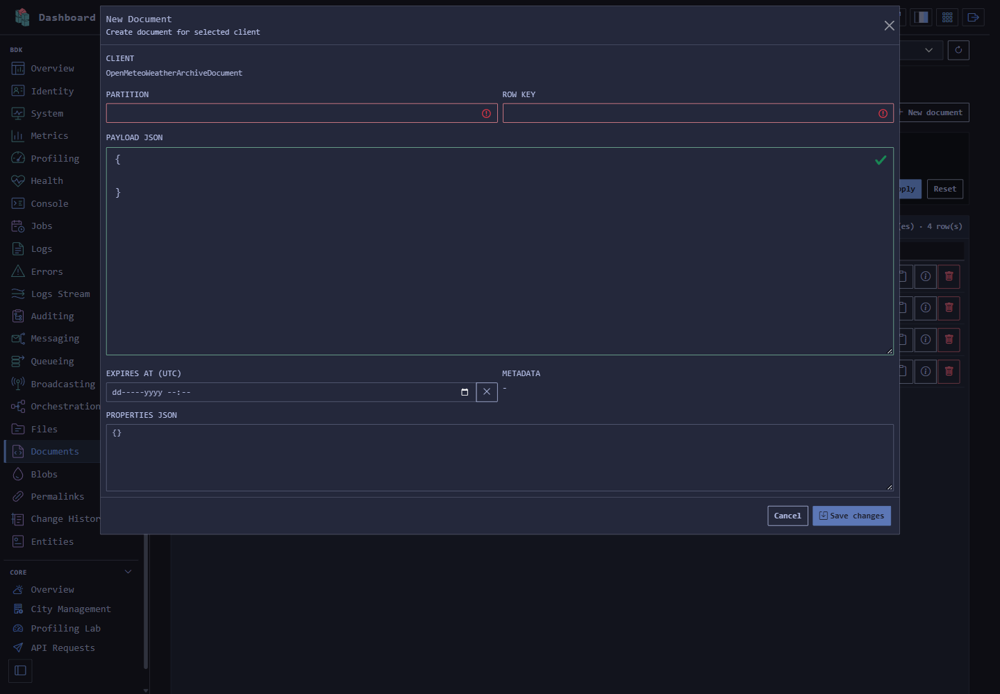
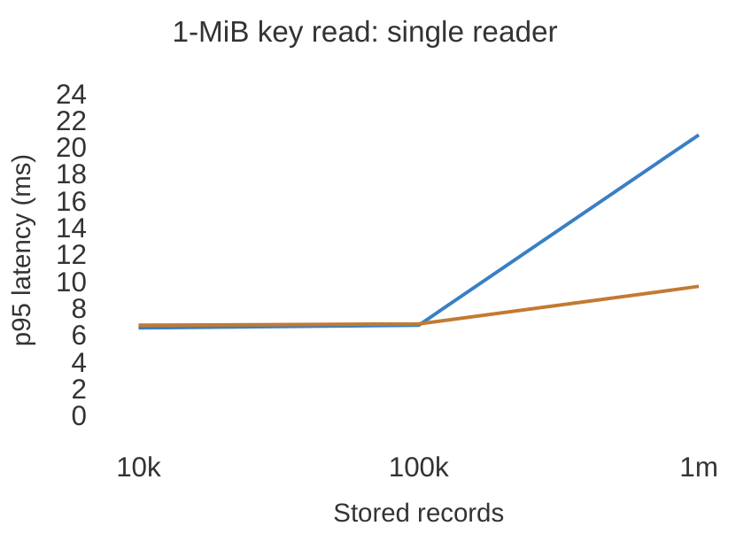
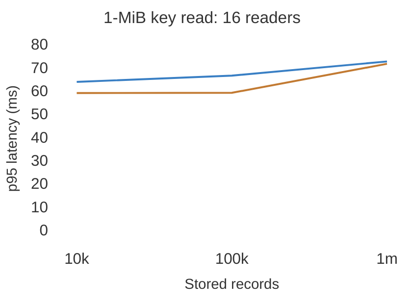
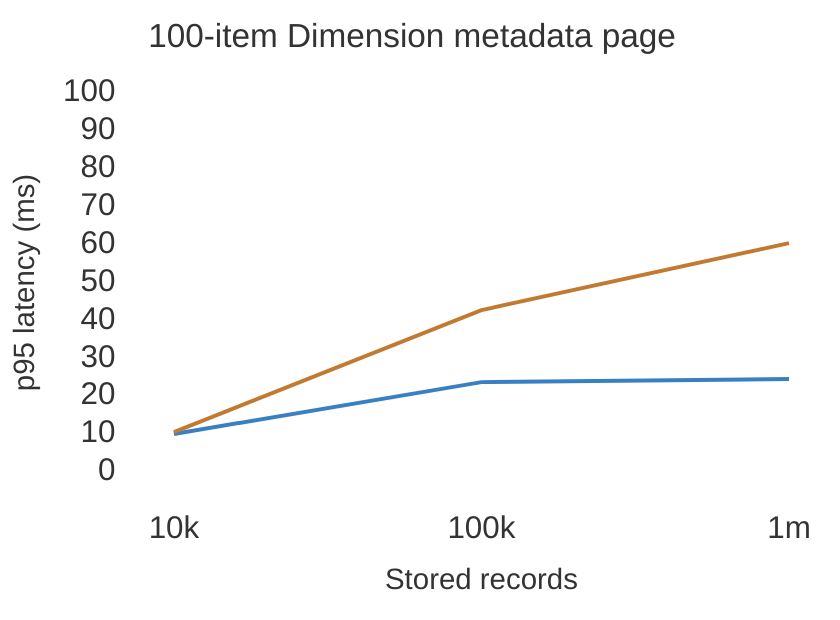
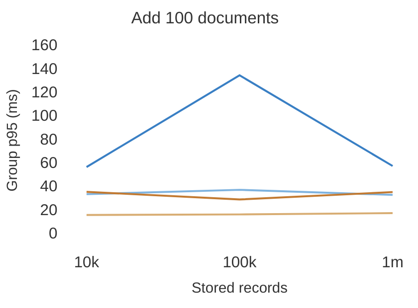
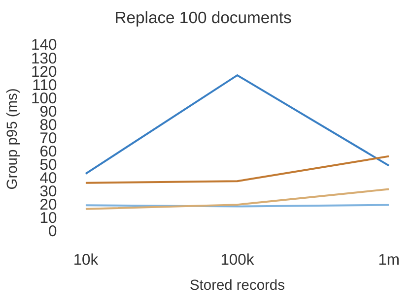

# Document Storage

[TOC]

## Overview

Document Storage is the typed JSON-document companion to Blob Storage. Applications use `IDocumentStoreClient<T>` with a two-part `DocumentKey` (`PartitionKey`, `RowKey`); providers persist serialized bytes and provider-neutral metadata.

The client owns validation, serialization, canonical SHA-256 hashes, size limits, payload transforms, integrity verification, continuation-token binding, and expiration resolution. Providers own durable state, conditional persistence, native paging, and resource initialization.

Document Storage does not replace `ICacheProvider`. `DocumentStoreCacheProvider` is an adapter for deployments that intentionally use a document store as cache persistence; the abstractions remain separate.

## Challenges

Typed JSON data needs more than provider-specific CRUD. Callers need stable keys, optimistic concurrency, bounded queries, portable metadata, expiration, payload limits, and integrity checks without changing application code when the persistence provider changes.

## Solution

`IDocumentStoreClient<T>` owns the provider-neutral document contract and returns `Result` values for expected failures. It validates and serializes logical documents before a provider stores bytes and metadata. Registration binds one document type and normalized client name to an in-memory, filesystem, database, or cloud provider.

## Key Features

- typed reads and writes with two-part `DocumentKey` values
- optional ETag conditions for document content, metadata updates, and deletes
- bounded paging with query-bound continuation tokens
- size limits and logical/stored SHA-256 integrity checks
- scalar properties, expiration, retention, compression, and encryption
- named clients, behaviors, diagnostics, dashboard, and MCP integration
- optional maintenance and content-read REST endpoints with independent feature registration
- in-memory, filesystem, Entity Framework, Azure Blob, Azure Table, and Cosmos providers

## Architecture

The outer client validates keys, queries, sizes, and continuation tokens. Registered behaviors wrap a core `DocumentStoreClient<T>`, which serializes the value, applies payload transforms, and calls `IDocumentStoreProvider`. Providers own conditional persistence, paging, initialization, and provider-native retention. The factory resolves existing keyed registrations by document type and client name.

## Use Cases

- store shared typed configuration or reference documents
- keep temporary documents with explicit expiration and retention
- page through partition or row-key prefixes without exposing provider queries
- move documents between named stores of the same type
- protect writes with ETags and content hashes
- persist typed documents on application-owned local disks or configured file shares

## Basic Usage

This example registers an in-memory client, writes one typed document, checks both operation results, and reads the stored value back for a visible HTTP response.

```csharp
using BridgingIT.DevKit.Application.Storage;

var builder = WebApplication.CreateBuilder(args);

builder.Services.AddDocumentStorage()
    .WithProvider<CustomerDocument>(
        _ => new InMemoryDocumentStoreProvider());

var app = builder.Build();

app.MapPost("/documents/customers/{id}", async (
    string id,
    IDocumentStoreClient<CustomerDocument> documents,
    CancellationToken cancellationToken) =>
{
    var key = new DocumentKey("customers", id);
    var stored = await documents.UpsertAsync(
        key,
        new CustomerDocument { Name = $"Customer {id}" },
        cancellationToken: cancellationToken);

    if (stored.IsFailure)
    {
        return Results.Problem(string.Join(
            "; ",
            stored.Errors.Select(error => error.Message)));
    }

    var read = await documents.GetAsync(key, cancellationToken);
    if (read.IsFailure)
    {
        return Results.Problem(string.Join(
            "; ",
            read.Errors.Select(error => error.Message)));
    }

    return Results.Ok(new
    {
        read.Value.Key.PartitionKey,
        read.Value.Key.RowKey,
        read.Value.Value.Name,
        read.Value.ETag,
        read.Value.ContentHash
    });
});

app.Run();

public sealed class CustomerDocument
{
    public string Name { get; set; }
}
```

`POST /documents/customers/42` returns the typed value with its key, ETag, and logical content hash. The in-memory provider retains it only for the process lifetime.

## Selection guidance

Use Document Storage when data is:

- naturally addressed by partition and row key;
- serialized and consumed as a typed document;
- read by exact key or bounded key-prefix pages;
- shared across application instances;
- protected by optimistic concurrency;
- temporary or retention-managed;
- portable across in-memory, filesystem, relational, Azure Storage, and Cosmos providers.

Use Blob Storage for stream-first binary objects and Key/Value Storage for low-latency scalar/shared-state workloads.

## Contract

```csharp
var properties = new PropertyBag();
properties.Set("region", "eu");
var created = await documents.UpsertAsync(
    new DocumentKey("customers", "42"),
    customer,
    new DocumentWriteOptions
    {
        CreateOnly = true,
        Expiration = ExpirationChange.After(TimeSpan.FromDays(7)),
        Properties = properties
    },
    cancellationToken);

if (created.IsFailure)
{
    Console.Error.WriteLine(string.Join(
        "; ",
        created.Errors.Select(error => error.Message)));
    return;
}

var current = await documents.GetAsync(
    new DocumentKey("customers", "42"),
    cancellationToken);

if (current.IsFailure)
{
    Console.Error.WriteLine(string.Join(
        "; ",
        current.Errors.Select(error => error.Message)));
    return;
}

var updated = await documents.UpdatePropertiesAsync(
    new DocumentPropertiesUpdate(current.Value.Key)
    {
        IfMatchETag = current.Value.ETag,
        Expiration = ExpirationChange.Clear
    },
    cancellationToken);

if (updated.IsFailure)
{
    Console.Error.WriteLine(string.Join(
        "; ",
        updated.Errors.Select(error => error.Message)));
}
```

Core operations:

- `GetAsync`: exact read returning `DocumentEntry<T>`.
- `FindPageAsync`: bounded payload page returning `DocumentEntry<T>` items.
- `ListPageAsync`: bounded key-only page.
- `CountAsync`: provider-side count where supported.
- `ExistsAsync`: exact logical existence.
- `GetManyAsync`: batched exact reads returning one `Result<DocumentEntry<T>>` per requested key, in input order. A missing or expired key is a per-item `DocumentStoreNotFoundError`; the outer result fails only when the whole read fails. Duplicate keys are read once.
- `UpsertAsync`: one typed write with an optional ETag condition, returning `DocumentInfo`.
- `UpsertManyAsync`: ordered, prevalidated, non-atomic batch with explicit partial completion. Providers that implement `IDocumentStoreBulkWriteProvider` (Entity Framework) commit the batch in one round trip.
- `UpdatePropertiesAsync`: metadata and expiration update with an optional ETag condition.
- `DeleteAsync`: idempotent optional ETag delete.
- `DeleteManyAsync`: ordered, prevalidated delete batch, also bulk-capable.

Batch read size is controlled by `DocumentStoreOptions.GetManyBatchSize` (default 25, valid range 1 to 1000). `DocumentStoreOptions.GetManyMaxParallelism` (default 4, valid range 1 to 32) limits how many batches of one call run at the same time. Providers without `IDocumentStoreBatchGetProvider` fall back to one `GetAsync` per distinct key.

`DocumentEntry<T>` and `DocumentInfo` expose provider-neutral `ETag`, logical `ContentHash`, creation/modification timestamps, `ExpiresAt`, and cloned scalar properties. The stored transformed hash remains an internal integrity value.

### Conditional updates

`DocumentWriteOptions.IfMatchETag` protects replacement of a previously read document. `DocumentPropertiesUpdate.IfMatchETag` and `DocumentDeleteOptions.IfMatchETag` protect metadata updates and exact deletes. These conditions are optional. Null, empty, and whitespace-only values are omitted; the wildcard `*` is invalid as a concrete version token.

One ETag represents the whole item. Every successful content, property, or expiration update invalidates the previous ETag, even when the submitted values are unchanged. Retain the original token while editing, then submit it with the draft:

```csharp
var key = new DocumentKey("customers", "42");
var draft = await documents.GetAsync(key, cancellationToken);
if (draft.IsFailure)
{
	Console.Error.WriteLine("The customer document could not be read.");
	return;
}

draft.Value.Value.Name = "Harbor Supplies";
var saved = await documents.UpsertAsync(key, draft.Value.Value,
	new DocumentWriteOptions { IfMatchETag = draft.Value.ETag },
	cancellationToken);

if (saved.IsFailure)
{
	Console.Error.WriteLine(string.Join("; ", saved.Errors.Select(error => error.Message)));
}
```

| Request | Behavior |
| --- | --- |
| Upsert without an ETag | Create if absent, or replace unconditionally |
| Upsert with a matching ETag | Replace that version and return the committed new ETag |
| Upsert with a stale ETag or missing target | Return `DocumentStoreConflictError` without creating or changing the item |
| Metadata update with a stale ETag | Return `DocumentStoreConflictError` without changing the item |
| Metadata update against a missing target | Fail without creating an item |
| `CreateOnly = true` without an ETag | Create only if no physical record exists, including an expired record |
| `CreateOnly = true` with a nonempty ETag | Validation failure before mutation |

Metadata updates without an ETag are unconditional but still require an existing item. Exact deletes remain idempotent when the item is already absent. Conditional deletes retain a newer item and return a conflict when its ETag differs.

The returned ETag and metadata describe the version committed by the operation. An intervening writer's token is never adopted from a later unconditional read. Keep the named client, document type, partition key, and row key with the token. ETags do not establish authorization, and `ExpectedContentHash` validates the incoming logical payload rather than the stored version. Bulk writes preserve each `DocumentWrite<T>.Options` condition.

## Queryable Dimensions

Use `Properties` for descriptive metadata and optional `Dimensions` for typed, indexed queries. EF SQL Server, PostgreSQL, and SQLite support Dimensions. Check the registered client's descriptor through `IDocumentStoreClientFactory.GetDescriptors()` before offering this feature. Other providers reject explicit Dimensions, including an empty collection, before backend I/O.

Supply dimensions through ordinary write options. Names register automatically within the document type; applications do not configure numeric name IDs or choose individual indexes.

```csharp
var descriptor = documentClientFactory.GetDescriptors()
    .Single(item => item.DocumentType == typeof(Invoice) && item.Name == "default");
if (!descriptor.Capabilities.Dimensions.SupportsDimensions) return;

var dimensions = DocumentDimensions.Create(new Dictionary<string, object>
{
    ["FiscalYear"] = 2026,
    ["Amount"] = 125.500000m,
    ["Approved"] = true
});
if (dimensions.IsFailure) return;

var saved = await documents.UpsertAsync(
    new DocumentKey("invoices", "INV-42"), invoice,
    new DocumentWriteOptions { Dimensions = dimensions.Value }, cancellationToken);

var year = DocumentDimensionPredicate.Create("FiscalYear", DocumentDimensionOperator.Equal, 2026);
if (year.IsFailure) return;
var page = await documents.FindPageAsync(new DocumentQuery
{
    DimensionFilter = DocumentDimensionFilter.Where(year.Value),
    Take = 100
}, cancellationToken);
```

Omitting `Dimensions` preserves the current collection when replacing content. Explicit `DocumentDimensions.Empty` clears it. A nonempty collection replaces it. New documents without dimensions remain dimensionless. Use `UpdateDimensionsAsync(new DocumentDimensionsUpdate { Key = key, Dimensions = replacement, IfMatchETag = current.ETag })` to replace only dimensions. Content, Properties, and Dimensions share one ETag. A stale token fails rather than overwriting another field's newer value.

| Contract | Behavior |
| --- | --- |
| Scalar values | `int`, `decimal`, `bool`, `string`, UTC `DateTime`, or explicit null |
| Decimal | Exact `decimal(18,6)` range; excess fractional precision is rejected |
| String values | Exact case-sensitive equality, spaces significant; at most 256 UTF-8 bytes |
| Names | Case-insensitive ASCII identifiers matching `[A-Za-z_][A-Za-z0-9_.:-]{0,127}`; snapshots retain supplied spelling |
| Per-document limit | 64 dimensions, including nulls |
| Filter limits | 16 predicates, 16 groups, four nested group levels |
| Comparisons | Equality/inequality, integer/date/decimal ranges, existence and null checks; `All`/`Any` groups |
| SQLite decimal | Indexed equality only; other decimal comparisons fail before query execution |

`NotEqual` matches only present, non-null values of the operand's type. Missing names and explicit null are distinct. String ordering is unsupported. Counts and key-only pages accept the same filter. A positive indexed predicate permits selective queries; otherwise existing key constraints or full-scan consent are required. Every `Any` branch needs an anchor. Continuation tokens bind the logical filter, not database name IDs.

EF discovers the two dimension tables through annotated navigations on `StorageDocument`; the context interface needs no new sets. Existing persisted Properties require no backfill. Generate the application's normal provider-specific migrations for the added snapshot and tables. EF Cosmos hosts call `modelBuilder.ExcludeDocumentDimensions()` to exclude the relational-only members.

The name dictionary retains unused names and has no quota. Its per-provider positive cache is bounded to 4,096 entries. After externally recreating the database, quiesce operations and recreate the provider or call `ClearDimensionNameCache()` on the EF provider. Diagnostics expose local cache/registration counters. MCP `documents.clients` and `documents.probe` count dictionary entries only when `includeDimensionNameCounts` is explicitly true.

Dimensions are plaintext metadata indexed for filtering. Payload encryption does not encrypt their snapshot or indexed values. Avoid placing secrets in Dimensions.

Enabled read endpoints add POST `/{clientId}/documents/search`, `/documents/keys`, and `/documents/count` under their configured route group. Maintenance adds PATCH `/{clientId}/documents/dimensions`. Typed dimensions use envelopes such as `{"FiscalYear":{"type":"integer","value":2026},"Amount":{"type":"decimal","value":"125.5"}}`. A filter leaf is `{"name":"FiscalYear","operator":"Equal","operand":{"type":"integer","value":2026}}`; groups use `{"all":[...]}` or `{"any":[...]}`. CLI listing accepts this filter JSON through `--dimension-filter`.

See [Read by Dimensions](#read-by-dimensions) for measurements as the collection grows. SQLite supports Dimension queries, with performance diagnostics reported separately from the SQL Server and PostgreSQL measurements. Server performance depends on data volume and filter selectivity.

### Filter metadata with FilterModel

Use the `ListPageAsync` overload to combine document keys and indexed Dimensions. This example lists approved invoices with row keys starting with `INV-`. Use an EF Core client for SQL Server, PostgreSQL, or SQLite. Check `descriptor.Capabilities.SupportsFilterModel` on the registration returned by `IDocumentStoreClientFactory.GetDescriptors()`.

```csharp
var scope = new DocumentFilterScope(PartitionKey: "invoices");
var filter = new FilterModel
{
    PageSize = 25,
    Filters =
    [
        new("RowKey", FilterOperator.StartsWith, "INV-"),
        new("Dimensions.Approved", FilterOperator.Equal, true)
    ]
};

string continuationToken = null;
do
{
    var page = await documents.ListPageAsync(scope, filter, continuationToken, cancellationToken);
    if (page.IsFailure)
    {
        Console.Error.WriteLine(string.Join(", ", page.Errors.Select(error => error.Message)));
        break;
    }

    foreach (var document in page.Value.Items)
    {
        Console.WriteLine(document.Key.RowKey);
    }

    continuationToken = page.Value.ContinuationToken;
}
while (continuationToken is not null);
```

To run the same query over HTTP, enable maintenance endpoints for the EF-backed client and authenticate with the configured maintenance policy. Replace `{clientId}` with the registered ID from the [clients endpoint](#routes-and-request-semantics).

```http
POST /_bdk/api/storage/documents/{clientId}/search?partitionKey=invoices
Content-Type: application/json

{
  "pageSize": 25,
  "filters": [
    { "field": "RowKey", "operator": "startswith", "value": "INV-" },
    { "field": "Dimensions.Approved", "operator": "eq", "value": { "type": "boolean", "value": true } }
  ]
}
```

The `SupportsFilterModel` capability also applies to queries that only use keys. The `PartitionKey` and `RowKey` fields support `eq`, `neq`, and `startswith`. Sort results by either key or both.

Use `Dimensions.<name>` for the provider's supported typed equality, inequality, range, and null checks. In HTTP requests, wrap a comparison value in a typed envelope as shown above. Omit `value` for `isnull` and `isnotnull`. Both checks require the Dimension to be present. Use the native Dimension query for `Exists` and `Missing`.

Combine key and Dimension predicates in nested AND and OR groups. The selected partition and optional `rowKeyPrefix` query parameter constrain every branch. To avoid a full scan without a partition in the scope, each branch needs an equality comparison on `PartitionKey` or a positive indexed Dimension predicate. Use `allowFullScan=true` when the filter requires a full scan and the client permits it.

Omit `page` or use `0` or `1`. Omit `pageSize` or use `0` for the configured `DefaultTake`, capped by `MaxTake` and 1,000. Each response includes metadata and Dimensions in `items`. When `hasMore` is true, send the same request with the returned `continuationToken` in the JSON body. Each page reevaluates expiration using the client clock. Fetch content through the item read.

See the shared [FilterModel structure](features-filtering.md#filter-model-structure).

## Query safety

Reads are page-based and deterministic. Full scans require consent in both `DocumentStoreOptions` and the individual query. Provider capabilities decide whether exact, prefix, suffix, count, and key-only operations are accepted or require client-side filtering.

Continuation tokens are opaque and bind the normalized client name, document type, operation, query shape, page size, provider state, and first-page expiration cutoff. Configure `IContinuationTokenProtector` to require HMAC-protected tokens.

##  Size and integrity

`DocumentStoreOptions.MaxDocumentSize` defaults to `ByteSize.Megabytes(1)` and is enforced against logical serialized bytes before provider I/O. A provider may advertise a lower stored-size limit.

Every write computes:

- logical `ContentHash` over serialized bytes;
- stored content hash after all transforms.

`DocumentWriteOptions.ExpectedContentHash` can enforce the caller's expected logical hash. Reads verify the stored hash before reversing transforms and verify the logical hash before deserialization. Mismatches return `DocumentStoreIntegrityError`.

##  Properties and transforms

Document Storage supports application-defined `Properties`. Names are case-insensitive and retain supplied spelling. Results contain detached bags, including copies of byte-array values.

| Input | Insert | Content replacement or metadata update |
| --- | --- | --- |
| Omitted or `null` | Empty bag | Preserve current properties |
| Empty bag | Empty bag | Clear application properties |
| Non-empty bag | Store the bag | Replace the entire bag |

A present entry with a null value remains present. Use the merge/set/remove helpers for explicit read-modify-write changes.

Supported values are null, `string`, `char`, `bool`, `byte`, `sbyte`, `short`, `ushort`, `int`, `uint`, `long`, `ulong`, `float`, `double`, `decimal`, `Guid`, `DateTime`, `DateTimeOffset`, `DateOnly`, `TimeOnly`, `TimeSpan`, and `byte[]`. Other objects and collections fail validation before provider I/O. Typed .NET calls and provider persistence preserve scalar type and value. HTTP uses ordinary JSON objects: strings stay strings, and JSON does not carry every .NET numeric or temporal type.

Properties remain unindexed descriptive metadata. Use the separate Dimensions collection for indexed queries on supported EF providers. Compression/encryption state lives in separate provider metadata and survives clearing Properties. Application keys resembling transform keys are ordinary user properties.

Providers use `PropertyBagScalarCodec` where text persistence is required. Azure Blob enforces its 8 KiB encoded metadata limit with a typed size failure. Filesystem document records use format version 3; recreate development/test storage, with no old-format reader or data conversion.

See [scalar property bag persistence](common-serialization.md#propertybagserialization) for the shared JSON dictionary format.

`IDocumentPayloadTransform` runs in registration order on writes and reverse order on reads. Compression uses `CompressionHelper`; encryption uses `EncryptionHelper` and `IEncryptionKeyProvider`, so active-key writes and historical-key reads support key rotation. Transform metadata is stored in a versioned `bdk_` envelope and is not exposed as application properties.

```csharp
services.AddDocumentStorage()
    .WithCompressionTransform<Customer>()
    .WithEncryptionTransform<Customer>()
    .WithAzureTableClient<Customer>(tableServiceClient);
```

The encryption transform requires a registered `IEncryptionKeyProvider`. Standard provider registrations resolve the configured `ISerializer`, `TimeProvider`, `IContinuationTokenProtector`, and transforms from dependency injection.

##  Expiration and retention

Writes use `ExpirationChange`:

- `Preserve`: keep the current expiration; inserts remain non-expiring.
- `At(...)`: set an absolute timestamp normalized to UTC.
- `After(...)`: resolve one relative timestamp from the operation `TimeProvider`.
- `Clear`: remove expiration.

Due documents are immediately hidden from exact reads, existence, count, pages, enumeration, copy, and move. They remain physical records until retention runs. `CreateOnly` therefore still conflicts with an expired physical record, while clearing or extending expiration revives it.

```csharp
services.AddDocumentStorage(options => options.WithRetention(retention =>
{
    retention.SweepInterval = TimeSpan.FromMinutes(15);
    retention.BatchSize = 500;
    retention.MaxBatchesPerStore = 5;
}));
```

`DocumentRetentionBackgroundService` resolves each named client in a fresh DI scope and invokes only `IDocumentStoreRetentionProvider`. It never emulates cleanup through public scans. In-memory, filesystem, Entity Framework, Azure Blob, and Azure Table use bounded provider-native cleanup; Cosmos uses native item TTL.

Filesystem retention uses a persisted discovery cursor that resumes across sweeps and restarts. Each candidate is rechecked under key authority without waiting for busy keys. Clearing or extending expiration prevents stale discovery from deleting the document. Cleanup reclaims superseded payload files, while open readers can retain their disk blocks. Tombstones and coordination directories remain on disk; offline compaction is not implemented. No additional retention scheduler or public scan approval is needed.

The defaults are enabled retention, a 15-second startup delay, one-hour interval, batch size 1000, at most 10 batches per client, no batch delay, and a 10-second stop timeout.

## Named clients and DI

`AddDocumentStorage` is the feature registration entry point. Registrations are keyed by document CLR type and normalized case-insensitive client name. At most one registration for a type is the explicit default exposed through direct `IDocumentStoreClient<T>` injection. Resolve other clients through `IDocumentStoreClientFactory.CreateClient<T>(name)`.

```csharp
services.AddDocumentStorage()
    .WithAzureTableClient<Customer>(tableServiceClient, name: "primary", isDefault: true)
    .WithEntityFrameworkClient<Customer, StorageDbContext>(name: "archive", isDefault: false);
```

Singleton, scoped, and transient client lifetimes follow normal keyed DI semantics. The factory is scoped and lookup-only; it does not construct or cache clients. Entity Framework providers receive `IServiceScopeFactory` and own one scope and `DbContext` per operation.

Both `IDocumentStoreProvider` and `IDocumentStoreClient<T>` are keyed by the same type/name identity at the configured lifetime. Retention resolves the keyed provider directly, so custom client behaviors cannot hide retention support.

Behaviors are composed between the provider adapter and the outer validating/serializing client. Invalid input never reaches logging, retry, timeout, cache, chaos, transforms, or providers.

## Operation profiling

Register Profiling before other named-client behaviors to include their downstream work:

```csharp
services.AddDocumentStorage()
    .WithProfilingBehavior<Person>()
    .RegisterProvider<Person>(_ => new InMemoryDocumentStoreProvider(), name: "archive");
```

Every typed client method is measured, including count, key-only paging, property updates and batch writes/deletes. `DocumentStorage` keys use `documentstorage:{type name}:{operation}`. Dimensions are `documentstorage.client`, `documentstorage.documentType` and `documentstorage.operation`; partition keys, row keys, query tokens and document payloads are omitted. A partially completed batch keeps its original result while profiling records `PartialBatch` failure. Direct `DocumentStoreBuilderContext<T>` registration also offers `.WithProfilingBehavior()`. See [Storage profiling behaviors](features-profiling.md#storage-behaviors) for ownership and comparison rules.

## Behaviors

- Typed logging with raw keys by default. Register `Sha256KeyDisplayStrategy` only where keys are classified as sensitive.
- Metrics with shared operation names and key/query context. See [Metrics](#metrics).
- Retry for transient provider failures only.
- Timeout with a linked token, cancellation quiescence, caller-cancellation preservation, typed timeout errors, and injected `TimeProvider`.
- Exact-read caching with named-client-aware keys and mutation invalidation.
- Chaos behavior for controlled resilience testing.

## Metrics

`WithMetricsBehavior<T>()` measures every typed client method (get, get-many, find, list, count, exists, upsert, upsert-many, update-properties, delete, delete-many) through the `bdk` meter. All instruments carry the `operation` and `document.type` tags only; keys, tokens and payloads are never tagged.

| Instrument | Type | Meaning |
|---|---|---|
| `document.operations` | counter | Completed operations. |
| `document.operation.duration` | histogram (ms) | Operation duration. |
| `document.operation.failures` | counter | Failed operations, including a batch that stopped at a failed key. |
| `document.bytes` | counter | Cumulative logical serialized bytes read or written (`DocumentInfo.ContentLength`, before payload transforms). |
| `document.bytes_per_second` | histogram (`By/s`) | Transfer rate of one successful non-empty get, get-many, find, upsert or upsert-many call. |

`document.bytes_per_second` is skipped for failed and empty calls and for operations that do not move payloads (list, count, exists, update-properties, delete, delete-many). The `operation` tag separates read rates from write rates. The duration covers the whole call below the behavior, so retry delays and timeouts that sit below it lower the rate. Bytes are logical bytes, so compressing or encrypting transforms make the stored size differ from the reported size.

`DocumentInfo.ContentLength` is set by the client on every read and upsert. It is zero for property-only updates, which do not read the payload.

## Transfers and maintenance

`EnumerateAsync` and `EnumerateKeysAsync` require a positive maximum item count. `DeleteByQueryAsync` is bounded, supports dry-run and optional continue-on-error, reads the matching entry metadata, and conditionally deletes the ETag observed during enumeration. Partial results expose every failed key in input order.

`CopyAsync` and `MoveAsync` work across any two clients of the same document type. They reserialize through the target client and preserve properties and expiration unless overridden. Move copies first, then conditionally deletes the source ETag. A changed source remains intact and returns `DocumentStoreTransferError`; a move to the same client/key is a successful existence-checked no-op.

`DocumentTransferOptions.IfMatchETag` refers to the destination version. Set it when replacing a previously read target. `CreateOnly = true` prevents replacing any physical target record and cannot be combined with a nonempty ETag. Without either condition, the destination write is unconditional. A failed destination condition prevents move source deletion.

## HTTP endpoints

The `Presentation.Web.Storage` package exposes registered typed Document Storage clients through two optional Minimal API groups:

- `AddMaintenanceEndpoints(...)` enables create, update, and delete actions, property reads and updates, existence checks, discovery of registered clients, bounded key listing, and FilterModel queries.
- `AddReadEndpoints(...)` enables exact-key document content reads with an ETag response header.

Enable each group explicitly in the feature setup. Registering `AddDocumentStorage()` and its providers does not enable either group. Assembly discovery through `AddEndpoints()` also leaves them disabled until explicitly configured. `app.MapEndpoints()` maps the enabled registrations.

### Enable endpoints in the feature setup

Reference `BridgingIT.DevKit.Presentation.Web.Storage` in the host. Register the provider and endpoints, then map the DevKit endpoints:

```csharp
services.AddDocumentStorage()
    .WithProvider<CustomerDocument>(sp => new InMemoryDocumentStoreProvider(),
        lifetime: ServiceLifetime.Singleton)
    .AddMaintenanceEndpoints(options => options
        .GroupPath("/_bdk/api/storage/documents")
        .RequireAuthorization(), enabled: true)
    .AddReadEndpoints(options => options
        .GroupPath("/_bdk/api/storage/documents")
        .RequireAuthorization(), enabled: true);

app.MapEndpoints();
```

The in-memory example uses a singleton so separate HTTP requests share stored documents. Choose the normal provider lifetime for persistent providers.

Omit either registration or pass `enabled: false` to leave that group disabled. For separate service registration, use `services.AddDocumentStorageMaintenanceEndpoints(...)` and `services.AddDocumentStorageReadEndpoints(...)` with the same options and `enabled` switch.

Both groups require authorization by default. Each has independent options for its path, tag, policies, and roles. Configure host authentication and authorization for the selected policies. To expose intentionally public content, call `AllowAnonymous()` on the read group while retaining authorization on maintenance. The default paths can be shared because the groups map different routes and HTTP methods.

### Routes and request semantics

Get `clientId` from the clients endpoint. It identifies a registered named, typed client; the API does not accept arbitrary CLR types. URL-encode the client id and exact key query values, including keys containing slashes.

The read group exposes the existing exact content URL:

```http
GET /_bdk/api/storage/documents/{clientId}/documents?partitionKey=customers&rowKey=customer-42
```

The maintenance group exposes these routes:

```http
GET    /_bdk/api/storage/documents/clients
GET    /_bdk/api/storage/documents/{clientId}/documents/properties?partitionKey=customers&rowKey=customer-42
GET    /_bdk/api/storage/documents/{clientId}/documents/exists?partitionKey=customers&rowKey=customer-42
GET    /_bdk/api/storage/documents/{clientId}/documents/keys?partitionKey=customers&rowKeyPrefix=customer-&take=100
POST   /_bdk/api/storage/documents/{clientId}/search?partitionKey=invoices
POST   /_bdk/api/storage/documents/{clientId}/documents?partitionKey=customers&rowKey=customer-42
PUT    /_bdk/api/storage/documents/{clientId}/documents?partitionKey=customers&rowKey=customer-42
PATCH  /_bdk/api/storage/documents/{clientId}/documents/properties?partitionKey=customers&rowKey=customer-42
DELETE /_bdk/api/storage/documents/{clientId}/documents?partitionKey=customers&rowKey=customer-42
```

See the [FilterModel request example](#filter-metadata-with-filtermodel) for the JSON request to `POST /{clientId}/search`.

POST is atomic create-only and returns HTTP 201 with committed `DocumentInfo`, an `ETag` header, and a `Location` pointing to the maintenance properties route. An existing physical record, including an expired record, returns HTTP 409. PUT creates or replaces content and returns HTTP 200 with committed `DocumentInfo` and a fresh `ETag`. Both deserialize the `content` envelope field through the selected typed client's serializer and use its normal validation, behaviors, transforms, size limits, and provider pipeline.

```http
PUT /_bdk/api/storage/documents/{clientId}/documents?partitionKey=customers&rowKey=customer-42
Content-Type: application/json
If-Match: "bdk.<token-from-the-last-response>"

{
  "content": { "id": "customer-42", "name": "Ada" },
  "properties": { "reviewed": true, "revision": 2 },
  "expiresAt": "2030-12-31T23:59:59Z"
}
```

PUT, PATCH, and DELETE accept optional `If-Match`. Echo the complete `ETag` response header from an earlier read or successful write. The token covers content, custom properties, and expiration together. Any change invalidates the old token; stale content saves, property edits, and deletes return HTTP 409 without modifying the item. A stale PUT after deletion also conflicts and cannot recreate the document. Omit `If-Match` to permit unconditional creation or replacement. An already absent delete target is a successful HTTP 200 no-op. POST rejects `If-Match` with HTTP 400; wildcards and ETag lists are unsupported.

HTTP `ETag` headers are quoted opaque transport tokens (`"bdk.<base64url>"`) preserving each provider's exact native token. Copy them unchanged without stripping quotes or decoding. The metadata body's `ETag` remains the native provider token; legacy native conditions are also accepted. Content GET requires `AddReadEndpoints(...)` and returns the typed JSON payload and ETag from the same snapshot. It uses the selected typed client pipeline, including behaviors, transforms, integrity checks, and expiration visibility. Properties GET returns `DocumentInfo` with the corresponding header. Successful writes return metadata from the exact commit without rereading the document.

Omitted or null `properties` preserve the existing bag; `{}` clears it. Properties must contain scalar JSON values, not nested objects or arrays. Numeric values that overflow or underflow the supported finite .NET numeric types return HTTP 400. Omitted expiration preserves it. Supply `expiresAt` to set it or `clearExpiration: true` to remove it; combining both returns HTTP 400. These rules apply to POST/PUT and properties PATCH. PATCH uses the same metadata fields without a `content` field and leaves document content unchanged:

```http
PATCH /_bdk/api/storage/documents/{clientId}/documents/properties?partitionKey=customers&rowKey=customer-42
Content-Type: application/json
If-Match: "bdk.<token-from-the-last-response>"

{ "properties": { "reviewed": true }, "clearExpiration": true }
```

Unknown clients and missing reads return HTTP 404. Invalid requests return HTTP 400, and configured document size violations return HTTP 413. Key listing uses bounded paging and protected continuation tokens. Type-wide scans require client `AllowFullScans` approval plus `allowFullScan=true` on the request.

## Providers

###  In-memory

Process-local provider for tests and ephemeral use. It stores copied bytes in private synchronized state and returns cloned records.

### Filesystem

The optional `BridgingIT.DevKit.Infrastructure.FileSystem` package provides `FileSystemDocumentStoreProvider`. It stores the existing serialized document bytes and metadata through direct file I/O. The typed client still owns serialization, transforms, hash verification, expiration resolution, and continuation-token protection. File Storage registration is not required.

```csharp
using BridgingIT.DevKit.Application.Storage;
using BridgingIT.DevKit.Infrastructure.FileSystem;
using Microsoft.Extensions.DependencyInjection;

var storageRoot = Path.GetFullPath(
	Path.Combine(builder.Environment.ContentRootPath, "app-data", "storage"));

builder.Services.AddDocumentStorage()
	.WithFileSystemClient<CustomerDocument>(storageRoot,
		configureFileSystem: options =>
		{
			options.AccessKind = FileSystemStorageAccessKind.Local;
			options.Durability = FileSystemStorageDurability.Durable;
		},
		documentStoreOptions: new DocumentStoreOptions
		{
			DefaultTake = 100,
			MaxTake = 500
		},
		name: "customers",
		isDefault: true);
```

`CustomerDocument` is the model from [Basic Usage](#basic-usage). Resolve the default through `IDocumentStoreClient<CustomerDocument>` or resolve `"customers"` through the factory. Use an absolute persistent data path when deployment replaces the application directory.

#### Platforms and configuration

Windows supports `Local` and `Smb`. Linux supports `Local`, `Smb`, and `Nfs`. Windows NFS and other operating systems are unsupported. Set `AccessKind` to the actual protocol, including shares mounted as directories. Every participant opening a store must use its recorded access kind. Blob and document providers can share one root through separate namespaces.

`configureFileSystem` accepts the shared `FileSystemStorageOptions`. Defaults are Durable acknowledgement, root creation enabled, a five-second authority acquisition budget, a 64 KiB transfer buffer, a 1 MiB metadata limit, 100,000 examined metadata entries per query, and 10,000 discovery or metadata steps per retention sweep. `CreateRoot = false` requires an initialized compatible store. See the [filesystem configuration table](features-storage-blobs.md#configuration) for option names and limits. `documentStoreOptions` configures the existing typed-client rules separately.

The directory layout belongs to the provider. Ordinal type, partition, and row identities map to hashed paths, with original identities checked in metadata. Files are not named for application browsing or direct edits. Experimental format-1 roots are rejected without automatic migration. All participating OS identities need compatible create, read, flush, and delete permissions. Back up the complete root with every participant quiesced. Live backups are unqualified.

#### Queries and paging

Exact-key reads resolve their paths directly. Prefix, suffix, full-scan, and key-listing capabilities are advertised as `SupportedClientSide`, because they scan metadata rather than use a secondary index. These queries require `DocumentStoreOptions.RejectClientSideFilteredQueries = false`. Type-wide scans additionally require global `AllowFullScans = true` and query-level `AllowFullScan = true`. Exact lookups remain available with the defaults shown above.

Metadata traversal prunes by document type and exact partition where available. `ListPageAsync` reads no payloads. `FindPageAsync` opens the selected payloads after metadata selection. Counts use bounded metadata traversal rather than a native index. Exceeding `MaxQueryMetadataEntries` returns a query-too-broad failure rather than a partial successful page or count.

Pages use live ordinal key positions. Unchanged data can be traversed once in order; concurrent changes can affect subsequent pages. The first-page expiration cutoff remains bound to the token, which does not create a snapshot. Omitted `Take` uses the registered `DocumentStoreOptions.DefaultTake` on every page.

#### Publication, retention, and recovery

Writes stage immutable payload generations and publish the current metadata atomically under per-key authority. Property updates reuse the payload generation. Deletes publish tombstones. Local authority uses exclusive handles across cooperating processes. Shared authority uses persistent ownership markers without age-based takeover. Existing read handles remain valid through replacement and deletion.

`Durable` performs native file and namespace persistence operations before success. A Durable property update also flushes the referenced payload. `Buffered` permits loss of recent acknowledged metadata changes after host failure. Initialization, staging, and safe reclamation still perform persistence operations, so Buffered mode does not promise zero flushes or higher throughput.

The existing [expiration and retention](#expiration-and-retention) contract applies, including immediate logical expiration and conditional cleanup. Documents without an expiration remain until explicitly deleted.

An uncertain mutation returns `DocumentStoreIndeterminateOperationError` with a mutation identity. The standard retry behavior does not replay it. Shared uncertainty retains ownership and can block later operations. Recovery requires quiescing every participant on every host, reconciling fresh server-confirmed metadata, and draining or cancelling old server operations before clearing ownership.

Required native operations fail clearly when unsupported. Actual SMB, NFS, independent-host recovery, power-loss, and full performance qualification remain pending. See the [filesystem provider guide](storage-filesystem-providers.md) for native persistence requirements, recovery tooling, benchmarks, and opt-in share tests. Share tests remain inactive until disposable shares are configured and skip cases inapplicable to the host OS.

#### Public storage helpers

`FileSystemDocumentStoreProvider.Store` exposes the public `FileSystemStore` for trusted diagnostics, maintenance, and recovery. Authority, durability, staging, retention, and diagnostic helpers also have public APIs with XML documentation and examples. `Store.Options` returns a configuration copy, and `FileSystemStore.Json` is read-only. Active configuration and authority handles stay private.

Normal typed operations use `IDocumentStoreClient<T>`. Direct helper calls must preserve ownership, persistence, and global-quiescence preconditions. See [public storage helpers](storage-filesystem-providers.md#public-storage-helpers) before using the low-level API.

###  Entity Framework

Annotation-mapped `StorageDocument` persistence with indexed hashes for type/partition/row identity, a concurrency version, Unix-millisecond expiration, payload/transform metadata, and provider-owned contexts. SQL Server, PostgreSQL, and SQLite run the same provider contract.

The provider implements the optional batch interfaces: `GetManyAsync` reads keys grouped by partition in chunks of `GetManyBatchSize` with one query per chunk, runs up to `GetManyMaxParallelism` chunks at the same time (each on its own connection), and `UpsertManyAsync` and `DeleteManyAsync` load existing rows once, apply the operations in order and commit once. A failed operation stops the batch, the operations before it stay committed and `FailedKey` is set. If the single commit throws (for example under contention), the provider repeats the batch through the per-operation path, which keeps the retry and conflict semantics of single writes.

New document rows get UUIDv7 IDs from `StorageDocument.CreateId()`. On SQL Server, PostgreSQL, and SQLite, EF discovers the key mapping from the entity annotations. It writes `StorageDocument.Id` and `StorageDocumentDimension.DocumentId` as lowercase, 32-character GUID text in `char(32)` columns on a fresh schema.

Both columns inherit the database default collation. To guarantee UUIDv7 timestamp order across distinct milliseconds, call `modelBuilder.UseDocumentRowIdCollation(Database.ProviderName)` in `OnModelCreating` before creating the schema. It applies `Latin1_General_100_BIN2` on SQL Server, `C` on PostgreSQL, or `BINARY` on SQLite to both columns.

The model uses an index on `(TypeHash, PartitionKey, RowKey)` for keyset paging. To reduce expiration index storage, call `modelBuilder.ApplyDocumentStoreConfiguration()` in `OnModelCreating` when creating the schema. It filters the `(TypeHash, ExpiresAtUnixMilliseconds)` index to rows with an expiration. Either model can use the row ID collation independently.

See the [Appendix A: Performance and scaling](#appendix-a-performance-and-scaling).

###  Azure Blob

Requires only `BlobServiceClient` or an account connection string. The provider derives `bdk-doc-{hash}` from normalized client name and document type, creates/reuses it through `CreateIfNotExistsAsync`, and never deletes it on disposal. Logical keys are independent Base64Url path segments, so reserved characters round-trip.

###  Azure Table

Requires only `TableServiceClient` or an account connection string. The provider derives `BdkDoc{hash}`, creates/reuses it, chunks payload bytes into 60 KiB `bdk_content_####` properties, and validates the complete entity against Azure Table's 1 MiB limit. All provider metadata uses `bdk_` keys.

###  Cosmos DB

Uses provider-owned database/container initialization through `CosmosSqlProvider`, enables per-item TTL, persists provider continuation state inside document tokens, and applies logical expiration filtering while native deletion remains eventual.

## Azure resource ownership

Azure providers depend on an existing account, not pre-created feature resources. Resource names are deterministic from `normalizedClientName + "\n" + documentTypeIdentity`; optional prefixes are validated. Initialization is asynchronous and idempotent. Concurrent callers and nodes may race safely, cancellation/failure is retryable, unrelated account resources are untouched, and disposal never removes the table/container.

## Dashboard and diagnostics

The Document Storage dashboard inherits the shared dashboard authorization and antiforgery conventions. It selects named clients, lists document pages from 25 to 500 rows, and presents partition/row keys, serialized JSON size, modification time, and expiration in the compact table. Manual and interval refreshes use the currently applied client, key filters, query mode, page size, continuation state, and selected document. The standard refresh interval is off by default and remembered in browser-local storage. The details dialog exposes ETags, hashes, timestamps, expiration, scalar properties, and conditional save/delete actions without adding retention or transform administration to the browsing surface.

Open Documents at `/_bdk/dashboard/storage/documents`. Choose a client, then apply partition and row-key filters. Prefix, Suffix and Exact select how the row key is matched. Use Load more to append a continuation page.

For a provider that supports Dimension queries, expand **Dimensions** and add typed conditions. Combine them with **Match all** or **Match any**, including nested groups, then choose **Apply**. Available comparisons follow the provider. Results and the matching count use the same filter, which remains active through refresh and Load more. Reset or changing clients clears it. The key-filter illustration below omits the optional Dimensions panel.

Applied filters and unfinished Dimension entries survive switching between **Explorer** and **Diagnostics** or navigating back in the same browser tab.

Dashboard filters travel in URLs and remain subject to hosting limits. A large valid filter can return HTTP 414 when it exceeds the request-line or query-string limit. Use the POST search endpoint or .NET query API for larger filters.

[](assets/dashboard/14-storage-documents-documents.png)

Select a row's information button to inspect and edit its JSON payload, scalar properties, and expiration. For clients that support Dimensions, the editor shows the stored keys, types, and values. Use **Add dimension** to add an entry. The **New document** button opens the same editor with editable partition and row keys. A create conflict reports an existing key.

Use the funnel button beside a saved dimension in **Document Details** to add its value to the active filter. Edit or remove conditions in **Dimensions**, then select **Apply**. In **Dimension columns**, pin up to three keys in the results table. The dashboard remembers these keys for each selected document client. A dash indicates a missing dimension, and `null` indicates an explicit null.

Existing edits submit the originally displayed ETag, and an ordinary edit without that token is invalid. On conflict, the editor retains its JSON draft, properties, dimensions, expiration, identity, and original ETag. **Reload current item** asks for discard confirmation before replacing the draft. **Force overwrite** submits the retained draft without an ETag condition. This choice applies to one submission. After a validation error, HTTP error, or network failure, an ordinary Save uses the original ETag again. New documents remain create-only. The editor never refreshes the token silently to make a stale save succeed.

[](assets/dashboard/storage/document-details.png)

Permalink download and copy actions appear for clients registered with `WithPermalinks<T>()`. See the [shared dashboard setup](features-presentation-dashboard.md) for plugin discovery and authorization.

`IDocumentStorageDiagnosticsService` reports non-sensitive registration identity, lifetime, capabilities, size limits, configured transform identifiers, latest retention outcome, and health. `DocumentStorageMcpHandler` exposes `documents.summary`, `documents.clients`, and `documents.probe` when the MCP runtime is registered. Neither surface exposes payloads, continuation tokens, encryption material, or secrets.

## Shared common APIs

Document and Blob Storage share:

- `ByteSize`, `StreamHelper`, and `TemporaryFileHelper`;
- `ExpirationChange` and `ExpirationHelper`;
- `ContentHashHelper`;
- `Base64UrlHelper`, `PropertyBagScalarCodec`, and `OpaqueContinuationTokenCodec`;
- `ContentTransformEnvelopeCodec`;
- `IEncryptionKeyProvider`;
- raw and SHA-256 key display strategies;
- `AsyncInitializationGate`.
- `PeriodicBackgroundService` and `PeriodicBackgroundServiceOptions` for the monitored retention loop.

See [Common Utilities](./common-utilities.md), [Common Serialization](./common-serialization.md), and [Blob Storage](./features-storage-blobs.md).

## Testing

The feature is covered by client/behavior tests, in-memory contracts, dashboard and MCP registration tests, Entity Framework contracts on SQLite/PostgreSQL/SQL Server, Azurite contracts for Blob/Table resource management and persistence, and Cosmos contracts when an emulator or configured account is available. Blob Storage contracts remain regression coverage for shared primitives.

## Dashboard throughput tests

The Diagnostics tab provides read/write throughput tests and live metric charts for the configured providers. See [Storage dashboard throughput tests](storage-load-testing.md) for controls, measurement semantics, and temporary-item cleanup.

<a id="appendix-a-read-performance-and-scaling"></a>

## Appendix A: Performance and scaling

**Selective Dimension reads remained in the tens of milliseconds at one million documents.** Their latency grew much more slowly than the number of stored records in these measurements. Native plans for selective indexed value filters located matching keys without scanning every parent record.

### Read by key

The following figures measure a complete random 1-MiB item retrieved by key, with no writers or Dimensions. Each collection mixes 1-KiB, 16-KiB, 256-KiB and 1-MiB items.

#### Single reader

With one reader, latency grew more slowly than the number of stored records. Larger working sets increased the cost of large-content reads, especially on SQL Server.

<div class="storage-performance-comparison" markdown="1">

<figure class="storage-performance-figure" markdown="1">



</figure>

<div class="storage-performance-data" markdown="1">

| Total records | SQL Server p95 | PostgreSQL p95 |
|---:|---:|---:|
| 10,000 | 6.7 ms | 6.9 ms |
| 100,000 | 6.9 ms | 7.0 ms |
| 1,000,000 | 21.1 ms | 9.8 ms |

</div>

</div>

#### 16 concurrent readers

With 16 readers, full-content latency increased moderately across the 100-fold larger collection. Throughput and per-request latency differ from the single-reader profile.

<div class="storage-performance-comparison" markdown="1">

<figure class="storage-performance-figure" markdown="1">



</figure>

<div class="storage-performance-data" markdown="1">

| Total records | SQL Server p95 | PostgreSQL p95 |
|---:|---:|---:|
| 10,000 | 64.4 ms | 59.6 ms |
| 100,000 | 67.1 ms | 59.7 ms |
| 1,000,000 | 73.2 ms | 72.2 ms |

</div>

</div>

At one million records, 1-KiB content reads stayed below 2.1 ms p95 with one reader and below 10 ms with 16 readers on both engines. Cache residency and content size affect latency; these results do not imply constant latency beyond the tested working sets.

Read figures are medians of three 30-second run-level p95 values, including complete content consumption and checksum verification. Caches remain active, all payloads fit one blob chunk, and HTTP and typed document deserialization are excluded. The million-record collection contains 10,000 of the 1-MiB items.

At one million documents, a warm-cache batch of 100 random 1-KiB documents took **9.1–9.5 ms** with `GetManyAsync`, versus 121–131 ms when read sequentially. The batch took 40–52 ms with cold database buffers and a warm operating-system cache.

### Read by Dimensions

The table shows a 100-item metadata page selected by an integer Dimension. Each record has eight Dimensions.

<div class="storage-performance-comparison" markdown="1">

<figure class="storage-performance-figure" markdown="1">



</figure>

<div class="storage-performance-data" markdown="1">

| Documents | Dimension rows | SQL Server p95 | PostgreSQL p95 |
|---:|---:|---:|---:|
| 10,000 | 80,000 | 10.0 ms | 10.5 ms |
| 100,000 | 800,000 | 23.7 ms | 42.7 ms |
| 1,000,000 | 8,000,000 | 24.5 ms | 60.4 ms |

</div>

</div>

The 100k and million-record filters both selected 960 matches; the 10k filter selected 200. The million-record plans examined matching keys rather than work proportional to the whole collection. This supports efficient indexed selection at the tested sizes, not constant latency for every filter.

Use exact keys when known, selective Dimensions for discovery, and batching to reduce round trips. Fetching content adds transfer cost. Common values, broad filters, counts and sorting can be much slower, so keep interactive queries selective and paged.

Dimension figures are medians of three two-minute run-level p95 values, with 16 readers and four concurrent writers shared across both storage features. Both features ran together within the approved local eight-CPU/32-GiB resource budget on NVMe. These are mixed-load provider timings, not pure read-only capacity or service guarantees. Payloads, selectivity, cache residency, network latency and competing work affect results.


### Add and content-update performance

Increasing the collection from 10k to one million documents kept single writes in a similar latency range. At one million records, adding with three Dimensions took 6.7 ms p95 on SQL Server and 4.7 ms on PostgreSQL; replacing content took 5.7 and 4.7 ms. Bulk updates grew more than single calls, so batch cost deserves separate attention.

These writes use 1-KiB content and collections of 10k, 100k and one million records. Every record has either no Dimensions or three: an integer, a Boolean and a short string. Updates replace content and change all three values. There are no competing readers.

One writer coordinates each operation. The 100-item groups call `UpsertManyAsync`; the charts show completion of the whole group.

Each cell shows **SQL Server / PostgreSQL**: p95 milliseconds first, then call-only items/second in small text. Chart legends use 0 or 3 for the Dimension count.

#### Add items

<div class="storage-performance-comparison" markdown="1">

<figure class="storage-performance-figure" markdown="1">



</figure>

<div class="storage-performance-data" markdown="1">

| Method | Dims | 10k | 100k | 1m |
|---|---:|---:|---:|---:|
| Single | 0 | 3.5 / 3.6<br><small>371 / 387</small> | 3.3 / 2.9<br><small>381 / 406</small> | 3.4 / 3.3<br><small>363 / 420</small> |
| Single | 3 | 6.4 / 4.9<br><small>204 / 235</small> | 13.1 / 4.9<br><small>121 / 232</small> | 6.7 / 4.7<br><small>201 / 250</small> |
| Bulk 100 | 0 | 34.2 / 16.5<br><small>3.5k / 7.0k</small> | 37.9 / 17.0<br><small>3.0k / 6.9k</small> | 33.6 / 18.1<br><small>3.4k / 6.6k</small> |
| Bulk 100 | 3 | 57.3 / 36.2<br><small>2.0k / 3.6k</small> | 135.3 / 29.7<br><small>1.1k / 3.9k</small> | 58.2 / 36.0<br><small>2.0k / 3.5k</small> |

</div>

</div>

#### Replace content

<div class="storage-performance-comparison" markdown="1">

<figure class="storage-performance-figure" markdown="1">



</figure>

<div class="storage-performance-data" markdown="1">

| Method | Dims | 10k | 100k | 1m |
|---|---:|---:|---:|---:|
| Single | 0 | 3.3 / 3.2<br><small>374 / 400</small> | 3.4 / 2.9<br><small>370 / 397</small> | 3.5 / 4.2<br><small>353 / 416</small> |
| Single | 3 | 6.7 / 5.0<br><small>192 / 234</small> | 10.4 / 5.6<br><small>132 / 225</small> | 5.7 / 4.7<br><small>200 / 242</small> |
| Bulk 100 | 0 | 20.2 / 17.4<br><small>6.2k / 6.8k</small> | 19.3 / 20.6<br><small>6.1k / 5.6k</small> | 20.4 / 32.3<br><small>5.8k / 3.7k</small> |
| Bulk 100 | 3 | 43.9 / 37.0<br><small>2.6k / 3.3k</small> | 117.9 / 38.3<br><small>1.7k / 2.9k</small> | 50.0 / 57.0<br><small>2.4k / 1.9k</small> |

</div>

</div>

Native 100-item batches amortized the cost of individual calls. At one million records with three Dimensions, adds completed in 58.2 ms p95 on SQL Server and 36.0 ms on PostgreSQL; updates took 50.0 and 57.0 ms. PostgreSQL bulk-update p95 rose about 1.5 to 1.9 times as the collection grew 100 times. SQL Server's three-Dimension 100k point was slower than both other sizes. Its three slowest calls occurred in the final repetition. An independent 100k repeat gave 60.6 ms p95 for adds and 47.5 ms for updates; the original plotted results are retained. The cause of that slow phase was not established. Write latency varied at the same collection size, so treat these results as an observed range rather than a fixed curve.

Write p95 uses 500 single calls or 50 complete groups across five repetitions after warm-up. Caches remain active. Group tails are indicative because they have fewer samples. Input preparation, persistent verification and insert cleanup are outside timing; rates cover provider/client call time, not full application capacity. The same resource budget described above applies. SQL Server used MAXDOP 1 and EF `MinBatchSize(1)`. Larger payloads, more Dimensions and competing work are outside this write study.
