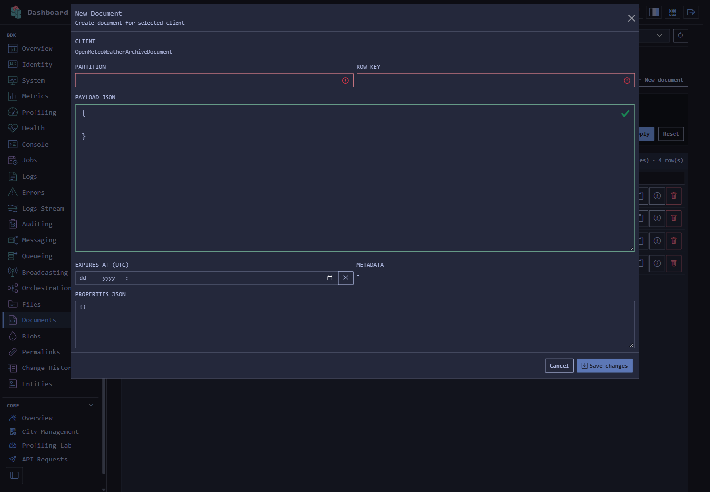

# Document Storage

[TOC]

## Overview

Document Storage is the typed JSON-document companion to Blob Storage. Applications use `IDocumentStoreClient<T>` with a two-part `DocumentKey` (`PartitionKey`, `RowKey`); providers persist serialized bytes and provider-neutral metadata.

The client owns validation, serialization, canonical SHA-256 hashes, size limits, payload transforms, integrity verification, continuation-token binding, and expiration resolution. Providers own durable state, conditional persistence, native paging, and resource initialization.

Document Storage does not replace `ICacheProvider`. `DocumentStoreCacheProvider` is an adapter for deployments that intentionally use a document store as cache persistence; the abstractions remain separate.

## Challenges

Typed JSON data needs more than provider-specific CRUD. Callers need stable keys, optimistic concurrency, bounded queries, portable metadata, expiration, payload limits, and integrity checks without changing application code when the persistence provider changes.

## Solution

`IDocumentStoreClient<T>` owns the provider-neutral document contract and returns `Result` values for expected failures. It validates and serializes logical documents before a provider stores bytes and metadata. Registration binds one document type and normalized client name to an in-memory, filesystem, database, or cloud provider.

## Key Features

- typed reads and writes with two-part `DocumentKey` values
- ETag-based conditional updates and deletes
- bounded paging with query-bound continuation tokens
- size limits and logical/stored SHA-256 integrity checks
- scalar properties, expiration, retention, compression, and encryption
- named clients, behaviors, diagnostics, dashboard, and MCP integration
- in-memory, filesystem, Entity Framework, Azure Blob, Azure Table, and Cosmos providers

## Architecture

The outer client validates keys, queries, sizes, and continuation tokens. Registered behaviors wrap a core `DocumentStoreClient<T>`, which serializes the value, applies payload transforms, and calls `IDocumentStoreProvider`. Providers own conditional persistence, paging, initialization, and provider-native retention. The factory resolves existing keyed registrations by document type and client name.

## Use Cases

- store shared typed configuration or reference documents
- keep temporary documents with explicit expiration and retention
- page through partition or row-key prefixes without exposing provider queries
- move documents between named stores of the same type
- protect writes with ETags and content hashes
- persist typed documents on application-owned local disks or configured file shares

## Basic Usage

This example registers an in-memory client, writes one typed document, checks both operation results, and reads the stored value back for a visible HTTP response.

```csharp
using BridgingIT.DevKit.Application.Storage;

var builder = WebApplication.CreateBuilder(args);

builder.Services.AddDocumentStorage()
    .WithProvider<CustomerDocument>(
        _ => new InMemoryDocumentStoreProvider());

var app = builder.Build();

app.MapPost("/documents/customers/{id}", async (
    string id,
    IDocumentStoreClient<CustomerDocument> documents,
    CancellationToken cancellationToken) =>
{
    var key = new DocumentKey("customers", id);
    var stored = await documents.UpsertAsync(
        key,
        new CustomerDocument { Name = $"Customer {id}" },
        cancellationToken: cancellationToken);

    if (stored.IsFailure)
    {
        return Results.Problem(string.Join(
            "; ",
            stored.Errors.Select(error => error.Message)));
    }

    var read = await documents.GetAsync(key, cancellationToken);
    if (read.IsFailure)
    {
        return Results.Problem(string.Join(
            "; ",
            read.Errors.Select(error => error.Message)));
    }

    return Results.Ok(new
    {
        read.Value.Key.PartitionKey,
        read.Value.Key.RowKey,
        read.Value.Value.Name,
        read.Value.ETag,
        read.Value.ContentHash
    });
});

app.Run();

public sealed class CustomerDocument
{
    public string Name { get; set; }
}
```

`POST /documents/customers/42` returns the typed value with its key, ETag, and logical content hash. The in-memory provider retains it only for the process lifetime.

## Selection guidance

Use Document Storage when data is:

- naturally addressed by partition and row key;
- serialized and consumed as a typed document;
- read by exact key or bounded key-prefix pages;
- shared across application instances;
- protected by optimistic concurrency;
- temporary or retention-managed;
- portable across in-memory, filesystem, relational, Azure Storage, and Cosmos providers.

Use Blob Storage for stream-first binary objects and Key/Value Storage for low-latency scalar/shared-state workloads.

## Contract

```csharp
var properties = new PropertyBag();
properties.Set("region", "eu");
var created = await documents.UpsertAsync(
    new DocumentKey("customers", "42"),
    customer,
    new DocumentWriteOptions
    {
        CreateOnly = true,
        Expiration = ExpirationChange.After(TimeSpan.FromDays(7)),
        Properties = properties
    },
    cancellationToken);

if (created.IsFailure)
{
    Console.Error.WriteLine(string.Join(
        "; ",
        created.Errors.Select(error => error.Message)));
    return;
}

var current = await documents.GetAsync(
    new DocumentKey("customers", "42"),
    cancellationToken);

if (current.IsFailure)
{
    Console.Error.WriteLine(string.Join(
        "; ",
        current.Errors.Select(error => error.Message)));
    return;
}

var updated = await documents.UpdatePropertiesAsync(
    new DocumentPropertiesUpdate(current.Value.Key)
    {
        IfMatchETag = current.Value.ETag,
        Expiration = ExpirationChange.Clear
    },
    cancellationToken);

if (updated.IsFailure)
{
    Console.Error.WriteLine(string.Join(
        "; ",
        updated.Errors.Select(error => error.Message)));
}
```

Core operations:

- `GetAsync`: exact read returning `DocumentEntry<T>`.
- `FindPageAsync`: bounded payload page returning `DocumentEntry<T>` items.
- `ListPageAsync`: bounded key-only page.
- `CountAsync`: provider-side count where supported.
- `ExistsAsync`: exact logical existence.
- `GetManyAsync`: batched exact reads returning one `Result<DocumentEntry<T>>` per requested key, in input order. A missing or expired key is a per-item `DocumentStoreNotFoundError`; the outer result fails only when the whole read fails. Duplicate keys are read once.
- `UpsertAsync`: one conditional typed write returning `DocumentInfo`.
- `UpsertManyAsync`: ordered, prevalidated, non-atomic batch with explicit partial completion. Providers that implement `IDocumentStoreBulkWriteProvider` (Entity Framework) commit the batch in one round trip.
- `UpdatePropertiesAsync`: metadata/expiration-only conditional update.
- `DeleteAsync`: idempotent optional ETag delete.
- `DeleteManyAsync`: ordered, prevalidated delete batch, also bulk-capable.

Batch read size is controlled by `DocumentStoreOptions.GetManyBatchSize` (default 25, valid range 1 to 1000). `DocumentStoreOptions.GetManyMaxParallelism` (default 4, valid range 1 to 32) limits how many batches of one call run at the same time. Providers without `IDocumentStoreBatchGetProvider` fall back to one `GetAsync` per distinct key.

`DocumentEntry<T>` and `DocumentInfo` expose provider-neutral `ETag`, logical `ContentHash`, creation/modification timestamps, `ExpiresAt`, and cloned scalar properties. The stored transformed hash remains an internal integrity value.

## Query safety

Reads are page-based and deterministic. Full scans require consent in both `DocumentStoreOptions` and the individual query. Provider capabilities decide whether exact, prefix, suffix, count, and key-only operations are accepted or require client-side filtering.

Continuation tokens are opaque and bind the normalized client name, document type, operation, query shape, page size, provider state, and first-page expiration cutoff. Configure `IContinuationTokenProtector` to require HMAC-protected tokens.

See [Document Storage Paging Specification](./specs/spec-application-storage-documents-paging.md).

##  Size and integrity

`DocumentStoreOptions.MaxDocumentSize` defaults to `ByteSize.Megabytes(1)` and is enforced against logical serialized bytes before provider I/O. A provider may advertise a lower stored-size limit.

Every write computes:

- logical `ContentHash` over serialized bytes;
- stored content hash after all transforms.

`DocumentWriteOptions.ExpectedContentHash` can enforce the caller's expected logical hash. Reads verify the stored hash before reversing transforms and verify the logical hash before deserialization. Mismatches return `DocumentStoreIntegrityError`.

##  Properties and transforms

Properties are scalar `PropertyBag` values. Supported values include null, strings, Boolean and numeric primitives, `Guid`, date/time values, `TimeSpan`, and byte arrays. Providers use `PropertyBagScalarCodec` where text persistence is required.

`IDocumentPayloadTransform` runs in registration order on writes and reverse order on reads. Compression uses `CompressionHelper`; encryption uses `EncryptionHelper` and `IEncryptionKeyProvider`, so active-key writes and historical-key reads support key rotation. Transform metadata is stored in a versioned `bdk_` envelope and is not exposed as application properties.

```csharp
services.AddDocumentStorage()
    .WithCompressionTransform<Customer>()
    .WithEncryptionTransform<Customer>()
    .WithAzureTableClient<Customer>(tableServiceClient);
```

The encryption transform requires a registered `IEncryptionKeyProvider`. Standard provider registrations resolve the configured `ISerializer`, `TimeProvider`, `IContinuationTokenProtector`, and transforms from dependency injection.

##  Expiration and retention

Writes use `ExpirationChange`:

- `Preserve`: keep the current expiration; inserts remain non-expiring.
- `At(...)`: set an absolute timestamp normalized to UTC.
- `After(...)`: resolve one relative timestamp from the operation `TimeProvider`.
- `Clear`: remove expiration.

Due documents are immediately hidden from exact reads, existence, count, pages, enumeration, copy, and move. They remain physical records until retention runs. `CreateOnly` therefore still conflicts with an expired physical record, while clearing or extending expiration revives it.

```csharp
services.AddDocumentStorage(options => options.WithRetention(retention =>
{
    retention.SweepInterval = TimeSpan.FromMinutes(15);
    retention.BatchSize = 500;
    retention.MaxBatchesPerStore = 5;
}));
```

`DocumentRetentionBackgroundService` resolves each named client in a fresh DI scope and invokes only `IDocumentStoreRetentionProvider`. It never emulates cleanup through public scans. In-memory, filesystem, Entity Framework, Azure Blob, and Azure Table use bounded provider-native cleanup; Cosmos uses native item TTL.

Filesystem retention uses a persisted discovery cursor that resumes across sweeps and restarts. Each candidate is rechecked under key authority without waiting for busy keys. Clearing or extending expiration prevents stale discovery from deleting the document. Cleanup reclaims superseded payload files, while open readers can retain their disk blocks. Tombstones and coordination directories remain on disk; offline compaction is not implemented. No additional retention scheduler or public scan approval is needed.

The defaults are enabled retention, a 15-second startup delay, one-hour interval, batch size 1000, at most 10 batches per client, no batch delay, and a 10-second stop timeout.

## Named clients and DI

`AddDocumentStorage` is the feature registration entry point. Registrations are keyed by document CLR type and normalized case-insensitive client name. At most one registration for a type is the explicit default exposed through direct `IDocumentStoreClient<T>` injection. Resolve other clients through `IDocumentStoreClientFactory.CreateClient<T>(name)`.

```csharp
services.AddDocumentStorage()
    .WithAzureTableClient<Customer>(tableServiceClient, name: "primary", isDefault: true)
    .WithEntityFrameworkClient<Customer, StorageDbContext>(name: "archive", isDefault: false);
```

Singleton, scoped, and transient client lifetimes follow normal keyed DI semantics. The factory is scoped and lookup-only; it does not construct or cache clients. Entity Framework providers receive `IServiceScopeFactory` and own one scope and `DbContext` per operation.

Both `IDocumentStoreProvider` and `IDocumentStoreClient<T>` are keyed by the same type/name identity at the configured lifetime. Retention resolves the keyed provider directly, so custom client behaviors cannot hide retention support.

Behaviors are composed between the provider adapter and the outer validating/serializing client. Invalid input never reaches logging, retry, timeout, cache, chaos, transforms, or providers.

## Operation profiling

Register Profiling before other named-client behaviors to include their downstream work:

```csharp
services.AddDocumentStorage()
    .WithProfilingBehavior<Person>()
    .RegisterProvider<Person>(_ => new InMemoryDocumentStoreProvider(), name: "archive");
```

Every typed client method is measured, including count, key-only paging, property updates and batch writes/deletes. `DocumentStorage` keys use `documentstorage:{type name}:{operation}`. Dimensions are `documentstorage.client`, `documentstorage.documentType` and `documentstorage.operation`; partition keys, row keys, query tokens and document payloads are omitted. A partially completed batch keeps its original result while profiling records `PartialBatch` failure. Direct `DocumentStoreBuilderContext<T>` registration also offers `.WithProfilingBehavior()`. See [Storage profiling behaviors](features-profiling.md#storage-behaviors) for ownership and comparison rules.

## Behaviors

- Typed logging with raw keys by default. Register `Sha256KeyDisplayStrategy` only where keys are classified as sensitive.
- Metrics with shared operation names and key/query context. See [Metrics](#metrics).
- Retry for transient provider failures only.
- Timeout with a linked token, cancellation quiescence, caller-cancellation preservation, typed timeout errors, and injected `TimeProvider`.
- Exact-read caching with named-client-aware keys and mutation invalidation.
- Chaos behavior for controlled resilience testing.

## Metrics

`WithMetricsBehavior<T>()` measures every typed client method (get, get-many, find, list, count, exists, upsert, upsert-many, update-properties, delete, delete-many) through the `bdk` meter. All instruments carry the `operation` and `document.type` tags only; keys, tokens and payloads are never tagged.

| Instrument | Type | Meaning |
|---|---|---|
| `document.operations` | counter | Completed operations. |
| `document.operation.duration` | histogram (ms) | Operation duration. |
| `document.operation.failures` | counter | Failed operations, including a batch that stopped at a failed key. |
| `document.bytes` | counter | Cumulative logical serialized bytes read or written (`DocumentInfo.ContentLength`, before payload transforms). |
| `document.bytes_per_second` | histogram (`By/s`) | Transfer rate of one successful non-empty get, get-many, find, upsert or upsert-many call. |

`document.bytes_per_second` is skipped for failed and empty calls and for operations that do not move payloads (list, count, exists, update-properties, delete, delete-many). The `operation` tag separates read rates from write rates. The duration covers the whole call below the behavior, so retry delays and timeouts that sit below it lower the rate. Bytes are logical bytes, so compressing or encrypting transforms make the stored size differ from the reported size.

`DocumentInfo.ContentLength` is set by the client on every read and upsert. It is zero for property-only updates, which do not read the payload.

## Transfers and maintenance

`EnumerateAsync` and `EnumerateKeysAsync` require a positive maximum item count. `DeleteByQueryAsync` is bounded, supports dry-run and optional continue-on-error, reads the matching entry metadata, and conditionally deletes the ETag observed during enumeration. Partial results expose every failed key in input order.

`CopyAsync` and `MoveAsync` work across any two clients of the same document type. They reserialize through the target client and preserve properties and expiration unless overridden. Move copies first, then conditionally deletes the source ETag. A changed source remains intact and returns `DocumentStoreTransferError`; a move to the same client/key is a successful existence-checked no-op.

## Providers

###  In-memory

Process-local provider for tests and ephemeral use. It stores copied bytes in private synchronized state and returns cloned records.

### Filesystem

The optional `BridgingIT.DevKit.Infrastructure.FileSystem` package provides `FileSystemDocumentStoreProvider`. It stores the existing serialized document bytes and metadata through direct file I/O. The typed client still owns serialization, transforms, hash verification, expiration resolution, and continuation-token protection. File Storage registration is not required.

```csharp
using BridgingIT.DevKit.Application.Storage;
using BridgingIT.DevKit.Infrastructure.FileSystem;
using Microsoft.Extensions.DependencyInjection;

var storageRoot = Path.GetFullPath(
	Path.Combine(builder.Environment.ContentRootPath, "app-data", "storage"));

builder.Services.AddDocumentStorage()
	.WithFileSystemClient<CustomerDocument>(storageRoot,
		configureFileSystem: options =>
		{
			options.AccessKind = FileSystemStorageAccessKind.Local;
			options.Durability = FileSystemStorageDurability.Durable;
		},
		documentStoreOptions: new DocumentStoreOptions
		{
			DefaultTake = 100,
			MaxTake = 500
		},
		name: "customers",
		isDefault: true);
```

`CustomerDocument` is the model from [Basic Usage](#basic-usage). Resolve the default through `IDocumentStoreClient<CustomerDocument>` or resolve `"customers"` through the factory. Use an absolute persistent data path when deployment replaces the application directory.

#### Platforms and configuration

Windows supports `Local` and `Smb`. Linux supports `Local`, `Smb`, and `Nfs`. Windows NFS and other operating systems are unsupported. Set `AccessKind` to the actual protocol, including shares mounted as directories. Every participant opening a store must use its recorded access kind. Blob and document providers can share one root through separate namespaces.

`configureFileSystem` accepts the shared `FileSystemStorageOptions`. Defaults are Durable acknowledgement, root creation enabled, a five-second authority acquisition budget, a 64 KiB transfer buffer, a 1 MiB metadata limit, 100,000 examined metadata entries per query, and 10,000 discovery or metadata steps per retention sweep. `CreateRoot = false` requires an initialized compatible store. See the [filesystem configuration table](features-storage-blobs.md#configuration) for option names and limits. `documentStoreOptions` configures the existing typed-client rules separately.

The directory layout belongs to the provider. Ordinal type, partition, and row identities map to hashed paths, with original identities checked in metadata. Files are not named for application browsing or direct edits. Experimental format-1 roots are rejected without automatic migration. All participating OS identities need compatible create, read, flush, and delete permissions. Back up the complete root with every participant quiesced. Live backups are unqualified.

#### Queries and paging

Exact-key reads resolve their paths directly. Prefix, suffix, full-scan, and key-listing capabilities are advertised as `SupportedClientSide`, because they scan metadata rather than use a secondary index. These queries require `DocumentStoreOptions.RejectClientSideFilteredQueries = false`. Type-wide scans additionally require global `AllowFullScans = true` and query-level `AllowFullScan = true`. Exact lookups remain available with the defaults shown above.

Metadata traversal prunes by document type and exact partition where available. `ListPageAsync` reads no payloads. `FindPageAsync` opens the selected payloads after metadata selection. Counts use bounded metadata traversal rather than a native index. Exceeding `MaxQueryMetadataEntries` returns a query-too-broad failure rather than a partial successful page or count.

Pages use live ordinal key positions. Unchanged data can be traversed once in order; concurrent changes can affect subsequent pages. The first-page expiration cutoff remains bound to the token, which does not create a snapshot. Omitted `Take` uses the registered `DocumentStoreOptions.DefaultTake` on every page.

#### Publication, retention, and recovery

Writes stage immutable payload generations and publish the current metadata atomically under per-key authority. Property updates reuse the payload generation. Deletes publish tombstones. Local authority uses exclusive handles across cooperating processes. Shared authority uses persistent ownership markers without age-based takeover. Existing read handles remain valid through replacement and deletion.

`Durable` performs native file and namespace persistence operations before success. A Durable property update also flushes the referenced payload. `Buffered` permits loss of recent acknowledged metadata changes after host failure. Initialization, staging, and safe reclamation still perform persistence operations, so Buffered mode does not promise zero flushes or higher throughput.

The existing [expiration and retention](#expiration-and-retention) contract applies, including immediate logical expiration and conditional cleanup. Documents without an expiration remain until explicitly deleted.

An uncertain mutation returns `DocumentStoreIndeterminateOperationError` with a mutation identity. The standard retry behavior does not replay it. Shared uncertainty retains ownership and can block later operations. Recovery requires quiescing every participant on every host, reconciling fresh server-confirmed metadata, and draining or cancelling old server operations before clearing ownership.

Required native operations fail clearly when unsupported. Actual SMB, NFS, independent-host recovery, power-loss, and full performance qualification remain pending. See the [filesystem provider guide](storage-filesystem-providers.md) for native persistence requirements, recovery tooling, benchmarks, and opt-in share tests. Share tests remain inactive until disposable shares are configured and skip cases inapplicable to the host OS.

#### Public storage helpers

`FileSystemDocumentStoreProvider.Store` exposes the public `FileSystemStore` for trusted diagnostics, maintenance, and recovery. Authority, durability, staging, retention, and diagnostic helpers also have public APIs with XML documentation and examples. `Store.Options` returns a configuration copy, and `FileSystemStore.Json` is read-only. Active configuration and authority handles stay private.

Normal typed operations use `IDocumentStoreClient<T>`. Direct helper calls must preserve ownership, persistence, and global-quiescence preconditions. See [public storage helpers](storage-filesystem-providers.md#public-storage-helpers) before using the low-level API.

###  Entity Framework

Annotation-mapped `StorageDocument` persistence with indexed hashes for type/partition/row identity, a concurrency version, Unix-millisecond expiration, payload/transform metadata, and provider-owned contexts. SQL Server, PostgreSQL, and SQLite run the same provider contract.

The provider implements the optional batch interfaces: `GetManyAsync` reads keys grouped by partition in chunks of `GetManyBatchSize` with one query per chunk, runs up to `GetManyMaxParallelism` chunks at the same time (each on its own connection), and `UpsertManyAsync` and `DeleteManyAsync` load existing rows once, apply the operations in order and commit once. A failed operation stops the batch, the operations before it stay committed and `FailedKey` is set. If the single commit throws (for example under contention), the provider repeats the batch through the per-operation path, which keeps the retry and conflict semantics of single writes.

Row ids are generated by EF Core, which produces sequential GUIDs on SQL Server and PostgreSQL, so inserts append to the clustered key instead of landing on random pages. SQLite stores random ids, which is harmless for its rowid-backed tables.

See the [Appendix: EF performance and indexes](#appendix-ef-performance-and-indexes).

###  Azure Blob

Requires only `BlobServiceClient` or an account connection string. The provider derives `bdk-doc-{hash}` from normalized client name and document type, creates/reuses it through `CreateIfNotExistsAsync`, and never deletes it on disposal. Logical keys are independent Base64Url path segments, so reserved characters round-trip.

###  Azure Table

Requires only `TableServiceClient` or an account connection string. The provider derives `BdkDoc{hash}`, creates/reuses it, chunks payload bytes into 60 KiB `bdk_content_####` properties, and validates the complete entity against Azure Table's 1 MiB limit. All provider metadata uses `bdk_` keys.

###  Cosmos DB

Uses provider-owned database/container initialization through `CosmosSqlProvider`, enables per-item TTL, persists provider continuation state inside document tokens, and applies logical expiration filtering while native deletion remains eventual.

## Azure resource ownership

Azure providers depend on an existing account, not pre-created feature resources. Resource names are deterministic from `normalizedClientName + "\n" + documentTypeIdentity`; optional prefixes are validated. Initialization is asynchronous and idempotent. Concurrent callers and nodes may race safely, cancellation/failure is retryable, unrelated account resources are untouched, and disposal never removes the table/container.

## Dashboard and diagnostics

The Document Storage dashboard inherits the shared dashboard authorization and antiforgery conventions. It selects named clients, lists document pages from 25 to 500 rows, and presents partition/row keys, serialized JSON size, modification time, and expiration in the compact table. Manual and interval refreshes use the currently applied client, key filters, query mode, page size, continuation state, and selected document. The standard refresh interval is off by default and remembered in browser-local storage. The details dialog exposes ETags, hashes, timestamps, expiration, scalar properties, and conditional save/delete actions without adding retention or transform administration to the browsing surface.

Open Documents at `/_bdk/dashboard/storage/documents`. Choose a client, then apply partition and row-key filters. Prefix, Suffix and Exact select how the row key is matched. Use the pager when the result has a continuation page.

[](assets/dashboard/14-storage-documents-documents.png)

Select a row's information button to inspect and edit its JSON payload, scalar properties and expiration. The New document button opens the same editor with editable partition and row keys. A create conflict reports an existing key rather than overwriting it.

[](assets/dashboard/storage/document-details.png)

Permalink download and copy actions appear for clients registered with `WithPermalinks<T>()`. See the [shared dashboard setup](features-presentation-dashboard.md) for plugin discovery and authorization.

`IDocumentStorageDiagnosticsService` reports non-sensitive registration identity, lifetime, capabilities, size limits, configured transform identifiers, latest retention outcome, and health. `DocumentStorageMcpHandler` exposes `documents.summary`, `documents.clients`, and `documents.probe` when the MCP runtime is registered. Neither surface exposes payloads, continuation tokens, encryption material, or secrets.

## Shared common APIs

Document and Blob Storage share:

- `ByteSize`, `StreamHelper`, and `TemporaryFileHelper`;
- `ExpirationChange` and `ExpirationHelper`;
- `ContentHashHelper`;
- `Base64UrlHelper`, `PropertyBagScalarCodec`, and `OpaqueContinuationTokenCodec`;
- `ContentTransformEnvelopeCodec`;
- `IEncryptionKeyProvider`;
- raw and SHA-256 key display strategies;
- `AsyncInitializationGate`.
- `PeriodicBackgroundService` and `PeriodicBackgroundServiceOptions` for the monitored retention loop.

See [Common Utilities](./common-utilities.md), [Common Serialization](./common-serialization.md), and [Blob Storage](./features-storage-blobs.md).

## Testing

The feature is covered by client/behavior tests, in-memory contracts, dashboard and MCP registration tests, Entity Framework contracts on SQLite/PostgreSQL/SQL Server, Azurite contracts for Blob/Table resource management and persistence, and Cosmos contracts when an emulator or configured account is available. Blob Storage contracts remain regression coverage for shared primitives.

## Appendix: EF performance and indexes

This appendix describes the design of the Entity Framework provider's read and write paths, shows measured figures from SQL Server benchmarks and lists the schema notes for existing databases. The figures come from the benchmarks in `benchmarks/Application.Benchmarks` (BenchmarkDotNet, 12 iterations, one request in flight unless a row says otherwise). They show what the provider can do and how the paths compare. They are not a guarantee for your hardware, network or schema. The plan behind them is in [Document Storage EF performance](specs/spec-application-storage-documents-ef-performance.md).

**Test setup.** AMD Ryzen 9 9900X, .NET 10, SQL Server 2022 in a local Docker container, so there is no network latency between the application and the database. Only SQL Server was benchmarked. PostgreSQL and SQLite are covered by the integration contract tests, not by timings. "Cold" means the SQL Server buffer pool was emptied with `DBCC DROPCLEANBUFFERS` before each iteration. The operating system file cache stayed warm, so real disks will be slower. The baseline is the provider as it was before this work (`GetAsync` and `UpsertAsync` in a loop, random ids, no keyset index), run on the same machine and the same data.

Figures vary by a few percent between runs. Compare rows within one table, not across tables.

### Read path

- `GetAsync` runs one compiled query per provider instance. It filters on the fixed-length SHA-256 hash columns of type, partition and row key, then confirms the exact keys in memory, so a hash collision can never return another document.
- `GetManyAsync` groups the distinct keys by partition and reads them in chunks of `GetManyBatchSize` with one compiled query per chunk. Up to `GetManyMaxParallelism` chunks (default 4) run at the same time, each in its own scope, context and connection. Round trips grow with the number of chunks, not the number of keys.
- Stored bytes are not copied again on the way to the caller. Both integrity checks (stored hash and logical hash) stay.

Throughput is the payload bytes of the 100 documents divided by the mean time. SQL Server, warm cache, documents read by 100 keys. "Loop" is the baseline, 100 `GetAsync` calls one after the other. "16 parallel" is 100 `GetAsync` calls with 16 in flight. The raw SQL ceiling is the fastest hand-written multi-key query over the same data, with no DevKit pipeline.

| Document size | Loop | 16 parallel `GetAsync` | `GetManyAsync`, one partition | `GetManyAsync`, across 20 partitions | Raw SQL ceiling (one partition) |
|---|---|---|---|---|---|
| 1 KB | 117.9 ms, 0.8 MiB/s | 14.0 ms, 7.0 MiB/s | 4.0 ms, 24.3 MiB/s | 8.8 ms, 11.1 MiB/s | 1.9 ms, 50.1 MiB/s |
| 10 KB | 122.6 ms, 8.0 MiB/s | 15.8 ms, 61.9 MiB/s | 8.4 ms, 116.5 MiB/s | 12.4 ms, 78.5 MiB/s | 5.7 ms, 172.6 MiB/s |
| 100 KB | 198.0 ms, 49.3 MiB/s | 55.1 ms, 177.3 MiB/s | 56.1 ms, 174.2 MiB/s | 58.7 ms, 166.3 MiB/s | 45.6 ms, 214.0 MiB/s |

- **Small documents (up to about 10 KB)** are limited by per-document cost and by round trips. `GetManyAsync` is 3.5x faster than 16 parallel reads for 1 KB in one partition and 1.9x for 10 KB. Across partitions it needs one query per partition, so the gain drops to 1.4x (1 KB) and 1.2x (10 KB). Against the loop it is 10 to 29x faster. Allocation falls to 25% to 54% of the loop's.
- **At 100 KB** moving the bytes dominates and `GetManyAsync` equals 16 parallel reads (within the measurement error), while allocating about 75% as much.
- **Remaining overhead.** For 1 KB documents `GetManyAsync` is about twice the raw SQL ceiling (4.0 ms against 1.9 ms). The rest is EF Core materialization, the behavior pipeline and a result object per document.
- **Parallelism and batch size.** For 100 keys across 20 partitions (1 KB), `GetManyMaxParallelism = 1` takes 22.2 ms against 8.8 ms with the default of 4, because every partition needs its own query. For 100 keys in one partition, batches of 25 become 4 queries: 7.2 ms with parallelism 1 and 4.5 ms with 4, and one query of 100 keys also takes 4.3 ms. In a request of 1,000 keys, batches of 100 with 4 in parallel took 29.5 ms (1 KB) against 39.4 ms for batches of 25. The default batch size of 25 was kept because batches of 100 were 17% slower for 100 KB documents in one partition (65.7 ms against 56.1 ms, one run).

Reading from a 1,000,000 row table (1 KB documents, 100 keys):

| Read path | Warm | Cold |
|---|---|---|
| Loop (baseline) | 121 to 131 ms | 225 to 294 ms |
| 16 parallel `GetAsync` | 13 to 14 ms | 28 to 29 ms |
| `GetManyAsync` | 9.1 to 9.5 ms | 40 to 52 ms |

- With a warm cache `GetManyAsync` reads 100 keys about 13 times faster than the loop and about 1.4x faster than 16 parallel reads. The table size does not change this, lookups stay index seeks.
- With a cold cache every key costs its own page reads, so time goes to I/O. `GetManyAsync` is about 5 times faster than the loop but slower than 16 parallel reads, because it keeps only 4 batches in flight. Raising `GetManyMaxParallelism` is the lever for I/O-bound tables. Values above 4 were not measured for cold reads. For warm reads, 8 was 10% to 15% faster than 4 for 1,000 keys.
- A single `GetAsync` is 6% to 8% faster than before for 1 KB and 10 KB documents (118 ms against 126 ms for 100 sequential reads of 1 KB) and equal at 100 KB. It allocates 11% to 16% less at every size (13.6 MB against 15.3 MB at 1 KB), from the compiled query and the removed byte copy.

### Write path

- `UpsertManyAsync` and `DeleteManyAsync` use one scope, one tracked lookup per chunk and one `SaveChanges` per batch.
- Operations are evaluated in input order against the loaded rows. Duplicate keys in one batch see the result of earlier operations.
- Failure semantics match the per-operation loop: stop at the first failure, keep the committed prefix, report `FailedKey`. A deleted key that does not exist counts as success.
- If the single commit throws, the batch is repeated through the single-operation path, so contention behaves as it does for `UpsertAsync`.
- A write that fails payload preparation (size limit, serialization, `ExpectedContentHash`) stops the batch at that item after the valid prefix has been sent.

Time for one batch, SQL Server, 1 KB documents. "Loop" is the baseline per-operation loop (the baseline `UpsertManyAsync` and `DeleteManyAsync` were the same loop and measured the same).

| Documents | Operation | Loop | `UpsertManyAsync` / `DeleteManyAsync` | Faster | Allocation |
|---|---|---|---|---|---|
| 10 | Insert | 33.7 ms | 12.8 ms | 2.6x | 49% |
| 10 | Overwrite | 33.2 ms | 15.3 ms | 2.2x | 54% |
| 10 | Delete | 32.3 ms | 14.0 ms | 2.3x | 44% |
| 100 | Insert | 320.6 ms | 51.4 ms | 6.2x | 32% |
| 100 | Overwrite | 317.8 ms | 45.5 ms | 7.0x | 41% |
| 100 | Delete | 298.4 ms | 40.2 ms | 7.4x | 28% |
| 1,000 | Insert | 2,523 ms | 360 ms | 7.0x | 30% |
| 1,000 | Overwrite | 2,666 ms | 220 ms | 12.1x | 39% |
| 1,000 | Delete | 2,490 ms | 166 ms | 15.0x | 24% |

- The loop costs about 3 ms per document (scope, tracked `SELECT`, `SaveChanges` round trip). The batch pays the round trip once, so the gain grows with the batch size.
- The gain is the saved round trips. Against a remote database each round trip costs more, so the gain should be larger there (not measured).

### Row ids

New rows get their `Id` from EF Core's value generator. SQL Server and PostgreSQL produce sequential GUIDs, so inserts append to the clustered key. SQLite keeps random GUIDs. Existing rows keep their ids, no data migration is needed, and the id is never exposed through the public API.

Inserting 100,000 documents with 8 parallel writers into a table of 1,000,000 rows whose clustered key was built in order:

| | Baseline (random GUIDs) | Sequential ids |
|---|---|---|
| Time | 49.7 s | 46.7 s |
| Clustered index fragmentation | 0% to 34.6% | 0% to 15.3% |
| Clustered index pages | 500,001 to 766,676 | 500,000 to 722,319 |
| Page fullness | 72.8% | 77.3% |

- Insert time is the same within the measurement error (the standard deviation was 4 s). The transaction log flush dominates, so sequential ids do not make single inserts faster. 1,000 sequential inserts took 2.5 s and 1,000 inserts with 8 writers took 0.5 s, for random and sequential ids alike, at 1,000 and at 1,000,000 rows.
- The benefit is the layout of the table. Random ids split pages all over the clustered index. After the same inserts it was 2.3 times as fragmented and 6% larger, with fuller pages in the sequential case (77.3% against 72.8%). A table that is already fragmented stays fragmented (a table seeded with random ids was 99.3% fragmented before and 86.3% after the same insert), because new ids only improve the new pages. Rebuild the clustered index in a maintenance window to recover the old rows.
- The sequential ids are in the clustered key only. The index on `(TypeHash, PartitionKey, RowKey)` and the hash index are ordered by other columns, so they fragment as before (4.0% to 42.6% and 0.2% to 38.4%).

### Paging

`FindPageAsync` and `ListPageAsync` page by keyset over `(TypeHash, PartitionKey, RowKey)`. SQL Server, 1 KB documents, page of 100 documents (mean time per page):

| Table | Page | Baseline `FindPage` | New `FindPage` | Baseline `ListPage` | New `ListPage` |
|---|---|---|---|---|---|
| 1,000 rows | first | 6.3 ms | 3.7 ms | 2.5 ms | 1.7 ms |
| 1,000 rows | deep | 4.4 ms | 3.4 ms | 2.2 ms | 1.6 ms |
| 1,000,000 rows | first | 2,981 ms (cold start) | 4.8 ms | 185 ms | 2.0 ms |
| 1,000,000 rows | middle | 235 ms | 10.4 ms | 168 ms | 8.3 ms |
| 1,000,000 rows | deep | 183 ms | 10.4 ms | 167 ms | 8.3 ms |

- Without the keyset index SQL Server sorted the whole document type for every page. With it, each page is an index seek, so the cost no longer depends on how deep the page is. At 1,000,000 rows a deep page is about 18x (`FindPage`) and 20x (`ListPage`) faster.
- The cost still grows with the table. A middle or deep page at 1,000,000 rows takes about 3x to 5x as long as at 1,000 rows (10.4 ms against 3.4 to 3.6 ms for FindPage). It is flat across depth, not independent of table size.
- `ListPageAsync` is cheaper than `FindPageAsync` because it does not materialize documents. It allocates about 11% as much.

### Indexes and migration notes

`StorageDocument` carries the index `(TypeHash, PartitionKey, RowKey)` as an annotation, which supports keyset paging over a full document type. Continuation uses `PartitionKey >= p AND (PartitionKey > p OR RowKey > r)`, which the index can seek. At 1,000,000 rows the index takes 24,426 pages (about 190 MB). That is the price of the paging figures above.

Most rows have no expiration, so the `(TypeHash, ExpiresAtUnixMilliseconds)` index is much smaller as a filtered index. A filter cannot be expressed with annotations. Call the extension from your context to opt in:

```csharp
protected override void OnModelCreating(ModelBuilder modelBuilder)
{
    base.OnModelCreating(modelBuilder);
    modelBuilder.ApplyDocumentStoreConfiguration();
}
```

Then add a migration. Notes:

- The library does not own migrations. Generate the migration from your model, review it and apply it as usual.
- The migration adds the keyset index and replaces the expiration index with the filtered one.
- On SQL Server, dropping and recreating an index is an online operation on Enterprise edition only. Other editions lock the table, so plan a maintenance window for large tables.
- Databases on the old schema keep working. Queries stay correct without the new indexes, only slower on full-type scans and expiration sweeps.
- Calling `ApplyDocumentStoreConfiguration` is optional. Without it you still get the keyset index.

Expiration sweep in a table of 1,000,000 rows where 5% of the rows expire at some point (one sweep batch of 1,000):

| Expired rows | Baseline index | Plain index (new schema) | Filtered index |
|---|---|---|---|
| 0 | 1.55 ms | 1.53 ms | 1.53 ms |
| 1,000 | 168 ms | 136 ms | 140 ms |

| Index | Pages (1,000,000 rows, 5% with expiry) | Fragmentation |
|---|---|---|
| Plain `(TypeHash, ExpiresAtUnixMilliseconds)` | 31,205 | 95.8% |
| Filtered (rows with an expiry only) | 1,087 | 4.6% |

- The filtered index is **not faster**. The 1,000 row sweep takes the same time with either index (the difference is within the measurement error). Cost follows the number of expired rows, and a sweep that finds nothing costs 1.5 ms in all cases.
- The filtered index is 29 times smaller. That saves storage and write cost for every row without an expiry, and with no expiring rows it stays empty. Use it for the size, not for sweep speed.

### Measuring in production

Use `document.bytes_per_second` and `document.operation.duration` from the metrics behavior (see [Metrics](#metrics)), split by `operation`. Compare the read and write rates with your own document sizes, since the same store reads 1 KB documents at tens of MiB/s and 100 KB documents at around 170 MiB/s. Watch the connection pool as well: one `GetManyAsync` call can use up to `GetManyMaxParallelism` connections at once, so many concurrent callers multiply that. Lower the option if the pool is the limit.

### Limits of these figures

- One request was in flight at a time, except for the parallel rows and the sustained insert. A sustained load test with many concurrent readers was not run.
- There was no network between the application and SQL Server. Over a network each query adds a round trip, which should favor the batch APIs, but this was not measured.
- Cold figures use `DROPCLEANBUFFERS` only. A real disk, or a database larger than memory, reads slower.
- Only SQL Server was benchmarked. PostgreSQL also gets sequential ids and the same indexes, SQLite keeps random ids.
- At 100 KB `GetManyAsync` is not faster than 16 parallel `GetAsync` calls, and on a cold cache it is slower for 1,000,000 rows. It saves connections and allocations there, not time.
- Documents from 1 KB to 100 KB were measured. Larger documents are not part of these figures.

See [ADR-0034](adr/0034-sequential-ef-document-row-ids.md), [ADR-0035](adr/0035-batched-ef-document-reads-and-bulk-writes.md) and [ADR-0036](adr/0036-keyset-and-filtered-indexes-for-ef-documents.md) for the design decisions behind these results.


## Dashboard throughput tests

The Diagnostics tab provides read/write throughput tests and live metric charts for the configured providers. See [Storage dashboard throughput tests](storage-load-testing.md) for controls, measurement semantics, and temporary-item cleanup.
