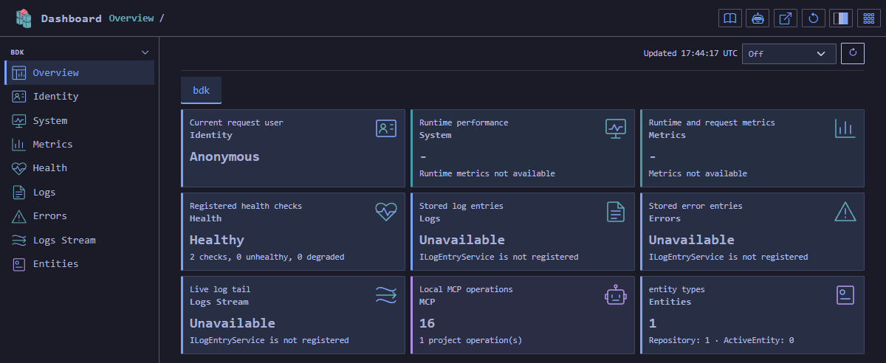

<!-- markdownlint-disable-file MD033 -->

!!! path-b "Path B: existing app"

    [**01** Basics](getting-started-existing-app.md)
    [**02** Add features](getting-started-existing-app-features.md){ aria-current="page" }
    <span class="switch">Starting from scratch? Use [Path A: new solution](getting-started-template.md).</span>
    { .path-pager }

# Add features

Every recipe starts from the host built in [Add DevKit to an existing app](getting-started-existing-app.md). Pick the features your app needs. Recipes depend on the basics alone unless a **Needs** line says otherwise.

<ol class="flow-strip">
  <li><b>01</b><span>Package</span><code>dotnet add package</code></li>
  <li><b>02</b><span>Register</span><code>builder.Services.Add...()</code></li>
  <li><b>03</b><span>Pipeline</span><code>app.Use...(), if needed</code></li>
  <li><b>04</b><span>DbContext + migration</span><code>durable features only</code></li>
</ol>

Register shared services in `Program.cs` before `builder.Build()`. Registrations only the Customers area uses, such as a queue subscription, can go in `CustomersModule.Register` instead. Keep shared services such as the notifier in `Program.cs`. Put the usage endpoints below `builder.Build()` and before `app.Run()`.

The `Program.cs` snippets use `using Customers.Web;` for the context and `using Customers.Web.Modules.Customers;` for feature types. Add those imports if the file does not already have them.

Use the same version for every DevKit package. Commands below run from `Customers.Web` in PowerShell 7.3 or later, as on the basics page.

<nav class="feature-picker" aria-label="Features on this page">
  <div>
    <p class="feature-picker__group"><a href="#no-infrastructure-needed">No infrastructure needed</a><span>3</span></p>
    <ul>
      <li><a href="#notifications">Notifications and more behaviors</a></li>
      <li><a href="#mapping">Mapping</a></li>
      <li><a href="#startup-tasks">Startup tasks</a></li>
    </ul>
  </div>
  <div>
    <p class="feature-picker__group"><a href="#backed-by-your-dbcontext">Backed by your DbContext</a><span>12</span></p>
    <ul>
      <li><a class="is-worked" href="#queueing">Queueing</a></li>
      <li><a href="#messaging">Messaging</a></li>
      <li><a href="#orchestrations">Orchestrations</a></li>
      <li><a href="#jobs">Jobs</a></li>
      <li><a href="#file-storage">File storage</a></li>
      <li><a href="#document-storage">Document storage</a></li>
      <li><a href="#blob-storage">Blob storage</a></li>
      <li><a href="#storage-permalinks">Storage permalinks</a></li>
      <li><a href="#auditing">Auditing</a></li>
      <li><a href="#broadcasting">Broadcasting</a></li>
      <li><a href="#domain-event-outbox">Domain event outbox</a></li>
      <li><a href="#log-entries">Log entries</a></li>
    </ul>
  </div>
  <div>
    <p class="feature-picker__group"><a href="#operations-and-tooling">Operations and tooling</a><span>5</span></p>
    <ul>
      <li><a href="#profiling">Profiling</a></li>
      <li><a href="#metrics">Metrics</a></li>
      <li><a href="#dashboard">Dashboard</a></li>
      <li><a href="#console-commands">Console commands</a></li>
      <li><a href="#mcp">MCP</a></li>
    </ul>
  </div>
</nav>

##  No infrastructure needed

###  Notifications and more behaviors { #notifications .feature-recipe }

Publish an application notification after saving a customer, and add retry and timeout behaviors to the requester.

<div class="step-meta">
  <span><b>Packages</b>none new</span><span><b>Pipeline</b>none</span><span><b>DbContext</b>none</span><span><b>Guide</b><a href="../reference/features-requester-notifier/">Requester and notifier</a></span>
</div>

Step 10's domain event records what happened to the aggregate, and the repository publishes it after the save. Application code publishes this notification itself, for example to tell another module. A command has one handler. A notification can have none or many. [Requester or notifier](decisions-requester-vs-notifier.md) explains the choice.

```csharp title="Modules/Customers/CustomerCreatedNotification.cs"
namespace Customers.Web.Modules.Customers;

using BridgingIT.DevKit.Common;

public class CustomerCreatedNotification(Guid customerId) : NotificationBase
{
    public Guid CustomerId { get; } = customerId;
}

public class CustomerCreatedNotificationHandler(
    ILogger<CustomerCreatedNotificationHandler> logger)
    : NotificationHandlerBase<CustomerCreatedNotification>
{
    protected override Task<Result> HandleAsync(
        CustomerCreatedNotification notification, PublishOptions options,
        CancellationToken cancellationToken)
    {
        logger.LogInformation("customer {CustomerId} welcome requested", notification.CustomerId);

        return Task.FromResult(Result.Success());
    }
}
```

`AddNotifier().AddHandlers()` from step 10 discovers the new handler. In `CustomerCreateCommand.cs`, replace only the handler:

===+ "After"

    ```csharp title="Modules/Customers/CustomerCreateCommand.cs"
    public class CustomerCreateCommandHandler(
        IGenericRepository<Customer> repository, INotifier notifier)
        : RequestHandlerBase<CustomerCreateCommand, Customer>
    {
        protected override async Task<Result<Customer>> HandleAsync(
            CustomerCreateCommand request, SendOptions options,
            CancellationToken cancellationToken)
        {
            var customer = Customer.Create(request.FirstName, request.LastName, request.Email);
            await repository.InsertAsync(customer, cancellationToken);
            var published = await notifier.PublishAsync(
                new CustomerCreatedNotification(customer.Id), cancellationToken: cancellationToken);

            return published.IsSuccess
                ? Result<Customer>.Success(customer)
                : Result<Customer>.Failure().WithErrors(published.Errors);
        }
    }
    ```

=== "Before"

    ```csharp title="Modules/Customers/CustomerCreateCommand.cs"
    public class CustomerCreateCommandHandler(IGenericRepository<Customer> repository)
        : RequestHandlerBase<CustomerCreateCommand, Customer>
    {
        protected override async Task<Result<Customer>> HandleAsync(
            CustomerCreateCommand request, SendOptions options,
            CancellationToken cancellationToken)
        {
            var customer = Customer.Create(request.FirstName, request.LastName, request.Email);
            await repository.InsertAsync(customer, cancellationToken);

            return customer;
        }
    }
    ```

A notification failure returns a failed result after the customer has already been saved. Use the [domain event outbox](#domain-event-outbox) when the event must survive a process failure between saving and publication.

Add behaviors to the existing requester registration:

```csharp title="Program.cs"
builder.Services.AddRequester()
    .AddHandlers()
    .WithBehavior(typeof(ValidationPipelineBehavior<,>))
    .WithBehavior(typeof(RetryPipelineBehavior<,>))
    .WithBehavior(typeof(TimeoutPipelineBehavior<,>));
```

Retry and timeout run only on request handlers marked with `[HandlerRetry]` or `[HandlerTimeout]`. These behaviors wrap command and query handlers. They do not wrap notification handlers.

===+ "After"

    ```csharp title="Modules/Customers/CustomerFindOneQuery.cs"
    [HandlerTimeout(500)]
    public class CustomerFindOneQueryHandler(IGenericRepository<Customer> repository)
        : RequestHandlerBase<CustomerFindOneQuery, Customer>
    {
        protected override async Task<Result<Customer>> HandleAsync(
            CustomerFindOneQuery request, SendOptions options, CancellationToken cancellationToken)
        {
            return await repository.FindOneResultAsync(
                request.Id, cancellationToken: cancellationToken);
        }
    }
    ```

=== "Before"

    ```csharp title="Modules/Customers/CustomerFindOneQuery.cs"
    public class CustomerFindOneQueryHandler(IGenericRepository<Customer> repository)
        : RequestHandlerBase<CustomerFindOneQuery, Customer>
    {
        protected override async Task<Result<Customer>> HandleAsync(
            CustomerFindOneQuery request, SendOptions options, CancellationToken cancellationToken)
        {
            return await repository.FindOneResultAsync(
                request.Id, cancellationToken: cancellationToken);
        }
    }
    ```

If the query exceeds 500 ms, the timeout behavior throws a timeout exception. With the requester's default exception handling, the endpoint returns `500 Internal Server Error` with an `Exception Error` problem response. See [timeout options](reference/features-requester-notifier.md#timeoutoptions-configuration) for cancellation and timeout settings. Mark retryable handlers with `[HandlerRetry(3, 200)]` only when repeating their work is safe.

!!! verify "Check it"

    ```powershell
    curl.exe -i -H "CorrelationId: customers-notify-1" -X POST http://localhost:5199/api/customers -H "Content-Type: application/json" -d '{"firstName":"Grace","lastName":"Hopper","email":"grace@example.test"}'
    ```

    Expect `201 Created`. The command saves the customer and publishes the application notification.

###  Mapping { #mapping .feature-recipe }

Return a model from the query so the domain entity no longer leaves the GET endpoint.

<div class="step-meta">
  <span><b>Packages</b><code>Common.Mapping</code></span><span><b>Pipeline</b>none</span><span><b>DbContext</b>none</span><span><b>Guide</b><a href="../reference/common-mapping/">Mapping</a></span>
</div>

```powershell
dotnet add package BridgingIT.DevKit.Common.Mapping
```

```csharp title="Program.cs"
builder.Services.AddMapping().WithMapster();
```

Replace the query file. Mapster maps the matching property names without a custom mapping registration. The POST still returns `Customer`.

===+ "After"

    ```csharp title="Modules/Customers/CustomerFindOneQuery.cs"
    namespace Customers.Web.Modules.Customers;

    using BridgingIT.DevKit.Common;
    using BridgingIT.DevKit.Domain.Repositories;

    public class CustomerModel
    {
        public Guid Id { get; set; }

        public string FirstName { get; set; } = string.Empty;

        public string LastName { get; set; } = string.Empty;

        public string Email { get; set; } = string.Empty;
    }

    public class CustomerFindOneQuery(Guid id) : RequestBase<CustomerModel>
    {
        public Guid Id { get; } = id;
    }

    public class CustomerFindOneQueryHandler(IGenericRepository<Customer> repository, IMapper mapper)
        : RequestHandlerBase<CustomerFindOneQuery, CustomerModel>
    {
        protected override async Task<Result<CustomerModel>> HandleAsync(
            CustomerFindOneQuery request, SendOptions options, CancellationToken cancellationToken)
        {
            var result = await repository.FindOneResultAsync(
                request.Id, cancellationToken: cancellationToken);

            return result.IsSuccess
                ? Result<CustomerModel>.Success(mapper.Map<Customer, CustomerModel>(result.Value))
                : Result<CustomerModel>.Failure().WithErrors(result.Errors);
        }
    }
    ```

=== "Before"

    ```csharp title="Modules/Customers/CustomerFindOneQuery.cs"
    namespace Customers.Web.Modules.Customers;

    using BridgingIT.DevKit.Common;
    using BridgingIT.DevKit.Domain.Repositories;

    public class CustomerFindOneQuery(Guid id) : RequestBase<Customer>
    {
        public Guid Id { get; } = id;
    }

    public class CustomerFindOneQueryHandler(IGenericRepository<Customer> repository)
        : RequestHandlerBase<CustomerFindOneQuery, Customer>
    {
        protected override async Task<Result<Customer>> HandleAsync(
            CustomerFindOneQuery request, SendOptions options, CancellationToken cancellationToken)
        {
            return await repository.FindOneResultAsync(
                request.Id, cancellationToken: cancellationToken);
        }
    }
    ```

!!! verify "Check it"

    ```powershell
    $customer = Invoke-RestMethod http://localhost:5199/api/customers -Method Post -ContentType application/json -Body '{"firstName":"Grace","lastName":"Hopper","email":"grace@example.test"}'
    Invoke-RestMethod "http://localhost:5199/api/customers/$($customer.id)"
    ```

    The GET returns the model's `id`, `firstName`, `lastName`, and `email`. A random GUID still returns `404`.

###  Startup tasks { #startup-tasks .feature-recipe }

Run an idempotent seed task after the host starts.

<div class="step-meta">
  <span><b>Packages</b>none new</span><span><b>Pipeline</b>none</span><span><b>DbContext</b>none new</span><span><b>Guide</b><a href="../reference/features-startuptasks/">Startup tasks</a></span>
</div>

```csharp title="Program.cs"
builder.Services.AddStartupTasks()
    .WithTask<SeedCustomersTask>();
```

```csharp title="Modules/Customers/SeedCustomersTask.cs"
namespace Customers.Web.Modules.Customers;

using BridgingIT.DevKit.Common;
using BridgingIT.DevKit.Domain.Repositories;

public class SeedCustomersTask(
    IGenericRepository<Customer> repository, IDatabaseReadyService databaseReady,
    ILogger<SeedCustomersTask> logger)
    : IStartupTask
{
    public async Task ExecuteAsync(CancellationToken cancellationToken)
    {
        await databaseReady.WaitForReadyAsync(
            nameof(CustomersDbContext), cancellationToken: cancellationToken);

        if (await repository.CountAsync(cancellationToken) == 0)
        {
            await repository.InsertAsync(Customer.Create("Grace", "Hopper", "grace@example.test"), cancellationToken);
        }

        logger.LogInformation("customer seed done");
    }
}
```

The task waits for the basics migrator to mark this context ready before it reads the table. This single-instance seed checks for an empty table. For concurrent hosts, use a unique key or database coordination.

!!! verify "Check it"

    ```powershell
    dotnet run --urls http://localhost:5199
    ```

    An empty database receives one customer. Restarting the app keeps the existing customers.

##  Backed by your DbContext

These recipes store feature data beside `Customer`. Keep the existing `Customers` set, add the listed interface and sets to `CustomersDbContext`, then create the named migration with the app stopped. The basics migrator applies pending migrations at the next start. A deployment pipeline that owns migrations applies them there instead.

Each recipe below adds its own interface. To combine recipes, keep the interfaces and sets from both. Import `Microsoft.EntityFrameworkCore` for `DbSet<T>`.

###  Queueing { #queueing .feature-recipe .is-worked }

Run work in the background after the request returns, with messages stored in SQLite until the queue broker processes them.

<div class="step-meta">
  <span><b>Packages</b><code>Application.Queueing</code></span><span><b>Pipeline</b>none</span><span><b>DbContext</b><code>IQueueingContext</code></span><span><b>Guide</b><a href="../reference/features-queueing/">Queueing</a></span>
</div>

<figure class="context-board">
  <div class="context-board__class">
    <header>CustomersDbContext.cs</header>
    <div class="sig"><code>public class CustomersDbContext(...)</code><br><code>: DbContext, <strong>IQueueingContext</strong></code></div>
    <div class="row"><code>DbSet&lt;Customer&gt; Customers { get; set; }</code></div>
    <div class="row is-new"><code>DbSet&lt;QueueMessage&gt; QueueMessages { get; set; }</code></div>
    <div class="end">}</div>
  </div>
  <div class="context-board__wire" aria-hidden="true"></div>
  <ul class="context-board__ports">
    <li class="is-plugged"><code>IQueueingContext</code><small>this recipe</small></li>
    <li><code>IMessagingContext</code><small><a href="#messaging">Messaging</a></small></li>
    <li><code>IOrchestrationContext</code><small><a href="#orchestrations">Orchestrations</a></small></li>
    <li><code>IJobsContext</code><small><a href="#jobs">Jobs</a></small></li>
    <li><code>IFileStorageContext</code><small><a href="#file-storage">File storage</a></small></li>
    <li><code>IAuditingDbContext</code><small><a href="#auditing">Auditing</a></small></li>
    <li><code>IOutboxDomainEventContext</code><small><a href="#domain-event-outbox">Domain event outbox</a></small></li>
  </ul>
  <figcaption>Solid: implemented by <code>CustomersDbContext</code>. Dashed: one interface and one migration away.</figcaption>
</figure>

**1. Add the package.** The EF provider came with the basics page's Sqlite package.

```powershell
dotnet add package BridgingIT.DevKit.Application.Queueing
```

**2. Add the context interface and set.** Both `IQueueingContext` and `QueueMessage` live in `BridgingIT.DevKit.Infrastructure.EntityFramework.Queueing`.

===+ "After"

    ```csharp title="CustomersDbContext.cs" hl_lines="3 7 11"
    namespace Customers.Web;

    using BridgingIT.DevKit.Infrastructure.EntityFramework.Queueing;
    using Microsoft.EntityFrameworkCore;

    public class CustomersDbContext(DbContextOptions<CustomersDbContext> options)
        : DbContext(options), IQueueingContext
    {
        public DbSet<Customer> Customers { get; set; }

        public DbSet<QueueMessage> QueueMessages { get; set; }
    }
    ```

=== "Before"

    ```csharp title="CustomersDbContext.cs"
    namespace Customers.Web;

    using Microsoft.EntityFrameworkCore;

    public class CustomersDbContext(DbContextOptions<CustomersDbContext> options) : DbContext(options)
    {
        public DbSet<Customer> Customers { get; set; }
    }
    ```

**3. Define the work.** Put the message and its handler next to the command.

```csharp title="Modules/Customers/CustomerCreatedMessage.cs"
namespace Customers.Web.Modules.Customers;

using BridgingIT.DevKit.Application.Queueing;

public class CustomerCreatedMessage(Guid customerId) : QueueMessageBase
{
    public Guid CustomerId { get; } = customerId;
}

public class CustomerCreatedHandler(ILogger<CustomerCreatedHandler> logger)
    : IQueueMessageHandler<CustomerCreatedMessage>
{
    public Task Handle(CustomerCreatedMessage message, CancellationToken cancellationToken)
    {
        logger.LogInformation("customer {CustomerId} queued work completed", message.CustomerId);

        return Task.CompletedTask;
    }
}
```

**4. Register the broker and create the migration.** Import `BridgingIT.DevKit.Application.Queueing` and `BridgingIT.DevKit.Infrastructure.EntityFramework.Queueing` in `Program.cs`.

```csharp title="Program.cs"
builder.Services.AddQueueing(builder.Configuration)
    .WithSubscription<CustomerCreatedMessage, CustomerCreatedHandler>()
    .WithEntityFrameworkBroker<CustomersDbContext>();
```

```powershell
dotnet ef migrations add AddQueueing
```

The migration creates `__Queueing_BrokerMessages` at the next start.

**5. Enqueue after saving.** Keep the command and validator from the basics. Add `using BridgingIT.DevKit.Application.Queueing;` to `CustomerCreateCommand.cs` and replace its handler:

===+ "After"

    ```csharp title="Modules/Customers/CustomerCreateCommand.cs"
    public class CustomerCreateCommandHandler(
        IGenericRepository<Customer> repository, IQueueBroker queueBroker)
        : RequestHandlerBase<CustomerCreateCommand, Customer>
    {
        protected override async Task<Result<Customer>> HandleAsync(
            CustomerCreateCommand request, SendOptions options,
            CancellationToken cancellationToken)
        {
            var customer = Customer.Create(request.FirstName, request.LastName, request.Email);
            await repository.InsertAsync(customer, cancellationToken);
            await queueBroker.Enqueue(new CustomerCreatedMessage(customer.Id), cancellationToken);

            return customer;
        }
    }
    ```

=== "Before"

    ```csharp title="Modules/Customers/CustomerCreateCommand.cs"
    public class CustomerCreateCommandHandler(IGenericRepository<Customer> repository)
        : RequestHandlerBase<CustomerCreateCommand, Customer>
    {
        protected override async Task<Result<Customer>> HandleAsync(
            CustomerCreateCommand request, SendOptions options,
            CancellationToken cancellationToken)
        {
            var customer = Customer.Create(request.FirstName, request.LastName, request.Email);
            await repository.InsertAsync(customer, cancellationToken);

            return customer;
        }
    }
    ```

The save and enqueue are separate operations. A broker failure can leave a saved customer without queued work. This recipe does not make them one transaction.

!!! verify "Check it"

    Start the app and send a customer:

    ```powershell
    curl.exe -i -H "CorrelationId: customers-queue-1" -X POST http://localhost:5199/api/customers -H "Content-Type: application/json" -d '{"firstName":"Grace","lastName":"Hopper","email":"grace@example.test"}'
    ```

    Expect `201 Created`. The broker stores the message in `QueueMessages` and processes it in the background. With the defaults, allow about 45 seconds after startup for the first processing cycle.

Every durable recipe below repeats the package, interface, migration, and registration steps. [Messaging or queueing](decisions-messaging-vs-queueing.md) explains when work needs multiple subscribers instead.


###  Messaging { #messaging .feature-recipe }

Publish a message to the subscribers registered for its type.

<div class="step-meta">
  <span><b>Packages</b><code>Application.Messaging</code></span><span><b>Pipeline</b>none</span><span><b>DbContext</b><code>IMessagingContext</code></span><span><b>Guide</b><a href="../reference/features-messaging/">Messaging</a></span>
</div>

```powershell
dotnet add package BridgingIT.DevKit.Application.Messaging
```

```csharp title="CustomersDbContext.cs"
namespace Customers.Web;

using BridgingIT.DevKit.Infrastructure.EntityFramework.Messaging;
using Microsoft.EntityFrameworkCore;

public class CustomersDbContext(DbContextOptions<CustomersDbContext> options)
    : DbContext(options), IMessagingContext
{
    public DbSet<Customer> Customers { get; set; } = null!;

    public DbSet<BrokerMessage> BrokerMessages { get; set; } = null!;
}
```

```csharp title="Modules/Customers/CustomerAnnouncedMessage.cs"
namespace Customers.Web.Modules.Customers;

using BridgingIT.DevKit.Application.Messaging;

public class CustomerAnnouncedMessage(Guid customerId) : MessageBase
{
    public Guid CustomerId { get; } = customerId;
}

public class CustomerAnnouncedHandler(ILogger<CustomerAnnouncedHandler> logger)
    : IMessageHandler<CustomerAnnouncedMessage>
{
    public Task Handle(CustomerAnnouncedMessage message, CancellationToken cancellationToken)
    {
        logger.LogInformation("customer {CustomerId} announced", message.CustomerId);

        return Task.CompletedTask;
    }
}
```

```csharp title="Program.cs"
using BridgingIT.DevKit.Application.Messaging;
using BridgingIT.DevKit.Infrastructure.EntityFramework.Messaging;
using Customers.Web;

builder.Services.AddMessaging(builder.Configuration)
    .WithSubscription<CustomerAnnouncedMessage, CustomerAnnouncedHandler>()
    .WithEntityFrameworkBroker<CustomersDbContext>();
```

```powershell
dotnet ef migrations add AddMessaging
```

```csharp title="Program.cs"
app.MapPost("/api/customer-announcements/{id:guid}", async (
    Guid id, IMessageBroker broker, CancellationToken cancellationToken) =>
{
    await broker.Publish(new CustomerAnnouncedMessage(id), cancellationToken);
    return Results.Accepted();
});
```

!!! verify "Check it"

    ```powershell
    curl.exe -i -X POST http://localhost:5199/api/customer-announcements/11111111-1111-1111-1111-111111111111
    ```

    Expect `202 Accepted`. The broker stores the message in `BrokerMessages` for background delivery to its subscribers.

[Messaging or queueing](decisions-messaging-vs-queueing.md) compares subscriptions and single-consumer work.


###  Orchestrations { #orchestrations .feature-recipe }

Run a state-based workflow and persist its instance and history.

<div class="step-meta">
  <span><b>Packages</b><code>Application.Orchestrations</code></span><span><b>Pipeline</b>none</span><span><b>DbContext</b><code>IOrchestrationContext</code></span><span><b>Guide</b><a href="../reference/features-orchestrations/">Orchestrations</a></span>
</div>

```powershell
dotnet add package BridgingIT.DevKit.Application.Orchestrations
```

```csharp title="CustomersDbContext.cs"
namespace Customers.Web;

using BridgingIT.DevKit.Infrastructure.EntityFramework.Orchestrations;
using Microsoft.EntityFrameworkCore;

public class CustomersDbContext(DbContextOptions<CustomersDbContext> options)
    : DbContext(options), IOrchestrationContext
{
    public DbSet<Customer> Customers { get; set; } = null!;

    public DbSet<OrchestrationInstance> OrchestrationInstances { get; set; } = null!;

    public DbSet<OrchestrationHistory> OrchestrationHistory { get; set; } = null!;

    public DbSet<OrchestrationSignal> OrchestrationSignals { get; set; } = null!;

    public DbSet<OrchestrationTimer> OrchestrationTimers { get; set; } = null!;
}
```

```csharp title="Modules/Customers/CustomerOnboardingOrchestration.cs"
namespace Customers.Web.Modules.Customers;

using BridgingIT.DevKit.Application.Orchestrations;
using BridgingIT.DevKit.Common;

public sealed class CustomerOnboardingData : IOrchestrationData
{
    public Guid CustomerId { get; set; }

    public string Status { get; set; } = string.Empty;
}

public sealed class CustomerOnboardingOrchestration : Orchestration<CustomerOnboardingData>
{
    protected override void Define(IOrchestrationBuilder<CustomerOnboardingData> builder)
    {
        builder.State("ActivateCustomer", state => state
            .Activity((context, cancellationToken) =>
            {
                context.Data.Status = "activated";
                return Task.FromResult(OrchestrationOutcome.Continue());
            })
            .Complete());
    }
}
```

```csharp title="Program.cs"
using BridgingIT.DevKit.Application.Orchestrations;
using BridgingIT.DevKit.Infrastructure.EntityFramework.Orchestrations;
using Customers.Web;

builder.Services.AddOrchestrations()
    .WithOrchestration<CustomerOnboardingOrchestration>()
    .WithEntityFramework<CustomersDbContext>();
```

```powershell
dotnet ef migrations add AddOrchestrations
```

```csharp title="Program.cs"
app.MapPost("/api/customer-onboarding/{id:guid}", async (
    Guid id, IOrchestrationService orchestrations, CancellationToken cancellationToken) =>
{
    var data = new CustomerOnboardingData { CustomerId = id };
    var result = await orchestrations.ExecuteAsync<CustomerOnboardingOrchestration, CustomerOnboardingData>(
        data, cancellationToken);

    return result.IsSuccess
        ? Results.Ok(new { result.Value.InstanceId, data.Status })
        : Results.Problem(string.Join("; ", result.Errors.Select(error => error.Message)));
});
```

!!! verify "Check it"

    ```powershell
    curl.exe -X POST http://localhost:5199/api/customer-onboarding/11111111-1111-1111-1111-111111111111
    ```

    The response contains an `instanceId` and `"status":"activated"`.

[Pipeline or orchestration](decisions-pipeline-vs-orchestration.md) explains which workflows need durable state.


###  Jobs { #jobs .feature-recipe }

Schedule a job that counts customers once per minute.

<div class="step-meta">
  <span><b>Packages</b><code>Application.Jobs</code></span><span><b>Pipeline</b>none</span><span><b>DbContext</b><code>IJobsContext</code></span><span><b>Guide</b><a href="../reference/features-jobs/">Jobs</a></span>
</div>

```powershell
dotnet add package BridgingIT.DevKit.Application.Jobs
```

```csharp title="CustomersDbContext.cs"
namespace Customers.Web;

using BridgingIT.DevKit.Infrastructure.EntityFramework.Jobs;
using Microsoft.EntityFrameworkCore;

public class CustomersDbContext(DbContextOptions<CustomersDbContext> options)
    : DbContext(options), IJobsContext
{
    public DbSet<Customer> Customers { get; set; } = null!;

    public DbSet<JobRuntimeStateEntity> JobRuntimeStates { get; set; } = null!;

    public DbSet<JobTriggerRuntimeStateEntity> JobTriggerRuntimeStates { get; set; } = null!;

    public DbSet<JobOccurrenceEntity> JobOccurrences { get; set; } = null!;

    public DbSet<JobOccurrenceDependencyEntity> JobOccurrenceDependencies { get; set; } = null!;

    public DbSet<JobBatchEntity> JobBatches { get; set; } = null!;

    public DbSet<JobBatchOccurrenceEntity> JobBatchOccurrences { get; set; } = null!;

    public DbSet<JobExecutionEntity> JobExecutions { get; set; } = null!;

    public DbSet<JobExecutionHistoryEntity> JobExecutionHistory { get; set; } = null!;

    public DbSet<JobBatchHistoryEntity> JobBatchHistory { get; set; } = null!;

    public DbSet<JobAcceptedEventEntity> JobAcceptedEvents { get; set; } = null!;

    public DbSet<JobLeaseEntity> JobLeases { get; set; } = null!;
}
```

```csharp title="Modules/Customers/CustomerCountJob.cs"
namespace Customers.Web.Modules.Customers;

using BridgingIT.DevKit.Application.Jobs;
using BridgingIT.DevKit.Common;
using BridgingIT.DevKit.Domain.Repositories;

public sealed class CustomerCountJob(IGenericRepository<Customer> repository, ILogger<CustomerCountJob> logger)
    : JobBase
{
    public override async Task<Result> ExecuteAsync(
        IJobExecutionContext<Unit> context, CancellationToken cancellationToken = default)
    {
        var count = await repository.CountAsync(cancellationToken);
        logger.LogInformation("customer count {Count}", count);

        return Result.Success();
    }
}
```

```csharp title="Program.cs"
using BridgingIT.DevKit.Application.Jobs;
using BridgingIT.DevKit.Infrastructure.EntityFramework.Jobs;
using Customers.Web;

builder.Services.AddJobScheduler()
    .WithJob<CustomerCountJob>("customer-count", job => job
        .Description("Logs the number of customers.")
        .AddTrigger("every-minute", trigger => trigger.Cron(CronExpressions.EveryMinute)))
    .WithEntityFramework<CustomersDbContext>();
```

```powershell
dotnet ef migrations add AddJobs
```

!!! verify "Check it"

    ```powershell
    dotnet run --urls http://localhost:5199
    ```

    Within a minute, `JobExecutions` contains a successful run of `customer-count`.

`AddJobScheduling(...)` is the separate Quartz-based feature. This recipe uses `AddJobScheduler()` from `Application.Jobs`. [Jobs or startup tasks](decisions-jobs-vs-startup-tasks.md) compares recurring and startup work.


###  File storage { #file-storage .feature-recipe }

Read and write files through a named provider backed by your database.

<div class="step-meta">
  <span><b>Packages</b><code>Application.Storage</code></span><span><b>Pipeline</b>none</span><span><b>DbContext</b><code>IFileStorageContext</code></span><span><b>Guide</b><a href="../reference/features-storage-files/">File storage</a></span>
</div>

```powershell
dotnet add package BridgingIT.DevKit.Application.Storage
```

```csharp title="CustomersDbContext.cs"
namespace Customers.Web;

using BridgingIT.DevKit.Infrastructure.EntityFramework;
using Microsoft.EntityFrameworkCore;

public class CustomersDbContext(DbContextOptions<CustomersDbContext> options)
    : DbContext(options), IFileStorageContext
{
    public DbSet<Customer> Customers { get; set; } = null!;

    public DbSet<FileStorageFileEntity> StorageFiles { get; set; } = null!;

    public DbSet<FileStorageFileContentEntity> StorageFileContents { get; set; } = null!;

    public DbSet<FileStorageDirectoryEntity> StorageDirectories { get; set; } = null!;
}
```

```csharp title="Program.cs"
using System.Text;
using BridgingIT.DevKit.Application.Storage;
using BridgingIT.DevKit.Infrastructure.EntityFramework;
using Customers.Web;

builder.Services.AddFileStorage(factory => factory
    .RegisterProvider("customers", storage => storage
        .UseEntityFramework<CustomersDbContext>("CustomerFiles")
        .WithLifetime(ServiceLifetime.Singleton)));
```

```powershell
dotnet ef migrations add AddFileStorage
```

```csharp title="Program.cs"
app.MapPut("/api/customer-files/{name}", async (
    string name,
    IFileStorageProviderFactory factory,
    CancellationToken cancellationToken) =>
{
    var storage = factory.CreateProvider("customers");
    await using var source = new MemoryStream(
        Encoding.UTF8.GetBytes($"Customer file: {name}"),
        writable: false);

    var written = await storage.WriteFileAsync(
        name,
        source,
        cancellationToken: cancellationToken);

    if (written.IsFailure)
    {
        return Results.Problem(string.Join(
            "; ",
            written.Errors.Select(error => error.Message)));
    }

    var read = await storage.ReadFileAsync(
        name,
        cancellationToken: cancellationToken);

    if (read.IsFailure)
    {
        return Results.Problem(string.Join(
            "; ",
            read.Errors.Select(error => error.Message)));
    }

    await using var content = read.Value;
    using var reader = new StreamReader(
        content,
        Encoding.UTF8,
        leaveOpen: true);
    var text = await reader.ReadToEndAsync(cancellationToken);

    return Results.Ok(new { Path = name, Content = text });
});
```

!!! verify "Check it"

    ```powershell
    curl.exe -X PUT http://localhost:5199/api/customer-files/welcome.txt
    ```

    The response contains the stored file text. Restart the app and use the provider to read `welcome.txt` again. Its bytes live in the database.

The provider owns a scope per operation. A singleton provider does not hold a scoped `CustomersDbContext` for the host lifetime.


###  Document storage { #document-storage .feature-recipe }

Store a typed customer profile by partition and row key.

<div class="step-meta">
  <span><b>Packages</b><code>Application.Storage</code></span><span><b>Pipeline</b>none</span><span><b>DbContext</b><code>IDocumentStoreContext</code></span><span><b>Guide</b><a href="../reference/features-storage-documents/">Document storage</a></span>
</div>

```powershell
dotnet add package BridgingIT.DevKit.Application.Storage
```

```csharp title="CustomersDbContext.cs"
namespace Customers.Web;

using BridgingIT.DevKit.Infrastructure.EntityFramework;
using Microsoft.EntityFrameworkCore;

public class CustomersDbContext(DbContextOptions<CustomersDbContext> options)
    : DbContext(options), IDocumentStoreContext
{
    public DbSet<Customer> Customers { get; set; } = null!;

    public DbSet<StorageDocument> StorageDocuments { get; set; } = null!;
}
```

```csharp title="Modules/Customers/CustomerProfileDocument.cs"
namespace Customers.Web.Modules.Customers;

public class CustomerProfileDocument
{
    public Guid CustomerId { get; set; }

    public string FirstName { get; set; } = string.Empty;

    public string LastName { get; set; } = string.Empty;

    public string Email { get; set; } = string.Empty;
}
```

```csharp title="Program.cs"
using BridgingIT.DevKit.Application.Storage;
using BridgingIT.DevKit.Infrastructure.EntityFramework;
using Customers.Web;

builder.Services.AddDocumentStorage()
    .WithEntityFrameworkClient<CustomerProfileDocument, CustomersDbContext>();
```

```powershell
dotnet ef migrations add AddDocumentStorage
```

```csharp title="Program.cs"
app.MapPut("/api/customer-profiles/{id:guid}", async (
    Guid id, IDocumentStoreClient<CustomerProfileDocument> documents, CancellationToken cancellationToken) =>
{
    var stored = await documents.UpsertAsync(
        new DocumentKey("customers", id.ToString()),
        new CustomerProfileDocument
        {
            CustomerId = id, FirstName = "Ada", LastName = "Lovelace", Email = "ada@example.test"
        },
        cancellationToken: cancellationToken);

    return stored.IsSuccess
        ? Results.Ok(new { id, firstName = "Ada", lastName = "Lovelace", email = "ada@example.test" })
        : Results.Problem(string.Join("; ", stored.Errors.Select(error => error.Message)));
});
```

!!! verify "Check it"

    ```powershell
    curl.exe -X PUT http://localhost:5199/api/customer-profiles/11111111-1111-1111-1111-111111111111
    ```

    Expect the ID and `"email":"ada@example.test"`. The `StorageDocuments` set contains the serialized profile.

[Repository or document storage](decisions-repository-vs-document-storage.md) compares aggregate queries and key-based documents.


###  Blob storage { #blob-storage .feature-recipe }

Store a customer welcome message as bytes, with its content type and metadata.

<div class="step-meta">
  <span><b>Packages</b><code>Application.Storage</code></span><span><b>Pipeline</b>none</span><span><b>DbContext</b><code>IBlobStoreContext</code></span><span><b>Guide</b><a href="../reference/features-storage-blobs/">Blob storage</a></span>
</div>

```powershell
dotnet add package BridgingIT.DevKit.Application.Storage
```

```csharp title="CustomersDbContext.cs"
namespace Customers.Web;

using BridgingIT.DevKit.Infrastructure.EntityFramework;
using Microsoft.EntityFrameworkCore;

public class CustomersDbContext(DbContextOptions<CustomersDbContext> options)
    : DbContext(options), IBlobStoreContext
{
    public DbSet<Customer> Customers { get; set; } = null!;

    public DbSet<StorageBlob> StorageBlobs { get; set; } = null!;

    public DbSet<StorageBlobChunk> StorageBlobChunks { get; set; } = null!;
}
```

```csharp title="Program.cs"
using System.Text;
using BridgingIT.DevKit.Application.Storage;
using BridgingIT.DevKit.Infrastructure.EntityFramework;
using Customers.Web;

builder.Services.AddBlobStorage(options => options
        .WithRetention(retention => retention.Enabled = false))
    .WithEntityFrameworkClient<CustomersDbContext>("customers");
```

This SQLite recipe disables automatic expiration sweeping. The current EF sweep compares `DateTimeOffset` values, which SQLite cannot translate without a suitable conversion. Upload and download work without expiration sweeping. For expiration, configure provider-appropriate mappings before creating the migration, or use a provider that supports the comparison.

```powershell
dotnet ef migrations add AddBlobStorage
```

```csharp title="Program.cs"
app.MapPut("/api/customer-blobs/{name}", async (
    string name,
    IBlobStoreClientFactory factory,
    CancellationToken cancellationToken) =>
{
    var blobs = factory.CreateClient("customers");
    var content = Encoding.UTF8.GetBytes($"Customer welcome: {name}");
    await using var source = new MemoryStream(content, writable: false);

    var uploaded = await blobs.UploadAsync(new BlobUpload
    {
        Key = new BlobKey("customers", name),
        Content = source,
        ContentType = ContentType.TXT
    }, cancellationToken);

    if (uploaded.IsFailure)
    {
        return Results.Problem(string.Join(
            "; ",
            uploaded.Errors.Select(error => error.Message)));
    }

    var downloaded = await blobs.DownloadAsync(
        uploaded.Value.Key,
        cancellationToken);

    if (downloaded.IsFailure)
    {
        return Results.Problem(string.Join(
            "; ",
            downloaded.Errors.Select(error => error.Message)));
    }

    await using var download = downloaded.Value;
    using var reader = new StreamReader(
        download.Content,
        Encoding.UTF8,
        leaveOpen: true);
    var text = await reader.ReadToEndAsync(cancellationToken);

    return Results.Ok(new
    {
        download.Info.Key.Container,
        download.Info.Key.Name,
        download.Info.Length,
        download.Info.ContentHash,
        Content = text
    });
});
```

!!! verify "Check it"

    ```powershell
    curl.exe -X PUT http://localhost:5199/api/customer-blobs/welcome.txt
    ```

    The response contains the key, content hash, and `"content":"Customer welcome: welcome.txt"`. The endpoint disposes both streams.

[Blob storage or document storage](decisions-blob-vs-document-storage.md) compares byte streams and typed values.


###  Storage permalinks { #storage-permalinks .feature-recipe }

Create a download URL that resolves through a durable storage registry.

<div class="step-meta">
  <span><b>Packages</b><code>Application.Storage</code>, <code>Presentation.Web.Storage</code></span><span><b>Pipeline</b>none new</span><span><b>DbContext</b><code>IStoragePermalinkRegistryContext</code></span><span><b>Guide</b><a href="../reference/features-storage-permalinks/">Storage permalinks</a></span>
</div>

**Needs:** the [file storage](#file-storage) recipe. This example adds permalink tracking to its `customers` provider.

```powershell
dotnet add package BridgingIT.DevKit.Presentation.Web.Storage
```

```csharp title="CustomersDbContext.cs"
namespace Customers.Web;

using BridgingIT.DevKit.Infrastructure.EntityFramework.Storage;
using Microsoft.EntityFrameworkCore;

public class CustomersDbContext(DbContextOptions<CustomersDbContext> options)
    : DbContext(options), IStoragePermalinkRegistryContext
{
    public DbSet<Customer> Customers { get; set; } = null!;

    public DbSet<StoragePermalink> StoragePermalinks { get; set; } = null!;
}
```

Keep `IFileStorageContext` and its three sets from the file storage recipe when adding this interface and set.

```csharp title="Program.cs"
using BridgingIT.DevKit.Application.Storage;
using BridgingIT.DevKit.Infrastructure.EntityFramework;
using BridgingIT.DevKit.Infrastructure.EntityFramework.Storage;
using BridgingIT.DevKit.Presentation.Web.Storage;

builder.Services.AddStoragePermalinks()
    .UseEntityFramework<CustomersDbContext>()
    .AddDownloadEndpoints();

// Replace the file storage registration from that recipe.
builder.Services.AddFileStorage(factory => factory
    .RegisterProvider("customers", storage => storage
        .UseEntityFramework<CustomersDbContext>("CustomerFiles")
        .WithPermalinks()
        .WithLifetime(ServiceLifetime.Singleton)));
```

```powershell
dotnet ef migrations add AddStoragePermalinks
```

```csharp title="Program.cs"
app.MapGet("/api/customer-files/{name}/link", async (
    string name, IFileStorageProviderFactory factory, CancellationToken cancellationToken) =>
{
    var files = factory.CreateProvider("customers");
    var result = await files.GetPermalinkAsync(name, cancellationToken: cancellationToken);

    return result.IsSuccess
        ? Results.Ok(new { downloadUrl = $"/_bdk/api/storage/permalinks/{result.Value.Id.Value}" })
        : Results.Problem(string.Join("; ", result.Errors.Select(error => error.Message)));
});
```

!!! verify "Check it"

    ```powershell
    curl.exe -X PUT http://localhost:5199/api/customer-files/welcome.txt
    $link = Invoke-RestMethod http://localhost:5199/api/customer-files/welcome.txt/link
    curl.exe "http://localhost:5199$($link.downloadUrl)"
    ```

    The last request downloads the stored text. `MapEndpoints()` from the basics maps the download endpoint.

The download endpoint permits anonymous access by default. The guide shows how to require authorization and configure the public-link policy.


###  Auditing { #auditing .feature-recipe }

Retain an HTTP execution record and the requester operations it contains.

<div class="step-meta">
  <span><b>Packages</b><code>Presentation.Web.Auditing</code></span><span><b>Pipeline</b><code>UseAuditing()</code></span><span><b>DbContext</b><code>IAuditingDbContext</code></span><span><b>Guide</b><a href="../reference/features-application-auditing/">Auditing</a></span>
</div>

```powershell
dotnet add package BridgingIT.DevKit.Presentation.Web.Auditing
```

```csharp title="CustomersDbContext.cs"
namespace Customers.Web;

using BridgingIT.DevKit.Infrastructure.EntityFramework.Auditing;
using Microsoft.EntityFrameworkCore;

public class CustomersDbContext(DbContextOptions<CustomersDbContext> options)
    : DbContext(options), IAuditingDbContext
{
    public DbSet<Customer> Customers { get; set; } = null!;

    public DbSet<AuditRecordEntity> AuditRecords { get; set; } = null!;

    public DbSet<AuditActionEntity> AuditActions { get; set; } = null!;

    public DbSet<AuditEntityChangeEntity> AuditEntityChanges { get; set; } = null!;

    public DbSet<AuditStoreStateEntity> AuditStoreState { get; set; } = null!;
}
```

```csharp title="Program.cs"
using BridgingIT.DevKit.Infrastructure.EntityFramework.Auditing;
using BridgingIT.DevKit.Presentation.Web.Auditing;

builder.Services.AddAuditing(options => options.Application("Customers"))
    .WithHttpRequests(options => options.IncludeAuditIdHeader = true)
    .WithEntityFrameworkProvider<CustomersDbContext>();
builder.Services.AddRequester().WithAuditing();
```

```powershell
dotnet ef migrations add AddAuditing
```

```csharp title="Program.cs"
app.UseAuditing(); // After authentication, before authorization and endpoints.
```

!!! verify "Check it"

    ```powershell
    curl.exe -i -X POST http://localhost:5199/api/customers -H "Content-Type: application/json" -d '{"firstName":"Grace","lastName":"Hopper","email":"grace@example.test"}'
    ```

    The response includes an `X-Audit-Id` header. After finalization, the context contains an audit record with the HTTP and requester actions.

Auditing stores execution facts. It does not infer entity property changes. The [auditing guide](reference/features-application-auditing.md) describes source evidence and optional query endpoints.


###  Broadcasting { #broadcasting .feature-recipe }

Send a short-lived notification to every active node registered for the Customers scope.

<div class="step-meta">
  <span><b>Packages</b>none new</span><span><b>Pipeline</b>none new</span><span><b>DbContext</b><code>IBroadcastingContext</code></span><span><b>Guide</b><a href="../reference/features-broadcasting/">Broadcasting</a></span>
</div>

```csharp title="CustomersDbContext.cs"
namespace Customers.Web;

using BridgingIT.DevKit.Infrastructure.EntityFramework.Broadcasting;
using Microsoft.EntityFrameworkCore;

public class CustomersDbContext(DbContextOptions<CustomersDbContext> options)
    : DbContext(options), IBroadcastingContext
{
    public DbSet<Customer> Customers { get; set; } = null!;

    public DbSet<BroadcastNodeRegistrationEntity> BroadcastNodeRegistrations { get; set; } = null!;

    public DbSet<BroadcastNodeScopeEntity> BroadcastNodeScopes { get; set; } = null!;
}
```

```csharp title="Modules/Customers/CustomerCreatedBroadcast.cs"
namespace Customers.Web.Modules.Customers;

using BridgingIT.DevKit.Common;

public record CustomerCreatedBroadcast(Guid CustomerId);

public class CustomerCreatedBroadcastHandler(ILogger<CustomerCreatedBroadcastHandler> logger)
    : IBroadcastHandler<CustomerCreatedBroadcast>
{
    public Task HandleAsync(
        CustomerCreatedBroadcast payload, BroadcastContext context, CancellationToken cancellationToken)
    {
        logger.LogInformation("customer {CustomerId} received on this node", payload.CustomerId);

        return Task.CompletedTask;
    }
}
```

```csharp title="Program.cs"
using BridgingIT.DevKit.Common;
using BridgingIT.DevKit.Infrastructure.EntityFramework.Broadcasting;

builder.Services.AddBroadcasting(options => options.Scopes("customers"))
    .WithEntityFrameworkRegistry<CustomersDbContext>()
    .WithHttpTransport() // Local development. Configure authentication for reachable receivers.
    .AddHandler<CustomerCreatedBroadcast, CustomerCreatedBroadcastHandler>();
```

```powershell
dotnet ef migrations add AddBroadcasting
```

```csharp title="Program.cs"
app.MapPost("/api/customer-broadcasts/{id:guid}", async (
    Guid id, IBroadcastService broadcasts, CancellationToken cancellationToken) =>
{
    var result = await broadcasts.PublishAsync(
        new CustomerCreatedBroadcast(id), ["customers"], cancellationToken: cancellationToken);

    return result.IsSuccess
        ? Results.Ok(new { result.Value.AcceptedCount, result.Value.FailureCount })
        : Results.Problem(string.Join("; ", result.Errors.Select(error => error.Message)));
});
```

!!! verify "Check it"

    ```powershell
    curl.exe -X POST http://localhost:5199/api/customer-broadcasts/11111111-1111-1111-1111-111111111111
    ```

    Once node registration completes, expect `acceptedCount` of `1` in a single-host run.

`MapEndpoints()` already maps the receiver. For multiple hosts, use the same registry database, set each advertised address, and configure `.SharedSecret(...)` or a custom HTTP authenticator. The default transport permits unauthenticated receivers.


###  Domain event outbox { #domain-event-outbox .feature-recipe }

Store the step 10 domain event for publication by a background worker.

<div class="step-meta">
  <span><b>Packages</b>none new</span><span><b>Pipeline</b>none</span><span><b>DbContext</b><code>IOutboxDomainEventContext</code></span><span><b>Guide</b><a href="../reference/features-domain-events/#outbox-publication">Domain event outbox</a></span>
</div>

```csharp title="CustomersDbContext.cs"
namespace Customers.Web;

using BridgingIT.DevKit.Infrastructure.EntityFramework;
using Microsoft.EntityFrameworkCore;
using Microsoft.EntityFrameworkCore.Storage.ValueConversion;

public class CustomersDbContext(DbContextOptions<CustomersDbContext> options)
    : DbContext(options), IOutboxDomainEventContext
{
    public DbSet<Customer> Customers { get; set; } = null!;

    public DbSet<OutboxDomainEvent> OutboxDomainEvents { get; set; } = null!;

    protected override void OnModelCreating(ModelBuilder modelBuilder)
    {
        // SQLite needs a comparable representation for the worker ordering.
        modelBuilder.Entity<OutboxDomainEvent>()
            .Property(e => e.CreatedDate)
            .HasConversion<DateTimeOffsetToBinaryConverter>();
    }
}
```

The conversion is for this SQLite sample. Preserve any existing model configuration and use provider-appropriate mappings in your app.

```csharp title="Program.cs"
using BridgingIT.DevKit.Domain.Outbox;
using BridgingIT.DevKit.Infrastructure.EntityFramework;

builder.Services.AddOutboxDomainEventService<CustomersDbContext>(options => options
    .ProcessingMode(OutboxDomainEventProcessMode.Interval)
    .ProcessingInterval(TimeSpan.FromSeconds(5)));
```

In `CustomersModule.Register`, replace the immediate event publisher. Keep the notifier and the step 10 domain-event handler.

```csharp title="Modules/Customers/CustomersModule.cs"
using BridgingIT.DevKit.Infrastructure.EntityFramework;

services.AddEntityFrameworkRepository<Customer, CustomersDbContext>()
    .WithBehavior<RepositoryLoggingBehavior<Customer>>()
    .WithBehavior<RepositoryOutboxDomainEventBehavior<Customer, CustomersDbContext>>();
```

```powershell
dotnet ef migrations add AddDomainEventOutbox
```

The decorator saves the aggregate and outbox rows in separate saves by default. To make the writes atomic, put both inside the same database transaction. The [outbox publication guide](reference/features-domain-events.md#outbox-publication) describes the boundary and retry semantics.

!!! verify "Check it"

    ```powershell
    curl.exe -i -X POST http://localhost:5199/api/customers -H "Content-Type: application/json" -d '{"firstName":"Grace","lastName":"Hopper","email":"grace@example.test"}'
    ```

    Expect `201 Created`. The event appears in `OutboxDomainEvents`, and the worker updates its processing state after publication.


###  Log entries { #log-entries .feature-recipe }

Query and maintain structured log rows that a Serilog SQL Server sink already writes.

<div class="step-meta">
  <span><b>Packages</b><code>Infrastructure.EntityFramework.SqlServer</code></span><span><b>Pipeline</b>none</span><span><b>DbContext</b><code>ILoggingContext</code></span><span><b>Guide</b><a href="../reference/features-log-entries/">Log entries</a></span>
</div>

**Needs:** SQL Server and a Serilog SQL Server sink writing the DevKit log-entry schema. This recipe does not run on the SQLite sample. Use it when your existing app already uses SQL Server.

```powershell
dotnet add package BridgingIT.DevKit.Infrastructure.EntityFramework.SqlServer
```

```csharp title="CustomersDbContext.cs"
namespace Customers.Web;

using BridgingIT.DevKit.Infrastructure.EntityFramework;
using Microsoft.EntityFrameworkCore;

public class CustomersDbContext(DbContextOptions<CustomersDbContext> options)
    : DbContext(options), ILoggingContext
{
    public DbSet<Customer> Customers { get; set; } = null!;

    public DbSet<LogEntry> LogEntries { get; set; } = null!;
}
```

```csharp title="Program.cs"
builder.Services.AddLogEntryServices<CustomersDbContext>();
```

Keep your SQL Server context registration. Configure the sink and its columns as shown in the [log entries guide](reference/features-log-entries.md#3-register-the-application-and-maintenance-services). The query service reads the sink table. It does not write application logs. Include that table in a migration, with sink auto-creation disabled.

!!! verify "Check it"

    ```powershell
    dotnet ef migrations script
    ```

    The script includes the configured log table. After deployment, an `ILogEntryService` query returns rows written by the sink. The guide has a bounded query endpoint with safe result handling.


##  Operations and tooling


###  Profiling { #profiling .feature-recipe }

Record request timings and inspect completed operations.

<div class="step-meta">
  <span><b>Packages</b>none new</span><span><b>Pipeline</b><code>UseRequestProfiling()</code>, observer</span><span><b>DbContext</b>none</span><span><b>Guide</b><a href="../reference/features-profiling/">Profiling</a></span>
</div>

**Needs:** the [dashboard](#dashboard) recipe to inspect the recordings in a browser.

```csharp title="Program.cs"
builder.Services.AddProfiling(options => options
        .Enabled(builder.Environment.IsDevelopment()))
    .WithOperationProfiling()
    .WithRequestProfiling();
```

```csharp title="Program.cs"
app.UseRequestCorrelation();
app.UseRequestProfiling();
// Keep the app's configured error handler here, if it has one.
app.UseRequestProfilingExceptionObserver();
// Then the existing module context, request logging, and endpoints.
```

`WithRequestProfiling()` requires `WithOperationProfiling()`. Put the observer immediately inside the configured exception handler so it observes the exception before that handler consumes it. A host without an exception handler keeps the two profiling calls in this order.

!!! verify "Check it"

    ```powershell
    curl.exe -i http://localhost:5199/api/customers/11111111-1111-1111-1111-111111111111
    ```

    Open Profiling from the dashboard. The completed request appears with its duration and HTTP status. A missing customer still returns `404`.


###  Metrics { #metrics .feature-recipe }

Record HTTP request counts, statuses, and latency, and expose a local snapshot.

<div class="step-meta">
  <span><b>Packages</b>none new</span><span><b>Pipeline</b><code>UseRequestMetrics()</code></span><span><b>DbContext</b>none</span><span><b>Guide</b><a href="../reference/features-metrics/">Metrics</a></span>
</div>

```csharp title="Program.cs"
builder.Services.AddMetrics(options => options.Enabled());
if (builder.Environment.IsDevelopment())
{
    // Anonymous metrics snapshots for local development only.
    builder.Services.AddMetricsEndpoints(options => options.RequireAuthorization(false));
}
```

```csharp title="Program.cs"
app.UseRequestMetrics(); // After request logging, before mapped endpoints.
```

`MapEndpoints()` from the basics maps the metrics endpoints. Endpoints require authorization by default. Configure authorization explicitly when enabling them outside local development.

!!! verify "Check it"

    ```powershell
    curl.exe -i http://localhost:5199/api/customers/11111111-1111-1111-1111-111111111111
    curl.exe http://localhost:5199/_bdk/api/metrics/bdk
    ```

    The second response contains the HTTP request measurement series.


###  Dashboard { #dashboard .feature-recipe }

Inspect host health and the registered entities through the dashboard's feature pages.

<div class="step-meta">
  <span><b>Packages</b>none new</span><span><b>Pipeline</b>none new</span><span><b>DbContext</b>none new</span><span><b>Guide</b><a href="../reference/features-presentation-dashboard/">Dashboard</a></span>
</div>

```csharp title="Program.cs"
builder.Services.AddDashboard(options => options
    .Enabled(builder.Environment.IsDevelopment()));
```

`MapEndpoints()` from the basics maps the dashboard routes. The dashboard permits anonymous access only while the host has no authentication schemes. Once your app uses authentication, configure dashboard authorization as described in the [dashboard guide](reference/features-presentation-dashboard.md#authentication-and-authorization).

!!! verify "Check it"

    ```powershell
    Start-Process http://localhost:5199/_bdk/dashboard
    ```

    The index opens with cards for the host's features. Open **Health** to find `CustomersDbContext`, registered through the basics page's `AddSqliteDbContext` call. **Entities** lists `Customer` and its repository.



Feature-specific dashboard panels appear when their presentation packages and services are registered. The [dashboard guide](reference/features-presentation-dashboard.md) lists the available plugins.


###  Console commands { #console-commands .feature-recipe }

Run an application command from the development console.

<div class="step-meta">
  <span><b>Packages</b>none new</span><span><b>Pipeline</b><code>UseConsoleCommandsInteractive()</code></span><span><b>DbContext</b>none</span><span><b>Guide</b><a href="../reference/features-presentation-console-commands/">Console commands</a></span>
</div>

```csharp title="Modules/Customers/CountCustomersCommand.cs"
namespace Customers.Web.Modules.Customers;

using BridgingIT.DevKit.Domain.Repositories;
using BridgingIT.DevKit.Presentation;
using Spectre.Console;

public class CountCustomersCommand() : ConsoleCommandBase("count-customers", "Shows the number of customers")
{
    public override async Task ExecuteAsync(
        IAnsiConsole console, IServiceProvider services, CancellationToken cancellationToken = default)
    {
        var repository = services.GetRequiredService<IGenericRepository<Customer>>();
        var count = await repository.CountAsync(cancellationToken);

        console.MarkupLine($"[green]{count} customers[/]");
    }
}
```

```csharp title="Program.cs"
if (builder.Environment.IsDevelopment())
{
    builder.Services.AddConsoleCommandsInteractive(commands => commands
        .WithCommand<CountCustomersCommand>());
}
```

```csharp title="Program.cs"
if (app.Environment.IsDevelopment())
{
    app.UseConsoleCommandsInteractive();
}
```

!!! verify "Check it"

    ```powershell
    dotnet run --urls http://localhost:5199
    ```

    In the interactive console, run `count-customers`. It prints the number of stored customers. Use an interactive terminal rather than redirected input.


###  MCP { #mcp .feature-recipe }

Expose a customer-count tool to a local AI agent through the DevKit CLI.

<div class="step-meta">
  <span><b>Packages</b>none new</span><span><b>Pipeline</b>none</span><span><b>DbContext</b>none</span><span><b>Guide</b><a href="../reference/features-cli-mcp/">MCP</a></span>
</div>

```csharp title="Modules/Customers/CustomersMcpHandler.cs"
namespace Customers.Web.Modules.Customers;

using BridgingIT.DevKit.Common;
using BridgingIT.DevKit.Domain.Repositories;

public sealed class CustomersMcpHandler(IServiceScopeFactory scopeFactory) : IMcpHandler
{
    public IReadOnlyCollection<McpCapability> Capabilities { get; } =
    [
        new("customers_count", McpToolset.Diagnostics, "project", "Counts the stored customers.")
        {
            Owner = "customers",
            Category = "customers"
        }
    ];

    public async ValueTask<McpResponse> HandleAsync(McpRequest request, CancellationToken cancellationToken)
    {
        await using var scope = scopeFactory.CreateAsyncScope();
        var repository = scope.ServiceProvider.GetRequiredService<IGenericRepository<Customer>>();
        var count = await repository.CountAsync(cancellationToken);

        return McpResponse.Success($"{count} customers stored.", new { count });
    }
}
```

```csharp title="Program.cs"
var builder = DevKitWebApplication.CreateBuilder(args)
    .AddLogging()
    .AddMcp(mcp => mcp.WithHandler<CustomersMcpHandler>());
```

The handler creates a scope for the repository because MCP handlers live beyond an HTTP request. Keep the `bdk` tool and MCP client configuration from the basics page.

!!! verify "Check it"

    ```powershell
    dotnet tool run bdk mcp
    ```

    With the app running, connect the agent's MCP client to this stdio server. Its tool list contains `customers_count`, and invoking it returns the stored count. The server waits for protocol input when run directly in a terminal.

[Agent support](agent-support.md) covers clients. The [MCP guide](reference/features-cli-mcp.md) describes runtime discovery and toolsets.


## Pipeline order

Keep only the calls for features you have registered. The error handler and authentication calls below stand for the app's existing setup. Do not add them without registering the corresponding services.

```csharp title="Program.cs"
app.UseRequestCorrelation();                 // Basics: enrich every later log line.
app.UseRequestProfiling();                   // Profiling: measure handled failures too.
app.UseExceptionHandler();                   // The app's configured error handler, if present.
app.UseRequestProfilingExceptionObserver();  // Profiling: observe before the handler consumes.
app.UseRouting();                           // Keep explicit routing if the app uses it.
app.UseRequestModuleContext();              // Basics: resolve the module before request logging.
app.UseRequestLogging();                    // Basics: log the routed request.
app.UseRequestMetrics();                    // Metrics: measure the endpoint execution.
app.UseModules();                           // Basics: each module's middleware.
app.UseAuthentication();                    // The app's existing authentication.
app.UseAuditing();                          // Auditing: read the authenticated user.
app.UseAuthorization();                     // The app's existing authorization.
app.MapModules();                           // Basics: map each module.
app.MapEndpoints();                         // Once: application, dashboard, and metrics endpoints.
if (app.Environment.IsDevelopment())
{
    app.UseConsoleCommandsInteractive();     // Interactive development tooling.
}
```


??? abstract "All features as one table"

    Provider-backed registrations also use `BridgingIT.DevKit.Infrastructure.EntityFramework`, supplied by the basics provider package. Several packages already arrive transitively through `Presentation.Web` or the provider package.

    | Feature | Package | Registration | Pipeline | DbContext interface | Where |
    | --- | --- | --- | --- | --- | --- |
    | Host builder | `BridgingIT.DevKit.Presentation.Web` | `DevKitWebApplication.CreateBuilder` | none | none | [Basics page](getting-started-existing-app.md) |
    | Logging | `BridgingIT.DevKit.Presentation.Serilog` | `.AddLogging()` | none | none | [Basics page](getting-started-existing-app.md) |
    | Correlation IDs | `BridgingIT.DevKit.Presentation.Web` | none | `UseRequestCorrelation()` | none | [Basics page](getting-started-existing-app.md) |
    | Request logging | `BridgingIT.DevKit.Presentation.Web` | none | `UseRequestLogging()` | none | [Basics page](getting-started-existing-app.md) |
    | Endpoints | `BridgingIT.DevKit.Presentation.Web` | `AddEndpoints<T>()` | `MapEndpoints()` | none | [Basics page](getting-started-existing-app.md) |
    | Requester | `BridgingIT.DevKit.Common.Utilities` | `AddRequester().AddHandlers()` | none | none | [Basics page](getting-started-existing-app.md) |
    | Modules | `BridgingIT.DevKit.Presentation.Web` | `AddModules(...)` | `UseRequestModuleContext(), UseModules(), MapModules()` | none | [Basics page](getting-started-existing-app.md) |
    | DbContext | `BridgingIT.DevKit.Infrastructure.EntityFramework.Sqlite` | `AddSqliteDbContext<T>().WithDatabaseMigratorService()` | none | none | [Basics page](getting-started-existing-app.md) |
    | Repositories | `BridgingIT.DevKit.Infrastructure.EntityFramework` | `AddEntityFrameworkRepository<T, TContext>()` | none | none | [Basics page](getting-started-existing-app.md) |
    | Domain model | `BridgingIT.DevKit.Domain` | `Customer.Create(...)` | none | none | [Basics page](getting-started-existing-app.md) |
    | Domain events | `BridgingIT.DevKit.Domain` | `RepositoryDomainEventPublisherBehavior<T>` | none | none | [Basics page](getting-started-existing-app.md) |
    | Notifier | `BridgingIT.DevKit.Common.Utilities` | `AddNotifier().AddHandlers()` | none | none | [Basics page](getting-started-existing-app.md) |
    | Notifications and more behaviors | `BridgingIT.DevKit.Common.Utilities` | `RetryPipelineBehavior<,>, TimeoutPipelineBehavior<,>` | none | none | [Recipe](#notifications) |
    | Mapping | `BridgingIT.DevKit.Common.Mapping` | `AddMapping().WithMapster()` | none | none | [Recipe](#mapping) |
    | Startup tasks | `BridgingIT.DevKit.Application.Utilities` | `AddStartupTasks().WithTask<T>()` | none | none | [Recipe](#startup-tasks) |
    | Queueing | `BridgingIT.DevKit.Application.Queueing` | `AddQueueing().WithEntityFrameworkBroker<T>()` | none | `IQueueingContext` | [Recipe](#queueing) |
    | Messaging | `BridgingIT.DevKit.Application.Messaging` | `AddMessaging().WithEntityFrameworkBroker<T>()` | none | `IMessagingContext` | [Recipe](#messaging) |
    | Orchestrations | `BridgingIT.DevKit.Application.Orchestrations` | `AddOrchestrations().WithEntityFramework<T>()` | none | `IOrchestrationContext` | [Recipe](#orchestrations) |
    | Jobs | `BridgingIT.DevKit.Application.Jobs` | `AddJobScheduler().WithEntityFramework<T>()` | none | `IJobsContext` | [Recipe](#jobs) |
    | File storage | `BridgingIT.DevKit.Application.Storage` | `AddFileStorage(...UseEntityFramework<T>())` | none | `IFileStorageContext` | [Recipe](#file-storage) |
    | Document storage | `BridgingIT.DevKit.Application.Storage` | `AddDocumentStorage().WithEntityFrameworkClient<T, TContext>()` | none | `IDocumentStoreContext` | [Recipe](#document-storage) |
    | Blob storage | `BridgingIT.DevKit.Application.Storage` | `AddBlobStorage().WithEntityFrameworkClient<T>()` | none | `IBlobStoreContext` | [Recipe](#blob-storage) |
    | Storage permalinks | `BridgingIT.DevKit.Application.Storage`, `BridgingIT.DevKit.Presentation.Web.Storage` | `AddStoragePermalinks().UseEntityFramework<T>()` | `MapEndpoints()` | `IStoragePermalinkRegistryContext` | [Recipe](#storage-permalinks) |
    | Auditing | `BridgingIT.DevKit.Presentation.Web.Auditing` | `AddAuditing().WithEntityFrameworkProvider<T>()` | `UseAuditing()` | `IAuditingDbContext` | [Recipe](#auditing) |
    | Broadcasting | `BridgingIT.DevKit.Common.Utilities` | `AddBroadcasting().WithEntityFrameworkRegistry<T>()` | `MapEndpoints()` | `IBroadcastingContext` | [Recipe](#broadcasting) |
    | Domain event outbox | `BridgingIT.DevKit.Infrastructure.EntityFramework` | `AddOutboxDomainEventService<T>()` | none | `IOutboxDomainEventContext` | [Recipe](#domain-event-outbox) |
    | Log entries | `BridgingIT.DevKit.Infrastructure.EntityFramework.SqlServer` | `AddLogEntryServices<T>()` | none | `ILoggingContext` | [Recipe](#log-entries) |
    | Profiling | `BridgingIT.DevKit.Common.Utilities` | `AddProfiling(...).WithOperationProfiling().WithRequestProfiling()` | `UseRequestProfiling(), UseRequestProfilingExceptionObserver()` | none | [Recipe](#profiling) |
    | Metrics | `BridgingIT.DevKit.Common.Utilities` | `AddMetrics(...), AddMetricsEndpoints(...)` | `UseRequestMetrics(), MapEndpoints()` | none | [Recipe](#metrics) |
    | Dashboard | `BridgingIT.DevKit.Presentation.Web` | `AddDashboard(...)` | `MapEndpoints()` | none | [Recipe](#dashboard) |
    | Console commands | `BridgingIT.DevKit.Presentation.Web` | `AddConsoleCommandsInteractive(...)` | `UseConsoleCommandsInteractive()` | none | [Recipe](#console-commands) |
    | MCP | `BridgingIT.DevKit.Presentation.Web` | `.AddMcp(...)` | none | none | [Recipe](#mcp) |


## Choose the next step

<nav class="next-step-strip" aria-label="Next steps">
  <a href="../getting-started-existing-app/"><small>review the host</small>Basics</a>
  <a href="../architecture/"><small>understand the layers</small>Architecture</a>
  <a href="../docs/"><small>find a feature guide</small>Documentation overview</a>
  <a href="../guides/"><small>decide between options</small>Guides</a>
</nav>
