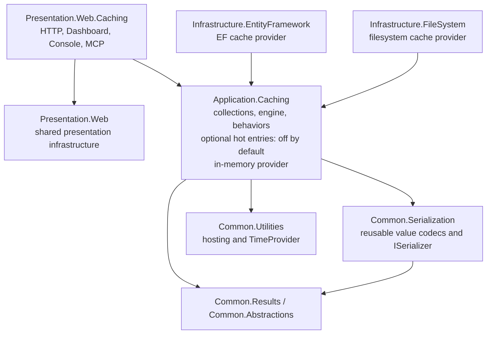
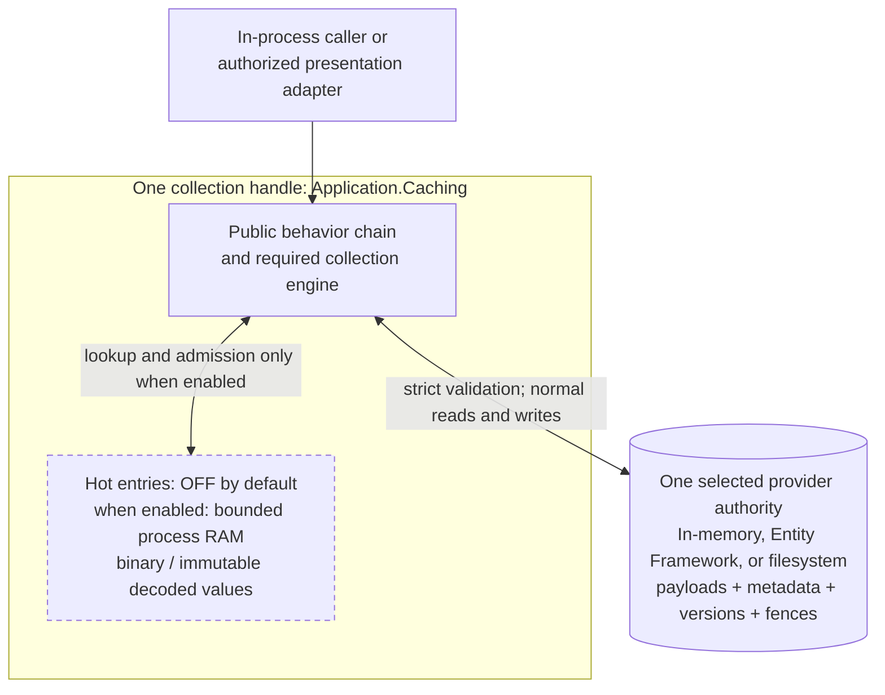
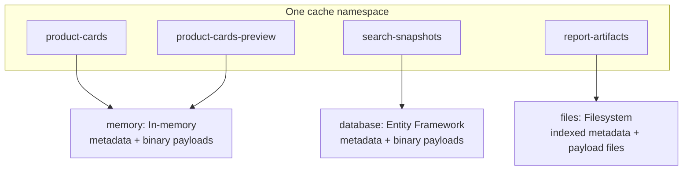
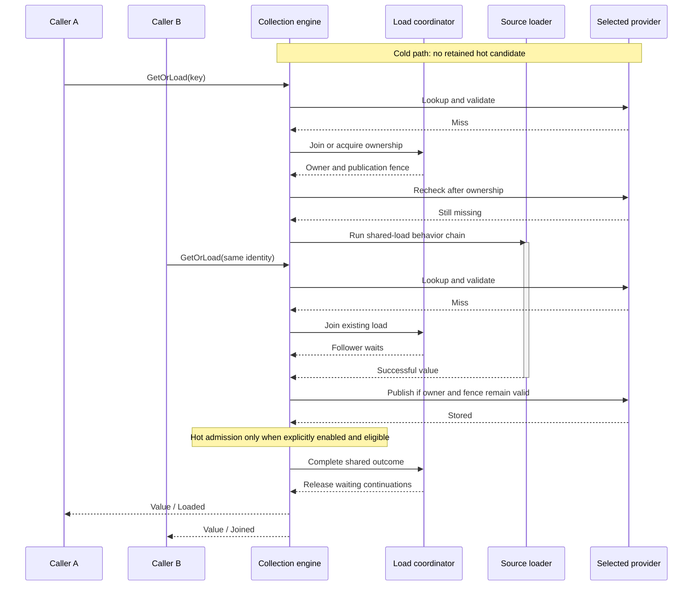
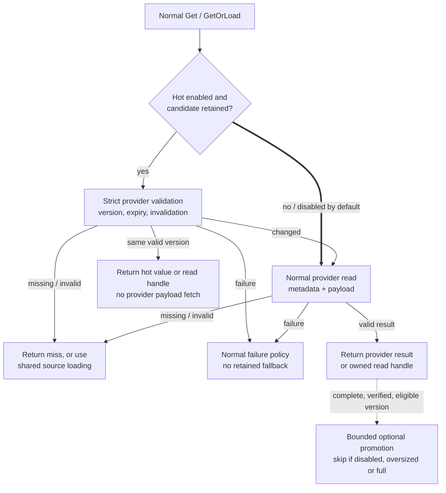
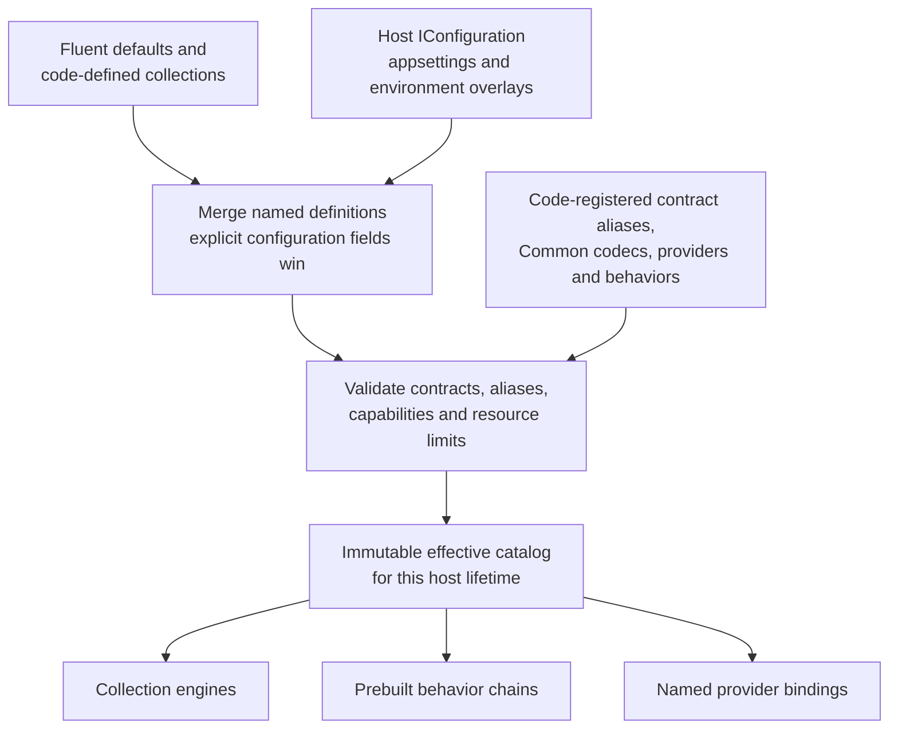
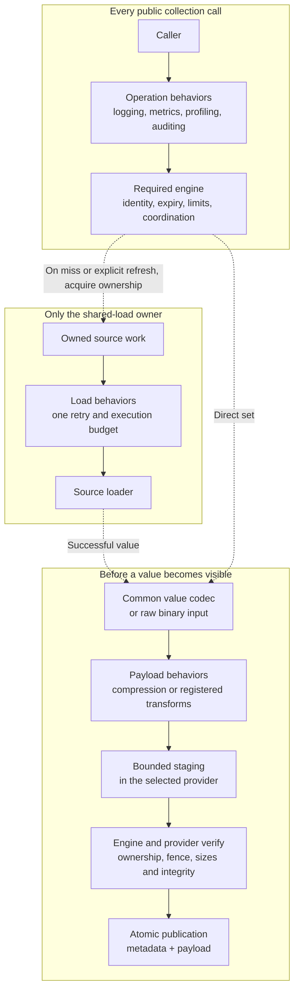
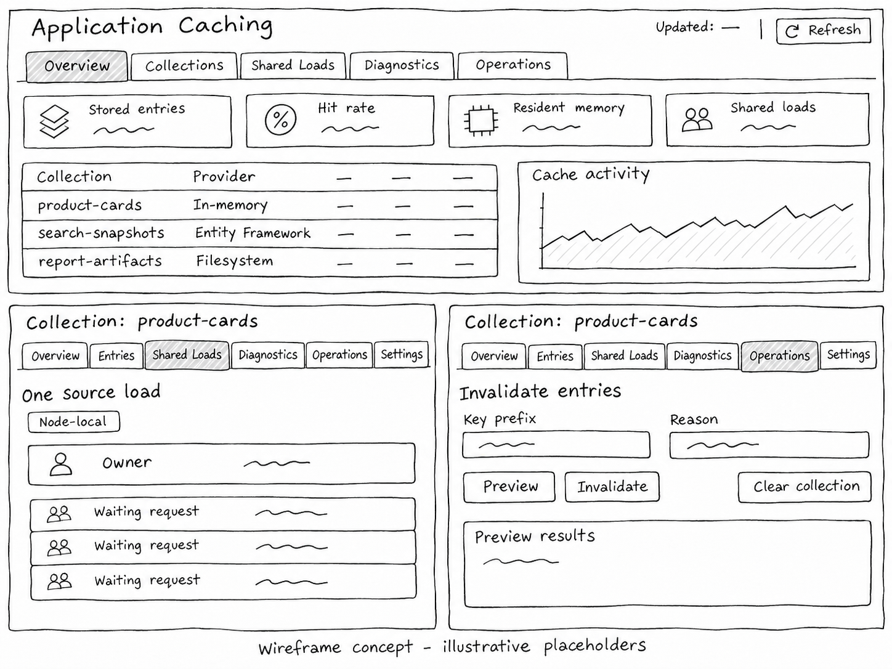
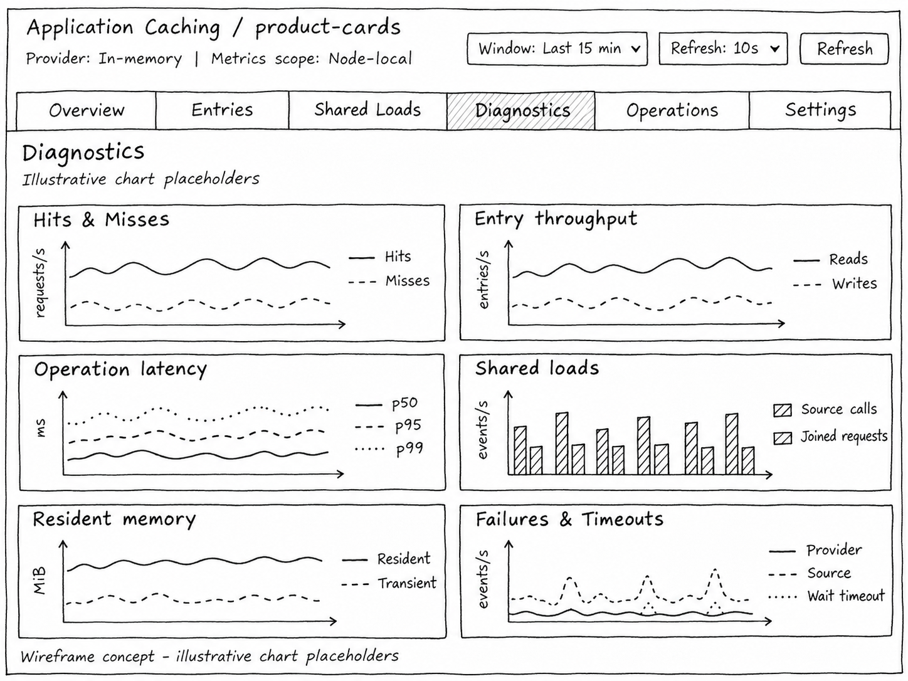

# Design specification: features-application-caching

## 1. Status and intent

This draft defines a universal backend application cache for large datasets and expensive reusable results. Collections, entries, retention, invalidation, codecs, compression, and interchangeable providers form the feature's core.

Each collection selects one self-contained cache provider. That provider owns the payloads, indexed metadata, entry versions, publication fences, and physical retention in one backing store. Payloads may be raw binary, serialized through a codec, compressed, or a combination. The collection engine's hot-entry layer is optional and disabled by default for every collection. When explicitly enabled, it retains bounded binary payloads, immutable decoded values, or both in process memory. Strict authoritative validation is the default for every hot reuse; retained content never becomes a separate store authority.

The agreed providers are in-memory, Entity Framework, and filesystem. The Entity Framework provider handles SQL Server, PostgreSQL, and SQLite. The filesystem provider uses `Infrastructure.FileSystem` building blocks and supports Windows and Linux. The feature must support both very high entry counts and large individual values, including persistent datasets larger than RAM with a bounded in-process working set. Optional HTTP endpoints expose cache get, set, and invalidation operations to external callers. Optional Dashboard, Console Commands, and MCP integrations provide operational inspection and management. This specification defines the complete feature. Proposed API names and implementation details describe the intended design; nothing in this document describes an implemented API unless explicitly identified as an existing building block.

This remains a design draft. Section 19 distinguishes accepted decisions from engineering-selected defaults and records the accepted operating contracts in D-34. Refresh ownership, finite starting budgets, provider formats/recovery, and access/completion semantics are defined. API sketches remain illustrative; actual numeric benchmark reports and provider qualification are implementation acceptance evidence, not results claimed by this document. Further user questions are reserved for material scope changes or genuinely new architectural ambiguity.

### 1.1 Architecture at a glance

Arrows show package dependencies. Infrastructure providers implement Application contracts; they are selected at runtime through those contracts. Common codecs can be reused without depending on the cache.



### 1.2 Runtime ownership and hot entries

This runtime view separates the optional resident working set from the selected provider's authoritative state. Each collection has one provider. Hot entries are disabled by default; the dashed box is used only when explicitly enabled for the collection. Each application instance then keeps its own bounded resident copies. The arrows describe runtime operations rather than package dependencies.



A retained candidate still needs strict provider validation before reuse. Successful hot reuse can avoid fetching the payload; decoded retention also avoids decompression and decoding. The in-memory provider validates its authoritative in-process state; EF and filesystem providers may still perform metadata I/O. Evicting resident copies leaves valid durable entries intact. See the [read path with hot entries](#935-read-path-with-hot-entries) for the per-request decisions.

## 2. Goals and boundaries

### 2.1 Goals

- Cache typed backend values, materialized datasets, lookup collections, computed results, and reusable binary payloads through one application API.
- Organize cached data into declared collections with independent policies and shared resource budgets.
- Support both high entry counts and large values. Persistent capacity must be able to exceed the process memory budget.
- Deliver high throughput, low allocations, and low latency across providers, with explicit hot-path and provider I/O budgets.
- Reduce repeated payload I/O and decoding through optional collection-owned hot entries, with strict validation, bounded admission, and independently observable memory use.
- Configure one complete provider per collection, keeping its payload and metadata in the same backing store.
- Support direct cache access, read-through loading, and partial batch loading without requiring consumers to know the storage provider.
- Prevent duplicate source work for concurrent misses of the same entry through shared loading, with bounded concurrency and waiting.
- Invalidate by exact identity, key pattern, dimensions, or collection, including protection against stale results from active loads.
- Make serialization, compression, memory consumption, cleanup, and operational inspection explicit and measurable.
- Allow individual collections to move between providers without changing the consuming use case.
- Integrate with DevKit results, serialization, dependency injection, configuration, logging, metrics, tracing, and optional host diagnostics.
- Provide optional external HTTP access for get, set, and invalidation, enabled once through `WithEndpoints()` on the fluent caching setup. Collections are exposed by default and may individually opt out through fluent setup or appsettings; requests targeting an excluded collection return HTTP 400 Bad Request.
- Provide separately enabled Dashboard, Console Commands, and MCP management integrations using existing DevKit presentation and host conventions.

### 2.2 Boundaries

The cache stores derived, disposable data. Authoritative records and business transactions remain with their owning application services and persistence providers. Persistence across a restart does not make cached data authoritative.

Partitioning, aggregation, query planning, data completeness, and interpretation of values belong to consumers. A consumer may split a dataset into multiple cache entries, but the engine has no built-in calendar partitions, sampling model, or domain-specific formats.

HTTP response caching, browser caching, event storage, general-purpose document storage, and a new distributed database are outside the feature's purpose. Dependencies are explicitly declared through dimensions; automatic dependency discovery and recursive entry-to-entry dependency graphs are excluded. Automatic caching of every query and write-behind updates to source systems are also excluded. Applications explicitly select the operations that use caching.

Advanced-cache integrations with command/query pipelines, repositories, and storage clients are deferred until after the advanced cache is implemented. Their design and implementation are outside this specification. The optional HTTP, Dashboard, Console Commands, and MCP integrations remain in scope.

## 3. Existing DevKit building blocks

The repository already provides:

- `ICacheProvider` in `Common.Abstractions`, a key-based contract with get, set, enumeration, prefix removal, and sliding or absolute expiration.
- `Common.Caching`, including `InMemoryCacheProvider`, `CachingBuilderContext`, and the `AddCaching()` registration family.
- `Application.Storage.DocumentStoreCacheProvider`, which implements the existing cache contract through document storage and `IDistributedCache`.
- Cache behaviors for queries, commands, requester pipelines, and storage clients belonging to the existing minimal caching feature.
- Feature-level behavior registration and forwarding decorators in DocumentStorage, and context/continuation execution behaviors in Jobs. Reuse these conventions for cache extensibility, with implementation adapted to the cache's low-allocation hot path.
- `Common.Serialization.ISerializer`, which reads and writes streams, and implementations such as `SystemTextJsonSerializer` and `CborSerializer`.
- `CompressionSerializer`, an existing serializer decorator with a fixed Deflate representation.
- `CompressionHelper.CreateGZipCompressionStream` and `CreateGZipDecompressionStream`, public GZip stream factories that can be reused without the serializer decorator's fixed format.
- Result types, options builders, `TimeProvider`, `PeriodicBackgroundService`, `PeriodicBackgroundServiceOptions`, `IDatabaseReadyService`, metrics, tracing, and host diagnostics conventions.

The richer feature needs collection identity, metadata indexes, conditional publication, bounded bulk operations, and provider capability reporting. The existing `ICacheProvider` contract does not express these requirements.

`Common.Caching` and `Application.Caching` are separate features. `Common.Caching` remains the minimal shared caching building block. `Application.Caching` is the advanced backend caching feature with collections, coordinated loading, retention, invalidation, codecs, compression, and scalable providers. This separation is agreed.

Each feature has its own public contracts, registration, configuration, and provider selection. Applications choose the appropriate feature for each use case and may register both in one host. Registering or configuring the advanced feature cannot replace the minimal feature's services or change its existing consumers. Consolidation, deprecation, and migration of the minimal feature are outside this specification.

The existing minimal-cache behaviors remain with `Common.Caching`. This feature supplies a separate advanced application API. Advanced-cache behaviors for command/query pipelines, repositories, and storage clients are deferred until after implementation; no such behavior is required to complete this specification.

The reusable codec capability belongs in `Common.Serialization` alongside `ISerializer`, with cache-independent contracts and implementations. Application Caching consumes those codecs rather than defining its own codec interface. The current `IBufferSerializer` is internal to `Common.Serialization`; consumers cannot assume access to it. Compression needs an explicit persisted envelope rather than assuming that `CompressionSerializer` supplies algorithm identifiers, format versions, or size limits.

The public `ISerializer` operations are synchronous. The current `SystemTextJsonSerializer` decode methods inspect stream length and reset position, so an unchanged adapter does not support forward-only input. Common codecs must declare actual streaming capabilities and memory requirements. The reusable JSON codec can use public `DefaultJsonSerializerOptions` conventions with BCL streaming APIs; a stream-shaped serializer signature alone does not establish the required access guarantees. Existing `ContentTransformEnvelope` and `ContentTransformEnvelopeCodec` also supply reusable transform metadata concepts; reuse compatible parts without encoding payload bytes as metadata or assuming their text envelope is the cache's persisted format.

## 4. Concepts and identity

### 4.1 Cache instance and collection

A cache instance has an application-controlled namespace. A cache collection is a declared, named set of entries within that namespace. It defines:

- A stable value contract and contract version.
- The provider instance and its connection or storage configuration.
- The accepted dimension schema.
- Expiration and physical cleanup policies.
- Loading strategy, concurrency limits, and timeout behavior.
- Entry admission rules, size limits, and capacity budgets.
- Codec, compression, and optional hot-entry retention of binary payloads and immutable decoded values.
- Diagnostic detail and operational permissions.

Each collection has exactly one declared value type or binary payload format. This is an agreed requirement. Typed collections select a declared value type and codec; binary collections select a declared streaming representation. Multiple collections may share the same type or format while applying different policies.

The proposed handles are `ICacheCollection<T>` for typed values and `ICacheBinaryCollection` for binary streaming access. A stable contract identifier, rather than an assembly-qualified CLR name, identifies persisted values across deployments. Both collection forms participate in the behavior extension model.

Collection names are normalized once during startup and compared consistently across every provider. Names and namespaces are bounded. Code and configuration may both declare collections; matching normalized names identify one collection whose settings are merged. Duplicate definitions within one source, unknown contract/component aliases, and incompatible merged definitions fail startup. The final collection catalog is fixed for that host lifetime. Requests and HTTP routes cannot create collections dynamically; environment configuration may define a different catalog on the next startup.

### 4.2 Item, entry, and descriptor

A cache item identifies the requested key and the dimensions known before loading. An entry contains value-kind metadata and, for an ordinary value, its payload; an explicit not-found marker carries no payload. A descriptor supplies policy overrides and size information when the source outcome is produced. A marker does not introduce a second CLR value contract for the collection.

Entry identity is the cache namespace, collection, contract version, and normalized key. Dimensions describe dependencies and support selection; they do not create alternative identities for the same key.

Proposed entry metadata includes:

- A value kind distinguishing a payload value, including permitted null/empty values, from an explicit not-found marker.
- An opaque entry version used for conditional publication, replacement, and cleanup.
- Key, collection, contract identity, and declared dimension values.
- Creation time, expiration time, and physical purge eligibility.
- Last access and hit information, with exactness declared by the provider.
- Logical value size, encoded size, stored payload size, and accounted resident memory.
- Optional item count and eviction priority.
- Payload format, codec identifier and version when applicable, compression identifier when applicable, envelope version, and integrity information.

`ItemCount` is diagnostic metadata, not the number of cache entries. Sizes use bytes and 64-bit counters. Unknown or estimated sizes are reported as such and cannot be passed off as measured memory usage.

### 4.3 Keys and isolation

Keys must include every input that can affect the value. A proposed key builder supports named components, invariant formatting, explicit UTC timestamps, deterministic ordering, and unambiguous escaping or length prefixes. Literal wildcard characters cannot accidentally become patterns.

Key identity is always case-insensitive using ordinal-ignore-case semantics. Within the same namespace, collection, and contract version, keys differing only by case identify the same entry and source-load ownership. This policy has no case-sensitive mode or per-collection comparison switch. Normalized, indexed, and hashed representations must preserve the same equivalence across every provider, independently of database collation and filesystem case behavior.

Applications may supply opaque keys. Providers do not reinterpret their contents as SQL, paths, or executable expressions. Hashing may shorten physical identifiers, but stored identity must still prevent a hash collision from returning another value.

Tenant and authorization scope must participate in collection namespace or key identity whenever they affect the result. The engine cannot assume that values are interchangeable between users. Dimension filtering alone is not a tenant security boundary.

### 4.4 Dimensions and filters

Dimensions are declared metadata used for invalidation and browsing. The agreed filter model supports typed scalar values, sets of values, and ordered intervals. Values have explicit types and invariant representations; interval comparison cannot depend on arbitrary string formatting.

The supported dimension types are fixed:

| Dimension kind | Accepted values and canonical comparison | Supported forms |
| --- | --- | --- |
| String | Strings compared with ordinal-ignore-case semantics | Scalar equality and set membership |
| Boolean | `bool`, preserving true and false | Scalar equality and set membership |
| Integer | Signed `sbyte`, `short`, `int`, or `long`, normalized losslessly to `Int64` | Scalar equality, set membership, and intervals |
| Identifier | `Guid`, preserving its value through a stable invariant representation | Scalar equality and set membership |
| Timestamp | `DateTimeOffset`, normalized to the UTC instant with .NET tick precision | Scalar equality, set membership, and intervals |

Each dimension declares one kind. Integer CLR aliases share the Integer kind; other kinds are not implicitly coerced. Timestamp indexes preserve the canonical tick value rather than relying on a database timestamp's lower precision. Decimal, floating-point, unsigned integer, `DateTime`, arbitrary CLR, and custom dimension types are unsupported in this version. Applications may use declared scaled integers for decimal quantities. These restrictions apply to dimension metadata and filters, not cached payload contracts.

Sets use the declared element kind and deduplicate values with that kind's comparison rules. Null is allowed only by an explicitly nullable dimension schema. Null equality or membership selects explicitly supplied null values, never an omitted dimension. Interval endpoints must be non-null integers or timestamps. Unsupported kinds, cross-kind filters, and null interval endpoints fail validation before mutation.

Every provider implements the same typed, bounded selection model for invalidation, counts, metadata browsing, and invalidation preview. The accepted baseline includes exact keys, indexed scalar equality, set membership, interval overlap, AND and OR groups, and bounded key patterns. Literal keys and patterns use distinct filter forms. Matching semantics cannot vary with the provider, database collation, filesystem, or operating system. Providers may optimize execution while preserving the same selected entries.

AND groups require all child predicates to match; OR groups require any child predicate to match. Grouping is explicit, and each matching entry is selected once even when several branches match it. Hard limits cover nesting, total clauses, and execution resources, with complexity validated before execution. Normalization and query planning must remain within those limits without expanding a small input into unbounded work. Arbitrary executable predicates are excluded. This Boolean composition policy is agreed.

The common model also includes dimension presence or absence, creation-time ranges, and stored-payload-size ranges. These predicates use metadata only, without opening or decoding payloads. Presence means the declared dimension was supplied; an empty set or a schema-permitted null is still present. Absence means it was omitted. Referencing an undeclared dimension fails validation rather than matching every entry as absent. These metadata operators are agreed.

Creation-time filters use the current entry version's publication timestamp in UTC, rather than source-entity or filesystem creation time. Relative age resolves through `TimeProvider` to one fixed UTC cutoff when the operation starts. Preserve that cutoff through pagination, bounded batches, and continuation or resume; advancing time cannot change the predicate between pages. Timestamp ranges use inclusive lower and exclusive upper bounds.

Stored-payload-size filters use an exact nonnegative 64-bit byte count after encoding and cache-managed compression, including envelope bytes stored as part of that payload. Separate metadata, indexes, filesystem allocation overhead, and estimated decoded memory are not part of this field. Size ranges use inclusive lower and exclusive upper bounds. Invalid types or empty or reversed ranges fail validation before mutation. Preview reports its consistency and count accuracy; using the same predicate does not promise a frozen result set while concurrent mutations continue.

Keys, dimension names, and string dimension values always use ordinal-ignore-case matching. Apply it consistently to identity, scalar equality, set membership, and the literal portions of key patterns. There is no case-sensitive option. Dimension declarations that differ only by case are duplicates; batch keys differing only by case are duplicate identities under the normal batch validation rules. Non-string dimension values retain their declared typed comparisons. This matching policy is agreed. It does not transform cached payload content.

The accepted key-pattern grammar supports literal prefixes and escaped glob patterns using `*` for zero or more characters and `?` for one character. A glob matches the whole key without implicit wildcards. Backslash escapes a literal `*`, `?`, or backslash; malformed escapes fail validation. A literal prefix never interprets wildcard characters. Match literal portions using the agreed ordinal-ignore-case semantics. Regular expressions and provider-specific pattern operators are excluded; SQL or filesystem matching syntax cannot extend this grammar.

Pattern queries enforce candidate and execution-work limits. Use key indexes where the predicate permits it, and do not decode payloads to match keys. A broad pattern never authorizes an unbounded scan. Exhausting the work budget cannot silently truncate the match set or report complete invalidation. Return an explicit failure or incomplete operation with its progress, following the bulk-operation contract. Sections 10.6 through 10.8 and 16.1.1 define provider plans, qualification, and finite query defaults.

Interval dimensions and interval filters use half-open ranges `[start, end)` with `start < end`. Two intervals overlap exactly when `a.start < b.end && b.start < a.end`; ranges that only touch at a boundary do not overlap. Endpoints use the dimension's declared type and comparison rules identically across providers. Empty, reversed, or type-incompatible intervals fail validation before storage or invalidation changes entries. This interval policy is agreed.

An empty filter matches nothing. Full-collection removal requires an explicit clear operation. No dimension value has an implicit wildcard meaning; an application must describe broad dependencies through explicit values and filters.

Dimensions may be added by a loader when dependencies become known. The invalidation protocol must account for this late metadata. Dimension counts, value sizes, set cardinality, and filter complexity are bounded and validated before execution.

### 4.5 Collections and provider ownership

Each collection selects exactly one complete provider instance. Several collections may share an instance. The examples below show all three built-in provider kinds; their metadata and payloads remain together in the selected store.



An entry is identified by namespace, collection, contract version, and its case-insensitive key. Relational engines and filesystem access modes are profiles of these providers, not extra providers.

## 5. Proposed application API

The proposed entry point is `IApplicationCache`, with typed `ICacheCollection<T>` and binary `ICacheBinaryCollection` handles. These names avoid redefining the existing `ICacheProvider`. Resolved handles include the configured behavior chains; presentation adapters and in-process callers do not construct separate decoration paths.

Collection operations cover:

- Read by key, returning an explicit hit or miss.
- Read or load one item.
- Read or load a bounded collection, passing only misses owned by that caller to the batch loader.
- Set or replace a value, optionally conditioned on an entry version.
- Read and write large payloads through a public streaming API with explicit resource ownership and disposal.
- Remove an exact key, invalidate a filter, or clear the collection.
- Preview invalidation and browse entry metadata through bounded pages.
- Inspect effective policy and provider capabilities.

Cross-collection invalidation explicitly selects collections or a declared scope. It does not silently search every application's cache namespace.

Public asynchronous operations use `Result` or `Result<T>` for recoverable failures and propagate cancellation using standard .NET cancellation semantics. A miss is a successful lookup outcome, not an error. Stored `null`, `false`, zero, and empty collections must remain distinguishable from a miss.

A lookup result separates the source of the returned value from whether it was retained. Proposed lookup outcomes are `Miss`, `Hit`, `Loaded`, `Joined`, and `Bypassed`. Proposed storage outcomes include `NotAttempted`, `Stored`, `Suppressed`, `TooLarge`, `CapacityRejected`, `InvalidatedDuringLoad`, `ProviderUnavailable`, and `ProviderIndeterminate`. A direct hit or miss makes no new storage attempt.

A loader produces a value, optional dimensions, policy overrides, and size information, or a recoverable failure. Typed loaders may explicitly suppress storage. Payload-producing binary loads require confirmed publication under section 9.5. Failed loads, thrown exceptions, and cancellation are never stored as values. Confirmed source absence uses the explicit not-found marker and optional negative-caching policy in section 5.5; it cannot convert a transient source failure into a negative entry.

Explicit cache writes report storage failure. Typed read-through may still return a successfully loaded value when storage fails under its configured failure policy. Binary payload delivery requires a confirmed stored version. Invalidation failure must remain visible to its caller.

Batch results preserve input order and expose an outcome per item. The proposed policy rejects duplicate normalized keys before invoking the loader. Completion publishes each successful item promptly; a failure in another item does not roll back successful entries. Uncompleted items receive an explicit failure when the loader ends. Large batches are chunked and cannot materialize the entire cache.

### 5.1 Illustrative collection contracts

The following sketches explain the intended boundaries. All cache types and members shown here are proposed, including supporting types whose definitions are omitted. `Result`, `Result<T>`, and the result extensions are existing DevKit APIs. The sketches omit XML documentation, complete overload sets, batch operations, and provider internals. They are not implementation files or a finalized public API.

```csharp
public interface IApplicationCache
{
    ICacheCollection<T> GetCollection<T>(string name);

    ICacheBinaryCollection GetBinaryCollection(string name);
}

public delegate ValueTask<Result<CacheLoadResult<T>>> CacheLoadDelegate<T>(
    CacheLoadContext context,
    CancellationToken cancellationToken);

public interface ICacheCollection<T>
{
    ValueTask<Result<CacheLookup<T>>> GetAsync(
        string key,
        CancellationToken cancellationToken = default);

    ValueTask<Result<CacheLookup<T>>> GetOrLoadAsync(
        CacheItem item,
        CacheLoadDelegate<T> loader,
        CancellationToken cancellationToken = default);

    ValueTask<Result<CacheWriteOutcome>> SetAsync(
        CacheItem item,
        T value,
        CacheEntryDescriptor descriptor,
        CancellationToken cancellationToken = default);

    ValueTask<Result<CacheWriteOutcome>> SetAsync(
        CacheItem item,
        T value,
        CacheEntryDescriptor descriptor,
        CacheEntryVersion expectedVersion,
        CancellationToken cancellationToken = default);

    ValueTask<Result> RemoveAsync(
        string key,
        CacheEntryVersion expectedVersion,
        CancellationToken cancellationToken = default);

    ValueTask<Result<CacheInvalidationPreview>> PreviewInvalidationAsync(
        CacheSelection selection,
        CancellationToken cancellationToken = default);

    ValueTask<Result<CacheInvalidationOutcome>> InvalidateAsync(
        CacheSelection selection,
        CancellationToken cancellationToken = default);
}

public readonly record struct CacheLookup<T>(
    bool Found,
    T Value,
    CacheLookupOutcome LookupOutcome,
    CacheStorageOutcome StorageOutcome,
    CacheAccessMode AccessMode = CacheAccessMode.Normal,
    bool IsNotFound = false,
    CacheEntryVersion? Version = null);

public sealed record CacheLoadResult<T>(
    T Value,
    CacheEntryDescriptor Descriptor);
```

The outer `Result` reports recoverable operation failure. On success, `Found` means a payload value is available, including a permitted `null`. `IsNotFound` means confirmed source absence; a cache miss has neither flag. The flags cannot both be true. Read `Value` only when both `IsSuccess` and `Found` are true. `LookupOutcome` describes the access path, so a cached not-found marker is a `Hit` with `IsNotFound = true`, not a miss. `StorageOutcome` describes any attempt to retain newly loaded content or a marker.

`CacheItem` carries the key and dimensions known before loading. `CacheEntryDescriptor` adds source-produced metadata and bounded policy overrides; an empty descriptor inherits collection policy. `CacheWriteOutcome` carries the publication acknowledgement and version. Invalidation outcomes expose completed work and remaining or failed work, including partial effects when a bulk operation fails. The full supporting contracts must preserve those semantics rather than reducing every write or invalidation to a Boolean.

`Version` is the optional opaque token for the stored version acquired with the value or negative marker. Hits and confirmed stored load/join outcomes return it from the same read/publication snapshot. Misses and successful unretained or indeterminate results have no confirmed stored version. The token does not promise that the version remains current after return. Reuse the acquired version without a separate metadata query or a newly allocated metadata object on each hit. Conditional replacement/removal checks the supplied token atomically; a conflict returns a recoverable failure without mutation or an unconditional retry.

All returned typed values are read-only by contract, including hits, loaded/joined values, bypass results, and successful uncached values. Mutable CLR types remain supported. Callers must not mutate returned instances, and loaders must not mutate values after completing a load. The engine may share that instance among callers. Consumers make their own copy when mutation is needed; the cache performs no automatic cloning. Decoded hot retention still requires the separate immutable-sharing eligibility and size-accounting approval.

Handle resolution uses the startup catalog and verifies the requested value contract. It performs no lookup I/O, does not create collections, and returns the already-composed behavior chain. Await each returned `ValueTask` once. The shared-load engine owns its separate multi-waiter completion mechanism.

### 5.2 Typed read-through and shared loading example

This example uses the `ProductCard` contract and `product-cards` setup from section 11.2. The collection declares a scalar string dimension named `catalog`. `IProductCatalog` is an application service whose `GetCardAsync` method returns `Result<ProductCard>`.

```csharp
var products = cache.GetCollection<ProductCard>("product-cards");
var item = new CacheItem("P-104")
    .WithDimension("catalog", "retail");

var lookup = await products.GetOrLoadAsync(
    item,
    static async (context, loadToken) =>
    {
        var catalog = context.Services.GetRequiredService<IProductCatalog>();
        var loaded = await catalog.GetCardAsync(context.Item.Key, loadToken);

        return loaded.Map(card => new CacheLoadResult<ProductCard>(
            card,
            new CacheEntryDescriptor()));
    },
    cancellationToken);
```

`CacheLoadContext.Item` contains the owner's item. Its `Services` resolves source dependencies from the shared load's owned scope. The static callback captures no request-scoped service, and `loadToken` belongs to the shared work. The caller's `cancellationToken` controls that caller's interest and wait. A warm hit invokes no loader and creates no source scope.

With the default shared-loading strategy, concurrent calls for `P-104` and `p-104` share source work within the configured coordination scope. Different keys remain concurrent. `Map` preserves source failures; a failed source result does not become a cached value. A successful result can report `Loaded` or `Joined` with a rejected storage outcome, so the application must not infer retention from `Found` alone.

### 5.3 Direct set and get example

An application may already have a value and need no loader. Both operations retain the same collection policy and behavior chain:

```csharp
var stored = await products.SetAsync(
    item,
    new ProductCard("P-104", 19.95m),
    new CacheEntryDescriptor(),
    cancellationToken);

if (stored.IsSuccess)
{
    var fetched = await products.GetAsync("p-104", cancellationToken);
    // Inspect fetched.IsSuccess and fetched.Value.Found before using the value.
}
```

An explicit write that cannot publish returns failure; it cannot report success because the application still owns the supplied value. A successful write does not guarantee a later hit if expiration, invalidation, or another write intervenes. The lowercase lookup demonstrates the same case-insensitive identity as the uppercase write.

A typed lookup supplies the version for a conditional replacement through the same proposed API:

```csharp
var fetched = await products.GetAsync("p-104", cancellationToken);
if (fetched.IsSuccess && fetched.Value.Found && fetched.Value.Version is { } expectedVersion)
{
	var replaced = await products.SetAsync(
		item,
		new ProductCard("P-104", 21.95m),
		new CacheEntryDescriptor(),
		expectedVersion,
		cancellationToken);
	// Inspect replaced.IsSuccess. A version conflict does not overwrite the winner.
}
```

`RemoveAsync(key, expectedVersion, cancellationToken)` uses the same acquired token for conditional removal. Binary read handles expose their acquired version through metadata and use the same conditional-write/removal rules.

### 5.4 Bypass and explicit refresh contracts

Normal `GetAsync` and `GetOrLoadAsync` retain their defined lookup semantics. An explicit typed read-through overload accepts proposed `CacheAccessOptions` with `Mode = Normal` or `Bypass`. Bypass skips stored and hot-value lookup and suppresses publication by work owned by that bypass call. It does not remove existing entries, enable hot retention, or bypass admission, authorization, cancellation, source deadlines, or the configured source-work coordination scope. Binary loading rejects bypass and explicit storage suppression before invoking a loader. Direct gets have no loader and do not accept this option. External HTTP gets cannot activate a loader or request this bypass mode.

Bypass may join source work already running for the same identity within the configured scope; it cannot obtain an existing stored value instead. Joining another caller's ordinary load does not prohibit that owner from publishing. A bypass-owned load stays non-storing even if ordinary callers later join it. The lookup exposes the requested access mode in addition to its actual `Loaded`, `Joined`, or `Bypassed` source outcome and the actual shared storage outcome. Provider coordination I/O can still occur in shared-store scope; bypass is not a promise of zero provider I/O. Disabled collection mode retains its separate no-storage/no-cache-lease contract.

The proposed explicit refresh operation is:

```csharp
ValueTask<Result<CacheLookup<T>>> RefreshAsync(
    CacheItem item,
    CacheLoadDelegate<T> loader,
    CancellationToken cancellationToken = default);
```

`RefreshAsync` requests fresh source work even when a valid entry exists. It joins applicable source work or acquires the usual ownership and captures the current entry version and publication fence. Ordinary reads continue to use the existing independently valid version while refresh runs; refresh never removes it first. A missing entry can be loaded and published normally. Completion creates a new version with expiration measured from its publication. Replacement, removal, or invalidation after the captured version/fence prevents a late overwrite. Failure leaves the previous version under its original validity and never extends its expiration.

Successful uncached typed outcomes and indeterminate publication retain the normal read-through failure semantics. Binary payload refresh requires confirmed publication before returning new read handles. Recoverable version conflicts are explicit outcomes, not unconditional retries. Background refresh adds the stricter existing-entry eligibility rules in section 6.5. These operating contracts are fixed; overload spelling remains illustrative until implementation.

### 5.5 Explicit not-found results and negative caching

Negative caching is optional and disabled by default. A trusted loader explicitly returns a proposed `CacheLoadResult<T>.NotFound(...)` marker, represented by the descriptor's value kind; binary loaders can return the same descriptor without payload bytes. Normal successful null, false, zero, and empty payloads remain ordinary values. The marker is a successful source outcome, never an automatic conversion of a failed `Result`, exception, timeout, cancellation, or HTTP error.

Without opt-in, callers receive `IsNotFound = true` without retaining a marker. This metadata-only absence outcome needs no binary read handle and remains available to binary loaders without retaining payload bytes. When enabled, the default negative TTL is 30 seconds, bounded by collection freshness limits and any shorter requested lifetime. Apply configured expiry jitter to that lifetime once at publication. Markers use the same key, dimensions, contract/version, publication fencing, invalidation, and capacity rules as positive entries; their default eviction priority is lowest. They carry metadata rather than a fabricated serialized null or empty payload. Batch/shared callers receive explicit per-item absence outcomes, and ordinary read-through must not reload a valid negative hit.

Negative markers are excluded from hot-value admission and proactive refresh. Creation or replacement of the source value invalidates the relevant marker through the ordinary key/dimension path. A cacheable refresh that confirms absence conditionally replaces the old value with a marker, or removes its expected old version when negative retention is disabled. Explicit suppression/bypass still prohibits that work's mutation, and source failure leaves the prior version under its original validity. Unretained absence follows the existing successful-uncached cross-instance handoff policy. HTTP lookup returns 404 for a valid negative hit without activating a loader; its internal hit/absence diagnostics remain distinct from an ordinary miss.

## 6. Loading and coordination

### 6.1 Shared loading and independent loading

Shared loading, also called single-flight or coordinated loading, is the standard read-through strategy. For concurrent misses of the same entry identity, exactly one caller owns the source work while admitted followers wait for that work to complete. The identity includes namespace, collection, contract version, and the case-insensitive key. Followers do not invoke their own loader delegate while waiting.

The owner performs the expensive fetch or computation and attempts publication once. On successful cacheable completion, waiting callers reuse the resulting value or acquire the published entry; they do not repeat the source work. Storage is rechecked after acquiring ownership so a just-published entry is reused. Different keys can load concurrently within admission limits; a shared load must not serialize unrelated keys behind one global source-work lock.

The owner consumes the source continuation once and publishes its outcome through an engine-owned completion mechanism that supports multiple waiters. Do not hand the same single-consumption `ValueTask` or a single caller-owned stream to every follower. The shared completion and waiter state are bounded and remain owned by the shared work until it finishes.

The independent strategy is an explicit collection option for applications that intentionally permit concurrent misses to load separately. It still registers active loads and applies publication fencing so invalidation can prevent stale storage. The shared-load success, failure, cancellation, and uncached-result rules below define the coordinated strategy's behavior; they do not promise global exactly-once execution across crashes or outside its configured scope.

Node-local source-load coordination is the default. A collection may explicitly select shared-store coordination with a capable Entity Framework or filesystem provider. The in-memory provider supports node-local coordination. Validate the selected scope against provider capabilities at startup and expose the effective scope in diagnostics. This scope policy is agreed.

Shared-store coordination uses the selected provider's own backing store for ownership, fencing, and bounded completion state. Participating instances must address the same cache namespace, collection, and store authority. Registration of shared storage alone does not enable this mode. Node-local coordination may run one source load on each instance; it still requires shared publication, expiration, and invalidation correctness when those instances use the same store.

Sharing a successfully published value across instances uses the provider's stored binary representation. A successful typed source load can also produce no reusable published value because storage was suppressed, admission rejected it, or publication failed. In that case, return the successful uncached value read-only to eligible callers in the loading process. Callers on other instances recheck storage and acquire ownership before performing their own source load. This handoff policy is agreed. A payload-producing binary load without confirmed publication instead returns the corresponding recoverable failure to its waiters; it creates no temporary replay store or shared consumable stream.

The handoff preserves the callers' existing wait deadlines, cancellation, admission limits, and publication fences. It does not start one independent load per remote waiter, reset exhausted budgets, or store a temporary result that bypasses size and capacity limits. The cache provides no separate transport for uncached values between instances. A source failure or caller wait timeout still follows the agreed failure policy and cannot trigger this successful-load handoff.

Ownership reassignment requires authoritative provider state. An indeterminate publication outcome follows the provider's recovery rules; a lost acknowledgement does not prove that no value was published. Shared-store mode requires confirmed ownership before starting source work. If the ownership authority is unavailable or uncertain, return `ProviderUnavailable` and start no new source work. There is no automatic downgrade to node-local coordination. Default node-local typed loading retains its bounded source fallback. Already-running typed work may return a successful value locally without confirmed retention, but cannot publish while ownership or fencing is uncertain. Remote waiters retain their existing deadlines and cannot infer takeover from an outage.

Coordination is bounded by maximum active loads, queued loads, followers per key, and total waiters. Limits apply globally and per collection where appropriate. Encoding and decoding also require concurrency and transient-memory limits.

Inside a cache-owned loader execution, nested cache hits are permitted. If a nested call would start or join source work, reject it with a recoverable `NestedCacheLoad` failure before ownership, queueing, or waiting. Explicit nested refresh and bypass fail by the same rule. Apply it across keys, collections, and cache handles for the execution context, including batch loading and retries. A simple execution-context marker enforces the rule; no dependency graph is maintained. Loaders can call source services or use direct cache lookup without starting nested cache source work.

### 6.2 Timeouts and cancellation

Queue timeout, caller wait timeout, loader execution timeout, and ownership lease lifetime have separate meanings. No timeout is infinite by accident.

Cancelling a caller cancels only that caller's wait while other interested callers remain. By default, cancel the source load when its last interested caller cancels. A collection may explicitly opt into completion in the background after all callers leave. Both policies retain the same work, timeout, admission, and publication limits. This cancellation policy is agreed.

Every coordinated load owns its cancellation and resource lifetime independently of any one caller, including the caller that first acquired ownership. Use a cache-owned dependency scope or an application-owned loader whose lifetime covers the work. Retaining a reference to a request-scoped service does not prevent its owner from disposing it; per-call delegates cannot rely on such captures when work may outlive that request.

When cancellation wins before publication, complete the cancelled waiters, prevent new callers from joining the stopped load, and fence off a late result. An opted-in background completion may publish only while its normal ownership and invalidation checks still succeed. Shutdown cancels active work, observes its completion, and stops accepting new loads.

A caller wait timeout returns a recoverable coordination timeout and ends only that caller's wait. It never starts an independent duplicate source load. Other interested callers may continue waiting; if the last caller leaves, apply the configured cancellation or background-completion policy. This wait-timeout behavior is agreed.

A coordination wait timeout is not a cache-provider outage or an ordinary miss and cannot trigger the read-through fallback policy to bypass source-load limits. Ending a caller's wait does not release an execution slot still occupied by the loader.

The shared load delivers its final outcome to all remaining waiters. If it fails, they receive that failure without automatic per-waiter retries or leadership takeover. A later independent call may start fresh work normally. Failed source results are not stored as cache values. This failure policy is agreed.

Source retries require an explicit bounded resilience policy around the shared load, implemented through its execution behaviors using existing resilience facilities or an appropriately configured application loader. One work unit owns the retry budget; adding waiters does not multiply attempts. The load behavior chain executes inside acquired ownership and the engine's execution budget, not separately for every waiter. The overall execution timeout, cancellation, ownership lease, and admission limits cover every attempt and backoff. Retry configuration cannot reset those budgets or replay an operation whose outcome remains indeterminate.

Cancellation is cooperative. If a loader ignores cancellation, the cache cannot terminate its code. It must fence off late publication and report stuck work. Releasing a logical lease does not release an occupied execution slot or make its allocated memory disappear.

### 6.3 Batch coordination

For overlapping batches, resolve hits, acquire ownership of misses without waiting, complete owned work, and only then await work owned by other callers. Never wait on another batch while holding unfinished ownership that it may need.

Per-item completion releases ownership promptly. Partial failures, cancellation, and suppressed storage complete the relevant followers explicitly. Batch membership cannot create an unbounded queue of item tasks or source reads.

### 6.4 Shared-load success path

This sequence shows two admitted application callers missing the same identity within one coordination scope. The first owns the work; the second waits. It illustrates a successful cacheable result with a valid publication fence.



The coordinator is part of the cache engine. In shared-store mode, its authoritative state is kept in the same selected provider, not in a separate coordination service. Node-local scope is the default; cross-instance coordination is opt-in for capable EF and filesystem profiles. Failure, timeout, cancellation, and uncached-result cases follow sections 6.1 and 6.2; followers do not start independent duplicate loads merely because their wait times out.

### 6.5 Independent proactive refresh and background maintenance

Application Caching owns its scheduled work through hosted background services. It does not depend on Jobs, JobScheduling, Quartz, or StartupTasks for refresh, warm-up, cleanup, or index maintenance. Use the existing [PeriodicBackgroundService](../../src/Common.Utilities/Hosting/PeriodicBackgroundService.cs) and its options for host-startup gating, `TimeProvider` delays, one iteration at a time, and bounded shutdown. The [DocumentRetentionBackgroundService](../../src/Application.Storage/Documents/Retention/DocumentRetentionBackgroundService.cs) provides the named-provider and owned-scope pattern; [OrchestrationRecoveryService](../../src/Application.Orchestrations/Execution/OrchestrationRecoveryService.cs) demonstrates the database-readiness integration. These are source references for conventions, not dependencies on those features.

Provide a proposed `CacheMaintenanceBackgroundService` for bounded cleanup, local idle eviction, staging recovery, and provider index compaction. A separate proposed `CacheRefreshBackgroundService` handles explicitly enabled proactive refresh and optional warm-up. Register a shared monitored instance per host, using the existing `TryAddBackgroundServiceHealthCheck<T>` convention. Disabled refresh/warm-up creates no active refresh polling. Services use the same finalized collection catalog, decorated handles, and container-owned providers as foreground callers.

After `IHostApplicationLifetime.ApplicationStarted`, wait the configured startup delay. Before touching a database-backed provider or registered database-dependent loader, await its named `IDatabaseReadyService.WaitForReadyAsync` gate when registered. With no gate, use the provider's readiness check. A failed/timed-out gate leaves that provider's work pending, records readiness, and retries on a later iteration; it does not proceed against an unready database or block unrelated providers. Recheck readiness after connection failures. Normal request paths retain their existing provider-failure policy.

Create an async DI scope per admitted source execution or bounded maintenance unit. Do not retain request scopes, ambient request identity, `DbContext` instances, delegates supplied by earlier requests, or scoped services across iterations. Source work uses its cache-owned context and cancellation lifetime. Expected provider/readiness failures produce bounded diagnostics and a later retry; invariant failures remain observable through the monitored hosted service. Shutdown cancels admission and active work, awaits the configured stop budget, and preserves accounting/fencing for native calls or loaders that have not actually stopped.

#### 6.5.1 Refresh eligibility and source registration

Proactive refresh is disabled by default per collection and independent of hot-entry opt-in. Code registers a trusted typed or binary refresh-loader alias whose contract matches the collection; configuration selects the alias and policy, never a delegate or arbitrary CLR type name. The loader reconstructs its source request from the stable key and declared metadata. Enabling refresh without a compatible registered loader fails startup. Binary loaders write to an engine-owned bounded destination and return a descriptor. Payload-producing binary work requires confirmed publication; each follower then acquires its own read handle under normal validity and reader limits. Failed publication returns the corresponding failure rather than an uncached stream. Refresh failure leaves any previous independently valid version under its original validity.

The proposed loader contracts use the same owned source context as read-through:

```csharp
public interface ICacheRefreshLoader<T>
{
    ValueTask<Result<CacheLoadResult<T>>> LoadAsync(
        CacheLoadContext context,
        CancellationToken cancellationToken = default);
}

public interface ICacheBinaryRefreshLoader
{
    ValueTask<Result<CacheEntryDescriptor>> LoadAsync(
        CacheLoadContext context,
        Stream destination,
        CancellationToken cancellationToken = default);
}
```

The worker queries indexed due-refresh metadata in bounded pages for the host's declared collection contract version; it cannot activate loaders for unknown persisted contracts or other deployments' types. It refreshes only an existing valid version that has foreground access within the configured activity window and is approaching absolute expiry. Effective refresh lead is the smaller of `RefreshAhead` and 20 percent of that version's published lifetime; scheduling is best effort and promises no extension of validity. Background refresh, browsing, and diagnostics do not count as foreground activity. Sliding idle expiry is not renewed by the worker; a successful newly published refresh establishes a new entry lifetime under normal collection policy. Approximate activity observations may be batched and can only affect eligibility, never validity.

Before starting source work, recheck that the candidate remains valid, due, active, and at the selected version. Use the normal source-load owner, overall deadline, retry behavior, and publication fence, including conditional expected-version publication. Foreground reads remain nonblocking hits while the old version is valid. If it expires during admitted work, new reads miss and may join that work. A successful fresh source result may publish a new version only while its captured publication rights remain valid; it does not revive the expired version by touching it. Invalidation/removal/replacement wins over late refresh, and required tokens/tombstones survive cleanup while that work can still publish.

Refresh inherits the collection's coordination scope. Node-local scope may perform work on more than one instance; shared-store scope coalesces across participating instances. Competing refreshes still conditionally publish against the selected version. Maintenance sweep ownership belongs to the selected provider and is bounded/cooperative; filesystem uncertainty follows the no-timeout-takeover rule. There is no separate scheduler database, result transport, or unbounded timer per key.

Remote completion observation is coalesced once per active key per node, not one provider poll per waiting caller. Default polling starts at 50 milliseconds and backs off with bounded jitter to one second while retaining each caller's deadline. Local followers use the engine-owned completion directly. Neither polling delay nor a busy authority result starts duplicate source work or resets the wait budget.

#### 6.5.2 Scheduling, retry, and warm-up

Default refresh scheduling is a 15-second startup delay and 15-second delay between completed iterations, with 30-second readiness waits, at most 128 candidates examined per iteration, and source parallelism of four per process and two per collection. These limits are sublimits of normal source-work admission. Stop admitting new candidates after five seconds of sweep work, then await already-admitted bounded executions; iterations never overlap or create catch-up queues. The default refresh lead is one minute and foreground activity window is ten minutes.

On a source failure, retain the old version only until its original expiry. Retry on a later due sweep using version-scoped backoff starting at five seconds and capped at one minute, with bounded jitter. After three consecutive failures for that version, pause automatic attempts for five minutes or until replacement makes the candidate obsolete. This scheduler backoff does not add unbounded retries inside one shared source execution or reset caller budgets. Invalidation and provider uncertainty suppress publication rather than triggering an immediate replacement load.

Optional warm-up is disabled by default. The same refresh service can perform a bounded startup pass over configured seed keys or a code-registered asynchronous key source after delay/readiness. It uses ordinary `GetOrLoad` semantics, including the shared-store outage and confirmed binary publication rules, bounded batches and the same loader/lifetime/coordination limits, and disposes the key enumerator on cancellation or budget exhaustion. Disabled collections admit no warm-up or refresh work. Periodic warm-up requires an explicit interval. Configuration cannot enable arbitrary administrative loaders or make HTTP get invoke them. Warm-up and refresh never enable the hot-entry layer implicitly.

Diagnostics expose readiness, last/next sweep, due/eligible/skipped counts, active refresh owners, failures/backoff, conditional publication outcomes, and last successful refresh. Metrics keep bounded labels. Benchmarks include foreground latency and allocations while refresh/maintenance runs, rather than timing only an idle cache.

## 7. Invalidation and publication correctness

### 7.1 Semantics

Invalidation is available by exact key, indexed dimensions, bounded key pattern, and explicit collection clear. A preview reports estimated or exact counts and a bounded metadata sample without changing entries or active work.

An acknowledged invalidation establishes a visibility boundary within its declared scope:

- Matching stored entries are no longer eligible for subsequent reads in that scope.
- Matching old loads cannot publish stale results afterward.
- A caller starting after that boundary cannot join an invalidated load.
- An operation that already acquired a value before invalidation may finish with that value. The cache cannot revoke an object already returned to application code.

An already-open read stream retains its original entry version after invalidation, subject to its configured reader lifetime. Invalidation prevents new opens from acquiring that invalidated version.

Explicit collection invalidation covers all contract versions of the targeted logical collection in the same cache namespace and provider store. Payload reads and writes remain contract-version-isolated, but exact-key invalidation, matching dimension invalidation, and clear cannot leave older contract versions eligible solely because another application version issued the operation. This cross-version scope is agreed. It does not discover or transact across other provider stores; those require explicit targets and retain the normal per-target partial-failure semantics.

Selection uses shared metadata without decoding older payloads. If a filter cannot be evaluated safely against a retained version's dimension schema, report an explicit incomplete or failed invalidation rather than skipping that version, coercing incompatible types, or silently widening the operation to clear. Validate known incompatibilities before mutation where possible; any effects already applied remain visible in the result. Callers can explicitly select exact keys or clear when a broader operation is intended.

The source system remains responsible for ordering its commit before invalidation. Cache invalidation and an application's database transaction are not automatically atomic. Applications needing reliable delivery should use the existing messaging and outbox patterns where appropriate.

### 7.2 Publication fencing

Every load captures a publication fence before reading source data. Publication checks that fence, ownership token, and relevant entry version atomically with the write. Collection invalidation fences cover the targeted logical collection's contract versions, so an older deployed application cannot republish pre-invalidation data. A separate check followed by an unconditional write is insufficient.

Key removal must fence old loads even when no stored entry exists. Clear must also fence all old work. A timed-out owner cannot overwrite a newer owner or a direct replacement.

When a filter could match dimensions that become known only after loading, the proposed protocol advances a collection publication epoch. All older active loads in that collection then lose publication rights, even if some are unrelated. Stored entries that do not match the filter remain readable. More selective tracking is an optimization that must preserve these guarantees.

Fence state and tombstones are bounded and cannot disappear while a relevant old publisher could still succeed. Durable providers preserve the necessary fence across process restarts. Conditional deletion uses the expected entry version so delayed cleanup cannot delete a newer replacement.

### 7.3 Bulk and cross-collection work

Large invalidations process metadata and payload cleanup in bounded batches. If an operation cannot establish its visibility boundary within a bounded transaction, its result must expose progress and completion rather than claiming that scheduling physical deletion completed invalidation.

Dependencies stay dimension-based. Applications attach dependency identifiers to relevant entries and explicitly invalidate the matching dimensions in the selected collections. The cache does not maintain or traverse recursive entry-to-entry graphs, infer dependencies from payload content, or automatically cascade a replacement or eviction into other entries. This dependency model is agreed.

Cross-collection invalidation returns per-collection results. No cross-provider transaction is promised. Partial failures remain visible and are retryable. Reason, origin, scope, affected counts, and publication suppression are included in diagnostics.

### 7.4 Multiple nodes

For a shared store, the invalidation protocol must use authoritative shared metadata and conditional writes. In-process events alone cannot establish a cluster-wide boundary.

A collection uses one complete provider and may enable the collection engine's bounded hot-entry layer over that provider. Hot binary payloads and decoded values are resident copies of provider-owned entry versions, not a separately selected in-memory provider or store authority. Strict validation checks the current version and validity for every attempted hot reuse. Best-effort broadcasts, a remembered validation result, or a cached TTL alone cannot satisfy acknowledged shared invalidation. Section 9.3 defines the hot path and its failure rules.

Broadcasting can improve convergence for separate node-local caches, but delivery guarantees and disconnected nodes must be stated. TTL alone is not equivalent to acknowledged distributed invalidation.

### 7.5 Dimension invalidation example

After a successful source commit, an application can invalidate the entries carrying a dependency dimension. The following uses the declared `catalog` dimension from the read-through example:

```csharp
var selection = CacheSelection.Dimension("catalog").EqualTo("RETAIL");

// Read-only inspection, for example from an authorized Operations page.
var preview = await products.PreviewInvalidationAsync(selection, cancellationToken);

// A separate, authorized mutation submits the same selection.
var invalidated = await products.InvalidateAsync(selection, cancellationToken);
```

`RETAIL` matches `retail` under the fixed dimension comparison policy. Preview does not reserve matching entries or guarantee that the later count is unchanged. The mutation applies publication fencing and reports its actual effects and any incomplete work. Callers inspect operation failures and progress rather than treating a submitted request as completed invalidation. Cross-collection invalidation supplies its collection scope explicitly.

## 8. Expiration, retention, and eviction

### 8.1 Logical expiration

Finite absolute TTL is the default. It begins when publication succeeds, using `TimeProvider`; hits do not extend it. Per-entry policy overrides remain within the collection's configured limits. An already-open stream may finish reading its acquired version within its configured reader lifetime.

Sliding expiration is optional and requires both a finite idle timeout and a finite maximum absolute lifetime. Its effective expiry is `min(publishedAt + maximumLifetime, lastValidAccessAt + idleTimeout)`. A successful valid lookup or stream acquisition may renew the idle deadline, but cannot move expiry beyond the hard age limit. Explicit replacement publishes a new version with a new lifetime. This expiration policy is agreed.

Validity checking and sliding renewal must be atomic with respect to replacement and invalidation. Access at or after the current expiry cannot renew the old entry. A touch cannot restore an invalidated version, rewrite the payload, or imply that its source data was refreshed. Metadata browsing, counts, diagnostics, and continued consumption of an already-open stream do not renew entry expiry.

Sliding validity uses authoritative provider state, not sampled usage statistics. Persistent providers may need an additional metadata write or combined read-and-touch operation; that cost belongs to the sliding profile's latency and I/O budget. The default absolute-TTL read path remains free of writes made solely for idle renewal. Tests use `TimeProvider` to cover exact expiry boundaries.

New reads and stream opens enforce logical expiry independently of cleanup. Expired entries are misses even if fresh source loading fails. Stale-while-revalidate and stale-if-error behavior are excluded. Already-open streams retain their acquired version only within the agreed reader lifetime. These freshness rules are accepted; physical retention never authorizes returning expired data to a new caller.

### 8.2 Physical retention

Physical retention controls when expired or invalidated storage is reclaimed. Persisted rows and files can outlive their logical validity while cleanup proceeds. They remain unreadable as cache hits.

The proposal is a bounded cleanup grace after expiration or invalidation, configurable by provider or collection. Retention is for cleanup scheduling, not an archive or a right to serve stale values. Capacity pressure may reclaim invalid data before that grace ends.

Cleanup has bounded batch size, concurrency, and I/O cost. It resumes after interruption and cannot depend on a request scanning the whole store. Shared maintenance needs coordinated ownership to avoid every node repeating the same expensive sweep.

An obsolete payload version held by an open reader is reclaimed after its readers release it. Retained versions continue to count against applicable storage and resident-memory budgets until released. Reader lifetime and resource limits prevent abandoned streams from retaining old versions indefinitely.

### 8.3 Capacity and eviction

Maximum entry size is configurable per collection, subject to provider hard limits. Separate limits apply to the encoded representation and the decoded value. Large-payload processing uses bounded streaming and transient-memory admission. Section 16.1.1 defines the finite starting defaults; larger supported workloads use explicit environment settings and the benchmark profiles in section 16.6.

Admission checks precede destructive eviction where practical. An entry larger than the allowed maximum is returned uncached for typed read-through or rejected for explicit writes and payload-producing binary loads. It cannot evict the entire useful working set and still fail admission.

The default capacity policy reclaims expired and invalid entries first, then lower-priority eligible entries, then approximately least recently used candidates. A collection may select rejection of new storage instead of evicting valid entries. Under either policy, an individually oversized entry is rejected without evicting the useful working set. Selection and cleanup are incremental and bounded; sorting or copying the whole cache on each limit breach is unacceptable at high cardinality.

If sufficient space cannot be reserved or reclaimed within the work budget, report rejected admission rather than extending the scan, exceeding a hard limit, or evicting versions still protected by readers. No eviction priority bypasses resource limits. Approximate recency information may be sampled or batched; it must not add an authoritative metadata write to every default absolute-TTL hit. Exact validity and any configured sliding renewal remain authoritative.

Global process memory, collection memory, provider storage, entry count, and individual entry size are separate budgets. A persistent store's total bytes do not count as resident RAM, and a node-local budget cannot be presented as a strict fleet-wide quota.

Memory accounting includes owned payloads, metadata, dimension indexes, decoded retained values, and bounded coordination structures. Estimates and fixed overheads must be documented. Transient encode, decode, and I/O buffers need separate headroom and admission controls.

Memory-pressure handling releases unpinned hot binary payloads, decoded values, and reclaimable resident metadata first, then evicts eligible in-memory provider entries if needed. A persistent provider can release resident state without deleting valid persisted payloads solely because process memory is tight; its storage eviction follows the separate configured storage policy and quota. Hot-entry admission, local eviction, provider storage eviction, and active-reader reservations have separate accounting and outcomes. Use process or container limits where available, with hysteresis and bounded work. Do not force garbage collection or claim to impose a hard limit on the entire application heap.

### 8.4 Optional expiration jitter

Expiry spreading is configured per collection and disabled by default with proposed `Expiration.JitterMaxRatio = 0`. An explicit value such as `0.10` samples a reduction between zero and ten percent of the effective absolute lifetime. The ratio must be finite, nonnegative, and less than one, and the resulting lifetime stays positive. Jitter can shorten expiration but never extend the configured freshness limit.

Sample once when a version publishes and persist its actual expiration so all readers use the same result. Apply the policy after choosing a positive or negative lifetime; for sliding entries, jitter the absolute cap while normal idle renewal remains bounded by that persisted cap. Reads, touches, and hot validation do not rerandomize expiry. Refresh eligibility uses the actual published lifetime. This spreads distinct-key expiry bursts while shared loading continues to coordinate requests for one identity.

## 9. Codecs, compression, and large values

### 9.1 Value codecs and envelopes

A proposed cache-independent `IValueCodec<T>` in `Common.Serialization` defines typed encoding/decoding, a stable format identifier and version, and stream-oriented capabilities. Common owns the codec contracts, reusable implementations, registered codec resolution, and adapters for compatible `ISerializer` implementations. Typed collections default to the Common System.Text.Json codec using DevKit conventions, including `DefaultJsonSerializerOptions`. Each collection may explicitly select a registered serializer adapter or specialized binary codec whose capabilities satisfy its access contract and memory budgets. This default and per-collection selection policy is agreed.

Common codec APIs contain no collection, key, provider, TTL, cache-hit, invalidation, publication-fence, or cache-envelope dependencies. They declare format and access capabilities, support cancellation and explicit stream ownership, and can be used by other DevKit components without referencing Application Caching. Preserve `ISerializer` compatibility; adding codecs does not replace its public contract or silently reconfigure existing consumers. Reuse existing dependencies and BCL implementations rather than introducing another serialization framework.

Application Caching owns collection-to-codec selection, cache contract versions, accepted-reader policy, cache-specific resource limits, and the cache entry envelope. It maps generic codec failures into the appropriate cache outcomes. An unsupported format is not intrinsically a cache miss in the Common API; that recovery policy belongs to its consumer. Binary collections still require no object codec. Cache compression behaviors and validity rules remain in Application Caching, while reusable encoding and decoding stay in Common.

The Common default JSON codec must support bounded forward-only stream access explicitly, including decoding without relying on stream length or seeking. It cannot simply wrap the current `SystemTextJsonSerializer` unchanged or buffer the whole payload to accommodate its seek assumptions. A nullable declared value remains a stored value distinct from a cache miss. Choosing a collection codec does not replace the host's `ISerializer` registration or change another collection's or component's format.

Cache providers own stored binary payloads directly alongside their metadata. Typed collections require a registered codec to convert values to and from bytes, including with the in-memory provider. Missing required codecs fail configuration validation. Raw binary collections preserve their declared byte representation directly and do not require object serialization.

A binary entry carries an envelope identifying its payload format, contract version, codec when applicable, compression when applicable, expected sizes, and integrity information. Serialization and compression are optional transformations of the binary payload. Unknown or incompatible formats are controlled misses with diagnostics; they are never deserialized into arbitrary CLR types named by stored input.

Each collection uses an explicit, bounded set of supported versioned readers. Current supported envelope and codec versions are registered by default; reading older formats requires explicit reader registration for the same declared value contract. All readers obey the same size, integrity, streaming, and execution budgets. The compatibility window is this declared reader set rather than an assumed number of previous releases. This compatibility policy is agreed.

Contract-version changes isolate entry identity. Reading an older codec version within one contract does not authorize reading another contract version or rewriting the stored payload. The cache performs no automatic payload migration. Changes to codec meaning or incompatible serializer settings require a new declared format identifier or version; rolling deployments cannot reinterpret one format under another identifier.

An unsupported envelope or codec version is a diagnostic miss before payload delivery. Only registered readers for the declared contract may run; stored input cannot select arbitrary CLR types or load code. A local compatibility miss alone does not authorize deleting an entry another deployment may still understand. Normal expiration, explicit invalidation, and bounded capacity cleanup remain applicable with the usual version checks.

This payload-reader policy does not make an incompatible provider metadata or catalog schema readable. If the provider cannot safely interpret its shared metadata, it reports a readiness or compatibility failure rather than pretending every entry is absent or rebuilding the store implicitly.

#### 9.1.1 Illustrative Common codec contract

The reusable codec contract describes a format and stream access. It has no cache concepts:

```csharp
public interface IValueCodec<T>
{
    string FormatId { get; }

    int FormatVersion { get; }

    ValueCodecCapabilities Capabilities { get; }

    ValueTask<Result> EncodeAsync(
        T value,
        Stream destination,
        CancellationToken cancellationToken = default);

    ValueTask<Result<T>> DecodeAsync(
        Stream source,
        CancellationToken cancellationToken = default);
}
```

These proposed types belong to `Common.Serialization`. `ValueCodecCapabilities` declares format-access requirements, including forward-only support and any seeking requirement. Callers own the input and output streams; the codec leaves them open. Completion means encoding or decoding has finished, not that a cache entry has been published. Cancellation propagates normally. The default JSON codec uses the forward-only path; typed decoding may still allocate the resulting object graph.

The codec's format version identifies its byte representation. The collection's contract version identifies the application's value contract. Neither replaces the provider's metadata schema version. The existing `ISerializer` contract remains unchanged.

### 9.2 Compression

Cache-managed compression is off by default and enabled explicitly per collection. Each enabled collection declares a size threshold and minimum saving; compression does not become a global serializer setting or alter another collection. This default and opt-in policy is agreed.

Built-in compression supports BCL GZip and Brotli. Enabling compression requires an explicit algorithm and compression level in the collection configuration. An incomplete or unsupported opt-in fails startup validation; it cannot silently inherit a helper's defaults, choose another algorithm, or disable compression. There is no implicit algorithm or level for enabled compression. This configuration policy is agreed; evaluate the selected settings with representative workloads.

Reuse `CompressionHelper` GZip stream factories with the explicitly configured level where they satisfy the cache's ownership and resource contracts, and use BCL Brotli streams directly. Compression remains independent of the value codec and provider.

The built-in compression payload behavior owns the optional write transformation and saving policy. The engine owns bounded staging, envelope publication, integrity, and admission. Read-time format dispatch remains driven by registered envelope readers, so removing write compression does not remove the decoders needed by existing entries. Compression is not duplicated inside each provider or every collection operation.

The envelope identifies the actual algorithm used for each stored payload. Readers use that identity, including when a collection has since selected a different write algorithm. Changing write settings does not require recompressing all existing entries or trying multiple decoders to guess a format. Invalid configured algorithms or unsupported levels fail validation rather than silently selecting another representation.

The write path obtains the binary payload by encoding a typed value once or accepting raw binary bytes, then attempts cache-managed compression at or above a configured size threshold. It keeps the compressed representation only when it meets the configured minimum saving. The envelope records the representation chosen for that entry.

Below the threshold, skip the compression attempt. An unsuccessful saving test retains the uncompressed binary representation. For a forward-only input, preserving both candidates must use bounded provider-owned staging rather than a second source load, a second typed encoding, or an unbounded whole-payload memory buffer. Account candidate storage, buffers, compression concurrency, and cleanup within the same provider's resource limits. This policy applies equally to typed values and opaque binary payloads.

Changing whether a collection compresses new writes does not change an existing entry's representation. Readers use the stored envelope and supported decoders to interpret each entry, including compressed entries written before compression was disabled. Public streams continue to expose the original logical bytes. Workload validation measures compression CPU, allocations, latency, and stored size separately from codec and provider costs.

A recoverable compressor failure falls back to uncompressed storage only when the complete original binary payload is intact and still passes size, capacity, integrity, ownership, and publication-fence checks. Reuse the staged original without another source load or typed encoding. The fallback publishes atomically with an envelope declaring no cache-managed compression, and diagnostics record the compressor failure and fallback outcome. This failure policy is agreed.

Fallback cannot conceal cancellation, an exhausted operation budget, invalid or incomplete input, a provider failure, or uncertain ownership. If the uncompressed representation is inadmissible, no replacement is published; any previous independently valid version retains its normal validity. A provider failure while publishing the fallback follows the existing explicit-write or read-through failure contract. Discard failed compression candidates through bounded cleanup without releasing their resource accounting prematurely.

Encoding failure prevents storing a typed value; read-through may still return the valid source value uncached. Retaining a decoded object does not substitute for a stored binary entry.

Reads enforce encoded size, decoded size, integrity, and work limits before and during decompression and decoding. Malformed, truncated, or oversized payloads produce a recoverable cache failure or an instrumented miss according to policy. Unsupported format versions follow the explicit compatibility-reader policy above. Conditional removal prevents corruption cleanup from deleting a newer valid entry.

For streaming reads, recovery as a miss is only possible before payload bytes have been delivered. Failures discovered after delivery follow the explicit stream-failure contract below.

### 9.3 Collection-owned hot entries

The optional hot-entry layer is a node-local component of the collection engine in `Application.Caching`. It keeps the active working set in process memory to avoid repeated payload transfer, decompression, or deserialization. Each collection still selects exactly one complete provider for authoritative payloads, metadata, versions, and fences. The hot layer uses that provider's validation contract and is not configured as another provider. It applies to the in-memory, Entity Framework, and filesystem providers.

The agreed default is disabled hot retention for every collection. Only an explicit fluent opt-in or an effective configured `HotEntries.Enabled: true` activates it. Declaring a collection, selecting a provider, supplying budgets or policy settings, or enabling diagnostics/endpoints does not activate hot retention. Without effective opt-in, reads use the normal provider path and the collection creates no hot resident store, admission trackers, or promotion work and issues no additional hot-validation queries. Normal provider caching and shared loading remain active.

Binary representation when enabled and reuse-aware admission are design-selected defaults. Strict validation is the agreed default for enabled hot reuse. A disabled caching collection retains nothing in this layer either. No timed trust, best-effort coherence, or stale-value serving mode is introduced.

#### 9.3.1 Retained representations and ownership

Support `Binary`, `Decoded`, and `BinaryAndDecoded` retention for typed collections. Binary collections support `Binary`; requesting a decoded representation for them fails startup validation.

- Binary retention keeps a complete, integrity-validated stored binary representation with its format/envelope information. Reuse can avoid provider payload I/O. Cache-managed compression is still reversed before exposing logical bytes, and a typed result still needs decoding unless its decoded form is also retained.
- Decoded retention keeps an immutable value for an entry version. Reuse avoids payload I/O, decompression, and decoding, while strict validation still runs. Only contracts explicitly eligible for immutable sharing may use it; arbitrary mutable or disposable values are not retained as shared objects.
- Combined retention accounts for both representations and their bookkeeping under the same entry and collection budgets. It cannot conceal duplicate storage or retain one representation outside the configured limits.

Retained identity includes namespace, normalized collection and key, value-contract version, entry version, and the representation/reader identity where applicable. Another version or format is never returned as the requested version. Caller-owned streams and pooled buffers cannot be retained. Bytes come from completed provider-owned publication or fully validated reads, under explicit ownership. The in-memory provider may safely share its immutable binary storage rather than copying it into a second byte cache; references, pins, and accounting must still be correct.

#### 9.3.2 Strict validation and read visibility

For each attempted hot reuse, the engine asks the selected provider to validate the retained entry version and establish the same valid-read boundary as a normal provider read. Validation covers identity/contract compatibility, current version, logical expiration, explicit removal, matching invalidation state, and applicable publication epochs. Checking a version field alone is insufficient if the entry was logically invalidated without physical deletion.

The provider returns an explicit valid-same-version, changed-version, missing/invalid, or failure outcome. Same-version validation permits reuse for this read. A changed version discards the candidate and follows the normal provider read path; missing, expired, or invalidated state produces a miss and the normal optional read-through path. A failure keeps its normal failure semantics. A retained value is not a provider-outage fallback, and uncertainty cannot be converted into successful local validation. Read-through may still load a new source value under the existing degradation policy, without retaining it as a hot entry unless publication is confirmed.

The provider's validation is the read visibility point. A read admitted before concurrent replacement or invalidation may finish with its established snapshot under the existing reader rules. A new read after acknowledged invalidation cannot reuse the old candidate. Stream acquisition establishes any required version/reader protection; hot bytes cannot bypass reader lifetime and reservation limits. Validation and required sliding-expiration renewal must share the provider's atomic validity rules. Approximate last-access statistics cannot substitute for sliding renewal.

Every new read validates again. Local retention lifetime, access frequency, successful prior validation, notifications, and source-load coordination scope do not grant a reusable validation window. For shared EF and filesystem stores this normally still costs provider metadata I/O, even when no payload is fetched. The in-memory provider validates against its own authoritative in-process state. No zero-I/O shared-store claim follows from enabling hot entries.

On a hot miss, use the normal provider read directly rather than adding a separate preflight validation query. Providers should validate hot candidates without loading payload columns or content and report any unavoidable reader-registration or sliding-update I/O. A provider may combine validation with retrieval of a changed version to avoid redundant calls while preserving the same semantics.

#### 9.3.3 Admission, limits, and local eviction

Final settings provide finite process-wide and per-collection charged-memory limits, retained-entry counts, maximum retained bytes per entry, maximum idle retention time, and bounded admission-tracking limits. Binary charges include actual owned buffer capacity and bookkeeping. Decoded charges require an approved conservative size estimator or validated size information for the contract; an unknown or unbounded decoded size declines decoded admission. Report estimates as estimates. These reservations bound cache-owned accounting, not the entire managed heap or references kept by application callers.

The design-selected admission policy promotes an eligible version on its second successful access within a finite observation window. Bounded approximate counters and incremental maintenance prevent a one-time scan from filling the retained working set or creating a full in-memory catalog. A configured admission strategy may tune the reuse threshold within the same resource and work limits. Confirmed writes can seed admission evidence but do not automatically displace the working set.

Evict idle, invalid, obsolete, and lower-value local candidates using bounded approximate recency and reuse information. Local eviction never deletes a valid durable entry. Oversized or ineligible candidates bypass hot retention without failing an otherwise successful provider read or confirmed write. Exhausted hot budgets do not increase provider or process limits. Idle retention may renew only after successful strict validation and never extends provider expiration. Bound admission, metadata, and representation-building work separately from source loading.

Outstanding handles keep their immutable bytes and reservations until released, within the existing bounded reader lifetime. Removing a candidate from the lookup index does not free pinned memory immediately. Account shared buffers once in aggregate memory totals while retaining enough per-collection attribution to enforce each limit. Pressure recovery releases eligible resident state without whole-cache sorts, forced garbage collection, or an authoritative metadata write solely to record every hot hit.

#### 9.3.4 Publication, invalidation, and streaming

Only confirmed provider entry versions are eligible for hot retention. A successful source result that was suppressed, oversized, capacity-rejected, or not confirmed stored is not admitted as a hot value. A failed or indeterminate write cannot seed a new hot entry. Existing independently valid versions keep their own normal rules.

Provider publication and its configured durability govern acknowledgements; hot promotion follows confirmation rather than becoming a write-behind path. A process restart discards resident copies and uses normal provider recovery. Hot retention does not strengthen a Buffered provider acknowledgement into Durable persistence.

After publication or a validated read, admission retains the exact version and captured validity state. Invalidation or replacement concurrent with promotion cannot give an old version a new lifetime or bypass publication fences. New reuse still validates authoritatively; same-process invalidation also conditionally retires matching local candidates. Notifications may accelerate local retirement but are not the validity authority. Misses, source failures, and validation failures do not become implicit negative hot entries.

Coalesce expensive promotion and decoding by entry version with bounded ownership and waiters. This is separate from shared source loading: a hot miss or decode contention cannot duplicate source work when a valid provider entry exists. Different keys remain concurrent.

Large streams bypass whole-value hot retention when they exceed the retained-entry limit or their complete size cannot be bounded before reservation. A partial stream is not a complete retained value, and a miss cannot trigger whole-payload buffering solely to populate the hot layer. When complete retained binary bytes are used, the returned handle exposes the normal logical bytes, has independent read position, and preserves cancellation, integrity-completion status, snapshot lifetime, and disposal. Seeking and ranges still follow the declared effective capabilities; memory residency does not silently add an unsupported access mode.

#### 9.3.5 Read path with hot entries

This diagram shows normal access; explicit bypass and refresh follow section 5.4. The default disabled path goes directly to a normal provider read. An explicitly enabled layer first checks for a retained candidate; only a same-version, valid provider result authorizes its reuse. No candidate means a normal provider read without a separate validation preflight. The dashed admission branch is used only when hot retention is enabled and eligible; it does not require buffering a stream before returning its handle.



Validation establishes the normal read snapshot. A valid negative marker returns confirmed absence without fetching a payload, promoting a hot value, or calling the source. Changed or invalid retained versions are retired; a hot binary representation may still need decompression and decoding before it can serve a typed result. Shared source loading follows section 6.4: one owner within the selected coordination scope loads a missing entry, and publication checks ownership and invalidation fences. Only a confirmed provider value may then become a hot candidate. On a provider failure, the existing read-through policy may load a new source value; the retained candidate is never an outage fallback. Every later hot reuse validates again, including after another instance replaces, invalidates, or clears entries.

### 9.4 Large payloads and ownership

Providers and codecs must support bounded streaming internally instead of requiring every large value to pass through multiple whole-payload byte arrays. Bounded streaming and separate encoded and decoded entry limits are agreed requirements. A typed API may still materialize `T`; streaming storage alone cannot promise constant-memory application consumption.

Public streaming reads and writes alongside typed-value access are agreed requirements. Consumers must be able to process large payloads without materializing the entire value in RAM. Stream ownership and disposal are explicit parts of the public contract.

Public streams expose logical, uncompressed payload bytes. Binary collections expose their original bytes; typed collections expose their declared codec format. Compression and provider storage envelopes are handled transparently by the cache and are excluded from the public stream. This representation is agreed for both reads and writes.

Here, uncompressed means before cache-managed compression. A caller may supply an already-compressed binary artifact as its logical payload. Those bytes remain opaque and round-trip unchanged; the cache reverses only the transformations declared in its own envelope.

Streaming writes publish atomically only after the complete payload passes size, integrity, and invalidation-fence checks. Staged payloads are invisible to readers. Any previous valid version remains readable until the replacement publishes, subject to its own expiration and invalidation. This publication behavior is agreed for every provider.

Cancellation or failure prevents publication and discards staged data through bounded cleanup. Cleanup failures remain observable and retryable. A failed replacement cannot restore a version that has independently expired or been invalidated.

Already-open read streams retain a stable entry version across replacement, expiration, and invalidation. They never switch versions partway through reading. New opens apply current entry validity. Old payload storage becomes reclaimable when its readers release it. Reader lifetimes and resource use are bounded. These are agreed requirements.

If corruption or an I/O error is detected after bytes have been delivered, the stream fails explicitly. It cannot silently restart, invoke fallback loading to continue the same stream, or splice in another entry version. A retry is a new read operation. These failure semantics are agreed.

Successful full-read integrity is established only after complete consumption and validation. Partial consumption or early disposal does not establish full integrity. The public read contract must distinguish validated completion from failure or incomplete consumption.

Every provider guarantees forward-only streaming. Seeking and byte-range reads are optional capabilities declared for the effective provider, codec, and compression combination. Unsupported access is rejected explicitly; the cache cannot buffer the entire entry to emulate it. These access guarantees are agreed.

Byte ranges address the logical, uncompressed payload. Partial or seeked reads cannot claim full-entry integrity without complete consumption and validation.

Reads return a cache-owned read handle that the caller disposes, releasing the underlying provider resources. An input stream supplied for writing remains caller-owned unless ownership transfer is explicit. The cache does not retain that input stream after the operation completes.

Physical chunking is a provider format decision used where needed to meet bounded-streaming and storage requirements; it does not introduce an application-visible partition model or change entry identity. Providers declare their supported entry limits and cannot claim an unsupported size by buffering the whole entry. Every stream belongs to its collection's declared value or payload contract. Applications may choose bounded units of caching through their keys, without the cache imposing domain-specific partition rules.

Typed reads may return newly decoded instances, share a source result among waiting callers, or share an approved immutable instance from decoded hot retention. All typed results are read-only by contract, including uncached and bypass results. Applications copy values themselves before mutation; the engine does not clone them. All providers store the binary payload. Provider changes must not alter value meaning, but they may alter reference identity. Applications must not rely on reference equality. Only approved immutable contracts qualify for decoded hot retention, even when a mutable CLR contract is used read-only by callers.

The cache never retains caller-owned pooled memory, a request-scoped stream, an open database context, or an ambiguous disposable resource. Stream and buffer ownership must be explicit in any eventual contract.

### 9.5 Binary stream contract and usage example

The proposed binary handle uses the same successful-hit-or-miss model as typed lookup.

Binary read-through, refresh, and warm-up write into an engine-owned bounded destination and follow a store-then-open contract. A payload-producing load must confirm publication before returning any read handle. Each caller acquires its own handle for the confirmed version under the normal validity, snapshot, and reader limits; publication confirmation does not bypass a later invalidation. Admission rejection, failed publication, and indeterminate publication produce the corresponding recoverable failure for the affected callers. There is no successful uncached payload delivery, temporary replay store, or shared consumable stream. A binary absence marker needs no payload handle and retains section 5.5's metadata-only outcome.

Explicit binary loading options requesting bypass or storage suppression fail capability validation before invoking the loader. A loader that nevertheless returns a suppression descriptor fails the load without publishing or delivering a payload. Disabled collections reject binary source-loading calls before invoking a loader, while direct binary reads report misses. These are explicit exceptions to typed uncached/bypass behavior.

The following sketch shows direct forward-only access. The complete contract also supports loading, invalidation, and management operations:

```csharp
public interface ICacheBinaryCollection
{
    ValueTask<Result<CacheLookup<ICacheReadHandle>>> OpenReadAsync(
        string key,
        CancellationToken cancellationToken = default);

    ValueTask<Result<CacheWriteOutcome>> SetAsync(
        CacheItem item,
        Stream input,
        CacheEntryDescriptor descriptor,
        CancellationToken cancellationToken = default);
}

public interface ICacheReadHandle : IAsyncDisposable
{
    Stream Content { get; }

    CacheEntryMetadata Metadata { get; }

    CacheReadCompletion Completion { get; }

    ValueTask<Result<CacheReadCompletion>> WaitForCompletionAsync(
        CancellationToken cancellationToken = default);
}

public enum CacheReadCompletion
{
    Pending,
    Validated,
    RangeCompleted,
    Incomplete,
    Failed
}
```

The completion state makes acquisition distinct from consumption. It starts as `Pending`; full-entry consumption and successful integrity checks produce `Validated`. A completed partial-range transfer produces `RangeCompleted`, which does not assert full-entry integrity. Early disposal produces `Incomplete`, and a read or validation failure produces `Failed`. A failed final integrity check must fail the read rather than return a successful end-of-stream. Disposal releases the pinned version and provider resources without changing an established terminal state into a different success. Section 9.6 fixes completion, validation, and range semantics; supporting type spelling remains illustrative.

For a declared binary `report-artifacts` collection, callers pass their source stream to `SetAsync` and dispose the returned read handle after consumption:

```csharp
var artifacts = cache.GetBinaryCollection("report-artifacts");

var stored = await artifacts.SetAsync(
    new CacheItem("R-104"),
    input,
    new CacheEntryDescriptor(),
    cancellationToken);

// An independent read operation, after checking any required write outcome.
var opened = await artifacts.OpenReadAsync("r-104", cancellationToken);
if (opened.IsSuccess && opened.Value.Found)
{
    await using var read = opened.Value.Value;
    await read.Content.CopyToAsync(destination, cancellationToken);
    // A successful full copy has Completion == CacheReadCompletion.Validated.
}
```

`input` and `destination` are caller-owned streams. The application handles an outer failure or a successful miss before deciding whether another source is appropriate. A failure during copying propagates and cannot be converted into a completed transfer. Neither operation requires a whole-value `byte[]`, and any cache-managed compression remains transparent. Already-compressed input is returned as the same logical bytes. The read handle remains bound to its acquired version while other callers replace or invalidate that entry.

### 9.6 Stream validation, completion, seeking, and ranges

`OpenReadAsync` is available on typed and binary handles and returns the collection's logical byte representation without decoding an object merely to expose its bytes. A normal request is forward-only. Explicit read options may require seeking or a bounded byte range and may supply an expected entry version. Reject unsupported combinations, invalid/overflowing ranges, and expected-version conflicts before payload delivery. Provider opening is cancellable; stream/reader idle and maximum-lifetime budgets continue after opening.

The baseline capability combinations are:

- In-memory and filesystem binary entries without cache-managed compression or another non-seekable transform support explicit seeking and byte ranges over the immutable version.
- EF binary entries without those transforms support byte ranges through indexed payload chunks; its baseline stream is forward-only and arbitrary seeking is unsupported.
- BCL GZip/Brotli representations are forward-only without byte-range support in this format. They cannot be buffered in full to manufacture seeking.
- Typed streams are forward-only unless the selected codec explicitly declares compatible raw-byte seeking/range capabilities and the provider/transform combination supports them. Default JSON makes no such capability promise.
- Hot binary residency follows the same effective capabilities; it never upgrades a collection's declared contract silently.

Ranges address logical bytes, use a zero-based offset and positive length within the known logical size, and return a handle with its own position and the selected version. A caller combining separate range requests supplies the expected version; a changed version fails rather than mixing generations. Full integrity is claimed only for a verified complete entry. Partial ranges verify the affected stored chunks where available and finish as `RangeCompleted`; completion metadata identifies the delivered range and the scope of integrity checked.

Typed `SetAsync(T)` encodes the declared contract through its registered codec. A proposed `SetEncodedAsync` accepts logical codec bytes only when a code-registered streaming validator for that exact contract/format can validate them in bounded memory. The proposed reusable `IValueCodecValidator<T>.ValidateAsync(Stream, CancellationToken)` capability belongs to Common Serialization alongside the codec. Validation must consume the complete input, enforce its declared shape/type and limits, and reject trailing or malformed content before publication. The engine stages the same single-pass bytes and applies its cache transforms; it does not decode an arbitrarily large object graph or read a non-replayable input a second time. No validator means an explicit unsupported-capability failure before consuming the input. Default JSON encoding/decoding alone does not imply a streaming type validator; applications register a compatible contract validator to enable encoded stream writes.

Raw binary writes enforce their declared format validation policy, size, integrity, and complete-input rules without introducing object serialization. Resolve each HTTP write profile at startup: raw binary uses `BinaryStream`; the default JSON profile provides `Typed` access through the code-registered public value contract and Common codec; a specialized codec selects an approved typed boundary mapping or `ValidatedEncodedStream`. The typed path explicitly materializes its bounded value under the 16 MiB default decoded-byte limit, without a whole-body byte-array intermediate, and makes no constant-memory object-graph claim. Application-specific mappings use boundary models. Streamed encoded writes require the same validator capability as in-process calls. Unsupported combinations produce a documented validation/capability response, with no partial publication or silent fallback from a streaming operation to materialization.

`WaitForCompletionAsync` observes the handle; it neither drains nor rewinds the stream. It completes after EOF validation, range completion, disposal, deadline, or failure. Cancelling this wait cancels only that observation; read cancellation and disposal retain their own responsibilities. It returns `Validated`, `RangeCompleted`, or `Incomplete` as terminal observations, and a failed `Result` carrying the typed transfer/integrity error for `Failed`. Errors during `ReadAsync`/`CopyToAsync` also propagate as appropriate .NET stream exceptions. After HTTP response start, the mapper aborts the transfer; it cannot replace delivered bytes with Problem Details. Every handle has a finite idle/lifetime reservation, and disposal is idempotent.

Cancelling an active read aborts that handle, propagates `OperationCanceledException`, and records `Incomplete` with a cancellation reason; idle/lifetime expiry also records an explicit incomplete reason. An I/O or integrity error records `Failed`. Source integrity completion is distinct from destination success: a fully validated source whose destination/HTTP write fails is still a failed transfer. The mapper records both facts and releases the handle, rather than treating `Validated` as proof of successful delivery.

The shared HTTP streaming mapper owns successful response transfer and `await using` disposal of the read handle. Before response start, it uses normal Result mapping; afterwards, it records completion/abort without replaying or buffering the response. A typed Result remains a lookup/acquisition outcome, never a promise that a later stream transfer already succeeded.

## 10. Providers and capabilities

Exactly three storage providers ship with the feature:

- **In-memory**: process-local storage of payloads and metadata, with bounded resident memory.
- **Entity Framework**: one provider supporting SQL Server, PostgreSQL, and SQLite as relational engine profiles.
- **Filesystem**: one provider supporting the required Windows/Linux local-disk and network-share profiles using `Infrastructure.FileSystem`.

Relational engines and filesystem access modes are profiles of those providers, not additional provider types. Disabling caching is an execution mode, not a fourth storage provider.

### 10.1 Complete provider contract

The proposed storage contract is `ICacheStoreProvider`, separate from the existing minimal `ICacheProvider`. Each provider implements the whole cache store: binary payloads, entry metadata, dimension indexes, versions, publication fences, reader protection, and physical retention. The engine orchestrates public loading semantics and policies through that contract.

A collection selects one provider instance. Its authoritative payload and metadata live in the same backing store. The provider may use multiple internal structures, database tables, or files under one store root, but does not require independently configured metadata and payload backends. There is no Blob Storage integration or payload adapter package.

Mandatory operations include exact lookup, authoritative version/validity validation for hot reads, conditional publication and replacement, invalidation fencing, bounded cleanup, forward-only streaming, and reliable namespace isolation. Capabilities describe indexed filters, interval queries, shared visibility, distributed ownership, byte accounting, diagnostic metadata, and optional seeking or byte-range reads. Effective stream capabilities reflect the provider, codec, and compression combination.

The following illustrative member makes the engine/provider validation boundary explicit. Supporting types and other provider operations are omitted:

```csharp
public interface ICacheStoreProvider
{
    ValueTask<Result<CacheReadValidation>> ValidateReadAsync(
        CacheEntryIdentity identity,
        CacheEntryVersion expectedVersion,
        CacheReadRequest request,
        CancellationToken cancellationToken = default);
}
```

`CacheReadValidation` reports same-version validity, a changed version, or missing/invalid state, with current authoritative metadata and the established read snapshot/protection where applicable. Provider failures use the outer `Result`; cancellation propagates. `CacheReadRequest` describes the engine's read intent and resource requirements. The engine owns and releases any acquired protection, transferring ownership to a returned stream handle when needed. This is not a Boolean version comparison or a cached validity lease. All three providers implement the same required semantics through their native authoritative state.

Metadata-only operations must avoid reading payload content. Providers cannot emulate unsupported indexed operations with unbounded scans. Required capabilities are validated at startup. All providers satisfy the same applicable correctness requirements while optimizing their native storage path.

### 10.2 In-memory provider

One provider instance owns entries, binary payloads, metadata indexes, publication fences, and reader state in memory. The collection engine's optional hot-entry layer can share immutable decoded objects for repeated typed reads. Its binary retention should reuse eligible immutable provider buffers with correct ownership rather than duplicate them. Strict validation uses the provider's authoritative in-process state. Payload buffers, hot representations, indexes, and active work count toward the applicable resource budgets without double-counting shared storage.

Exact hits use the key index directly. A retained decoded hit does not serialize, decompress, copy payloads, construct missing-key collections, allocate loader closures, or register new loading work. Synchronous completion must avoid a per-hit Task allocation. Public and provider API design must preserve Result semantics while supporting that fast path.

High-cardinality indexing cannot depend on one global lock or a full-cache sort for normal inserts. Version acquisition, invalidation, and conditional publication must remain correct under concurrent readers and writers without serializing unrelated keys. Filter and interval indexing must be measured at the supported cardinality.

Entry count and memory budgets apply during admission and replacement, including temporary encoding and compression buffers. Owned payload storage cannot retain caller-owned pooled memory. Old versions remain accounted for while held by bounded readers. Restart empties this provider.

### 10.3 Entity Framework provider

The provider supports SQL Server, PostgreSQL, and SQLite. This coverage is agreed. It belongs in `Infrastructure.EntityFramework`, implements the cache contract directly, and owns its complete schema in the configured database. Engine-specific capabilities, isolation behavior, and limits must be explicit.

Provider-owned storage includes collection state, entry metadata, indexed dimensions, entry versions, payloads or payload chunks, and the persistent fencing and reader state required by the selected mode. These may occupy separate tables in one store. Publication uses that database's transaction and concurrency facilities to make a fully validated entry visible atomically.

Large writes stage bounded chunks within the provider's own storage and finalize them only after size, integrity, version, and invalidation-fence checks. Failed writes cannot leave a visible partial entry or invalidate the previous independently valid version. Publication and staged-data recovery stay inside this store, with provider-native bounded cleanup.

Exact reads are parameterized and indexed by namespace, collection, contract version, and key. Small-entry hits should retrieve validity, metadata, and payload in one database round trip. Large payloads use bounded chunk reads, with query and round-trip counts measured explicitly. Reader registration costs must be included rather than hidden from latency measurements.

Read paths use projections and no tracking where appropriate, avoiding unrelated rows, repeated query construction, and N+1 metadata lookups. Metadata browsing and invalidation do not materialize payload columns. Batch reads exploit bounded set-based queries. Large writes group chunk persistence within explicit buffer limits rather than saving every chunk or tracking the complete payload.

A normal absolute-TTL hit must not require a synchronous write merely to update hit counters or approximate last access. Sampling or batching such statistics is allowed; expiration and invalidation correctness cannot depend on approximate statistics. Opt-in sliding expiry may require an authoritative expiry update, which must be measured separately and cannot be replaced by sampled statistics. Connection, context, transaction, and stream lifetimes must remain bounded and observable.

For a retained hot candidate, use an indexed metadata projection to validate identity, version, expiry, and invalidation state without fetching payload columns. Include any necessary snapshot/reader registration and sliding renewal in the measured access cost. Without a candidate, keep the normal payload lookup path rather than adding a validation query first. Binary and decoded retention remain collection-engine components, not EF tracked entities or a `DbContext` identity map.

A shared database does not automatically provide distributed source-load ownership. If selected, distributed coordination needs explicit expiry, renewal, fencing, and crash recovery within the provider's storage model. Database schema and migration ownership, cleanup, persistent quotas, and multi-node behavior must be documented and tested per engine.

### 10.4 Filesystem provider

The filesystem provider is included in the complete feature and supports Windows and Linux. It belongs in `Infrastructure.FileSystem` and implements the complete cache provider contract directly. Payloads, entry metadata, dimension indexes, publication fences, and recovery state live under one configured provider-owned root. SQLite is handled by the Entity Framework provider, not used as a substitute for this provider or as its hidden metadata backend.

Local disks and network shares are both agreed storage locations. Follow the existing filesystem access modes: local disk and SMB on Windows; local disk, SMB, and NFS on Linux. Configure the access kind explicitly, including mounted shares, and use one share protocol per store. The server and mount must support the required native publication and coordination operations; unsupported combinations fail explicitly.

Concurrent readers and writers are supported across multiple processes on one host for local roots, and across multiple hosts for share roots. This concurrency scope is agreed. Authoritative cache metadata, indexes, fences, and payloads remain under the same provider root. A process-local index may be a bounded optimization, but cannot become the sole authority for shared state.

Hot-entry validation uses the authoritative filesystem metadata/index protocol across that concurrency scope. A local remembered index generation, filesystem watcher notification, path timestamp, or lack of recent notifications cannot by itself establish current shared validity. Successful validation may avoid reopening payload content, but its actual native metadata, locking, and share I/O costs remain observable.

Coordination and publication fencing must work across all participating instances. Publication, invalidation, dimension-index updates, and reader protection follow one consistent ownership protocol. Coordination identity must not depend solely on a host-local path string, because different mount paths can refer to the same share. Shared storage concurrency does not by itself select distributed source-load coalescing; that strategy remains a separate decision.

Reuse the existing filesystem building blocks described in [ADR-0038](../adr/0038-shared-filesystem-infrastructure-for-file-storage.md): `FileSystemFileOperations` for instrumented I/O, `FileSystemPaths` for path and link checks, `FileSystemDurability` for native publication and flushing, and existing operating-system error classification. `FileSystemStore`, staging, and authority helpers offer reusable mechanisms where their contracts fit. Their existing blob/document record model does not already implement the cache entry format or dimension index.

Reuse these primitives directly within Infrastructure rather than routing the cache through Blob Storage or Document Storage clients. The cache provider owns its format and commit protocol. The application cache core continues to depend only on its own provider contracts; implementation references point from Infrastructure toward Application.

Logical namespace, collection, key, and version identity must be consistent on Windows and Linux. Store-owned physical paths must not inherit logical comparison rules from OS filename casing or separators. Validate persisted identities, bound metadata, and reject path or link escapes outside the configured root. Payload references stored on disk remain relative to the root's owned layout.

Exact-key reads use a deterministic location or bounded index lookup. Metadata and dimension queries use a durable indexed design with a bounded resident working set. Repeated directory scans and loading every key into RAM are not acceptable substitutes at the supported entry cardinality. Layout, index format, and incremental compaction remain design decisions subject to the agreed performance budgets.

Writes stream once into a pending immutable generation using bounded buffers, then publish a complete entry only after size, integrity, expected-version, and invalidation-fence checks. Reuse native atomic publication rather than a copy fallback. A single-file atomic replacement does not automatically make entry, dimension-index, and fence mutations atomic; the provider must define and verify their combined publication and recovery protocol.

Readers retain the selected version within their bounded lifetime. Replacement, invalidation, and cleanup preserve active readers while preventing new reads of invalid data. Recovery and cleanup process staged generations, index state, tombstones, and retained versions incrementally. Interrupted or ambiguous mutations must resolve to a complete valid entry or an explicit failure, never a mismatched payload and metadata.

When ownership is uncertain, affected writes fail until exclusive ownership is re-established. A timeout or an apparently old owner marker alone cannot authorize takeover. Reuse the existing filesystem recovery rules to prevent an old or disconnected writer from later publishing over newer state. Apply the restriction to the affected authority scope; unrelated operations may continue only where their ownership and consistency remain established. This recovery policy is agreed.

Recovery must reconcile entry, index, and publication-fence state before affected writes resume. If a mutation may have committed before its acknowledgement was lost, report an indeterminate outcome rather than claiming it had no effect. Do not blindly replay it or clear ownership solely to restore availability.

The provider defaults to `FileSystemStorageDurability.Durable`. `FileSystemStorageDurability.Buffered` is available only through explicit provider configuration. Both modes preserve atomic publication, integrity, concurrency, and reader-protection rules. Durable acknowledgements require the selected platform's prescribed flush and publication operations to complete before success.

Buffered mode permits loss of recent acknowledged cache mutations after a host or storage failure. Its weaker persistence guarantee includes potentially lost metadata or invalidation state and must be documented separately from Durable recovery guarantees. Recovery validates entry, index, and fence consistency and cannot serve an entry whose validity remains uncertain.

Buffered mode does not imply zero flushes or an automatic performance improvement. Keep protocol-required persistence operations and measure both modes with equivalent datasets and concurrency. Default performance evidence uses Durable mode; Buffered measurements are reported separately.

Use the existing durability and authority mechanisms where applicable, with explicit settings and measured flush costs. Do not silently weaken publication, integrity, or durability to improve latency. Qualify Windows and Linux local and share configurations separately. Existing filesystem mechanisms do not establish cache-index or coordination correctness; the selected cache concurrency modes need their own evidence.

### 10.5 Disabled caching mode

A disabled collection remains declared and discoverable but stores nothing. Direct reads report misses; typed read-through calls the loader and reports bypass. Binary source-loading calls report an unsupported-capability failure before invoking a loader because no stored version can be returned. Background refresh and warm-up skip disabled collections. Disabled mode creates no cache ownership leases, binary payloads, hot retained values, or entries.

Global and collection disabled configuration is supported. Explicit backend-work protection still applies where configured. Per-call bypass and explicit refresh follow section 5.4; disabled mode never creates hot entries or a hidden retained-value path. Provider changes use validated startup configuration; live provider switching is not part of this design. Disabling storage cannot change a successful typed loader's value semantics.

### 10.6 Entity Framework schema and execution contract

Use provider-owned tables for collection/contract state and epochs, current entries, typed dimension values/set members/interval endpoints, immutable payload versions and chunks, source ownership/fencing, bounded reader reservations, refresh due/activity/backoff metadata, and maintenance progress. All remain in the selected database. Entry identity and dimension comparisons use common canonical representations plus identity collision checks, not database `LOWER` or the database's default collation. Store the identity/schema format version and reject incompatible metadata rather than silently reindexing another deployment's keys.

The EF provider supplies its cache context/model and engine-specific migration artifacts. The host owns applying those migrations through its normal database bootstrap and marks the named database-ready gate only after the schema is usable. Requests and cache workers never create/delete databases, apply DDL, or silently upgrade a shared catalog. Default table names use a `Cache` prefix; optional schema/prefix changes are validated startup storage configuration, not a live rename. Incompatible catalog versions fail readiness while payload-reader compatibility remains independently configurable.

Index exact identity; dimension name/type/value and entry reference; interval starts/ends with bounded overlap evaluation; publication/expiry; stored size; refresh due time/activity; and reader/lease deadlines. AND/OR plans intersect or union bounded candidate sets, deduplicate entry versions, and retain a residual typed predicate. Key prefixes use the canonical key index; broader globs have the common candidate/work budget. Browse/count/preview never select payload columns.

Keep payloads up to 64 KiB in one logical payload field; the database engine may store that field off-row. Larger payloads use ordered chunks of at most 1 MiB with per-chunk and full-entry integrity metadata. Defaults can be tuned but the format records actual sizes. A small typed/binary lookup targets one indexed metadata/payload round trip. Hot validation projects metadata without payload. Streaming uses bounded asynchronous reads and native sequential/chunk access rather than materializing a complete large EF-tracked byte array. Chunk range reads select only affected chunks and verify bounded chunks before exposing the requested bytes.

Publication stages a version, then conditionally commits current-version metadata, indexes, size reservations, refresh metadata, and ownership/fence checks in one database transaction. Use engine-appropriate locking/concurrency: SQL Server conditional updates and transaction locks, PostgreSQL conditional updates/row locks, and SQLite serialized write transactions with WAL and a bounded busy timeout. Common opaque entry versions and explicit epochs remain the public concurrency tokens. Failed/uncertain commits reconcile by operation/version identity; never retry an indeterminate mutation blindly. Snapshot reads and persisted reader reservations protect old chunks, and cleanup deletes only the expected obsolete version. EF coordination leases default to 30 seconds with renewal every ten seconds; expiry alone never bypasses a live holder's publication fence.

The SQLite WAL profile uses a local database file, synchronous `FULL` commits, and a five-second busy budget. Multiple processes on that host may share it; multi-host/network-file SQLite is unsupported in this profile. Diagnostics label that shared-store scope as host-local. SQL Server/PostgreSQL provide multi-host relational profiles, and filesystem shares use the separate filesystem provider. This follows [SQLite's WAL requirement that participating processes share one host](https://sqlite.org/wal.html). Reports record each engine's actual commit/durability settings rather than comparing weakened commits with the durable reference as equivalent.

The asynchronous public contract does not promise native asynchronous I/O on SQLite. [Microsoft.Data.Sqlite executes async ADO.NET methods synchronously](https://learn.microsoft.com/en-us/dotnet/standard/data/sqlite/async). Its profile uses bounded chunk operations, the existing provider admission limits, and the configured busy timeout. Cancellation remains cooperative, and occupied provider/thread reservations stay charged until native work ends. No separate worker pool or unbounded `Task.Run` dispatch is introduced to simulate asynchronous I/O. SQL Server/PostgreSQL retain their applicable asynchronous access paths; SQLite's native execution limitation is explicit in capability and benchmark reports.

### 10.7 Filesystem format, publication, and recovery contract

Use a cache-owned version-one format under the selected root, independent of Blob/DocumentStorage record schemas. Root metadata records the store identity, schema/identity format versions, access/durability profile, collection definitions, and immutable shard count. Default to 256 key-hash shards per collection, created lazily; changing that count on an existing store requires an explicit offline migration or empty namespace. Physical names use digests and version identifiers with stored identity collision checks; user keys never become relative paths.

Each shard owns a checksummed append journal, immutable sorted metadata/index segments, a bounded block cache, and an atomically published current-manifest generation. Journal frames have an explicit format, length, monotonic sequence, provider-owned UTF-8 JSON metadata payload, and SHA-256 integrity/commit trailer; readers reject oversized/torn frames. Segments index exact keys and the common scalar/set/interval/time/size/refresh fields. Every commit publishes its point-index changes with the same watermark; ordinary exact reads use the index and do not scan the journal. They use bounded block reads and incremental merge/compaction rather than a full resident key catalog or directory scan. Default metadata blocks are 64 KiB, journal checkpoint target is 16 MiB, hard uncheckpointed tail is 32 MiB, and metadata frame/manifest limit is 1 MiB. A reached bound applies backpressure or explicit failure; it does not authorize unbounded replay or growth. Page offsets and native I/O batching are private implementation details, not unresolved public guarantees.

Payloads are immutable versioned files or at-most-1-MiB chunks beneath their owning shard, with declared lengths and per-chunk/full-entry hashes. Stage outside the short mutation critical section, under existing bounded staging/authority building blocks. Acquire shard authority, recheck the expected version, source ownership, epoch, and quota, then commit journal/index references and publish the new manifest watermark. A reader accepts only the manifest's complete committed prefix and establishes the normal snapshot/reader protection. Strict hot validation reads that authoritative generation/state; cached path timestamps or watcher events are insufficient.

Mutations use `FileSystemAuthority` and `FileSystemDurability` directly. Different shards remain concurrent; no root-wide mutex surrounds ordinary payload I/O. Shard-local metadata commit is serialized and compaction stages immutable output outside that authority, publishing conditionally against its input generation. Collection-wide invalidation advances the required publication epoch in every shard under bounded resumable progress; acknowledgement is complete only after all selected scope/fences are effective. This realizes the logical collection fence without holding every shard lock or pretending a multi-batch invalidation is atomic. Conditional removal never deletes a newer version.

The root owns an authoritative quota-reservation ledger for the shared provider ceiling. Shards reserve bounded space credits, by default in blocks of at most 8 MiB, before staging; larger entries acquire enough credits within their operation budget. Only reservation changes use that short ledger authority, rather than serializing payload transfer. Aggregate committed, staged, pinned, metadata, and reserved charges cannot exceed the configured store ceiling. Uncertain owners keep their credits charged until safe reconciliation/recovery, and unused credits are returned under authority. Node-local counters alone cannot establish a shared-store quota.

For Durable acknowledgements, persist staged payload data/names, the committed journal/index data, and the published manifest namespace in the required order using the native file and directory barriers. A complete checksum is not a durability barrier. A failure after a potentially visible step reports indeterminate outcome for reconciliation. Buffered uses the same visibility/ownership protocol with weaker persistence acknowledgement; it is never presented as equivalent to Durable. Flush and commit grouping remain bounded provider optimizations and are measured with their actual settings.

Recovery first validates root identity/profile and proves the required authority. Replay only the checked committed prefix, bounded by the checkpoint/tail limits, verify all referenced payload/index generations, and conditionally discard unreferenced staging/compaction candidates. A torn uncommitted suffix is discarded only under proven exclusivity. A damaged or missing committed generation marks the affected shard unavailable; do not roll back to an older readable entry that might have been invalidated. Recovery requiring more than the online replay budget leaves readiness pending for an explicit bounded offline repair/rebuild. Rebuild consumes committed metadata, not a guessed inventory of payload files.

After unclean Buffered recovery with uncertain recent fences or metadata, invalidate the affected shard generations under a persisted recovery fence before serving any old data. Failure to establish that boundary keeps them unavailable. Rewarming loses disposable cache content but cannot resurrect an invalidated version. A clean verified checkpoint may retain provably valid content. Shared authority markers are not stolen after a timeout: quiescent recovery requires all participating writers stopped or independently fenced, operator proof of exclusivity, verified replay/reset, and a new recorded generation before reopening. Recovery reports its scope and any discarded data; no HTTP clear or ordinary retry can bypass this procedure.

The filesystem provider deliverable includes a cache-aware offline recovery/reset procedure for this format. It identifies and validates the selected store/root, establishes quiescence, reconciles committed indexes, quota reservations, and retained versions, and verifies the recovery fence before reopening. A reset explicitly reports discarded disposable data. Do not apply a blob/document-format recovery routine to cache metadata. Validate the commit/recovery protocol early with a focused prototype in the existing filesystem test project, including concurrent publication/invalidation, quota recovery, and process failure. This is provider implementation evidence, with no additional recovery framework or acceptance harness.

### 10.8 Filesystem qualification profiles

The implementation qualification targets are Windows local NTFS and Linux local ext4/XFS; SMB 3.1.1 with Windows and Linux clients against Windows Server or Samba; and Linux NFS 4.1/4.2 over TCP against a server providing synchronous stable storage. These are required verification profiles, not claims that any untested server, NAS, failover mode, or mount already satisfies the cache protocol. Exact OS/kernel/server/filesystem and client settings accompany each qualification and benchmark report. Additional profiles require the same guarantees, not a relaxed cache mode.

The Linux SMB reference mount uses `vers=3.1.1,cache=none,actimeo=0`; the NFS reference uses a hard TCP mount, `vers=4.1` or `4.2`, `lookupcache=none,actimeo=0`, and synchronous server exports. Exclude loose/offline/disconnected authoritative metadata caching and NFS soft/no-close-to-open modes from these reference profiles. Windows SMB qualification disables Offline Files for the cache root. These choices are conservative qualification settings; settings alone do not prove atomicity, server freshness, or Durable persistence. Hard-mount native calls may outlive a managed cancellation budget and remain accounted as occupied work. The [Linux NFS manual](https://man7.org/linux/man-pages/man5/nfs.5.html) and [Linux CIFS documentation](https://docs.kernel.org/admin-guide/cifs/usage.html) explain the underlying client cache and mount semantics; cache-protocol qualification is still required.

Existing filesystem integration tests, extended for this cache format, verify cross-process/host contention, current-generation visibility, simultaneous publication/invalidation, pinned readers, process termination, torn writes, server disconnect/reconnect, stale owners, recovery fences, and durability failures for each profile. Native startup probes detect unsupported primitives and incompatible root/profile settings but cannot replace cross-host qualification. Unsupported or validity-uncertain combinations fail readiness explicitly; none silently fall back to unsafe writes. Run the existing `Infrastructure.FileSystem.Tests` project explicitly because the generic unit/integration task globs do not discover that project name. Use normal feature tests and documented fixture commands, not a second acceptance framework.

## 11. Configuration and registration

Use a proposed `AddApplicationCaching()` registration to avoid changing the meaning of the existing `AddCaching()` family. Concrete extension names remain provisional.

Both registration families must coexist independently. Provider selection, options binding, named services, and hosted maintenance for one feature cannot overwrite or reconfigure the other feature.

The fluent Application Caching setup offers `WithEndpoints()` as the single opt-in for the external cache HTTP API. Calling it registers the endpoint group through the normal DevKit endpoint discovery and mapping workflow and exposes declared collections by default. Individual collections may opt out through fluent setup or appsettings. Requests targeting an excluded collection return HTTP 400 Bad Request. A collection setting cannot independently register the feature-level endpoint group. Dashboard, Console Commands, and MCP integrations each have their own explicit registration; none implicitly enables another integration or the external API. The extensions belong to optional presentation integration, preserving the cache core's independence from ASP.NET Core and management transports.

The whole feature supports fluent setup and `IConfiguration` binding, including collections, named providers, policies, limits, coordination, codec selection, behavior selection/options, diagnostics, and options for available presentation integrations. Code-only, configuration-led, and mixed setup are supported. Collections may be declared primarily in appsettings, entirely in code, or through both sources. Configuration can add startup collections that have no per-collection fluent declaration.

Code registers trusted value-contract aliases mapped to CLR types or binary formats, Common codec factories/profiles, provider factories, behavior aliases, source delegates, and optional host-integration capabilities. The built-in provider kinds and JSON codec are available through their standard registrations. Configuration selects those registered capabilities by stable aliases; it cannot activate arbitrary assembly-qualified types, delegates, converters, or behavior classes. Register a value contract once and reuse it in several configuration-defined collections. A typed handle must match the selected collection's registered value contract.

Each collection selects one complete named provider for both payloads and metadata. Named provider instances can be declared in code or configuration using registered provider kinds, allowing connection settings, filesystem roots, access modes, and budgets to differ by environment. Multiple collections may share a provider while preserving collection isolation.

Apply precedence from lowest to highest: built-in defaults, global fluent defaults, collection fluent settings, explicitly configured global defaults, explicitly configured collection settings. Appsettings/configuration wins for any setting it explicitly supplies, independent of fluent call order. Within the supplied `IConfiguration`, preserve the host's provider precedence for base/environment appsettings, environment variables, secrets, command-line values, and other configured sources; do not manually reload JSON files in the cache builder.

Runtime per-entry or per-call options are bounded operation choices, not a route around final configuration. They cannot raise the effective hard limits, change a collection's contract/provider, bypass namespace isolation, or undo configured safety constraints. Finalize, validate, and snapshot the combined catalog before creating collection engines, behavior chains, and provider bindings. Configuration changes require normal host reconfiguration and restart; no implicit live reload is introduced.

Validation covers unknown providers and codecs, duplicate names, incompatible capabilities, invalid intervals, nonpositive timeouts, oversized batch limits, invalid retention settings, and inconsistent memory budgets. Production profiles require finite resource limits. An unlimited setting must be explicit and cannot arise from an omitted value.

Secrets use existing configuration providers and are excluded from diagnostic policy snapshots. Effective settings show their scope, provider capabilities, and whether a guarantee is node-local or shared.

Section 16.1.1 defines fixed finite starting defaults, including TTL, memory, concurrency, and work limits. They are tunable environment settings, not a business freshness promise or automatic percentage of host RAM. Compression remains off by default and requires an explicit algorithm and level when enabled.

### 11.1 Merge and environment semantics

Use name-keyed maps for collections and providers, not position-dependent arrays. Match their normalized names consistently across sources. Merge each object's explicitly supplied properties: an omitted setting inherits the lower-precedence value, while an explicit `false`, zero, or supported empty value is not treated as missing. Binding must track property presence rather than overlaying a default-filled options object that erases code settings accidentally. The final merged values still pass normal validation, including rejection of zero where the setting requires a positive value.

Ordered behavior lists are values: an explicitly configured list replaces the lower-precedence list for that stage rather than merging by array index. Omitted stages inherit their chains; an explicitly empty list clears optional behaviors for that stage. It cannot remove mandatory engine checks or leave an enabled capability without its required behavior. Unknown aliases, ambiguous duplicates, incompatible contracts, and invalid final chains fail startup. Registration uses approved factories rather than type loading from configuration strings.

Omitting a code-defined collection from configuration retains it. Use an explicit enabled/disabled setting to change its availability in an environment; omission is not deletion. Configuration-defined collections are available after finalization in the same way as code-defined collections. Optional application dependencies that require a collection validate that it exists and has the expected contract. Missing configuration references and names supplied by requests cannot create collections on demand.

Fluent presentation extensions register host capabilities outside the core. Their settings, including configured enabled state and collection HTTP exclusions, participate in the same overlay. `WithEndpoints()` retains one feature-level external API opt-in; appsettings may override the available integration's code defaults and a collection's HTTP exposure. An omitted collection exposure setting inherits the lower-precedence value, while an explicit `false` opts out and an explicit `true` restores exposure when the endpoint group is enabled. Requesting an unavailable presentation capability fails validation instead of creating a core dependency or silently exposing a different transport. The four presentation opt-ins remain independent.

Effective settings identify whether a value came from built-in defaults, fluent setup, or the final configuration overlay, without leaking secrets. The Settings tab uses this resolved snapshot rather than showing code defaults that have been overridden by an environment.

### 11.2 Mixed setup example

The following uses proposed API names to illustrate the intended merge contract. Omitted limits inherit the finite defaults in section 16.1.1; environment settings can tune them for the deployment. Code registers one reusable value contract and supplies one collection's defaults:

```csharp
services.AddApplicationCaching(configuration.GetSection("ApplicationCaching"))
    .WithValueContract<ProductCard>("product-card-v1")
    .WithCollection<ProductCard>("product-cards", collection => collection
        .UseContract("product-card-v1")
        .UseProvider("memory")
        .WithScalarDimension<string>("catalog")
        .WithAbsoluteExpiration(TimeSpan.FromMinutes(5)));

public sealed record ProductCard(string Code, decimal Price);
```

Appsettings declares the named provider, overrides the code collection's expiration, and adds another collection using the same registered contract:

```json
{
  "ApplicationCaching": {
    "Providers": {
      "memory": {
        "Kind": "InMemory",
        "MaxResidentBytes": 134217728
      }
    },
    "Collections": {
      "product-cards": {
        "Contract": "product-card-v1",
        "Provider": "memory",
        "Expiration": { "AbsoluteTtl": "00:15:00" }
      },
      "product-cards-preview": {
        "Contract": "product-card-v1",
        "Provider": "memory",
        "Expiration": { "AbsoluteTtl": "00:02:00" }
      }
    }
  }
}
```

An environment-specific appsettings file may supply only the changed field:

```json
{
  "ApplicationCaching": {
    "Collections": {
      "product-cards": {
        "Expiration": { "AbsoluteTtl": "00:30:00" }
      }
    }
  }
}
```

With that overlay active, `product-cards` has a 30-minute TTL, its remaining code/configuration settings are preserved, and the configuration-only `product-cards-preview` collection keeps its two-minute TTL. Calling a fluent method later in registration cannot overwrite that final environment value. Both collections resolve to `ProductCard`; no CLR type name is loaded from the JSON.

### 11.3 Startup composition

Configuration may add collection names through registered contract aliases. Explicit configuration fields override fluent values; missing fields inherit them. Engines and behavior chains are built only after the merged definitions have been validated.



The resulting catalog is fixed for the host lifetime. This startup composition does not introduce dynamic CLR loading, request-created collections, or live provider switching.

### 11.4 Collection HTTP opt-out example

The proposed collection-level fluent method is `WithoutEndpoints()`, supplied by `Presentation.Web.Caching`. In this alternative setup, the feature-level `WithEndpoints()` call registers the external API while the collection opts out:

```csharp
services.AddApplicationCaching(configuration.GetSection("ApplicationCaching"))
    .WithValueContract<ProductCard>("product-card-v1")
    .WithCollection<ProductCard>("product-cards", collection => collection
        .UseContract("product-card-v1")
        .UseProvider("memory")
        .WithScalarDimension<string>("catalog")
        .WithAbsoluteExpiration(TimeSpan.FromMinutes(5))
        .WithoutEndpoints())
    .WithEndpoints();
```

Appsettings can also exclude a collection, including a configuration-defined collection such as `product-cards-preview` from section 11.2:

```json
{
  "ApplicationCaching": {
    "Collections": {
      "product-cards-preview": {
        "Endpoints": { "Enabled": false }
      }
    }
  }
}
```

`Endpoints.Enabled` is the proposed configuration spelling. The examples supply exposure settings alongside the named provider, contract, and finite limits from the complete setup. Appsettings wins over fluent exposure settings: omission preserves a fluent opt-out, explicit `false` excludes the collection, and explicit `true` restores its exposure when the global endpoint group is enabled. This setting does not disable the collection itself or its separately enabled management surfaces.

An authorized request such as `GET /api/caches/product-cards/entries?key=P-104` returns HTTP 400 Bad Request when the effective collection setting opts out. The response uses the shared validation/Result Problem Details contract. The same rule applies to writes, invalidation, and the other external collection operations.

### 11.5 Hot-entry opt-in example

Hot entries are disabled unless explicitly enabled. Within a collection setup callback, the following proposed fluent configuration opts into bounded binary retention; this is an opt-in example, not the default setup:

```csharp
collection.WithHotEntries(hot => hot
    .WithRepresentation(CacheHotEntryRepresentation.Binary)
    .WithValidation(CacheHotEntryValidation.Strict)
    .WithMaxResidentBytes(64L * 1024 * 1024)
    .WithMaxEntries(10_000)
    .WithMaxEntryBytes(256L * 1024)
    .WithMaxIdleTime(TimeSpan.FromMinutes(2)));
```

These illustrative API names use the selected starting sizes from section 16.1.1, not measured capacity or a workload SLA. Omitted shared process/admission limits inherit those finite defaults. `WithHotEntries(...)` explicitly enables retention. Omission does not enable it; the effective enabled setting defaults to `false` unless code or configuration explicitly opts in. `Strict` is the validation default for an enabled layer when that setting is omitted. The only defined validation mode is strict; unsupported weaker values fail startup validation.

The equivalent configuration overlay can declare both the process budget and collection settings, including admission limits:

```json
{
  "ApplicationCaching": {
    "HotEntryBudget": {
      "MaxResidentBytes": 134217728
    },
    "Collections": {
      "product-cards": {
        "HotEntries": {
          "Enabled": true,
          "Representation": "Binary",
          "Validation": "Strict",
          "MaxResidentBytes": 67108864,
          "MaxEntries": 10000,
          "MaxEntryBytes": 262144,
          "MaxIdleTime": "00:02:00",
          "Admission": {
            "MinimumAccesses": 2,
            "ObservationWindow": "00:01:00",
            "MaxTrackingEntries": 20000
          }
        }
      }
    }
  }
}
```

Appsettings follows the normal property-presence merge: an explicit `HotEntries.Enabled: false` opts a collection out, omitted fields inherit, and explicitly configured settings override fluent values. Enabling retention requires valid finite limits in the final snapshot. Feature-level `HotEntryBudget.MaxResidentBytes` is the shared process reservation ceiling, distinct from collection policy defaults. Collection budgets cannot override that ceiling, and a hot-entry limit does not enlarge the provider's entry or storage limits. These are separate settings from `Endpoints.Enabled`.

Typed contracts may select `Decoded` or `BinaryAndDecoded` after registering immutable-sharing eligibility and approved size accounting in code. Configuration selects approved policies; it cannot assert arbitrary CLR types are immutable or activate a size estimator by an arbitrary type name. Effective Settings inspection includes representation, strict validation, admission, limits, enabled state, and the source of each resolved setting. All of these settings support fluent and configuration composition, and take effect at the same validated startup boundary as the collection catalog.

### 11.6 Refresh loader and worker setup example

The proposed fluent setup registers a trusted source alias and explicitly enables background refresh for a collection. `ProductCardRefreshLoader` is application code implementing the declared refresh-loader contract; its implementation is intentionally omitted:

```csharp
services.AddApplicationCaching(configuration.GetSection("ApplicationCaching"))
    .WithValueContract<ProductCard>("product-card-v1")
    .WithRefreshLoader<ProductCard, ProductCardRefreshLoader>("product-card-source")
    .WithCollection<ProductCard>("product-cards", collection => collection
        .UseContract("product-card-v1")
        .UseProvider("memory")
        .WithScalarDimension<string>("catalog")
        .WithRefresh(refresh => refresh
            .UseLoader("product-card-source")
            .WithRefreshAhead(TimeSpan.FromMinutes(1))));
```

`WithRefresh(...)` enables proactive refresh for this collection, not hot entries or an HTTP loader operation. Configuration may override these code settings:

```json
{
  "ApplicationCaching": {
    "BackgroundServices": {
      "StartupDelay": "00:00:15",
      "ReadinessTimeout": "00:00:30",
      "StopTimeout": "00:00:10",
      "RefreshInterval": "00:00:15",
      "MaintenanceInterval": "00:01:00"
    },
    "Collections": {
      "product-cards": {
        "Refresh": {
          "Enabled": true,
          "Loader": "product-card-source",
          "RefreshAhead": "00:01:00",
          "ActivityWindow": "00:10:00",
          "MaxConcurrency": 2
        }
      }
    }
  }
}
```

These examples inherit the finite limits in section 16.1.1 and their existing provider definition. Missing `Refresh.Enabled` remains false unless explicitly enabled by code/configuration. Configuration selects registered aliases and optional named database-ready gates; missing/incompatible aliases and impossible final budgets fail startup. The same property-presence merge applies to worker, refresh, warm-up, bypass limits, and provider-format options. Services start after the host, delay, and readiness gates; registration does not synchronously query the database or prefill the cache.

### 11.7 Additional policy configuration

The proposed policy spellings below are an overlay for an already declared persistent provider named `database`, a `product-cards` collection using it, and an opted-in web integration. Every setting also has a fluent equivalent on the relevant provider, collection, or endpoint builder:

```json
{
  "ApplicationCaching": {
    "Providers": {
      "database": {
        "CircuitBreaker": {
          "Enabled": true,
          "FailureThreshold": 5,
          "BreakDuration": "00:00:10"
        }
      }
    },
    "Endpoints": { "CachePolicy": "NoStore" },
    "Collections": {
      "product-cards": {
        "Expiration": { "JitterMaxRatio": 0.10 },
        "NegativeCaching": { "Enabled": true, "Ttl": "00:00:30" },
        "Endpoints": { "CachePolicy": "Revalidate" }
      }
    }
  }
}
```

Omitted jitter, negative caching, and provider circuit breaking remain off. When enabled, breaker defaults are five consecutive infrastructure failures, a ten-second open period, and one half-open probe. HTTP policy defaults to `NoStore`; `Revalidate` is an explicit per-feature/per-collection override. Existing property-presence precedence applies, including explicit false and zero. Policy settings do not enable HTTP exposure, hot retention, or automatic source work by themselves. Runtime pause/resume and operation controls in section 13.5 are operational commands, not configuration reloads.

## 12. Packaging, lifetimes, and integration

Package ownership follows the existing layer boundaries:

- `Common.Serialization`: cache-independent codec contracts, format descriptors/capabilities, reusable implementations and resolution, and compatible `ISerializer` adapters. Existing shared transform descriptors remain in their Common ownership; no Common package depends on caching.
- `Application.Caching`: cache contracts, collection engine, configuration, loading, invalidation orchestration, selection/use of Common codecs, diagnostics contracts, and the in-memory implementation.
- `Infrastructure.EntityFramework`: the complete EF SQL cache provider, its schema, payload storage, indexing, and any database-specific coordination implementations.
- `Infrastructure.FileSystem`: the complete filesystem cache provider for Windows and Linux, reusing shared filesystem primitives while owning its cache format, indexes, publication, and recovery.
- The new optional `Presentation.Web.Caching` package: the confirmed home for cache HTTP endpoints, public HTTP models, result mapping adapters, Dashboard pages and their tab/data/action routes, and the selected Console Commands and MCP integrations. It follows the existing `Presentation.Web.*` convention. Each surface is registered independently; sharing a package does not enable them together.
- Application code: key design, dependency dimensions, source loaders, source commit ordering, and application-specific invalidation handlers.

Core caching has no dependency on Infrastructure, Presentation, or Application Storage. There is no cache-to-storage adapter package. Domain models do not depend on cache state for business correctness. Dependency injection composes provider implementations inward through application contracts.

`Presentation.Web.Caching` references `Application.Caching` and the existing `Presentation.Web` infrastructure. It owns the `WithEndpoints()` extension and Dashboard registration adapters. Application queries, commands, shared loading, policy, and provider orchestration remain in `Application.Caching`; reusable codecs remain in Common. The web package binds and maps at the boundary rather than implementing another cache engine. Headless consumers do not need to reference this package.

Collection engines and thread-safe provider services are proposed process-wide services. Scoped source services require an explicit lifetime boundary when used by loaders. Background maintenance participates in host startup and shutdown without making web hosting mandatory.

Cache-owned hosted background services perform configured warm-up, proactive refresh, and maintenance using the existing Common hosting/readiness patterns from section 6.5. No Jobs or StartupTasks registration or package dependency is required. Scheduled work observes the same admission, coordination, invalidation, and memory rules as request-driven loads.

The existing command, query, requester, repository, and storage cache behaviors continue to use the separate minimal `Common.Caching` feature. Advanced-cache integrations with those features are deferred until after implementation and are outside this specification; no integration API or migration is planned here. Applications use the advanced cache directly and invalidate affected entries after successful source mutation. The optional HTTP, Dashboard, Console Commands, and MCP integrations remain in scope and call the advanced Application operations.

### 12.1 Behavior-based extension model

Composable behaviors are a required extension capability. Keep the collection engine focused on lookup, shared-load ownership, validity, admission, and atomic publication. Implement cross-cutting capabilities as registered behaviors or focused policy services, rather than expanding a monolithic client with logging, profiling, retry, compression, and integration branches. The same decorated collection contracts serve in-process callers and all presentation adapters.

Follow existing DevKit `WithBehavior<TBehavior>()` and factory-registration conventions. Support global defaults and collection-specific registration, with validated options and DI activation. Reuse the conventions of DocumentStorage forwarding decorators and Jobs execution behaviors without adding an Application.Storage dependency or creating a separate generic middleware framework.

Provide three narrow extension boundaries with strongly typed outcomes:

- **Collection operations:** typed and binary collection decorators surround individual public calls. Proposed forwarding bases are `CacheCollectionBehaviorBase<T>` and `CacheBinaryCollectionBehaviorBase`; custom behaviors override only relevant operations and delegate the rest. These behaviors see caller-level hit, miss, join, rejection, and failure outcomes and preserve cancellation and stream ownership.
- **Shared source work:** a proposed `ICacheLoadBehavior<T>` receives a load execution context and continuation inside acquired shared-load ownership. This chain runs once for the owned work, not once per follower. It supports source retry policies, additional source-attempt timeouts, work-level profiling, and application extensions while retaining the engine's overall deadline, admission accounting, and fence.
- **Payload transformation:** a proposed `ICachePayloadBehavior` acts on bounded binary streams after typed encoding and before publication. Built-in compression uses this boundary. Custom persisted transformations declare stable identifiers, versions, ordering, and supported readers; the core records and validates the actual envelope and sizes. A transformation cannot publish directly or introduce another payload store.

These stages are distinct: a per-caller retry around the entire read-through call cannot substitute for the one shared source retry budget, and a payload transform cannot be implemented by repeatedly invoking the public write operation. Standard convenience registrations select the appropriate behavior and options rather than implementing a second copy of the capability.

### 12.2 Standard behaviors, ordering, and lifetime

Provide behavior implementations for structured logging, metrics/tracing, operation profiling, optional auditing integration, shared-source resilience, and cache-managed compression. Optional diagnostics and integrations remain selectable. Reusable codecs remain Common components. The hot-entry store, representation/admission policies, and local eviction are focused collection-engine services; authoritative validation remains a provider contract. They are not public-operation behaviors that can short-circuit required validation. Provider indexes and storage eviction retain their own responsibilities. The core exposes bounded execution facts for observers instead of owning every observer's implementation.

Optional provider circuit breaking uses a focused resilience decorator at the `ICacheStoreProvider` boundary, reusing existing DevKit resilience facilities. It reports typed provider unavailability to the engine rather than short-circuiting the whole read-through call or replaying a stream. The three public behavior stages remain unchanged; no generic resilience or job framework is added.

When composed from fluent registrations, combine global registrations before collection registrations within each stage. Explicit configuration lists replace the lower-precedence stage list as defined in section 11, before chains are built. The first effective registration is outermost, as in existing DevKit decorator chains: requests enter in order and outcomes unwind in reverse. Reject ambiguous duplicate registrations and invalid stage/type combinations at startup. Per-collection options specialize a globally selected behavior without accidentally running it twice. Effective policy inspection lists enabled behaviors, their stage, order, and configuration with secrets redacted.

Resolve and compose the effective chains once per collection during startup/resolution. Do not enumerate registrations, use reflection, build closure chains, create DI scopes, or allocate generic context dictionaries on each warm hit. Use typed contexts and continuations with the proposed `ValueTask<Result<T>>` fast path where appropriate, avoiding boxing successful results or converting messages/errors unnecessarily. A disabled behavior is omitted or has a measured synchronous forwarding path. Benchmark minimal, standard, and explicitly enabled detailed-diagnostics chains separately.

Collection-wide instances are thread-safe and cannot retain per-call mutable state. Load behaviors use the shared load's owned lifetime and services; they cannot capture the originating request's scoped services after that request ends. Streaming observers distinguish successful handle acquisition from verified transfer completion, and observe completion without buffering or prematurely disposing the stream.

### 12.3 Invariants and behavior failure semantics

Namespace and contract validation, case-insensitive identity, hard resource limits, shared-load ownership, invalidation fencing, logical expiry, atomic publication, and reader protection remain required engine/provider guarantees. Removing an optional behavior must not remove these checks. Behaviors operate on trusted extension code contracts; they do not form a sandbox for arbitrary code and must not manufacture a confirmed hit, stored result, or invalidation acknowledgement without the corresponding validated operation.

An ordinary observing/forwarding behavior invokes its continuation once. Only a declared retry behavior may repeat replay-safe source work inside its one shared budget. Generic operation retries cannot repeat a consumed stream, start per-waiter replacement loads, replay an indeterminate mutation, or reset admission/deadline accounting. Provider mutation retries remain subject to the existing conditional-write and reconciliation rules.

Behavior short-circuits report an explicit rejection or declared suppression/bypass outcome; they cannot silently broaden invalidation scope or hide provider failures as not-found. Transform failures follow the agreed compression/encoding and staging rules. Observer failures cannot erase a confirmed publication or replace an existing failure with a false no-effect result. Cancellation remains cancellation, and a timeout cannot free resources still occupied by work that has not stopped.

### 12.4 Behavior and publication flow

These are three distinct extension boundaries. Operation behaviors run per caller; load behaviors run only for the shared-load owner. Payload behaviors transform streams while required engine/provider checks still govern publication.



Arrows describe logical processing stages. Provider-owned bounded staging is used throughout encoding and transformation as required; they do not imply whole-payload buffering between stages. Raw binary input skips object encoding. Optional behaviors cannot remove the required validity, resource, ownership, integrity, or fence checks.

### 12.5 Illustrative behavior contract and registration

Shared-source behaviors receive the owned load context and a continuation. This sketch keeps them separate from per-caller collection decorators:

```csharp
public interface ICacheLoadBehavior<T>
{
    ValueTask<Result<CacheLoadResult<T>>> ExecuteAsync(
        CacheLoadContext context,
        CacheLoadDelegate<T> next,
        CancellationToken cancellationToken = default);
}
```

An observing load behavior forwards through `next(context, cancellationToken)` once and returns its outcome. A declared source-retry behavior may repeat replay-safe source work within the same ownership, execution deadline, and admission budget. Joining callers do not each execute this chain. Collection decorators use the forwarding bases from section 12.1; payload transformations use the separate stream boundary. None of these extension points can disable mandatory engine checks.

For example, the mixed setup from section 11.2 can attach an application-supplied operation observer and a shared-source observer to its collection:

```csharp
.WithCollection<ProductCard>("product-cards", collection => collection
    .UseContract("product-card-v1")
    .UseProvider("memory")
    .WithScalarDimension<string>("catalog")
    .WithAbsoluteExpiration(TimeSpan.FromMinutes(5))
    .WithBehavior<ProductAccessLoggingBehavior>()
    .WithLoadBehavior<ProductLoadTimingBehavior>())
```

This is a replacement collection-registration fragment, not an additional declaration of the same collection. The two behavior class names stand for application-provided implementations; their bodies are intentionally omitted. The access observer runs for each public call, including hits and joins. The load observer runs around source work once per owned load. Additional behaviors in the same stage follow registration order with the first outermost. Explicitly configured behavior lists still replace the corresponding fluent lists during startup composition.

## 13. Diagnostics and operations

Use `System.Diagnostics.Metrics`, `ActivitySource`, and structured `ILogger<T>` events. Proposed measurements cover hits and misses, loads and joins, queue and wait duration, provider failures, rejected admission, invalidation, expiration, eviction, compression, decoding, and resource use.

Metric dimensions are bounded declarations such as collection, provider kind, strategy, and outcome. Keys, tenants, arbitrary dimension values, user identities, and trace identifiers are not metric labels.

Snapshots distinguish logical size, stored bytes, hot binary bytes, hot decoded charges, pinned/reserved hot bytes, estimated bookkeeping/index overhead, transient reservations, and process memory. They report provider scope and whether counts are exact, approximate, or sampled. A shared buffer contributes once to aggregate resident memory; collection attribution cannot be summed into a fictitious duplicate allocation.

Hot-entry observations distinguish candidate lookup, validated binary/decoded reuse, validation failure or version change, provider payload fetch, promotion, admission rejection, and local eviction. Both provider and hot reuse remain ordinary cache `Hit` outcomes; read-source facts are additional diagnostics. Report provider validation calls/round trips separately from payload reads avoided. A validated local hit that still executes a database query or share operation is not a zero-provider-I/O hit. Histories and labels retain the existing bounded-cardinality rules.

Detailed work and invalidation histories are optional bounded buffers with limited metadata. Traces preserve normal activity correlation. Diagnostics redact sensitive keys and dimensions by policy and never enumerate cached payloads by default. Disabled detailed diagnostics must leave the normal read path inexpensive.

Operational capabilities include collection overview, effective settings, metadata paging, in-flight work, footprint summaries, invalidation preview/execution, explicit clear, configured background-work pause/resume, and tracked invalidation status/resume/cancel. Optional HTTP endpoints, Dashboard pages, Console Commands, and MCP management are agreed feature scope. Presentation integrations remain optional host dependencies of the core cache.

HTTP access uses the host's default authorization policy, with optional read, write, and invalidation policy overrides in `WithEndpoints(...)`. Mutations carry a reason and identifiable origin. Expensive estimates and aggregate reports are bounded by sample count, time, concurrency, and bytes. A preview is advisory and cannot promise the same count after concurrent writes.

Provider readiness and dependency health are reported without automatically making an optional cache outage a host liveness failure. Operational guidance must cover cold starts, cache stampedes, capacity exhaustion, stuck loaders, persistent format changes, and failed invalidation.

### 13.1 Optional external HTTP endpoints

The feature provides an optional HTTP API for declared cache collections. Get, set, and invalidation are agreed operations. A single `WithEndpoints()` call on the fluent caching setup enables the endpoint group and exposes collections by default. Each collection may opt out through fluent setup or appsettings. Routes participate in normal DevKit endpoint mapping. Without `WithEndpoints()`, the external cache API group is absent, regardless of collection settings. Independently enabled Dashboard routes belong to the Dashboard host; core registration alone maps no routes and requires no ASP.NET Core dependency.

The proposed route group is a configurable prefix such as `/api/caches`. Proposed operations are:

- `GET /{collection}/entries?key=...`: return a valid cached value by exact key. A miss or expired entry is a miss response; it does not invoke an arbitrary application source loader.
- `PUT /{collection}/entries?key=...`: create or replace one value under the collection's declared payload contract and normal admission, expiry, and publication policies.
- `DELETE /{collection}/entries?key=...`: invalidate one exact key, including the relevant active publication rights.
- `POST /{collection}/invalidate/preview`: return a bounded preview of a structured invalidation filter.
- `POST /{collection}/invalidate`: invalidate the selected entries and active loads under the same semantics as in-process access.
- `POST /{collection}/clear`: explicitly clear the collection. Empty filters still match nothing.

The route layout, request metadata envelope, and optional metadata/list routes remain proposals. Keys bind as explicitly encoded query parameters so arbitrary key separators do not become route segments. External callers cannot declare new collections, select a different provider, name arbitrary CLR types, or expand configured hard limits.

After normal authentication and authorization, every external cache API operation validates the target collection's effective HTTP exposure. Targeting an opted-out collection returns HTTP 400 Bad Request through the common validation/Result Problem Details mapping, rather than a cache miss or an absent route. Reject the operation before invoking cache/provider access, acquiring a payload handle, processing a payload stream, or performing a mutation. This applies to get, set, remove, metadata, preview, invalidation, and clear. A request explicitly selecting several collections fails as a whole if any target is excluded; it cannot silently skip that target or partially mutate the others. External collection listings and implicit all-collection scopes include only exposed collections.

`Presentation.Web.Caching` owns the exposure settings and their request-validation integration. Endpoint methods retain the requester-based thin adapter pattern; the core collection engine does not acquire HTTP dependencies. This opt-out affects the external cache API only. In-process access and independently enabled Dashboard, Console Commands, and MCP operations retain their own authorization and availability policies.

Endpoint architecture follows [Presentation Endpoints checklist](../../.agents/skills/review-architecture/checklists/05-presentation-endpoints.md) and [ADR-0014](../adr/0014-minimal-api-endpoints-dto-exposure.md):

- Endpoint classes derive from `EndpointsBase` and use `.MapGroup()` for the shared prefix, policies, and tags. Endpoint methods are private.
- Bind route, query, body, and service parameters explicitly. Apply route constraints where applicable, and accept `CancellationToken ct` on asynchronous methods.
- Translate requests into application commands or queries and delegate through `IRequester.SendAsync(request, ct)`. Do not inject cache providers, repositories, or DbContexts into endpoint methods or put caching rules in Presentation.
- Application handlers invoke the cache application API. FluentValidation and the normal requester pipeline handle key, collection, dimensions, filter, and policy validation. Provider selection, invalidation, admission, and persistence stay below the HTTP adapter.
- Expose request/response DTOs or the declared streaming contract, rather than internal provider records, EF entities, or domain entities.
- Use each exposed collection's declared payload format as its public binary representation. Optional typed HTTP mappings use boundary models rather than automatically serializing internal CLR types. Collection opt-outs are enforced consistently across payload and metadata routes.
- Use common `.MapHttpOk()`, `.MapHttpNoContent()`, and other applicable Result mapping helpers. Map typed cache failures through the shared mapping infrastructure; do not add manual success/failure branches and bespoke error bodies to each endpoint.
- Add unique operation names, summaries, descriptions, tags, accepted content types, success responses, and Result Problem Details metadata for OpenAPI.

Get and set support the agreed public streaming contract for large binary or codec-formatted payloads. Request bodies and response bodies use bounded transfer buffers, propagate cancellation, enforce collection limits, and preserve explicit stream ownership. Serialization and compression follow the collection contract; callers cannot force whole-value materialization or choose arbitrary codecs through request data.

Stream acquisition uses Result error mapping and the shared streaming mapper contract in section 9.6. The mapper owns successful transfer and disposal of the cache read handle. It cannot use a byte-array file mapper or buffer the whole payload to adapt a large read. Full gets return HTTP 200, supported ranges return 206 with declared range/version metadata, version precondition conflicts return 412, unsatisfiable ranges return 416, and unsupported access/validation capabilities return the documented HTTP 400 validation response before payload delivery. A miss returns 404 without invoking a loader. Collection HTTP exclusions retain their earlier HTTP 400 check. A transfer failure after the response starts aborts that transfer; it cannot replace delivered bytes with a new value or a JSON error body.

Exposure is globally opt-in through `WithEndpoints()` and covers declared collections except those explicitly opted out in the effective configuration. Authentication and authorization use the host's existing facilities. The agreed authorization configuration uses the host's default policy unless `WithEndpoints(...)` supplies a read, write, or invalidation policy override. Get and metadata or preview operations use the read policy; set uses the write policy; remove, invalidate, and clear use the invalidation policy.

Resolve the effective policy per operation. An action-specific override replaces the feature's default-policy selection rather than unintentionally adding both requirements. Other actions retain their own configured override or the host default. Namespace and tenant scope derive from trusted host context and authorization configuration, not merely a caller-supplied dimension. Authorization and collection exposure are separate checks; authorization cannot re-enable an opted-out collection.

HTTP writes and synchronous invalidations report actual completion, explicit partial progress, or failure. Opt-in background invalidation returns an accepted operation handle with explicit pending state, never a completed-invalidation acknowledgement. Version conditions, TTL overrides, and dimensions map to the same application contracts as in-process calls. Missing values, malformed input, type/format mismatch, version conflict, size-limit rejection, overload, and provider failure require documented Result-to-HTTP mappings. Empty binary payloads and valid null representations remain distinguishable from misses and confirmed absence.

HTTP is an additional call path, not the cache's internal transport. Benchmark its end-to-end allocations, throughput, and p95/p99 latency separately from direct provider calls. Disabled HTTP exposure adds no request-dispatch or HTTP-model allocation to an in-process lookup.

#### 13.1.1 Cache-control, validators, and conditional mutations

The external cache API defaults to `CachePolicy = NoStore`, emitting `Cache-Control: no-store`. An explicit `Revalidate` profile emits `private, no-cache` for successful value reads and requires validation before reuse; it does not grant a positive client/proxy freshness window. Error, absence, mutation, and operational-control responses remain `no-store`. This is policy for these cache-resource endpoints, not a host-wide HTTP response-cache feature.

Immutable public representations expose an opaque ETag derived from their entry version and declared representation identity. Registered mappings and host content transformations must preserve validator/`Vary` correctness. Evaluate authorization, collection exposure, normal validity/compatibility, and standard HTTP precondition ordering before issuing a 304. A matching GET `If-None-Match` returns 304 without opening/decoding the payload or invoking a loader; changed content follows normal retrieval. Conditional requests do not bypass strict hot validation or sliding-expiry rules. Existing node/provider snapshot semantics apply if invalidation races an already-admitted read.

Map mutation `If-Match` to the same version-checked application write/removal condition, and `If-None-Match: *` on PUT to atomic create-only publication. Check again at commit, not merely when parsing headers; failed conditions return 412 with no mutation or fence advance. A valid positive value, including stored null/empty content, exists for create-only purposes; missing, expired, and confirmed not-found state does not. Preserve the existing range/version mappings and streaming ownership. Thin presentation adapters translate headers and use requester/Result mapping; normal requests without conditions gain no separate metadata preflight query.

### 13.2 Optional management integrations

Dashboard, Console Commands, and MCP use the same Application queries and commands for collection inspection, effective policy, bounded metadata browsing, in-flight work, aggregate diagnostics, invalidation preview, exact-key removal, filter invalidation, clear, and the operational controls in section 13.5. Adapters bind transport inputs, invoke the requester, and map Result outcomes. They do not access providers, filesystem indexes, or EF contexts directly, execute arbitrary source loaders, or introduce their own caching logic.

Each integration is explicitly enabled using the existing DevKit host registration conventions. Core registration enables none of these surfaces. `WithEndpoints()` enables the external API only. Dashboard registration may map its own authenticated pages and data routes through the Dashboard host, but does not enable the external cache API group. Console registration must not implicitly register cache MCP handlers, even where an existing feature's helper combines those actions.

The Dashboard provides collection and provider status, effective limits and scope, hit/load/admission summaries, footprint and coordination views, paged metadata, and controls for preview, invalidation, and clear. It consists of a cache overview page and collection detail pages, with subpages exposed through routed tabs:

- Cache overview tabs: **Overview** for aggregate health, rates, capacity, and provider status; **Collections** for the declared collection list and links to details; **Shared Loads** for owners, followers, wait durations, queueing, and source-work counts across collections; **Diagnostics** for scoped metric charts; **Operations** for bounded multi-collection preview, invalidation, and explicit clear.
- Collection detail tabs: **Overview** for scoped rates, footprint, and readiness; **Entries** for paged keys and metadata; **Shared Loads** for that collection's source work and waiters; **Diagnostics** for its traffic, latency, capacity, and failure charts; **Operations** for removal, preview/invalidation, clear, node-scoped refresh/warm-up pause/resume, and tracked invalidation progress/resume/cancel; **Settings** for effective policy, provider capabilities, codec/compression, behavior stages/order, and resource limits. Settings remain an inspection view; runtime controls do not rewrite startup configuration.

Reuse the shared Dashboard layout, RazorSlice pages, theme tokens, paging, and accessibility conventions. Page-level tabs are server routes registered through `DashboardPage.RememberedViews`, use the standard `nav nav-pills` presentation with an accessible label and current-page indication, and sit outside the refreshed content below the refresh toolbar. Build routes with the configured Dashboard path helpers rather than a hardcoded host root. Direct links and remembered navigation preserve the selected tab, collection, filters, and paging scope.

Use `window.bdkDashboard.createRefresher` for bounded, read-only content updates. Refresh cannot reset the selected tab, replay an operation, or replace an operation form while it is being edited. Collection and global operations use the same Application commands and report actual scope, completion, and partial failures. Insights distinguish source-loader invocations, joined callers, currently waiting callers, and cache hits rather than presenting all completed requests as source work.

Page refreshes do not enumerate the whole cache or load payloads for inspection. Each view identifies count accuracy, observation time, and provider degradation; unavailable data is not displayed as a successful zero. Verify direct tab links, remembered views, filtering, paging, refresh races, mutation results, and narrow layouts with the normal presentation tests and Dashboard conventions.

Console Commands expose the same management operations using existing discovery, help, cancellation, and structured-output conventions. Names distinguish advanced Application Caching from minimal caching commands. Large result sets use bounded pages and continuation rather than building an unbounded table in memory.

MCP management handlers integrate with the existing DevKit MCP discovery and dispatch infrastructure. Inspection tools are read-only; invalidation, removal, and clear are explicitly classified as mutations. Results carry bounded metadata, declared scope, count accuracy, and completion or partial-failure information. Bulk payload transfer and arbitrary source-loader execution are outside these management tools; binary transfer uses the optional streaming HTTP API or in-process contracts.

All surfaces use trusted host identity and existing authorization conventions. Read-only inspection and invalidation remain separate action categories. Mutations carry a reason and identifiable origin and obey the same namespace boundaries, contract-version scope, resource limits, and publication fences as in-process operations. Merely enabling a transport does not authorize every caller. Sensitive keys and dimensions follow the configured redaction policy in views, tool results, and logs.

### 13.3 Dashboard concept mockup

The abstract black-and-white wireframe shows the cache overview and two collection detail views, with routed tabs visible: Shared Loads illustrates one owner and waiting requests within a node; Operations illustrates scoped preview and invalidation. Sketchy outlines and placeholders communicate the information hierarchy and operations. Implementation uses the standard Dashboard design system for the `Presentation.Web.Caching` pages described above.



*Generated wireframe concept with illustrative placeholders. Chart strokes and data areas are schematic; this is neither an implemented UI capture nor benchmark evidence. The requirements in section 13.2 govern behavior and navigation.*

The [generation and revision prompts](assets/application-caching-dashboard-mockup.prompt.md) are retained with the asset for future design changes. The image was generated and revised with the built-in image-generation tool.

The separate Diagnostics wireframe shows the active collection tab, observation scope, time-window and refresh controls, and six chart placeholders:



*Illustrative chart layout, not measured data. The [Diagnostics generation prompt](assets/application-caching-diagnostics-mockup.prompt.md) is retained with the companion image.*

### 13.4 Diagnostics charts

Provide Diagnostics tabs at both cache and collection level. The cache-level view supports bounded collection/provider selection; the collection view fixes the selected collection context. Each chart identifies metric, unit, observation window, freshness, and scope. Process-local observations are labeled node-local; fleet-wide or shared-store figures are shown only when the source establishes that scope. Do not sum the same shared-store count once per application instance.

Diagnostics distinguish positive hits, negative hits, and ordinary misses. Provider breaker transitions, pending/terminal invalidation counts, and configured-versus-paused background state are bounded observations; keys and operation identifiers are not metric labels.

The standard views include:

- **Traffic and efficiency:** hits, misses, and hit ratio, with requests/s distinguished from successful entries/s. Show validated hot reuse separately from provider payload reads, with binary/decoded representation and validation-call rates.
- **Entry throughput:** successful reads, writes, and invalidated entries per second where available, with batch entry counts distinguished from method invocation counts.
- **Latency:** operation p50/p95/p99, source execution, queueing, and follower wait durations from supported histograms or samples. Do not derive tail percentiles from averages; unavailable quantiles remain unavailable.
- **Shared loading:** source invocations, joined callers, active owners, waiters, and timeouts. Completed request throughput cannot conceal repeated source work.
- **Capacity:** owned resident memory, hot binary and decoded retention, pinned reservations, transient work, hot admission/eviction, and provider entry counts and storage eviction. Persisted bytes are a separate storage quantity, not resident RAM.
- **Reliability:** provider/source failures, wait or execution timeouts, cancellation, corruption/compatibility outcomes, and compression fallback using bounded outcome categories.

Use existing DevKit metrics/query infrastructure and Dashboard chart helpers. Metrics behaviors supply counters and timing observations; a shared bounded history sampler may provide recent series where the selected metrics source has no history. This is an observability component, not another cache storage provider or a new persistent time-series service. Keep it outside the correctness engine and include its overhead in diagnostics-enabled benchmarks.

Default to a 15-minute displayed window with bounded sampling and a maximum of 180 returned points per series. Time windows, history retention, sampling, maximum series/points, refresh, and query concurrency are configurable within finite hard limits. Downsample using declared aggregation semantics and show the actual available window. Refresh reads bounded observations; it cannot enumerate the cache, deserialize payloads, launch loaders, run benchmarks, or execute mutations.

Reuse the shared chart and refresher lifecycle so changing tabs, scope, or window cancels obsolete reads, disposes old charts, and preserves explicit navigation. Read authorization and redaction apply to chart queries. If instrumentation is disabled, history is unavailable, a provider is unready, or a query fails, show that state and any last-observed timestamp rather than drawing fabricated zeros. Diagnostic settings follow the same code/configuration composition and startup snapshot as the rest of the feature.

### 13.5 Background controls and resumable invalidation

Dashboard, Console Commands, and MCP can pause/resume automatic refresh and warm-up per collection on the selected node. The effective view distinguishes configured enabled state from runtime pause state. Pause stops new background source admission at the next bounded unit; already-admitted shared work retains its normal deadline/cancellation policy. Dispose scoped enumerators/cursors rather than holding an open source database cursor across a pause. Resume releases the pause only for work already enabled in startup configuration; it cannot opt in disabled capabilities, change providers, or reload settings. Pause is node-local operational state, resets on host restart, and carries the normal mutation authorization, reason, origin, and scope. Foreground cache access, expiration, invalidation, and safe cleanup continue.

Large filter invalidations and explicit clear operations expose an opaque operation identifier and a bounded status record with operation kind, captured namespace/collection scope, selection and fixed cutoffs, continuation/progress, committed counts, cancellation request, completion, and failure details. Keep it in the selected provider's own metadata, with no extra operation database. In-memory status is process-local; EF/filesystem status survives restart under their normal durability/recovery rules. A cross-provider request returns child handles and per-collection outcomes rather than inventing an atomic durable parent transaction. Clear retains its explicit operation kind; an empty filter never becomes clear.

Small synchronous invalidation retains its current bounded path. A separate opt-in background submission returns an accepted handle before execution and never represents that acknowledgement as completed invalidation. Tracked multi-batch work reserves its status record before mutation. Existing cache maintenance services process bounded continuation units under the provider's normal ownership, work, and recovery rules. A partial synchronous result exposes its recorded handle when tracked. Captured scope/cutoffs, established fences, and conditional version checks survive resume; completed work is not blindly replayed against newer values.

Each continuation unit receives its configured query/work allowance, without a request or iteration looping beyond that allowance; cumulative progress remains visible. The provider's existing transaction/journal and conditional batch identity protect effects and their progress checkpoint together, reconciling uncertain completion before advancing. This is cache-specific continuation state, not a general job queue.

Status states are `Pending`, `Running`, `Completed`, `Cancelled`, and `Failed`, with a separate cancellation-request flag while an admitted unit finishes. Cancel prevents remaining work at a safe boundary; it cannot roll back committed invalidation, release occupied native work early, or label an indeterminate mutation as cancelled. Resume of retained failed/cancelled work continues its recorded remainder after current authorization/readiness checks. Repeated resume/cancel is idempotent for that handle; completed work returns its existing outcome. Completion means the logical invalidation boundary is established, not that every obsolete payload has already been physically deleted.

Retain terminal status for up to 24 hours within a default cap of 1,000 operation records per provider. Reclaim old terminal records first; active records are not silently evicted. If no safe record/admission capacity remains, reject new tracked work before mutation. Unknown/expired handles report status unavailable/404 rather than success or an implicit new operation. Records and queries use existing metadata byte, concurrency, work, redaction, and storage limits; do not retain payloads or raw request principals.

The optional external API can expose `GET /{collection}/operations/{operationId}` and POST `/{collection}/operations/{operationId}/resume` or `/cancel`, plus explicit background execution on invalidation/clear submission. Status uses the read policy; submission/resume/cancel use the invalidation policy. All apply collection exposure checks, including HTTP 400 for an opted-out collection, and return `no-store` responses. Background acceptance maps to 202 with its handle/status location, while actual completion keeps the ordinary result contract. Controls delegate to the same Application operations used by management surfaces and cannot activate arbitrary source loaders. Dashboard Operations shows actual processed counts and state; it does not invent a percentage when the total is unknown.

## 14. Failure policy

Default node-local typed read-through tolerates cache-provider failures when a caller-supplied source loader can still succeed. If provider lookup fails, run the loader subject to the normal load admission, cancellation, and timeout policies and return its successful value read-only without confirmed cache retention. If storage fails after a successful typed load, return that value without running the loader again. This behavior is agreed.

Shared-store coordination requires confirmed authoritative ownership before starting source work. If ownership cannot be established because the provider is unavailable or uncertain, return `ProviderUnavailable` without starting a loader or downgrading coordination scope. Already-running typed work may finish and return a successful uncached value locally, but cannot publish while ownership or fencing is uncertain. Remote callers cannot treat an outage as a transfer of ownership. These rules apply to foreground loading, bypass, refresh, and warm-up; disabled typed mode retains its explicit no-storage/no-cache-lease behavior.

Payload-producing binary loads require confirmed publication before returning read handles. Failed/rejected/indeterminate publication returns the corresponding failure, and unsupported binary bypass or suppression follows section 9.5. This rule adds no replay store or transport for uncached binary data. Explicit not-found markers retain their metadata-only semantics.

Record provider degradation separately from an ordinary miss. A failed or unfenced lookup cannot justify later publication merely because the provider recovers. Apply the typed uncached-value and binary failure rules above. An indeterminate write may already have committed, so distinguish unconfirmed retention from a confirmed storage failure and apply the existing reconciliation rules.

Explicit cache get, set, and invalidation operations report provider failures. A get with no loader cannot invent a source value or turn a provider outage into a normal not-found response. The HTTP get endpoint follows this exact-lookup behavior. Successful read-through fallback does not conceal failed explicit writes or invalidation.

Request authorization, validation and contract failures, caller cancellation, and source-loader failures keep their own semantics and are not converted into successful fallback. `NestedCacheLoad` is an explicit contract failure, not a miss or provider outage that authorizes another source invocation. If streaming bytes have already been delivered, a subsequent failure still terminates that stream explicitly; fallback cannot splice in another value. Provider outages cannot bypass work limits or create unlimited duplicate source loads.

Permission errors, corruption, source failures, capacity rejection, invalidation failure, and unsupported capabilities are distinct outcomes. A programming or contract error must not disappear into an endless sequence of misses.

Automatic retries are bounded and use existing DevKit resilience conventions where appropriate. Retries cannot repeat a source mutation, bypass work limits, or republish under an expired fence. A provider outage must not launch unlimited replacement loads.

Invalidation cannot report success merely because the cache is configured to fail open on reads. Applications must decide how to handle a successful source commit followed by failed invalidation, including reliable redelivery when freshness requires it.

Serve only logically valid entries to new callers. Expiration or invalidation cannot be bypassed because a source load fails or is still running. Stale-while-revalidate and stale-if-error behavior are excluded. Opt-in proactive refresh follows section 6.5, preserving existing valid reads during refresh and normal conditional publication and invalidation rules.

### 14.1 Optional provider circuit breaker

Circuit breaking is optional and off by default for persistent providers; it is not needed on the synchronous in-memory path. When enabled, a process-local breaker is shared by the named provider instance and fails fast on provider unavailability while open. The default opens after five consecutive classified infrastructure failures, waits ten seconds, and admits one non-mutating half-open readiness probe. A successful probe closes it; a failed probe starts the next bounded cooldown. Reuse existing DevKit resilience facilities and `TimeProvider` conventions rather than introducing another framework or shared breaker store.

Count transport/unavailability and provider-timeout failures. Do not count caller cancellation, validation/authorization, not-found, source errors, version conflicts, capacity rejection, or payload corruption as general provider outages. An open circuit produces explicit provider-unavailable information and remaining cooldown, not a cache miss. Node-local typed read-through may use its bounded source fallback. Shared-store mode starts no new source work without confirmed ownership, and binary payload delivery still requires confirmed publication. Explicit reads/writes/invalidation retain failure, and hot entries never bypass authoritative validation. Already-started or indeterminate mutations still require their normal reconciliation. Opening/recovery cannot trigger automatic mutation replay or retries of consumed streams.

Diagnostics expose provider/node breaker state, opening/recovery, and rejected/probe counts with bounded labels. Disabled breaking adds no policy chain to the in-memory fast path. Benchmarks include enabled persistent-provider overhead and failure/probe behavior; normal deterministic tests cover transitions and error classification.

## 15. Functional acceptance criteria

These proposed criteria describe observable behavior. They are inputs to ordinary feature tests rather than a separate acceptance framework.

### 15.1 Collections and typed entries

As a backend developer, I want a declared typed cache collection so that related values share policy without leaking across application boundaries.

1. Given equal keys in different namespaces or collections, writing one value does not change the other value.
2. Given a valid stored empty collection or nullable value, reading it reports a hit rather than a miss.
3. Given an incompatible value contract or undeclared collection, startup or access reports the corresponding explicit contract error.
4. Given a disabled typed collection, repeated read-through calls invoke the loader without retaining entries or changing successful value semantics.
5. Given both minimal and advanced cache registrations in one host, configuring the advanced feature does not change the minimal feature's resolved services, provider, or options.
6. Given loaded/joined, hit, bypassed, or successful uncached typed results, callers treat values as read-only and may receive the same instance; the engine performs no automatic cloning. Mutable CLR contracts remain supported without becoming eligible for decoded hot retention.
7. Given a positive or negative hit or confirmed stored load/join result, its version token identifies the same acquired snapshot. A miss or successful unretained/indeterminate result has no confirmed stored version, and obtaining the token adds no metadata query or per-hit metadata object.
8. Given a token from typed lookup and a concurrent replacement, conditional replacement/removal with that token fails without overwriting/removing the winner or retrying unconditionally.

### 15.2 Read-through and coordination

As a backend developer, I want concurrent callers to reuse expensive source loads so that cache misses do not multiply backend work.

1. Given 100 admitted concurrent misses for the same identity within one coordination scope and a successful cacheable result, the loader runs once, publication occurs once, and all remaining callers receive the value without repeating source work.
2. Given overlapping batches, each owned item can complete independently and callers do not deadlock while holding unfinished ownership.
3. Given a cancelled follower, other interested callers still receive the load result.
4. Given different keys or saturated load capacity, unrelated admitted keys can load concurrently while queued operations remain bounded and overload reports its declared outcome.
5. Given a caller wait timeout while other callers remain, only that caller receives the timeout and no additional source load starts; other waiters may receive the shared result.
6. Given a loader makes a nested read-through call, an existing positive/negative hit remains usable, but a miss or join requiring source work fails with `NestedCacheLoad` before ownership, queueing, or waiting. Self-key, cross-key/collection, and overlapping active-load cases cannot form a source wait cycle.
7. Given explicit refresh or bypass from a loader, the nested call fails with `NestedCacheLoad`; the rule also applies to batch loading and retry attempts without resetting the outer execution budget.

### 15.3 Invalidation

As an application owner, I want invalidation to prevent reuse of obsolete entries and late publication of obsolete work.

1. Given a source load started before acknowledged matching invalidation, completing it afterward does not repopulate the invalidated entry.
2. Given dimensions discovered after loading, a relevant earlier filter invalidation still prevents obsolete publication.
3. Given a clear followed by a new load, the older owner cannot replace the new value.
4. Given partial cross-collection failure, the result identifies successful and failed collections without claiming atomic completion.

### 15.4 Retention and resource control

As an operator, I want explicit validity and capacity limits so that the cache remains disposable and bounded under sustained load.

1. Given an expired value whose physical payload still exists, a read reports a miss.
2. Given two collections with different entry limits, each enforces its limits within provider hard limits, including for compressed or streamed entries. An oversized typed read-through result is returned uncached; an oversized binary payload load fails. Neither evicts the whole collection.
3. Given pressure on hot binary or decoded retention, releasing unpinned local representations does not delete or corrupt the persisted entry; pinned memory remains charged until released.
4. Given interrupted cleanup and a concurrent replacement, resumed cleanup does not delete the newer version.
5. Given capacity cannot be reclaimed within the configured work budget, storage reports rejected admission without exceeding hard limits, discarding protected reader versions, or continuing an unbounded eviction scan.

### 15.5 Encoded and persistent entries

As a backend developer, I want encoded values to retain their meaning across providers and process restarts.

1. Given a supported codec and compression representation, storing and reading preserves the declared value semantics.
2. Given an unknown format version or corrupted payload on a typed read, no invalid decoded value is returned and the configured recovery policy is observable.
3. Given a decompressed value exceeding its limit, decoding stops with bounded resource use.
4. Given interrupted persistent publication, subsequent readers see a complete valid version or a miss, never a partially written entry.
5. Given a restart with the same persistent namespace and compatible contract, unexpired entries remain readable while expired entries remain misses.

### 15.6 Public streaming access

As a backend developer, I want streaming reads and writes so that large payloads do not require whole-value materialization.

1. Given a payload within the configured limits, streaming access processes it with bounded transfer buffers independently of its total size.
2. Given a cache-owned read handle, disposing it releases its provider resources according to the declared ownership contract.
3. Given a caller-owned input stream, completing a write does not leave the cache retaining that stream.
4. Given the same payload stored with compression enabled or disabled, public stream reads expose the same uncompressed payload bytes without a storage envelope.
5. Given a provider, codec, and compression combination without seek or byte-range support, forward-only streaming remains available and unsupported access fails explicitly without whole-entry buffering.
6. Given a payload-producing binary load, each returned read handle follows confirmed publication and independent acquisition under normal validity/reader limits. Rejected, failed, or indeterminate publication returns the corresponding failure to waiters without an uncached stream or temporary replay store.
7. Given explicit binary loading bypass/suppression or a disabled collection, validation rejects source loading before invoking the loader; direct disabled reads remain misses. A loader-produced suppression descriptor fails without publication or payload delivery, while confirmed absence retains its metadata-only semantics.

### 15.7 Atomic streaming writes

As a backend developer, I want streaming writes to publish atomically so that incomplete or obsolete payloads never become cache hits.

1. Given cancellation or failure during a streaming replacement, readers cannot observe the staged payload and the previous version remains readable while independently valid.
2. Given a complete streaming write, publication succeeds only after size, integrity, and invalidation-fence checks pass atomically with making the new version visible.
3. Given failed staged-data cleanup, the payload remains unpublished and cleanup failure is observable and retryable.

### 15.8 Stream versions and read integrity

As a backend developer, I want a stable read version and explicit failures so that a streaming operation cannot silently mix data or report unverified completion.

1. Given an open stream whose entry is replaced, expires, or is invalidated, the stream continues reading its original version within its configured lifetime while new opens apply current validity.
2. Given an obsolete version held by active readers, cleanup preserves its payload until the readers release it; the retained resources remain accounted for and bounded by reader limits.
3. Given corruption or an I/O error after bytes have been delivered, the stream reports failure without silently restarting or switching entry versions; any retry is a new read.
4. Given early disposal or incomplete consumption, the read does not report full integrity validation. Validated completion requires complete consumption and successful validation.

### 15.9 Binary payload storage

As a backend developer, I want all payload representations stored by the selected cache provider so that raw, serialized, and compressed content share the same metadata and lifecycle.

1. Given a raw binary payload, a collection stores and reads it without requiring object serialization.
2. Given a typed value, its declared codec produces the binary payload for any selected cache provider, including in-memory storage.
3. Given an already-compressed caller payload, a streaming round trip returns its original bytes after reversing only cache-managed transformations.
4. Given retained decoded objects, releasing that retention leaves the stored binary entry available under its normal validity policy.

### 15.10 Complete providers selected per collection

As a backend developer, I want each collection to select one complete provider so that its metadata and payloads have one storage and consistency boundary.

1. Given two collections configured with different providers, each routes all metadata and payload operations through its own selected provider without leaking entries into the other collection.
2. Given a failed EF SQL replacement, the previous independently valid entry retains matching metadata and payload; no partial replacement becomes visible.
3. Given invalidation concurrent with publication, the provider prevents the old publisher from committing a stale entry through its own transaction or synchronization boundary.
4. Given a persistent collection after restart, the provider can resolve valid entries from its own store without rebuilding an external metadata catalog.

### 15.11 Optional external HTTP access

As a host developer, I want optional cache endpoints so that external clients can get, set, and invalidate cache entries using the same application behavior as in-process callers.

1. Given the fluent setup omits `WithEndpoints()`, cache usage maps no cache HTTP routes and does not require ASP.NET Core services in the cache core.
2. Given `WithEndpoints()` and normal DevKit endpoint mapping, collections are exposed by default except those opted out; an authorized HTTP set followed by get for an exposed collection returns the declared logical payload through its configured provider and policies.
3. Given successful HTTP invalidation, subsequent gets cannot serve the invalidated entry and an older active load cannot republish it.
4. Given a large or interrupted transfer, the HTTP path preserves streaming limits, cancellation, atomic write publication, and read-handle disposal.
5. Given invalid input or an application failure, validation and shared Result mapping produce the documented response through the requester-based thin adapter.

### 15.12 HTTP authorization

As a host developer, I want action-specific authorization overrides so that I can control reads, writes, and invalidation through existing host policies.

1. Given `WithEndpoints()` without action policy overrides, each cache endpoint uses the host's default authorization policy.
2. Given a write policy override, set operations use that policy while reads and invalidation retain their own configured policy or the host default. The feature does not additionally apply its default-policy selection to the overridden action.
3. Given an unauthorized request, the host denies it before the requested cache read or mutation executes.

### 15.13 Filesystem provider

As a backend developer, I want native filesystem caching on Windows and Linux so that a collection can persist its complete cache store without a relational database.

1. Given a filesystem collection on either supported OS, the provider stores and retrieves payloads and indexed metadata beneath its configured root using consistent logical key and version semantics.
2. Given a crash or failure during entry and index publication, reopening the store yields a complete valid version or an explicit recoverable failure; it never pairs one version's metadata with another version's payload.
3. Given indexed dimension queries and cleanup, operations remain bounded without scanning every payload or loading the complete key catalog into RAM.
4. Given filesystem caching is selected, no Entity Framework, SQLite database, or Blob Storage client is required for its cache storage operations.
5. Given a configured supported network share, payloads and authoritative metadata remain in its provider-owned root, with explicit access-kind validation and no assumption that local-disk qualification covers the share.
6. Given cache-format recovery/reset, the documented offline procedure validates the store/root, establishes quiescence, reconciles committed indexes/quotas/retained versions, and verifies a recovery fence before reopening. Any discarded data is reported, and a blob/document recovery routine is not applied to the cache format.

### 15.14 Concurrent filesystem instances

As a host developer, I want multiple instances to use one filesystem cache root so that local processes and share-connected hosts can reuse the same entries safely.

1. Given independent processes using one local root, concurrent writes preserve complete entries and a consistent metadata index without relying on process-local synchronization alone.
2. Given hosts using one supported share and conditional writes against the same version, conflicting writers cannot both publish incompatible replacements or mix metadata and payload versions.
3. Given invalidation on one instance and an older load completing on another, publication fencing prevents the obsolete value from being republished.
4. Given a reader on one instance and replacement or invalidation on another, the reader retains its acquired version within its lifetime and cleanup respects its shared reader registration.

### 15.15 Filesystem ownership recovery

As an operator, I want uncertain filesystem ownership to prevent conflicting writes so that recovery cannot let an obsolete writer corrupt the cache.

1. Given uncertain ownership, affected writes report failure until exclusive authority is re-established.
2. Given a timeout or an old owner marker without proof that ownership is safe to transfer, a competing instance cannot take over and publish.
3. Given an acknowledgement lost after a possibly committed mutation, the result distinguishes an indeterminate outcome from a confirmed rejection; recovery reconciles the published state before retrying writes.
4. Given recovery completes and an obsolete writer later returns, publication fencing prevents it from overwriting the recovered version.

### 15.16 Filesystem durability modes

As a host developer, I want explicit durability settings so that cache acknowledgement semantics and their performance costs are predictable.

1. Given no durability override, the filesystem provider selects Durable acknowledgement semantics.
2. Given explicit Buffered configuration, the provider preserves atomicity, integrity, ownership, and reader protection while reporting the selected mode and its weaker persistence guarantee.
3. Given a required durability operation fails, the provider does not return a Durable success acknowledgement.
4. Given recovery cannot validate an entry's metadata, index, or fence state after buffered state loss, the provider does not serve it as a confirmed valid hit.

### 15.17 Read-through degradation

As a backend developer, I want a successful source load to remain usable during cache-provider failures so that the cache does not unnecessarily block the underlying use case.

1. Given a provider lookup failure in default node-local typed loading and an admitted successful loader, read-through returns the read-only loader value and reports the provider degradation without claiming a hit or confirmed retention.
2. Given storage fails after typed loading succeeds, the value is returned without a second loader execution; confirmed storage failure and indeterminate retention remain distinguishable.
3. Given an explicit cache get, set, or invalidation encounters a provider failure, that operation reports failure rather than hiding it through read-through fallback.
4. Given authorization or validation failure, caller cancellation, or a failed source load, the original failure semantics remain observable. A source failure cannot substitute an expired or invalidated cached value.
5. Given many callers during a provider outage, fallback obeys the configured load and queue limits and does not publish values without a valid publication fence.
6. Given shared-store coordination cannot establish authoritative ownership, the operation returns `ProviderUnavailable` without a new source invocation or node-local downgrade. An open provider circuit has the same scope rule.
7. Given already-running shared-store typed work and subsequent authority uncertainty, successful work may return uncached locally without publication; remote waiters do not infer ownership transfer or reset their deadlines.
8. Given binary payload publication fails or remains indeterminate, the operation reports failure rather than applying typed uncached-value fallback.

### 15.18 Expiration policies

As a backend developer, I want predictable expiry and bounded renewal so that cache access cannot keep old values alive indefinitely.

1. Given default absolute TTL, successful publication starts the lifetime and subsequent hits do not extend it.
2. Given sliding expiry, a valid access can renew the idle deadline only up to the configured maximum absolute lifetime.
3. Given access at or after effective expiry, the old version cannot be renewed by that access.
4. Given invalidation or replacement races with renewal, the touch cannot revive or overwrite the obsolete version.
5. Given metadata browsing, diagnostics, or reads from an already-open stream, those operations do not extend entry expiry.

### 15.19 Coordinated load interest and lifetime

As a backend developer, I want shared loading to respect caller interest without tying the work to one request's lifetime.

1. Given the default policy and cancellation accepted from the last interested caller before publication, the load is cancelled and a late result cannot publish.
2. Given the originating caller cancels while other callers still wait, the shared load and its owned dependency scope remain usable for those callers.
3. Given explicit background-completion policy, work may finish after all callers leave and publish only within its normal limits and publication fences.
4. Given a loader ignores cancellation, it remains accounted as active work until it actually ends; releasing logical ownership does not create a free execution slot.

### 15.20 Shared source failure and retries

As a backend developer, I want coordinated callers to share retry work and its final outcome so that a failing source cannot trigger a retry storm.

1. Given a failed shared load without a configured retry policy, all remaining waiters receive its failure and do not independently invoke the loader again.
2. Given a bounded retry policy and many waiters, one shared retry budget controls the source attempts rather than allocating an attempt budget to each waiter.
3. Given cancellation or the overall execution deadline during retry or backoff, no further attempt bypasses that limit and no failed result is stored as a cache value.

### 15.21 Source-load coordination scope

As a backend developer, I want to choose coordination scope per collection so that source-load sharing matches my deployment.

1. Given coordinated loading without an explicit scope, callers in the same process share eligible work using node-local coordination.
2. Given explicit shared-store scope on a capable provider, callers on different instances coordinate ownership through that store and reuse a published valid entry without another source load.
3. Given node-local coordination over a shared provider, acknowledging invalidation still fences matching older loads on every participating instance.
4. Given a provider that cannot support the selected scope, startup reports a configuration error instead of silently narrowing the scope.
5. Given a shared-store outage before ownership, two participating instances both retain shared-store scope and invoke no new source loader without confirmed ownership; provider recovery does not silently replay a mutation or reset existing caller budgets.

### 15.22 Successful uncached results across instances

As a backend developer, I want callers on other instances to handle a successful uncached load without bypassing coordination or resource limits.

1. Given a successful typed load with storage suppressed or admission rejected, eligible callers in the loading process receive the uncached value read-only and no temporary value is stored for remote handoff.
2. Given a remote caller still waiting after that completion, it rechecks storage and acquires ownership before invoking its loader; concurrent remote callers do not each bypass coordination.
3. Given a caller's deadline or resource budget expires during handoff, it receives the corresponding outcome without resetting that budget or starting extra work.
4. Given source failure, wait timeout, or uncertain provider ownership, the successful uncached-result handoff does not authorize a new load or ownership takeover.

### 15.23 Common filter semantics

As a backend developer, I want one typed filter model so that changing providers does not change which cache entries a predicate selects.

1. Given identical entry metadata and visibility conditions, every provider selects the same entries for exact keys, scalar equality, set membership, interval overlap, AND and OR groups, and supported bounded key patterns.
2. Given a filter and a stable dataset, invalidation preview, count, and metadata browsing agree on the selected entries within their declared visibility scope; applying invalidation makes those entries ineligible for new reads.
3. Given a literal key containing wildcard characters, exact-key selection matches that key alone rather than interpreting it as a pattern.
4. Given a filter with incompatible dimension types or complexity above configured limits, validation fails explicitly before mutation instead of weakening the predicate or removing entries more broadly.
5. Given overlapping OR branches within nested AND and OR groups, grouping determines the match and each matching entry is counted, returned, or invalidated once.
6. Given dimension declarations or filters, every provider accepts only the fixed String, Boolean, Integer, Identifier, and Timestamp kinds. Signed integer aliases and equal UTC instants compare identically; unsupported numeric/CLR kinds and cross-kind predicates fail validation before mutation.
7. Given explicitly nullable scalar/set dimensions, null equality/membership selects supplied null only and does not match omission. Sets deduplicate with the declared comparison rules; intervals accept only non-null Integer or Timestamp endpoints.

### 15.24 Case-insensitive key and dimension matching

As a backend developer, I want keys and dimensions to match without regard to case on every provider.

1. Given keys `Invoice:ABC` and `invoice:abc` in the same namespace, collection, and contract version, they identify the same entry and coordinated source load; a batch containing both reports a duplicate key.
2. Given a declared dimension `Category` with string value `Reports`, a filter using `category` and `reports` matches it through scalar equality or set membership as appropriate, including inside AND and OR groups.
3. Given equivalent literal key patterns that differ only by case, every provider selects the same entries regardless of current culture, database default collation, or filesystem behavior.
4. Given dimension declarations differing only by case, registration rejects the duplicate; storing a value preserves the payload's original bytes and casing.

### 15.25 Portable bounded key patterns

As a backend developer, I want key patterns to select entries consistently without making the cache perform unbounded work.

1. Given the same keys and an escaped glob using `*` and `?`, every provider selects the same entries with case-insensitive literal matching; escaped wildcard characters match literally.
2. Given a literal-prefix filter containing `*` or `?`, those characters remain part of the prefix rather than becoming wildcard operators.
3. Given a malformed escape or unsupported pattern form, validation reports an error before invalidation changes entries.
4. Given a pattern operation reaches its candidate or execution-work limit, it reports explicit failure or incomplete progress instead of silently omitting matches or claiming complete invalidation.

### 15.26 Half-open interval matching

As a backend developer, I want interval filters to use identical boundaries across providers so that selections are predictable.

1. Given an entry interval `[10, 20)` and a filter interval `[15, 25)` of the same declared type, every provider reports overlap.
2. Given entry interval `[10, 20)` and filter interval `[20, 30)`, every provider reports no overlap because they only touch at the boundary.
3. Given equal or contained nonempty intervals of the same type, every provider reports overlap using the declared endpoint comparisons.
4. Given an empty, reversed, type-incompatible, null-ended, or unsupported-kind interval in entry metadata or a filter, validation rejects it before storage or invalidation mutates entries. Integer and UTC Timestamp intervals retain their declared precision on every provider.

### 15.27 Metadata-only selection

As an operator, I want to select entries by declared metadata so that cache management does not require reading large payloads.

1. Given an omitted dimension and a supplied empty set or schema-permitted null, presence and absence filters distinguish omission from supplied metadata; an undeclared dimension name reports a validation error.
2. Given a relative-age query spanning pages or resumed batches, advancing `TimeProvider` does not move its captured cutoff or change which unchanged entries satisfy the predicate.
3. Given a creation-time range, the current published version's UTC timestamp matches at its inclusive lower boundary and does not match at its exclusive upper boundary.
4. Given a stored-payload-size range, selection uses exact encoded/compressed payload bytes including its persisted envelope, independently of filesystem allocation and decoded-memory estimates.
5. Given metadata-only filters, selection does not open or decode payloads; invalid range types or bounds fail validation before invalidation mutates entries.

### 15.28 Explicit dimension-based dependencies

As a backend developer, I want to declare cache dependencies through dimensions so that invalidation stays explicit across collections.

1. Given entries in two collections with the same declared dependency value, explicit invalidation targeting both collections makes matching entries ineligible for new reads while preserving unrelated entries.
2. Given an exact entry replacement or eviction, the cache does not recursively invalidate other entries merely because application code used them together.
3. Given matching identifiers inside payload content without matching dependency metadata, dimension invalidation does not discover or traverse a relationship by decoding that content.

### 15.29 Default and selected value codecs

As a backend developer, I want predictable default encoding and explicit collection codecs so that typed values can round-trip independently of the provider.

1. Given a typed collection without an explicit codec selection, it uses System.Text.Json with DevKit JSON conventions and preserves a declared nullable value as a hit distinct from a miss.
2. Given two collections with different codec selections, changing one collection's selection does not change the other collection's format or the host's `ISerializer` registration.
3. Given the default JSON codec and a forward-only input stream, decoding succeeds without requiring stream length, seeking, or a second whole-payload buffer.
4. Given a serializer adapter whose declared capabilities cannot meet the collection's access contract or resource limits, validation reports the unsupported configuration instead of silently substituting a different codec.
5. Given a raw binary collection, payload bytes round-trip unchanged without invoking an object serializer.

### 15.30 Optional per-collection compression

As a backend developer, I want to opt collections into compression explicitly so that storage savings can be balanced against CPU and latency costs.

1. Given a collection without compression opt-in, cache-managed compression is not attempted; typed codec encoding and raw binary byte preservation still apply.
2. Given an enabled collection and a binary payload below its size threshold, the entry is stored without attempting compression.
3. Given an attempted compression that does not meet minimum savings, the uncompressed binary representation is retained without reloading the source or encoding the typed value again.
4. Given compression meets the saving policy, the envelope records the selected representation and reads return the original logical bytes within the agreed size, integrity, and work limits.
5. Given compression is disabled for new writes, existing compressed entries remain readable through their supported envelope-declared decoder, and other collections' compression settings remain unchanged.

### 15.31 Built-in compression algorithms

As a backend developer, I want to select GZip or Brotli per collection so that compression can be tuned independently of the codec and provider.

1. Given either built-in algorithm on a supported provider, typed values and raw binary payloads round-trip through the selected compression pipeline while public reads expose their original logical representation.
2. Given a collection switches its write algorithm from GZip to Brotli or back, existing entries remain readable using their envelope-declared algorithm without requiring bulk recompression.
3. Given compression is enabled with a missing or unsupported algorithm or level, startup reports a configuration error instead of silently choosing settings or disabling compression.

### 15.32 Recoverable compressor failures

As a backend developer, I want recoverable compression failures to preserve successful cache storage when the original payload remains valid and admissible.

1. Given a recoverable compressor failure and a complete admissible staged original, the cache publishes the uncompressed payload atomically with the correct envelope, records the fallback, and neither reloads the source nor encodes the typed value again.
2. Given the uncompressed representation exceeds admission limits, no replacement is published and any previous independently valid entry retains its normal validity.
3. Given cancellation, exhausted operation budgets, incomplete input, provider failure, or uncertain ownership, compression fallback cannot bypass that condition or claim successful publication.

### 15.33 Explicit persisted-format compatibility

As a backend developer, I want declared versioned readers so that deployment changes cannot silently reinterpret cached values.

1. Given an older envelope or codec version with an explicitly registered reader for the same contract, reading returns the declared value within normal resource limits without automatically rewriting the payload.
2. Given an unsupported payload format version, lookup reports an observable compatibility miss before delivering bytes and does not delete the entry solely because this instance lacks a reader.
3. Given equal logical keys under different contract versions, reads and writes remain isolated and one version cannot silently reinterpret the other's payload.
4. Given stored type names or format identifiers, only explicitly registered readers for the collection's declared contract can run; the entry cannot select arbitrary CLR types or load code.
5. Given an incompatible provider metadata schema that prevents safe interpretation of shared state, the provider reports a readiness or compatibility failure rather than converting the problem into ordinary entry misses.

### 15.34 Invalidation across contract versions

As an application owner, I want source invalidation to cover deployed contract versions so that older application instances cannot keep serving obsolete cached data.

1. Given two contract versions in the same logical collection, namespace, and store, exact-key invalidation makes both versions ineligible for new reads without affecting another namespace or store.
2. Given old and new application versions have loads active before an acknowledged matching invalidation, neither can publish pre-invalidation data afterward.
3. Given compatible dimension metadata across versions, filter invalidation selects the relevant entries without invoking their payload readers or requiring older codec registrations.
4. Given an incompatible retained dimension schema, the operation reports failure or incomplete progress instead of silently skipping the version or widening the filter into clear; any already-applied effects remain visible.

### 15.35 Optional management surfaces

As an operator, I want independently enabled management surfaces so that cache inspection and invalidation fit the host without changing core behavior.

1. Given core caching registration alone, no cache Dashboard pages, Console Commands, MCP management tools, or external HTTP API group are registered, and in-process caching remains usable without a web host or a `Presentation.Web.Caching` reference.
2. Given exactly one management integration is enabled, only that surface is registered; Console Commands do not implicitly enable MCP, and Dashboard routes do not enable the external API group.
3. Given the same management operation and a stable dataset, enabled surfaces report equivalent selection scope, count accuracy, completion, and partial-failure outcomes through the common Application operations.
4. Given a mutation is unauthorized under the host's policy, no invalidation occurs; authorized mutations retain the same publication fences and cross-version scope as in-process calls.
5. Given a large cache, inspection uses bounded pages and configured redaction without materializing cached payloads or silently claiming complete results after resource limits are reached.
6. Given adoption of Application Caching, the existing minimal-cache behaviors retain their `Common.Caching` contracts and registrations. This feature requires no advanced command/query, requester, repository, or storage integration, migration, or replacement of those behaviors; such integration design is deferred until after implementation.

### 15.36 Tabbed Dashboard insights and operations

As an operator, I want tabbed cache and collection pages so that I can investigate behavior and perform scoped operations without losing context.

1. Given Dashboard integration is enabled, cache overview tabs and collection detail tabs are directly addressable server routes with the views and operations defined in section 13.2.
2. Given a selected collection, tab, filter, and page, navigation and read-only auto-refresh preserve their scope; refresh does not reset the tab or replay a mutation.
3. Given the Shared Loads view, source-loader calls, joined and waiting callers, wait durations, and effective coordination scope are distinguishable from ordinary cache hits.
4. Given an authorized operation from an Operations tab, it uses the same selection, limits, cross-version fences, completion, and partial-failure rules as other surfaces; Settings remains an effective-policy inspection view.

### 15.37 Provider benchmark deliverables

As a feature maintainer, I want measured provider benchmarks so that developers can compare throughput, entry rates, allocations, and resource trade-offs.

1. Given the feature's benchmark deliverables, all three built-in providers have reproducible reports; relational engines and filesystem access/durability profiles are identified separately, with unmeasured cases explicitly marked.
2. Given single-entry and batch scenarios, reports distinguish operations/s from actual successful entries/s and include allocated bytes/op, bytes/entry, GC counts, latency percentiles, and configured resource limits.
3. Given same-key shared-load contention, the suite reports source-loader invocations, publications, followers, wait latency, and allocations as well as completed caller throughput, and verifies one source invocation within the successful supported scope.
4. Given benchmark setup and results, the measured settings, environment, dataset, command, and source revision are available; setup is excluded from the timed work and unsupported or failed cases are not presented as successful throughput.

### 15.38 Behavior composition and extension

As a backend developer, I want composable cache behaviors so that cross-cutting and custom capabilities can be extended without growing the engine or weakening its guarantees.

1. Given global and collection-specific behaviors, calls enter their validated stage in the documented order and unwind in reverse; forwarding covers all selected typed, binary, and management operations without duplicate execution.
2. Given 100 admitted followers and a configured source retry policy, one shared-load chain owns the attempt budget; adding followers does not multiply retry attempts or reset the overall deadline and admission limits.
3. Given optional logging, profiling, or metrics behaviors are removed, validity, hard limits, shared-load ownership, atomic publication, and invalidation fencing continue to hold.
4. Given a streaming payload behavior fails or a stream is only partially consumed, no partial entry is published and no observer reports verified completion or takes ownership of the caller's input stream incorrectly.
5. Given an effective behavior chain, policy inspection exposes its stage and ordering; benchmark reports separate minimal, standard, and detailed-diagnostics chains, preserving the warm-hit allocation budget without per-call chain construction.

### 15.39 Reusable Common codecs

As a DevKit component developer, I want cache-independent codecs in Common so that typed encoding and decoding can be reused without an Application Caching dependency.

1. Given only Common codec packages and a registered value codec, another component can encode/decode its declared type using the documented stream ownership, cancellation, format, and capability contracts without referencing Application Caching.
2. Given existing `ISerializer` registrations and consumers, introducing the Common codec capability does not replace their service registrations or alter their established serialization behavior.
3. Given a codec format/capability failure, the Common API exposes a generic encoding/decoding outcome; only the caching consumer maps it to a cache miss, cache failure, or other cache policy result.
4. Given collections and another component select registered codec profiles, selection does not mutate shared profiles or impose cache envelopes, TTL, invalidation, or provider semantics on that component.

### 15.40 Fluent and appsettings composition

As an application developer, I want code and environment configuration to compose so that collections can be configured primarily through appsettings while retaining typed contracts.

1. Given registered contract/component aliases, code-only, configuration-led, and mixed definitions all produce validated startup collections; a configuration-defined collection requires no separate fluent declaration of its name.
2. Given a code setting and an explicitly configured value for the same property, configuration wins regardless of fluent call order; omitted properties inherit code/default values, and explicit false or other supported empty values are not ignored.
3. Given base and environment-specific settings for named collections/providers, the host's final configuration values override only supplied properties and preserve other definitions; environment files do not silently delete omitted code collections.
4. Given a configured behavior-stage list, it replaces the lower-precedence list in order; unknown aliases, unapproved CLR type strings, incompatible contracts, and invalid final settings fail startup before the graph is used.
5. Given the final catalog, all surfaces inspect the same effective settings and source categories with secrets redacted; requests and runtime per-call options cannot create collections or override the effective hard limits.

### 15.41 Diagnostics charts and scope

As an operator, I want scoped Diagnostics charts so that I can understand cache efficiency, contention, resource use, and failures over time.

1. Given Dashboard integration and supported metrics are enabled, both cache-level and collection-level Diagnostics tabs expose the defined charts with units, time window, observation freshness, and explicit node/provider/fleet scope.
2. Given batch operations and shared loads, charts distinguish operations from entries, source invocations from joined callers, and resident memory from stored bytes; shared-store counts are not duplicated by summing identical per-node observations.
3. Given metrics are disabled, a histogram/history is unavailable, or a provider/query fails, the view reports the corresponding state instead of manufacturing zero samples or percentile values.
4. Given a refresh or time-window query, series/points and query work remain bounded, no payload scan or source load is triggered, and obsolete chart requests are cancelled without losing the selected tab or scope.
5. Given an unauthorized chart query, no diagnostic data is returned; enabled diagnostics keep the same redaction rules and have measured overhead in the provider benchmark profiles.

### 15.42 Collection HTTP exclusions

As a host developer, I want to exclude selected collections from the external cache API while retaining their normal in-process use.

1. Given the endpoint group is enabled and a collection opts out through fluent setup or appsettings, an otherwise authorized get, set, remove, metadata, preview, invalidation, or clear request targeting it returns HTTP 400 Bad Request through shared validation/Result Problem Details mapping before cache/provider access, payload transfer, or mutation.
2. Given conflicting fluent and explicit configuration exposure settings, configuration wins; omission inherits the fluent value, explicit `false` excludes the collection, and explicit `true` restores exposure when the global endpoint group is enabled.
3. Given an explicit multi-collection HTTP request containing an excluded target, the whole request fails with HTTP 400 before any mutation; external listings and implicit all-collection scopes include only exposed collections.
4. Given an HTTP-excluded collection, in-process access and independently enabled Dashboard, Console Commands, and MCP operations continue under their own policies; effective Settings inspection reports the resolved HTTP exposure.
5. Given no feature-level endpoint opt-in, no collection setting registers the external API group; with that opt-in, collections without an effective exclusion remain exposed by default under the normal authorization policies.

### 15.43 Bounded collection-owned hot entries

As a backend developer, I want active entries retained in process memory without adding another storage provider or retaining the whole durable dataset.

1. Given no explicit effective hot-entry opt-in, every collection defaults to `HotEntries.Enabled: false` and uses its normal provider path without a hot resident store, admission tracking, promotion work, or extra hot-validation queries; provider, budget, diagnostics, and endpoint registration alone cannot enable it. Fluent setup and appsettings retain the normal precedence and startup validation rules.
2. Given a typed collection, eligible binary, immutable decoded, or combined representations can be retained; binary collections reject decoded configuration, and unknown decoded size or mutable-sharing eligibility prevents decoded admission.
3. Given reuse-aware admission and a scan of distinct keys, tracking and retained entries remain bounded; individually oversized values bypass retention without displacing the working set or failing a successful provider operation.
4. Given per-collection or shared process pressure, bounded local eviction releases eligible resident content without deleting durable entries; combined representations, bookkeeping, shared buffers, and pinned handles have explicit accounting without fictitious double-counting or early reservation release.
5. Given idle retention expiry or disabled caching, old hot candidates cannot continue serving through a local TTL; provider expiration remains authoritative, and disabling caching retains no hot values.

### 15.44 Strict validation of hot reuse

As a backend developer, I want hot reads to preserve the same shared-store validity boundary as ordinary provider reads.

1. Given an eligible retained version, every new reuse validates identity, current version, expiration, and applicable invalidation state through the selected provider; a remembered validation, local TTL, or notification alone cannot authorize reuse.
2. Given replacement, expiration, key removal, dimension invalidation, or clear acknowledged by another instance before a new read, the old candidate is not returned; a changed version follows provider lookup and missing/invalid state follows the normal miss path.
3. Given an already-admitted read and concurrent invalidation, it retains only the established snapshot under the existing bounded reader rules; new read acquisition cannot reuse its validation or protection.
4. Given provider failure or uncertain validity, direct reads report failure and read-through uses only its existing bounded source-fallback policy; the retained value is not returned as stale fallback or treated as proof of successful validation.
5. Given sliding expiration, authoritative validation and renewal obey the provider's atomic rules and absolute cap; all three providers implement the contract, and unsupported weaker validation modes fail startup configuration.

### 15.45 Hot promotion and streaming ownership

As a backend developer, I want hot promotion to preserve publication, shared loading, and large-value streaming guarantees.

1. Given a suppressed, failed, indeterminate, oversized, or otherwise unconfirmed write/load, it cannot seed a new hot value; eligible promotion refers only to a confirmed provider entry version.
2. Given invalidation or replacement racing with promotion, the old version cannot gain fresh validity or bypass its fence, and any later attempted reuse must validate again.
3. Given no retained candidate, normal provider lookup proceeds without an extra validation preflight; concurrent decoding/promotion of one version is bounded and coalesced without starting duplicate source loads or serializing unrelated keys.
4. Given a large, partially consumed, or not safely bounded stream, the operation does not buffer the whole value solely for retention or admit an incomplete value; normal streaming and provider limits still apply.
5. Given a hot binary read, each handle has independent position and the same logical bytes, integrity-completion state, cancellation, snapshot protection, lifetime, and disposal rules; memory residency does not silently grant unsupported seek/range access.

### 15.46 Hot-entry diagnostics and performance evidence

As an operator, I want to see whether hot retention saves work and memory under realistic provider access patterns.

1. Given hot retention is enabled, Settings and Diagnostics expose effective policy, binary/decoded charges, pins, admission, promotion, local eviction, validated reuse, and provider payload reads, with bounded observation scope and unavailable states.
2. Given a validated hot hit with provider metadata I/O, reports count that validation separately from avoided payload reads and never describe the operation as zero-provider-I/O.
3. Given the provider benchmark suite, measured reports compare disabled, binary, decoded, and combined retention where supported, including locality, scans, contention, invalidation, and memory pressure; correctness checks use ordinary feature tests rather than wall-clock unit-test thresholds.

### 15.47 Independent background-service lifecycle

As a host developer, I want cache scheduling to follow DevKit hosting/readiness patterns without requiring a jobs or startup-task feature.

1. Given cache maintenance or explicitly enabled refresh/warm-up, monitored hosted services use host-startup gating, configurable startup delay, `TimeProvider`, non-overlapping iterations, and bounded shutdown without Jobs/JobScheduling/StartupTasks dependencies.
2. Given a database-ready gate is registered for a provider/loader, scheduled work awaits it; failure/timeout defers that work and records readiness while unrelated ready providers can proceed.
3. Given source or maintenance execution, the worker owns its async scope and cancellation lifetime rather than retaining request identity, scoped source services, or DbContexts across iterations.
4. Given a recoverable provider failure, the next bounded sweep may retry with backoff; fatal invariant failures remain observable through existing background-service monitoring rather than disappearing in detached tasks.
5. Given shutdown or an uninterruptible native call, admission stops, cancellation propagates, and stop timeout does not release occupied reservations, transfer uncertain authority, or falsely report publication failure/success.

### 15.48 Proactive refresh and warm-up

As a backend developer, I want explicitly configured background refresh to replace active values before expiry while preserving normal reads and invalidation.

1. Given no collection refresh/warm-up opt-in, no automatic source work runs; enabling refresh requires a compatible code-registered loader alias and does not enable hot retention or an HTTP loader operation.
2. Given an active, valid, due entry selected by the bounded index query, the worker rechecks its version/eligibility and enters the normal shared-source owner and work budget; node-local/shared-store scope retains its documented guarantee.
3. Given refresh in progress, independently valid old data remains readable until its own expiry; an expired value is not served as fallback, and successful fresh publication gets a new version/lifetime only under expected-version and fence checks.
4. Given source failure, invalidation, removal, or replacement, refresh cannot extend the old TTL or overwrite the winning mutation; bounded version-scoped scheduler backoff does not multiply source retries or reset deadlines.
5. Given opt-in warm-up, only bounded configured keys or an approved asynchronous key source run after startup/readiness through ordinary read-through; cancellation/budget exhaustion disposes enumeration and preserves the same resource and coordination limits.

### 15.49 Explicit bypass and refresh access

As a backend developer, I want explicit uncached-source and refresh operations with predictable coordination and publication behavior.

1. Given typed read-through bypass, no stored/hot value is used and bypass-owned work suppresses storage; the operation still observes source admission, configured coordination, cancellation, and deadline limits.
2. Given bypass joins existing fresh source work, it gets that source outcome and reports its requested mode; it neither prohibits the ordinary owner's publication nor changes a bypass-owned flight into storing work when later callers join.
3. Given explicit refresh for a valid key, old valid reads remain available while fresh work runs, and a captured version/fence prevents overwriting a concurrent replacement or invalidation.
4. Given a missing key, explicit refresh can load normally; a storage conflict/failure reports its actual outcome and never triggers an unconditional mutation retry or false confirmed retention.
5. Given external HTTP get, no bypass/refresh option can activate an arbitrary loader; collection exposure and authorization checks remain independent of these in-process contracts.
6. Given binary loading requests bypass or explicit storage suppression, capability validation fails before the loader runs; typed bypass remains supported, and binary refresh returns new payload handles only after confirmed publication.

### 15.50 Streaming validation and access capabilities

As a backend developer, I want large-value access to declare its validation, seeking, range, and completion guarantees explicitly.

1. Given an encoded typed write, only a registered contract-compatible single-pass streaming validator may authorize publication; absent capability, invalid/trailing input, cancellation, or size exhaustion fails before publication without hidden whole-object materialization.
2. Given a required seek/range mode, the provider/codec/transform combination validates support before delivery; compressed/default JSON paths cannot silently buffer to emulate it, and hot residency cannot upgrade capabilities.
3. Given separate range requests with an expected version, conflicts fail instead of mixing versions; completed partial ranges report `RangeCompleted`, while only verified full-entry consumption reports `Validated`.
4. Given `WaitForCompletionAsync`, observation does not drain/rewind the stream, cancelling that wait alone does not dispose the handle, and early disposal, deadline, or failure establishes the documented terminal state with bounded reservations.
5. Given HTTP streaming, full/range/version/range-error/unsupported responses follow the declared status mapping before delivery; after response start, transfer failure aborts and disposes the handle rather than emitting a false success or replacing bytes with JSON.

### 15.51 Entity Framework physical contracts

As a backend developer, I want EF cache storage to preserve the same indexed, transactional, bounded-memory contract on all three engines.

1. Given SQL Server, PostgreSQL, or SQLite, provider-owned collection/entry/dimension/refresh/ownership/reader state and payloads remain in one database, with common canonical identity and typed selection semantics.
2. Given small values, the indexed lookup/validation target avoids unrelated payload columns and redundant preflight queries; larger values use bounded indexed chunks and native asynchronous streaming instead of a whole tracked byte array.
3. Given publication, a transaction conditionally updates the selected version, indexes, quota, and fence/ownership state; failure or uncertain commit is reconciled by operation/version identity without blind mutation retries.
4. Given an old pinned version or expired lease, cleanup and a competing owner still require expected-version/fencing checks; SQLite's serialized-write/WAL profile and additional registration/renewal I/O are measured explicitly.
5. Given SQLite native I/O, the async public signature does not imply nonblocking database calls. Existing provider admission and busy limits apply, occupied work stays charged until completion, and capability/benchmark reports state the synchronous native execution without a separate worker pool or unbounded dispatch.

### 15.52 Filesystem format and recovery

As an operator, I want a bounded, recoverable filesystem cache whose metadata authority remains safe on qualified local disks and shares.

1. Given a version-one store, exact/query paths use sharded committed indexes, immutable payload versions, and a checked manifest watermark without full resident catalogs, journal scans on ordinary exact reads, or payload-directory discovery.
2. Given concurrent shards and shared quota, authority-protected commits and space credits enforce aggregate limits while payload transfers remain independent; invalidation acknowledges completion only after the required scope/fences are effective.
3. Given torn/uncommitted staging or uncertain committed state, bounded recovery under proven authority discards only safe candidates or marks the affected shard unavailable; it never rolls back into an invalidated version or takes shared authority after a timeout.
4. Given unclean Buffered recovery with uncertain metadata/fences, a persisted recovery generation invalidates affected old content before serving; inability to prove/persist that boundary keeps readiness failed.
5. Given a declared local/SMB/NFS profile, startup capability checks and normal cross-host/fault tests establish the required semantics and record the environment; unqualified/unsupported settings do not acquire an implied safe fallback or a claim of Durable persistence.
6. Given early filesystem provider implementation, a focused prototype in the existing test project demonstrates concurrent publication/invalidation, quota reconciliation, and crash recovery for the cache format before wider feature completion. The offline recovery/reset procedure is exercised without introducing another test/recovery framework.

### 15.53 Finite defaults and performance evidence

As a host developer, I want useful finite defaults and measurable performance targets that can be tuned for each environment.

1. Given default registration, final settings resolve the finite memory, storage, entry, concurrency, timeout, query, and worker values in section 16.1.1; fluent/configuration composition preserves presence and validates conflicting parent/capability limits.
2. Given an exhausted parent reservation or work bound, no child setting, hot admission, refresh, retry, or stream bypasses it; rejected/incomplete work is explicit and ignored cancellation stays counted.
3. Given benchmark reports, deterministic allocation/I/O targets and provider-specific reproducible baselines distinguish materialization, validation, payload transfer, refresh overhead, and actual numeric results; no unimplemented provider performance is fabricated and regression review uses controlled repeated runs rather than flaky unit-test timing.

### 15.54 Expiration jitter

As a backend developer, I want optional expiry spreading so different keys do not all require source work at once.

1. Given no jitter setting or an explicit zero, expiration follows the normal policy; enabled ratios must be finite and within the documented range.
2. Given an enabled policy, publication samples and persists one positive lifetime within the configured reduction bound, never beyond the original freshness limit, identically for all readers of that version.
3. Given subsequent reads, sliding renewal, hot validation, or refresh selection, expiry is not rerandomized and the persisted absolute cap remains authoritative.
4. Given positive and negative entries or a bulk publication, both use their own effective lifetime before jitter; failure/cancellation cannot publish an unvalidated partial version or bypass capacity/fencing.

### 15.55 Provider circuit breaking

As a backend developer, I want a failing persistent provider to fail fast without changing source, invalidation, or freshness semantics.

1. Given no breaker opt-in, normal provider behavior remains; enabled policy is scoped to the named provider/node and composed at the provider boundary.
2. Given the configured consecutive infrastructure failures, the circuit opens, fails fast during its cooldown, and admits one non-mutating half-open probe before closing or reopening.
3. Given cancellation, authorization/validation, not-found, source failure, version conflict, capacity rejection, or corruption, the outcome is not misclassified as a general provider outage.
4. Given an open circuit, read-through retains its bounded source-fallback policy while direct operations retain provider failure; hot reuse cannot skip authoritative validation, and an uncertain mutation is reconciled without replaying a write or consumed stream.

### 15.56 HTTP validators and cache policy

As an HTTP client, I want explicit caching headers and atomic version conditions without receiving stale or unauthorized cache content.

1. Given default endpoints, responses use `no-store`; an explicit `Revalidate` value-read profile uses `private, no-cache`, while errors, absence, mutations, and operation controls retain `no-store`.
2. Given a matching GET validator, authorization/exposure and normal read validity precede 304, no payload is opened/decoded and no loader runs; unchanged requests cannot bypass sliding expiry, strict hot validation, or snapshot rules.
3. Given `If-Match` or create-only `If-None-Match: *` mutations, the application/provider checks the condition atomically at publication/removal, with 412 and no mutation/fence advance on failure.
4. Given stored null/empty values, confirmed absence, representation variation, or a range request, tags and existence/precondition semantics follow the declared representation and normal HTTP ordering; ordinary unconditioned gets gain no metadata preflight query.

### 15.57 Explicit negative caching

As a backend developer, I want short-lived confirmed-absence results without confusing them with errors, ordinary misses, or nullable values.

1. Given a successful explicit not-found marker, `IsNotFound` distinguishes it from an ordinary miss and a permitted null/empty value; neither a failed Result, timeout, exception, nor cancellation becomes a marker automatically.
2. Given negative caching disabled, absence is returned without retention; when enabled, its bounded short TTL, dimensions, versions, capacity, and publication fences apply consistently across providers and batches/shared loading.
3. Given a valid negative hit, read-through does not invoke the source, HTTP get reports 404, and no payload codec, hot promotion, or proactive refresh is triggered for that marker.
4. Given source creation/invalidation or a cacheable refresh confirming absence, conditional marker replacement/removal follows the normal winning-version/fence rules; explicit bypass/suppression still prevents the owned mutation.
5. Given configured jitter or capacity pressure, negative expiry never exceeds its freshness limit and markers keep their low default eviction priority under the ordinary bounded resource policy.

### 15.58 Operational pause and resumable invalidation

As an operator, I want bounded control of background source work and visible, resumable progress for large invalidations.

1. Given a node-scoped refresh/warm-up pause, no new source work is admitted, scoped cursors are released at the bounded boundary, foreground cache access/expiry/invalidation continue, and resume cannot enable a statically disabled capability or reload configuration.
2. Given tracked/background invalidation, the selected provider stores its operation identifier, captured scope/cutoffs, continuation, counts, and state; 202 means acceptance, while completion means the actual logical boundary is established. Cross-provider requests expose per-child outcomes without an atomic parent promise.
3. Given cancellation/resume, retained handles are idempotent, committed effects are not rolled back, captured scope/cutoffs/fences are preserved, and uncertain native work is not falsely marked safely cancelled or replayed against newer versions.
4. Given bounded operation history/admission, active records are not silently evicted, exhausted capacity rejects tracked work before mutation, and unknown/expired handles report unavailable rather than successful completion or implicit new work.
5. Given Dashboard/Console/MCP or optional external status/resume/cancel calls, normal current authorization, scope, redaction, no-store policy, and collection HTTP opt-outs apply; a pause resets on host restart and is labeled node-local.

## 16. Performance, scale, and verification

High throughput, low allocations, and low latency are agreed requirements for every cache provider. They apply to the complete call path, including results, indexing, synchronization, diagnostics, retention, and provider I/O. Storage reuse or convenient abstractions cannot justify unmeasured overhead on that path.

### 16.1 Workload and measurable budgets

Scale has independent axes: entry cardinality, individual payload size, and application node count. The agreed workload includes very many small entries and large values, with persisted datasets larger than RAM and an independently bounded working set.

The supported workload envelope separates entry counts, dimension cardinality, payload distribution, total persisted size, resident memory, concurrency, batch sizes, invalidation selectivity, and node count. The following finite defaults provide a conservative backend starting profile. Larger benchmark/deployment profiles explicitly raise the necessary limits; a default admission cap is not a provider's absolute format limit or a claim that the whole dataset must fit in RAM.

For each supported profile, specify throughput, allocations per operation, p50/p95/p99 latency, database round trips, and peak transient memory. Separate cold loads, binary hits, decode-required hits, retained decoded hits, batch access, invalidation, and cleanup. A decoded value's unavoidable materialization cost is reported separately from cache overhead, with total allocations reported too.

#### 16.1.1 Finite starting defaults

These are engineering-selected defaults, configurable through fluent setup and appsettings. MiB/GiB use powers of 1024. They target a backend process with at least roughly 1 GiB available; smaller environments lower the configured budgets. Limits reserve capacity on demand, not at registration. The toolkit does not derive an automatic percentage of host RAM or claim to cap arbitrary application/loader allocations or the whole managed heap.

- **Memory:** 256 MiB of shared cache-owned resident charges per process, 128 MiB per collection, and 64 MiB of shared transient reservations, including pooled transfer/transform/validation work. Hot, provider, metadata, and pinned charges share the resident ceiling; transient work has its separate ceiling, giving at most 320 MiB of these configured charged reservations. Decoded graph estimates remain labeled estimates.
- **In-memory storage:** 128 MiB and 100,000 current provider entries per collection, still bounded by the shared process ceiling. Provider-owned buffers and hot shared references are not counted as duplicate allocations. No implicit spilling to another provider occurs.
- **Persistent storage:** 10 GiB charged bytes per provider and per collection, 1,000,000 current entries per collection, and 10,000,000 per provider. Provider aggregate limits win over collection sums. Owned staging, obsolete pinned versions, indexes/journals, and compaction count too; reserve five percent of the configured byte quota for metadata/reclamation so admission cannot consume the ability to record cleanup. Filesystem counts owned file bytes; EF uses cache-data/index charges and reservations, with estimates labeled rather than claiming control of a shared database's physical transaction log/page files. Actual server disk use is reported separately. These are accounting limits, not a reservation of database/server disk.
- **Resident metadata:** 16 MiB of provider metadata/index cache per provider, charged within process/collection ownership limits. Persistent indexes remain provider-resident on disk/database; entry cardinality does not authorize a matching in-process dictionary.
- **Entry size:** 4 MiB encoded/logical admission for in-memory entries; 256 MiB encoded/logical admission for persistent entries. Typed materialization defaults to a separate 16 MiB decoded-byte ceiling and approved decoded-size accounting. Applications explicitly raise limits for the 64 MiB/1 GiB streaming profiles; bytes may be streamed without retaining them in RAM.
- **Streaming:** 64 KiB transfer buffers; at most 1 MiB stored chunks; eight active transfers per process and four per collection; 30 seconds idle and five minutes maximum handle/transfer lifetime. Input ownership remains with the caller. Buffered data, decoder scratch, chunk reads, and pins require reservations before use.
- **Source work:** 32 active source executions per process and eight per collection; at most 256 queued admissions per process, 64 per collection, and 128 waiting callers per key. Four concurrent decode/promotion executions per process are sublimited by transient memory. Admission uses the smallest remaining applicable capacity and rejects rather than growing queues indefinitely.
- **Provider work:** 64 active cache-provider I/O units per process and 16 per collection, with at most 256 queued units per process and 64 per collection. Metadata queries are sublimited to four per process and two per collection. Do not hold an I/O slot while waiting for a source callback or another load's completion; live provider streams retain their applicable connection/transfer reservation until disposal. In-memory synchronous hits do not acquire a fictitious I/O slot.
- **Deadlines:** five seconds per provider metadata/open/authority or chunk-I/O attempt, 30 seconds overall for shared source work including retry/backoff/publication, and 30 seconds caller coordination wait. A direct streaming transfer uses its five-minute total/30-second idle budget rather than a five-second whole-payload timeout; source-driven streaming also observes its configured shared-source deadline. A shorter caller/host deadline wins. These are managed budgets, not a promise that a blocked native call can be forcibly stopped; occupied work remains counted until it ends.
- **Expiration:** 15-minute absolute TTL by default. Opt-in sliding mode defaults to five-minute idle expiry with a one-hour absolute cap. Consumers override these freshness settings for their value contract. Physical cleanup grace is five minutes, subject to earlier safe reclamation under pressure and bounded reader protection.
- **Additional policies:** expiry jitter, negative caching, and persistent-provider circuit breaking are off by default. Enabled negative caching starts with a 30-second TTL; enabled breakers start with five consecutive infrastructure failures, ten-second cooldown, and one probe. HTTP cache policy defaults to `NoStore`. Operational history is limited to 24 hours/1,000 records per provider, under the same metadata/storage/admission ceilings.
- **Hot entries:** disabled by default. When explicitly enabled, `Binary` and `Strict`, a 128 MiB process hot sublimit, 64 MiB/10,000 entries per collection, 256 KiB combined retained charge per entry, and two-minute idle retention. Admission uses two successful accesses in a one-minute window with at most 20,000 tracking records per collection. All are sublimits of the resident ceiling, not extra memory pools. Decoded modes require approved immutability/size accounting.
- **Batches and queries:** target 128 keys per read/write batch with a hard 1,024-key operation limit; metadata pages default to 100 and cap at 1,000 entries or 4 MiB of output, whichever comes first, with continuation rather than whole-result materialization. Selections allow at most 32 clauses, depth eight, 256 set-membership values, 100,000 candidate entries across the whole request scope, and two seconds of query work. Exhaustion is explicit incomplete/failure, never silently complete invalidation or an invented exact count.
- **Identity/metadata:** 4 KiB UTF-8 key limit, 256-byte namespace, 128-byte collection/dimension names, 16 dimensions per entry, 4 KiB per string dimension value, and 64 KiB total entry metadata. Limits apply together; satisfying each individual maximum does not bypass the total metadata cap. Providers use the same versioned ordinal-ignore-case canonicalization and collision checks.
- **Background services:** 15-second startup delay, 30-second readiness wait, ten-second stop budget, one-minute maintenance interval, and 256 entries per batch with at most four batches per collection and five seconds of new maintenance admission per sweep. Refresh defaults are in section 6.5.2 and remain inactive without collection opt-in; default per-source retry is one attempt unless an explicit shared retry behavior is registered.
- **Compression/diagnostics:** compression and detailed per-key histories remain off. Enabled compression defaults to a 4 KiB attempt threshold and ten-percent minimum saving, while algorithm and level still must be explicit. Summary counters may use the standard diagnostics behavior; detailed tracing/history follows explicit host settings and bounded observation limits.

Configured limits are hierarchical, not promises that every maximum can be reached simultaneously. A provider's lower hard limit or the next exhausted parent reservation wins. A configured explicit zero is never treated as missing; it either has the documented disabled meaning or fails validation. No whole-entry buffering is permitted merely because a configured maximum is large. Microsoft likewise places cache sizing responsibility on the application rather than automatically limiting an in-memory cache by pressure; these byte-accounting defaults are this feature's design, not `IMemoryCache` defaults. [Microsoft cache-sizing guidance](https://learn.microsoft.com/en-us/aspnet/core/performance/caching/memory?view=aspnetcore-10.0)

#### 16.1.2 Performance budgets and baseline policy

Use deterministic cost targets where hardware-independent claims are meaningful: zero avoidable allocation for a synchronous in-memory retained-decoded typed hit with detailed diagnostics disabled; no payload fetch on successful strict hot validation; no extra validation preflight on a normal cold lookup; one indexed round trip as the small EF lookup/validation target, with reader/sliding/coordination costs reported explicitly; and no full-catalog scan or whole-value allocation in a streaming operation. Required object materialization and owned stream handles have separately reported costs, not falsely reported zero allocations.

Absolute entries/s and p50/p95/p99 are measured per provider/engine/local/share/hardware profile. The specification does not promise one universal latency or throughput number for RAM, local SSD, SQL across a network, and a durable SMB/NFS server. Reports record the existing 1k/100k/1m and extended 10m-entry profiles, representative payloads, and concurrency 1/8/32/128 with matching admission settings; multi-instance runs use two and four application instances. Default limits may be deliberately raised for those declared profiles. Include source-only/materialization and equivalent direct-provider baselines with the same applicable correctness work.

After the first qualified implementation establishes reproducible baselines, investigate a throughput drop over ten percent or p95/p99 increase over ten percent on the same runtime/hardware/configuration, any loss of a deterministic I/O guarantee, and any new avoidable in-memory hot-hit allocation. Persistent-path allocation changes compare both total bytes/op and cache overhead with an explanation. Run repeated representative samples; a profile whose variation exceeds five percent is inconclusive for a ten-percent regression claim until measurement noise is reduced. This is benchmark review guidance, not a wall-clock unit-test threshold or a fabricated performance result.

Numerical reports remain implementation acceptance deliverables. Design completion requires the fixed workload, limits, failure semantics, cost targets, and measurement policy above; it does not require pretending an unimplemented provider has already met measured throughput.

### 16.2 Hot paths and allocations

- Exact-key reads use an index and do not enumerate the collection or reconstruct keys already supplied by the caller.
- The proposed warm in-memory decoded-hit target is zero avoidable per-operation allocations with detailed diagnostics disabled. The call should complete synchronously without allocating a Task, closure, intermediate collection, or new decoded value. Any remaining allocation must be measured and justified.
- Prefer direct value-type lookup results and avoid boxing them or copying Result messages and errors on a successful hit. The existing `Result<T>` is a readonly struct. A `ValueTask<Result<T>>`-based lookup is a candidate where it removes synchronous-hit Task allocations without weakening API semantics.
- Keep registration, capability checks, normalized collection handles, and invariant configuration work out of individual hits. Detailed history and tracing must not require per-hit object graphs when disabled.
- Coalesce source loads and expensive decoding where configured. Concurrency primitives must not force unrelated keys through one shared lock or permit an unbounded number of waiting allocations.
- Hot-candidate lookup, bounded admission evidence, and recency updates must have measured allocation and contention costs. A persistent hot hit still includes strict provider validation; report that cost rather than benchmarking an unvalidated local dictionary lookup as the feature path.
- Metadata paging, invalidation, eviction, and maintenance use bounded indexed or incremental work. No full-cache materialization or sort is allowed on a normal insertion or hot lookup.

### 16.3 EF SQL latency and streaming memory

- Optimize small-entry reads around one indexed, parameterized query including the fields needed to establish validity and return the value. Report any additional read-registration or coordination round trips explicitly.
- For an existing hot candidate, benchmark a payload-free validation projection and any required reader/sliding-expiry work separately from normal payload retrieval. Without a candidate, preserve the normal lookup baseline and avoid an extra validation query.
- Use no-tracking projections and bounded set-based reads where appropriate. Provider hot paths must not perform redundant metadata reads, payload lookups through another service, or synchronous statistics writes.
- Large values use bounded streaming buffers and provider-owned chunking. Pool buffers where useful, define ownership, and account for rented capacity and decode memory. Whole-value staging in a MemoryStream or temporary file is not the default streaming path.
- Chunk size, grouped writes, active transfers, queued work, and retained decoded bytes have explicit limits. Measure buffer costs under contention, not only with one caller.
- Atomicity, fencing, integrity, and stable reader versions remain mandatory. Performance optimization cannot silently weaken the selected consistency guarantees.

### 16.4 Filesystem latency and allocations

- Measure Windows and Linux filesystem profiles independently for local disks and supported shares. Record protocol, server/client and mount configuration, read/write opens, native publication calls, flushes, bytes transferred, allocated bytes, throughput, and p50/p95/p99 latency using the configured durability mode.
- Exact hits must not enumerate directories, reconstruct the full index, deserialize unrelated metadata, or rewrite statistics synchronously. Stream directly from the selected payload generation with bounded buffers.
- Pending generations are the provider's own staged payload, not an additional whole-value copy through another storage service. Index maintenance and cleanup remain bounded and are measured while foreground traffic runs.
- Include restart recovery, many small entries, large payloads, cache churn, dimension invalidation, and active readers during replacement. Low-level helper reuse is not itself proof of the cache provider's performance or cross-platform guarantees.
- Include independent local processes and multiple share-connected hosts, measuring contention, ownership waits, index visibility, and reader cleanup under concurrent traffic. Qualify mixed Windows/Linux access over SMB where selected; Linux NFS requires its own configuration and evidence.

### 16.5 Verification and benchmark evidence

Use the normal `Common.UnitTests`, `Application.UnitTests`, `Infrastructure.UnitTests`, and relevant integration projects following implementation ownership. Use xUnit, Shouldly, NSubstitute where needed, deterministic synchronization for races, and `TimeProvider` for time-dependent behavior.

Provider tests cover the same observable semantics, relational concurrency on SQL Server, PostgreSQL, and SQLite, and filesystem publication, indexing, reader lifetime, and recovery on Windows and Linux. Reuse the existing filesystem test projects and fixtures; run relevant `Infrastructure.FileSystem.Tests` checks explicitly because its project name does not match the ordinary unit/integration task globs. Check Docker and external-service requirements before running integrations. Keep fixtures lightweight and use normal CI rather than a separate conformance framework.

Include deterministic tests for shared-store authority outages across two instances, read-only shared typed completion, version-token conditional updates, confirmed binary publication/failure, and nested source-work rejection. Exercise the fixed dimension type/comparison matrix on every provider, including integer aliases, UTC tick precision, nullable sets, and invalid interval types. Keep the existing minimal-cache behavior suite independent; new advanced integration suites are deferred with those integrations. Validate the filesystem commit/recovery prototype and cache-aware offline procedure early in its existing test project. Report SQLite synchronous native occupancy separately from asynchronous SQL Server/PostgreSQL I/O.

Use the existing BenchmarkDotNet-based `benchmarks/Application.Benchmarks` project, including its memory diagnostics conventions, for the common provider benchmark suite. Reuse `benchmarks/Presentation.Benchmarks` for separate HTTP transport measurements and `benchmarks/Common.Benchmarks` for cache-independent codec measurements. Common codec tests and benchmarks must not need Application Caching. Benchmark raw binary hits, serialized and compressed hits, retained decoded hits, cold loads, partial and overlapping batches, selective invalidation, eviction pressure, and cleanup. Include compressible and incompressible fictional payloads, hot and cold keys, large entry counts, large values, and concurrent readers and writers. Do not introduce a parallel benchmark or conformance framework.

Microbenchmarks measure per-operation CPU and allocations. Provider load measurements establish latency percentiles and throughput under the agreed concurrency. Include active cleanup, mixed reads and writes, and memory pressure so tail latency and GC pauses remain visible. Unit tests do not enforce flaky wall-clock latency thresholds.

Reports include total and cache-overhead allocations, throughput, latency percentiles, GC collections, resident and peak transient memory, source load counts, database query and round-trip counts, payload I/O, and compression costs. Record runtime, hardware, provider settings, schema and indexes, dataset shape, diagnostics mode, and warm-up state. Compare against the provider's direct lookup baseline on the same setup.

Performance requirements are accepted; numerical performance results are not claimed by this draft. Meet the agreed budgets before declaring a supported profile complete.

### 16.6 Common provider benchmark suite and reports

Benchmarks and measured reports are feature deliverables for all three built-in providers, not only the in-memory implementation. Use the same workload definitions and result accounting where providers are compared:

- In-memory: binary hits, codec-decoded hits, optional retained decoded hits, fill/update, miss and shared-load paths, and eviction under an explicit memory budget. Keep the active hit dataset within that budget; report admission-rejected cases separately.
- Entity Framework: distinct results for SQL Server, PostgreSQL, and SQLite using the same logical schema, payload distribution, codecs, and collection policies. Record database placement, connection pooling, transaction/durability settings, indexes, and query/round-trip counts. Include persistent datasets larger than the cache process's resident budget.
- Filesystem: separate Windows and Linux local-disk results and the supported SMB/NFS share profiles. Record device or share setup, client/server and mount settings, authority scope, and index state. Report Durable as the default baseline and Buffered separately, never as interchangeable acknowledgements.

Required scenarios include single-entry get/hit/miss, set/update, cache fill, batches, entry streaming, indexed metadata queries, invalidation, shared-load contention, and mixed reads/writes while cleanup or eviction runs. Keep codec, compression, decoded retention, diagnostics, and durability settings visible; a retained-object hit cannot be presented as equivalent to a provider read that decompresses and decodes a value.

The initial reference profiles cover 1,000, 100,000, and 1,000,000 entries, with an extended persistent-scale profile at 10,000,000 entries. Small/medium payload profiles use 256 B, 4 KiB, 64 KiB, and 1 MiB values; dedicated streaming profiles include 64 MiB and 1 GiB logical values where declared provider limits and budgets support them. Use selected representative combinations rather than requiring every Cartesian product. Explicitly report unsupported or admission-rejected combinations. Generate persistent fixtures in bounded batches so the benchmark itself does not retain the whole dataset in RAM.

Concurrency profiles include 1, 8, 32, and 128 admitted callers where the configured limits permit them, with separate hot-key, distinct-key, read-heavy, and mixed read/write runs. Multi-process or multi-host profiles measure shared-store behavior separately from node-local coordination. Setup, data generation, and prefill are outside the timed operation; required encoding, compression, provider I/O, and Result handling remain inside it. Declare warm-up, process restart, database cache, and filesystem page-cache conditions.

Each scenario reports:

- Operations/s and successful entries/s. A batch invocation is one operation but may complete many entries; derive entries/s from the actual number of successful logical entries over measured elapsed time. Separate entries read, stored, and invalidated where applicable. Misses, rejected admission, errors, and cancellations have their own counts and rates.
- Managed allocated bytes/op and bytes/successful entry, together with GC generation counts, owned resident memory, and peak transient memory. Report total allocations and cache overhead separately where a source-only or materialization baseline permits that distinction. Allocation measurement for asynchronous concurrent work must cover its worker threads; a single caller-thread counter cannot stand in for process-wide work. Identify application-process measurements separately from database/server resource use.
- p50/p95/p99 latency and, for streams, time to first byte, full-transfer duration, and bytes/s. Include concurrency, successful completions, errors/rejections, dataset and payload sizes, source-loader calls, shared joins, wait duration, provider I/O, and query/round-trip counts.

Publish reproducible numeric reports with the source revision, runtime, OS, hardware, storage/network environment, command, parameters, seed, and effective settings. Include a provider comparison and selection guidance grounded in those measurements. Mark unmeasured profiles explicitly; do not fill gaps with inferred throughput. A list of benchmark classes alone does not satisfy this requirement. Use normal benchmark documentation and feature tests, with no bespoke acceptance manifest or flaky unit-test speed threshold.

### 16.7 Shared-load benchmarks

Compare shared loading with explicitly selected independent loading using a controlled source workload and equal admission limits. Measure same-key cold bursts and sustained contention separately from ordinary warm hits; include a distinct-key control so unrelated work is shown to remain concurrent.

For an admitted same-key burst with successful retained publication, report callers completed/s, unique source-loader invocations, publications, joined callers, and wait-latency percentiles. The expected source count is one within the configured coordination scope, not one per waiting request. For a fixed total of callers, also show source work performed and allocation cost per completed caller; high request throughput must not hide duplicate backend work.

Run node-local cases for all providers and shared-store cases across application instances for the EF and filesystem providers. Include cancellation of the originating caller while followers remain, final source failure, wait timeout, invalidation during a load, and a successful uncached result. Validate invocation counts and outcomes with deterministic synchronization in ordinary tests; use benchmarks for throughput, wait costs, allocations, and scale. Keep the accepted failure and uncached-result policies visible rather than claiming exactly-once work outside their scope.

### 16.8 Hot-entry benchmark profiles

For every built-in provider, compare disabled retention, binary retention, and eligible typed decoded/combined retention with identical validity and storage settings. Show cold and warm admission separately. Include skewed repeated reads, distinct-key scans, mixed replacements/invalidation, hot-set turnover, and bounded concurrent decoding/promotion. Reuse the established payload and cardinality profiles; large streaming values must demonstrate bounded bypass rather than whole-value resident growth.

Record operation/entry throughput, p50/p95/p99 latency, total and avoidable allocations, CPU/decode work, hot/pinned/bookkeeping memory, admission/eviction, provider validations and round trips, payload bytes/reads, and source invocations. Include the validity projection, reader registration, and sliding renewal in persistent hot-hit measurements. A hot hit may avoid payload bytes while still incurring a round trip. Measure first-access and disabled-layer overhead against direct provider lookup, and do not assume retention benefits every small-value workload.

Use the same Entity Framework engine and filesystem platform/share profiles as the common suite. In-memory reports identify shared-buffer reuse and decoded-allocation savings without claiming a separate binary-cache speedup from duplicating provider memory. Shared-store tests cover cross-instance replacement, filter invalidation, clear, validity failure, and in-flight read snapshots. Normal feature tests verify those guarantees and bounded admission/resource accounting; reproducible benchmarks supply the performance numbers.

### 16.9 Additional policy verification

Use normal feature tests with controlled time for persisted jitter bounds, marker/null/miss distinctions, breaker classification/state, HTTP validators/preconditions/cache-control, and operation pause/resume/cancellation/restart. Include negative hits and enabled/disabled provider resilience in the common benchmark suite; keep positive values, negative hits, and misses separate when deriving entries/s. Measure conditional-GET metadata/payload savings and operation-tracking overhead for large invalidations; do not add per-entry operation records or new warm-hit allocations for these administrative controls. A spread-expiry load profile compares distinct-key source pressure with shared loading still enabled, without flaky statistical unit-test thresholds.

## 17. Specification completeness

The specification covers the complete caching feature with in-memory, Entity Framework, and Windows/Linux filesystem providers. SQL Server, PostgreSQL, and SQLite belong to the Entity Framework provider. Each supported capability needs defined behavior, configuration, resource limits, failure semantics, and observable acceptance criteria.

Design completion requires:

- Defined collection identity, public contracts, direct access, read-through and batch loading, and independent coexistence with the minimal caching feature.
- Accepted read-only typed results, snapshot version tokens, nested source-work rejection, fixed dimension kinds, shared-store outage failure, and confirmed binary publication, with advanced feature integrations deferred until after implementation.
- Defined retention, invalidation, publication fencing, admission, eviction, resource budgets, cancellation, and overload behavior.
- Defined codecs, encoded formats, compression, hot binary/decoded retention, and large-value access contracts.
- Cache-independent Common codec ownership and fluent/appsettings composition with configuration-led collection definitions and explicit precedence.
- Defined semantics for each selected complete provider, including payload and metadata ownership, persistence, recovery, indexing, and supported coordination scopes.
- Defined finite resource defaults, allocation/I/O cost targets, workload profiles, and reproducible measurement/regression policy.
- Defined shared-store coordination, collection-engine-owned hot retention, strict provider validation, and operational scope, with one complete provider per collection and the agreed exclusion of serving expired or invalidated entries to new callers.
- Defined optional external HTTP get, set, and invalidation contracts, following the presentation-endpoints checklist and common requester/Result conventions.
- Defined expiry jitter, provider circuit breaking, explicit negative caching, HTTP cache-control/validators, and bounded background/long-operation controls.
- Defined independently enabled Dashboard, Console Commands, and MCP management integrations using common Application operations and existing host conventions.
- Defined behavior extension contracts, default capability placement, ordering, lifetime, failure rules, and hot-path allocation constraints.
- Tabbed cache overview and collection detail pages for insights, shared-load observation, and authorized cache operations.
- Requirements for reproducible benchmark reports for all three providers, with operations/s, entries/s, allocations, latency, resource use, and provider-specific setup.
- Workload targets, acceptance criteria, verification guidance, and accepted architecture decisions for the selected design.

The current scope and technical contracts are resolved in this draft. Source implementation, migrations/format fixtures, normal feature tests, native/share qualification, and actual numeric benchmark reports remain implementation acceptance deliverables. They must be produced before claiming a completed working feature, but are not fabricated prerequisites for writing its design. Implementation sequencing belongs in a separate implementation plan after the feature design is agreed.

## 18. Architecture decisions

These records distinguish accepted decisions from proposals. Accepted architecture decisions should become focused ADRs using the repository's normal format.

### A. Separate minimal and advanced caching features

Status: accepted.

Context: current consumers need a small cache abstraction, while collection caching adds different lifetime, metadata, and publication requirements.

Decision: retain `Common.Caching` as the minimal caching feature and define `Application.Caching` as a separate advanced feature. Each has independent contracts, configuration, registrations, and provider selection.

Consequence: applications select the appropriate feature per use case and may use both in one host. Existing minimal-cache consumers keep their behavior. This specification does not prescribe replacement or migration of the minimal feature.

### B. Separate loading policy from storage

Status: proposed.

Context: consumers need common miss handling while providers differ in persistence, indexing, and coordination scope.

Proposal: the application engine owns read-through semantics and policy. Providers implement conditional entry storage, metadata operations, and declared capabilities.

Consequence: source loaders remain portable, but consistency requirements must be explicit in the provider contract rather than hidden behind simple get and set calls.

### C. Prefer bounded work and explicit guarantees

Status: proposed.

Context: large values, high cardinality, and multiple nodes create different resource and consistency risks.

Proposal: require finite admission and work limits, conditional publication, declared coordination scope, and independent persistence and memory budgets.

Consequence: overload and unsupported operations can produce explicit failures. The feature cannot promise unlimited capacity, universal zero-copy access, or exactly one source execution under every failure.

### D. Self-contained cache providers

Status: accepted.

Context: cache validity depends on payloads, indexed metadata, entry versions, and publication fencing. Keeping these in one provider-owned store simplifies atomicity, recovery, configuration, and the hot read path.

Decision: use dedicated in-memory, Entity Framework, and filesystem cache providers. The filesystem implementation builds on `Infrastructure.FileSystem` for Windows and Linux; SQL Server, PostgreSQL, and SQLite belong to the Entity Framework implementation. Each collection selects one complete provider for metadata and payloads in one backing store. There is no Blob Storage integration or independently configured payload and metadata stores.

Consequence: providers implement their native storage and synchronization directly, including bounded payload handling and indexed queries. EF SQL can publish metadata and payload versions using one database transaction. Separate adapter layers and cross-store publication are unnecessary.

### E. High throughput, low allocations, and low latency

Status: accepted; finite starting budgets and measurement/regression policy defined in section 16.1.

Context: the cache must reduce backend work without replacing it with avoidable allocation, provider I/O, or contention overhead.

Decision: measure and optimize complete provider paths for throughput, allocations, and latency, including p95/p99 under concurrency. Preserve synchronous in-memory fast paths, bounded streaming, indexed EF reads, and explicit database round-trip budgets.

Consequence: diagnostics, statistics, encoding, synchronization, and provider implementation choices need measurable cost. Correctness guarantees remain mandatory, and performance is qualified per supported workload.

### F. Collection-engine-owned hot entries with strict validation

Status: accepted architectural direction; admission and representation defaults are design-selected.

Context: persistent reads can repeatedly transfer and decode the same active payloads, while the stored dataset may be much larger than process memory. A local copy must preserve acknowledged invalidation and version visibility across instances.

Decision: provide an optional bounded hot-entry layer in the collection engine, disabled by default for every collection. Explicit fluent or configuration opt-in enables binary payload retention, eligible immutable decoded values, or both. Keep one authoritative provider per collection. Strict validation is the default and the only currently defined validation mode: every attempted reuse establishes validity and its read snapshot through that provider. Fluent setup and appsettings configure retention and finite budgets using the normal precedence rules.

Consequence: hot reuse can save payload I/O and decoding while shared providers still perform authoritative metadata work. The feature gains bounded admission, resident eviction, promotion, and accounting responsibilities in the engine. It does not add another provider, implicit stale-serving policy, or cache-coherence service. Local eviction leaves durable data intact, and diagnostics/benchmarks distinguish validated reuse from provider payload reads and from zero-I/O access.

### G. Cache-owned background services for scheduling

Status: accepted user direction.

Context: proactive refresh and maintenance need host lifecycle, readiness, bounded work, and source scopes without introducing a dependency on another scheduling feature.

Decision: use cache-owned hosted services following `PeriodicBackgroundService`, `IHostApplicationLifetime`, `TimeProvider`, named `IDatabaseReadyService` gates, and existing background health monitoring. Refresh/warm-up are explicit opt-ins with trusted registered loaders and conditional publication. Jobs, JobScheduling, and StartupTasks are not scheduling dependencies.

Consequence: cache scheduling remains headless and independent. The cache owns bounded due queries, refresh backoff, worker fairness, readiness states, and shutdown rather than delegating those contracts to another feature. Ordinary valid reads remain available during refresh, and no expired value is served as fallback.

### H. Provider-native formats and bounded recovery

Status: engineering resolution under the user's authorization to close technical contracts.

Context: persisted metadata, indexed predicates, fencing, and payload versions must remain one store authority while memory use and recovery work stay finite.

Decision: EF uses normalized metadata/index/coordination tables and bounded immutable payload chunks with transactional conditional publication. Filesystem uses its native authority/durability helpers with a sharded committed journal/index/manifest format, immutable payloads, bounded block cache, quota credits, and explicit verified recovery. Local/share profiles and stream capability combinations are defined in sections 9.6 and 10.6 through 10.8.

Consequence: no hidden metadata database or Blob Storage adapter is introduced. Native index, publication, and failure tests are real implementation work. Uncertain shared ownership or Buffered recovery cannot be repaired by a timeout takeover or rollback into potentially invalid old content. Qualification and performance measurements remain required evidence.

## 19. Decisions for the design interview

The interview is limited to architecturally significant choices, material feature scope, and workload assumptions. Routine defaults, API details, validation, and implementation choices are resolved through the existing architecture and engineering judgment. Design-selected defaults are identified separately from explicit user decisions.

Accepted decisions and delegated engineering resolutions are recorded explicitly. The current scope has no pending interview question. API names remain illustrative and implementation evidence remains to be produced; genuinely new architectural conflicts are reviewed rather than silently changing these contracts.

### D-01. Workload envelope

Status: workload direction and entry-size policy accepted; finite defaults and reference profiles resolved by engineering judgment.

Decision: support both very many small entries and large individual values, including persistent datasets larger than RAM and a bounded in-process working set.

Decision: maximum entry size is configurable per collection, subject to provider hard limits. Large payloads use bounded streaming, with separate encoded and decoded size limits.

Resolution: sections 16.1 and 16.6 define finite memory/storage/entry/concurrency defaults, 1k through 10m-entry reference profiles, representative payloads, and two/four-instance shared-store runs. Sections 9.6 and 10.6 through 10.8 define streaming capabilities, index/publication formats, and recovery. Provider-specific numeric measurements remain implementation evidence rather than an unanswered design question.

### D-02. Relationship to current caching

Status: accepted.

Decision: these are separate features. `Common.Caching` remains minimal; the new `Application.Caching` feature provides advanced backend caching. Preserve existing registrations and integrations, and keep advanced-cache adoption explicit. Both features may coexist independently in one host. The existing cache behaviors remain part of the minimal feature. Advanced command/query, requester, repository, and storage integrations are deferred until after implementation; their planning is outside this specification. Optional HTTP, Dashboard, Console Commands, and MCP integration remains in scope.

### D-03. Relational provider coverage

Status: accepted.

Decision: the complete Entity Framework cache provider supports SQL Server, PostgreSQL, and SQLite, matching the existing DevKit relational engines. Verify cache guarantees and performance for each engine and document engine-specific limits. A separate filesystem provider supports Windows and Linux using `Infrastructure.FileSystem` building blocks.

### D-04. Multiple-node guarantees

Status: source-load coordination scope and successful uncached-result handoff accepted. Shared-store publication, invalidation fencing, and concurrent filesystem access are required under either coordination scope.

Decision: select source-load coordination scope per collection. Default to node-local coordination. Allow explicit shared-store coordination for capable Entity Framework and filesystem providers, with coordination state in the selected provider's own backing store. Validate unsupported combinations at startup and expose the effective scope in diagnostics. Node-local coordination does not promise one source load across instances.

Decision: after a successful typed source load without a reusable published value, return the result read-only locally. Other instances recheck storage and acquire ownership before loading under the same coordination and resource limits. Existing caller budgets continue to apply. No separate cross-instance uncached-result transport is provided. This handoff does not authorize retries after source failure, fallback after wait timeout, or takeover while provider ownership remains uncertain. Payload-producing binary loads require confirmed publication or return failure.

Decision: shared-store mode starts source work only after authoritative ownership is confirmed. Unavailable/uncertain ownership returns `ProviderUnavailable`, with no automatic node-local downgrade. Default node-local typed loading retains bounded source fallback. Already-running typed work may finish uncached locally but cannot publish under uncertain ownership/fencing.

The design keeps one complete provider per collection, with an optional engine-owned hot-entry layer for binary and immutable decoded representations. Every reuse strictly validates through that provider. It does not introduce a separate local-plus-shared provider hierarchy or a weaker invalidation mode.

### D-05. Value and access contracts

Status: collection contracts, streaming representation, atomic publication, reader snapshots/failures, access combinations, ownership/completion, and finite settings resolved.

Decision: expose public streaming reads and writes alongside typed-value access, allowing consumers to process large payloads without whole-value materialization. Stream ownership and disposal must be explicit.

Decision: each collection has one declared value type or binary payload format. Typed values use a declared codec to produce their binary payload; raw binary payloads use a declared streaming representation. This makes codec selection, type validation, format compatibility, and provider switching predictable.

Decision: every typed result is read-only by contract, including loaded/joined, bypass, and uncached values. Mutable CLR contracts remain usable without automatic cloning; consumers copy before mutation. Only separately approved immutable contracts qualify for decoded hot retention. Lookups return an optional opaque version token from the same snapshot for stored values/markers and confirmed stored loads, enabling atomic conditional replacement/removal without another metadata query.

Decision: binary payload loading uses store-then-open semantics. Each delivered handle follows confirmed publication and independent valid acquisition. Failed/rejected/indeterminate publication returns failure. Binary loading rejects bypass, explicit suppression, and disabled-mode source loading before invoking a loader; a loader-produced suppression descriptor fails without publication/delivery. Metadata-only absence remains supported without an uncached payload transport.

Decision: public streams expose logical, uncompressed payload bytes. Binary collections expose their original bytes; typed collections expose their declared codec format. Compression and storage envelopes remain internal to the cache.

Decision: streaming writes become visible atomically after the complete payload passes size, integrity, and invalidation-fence checks. Any previous independently valid version remains readable until replacement succeeds. Cancellation or failure prevents publication and discards staged data through bounded cleanup.

Decision: an already-open stream retains its original entry version across replacement, expiration, and invalidation, within a bounded reader lifetime. New opens apply current validity. Old payloads are reclaimed after readers release them and remain included in applicable resource budgets until then.

Decision: corruption or I/O failure discovered after bytes have been delivered fails the stream explicitly. The cache cannot silently restart or mix entry versions. Any retry starts a new read; full integrity is confirmed only after complete consumption and validation.

Decision: every provider guarantees forward-only streaming. Seeking and byte-range reads are optional capabilities declared per provider, codec, and compression combination. Unsupported requests fail explicitly without buffering the entire entry to emulate support.

Collection registration supports both code and configuration as defined in section 11, using code-registered value-contract aliases. Sections 5.4, 9.6, and 16.1 fix bypass/refresh, typed stream validation, seek/range combinations, completion observation, and reader limits. Public names/overloads are illustrative pending source implementation; their semantics are not deferred.

### D-06. Retention and freshness policy

Status: expiration, bounded sliding, and no expired-value fallback accepted; independent background-service proactive refresh accepted and defined.

Decision: default to finite absolute TTL. Support optional sliding expiration with a finite idle timeout and a hard maximum absolute lifetime. Valid accesses may renew idle expiry within that limit; expired or invalidated versions cannot be revived by a touch. Logical invalidation and physical cleanup retention remain separate.

Decision: new reads always treat expired entries as misses, including when source loading fails. Expired or invalidated values cannot be returned as fallback; stale-while-revalidate and stale-if-error behavior are excluded. Existing readers keep their agreed bounded snapshot lifetime. Physical payload retention does not extend logical validity.

### D-07. Coordination under cancellation and overload

Status: cancellation, caller wait-timeout, shared-loader failure, and retry policies accepted; finite work/queue/deadline defaults defined in section 16.1.1.

Decision: shared loading is a first-class read-through capability and the standard strategy. One owner performs the source work for a missing entry identity within the configured scope; admitted followers await that work rather than invoking duplicate loaders. Independent loading requires an explicit collection choice. Benchmarks and Dashboard insights expose source invocations, followers, and wait latency.

Decision: cancel coordinated loads when their last interested caller cancels, with background completion available only as an explicit collection policy. A single caller's cancellation cannot interrupt work needed by remaining callers. Loads own their resources independently of any one request and remain bounded under either policy.

Decision: a wait timeout ends only that caller's wait and returns a coordination timeout. It does not start another source load. Remaining callers may continue waiting, and removing the final interested caller applies the selected cancellation policy. A wait timeout cannot be reclassified as a provider failure to bypass this rule.

Decision: all remaining waiters receive the shared load's final outcome. Retries require an explicit bounded policy around that work unit, with one retry budget under the existing overall execution, cancellation, lease, and admission limits. Waiters do not automatically take over or retry independently after failure; later independent calls may start fresh work normally.

Decision: loader executions may use nested cache hits but cannot start or join nested source work. Such misses/joins, explicit refresh, and bypass fail promptly with `NestedCacheLoad` before admission/ownership/waiting, including batch/retry execution. Use a simple execution-context marker across keys and collections, without a dependency graph.

### D-08. Invalidation expressiveness

Status: common typed filters, fixed case-insensitive matching, bounded patterns/composition, interval and metadata semantics, and explicit dimensions accepted. Query-work defaults and provider index/execution plans are defined in sections 10.6 through 10.8 and 16.1.1.

Decision: every provider supports exact keys, indexed scalar equality, set membership, interval overlap, AND and OR groups, and bounded key patterns with identical matching semantics. Invalidation, counts, metadata browsing, and preview use the same selection model. Full-collection removal remains an explicit clear operation. Provider-specific execution must preserve the public predicate's meaning.

Decision: dimension kinds are String, Boolean, signed Integer normalized to `Int64`, Identifier (`Guid`), and Timestamp (`DateTimeOffset` normalized to UTC ticks). Sets use these kinds; intervals support only non-null Integer/Timestamp endpoints. Null requires explicit schema permission, and never means omission. Unsupported numeric/CLR kinds and cross-kind coercion are rejected as defined in section 4.4. These limits do not restrict cached payload types.

Decision: allow typed AND and OR groups with hard limits on nesting, total clauses, and execution resources. Validate complexity before execution, preserve explicit grouping, and deduplicate entries selected by multiple branches. Arbitrary executable predicates are excluded.

Decision: keys, dimension names, and string dimension values always use ordinal-ignore-case semantics across identity, scalar equality, set membership, and literal pattern matching. No per-collection mode or case-sensitive option is provided. Typed non-string comparisons and payload content are unaffected. Storage collation, current culture, and operating-system defaults cannot change these semantics.

Decision: support literal prefixes and escaped `*` and `?` globs with one provider-independent, case-insensitive grammar. Regular expressions are excluded. Enforce candidate and execution-work limits; a broad pattern cannot imply an unbounded scan, silent truncation, or complete invalidation when matching work is incomplete.

Decision: interval dimensions and filters use `[start, end)` with `start < end`. Overlap is `a.start < b.end && b.start < a.end`, using identical typed comparisons across providers. Touching intervals do not overlap. Empty, reversed, or type-incompatible intervals fail validation.

Decision: support dimension presence or absence, creation-time ranges, and stored-payload-size ranges using metadata only. Apply identical typed operators across providers, UTC timestamps, exact stored-payload byte counts, and inclusive-lower/exclusive-upper range bounds. Resolve relative age to one fixed cutoff per operation, preserved through paging and resume. Payload decoding is unnecessary for these predicates.

Decision: dependencies are declared through dimensions, with explicit invalidation across the selected collections. Recursive entry-to-entry graphs and automatic dependency discovery are excluded. Replacement or eviction does not automatically cascade to other entries. Reliable invalidation delivery can reuse existing messaging and outbox facilities; per-collection outcomes and partial-failure semantics still apply.

### D-09. Encoding and compatibility

Status: typed default codec, per-collection codec selection, compression policies, BCL GZip/Brotli coverage, explicit persisted-format readers, and invalidation across contract versions accepted.

Decision: typed collections default to System.Text.Json with DevKit JSON conventions. Each collection may explicitly select an existing serializer adapter or specialized codec that meets its streaming and memory limits. The default JSON codec supports forward-only access explicitly. Raw binary collections retain their existing byte-preservation contract and do not require object serialization.

Decision: reusable codec contracts, implementations, and resolution belong in `Common.Serialization` beside `ISerializer`. Application Caching selects Common `IValueCodec<T>` implementations and owns cache-specific envelope/compatibility/recovery policies. Common codec APIs have no dependency on caching concepts or packages, and existing serializer contracts remain compatible.

Decision: cache-managed compression is off by default. Collections may explicitly enable it with a size threshold and minimum saving. Skip compression below the threshold and retain uncompressed bytes if the saving is insufficient. Preserve bounded staging, encode typed values once, and measure CPU, allocations, latency, and storage costs for the selected workload.

Decision: support BCL GZip and Brotli as built-in compression algorithms, with algorithm and compression level configurable per collection. Reuse existing GZip stream factories and BCL Brotli streams while preserving the common envelope, atomic publication, ownership, and resource-limit contracts. Read each entry according to its envelope even if current write settings have changed.

Decision: enabling compression requires an explicit algorithm and compression level. Incomplete or unsupported settings fail startup validation. Enabled compression has no implicit algorithm or level and cannot inherit helper defaults or silently disable itself. Measure the selected settings against the collection's workload.

Decision: a recoverable compressor failure falls back to complete, intact staged original bytes only if all size, capacity, integrity, ownership, and publication checks still pass. Publish the uncompressed representation atomically and expose the fallback in diagnostics. Do not reload or re-encode the value, bypass operation budgets, or conceal cancellation, invalid input, or source/provider failures.

Decision: use an explicit supported-reader set for envelope and codec versions, with current formats registered by default and older readers explicitly configured for the same value contract. Unsupported formats are diagnostic misses before delivery. Contract-version changes isolate entries. Do not migrate payloads automatically or assume compatibility with a fixed number of previous releases. A local compatibility miss alone does not justify deleting another deployment's readable entry.

Decision: explicit invalidation and publication fences cover all contract versions of the targeted logical collection in the same namespace and store. Reads and writes remain contract-version-isolated. Evaluate filters through shared metadata without decoding old payloads. Incompatible dimension schemas produce an explicit failure or incomplete outcome; never silently skip a version, coerce incompatible values, or widen a filter into clear.

### D-10. Capacity policy

Status: routine policy resolved by design judgment, retaining per-collection configuration.

Default to reclaiming invalid data, then bounded priority-aware approximate recency eviction. Collections may choose rejection of new storage instead of evicting valid entries. Reject individually oversized values before destructive eviction and reject admission if bounded work cannot reclaim enough space. Keep persistent quotas, resident-memory budgets, and transient reservations distinct. Priority cannot bypass hard limits, and approximate usage statistics cannot weaken validity checks or add mandatory writes to every absolute-TTL hit.

### D-11. Degraded operation and freshness failures

Status: read-through degradation and explicit-operation failures accepted.

Decision: tolerate cache-provider failures during default node-local typed read-through and return a successful read-only loader result without confirmed retention. Shared-store mode requires confirmed authoritative ownership before source work and returns `ProviderUnavailable` when ownership is unavailable/uncertain. Already-running typed work may finish uncached locally but cannot publish under uncertain ownership/fencing. Binary payload loading requires confirmed publication and otherwise returns failure. Explicit cache get, set, and invalidation failures remain visible. Cancellation, nested source-work rejection, request validation or authorization, and source failures are not hidden. Fallback obeys normal resource limits and publication fencing.

Applications remain responsible for handling failed invalidation after a source commit, including reliable delivery through existing messaging patterns when required. The cache does not treat source loading as proof that a failed invalidation succeeded.

### D-12. Operational interfaces

Status: optional HTTP, Dashboard, Console Commands, and MCP management integrations accepted.

Decision: provide optional HTTP endpoints for external cache get, set, and invalidation. Enable them once with `WithEndpoints()` on the fluent caching setup, exposing declared collections by default. Collections may opt out through fluent setup or appsettings; targeting an opted-out collection returns HTTP 400 Bad Request before cache access or mutation. Follow the presentation-endpoints checklist with `EndpointsBase`, grouped routes, requester delegation, application validation, common Result mapping, explicit cancellation, and OpenAPI metadata.

Decision: `WithEndpoints(...)` supports read, write, and invalidation authorization policy overrides, falling back to the host's default policy per operation.

Decision: include Dashboard, Console Commands, and MCP management for collection inspection, bounded metadata and in-flight work views, diagnostics, invalidation preview, invalidation, and clear. Each integration is explicitly registered outside the cache core and uses existing DevKit host conventions and the same Application operations. Opt-ins are independent; enabling one surface does not enable another. Detailed contract naming and registration mechanics are resolved through normal engineering design.

Decision: Dashboard pages and HTTP endpoints reside in the new `Presentation.Web.Caching` package, together with its presentation registration and mapping adapters. This package placement is confirmed, while Application Caching remains usable without web dependencies.

### D-13. Complete cache provider ownership

Status: accepted. This is the current provider architecture.

Decision: cache providers own both payloads and all authoritative cache metadata in one backing store. Use dedicated in-memory, Entity Framework, and filesystem implementations. There is no integration with Blob Storage and no payload adapter or separate metadata-store configuration.

Binary payload support, codecs, compression, streaming, hot retention, indexed dimensions, fencing, and reader protection remain part of the feature. The provider owns authoritative storage, validation, indexing, publication, and reader protection. The collection engine owns the optional hot-entry store, representation/admission policies, and local eviction while consuming the provider's validity contract. Reusable codecs remain in Common and payload behaviors retain their transformation responsibility.

### D-14. Provider selection per collection

Status: accepted.

Decision: each collection selects one complete provider instance through configuration. That choice determines storage of both metadata and payloads and the provider's persistence, indexing, concurrency, and consistency capabilities. Collections may select different providers or share a provider instance while retaining namespace isolation.

### D-15. Filesystem provider and platform coverage

Status: accepted.

Decision: include a complete filesystem caching provider using `Infrastructure.FileSystem` as its building block. Windows and Linux are supported platforms. Reuse shared filesystem mechanisms while keeping payloads and indexed cache metadata within one provider-owned store.

Decision: SQLite remains a relational engine of the Entity Framework provider, alongside SQL Server and PostgreSQL. It does not replace the filesystem provider or supply its metadata backend.

Local disks and network shares are included, with concurrent local processes and share-connected hosts. Sections 10.7 and 10.8 define the sharded index/journal/manifest format, authority/quotas, publication, mode-specific recovery, and qualification profiles. Uncertain ownership blocks affected work until safe authority is proven. Durable remains the default; Buffered recovery fences uncertain generations before serving.

Decision: keep this provider architecture and validate the cache commit/recovery protocol early through a focused prototype in the existing filesystem test project. Its deliverables include the cache-aware offline recovery/reset procedure in section 10.7, with no additional recovery or acceptance framework.

### D-16. Performance constraints

Status: performance scope accepted; finite defaults, deterministic cost targets, profiles, and regression policy resolved in section 16.1.

Decision: provide a common benchmark suite and reproducible numeric reports for all three built-in providers. Report operations/s, successful entries/s, allocated bytes/op and bytes/entry, GC counts, latency percentiles, memory, I/O, and source-loader counts. Identify SQL Server/PostgreSQL/SQLite and Windows/Linux local/share/durability profiles separately. Include shared-load contention and publish measured provider-selection guidance. These are implementation deliverables, not existing performance results.

Decision: providers must deliver high performance, low allocations, and low latency. Verify throughput, allocations per operation, p50/p95/p99 latency, database round trips, and transient memory under the supported workload and concurrency. Optimize hot in-memory hits and direct EF SQL access while preserving correctness.

Resolution: fixed finite defaults and deterministic allocation/I/O targets distinguish cache overhead from materialization; provider-specific reports establish actual throughput/latency baselines. Controlled changes over ten percent trigger investigation under the defined repeatability/noise policy. No universal SQL/share/RAM latency guarantee or unmeasured throughput figure is claimed.

### D-17. External HTTP exposure policy

Status: accepted.

Decision: opt in once through `WithEndpoints()` on the fluent caching setup, enabling the HTTP endpoint group and exposing declared collections by default. Individual collections may opt out through fluent setup or appsettings, using the normal configuration precedence. Requests targeting an opted-out collection return HTTP 400 Bad Request through shared validation/Result mapping before cache access or mutation. An explicit multi-collection request containing an excluded target fails as a whole. Collection settings cannot register the endpoint group independently. Existing namespace, tenant, validation, provider, and authorization rules still apply; the exclusion affects only the external cache API.

### D-18. HTTP authorization configuration

Status: accepted.

Decision: `WithEndpoints(...)` supports separate read, write, and invalidation policy overrides. Each operation uses its action-specific override when configured and otherwise uses the host's default authorization policy. Reuse the host's existing authentication and authorization facilities.

### D-19. Filesystem shared-root scope

Status: accepted.

Decision: allow both local disks and network shares for filesystem cache roots. Follow `Infrastructure.FileSystem` access modes: Windows local/SMB and Linux local/SMB/NFS. Keep all authoritative payloads, metadata, indexes, and fences in the selected provider root and explicitly validate the configured access kind.

Concurrent multi-instance access and the ownership recovery policy are agreed. Sections 10.7 and 10.8 define recovery procedures and the local/SMB/NFS qualification targets and reference client/mount settings. Actual qualification reports remain required implementation evidence; existing filesystem support alone does not establish that evidence.

### D-20. Concurrent access to a filesystem root

Status: accepted.

Decision: allow multiple application instances to read and write the same filesystem cache root concurrently, both for local roots across processes and for shares across hosts. Use cross-process and cross-host coordination, atomic publication, publication fencing, shared-index consistency, and reader protection.

### D-21. Uncertain shared-store ownership

Status: accepted.

Decision: affected writes fail while ownership is uncertain and resume only after exclusive ownership is re-established. Reuse the filesystem building blocks' recovery semantics. A timeout alone cannot authorize takeover; recovery must prevent an old or disconnected writer from later publishing over a newer version.

### D-22. Filesystem acknowledgement durability

Status: accepted.

Decision: default to Durable acknowledgements, with Buffered as an explicit provider configuration option. Align with `Infrastructure.FileSystem` durability options and default. Preserve atomicity and integrity in both modes, document buffered mode's weaker persistence guarantee, and measure each mode's latency and flush costs.

### D-23. Collection terminology

Status: accepted.

Decision: use collections consistently for named cache containers, including public contracts such as `ICacheCollection<T>` and `ICacheBinaryCollection`, configuration, entry identity, routes, diagnostics, Dashboard labels, and behavior registration. The feature name remains Application Caching.

### D-24. Behavior-based extensibility

Status: architectural requirement accepted; contract names remain proposed.

Decision: provide composable collection-operation, shared-load, and payload-transform behavior boundaries following existing DevKit registration, decorator, and execution-context conventions. Implement logging, metrics/tracing, profiling, optional auditing, shared-source resilience, and compression through these extension points. Precompose chains per collection, support custom behaviors, and retain mandatory correctness and resource guarantees inside the engine/provider boundary. Detailed contracts and capability placement are defined in section 12.

### D-25. Cache-independent codec capability

Status: selected architectural direction.

Decision: place the proposed `IValueCodec<T>` capability, reusable format descriptors/capabilities, implementations, and resolution in Common Serialization alongside `ISerializer`. Other DevKit components can consume it directly. Keep cache identity, collections, provider policy, envelopes, allowed-reader selection, and cache recovery outcomes in Application Caching. Reuse existing serializer adapters and Common transform metadata where compatible without breaking `ISerializer` consumers.

### D-26. Fluent and configuration-led collection setup

Status: accepted requirement.

Decision: support complete fluent setup, appsettings-led collection definitions, and mixed setup. Code registers trusted contract/type aliases, executable factories, delegates, and host capabilities; configuration may create startup collections using them. Merge providers and collections by normalized name and explicit property presence. Final configuration overrides fluent settings independent of call order, using the host's normal environment/provider precedence. Validate and snapshot the resulting graph before use; no dynamic CLR loading, request-driven collection creation, or implicit live reload is introduced.

### D-27. Confirmed web integration package

Status: accepted.

Decision: place Dashboard pages, tab/data/action routes, and cache HTTP endpoints in the new `Presentation.Web.Caching` package. Keep their opt-ins independent. The package depends inward on `Application.Caching` and reuses `Presentation.Web`; cache use cases and orchestration stay in Application, providers in Infrastructure, and reusable codecs in Common.

### D-28. Diagnostics tab and chart views

Status: accepted.

Decision: include Diagnostics tabs on cache and collection pages for metric charts, with time-window/refresh controls, bounded history and query work, explicit observation scope, and unavailable/disabled states. Reuse existing metrics and chart infrastructure, source observations through behaviors, and keep real benchmark results distinct from illustrative mockup data.

### D-29. Hot-entry layer and validation

Status: optional engine-owned hot-entry layer, disabled by default for every collection, with strict validation when enabled, explicitly accepted by the user. Binary representation when enabled and second-access admission are engineering-selected defaults.

Decision: retain eligible binary payloads, immutable decoded values, or both in bounded process memory through an explicitly enabled collection-engine component, configured through fluent setup and appsettings. Without an effective opt-in, `HotEntries.Enabled` is `false` and reads follow the normal provider path without hot-layer tracking, promotion, or extra validation I/O. Preserve exactly one authoritative provider per collection and implement validation through all three providers. Strict validation is the default for enabled reuse; every attempted reuse checks the authoritative version and validity, with normal snapshot/reader and sliding-expiration semantics. No timed-trust or weaker coherence mode is defined.

Decision: bound process and collection memory, per-entry size, entry/admission counts, idle lifetime, promotion, and pins. Decline ineligible or oversized hot admission without failing successful provider operations. Promote only confirmed versions, preserve invalidation/publication fencing, and never use retained values as provider-outage fallback. Local eviction does not remove durable entries. Diagnostics and benchmarks expose validated hot reuse, actual validation I/O, payload work avoided, and memory costs separately.

### D-30. Independent refresh, warm-up, and maintenance scheduling

Status: background-service ownership explicitly requested by the user; lifecycle and refresh defaults resolved through existing DevKit patterns.

Decision: cache-owned hosted services wait for host startup, configured delay and named database readiness, execute bounded non-overlapping units in owned scopes, and stop under the host budget. Proactive refresh/warm-up are off until opted in; trusted registered loaders, indexed due/foreground-activity selection, backoff, normal shared-source ownership, and expected-version/fence publication govern their work. No Jobs or StartupTasks scheduler dependency is introduced, and hot retention remains a separate default-off opt-in.

### D-31. Finite defaults and measurable performance budgets

Status: engineering-selected starting defaults in response to the user's request for sane budgets.

Decision: use the hierarchical finite defaults in section 16.1.1, including 256 MiB resident and 64 MiB transient charges per process, bounded provider/collection storage, entries, streams, source concurrency, queries, and worker scheduling. All support fluent/appsettings override. Enforce deterministic allocation/I/O targets, publish provider-specific numeric baselines, and investigate controlled regressions over ten percent. Measurements and share qualification are implementation deliverables, not invented results or a reason to leave resource contracts unspecified.

### D-32. Technical access and storage contracts

Status: engineering resolution explicitly authorized by the user.

Decision: sections 5.4, 9.6, and 10.6 through 10.8 fix bypass/refresh participation, stream ownership/completion, encoded validation, seek/range capability combinations, HTTP transfer mapping, EF layout/transactions, and filesystem index/publication/quota/recovery profiles. Invalid combinations fail explicitly; no implicit whole-value buffering, stale hot fallback, unsafe ownership takeover, or rollback resurrection is allowed. Source API names remain sketches, while behavior and acceptance criteria are fixed.

### D-33. Five additional cache capabilities

Status: explicitly requested by the user; defaults and bounded contracts resolved through engineering judgment.

Decision: include optional downward-only expiration jitter, optional provider-scoped circuit breaking, explicit HTTP cache-control/validators and atomic mutation preconditions, optional short-lived negative caching, and node-scoped refresh/warm-up pause with provider-owned resumable invalidation records. Sections 5.5, 8.4, 11.7, 13.1.1, 13.5, and 14.1 define their contracts. Existing providers, configuration composition, behaviors, background services, authorization, and resource limits remain the building blocks; no generic operation/job service or additional storage provider is introduced.

Scope: retain ordinary UTC/`TimeProvider` handling. The user explicitly declined additional clock-skew machinery.

### D-34. Accepted operating contracts and deferred integrations

Status: explicitly accepted by the user on 2026-11-04.

The accepted resolutions are:

- Shared-store loading requires confirmed authoritative ownership; unavailable/uncertain ownership returns `ProviderUnavailable` without a scope downgrade. Default node-local typed fallback and already-running typed uncached completion follow sections 6.1 and 14.
- All typed results are read-only by contract, including shared, bypass, and unretained results. Consumers copy for mutation. No automatic cloning is added, and decoded hot retention keeps its separate immutable-sharing approval.
- Binary payload delivery requires confirmed publication and independent read-handle acquisition. Failed/rejected/indeterminate publication returns failure. Bypass, explicit suppression, and disabled binary source loading are unsupported; section 9.5 defines validation and metadata-only absence.
- Nested cache hits remain usable inside loaders. Starting/joining nested source work, refresh, or bypass returns `NestedCacheLoad` under the simple execution-context rule in section 6.1; no dependency graph is added.
- Typed lookup exposes the acquired opaque version token for stored values/markers and confirmed stored loads. Misses and successful unretained/indeterminate results have no confirmed stored token. Conditional replacement/removal uses that snapshot token atomically, without a separate metadata query or per-hit metadata object.
- Dimension kinds and forms are fixed by section 4.4: String, Boolean, signed Integer, Identifier, and UTC Timestamp; sets use those kinds and intervals use non-null Integer/Timestamp endpoints. Unsupported numeric/custom kinds and cross-kind coercion are rejected.
- SQLite keeps the asynchronous public API with explicit synchronous native execution, existing bounded provider admission/busy limits, cooperative cancellation, and occupied-work accounting. Section 10.6 requires no separate worker pool or unbounded async simulation.
- The filesystem architecture remains selected. Early commit/recovery proof and a cache-aware offline recovery/reset procedure are provider deliverables in the existing test/recovery workflow, as defined in section 10.7.
- Advanced command/query, requester, repository, and storage integrations are deferred until after implementation. Existing minimal-cache behaviors remain with `Common.Caching`; this feature is an independently selected advanced alternative. The optional presentation/management integrations remain in scope.

## 20. Related DevKit documentation

- [Common Caching](../common-caching.md)
- [Common Serialization](../common-serialization.md)
- [Filesystem infrastructure and providers](../storage-filesystem-providers.md)
- [Shared filesystem infrastructure](../adr/0038-shared-filesystem-infrastructure-for-file-storage.md)
- [DocumentStorage](../features-storage-documents.md)
- [Periodic background service](../../src/Common.Utilities/Hosting/PeriodicBackgroundService.cs)
- [Background-service scheduling options](../../src/Common.Utilities/Hosting/PeriodicBackgroundServiceOptions.cs)
- [Database-ready contract](../../src/Common.Abstractions/IDatabaseReadyService.cs)
- [Metrics](../features-metrics.md)
- [Presentation Dashboard](../features-presentation-dashboard.md)
- [Console Commands](../features-presentation-console-commands.md)
- [DevKit MCP](../features-cli-mcp.md)
- [Presentation Endpoints](../features-presentation-endpoints.md)
- [Presentation Endpoints checklist](../../.agents/skills/review-architecture/checklists/05-presentation-endpoints.md)
- [Minimal API endpoint architecture](../adr/0014-minimal-api-endpoints-dto-exposure.md)
- [Clean Architecture](../adr/0001-clean-onion-architecture.md)
- [Modular monolith architecture](../adr/0003-modular-monolith-architecture.md)
