# bITdevKit Blazor Presentation Framework

**Finalized requirements baseline.** Target platform is .NET 10 and Blazor, with MudBlazor as the default renderer.

## Problem and solution

### Problem

bITdevKit gives teams reusable building blocks for backend modules, commands, queries and data access. Teams still have to assemble the application shell for each Blazor app. Adding a feature can mean editing shared navigation and layouts, wiring an external toolbar to the right component, and deciding how links, permissions and failures behave. Repeating those decisions across apps and hosting modes makes features harder to reuse and behavior harder to keep consistent.

### Solution

Provide a browser-safe shell with a separately referenced default MudBlazor renderer. Presentation modules use typed contracts to contribute pages, navigation and contextual actions. A module can add a list and expose its actions in the page header while its own component keeps ownership of selection and behavior.

The shell handles composition, deep links, action placement, and common lifecycle and recovery behavior. Hosts choose the layout, rendering and identity integrations. Features own their workflows, and backend services enforce business rules and access.

## Purpose and developer promise

Developers can add a feature using ordinary Razor components and a presentation module registration. An enabled module makes its declared contributions available to the host, which can use the defaults or customize them through published contracts.

The framework targets multiple applications using DevKit. Its purpose is to reuse presentation patterns, application foundations and packaged features across projects. Teams should spend less effort assembling navigation, layouts, contextual interactions and failure handling, and carry that knowledge into the next application. Features retain their business workflows, application contracts and backend authorization.

The guiding architecture is a modular monolith across backend and frontend. Logical feature boundaries continue into presentation, where modules own their pages, state and contributions and integrate through published contracts. One application host selects and composes the modules into a coherent application. The same framework and module packages can be reused by other independently composed applications. Supported render modes retain their runtime boundaries within this application model, and a scaled deployment can run multiple instances of the same configured host.

Consuming applications start as greenfield projects. DoFiesta is the reference migration used to validate the framework. General adoption into existing applications, legacy-shell compatibility layers and migration tooling for those applications are outside the release scope.

ShopFiesta is the planned new greenfield example application alongside that DoFiesta migration. Its first slice demonstrates the application framework and shell; its longer-term purpose is a broad DevKit showcase. Backend breadth can grow after the presentation contracts have been proved, as described in the ShopFiesta showcase section and Appendix A.

Reusable modules can supply pages, navigation, contextual actions, resources and documented customization points. Consuming applications select and adapt those capabilities through public contracts. Shared fixes and improvements reach those applications through supported package upgrades. The framework owns the compatibility, accessibility and lifecycle behavior it promises; consuming applications remain responsible for their complete user experience.

These benefits must be demonstrated in consumers. A comprehensive shell or a successful reference migration alone does not establish lower development effort or reuse across applications.

### Low friction and native platform mechanisms

Low friction for application developers is a design requirement. The ordinary path uses familiar .NET and Blazor code with small, focused integration points. Advanced composition concepts become necessary when a developer publishes reusable extensions, coordinates multiple live owners or changes the default behavior.

Use native mechanisms and existing DevKit capabilities where they fit:

| Concern | Default foundation | Framework responsibility |
| --- | --- | --- |
| Services and configuration | .NET DI, options, configuration and validation. | Register feature contributions and validate their composition. |
| Pages and navigation | Razor components, `@page`, Blazor routing, layouts and `NavigationManager`. | Associate module ownership and availability, discover contributed pages and compose navigation. |
| Component interaction | Parameters, `EventCallback`, typed callbacks, `RenderFragment`, cascading values and normal component lifecycle. | Add explicit owner-bound action placement, invocation safety and cleanup where those behaviors are needed. |
| Forms and validation | Blazor `EditForm` and `EditContext`, or the selected component library's existing forms. | Adapt application outcomes and field errors where shared feedback requires it. |
| Resources and assets | .NET localization, Razor class libraries, static web assets, CSS isolation and supported JavaScript interop. | Preserve contribution ownership and supply documented packaging and customization conventions. |
| Diagnostics | .NET logging, `ActivitySource`, `Meter` and supported Blazor instrumentation. | Attribute composition and live behavior to their owners through the shared diagnostic model. |

Add a public abstraction when it owns required behavior or removes repeated integration work that these foundations do not already provide. State the problem and the existing mechanisms considered. Wrapping another abstraction solely to rename it or route calls through an additional layer is insufficient. Avoid parallel service locators, routing engines, mandatory event buses and universal execution or form systems.

Ordinary pages can use native components and MudBlazor controls directly. Their local callbacks and state remain local unless a shared behavior requires participation. Custom layouts and specialized pages can use the applicable shell services without adopting every page pattern or optional adapter. Developer convenience must preserve the declared authorization, ownership and lifecycle rules.

### Fluent setup, conventions and discovery

Design the public API around a short ordinary path, with fluent builders for related setup and explicit configuration where an application differs from the defaults. Prefer existing DevKit builder conventions and native .NET options over another configuration language. Builders collect registrations and validate composition. They must not hide network calls, start business operations or resolve live scoped services during startup.

| Mechanism | Design requirement |
| --- | --- |
| Fluent builders | Group module capabilities and action configuration through focused, typed methods. Keep ordinary DI registrations and native Razor parameters usable directly. Avoid a chain of builders that merely forwards the same options. |
| Convention over configuration | Infer local module names, page ownership within a declared assembly, routine contribution keys and live binding identities where unambiguous. Declare an assembly once rather than annotate every page. Pin public identities when publishing contracts, as required by the module identity policy. |
| Discovery | Discover presentation capabilities from the host's selected modules and pages from their declared assemblies. Discovery respects enablement and declared dependencies. It does not install modules merely because their assemblies happen to be loaded. Ambiguity produces a source-attributed configuration error. |
| Explicit configuration | Allow a focused override for shared-assembly ownership, dependencies, placement and other departures from convention. Host overrides apply after module defaults, whether those defaults were explicit, discovered or generated. Diagnostics show the effective result and its source. |
| Source generators | Consider generators for repeated registration, typed destination helpers and composition diagnostics when they reduce demonstrated developer work or enable supported trimming. Generated code uses the same contracts and validation rules as explicit registration. It must be inspectable, produce actionable diagnostics and preserve the host's final authority. |

Source generation is an implementation option, not a requirement for each ordinary page or callback. Reuse existing DevKit generator patterns where suitable. A generator must not create another module system, service locator or source of route truth. Build-time discovery cannot establish runtime permissions, backend availability or live component ownership. Supported browser publishing must use a validated discovery strategy, such as explicit or generated registrations, rather than assume unrestricted reflection survives trimming.

The API appendix proposes the ordinary usage first. G1 and G2 must compare the required declarations and setup effort before deciding which additional conventions or generated conveniences belong in the stable API.

## Vocabulary and ownership

| Term | Meaning |
| --- | --- |
| Application host | The application that selects modules, integrations, configuration and final UI composition. |
| Core shell (headless shell) | Browser-safe composition infrastructure, contracts and shared application behavior. |
| Default renderer | Separately referenced MudBlazor implementation of layouts, chrome and controls using the headless shell contracts. |
| Presentation module | The frontend part of a logical feature module, owning its presentation contributions and frontend service registrations. A module can also provide presentation-only capabilities. |
| Page or destination | A navigable feature entry with a stable URL and declared availability requirements. |
| Extension point | A deliberately published, typed contract accepting contributions at a declared place in the shell or a presentation module. |
| Attachment target | The specific menu item, page, region or other owner instance to which a compatible contribution attaches. |
| Contribution | A module-provided navigation item, region component, action, resource, setting or other documented extension. |
| Interaction scope | A live page/component/application owner of typed context and contribution bindings; action scopes use this ownership model. |
| UI action definition | Reusable action identity, typed context contract and default presentation/policy, distinct from a backend CQRS command. |
| Action placement | The action's presentation and location. A published placement declares an action definition and attachment target. A runtime placement presents a live binding. |
| Action binding | An action connected to one live scope, target context and handler/services, with its own observable execution state. |
| Action execution | One accepted invocation with its own identity, captured targets and outcome. |
| Renderer | A component that displays a behavior model, such as navigation or a page header. |
| Higher-level feature | An optional package or module built on shell contracts, potentially with backend integration. |

The host has final authority over composition and customization. Modules own the meaning and behavior of their features. Backend services remain authoritative for business rules and authorization.

## Product boundaries

The framework separates the core shell, reusable data components and optional application features. Applications can adopt each without acquiring unrelated capabilities.

| Layer | Delivered responsibilities | Boundary |
| --- | --- | --- |
| Headless shell | Module composition, routing integration, navigation, scoped contextual actions, toolbar contracts, extension regions, localization, optional identity integration, preferences, shared interactions, fault containment and developer diagnostics. | Browser-safe contracts and behavior with no direct or transitive MudBlazor dependency. |
| Default MudBlazor renderer | App layouts, navigation, toolbars, dialogs and the default visual experience. | Separately referenced. It consumes the headless shell contracts and can be replaced by host renderers. |
| Data components | The first release provides FilterModel query and selection adapters. Reusable grids, CRUD views, editing and lookups belong to the broader data offering. | Optional. Adapters consume application contracts and typed clients. |
| Application features | Notification center and inbox integration, administration and other reusable application capabilities. | Optional modules with explicit backend requirements. |
| Starters and examples | Ready-to-run hosts, module examples, common page patterns and customization guidance. | Examples demonstrate composition through the public contracts. |

### First stable release scope

The first stable release delivers the browser-safe headless shell, the separately referenced MudBlazor renderer, and the initial FilterModel query and selection adapters as optional dependencies. It includes the documented hosting arrangements, anonymous and protected configurations, and the enterprise requirements for session handling, recovery, production hosting, observability, accessibility and upgrades.

Interactive diagnostics include the drawer, attached popout, bounded capture and separately enabled browser facade. Hosts may opt into authorized production inspection. Interactive inspection is off by default outside development. The release also delivers host starters, extension and upgrade documentation, and DoFiesta evidence for each delivered capability and hosting profile.

Higher-level modules such as the notification center and inbox, administration, and reusable CRUD screens have separate delivery decisions. The bdk MCP and CLI adapter is a separate integration. Each optional capability is exercised in DoFiesta when it ships.

### Capability boundaries and status

| Capability | Placement | Defined scope or decision |
| --- | --- | --- |
| Shared contextual UI actions | Headless shell behavior, default renderer presentation and feature-owned business handlers. | One definition/placement/binding model supports toolbars and context menus with scoped availability and execution. UI actions can call APIs or Requester without becoming backend commands. |
| Interaction scopes and explicit target binding | Core shell. | Reuse the existing action-scope ownership model for page/component instances; separate shared composition metadata from live context and registrations. |
| Edit-session coordinator | Deferred optional editing capability. | Keep the current page-owned unsaved-change helper. Global participant coordination, nested-editor save orchestration and Save All are not requirements of the current core shell. |
| Restorable view state | Core AppState/preferences conventions with optional view/data adapters. | Declare per-view URL/transient/preference policy, identity/version/defaults and stale-value recovery. Editable drafts are separately owned feature data. |
| Asynchronous operation observation | Per-binding execution state in core; broader operations panel and application-owned workflows are separate optional design work. | Expose execution identity/outcome/cancellation/progress where available. Navigation survival requires an explicit longer-lived owner; restart durability belongs to backend capabilities. |
| Reusable business-page components | Optional presentation/data offering beyond the initial adapters. | DoFiesta demonstrates handwritten list, detail and edit workflows. Extract shared components once another workflow demonstrates reuse. |
| Search and command discovery | Deferred optional application capability. | No global search surface, command palette, federated provider model or shortcut-discovery catalog is required now. Local page/grid filtering remains available. |
| General shortcut routing | Deferred optional interaction capability. | Keep accessible toolbar navigation and explicit local shortcuts. Hierarchical scope routing, fallback and ambiguity resolution require separate justified design. |
| Semantic inspection and testing | Existing core diagnostics, with separately enabled adapters for any programmatic business-action invocation. | Inspect stable page/scope/action/binding/execution identities and reasons through the shared read model. Normal UI invocation remains the default execution path. |

Common composition metadata supplies identity, ownership, attachment, ordering and diagnostic provenance. Focused contracts continue to own action execution, view restoration and feature behavior; these capabilities do not require parallel registries or a universal service interface.

The core shell must run with no authentication integration and no higher-level modules. It must also support protected business applications. Removing an optional feature must leave the core application composition valid.

The framework does not provide a CMS, runtime page designer, automatic domain-entity screen generator, replacement Blazor router or abstraction over every MudBlazor control. Runtime installation and unloading of modules is outside scope. Developers can use ordinary Razor components, MudBlazor controls, callbacks and typed API clients directly.

## Architecture and bITdevKit synergy

The framework reuses existing bITdevKit concepts where they fit: module identity and composition, Result-based operations, AppState, Requester and Notifier, FilterModel, diagnostics, auditing, jobs and agent support. Frontend integration must respect browser compatibility and service lifetimes.

Contracts, public APIs, namespaces, implementation and lifecycle semantics remain owned by bITdevKit. Elsa Studio is architectural reference material only: no Elsa package/project dependency, public Elsa type, runtime integration or Elsa backend is required.

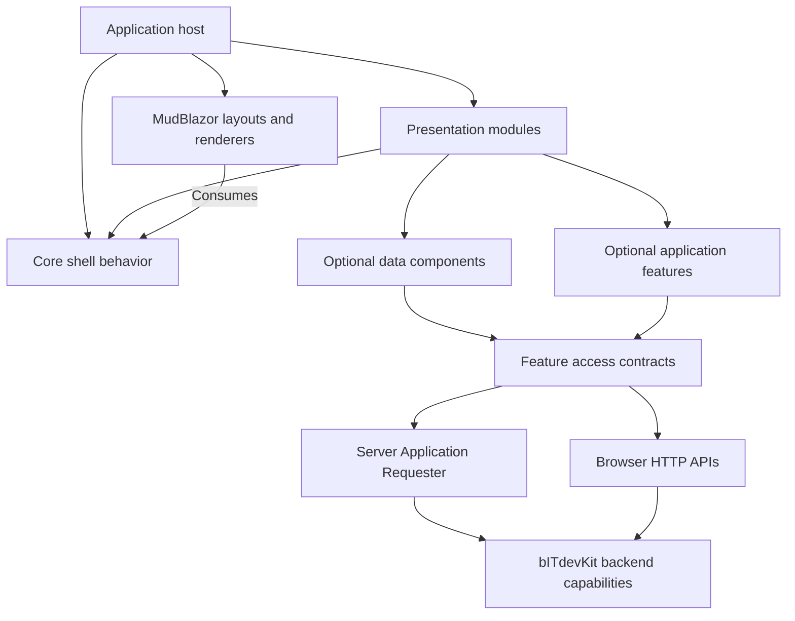

Presentation modules declare contributions; the shell composes and resolves them; default or custom renderers display the result. Higher-level modules build on these contracts. Runtime-specific feature adapters reach the same application use cases. Backend repositories and domain entities remain behind those use cases.

### Modular monolith across backend and frontend

Extend the module boundaries in [ADR-0003: Modular Monolith Architecture](../adr/0003-modular-monolith-architecture.md) into the frontend. A logical feature module owns its applicable backend use cases and presentation behavior. Its pages, components, local state and assets follow that ownership. Presentation extending an existing backend module retains its logical identity. A module can provide backend capabilities, presentation capabilities or both, without requiring a separate project for every layer or capability.

Application feature modules in ShopFiesta correspond across frontend and backend. Catalog owns product data and SKU definitions; Stock owns live availability and sellability for those same SKUs. Basket, Checkout and Marketing keep their identities, and customer/staff order views belong to Orders. Different assemblies, runtime adapters or audience-specific views do not create a second set of logical modules. The first backend implementations can be minimal or mocked while preserving those identities, contracts and dependency boundaries.

The host is the application composition root. It selects modules and shared integrations, validates their dependencies and composes their contributions through the shell. Modules can be developed, tested and packaged independently. The consuming application builds and releases its selected module versions and assets together. Separate Server and browser execution does not change those logical boundaries. Distributed module discovery, remote module loading and independent frontend deployment are outside the core model.

Cross-module frontend integration uses published destinations, typed extension points and public service or notification contracts where needed. A consuming module does not reach into another module's private components, state or implementation services. Shared workflows remain owned by feature or Application code. The shell supplies common composition and interaction behavior, and the host connects modules through their declared contracts. Ordinary Razor components, .NET DI and the existing registration conventions remain the implementation foundation.

### Reuse of existing bITdevKit capabilities

Use ordinary .NET DI and existing bITdevKit utilities where their semantics fit. Reuse supplies underlying mechanisms; presentation contracts continue to define attachment, live context, refresh and execution ownership. The source references below are pinned to a repository revision. Supported browser publishing, trimming and runtime behavior must be demonstrated by the hosting acceptance scenarios.

| Existing capability | Reuse direction | Required boundary |
| --- | --- | --- |
| ModuleBase and WebModuleBase | Reuse server identity, naming, enablement and registration conventions. | [Common.Modules](https://github.com/BridgingIT-GmbH/bITdevKit/blob/b41782cbd1a2ae220027544fe34f2deefc6c0946/src/Common.Modules/Common.Modules.csproj) references Microsoft.AspNetCore.App, and the base contracts expose server hosting types. Keep them server-side; portable presentation definitions preserve logical identity without importing server setup. |
| Common.Utilities.Composition | Use service registration, concrete decorators, adapters, composites and strategy selection where useful. | [Composition builders](https://github.com/BridgingIT-GmbH/bITdevKit/blob/b41782cbd1a2ae220027544fe34f2deefc6c0946/src/Common.Utilities/Composition/Composition.cs) do not supply shell contribution IDs, attachment/cardinality validation, deterministic contextual composition or live bindings. Focused presentation builders still own those semantics. |
| AppState | Refactor existing state, registration, manager and provider APIs as needed for the presentation framework. | [AppState](https://github.com/BridgingIT-GmbH/bITdevKit/blob/b41782cbd1a2ae220027544fe34f2deefc6c0946/src/Presentation.Web.Client/AppState/AppState.cs) reuse includes correcting lifetimes, state instance isolation and persistence behavior, plus selector subscriptions, renderer dispatch, disposal and stale-result checks. Component-local state remains valid. |
| Requester and Notifier | Optional typed frontend dispatch and explicit local invalidation/change notifications; reuse registration information for diagnostics where useful. | [Requester](https://github.com/BridgingIT-GmbH/bITdevKit/blob/b41782cbd1a2ae220027544fe34f2deefc6c0946/src/Common.Utilities/Requester/Requester.cs) and [Notifier](https://github.com/BridgingIT-GmbH/bITdevKit/blob/b41782cbd1a2ae220027544fe34f2deefc6c0946/src/Common.Utilities/Requester/Notifier.cs) keep their own contracts. Browser-safe handlers only; direct callbacks remain supported, and local mediation does not become durable or cross-runtime messaging. |
| Result, Result<T> and ResultPaged<T> | Reuse application outcomes and paged query responses, with presentation feedback adapters. | A confirmed business result remains distinct from transport uncertainty and later refresh failure. [Result operation scopes](https://github.com/BridgingIT-GmbH/bITdevKit/blob/b41782cbd1a2ae220027544fe34f2deefc6c0946/src/Common.Results/Result{T}OperationScope.cs) are not UI action/component scopes or transactions across APIs. |
| FilterModel and its typed builder | Reuse query contracts in optional grid/filter adapters. | [FilterModelBuilder](https://github.com/BridgingIT-GmbH/bITdevKit/blob/b41782cbd1a2ae220027544fe34f2deefc6c0946/src/Common.Abstractions/Filtering/FilterModelBuilder.cs) does not infer UI columns, supported backend fields/operators or authorization. Feature/API contracts define those mappings. |
| Debouncer | Coalesce declared read/evaluation triggers, such as filter changes and badge refresh. | [Debouncer](https://github.com/BridgingIT-GmbH/bITdevKit/blob/b41782cbd1a2ae220027544fe34f2deefc6c0946/src/Common.Utilities/Resiliancy/Debouncer.cs) is scoped/disposed with its consumer; observe failures, dispatch UI changes safely and retain context/version checks. It is not a mutation cancellation policy. |
| Retry, Retryer and TimeoutHandler | Reuse resilience mechanics for explicitly selected operations. | Policies are feature-defined. Do not retry unknown mutations automatically or interpret timeout as rollback. [TimeoutHandler](https://github.com/BridgingIT-GmbH/bITdevKit/blob/b41782cbd1a2ae220027544fe34f2deefc6c0946/src/Common.Utilities/Resiliancy/TimeoutHandler.cs) does not determine the business outcome. |
| Bulkhead | Optional concurrency limiting for deliberately grouped work. | [Bulkhead](https://github.com/BridgingIT-GmbH/bITdevKit/blob/b41782cbd1a2ae220027544fe34f2deefc6c0946/src/Common.Utilities/Resiliancy/Bulkhead.cs) waits for capacity; it is not duplicate-click suppression. A shared client/circuit gate must not accidentally serialize unrelated actions. |
| Startup-task contracts and behaviors | Reuse suitable task contracts and resilience conventions; retain existing host tasks for backend startup. | [StartupTasksService](https://github.com/BridgingIT-GmbH/bITdevKit/blob/b41782cbd1a2ae220027544fe34f2deefc6c0946/src/Application.Utilities/StartupTasks/StartupTasksService.cs) is a host-wide IHostedService. Per-user/circuit initialization, dependency ordering and shared-attempt ownership remain presentation responsibilities rather than assumed runner capabilities. |

### Constraints on utility reuse

Shell contribution replacement is resolved by stable contribution identity before applying underlying DI/service composition. The referenced Composition ReplaceExisting behavior removes registrations for a service type; it must not be used as if it replaced one identified navigation item or toolbar contribution. A provider composite supplies aggregation mechanics while the shell supplies ordering, applicability, local failure handling and diagnostic provenance.

Invocation capture must remain safe regardless of AppState enablement. In the referenced implementation, TakeSnapshot serializes/deserializes when enabled but returns the current object when disabled. Capture narrow independent inputs, such as selected ID arrays and relevant revisions, rather than assuming this method always isolates them. Generic JSON cloning is not the default for contribution graphs containing callbacks, services or components; use deliberate immutable models or copying on change.

Concrete typed decorators are the baseline where service wrapping is needed. The referenced [generic interception path](https://github.com/BridgingIT-GmbH/bITdevKit/blob/b41782cbd1a2ae220027544fe34f2deefc6c0946/src/Common.Utilities/Composition/Composition.Interception.cs) uses DispatchProxy and reflection; validate supported trimmed/WASM/AOT paths before relying on it. [Adapter factory](https://github.com/BridgingIT-GmbH/bITdevKit/blob/b41782cbd1a2ae220027544fe34f2deefc6c0946/src/Common.Utilities/Composition/Composition.Adapters.cs) lifetime and service-provider capture must preserve scoped resolution and DI disposal ownership. Helper reuse does not waive those requirements.

### Presentation behavior built on the utilities

| Presentation requirement | Existing foundation | Focused behavior still required |
| --- | --- | --- |
| Isolated resolved models | Typed models and ordinary immutable values. | Resolve without mutating definitions; copy mutable target/input values deliberately. |
| Temporary contribution cleanup | AppState events, normal DI and .NET disposal/cancellation primitives. | Owner-bound attachments/subscriptions, renderer dispatch and rejection of late completion. |
| Shared initialization attempts | Suitable startup-task contracts and resilience helpers. | One owner-local attempt/state per lifecycle generation, with explicit retry/reset semantics. |
| Explicit execution policies | Existing resilience/concurrency primitives where their semantics fit. | Per-binding invocation reservation, captured context and declared conflict behavior. |

The shell owns the contribution inventory/resolution and live action lifecycle defined by this specification. These are presentation-specific behavior, not an existing generic Composition registry or justification for another service locator, global scheduler or universal execution system. AppState/Notifier adapters and diagnostics consume the same ownership model. Pipelines remain available for genuinely multi-step feature workflows; ordinary UI actions do not require a pipeline definition.

## Typed extension points as a design foundation

Typed extension points are the framework's grounding model for integrating reusable functionality from shared packages. The shell or a presentation module deliberately publishes a place where other code can participate. A C# contract defines the inputs supplied to that code and the result or component contract it must provide. A registered implementation is a contribution.

An extension point describes a kind of participation, such as supplying navigation children. An attachment target identifies the particular owner accepting it, such as the Orders navigation item. Several targets can use the same kind of contract. Contributions can come from the framework, another presentation module or a customer application.

The model makes a familiar separation explicit: the point's owner defines what is accepted and how it is used; the contributor supplies compatible feature behavior; the application host controls the final composition. It extends ordinary providers, callbacks and component slots through consistent contracts and metadata.

### What typed means

Typed means that inputs and accepted outputs have explicit C# shapes. A navigation provider receives navigation-specific context and produces navigation descriptors; a page-toolbar contribution receives its declared page or selection context. Developers can discover these contracts and get compiler assistance when implementing or registering contributions.

Types establish compatibility, while stable identities establish which point/target a contribution attaches to and how it can be overridden or inspected. Composition validation checks target availability, duplicate identities, cardinality and conflicts that cannot be proven by the compiler.

An event contract describes information emitted to subscribers. An extension-point contract also describes the functionality or output accepted at a particular participation point and the rules for composing and using it. Existing AppState and Notifier events remain the mechanism for relevant runtime change signals.

### Example of an Orders contribution

| Part of the model | Orders example |
| --- | --- |
| Published extension point | The shell accepts typed navigation-children providers. |
| Published attachment target | The Orders presentation module exposes its Orders navigation item as a supported target. |
| Contribution | A customer package registers an orders-children provider against that target. |
| Runtime input | The provider receives the applicable parent/route, culture, declared state/context values and cancellation/paging information. Its API client is supplied through DI. |
| Typed output | The provider returns bounded child descriptors containing stable identities, labels and detail destinations. |
| Owner behavior | The shell composes the results, applies availability and ordering, resolves active paths, renders children and contains branch failures. |

At composition time, the host selects the provider and any supported overrides. At runtime, the provider evaluates the current context. A relevant state change can invalidate that evaluation and regenerate the children through the existing refresh rules. The registration itself remains the same.

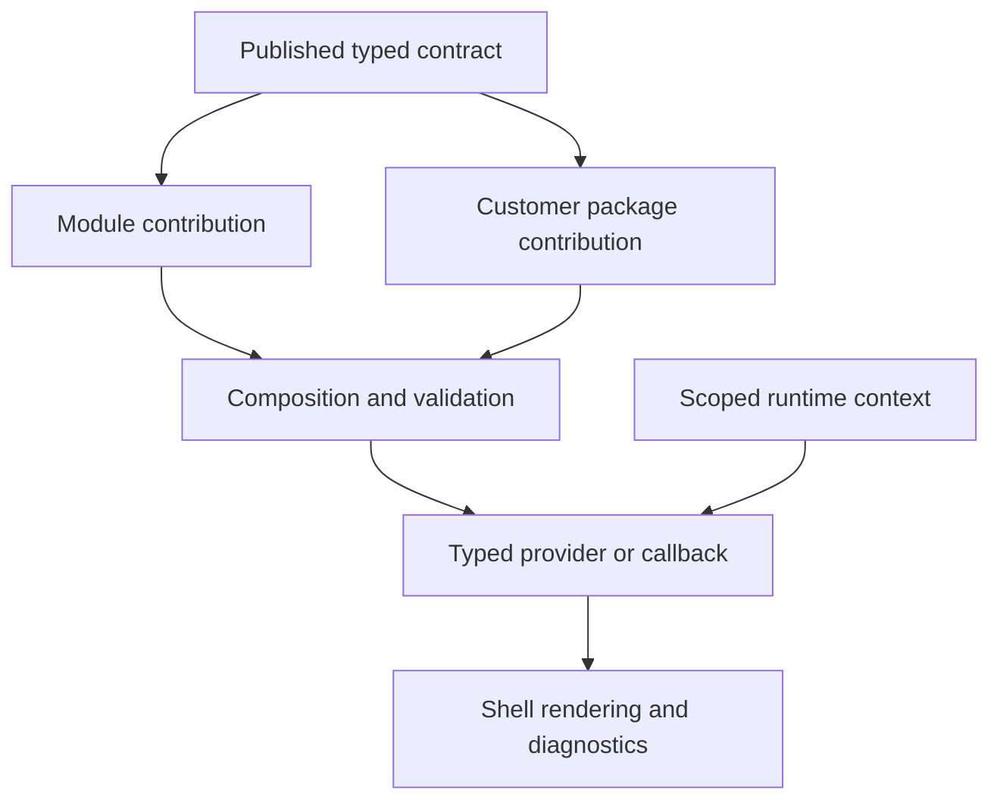

### Why the framework uses this model

A package can publish a supported contract and attachment target that multiple applications consume without copying shell layout source. The same contribution behavior can work with default or custom renderers, supporting the headless separation. Business behavior remains owned by feature code.

Separate typed contracts preserve the needs of navigation, actions, settings and diagnostic panels. Common composition metadata gives them consistent identity, attachment, ordering, override provenance and diagnostics. Focused registration builders and existing .NET DI provide the integration convenience; detailed rules are defined in Extension contracts and host authority.

## Reusable data components and CRUD scaffolding

The initial data offering ships optional FilterModel query and selection adapters. Typed field and operator mapping, paging, sorting, filtering and the selection context work independently of the grid renderer. A thin MudBlazor adapter translates grid columns and events. A handwritten Razor view can use the same query mapping, selection context and contextual actions. DoFiesta owns its Todo editor, validation and business operations.

The table describes the broader data-component design. Shared list, detail and editor components follow evidence of reuse across workflows.

| Capability | Target behavior |
| --- | --- |
| Data grids | Paging, sorting, selection, loading, empty and error states; custom cell templates and row actions. |
| FilterModel integration | Typed filter definitions, supported operator selection, query construction and integration with backend FilterModel APIs. |
| CRUD composition | Reusable list, detail and editing patterns with page, dialog or drawer presentation. |
| Forms and lookups | Validation, asynchronous lookups, custom field templates and explicit edit models. |
| Operations | Result feedback, field errors, cancellation, safe duplicate-submit prevention and explicit refresh behavior. |
| View state | Configurable filters, sorting, paging and column preferences, with URL and persistence rules. |
| Toolbar integration | Reuse core contextual actions/outlets; provide optional grid-selection and CRUD action adapters while feature code supplies business operations. |
| Customization | Replaceable sections and actions; custom commands such as Approve, Archive or Recalculate alongside conventional CRUD. |

Create, edit and delete are capabilities, not mandatory operations. A read-only grid or an archive-only workflow must be natural. Generic components must allow handwritten pages and custom MudBlazor controls to participate without requiring inheritance from a framework page class.

Backend filtering and authorization remain authoritative. Field and operator mappings must be explicit enough to prevent unsupported queries. Concurrency conflicts must preserve user input and provide a feature-owned recovery choice. A confirmed save remains successful if a subsequent refresh fails.

An editor captures the submitted values and edit revision before dispatch. Confirmed success establishes the saved baseline for that revision; it must not clear changes made after submission or overwrite them with a later response. A feature may disable editing during saving instead. Validation failures, conflicts and unknown mutation outcomes preserve the current edits and require feature-owned recovery.

Scaffolding means reusable composition patterns and starter code. It does not require metadata-driven runtime generation, direct repository access from the browser or a universal CRUD endpoint.

### Selection ownership and defaults

Selection policy belongs to the optional data adapters and the feature view using them. AppState can hold the state and supply notifications where useful; component-local state also works. The core shell consumes the view's typed action context and enforces binding, confirmation and execution rules. It does not manage grid paging or define which records a filter matches.

The initial selection adapter tracks explicitly selected stable record IDs. Its defaults apply to both grid and handwritten views:

| Change | Selection behavior |
| --- | --- |
| Paging | Retain selection across pages by default. A view can explicitly enable clearing selection on paging. |
| Filter or search criteria | Clear selection because the query represents a different working set. |
| Sorting | Preserve selected IDs. |
| Data refresh | Preserve selected IDs, update available record data and versions, and reevaluate action eligibility. Remove only confirmed deleted or inaccessible records. Absence from the loaded page does not establish either condition. |
| Relevant target change during confirmation | Invalidate the pending confirmation and require a fresh decision under the action invocation rules. |
| Change after dispatch | Keep the accepted execution's captured inputs. Selection changes do not retarget dispatched work. |
| Identity or workspace change | Invalidate old-context selection under the normal privacy and context-transition rules. |

When selected records can be outside the visible page, show the total selected count and a clear-selection control. Feature adapters supply the target data and versions needed by an action, with authorized reads where required. Selection alone does not establish current eligibility or grant access.

The first release selects explicit IDs across pages. Query-wide selection of records never loaded is deferred until a concrete feature defines backend consistency, authorization and batch-outcome semantics. An explicit Export all matching action can capture query intent independently of row selection.

## Optional application features

| Feature | Direction and scope |
| --- | --- |
| Notification center | A contributed shell control and destination combining notification sources, badges, lists, actions and deep links. |
| Inbox | An optional frontend/backend capability for durable recipient notifications and read state. Its detailed design is deferred to a separate specification. |
| Administration | Optional module/configuration inspection, preference management and adapters for existing backend capabilities. |
| Auditing and change history | Read-oriented views over existing backend features, subject to their permissions and availability. |
| Jobs administration | Monitoring first; backend actions appear only when the host explicitly enables supported operations. |
| Additional capabilities | Tenant switching, import/export and specialized data management can be supplied as optional modules. |
| Edit-session coordination | Deferred; any future optional coordinator requires its own design beyond the page-owned unsaved-change helper. |
| Search and command discovery | Deferred; the current specification does not require global search or a command-discovery UI. |
| General shortcut routing | Deferred; local shortcuts and toolbar keyboard accessibility remain supported without a global scope-routing facility. |

The inbox direction includes querying notifications, unread counts and explicit read operations, with InMemory and EF Core provider candidates. Recipient resolution, delivery, retention, deduplication, persistence details and API contracts remain for its own design. Local Notifier events do not become durable user notifications automatically.

Notification counts must represent their source's defined scope rather than only loaded rows. Source failures and failed read updates must remain distinguishable from navigation failures. Optional backend integrations must fail within their own region or feature.

Administration reuses the shell's composition and diagnostic models. It does not introduce a separate identity product, unrestricted secret/configuration editor or workflow designer.

## Hosting and render-mode interoperability

The framework supports Static SSR for static-compatible content, Interactive Server, Interactive WebAssembly and Interactive Auto within Blazor's legal boundaries, plus standalone WebAssembly hosting. Prerendering is disabled by default for the framework's interactive hosting profiles and is an explicit host opt-in. Static SSR is a distinct rendering choice, not prerendering awaiting activation. Mixed page/component arrangements are supported as defined below; Interactive Auto is not a synonym for per-component mode selection.

| Concern | Requirement |
| --- | --- |
| Portable composition | Shared presentation definitions can be registered in both server and browser runtimes. Backend registrations and secrets never flow into the browser. |
| Interactive boundaries | Follow Blazor's legal component boundaries and serializable parameter requirements. Delegates, RenderFragments and scoped services are not cross-runtime contracts. |
| Auto rendering | Auto selects Server or WebAssembly interactivity for a component lifetime. It is separate from host-selected per-page/component mixing, does not migrate running work and keeps prerendering off unless explicitly enabled. |
| State ownership | Give state, providers and mediation explicit logical owners within their actual runtime/circuit. Track interactive-root identity without assuming one DI scope per root or per component. |
| Coordination | Use an explicit serializable bridge or application service when separate runtimes need to coordinate preferences, context or invalidation. |
| Prerendering | Disabled by default for interactive profiles. Explicit opt-in follows the phase, service, state-transfer and activation rules below; browser-only services activate only when available. |
| Navigation | Direct URLs reconstruct destinations even when navigation crosses runtime or full-page boundaries. |

A visually shared shell does not imply shared DI services or in-memory state. Provider placement and context propagation follow the supported hosting matrix. Acceptance covers each supported arrangement, prerendering, cold/warm Auto visits, identity/context changes and diagnostics attribution. Cross-runtime changes affect only explicitly coordinated consumers; old-context results must still be rejected in every participating area.

Browser publishing and trimming behavior must be validated for reused Common features and frontend handler discovery. Compatibility must be demonstrated rather than inferred from a shared namespace.

### Supported hosting arrangements

The support boundary follows Blazor's legal component hierarchy and parameter rules. Tightly coupled actions and their presenters normally share one compatible interactive composition; independent Server and WASM areas can coexist in the same application and page.

| Arrangement | Support | Required boundary |
| --- | --- | --- |
| Standalone WebAssembly | Supported. | Shell, pages and frontend services execute in the browser. |
| Interactive Server application | Supported; prerendering off by default. | Event handling uses the originating server circuit and logical owners. A server-generated interactive UI does not require a preceding prerender phase. |
| Blazor Web App using Interactive WebAssembly | Supported; prerendering off by default. | UI runs in the browser; initial runtime/assets must load. Explicit prerendering opt-in also requires suitable server dependencies. |
| Interactive Auto | Supported; prerendering off by default. | Server interactivity is used initially and WebAssembly can be selected on later activations when available. Portable definitions/services support either runtime; active instances, bindings and work do not migrate. |
| Different modes on different pages | Supported independently of Auto. | The host chooses legal route/root arrangements; each destination reconstructs its context, using full-page navigation where needed. |
| Server and WASM areas on the same page | Supported as independent interactive areas. | Each area owns its state and direct interactions. Shared context/invalidation requires explicit coordination. |
| Separate roots sharing a compatible runtime/circuit | Supported through a documented in-process coordination arrangement. | Explicit scope association, owner lifetime and renderer-safe dispatch; no automatic cascading context between roots or assumption of one DI scope per root. |
| Server presenter directly invoking a WASM component, or the reverse | Generic cross-runtime action transport is deferred. | Keep the presenter with its owner or supply an explicit application integration; no implicit remote component invocation. |
| Static public pages and chrome | Supported for static-compatible content and ordinary links. | Use SSR-compatible Razor/HTML and styling; the full interactive MudBlazor shell is not guaranteed in static-only mode. Dynamic interactions require explicit interactive areas; no live action subscriptions exist in static output. |

The ordinary application pattern places shell interaction, contextual toolbar and feature content within one compatible interactive composition. Mixed applications use an outer host composition containing independent interactive areas; each area contains the presenters and owners requiring direct interaction. A WASM Orders area can therefore contain a page header, external Approve toolbar and Orders component while a Server navigation/reporting area coexists beside it.

Visual placement outside a component does not imply crossing its runtime boundary. Framework layouts and examples must not pass callbacks or RenderFragments through static-to-interactive serialization boundaries or nest incompatible interactive modes. Unsupported arrangements receive actionable configuration/activation diagnostics rather than silently losing actions or binding to another instance.

Generic cross-runtime business-action transport is deferred without deferring mixed-mode hosting, diagnostics attachment or explicitly configured context/invalidation coordination. Application-provided action integrations must preserve original binding/target identity, eligibility, confirmation, cancellation and stale-result rules. No UI/runtime bridge bypasses backend authorization.

### Recommended business application profile

The recommended starting profile for connected bITdevKit business applications is Interactive Server with prerendering explicitly disabled. It integrates naturally with existing server presentation modules and server-side services, avoids downloading a WebAssembly runtime before first interaction and reduces the extra activation and state-handoff concerns of prerendering. This is a starter/host recommendation; reusable presentation contracts and components retain the supported hosting portability.

This profile assumes reliable connectivity and acceptable server round-trip latency. Capacity planning includes per-circuit resources, connection handling and reconnect behavior. A lost circuit does not establish whether an already dispatched business operation succeeded; the normal unknown-outcome and recovery rules still apply. [Blazor hosting characteristics](https://learn.microsoft.com/en-us/aspnet/core/blazor/hosting-models?view=aspnetcore-10.0)

Choose WebAssembly when browser-side execution, deployment requirements or interaction characteristics justify its startup and API-integration costs. Choose Auto deliberately when the same feature and its dependencies have been validated in both runtimes; Auto adds runtime coverage rather than removing that work. Static SSR remains appropriate for static-compatible public content. Prerendering is an independent opt-in decision for a legal boundary, not a consequence of selecting Server or Auto. [Blazor render modes](https://learn.microsoft.com/en-us/aspnet/core/blazor/components/render-modes?view=aspnetcore-10.0)

### Reference application access paths

DoFiesta uses different application access paths for Server and browser execution. Shared portable components consume narrow feature-owned service contracts. Hosts register the appropriate implementation in each executing runtime. Existing suitable service contracts can be reused; the shell does not require a universal application-service wrapper.

| Executing runtime | Reference path |
| --- | --- |
| Interactive Server | Dispatch commands and queries in-process through Application Requester. The reference workflow does not call its own HTTP API. |
| Interactive WebAssembly or standalone WASM | Use typed HTTP clients. Server endpoints dispatch to the same application commands and queries. Backend handlers and their dependencies remain outside the browser assembly graph. |
| Interactive Auto | Use the Server implementation while executing on Server and the HTTP implementation while executing in the browser. Select the implementation through runtime registration; active instances and work do not migrate. |
| Explicit prerendering | Resolve suitable server-side feature services for approved read-only initialization. Apply the prerender request's identity and lifetime rules, then reconstruct live services and bindings on activation. |

The Server adapter obtains the current user and application context from the originating circuit. Application handlers or their behaviors enforce validation and permissions for both entry paths, including checks otherwise performed only by HTTP endpoint filters. Backend authorization remains authoritative. A direct Requester call must not bypass required policy or entity checks.

Resolve operation dependencies with lifetimes appropriate to each use case. A long-lived circuit or UI binding must not retain an operation-owned DbContext or repository beyond that operation. The presentation adapter handles access and mapping; application use cases continue to own business orchestration. Feature results, field errors, conflicts and unknown outcomes map to the same presentation feedback contract in both paths.

### Prerendering policy and activation

Framework interactive hosting profiles explicitly disable prerendering by default, including Server, WebAssembly and Auto. This reduces duplicated initialization, browser-service and state-handoff complexity for ordinary business applications. Hosts can opt in for a particular legal interactive boundary where initial server-produced content is useful. Choosing Static SSR does not enable prerendering for unrelated interactive areas.

The host configures this at the effective top-level interactive boundaries, including applicable routing and head outlets. A child contribution cannot override an ancestor's effective render/prerender policy. Reusable components should normally remain mode-agnostic and declare required capabilities rather than force an incompatible mode. An incompatible arrangement is diagnosed early where possible. [Blazor prerender configuration](https://learn.microsoft.com/en-us/aspnet/core/blazor/components/prerender?view=aspnetcore-10.0)

| Phase or capability | Required behavior |
| --- | --- |
| Prerender request | Produce static markup and approved read-only presentation data. Do not execute UI business actions, start user jobs or establish a continuing live interaction scope. Any request-local subscriptions/resources are disposed with that request owner. |
| Interactive activation | Create new live component scopes, bindings, subscriptions and cancellation ownership. Restore declared data where applicable, revalidate context/eligibility and activate browser-dependent capabilities when ready. |
| Frontend services | A prerendered component has suitable server-resolvable dependencies as well as the services required by its interactive runtime. Browser-only implementations are deferred or replaced by a suitable rendering abstraction; checking interactivity inside a method cannot repair failed construction/injection. |
| Browser preferences and JS | Browser storage, DOM-dependent work and browser measurements wait for supported interactive lifecycle hooks. Use server-known safe values/defaults before that point; defer browser preferences without performing browser interop during prerendering. |
| Toolbar and navigation previews | Render static descriptors, inert/disabled action previews or stable placeholders where available. Rebuild live invocation bindings on activation; child registrations made only after interactive rendering cannot be assumed present in the initial HTML. |
| MudBlazor providers | Dialog, popover, snackbar and theme/provider placement follows the compatible interactive composition using them. A static outer layout alone does not provide the live context needed by a separate interactive area. |
| Diagnostics | Attribute request/prerender, Server, WASM and browser measurements separately. Browser agents receive an explicit not-ready/unavailable state until the relevant bridge/runtime is available; opening the drawer is not required. |

Interactivity detection uses Blazor's supported renderer information, such as RendererInfo.IsInteractive. Running on the server alone does not distinguish prerendering from Interactive Server. OnAfterRender/OnAfterRenderAsync are interactive lifecycle hooks and do not run during prerendering. Shared-attempt initialization remains scoped to its actual owner/generation; it does not bridge prerender and interactive instances.

State handoff uses standard Blazor PersistentComponentState or applicable PersistentState support rather than a new shell persistence engine. Transfer only explicitly declared data appropriate to the receiving runtime and user, with keys distinguishing destination/view, component instance, identity/workspace and relevant schema/context. Orders A and B must not restore each other's data. Restored values follow freshness and context-validation rules; browser/Auto transfer must not contain credentials, server-only objects or unapproved private data. Do not transfer callbacks, component instances, live binding/execution identities, subscriptions or cancellation sources. These are reconstructed. Prerender handoff is distinct from long-term AppState preference/draft persistence. [Blazor prerendered state persistence](https://learn.microsoft.com/en-us/aspnet/core/blazor/state-management/prerendered-state-persistence?view=aspnetcore-10.0)

Optional badge queries, dynamic navigation and diagnostics must not hold up all initial content. Bound prerender work and use placeholders, deferred evaluation or explicitly configured streaming where appropriate. Test full document loads/reloads separately from already-interactive route navigation; a successful interactive navigation does not prove a component can prerender.

MudBlazor static-only rendering is outside the default interactive renderer guarantee. Static content uses compatible Razor/HTML with theme-aligned styling; an application can host interactive MudBlazor areas beside it. Global-interactivity examples place MudBlazor providers within that shared composition; per-page/area examples place them within the applicable interactive area. Initial prerendering of an interactive arrangement is distinct from a permanently static application. [MudBlazor provider placement](https://github.com/MudBlazor/MudBlazor/blob/dev/src/MudBlazor.Docs/Pages/Getting%20Started/Installation/Installation.razor)

### Render mode selection and optional offline behavior

Interactive Auto selects an interactive runtime; per-page/per-component rendering is the host's placement of modes at legal boundaries. Different sibling areas may use different modes; an interactive child cannot switch to an incompatible mode beneath its parent. A static outer composition can contain interactive areas, but ordinary callbacks, RenderFragments and in-memory state are not transports across serialization/runtime boundaries. Generic cross-runtime action transport remains deferred.

WebAssembly hosting does not make the application offline-capable automatically. Optional PWA/service-worker packaging, offline data, synchronization and operation recovery require their own application/feature contracts. Standalone WebAssembly is a suitable direction for an offline-oriented host; supporting Interactive WebAssembly or Auto alone does not promise offline navigation or business operations. No mandatory service worker, offline queue or synchronization engine is introduced by the core shell. [Blazor PWA guidance](https://learn.microsoft.com/en-us/aspnet/core/blazor/progressive-web-app/?view=aspnetcore-10.0)

## Presentation module composition

On the server, existing bITdevKit modules already located in the Presentation project should gain presentation capabilities through the existing module system. An optional IPresentationModule capability adds UI registrations and contributions while preserving module identity, configuration, ordering and enablement.

A reusable presentation base derives the logical module name from the type name using the same convention as backend modules. Local modules can use this default. Before a module publishes a cross-package attachment, a supported configuration reference or a persisted namespace, explicitly pin its logical name to the value consumers will use. Use the existing name override for this purpose and preserve the backend module identity when extending an existing module.

For WebAssembly, portable presentation definitions belong in browser-compatible assemblies or Razor class libraries. The browser registers frontend services and contributions without executing server Register, Use or Map behavior. Server and browser adapters reuse the same presentation definitions where appropriate.

Presentation definitions and browser-safe registration logic are authored once and reused by host adapters. Each executing DI container is configured once through the appropriate adapter; reuse does not imply a shared server/browser service instance. Prerendering resolves suitable server services or is explicitly disabled for that area. Existing server module behavior remains server-only.

Composition is selected and validated at startup. Enabling a module exposes its configured contributions. The host can replace, suppress or reorder them before composition is finalized. This requirement does not imply runtime DI unregistration or assembly unloading. Configuration changes do not imply automatic reconfiguration of already-running browsers or circuits.

Modules can contribute page/component assemblies, frontend services and API clients, navigation, typed state, resources/assets, named-region components, initialization tasks, handwritten settings sections and contextual toolbar actions. The host controls placement; modules own business meaning, behavior and feature-specific persistence.

Validation must identify duplicate contribution identities, route conflicts, missing required dependencies, dependency cycles and contributions targeting unavailable required regions. Typed extension points additionally validate attachment compatibility, required/optional participation, cardinality and unresolved competing replacements as defined in Extension contracts and host authority. Optional dependencies and attachments follow their documented fallbacks. Diagnostics identify the source module, point, target and effective composition.

A pinned name identifies the same logical module across the server and browser compositions. Qualified public extension and contribution IDs retain their published values. For example, a module initially named orders can rename its CLR type and keep the pinned orders name and its exported attachment IDs. Startup validation reports duplicate module identities and conflicting declarations where both are visible. Changing a published identity follows the compatibility and migration policy.

### Page ownership and route availability

A module can declare default ownership of its registered page assembly. Explicit page-type mappings override that default where multiple modules share an assembly. Composition resolves one effective owner for each framework-managed destination and reports ambiguous or missing ownership. A host-owned page can explicitly belong to the host composition. Ordinary pages in an unambiguous module assembly need no repeated module annotation.

Blazor `@page` declarations remain the source of URLs. Ownership metadata associates the page type and its routes with the stable module identity. The owning module supplies declared capability and availability defaults; page requirements and host destination overrides contribute to the effective requirements. Navigation visibility is evaluated separately. Namespace or URL naming alone does not establish ownership.

Host adapters use that resolved metadata for both initial server endpoint processing and interactive route activation. Configure Blazor's server and interactive page-assembly discovery from the effective composition. A disabled module's pages remain unavailable even when another enabled module requires the same assembly. Gate activation before constructing the feature page or running its protected reads and initialization.

Initial server requests use applicable ASP.NET Core endpoint authorization and availability handling. Interactive navigation uses the corresponding Blazor route integration. Both paths provide the declared denied or unavailable behavior and safe return destination. A client route view alone cannot supply server-request enforcement. These adapters extend normal Blazor routing and do not introduce a replacement router.

## Destinations, availability and deep links

Pages and destinations must work through direct URLs by default: opening a bookmark, refreshing a detail page, using browser back/forward and following a link from another module must reconstruct the correct page, module context and route-backed tabs without a previous menu click.

The URL is authoritative for destination identity, selected record and route-backed subsection. Navigation models reflect the destination; clicking a menu item must not be required to initialize it. Transient UI details and unsaved drafts remain outside the URL unless explicitly designed otherwise.

Availability has separate inputs:

- Composition availability: whether the module, dependency or capability exists.

- Policy availability: whether the current user is permitted to enter or act.

- Host customization: whether a contribution or destination is explicitly suppressed.

- Runtime presentation state: whether a particular item is hidden, disabled or decorated.

Hiding a navigation item alone must not disable its route. Conversely, a callback must not make an unavailable or unauthorized destination usable. A denied or unavailable direct link receives a consistent, customizable page with a safe recovery path. Authentication redirects preserve the intended authorized destination.

Cross-module links use stable destination contracts and normal Blazor routing. The shell must not create a competing router. Local component tabs may remain local; tabs representing a navigable page subsection require a deep-link strategy.

### Destination contracts and link generation

Modules publish stable destination identities and `@page` route patterns. Small typed destination helpers supply the required route parameters and supported query values for cross-module links. Generated links use correct URI encoding and respect the application's configured base path. Ordinary local links remain valid and need no extra registration merely to participate in the shell.

The first release preserves the module's published route patterns. Arbitrary host remapping of module pages to different URL patterns is deferred until a concrete application requirement justifies it. Destination helpers describe and generate links to the existing Blazor routes rather than maintaining a second routing engine.

Destination dependencies use the existing module and contribution composition metadata. A missing required module or destination fails startup validation with its source and target identified. Links to absent optional modules are hidden by default. A feature can explicitly show a disabled link with an availability reason instead. Runtime policy and capability checks remain authoritative after composition. Direct visits receive the established denied or unavailable behavior, independently of whether a link was rendered.

### Host-supplied feature availability

Feature availability uses the host's module composition, configuration and existing application services through the same availability model. Keep module installation, feature enablement, required backend capability and user permission as distinct inputs. An installed module does not establish that every feature is enabled or that the current user may invoke it.

Known module and configuration values resolve directly. An asynchronous check is needed only when a declared input requires it. The shell does not require a separate capability-discovery service, standardized discovery endpoint, distributed registry or feature-management engine. Server execution can resolve the relevant application services directly. Browser execution can consume a safe projection from the same application's backend where a feature requires it. That projection supplies declared availability information rather than secrets or arbitrary server configuration.

| Required availability | Default behavior |
| --- | --- |
| Established and available | Allow the dependent route or action when its other readiness and authorization requirements also pass. |
| Unknown or a required check cannot complete | Keep affected actions pending or unavailable with a reason and bounded retry. Dependent activation waits for its declared requirements. Unrelated features remain usable. |
| Established and unavailable | Apply the destination or contribution's declared hidden, disabled or unavailable presentation. An absent optional module follows the link defaults above. |

Scope results to the applicable host and runtime, backend, identity and workspace context. Reject results from obsolete context revisions, and invalidate affected consumers through the existing state and refresh rules. A previous enabled answer must not silently permit dispatch while its required availability is unknown. Backend services still enforce authorization and business rules independently.

## Headless behavior and opinionated defaults

The shell separates composition, navigation resolution, availability, state and diagnostics from the components that render them. An application can replace a sidebar, header, page frame or feedback renderer while retaining the same behavior and contribution contracts.

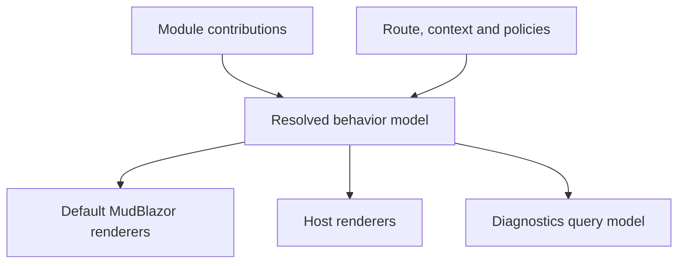

This headless separation is a customization seam within a Blazor framework. It does not require framework-independent UI code, a new library of unstyled controls or a mandatory controller for every component. Backend business logic remains independent of UI and routing.

The browser-safe shell contracts and behavior have no direct or transitive dependency on MudBlazor. Applications reference the default MudBlazor layouts, navigation, toolbars, dialogs and page patterns separately. Their live provider and interaction behavior requires the compatible interactive composition described in Hosting and render-mode interoperability. Static-only content uses SSR-compatible rendering.

## Shell layouts and application chrome

The default Backoffice layout provides a header, sidebar, content region and footer. A Website layout provides a header and footer with content-oriented navigation. Both must coexist with custom layouts in the same host using ordinary Blazor layout mechanisms.

Layouts expose documented regions for branding, account controls, header actions, navigation, footer content and page content. Hosts can contribute additional named regions. Contributions can use templates or components within legal rendering boundaries.

Page composition supports optional titles, breadcrumbs, actions, sections, loading states, empty states and error panels. A page can opt into these patterns or provide a completely custom body. A page frame or shell region can render contextual actions outside the component that supplies their behavior, using the scoped binding model in Contextual toolbars and action scopes.

Responsive behavior must preserve usable navigation, actions and focus order. Default renderers must support keyboard operation, meaningful focus after navigation, accessible labels and error announcements. Custom renderers inherit documented accessibility responsibilities.

## Conceptual layout wireframes

These image wireframes illustrate Backoffice, Website and Developer Tools compositions. They establish region arrangements and customization requirements rather than final visual design. Labels, counts and sample data are illustrative. Architecture diagrams describe behavior and relationships; the images show screen layouts.

### Backoffice: multiple navigation levels

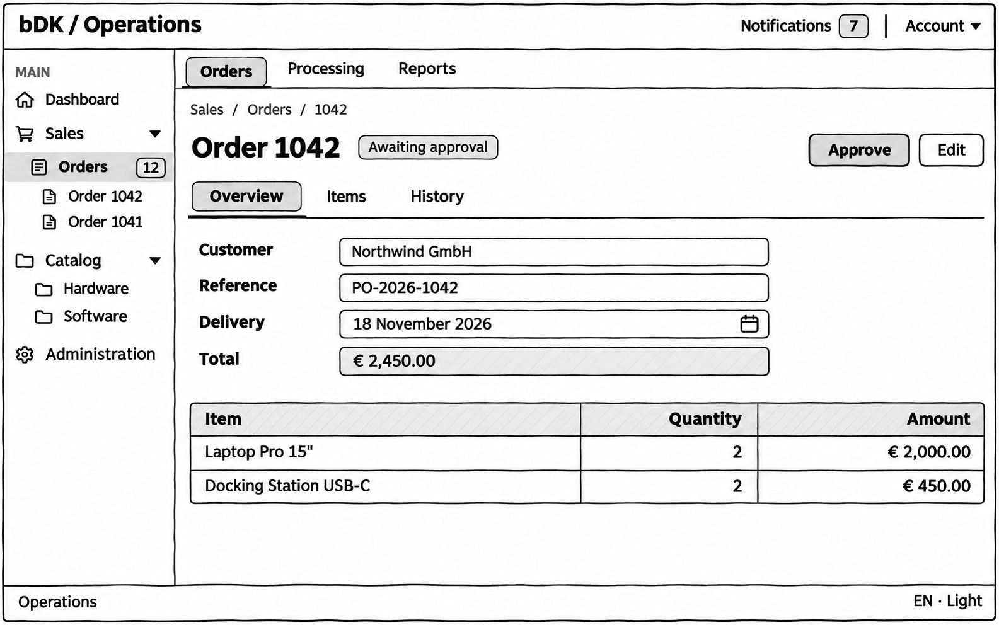

The logical navigation hierarchy supplies sidebar, header and page-tab outlets. Order tabs have stable deep links; badges are runtime contributions.

### Website: public content with optional identity


A different layout uses the same composition infrastructure. Authentication is unnecessary for this public configuration.

### Developer tools: attached to the active page


The drawer inspects the current session. An attached popout or agent queries that same diagnostic model; opening another circuit with unrelated state is insufficient. On narrow screens, the diagnostic region can overlay or reflow according to the chosen layout.

## Extension contracts and host authority

The framework uses separate typed contracts backed by common composition metadata. Each public extension point defines the context supplied to contributors, the accepted output or component contract, the attachment scope and the rules for composition and lifecycle.

These contracts strengthen the existing hooks, providers, component slots and presentation modules. Ordinary customization uses configuration, typed callbacks/templates, contribution providers and replaceable services through this same model.

| Extension mechanism | Intended use |
| --- | --- |
| Configuration | Select defaults, ordering, placement, capabilities and shared behavior. |
| Component slots and templates | Contribute or replace visible content without copying the entire shell. |
| Runtime callbacks | Evaluate simple context-dependent state or execute an action. |
| Contribution providers | Supply reusable or asynchronous collections and evaluation logic. |
| Replaceable services | Change behavior behind a documented contract. |
| Host overrides | Replace, remove or reorder module contributions with final authority. |

Modules must not require hosts to edit shell layout source for ordinary integration. Stable contribution identities support targeted host overrides. Types establish compatibility; identities establish attachment, override and diagnostic references. Composition validates facts that the compiler cannot establish, including whether an installed target exists.

Simple runtime behavior can use typed callbacks or Razor templates without an extra provider class. Reusable contributions can use provider interfaces. Focused registration builders make both paths convenient, attach common metadata and participate in the existing module-composition validation.

### Published typed contracts

Each public extension point documents its input context, accepted result/component contract, target scope, cardinality, ordering, supported customization operations, refresh dependencies and failure behavior. Descriptor-producing providers and UI-rendering components may use different contracts.

| Extension point | Focused context | Accepted contribution |
| --- | --- | --- |
| Navigation children | Parent/ancestors, relevant route and declared state/context inputs, culture, trigger, paging and cancellation. | Bounded navigation descriptor results. |
| Header actions | Applicable application/page context and declared capabilities. | Action descriptors or typed component contributions. |
| Contextual actions | Typed page, component, entity or selection context in a specific runtime scope. | Action descriptors with scoped, awaitable invocation bindings. |
| Toolbar controls | The declared typed toolbar scope and its relevant state. | Typed templates/components for search, filters, view selectors or custom controls. |
| Settings sections | Declared settings scope and relevant preference contracts. | Section descriptors or typed components. |
| Diagnostic panels | Supported diagnostic read model and inspection context. | Diagnostic panel components/templates. |

The shell and presentation modules can publish additional typed points through shared contract assemblies or Razor class libraries. Feature-owned points remain defined by their owning module; a customer package can contribute to an Orders toolbar or navigation parent by referencing its public contracts. Framework core must not require changes for every new feature-specific point.

### Public core extension points and defaults

The headless shell publishes browser-compatible contracts for the generic integration points below. The separately referenced default MudBlazor renderer consumes these contracts. Business-specific toolbar actions, grid adapters, administration screens and notification persistence are optional feature contributions.

| Public point | Default cardinality per target | Default composition behavior |
| --- | --- | --- |
| Navigation menu items and children providers | Zero or many contributions. | Compose static/dynamic contributions in deterministic order; each provider can return a bounded set of items. |
| Application header actions | Zero or many contributions. | Application-level actions coexist; page/component actions appear here only through explicit scope/outlet placement. |
| Page and component contextual actions | Zero or many contributions per live scope. | Compose actions for the explicitly selected scope; page and component contracts retain their typed contexts. |
| Toolbar controls/templates | Zero or many contributions per toolbar target. | Compose declared groups/order with actions; custom controls use the target's typed context. |
| Named content regions | Zero or many by default. | Region owners may declare a stricter cardinality; required content is validated during composition. |
| Branding region | Zero or one effective content contribution. | Optional framework default; a host can replace or disable it. Multiple competing effective contents are invalid. |
| Navigation and toolbar renderer selection | One effective renderer for each used outlet. | The selected renderer package can supply defaults. A host can choose an explicit compatible replacement. Each used outlet requires one effective renderer. |
| Settings sections | Zero or many contributions. | Core provides the section contract; modules own settings meaning/persistence and optional administration adapters. |
| Diagnostic panels/tabs | Zero or many contributions alongside framework panels. | Panels use supported diagnostic contracts and share normal ordering/override rules. |

These cardinalities apply to composed contributions or renderer selections. They do not require a minimum number of visible runtime actions, generated navigation children or controls.

The baseline supports adding to multi-contribution points, configuring exposed options, replacing an identified contribution and disabling optional contributions. Decoration is supported only where the point publishes a compatible typed decoration contract. Required-point constraints remain valid after customization.

Host order overrides take precedence over declared defaults. Across contribution registrations, default numeric order is zero; equal orders use ordinal comparison of stable, qualified contribution identities. Within a provider's output, declared item/group order or the returned sequence determines presentation as documented by that point. Incidental DI registration enumeration must not choose the order or replacement winner.

Registered contribution identities must be unique in their declared scope. Runtime actions and dynamic children also require stable keys within their source contribution and live scope; duplicate runtime keys produce a local diagnostic/failure rather than silently selecting one result.

Routing/page discovery continues through Blazor and presentation-module integration. Ordinary services, API clients and localization use existing .NET DI/localization contracts. They do not require parallel generic extension registries.

Published contracts must be portable across their supported server/browser runtimes and have documented compatibility guarantees. Breaking changes to context/output semantics, public attachment identities or required component parameters follow the compatibility policy. Application-, module- and component-owned localization resources retain their existing ownership.

Contexts are narrow contracts for the particular operation. Feature clients and other dependencies normally use constructor injection. Arbitrary object dictionaries and a universal context exposing every service/state store are not the public integration model.

Typed Razor templates can provide context-safe local slots. Registered component contributions require a documented typed adapter or parameter-contract validation; accepting a component type alone does not establish that it accepts the intended context. RenderFragments, callbacks and component instances remain within legal rendering boundaries.

### Common composition metadata

Shared registration metadata feeds the shell's composition validation and diagnostic inventory. It describes contributions while their typed contracts retain operation-specific execution and rendering semantics. This shell-specific inventory is built on ordinary DI and applicable composition utilities; Common.Utilities.Composition is not assumed to provide a pre-existing shell extension registry.

| Metadata | Purpose |
| --- | --- |
| Extension-point identity and owner | Identifies the published participation contract and its owning shell capability or presentation module. |
| Contribution identity and source | Gives the contribution a stable reference and records its source presentation module. |
| Attachment target | Identifies the particular parent, region, page or scope accepting the contribution. |
| Contract and cardinality | Describes compatible input/output or component contracts and whether the point accepts zero/one/many contributions. |
| Ordering and customization | Records declared order, supported host configuration and explicit decoration/replacement/disable decisions. |
| Action references | Definitions and placements have stable composition references; live scope/binding/execution IDs are recorded in scoped runtime diagnostics, without storing user state in shared registration metadata. |
| Declared runtime dependencies | Describes refresh dependencies and lifecycle policy without retaining current user-specific values or subscriptions in shared metadata. |

Registration builders infer module ownership and ordinary identity defaults where possible. The owner exports typed handles for cross-module extension points and attachment targets with stable IDs under its published module identity. The handle expresses compatibility in C# and supplies its stable ID for configuration and diagnostics. Startup validation checks whether the target is installed and compatible. Local page and component hooks can use ordinary Razor and callbacks.

### Predictable attachment and customization

Composition validates attachment targets, contract compatibility, required/optional participation and point cardinality after host composition overrides are applied. Missing required targets or required contributions are configuration errors. Optional attachments use their documented fallback and remain visible in diagnostics. Invalid registrations must identify the source contribution, target and violated contract.

Cardinality counts composed contributions, such as children providers, rather than the number of runtime items returned by a provider. A valid provider may return an empty collection. Runtime visibility changes do not redefine composition cardinality.

| Operation | Meaning |
| --- | --- |
| Add | Register an additional contribution where the point permits it. |
| Configure | Change options explicitly exposed by the contribution or point. |
| Decorate | Wrap or augment an existing contribution through a supported typed decoration contract. |
| Replace | Explicitly substitute an identified contribution with a compatible implementation. |
| Disable | Exclude an installed contribution from the effective application composition. |

Each point documents which operations it supports. Multiple additions follow its deterministic ordering rules, including a stable tie-break. Host ordering overrides have final authority. Decoration order is explicit. Competing replacements require explicit host resolution; incidental registration order must not silently select a winner.

Replacement and decoration preserve the point's compatibility requirements, authorization/availability rules and lifecycle expectations. Diagnostics retain both the effective implementation and its source/override provenance.

### Composition and contextual execution

Application composition selects implementations and installed contributions. Per-user evaluation, action execution and component rendering use their appropriate runtime/circuit/root scopes. Shared registration metadata and factories must not capture user-specific state, components or scoped services.

Contextual evaluation produces an isolated resolved model for the applicable owner/context. Filtering, localization, visibility, enabled state, badges and child composition must not mutate shared contribution definitions, registration metadata or provider-owned reusable descriptors. Immutable models or copying on change can satisfy this rule; immutable values may be shared without cloning an entire hierarchy. Changes to feature state still go through its owning contract.

Existing .NET DI interfaces, service registrations and container lifetimes provide dependency resolution and disposal ownership. Registration builders use these mechanisms. The framework does not require another service locator, a universal execution registry or a separate blueprint engine. Additional reusable factories are justified by concrete repeated patterns.

AppState subscriptions, typed Notifier signals and the existing targeted invalidation rules drive contextual updates. A composition-level disable/replace decision is distinct from runtime visibility, enabled state, badges or generated children. Providers and rendering components retain their existing, distinct failure boundaries and recovery behavior.

Temporary runtime contributions to headers, content regions and other outlets follow the same ownership rules as action bindings. Owner disposal releases their attachments and subscriptions, and late notifications/results must not render into a removed owner. Repeated mounting must not accumulate duplicate controls or observers. This cleanup concerns runtime bindings and owned resources, not DI unregistration or removal of installed module definitions. Detaching a presenter does not cancel work with an independent declared execution owner.

## Contextual toolbars and action scopes

A contextual toolbar renders actions and controls for what a page or component is currently displaying or editing. The framework supplies core action/scope contracts, runtime binding, typed providers/callbacks and a reusable default MudBlazor toolbar renderer. Hosts can place that toolbar in a page header, shell region, component, dialog or drawer.

Contextual toolbar contracts and binding behavior belong to the headless shell. The separately referenced MudBlazor renderer supplies the default toolbar component. Optional data adapters expose grid selection through the same contracts. Features own the business behavior behind actions such as Approve, Edit, Save and Archive.

### Action definition, placement, binding and execution

UI actions define behavior independently of the control presenting it. Toolbar buttons and context-menu entries can invoke the same live action binding through the same applicability, confirmation and execution path. UI handlers can call existing APIs or Requester; they are not a second backend CQRS model.

| Concept | Owns | Lifetime boundary |
| --- | --- | --- |
| Definition | Stable semantic action identity, typed context contract, default resource-based label/icon and default invocation/confirmation policy. | Reusable package contract/metadata; no selected records, component instances or per-user busy state in shared registration metadata. |
| Placement | Target toolbar, menu or control, group and order, and permitted presentation overrides. | A composition declaration references the action definition and published attachment target. At runtime the outlet resolves the binding for the explicitly selected scope. A scope-owned local placement can reference that live binding directly. |
| Binding | Definition connected to a particular live scope and typed context, handler/services, relevant context revision and execution state. | Runtime owner; scoped clients and component callbacks may be referenced only while that owner remains valid. |
| Execution | One accepted invocation, its identity, captured targets, completion/outcome and cancellation/progress state. | Owned by the binding's declared execution owner, with bounded diagnostic retention. |

Definition identity, placement/contribution identity, live scope identity, binding identity and execution identity are distinct diagnostic references. Binding identity includes its live owner and instance key, so two Orders components can use the same definition independently.

A toolbar and menu intentionally sharing one binding also share pending/busy state and feedback ownership. Two distinct bindings do not share selection or execution state merely because their definition IDs match.

Default presentation comes from the definition's resource identity and is resolved for the current culture. A placement can apply permitted presentation/visibility choices; it cannot grant execution eligibility or bypass the binding's business/policy checks.

### External toolbar and component-owned behavior

An Order detail component can supply Approve and Edit while a page frame renders those buttons outside the component. The component exposes action descriptors and binds their invocation to its own asynchronous handlers or feature services in a live action scope. The toolbar resolves and invokes those bindings; it does not need to find the Order component through the DOM or hold an arbitrary component reference.

Simple pages/components can bind typed callbacks directly. Reusable module packages can supply typed action providers using constructor-injected clients/state. Both paths participate in the same scoped action model. Existing Requester can dispatch a feature operation; Notifier/AppState can announce its outcome or invalidate dependent views. Invocation must remain awaitable rather than becoming a fire-and-forget notification.

In the Order 1042 example, the component supplies the current order identity, status and relevant editing/selection capabilities through its declared typed context. Approve invokes the owning feature's approval behavior for that order. Edit activates the owning feature's edit workflow or edit mode. Updating the order/status/edit state invalidates the relevant action evaluation, and the external toolbar updates accordingly.

### External toolbar example

The page frame owns the toolbar shown above two independent Orders components. It is explicitly bound to Orders A: Approve targets orders 1042 and 1043, while Edit is disabled because two rows are selected. Orders B's selected order 2090 is outside that binding. The image is illustrative; component boundaries and target ownership are the concepts being specified.


Opening the toolbar menu or a confirmation preserves the originating binding. A modal editor would have its own scope and local actions; it must not inherit a grid's selected rows implicitly.

### Confirmation and invocation flow

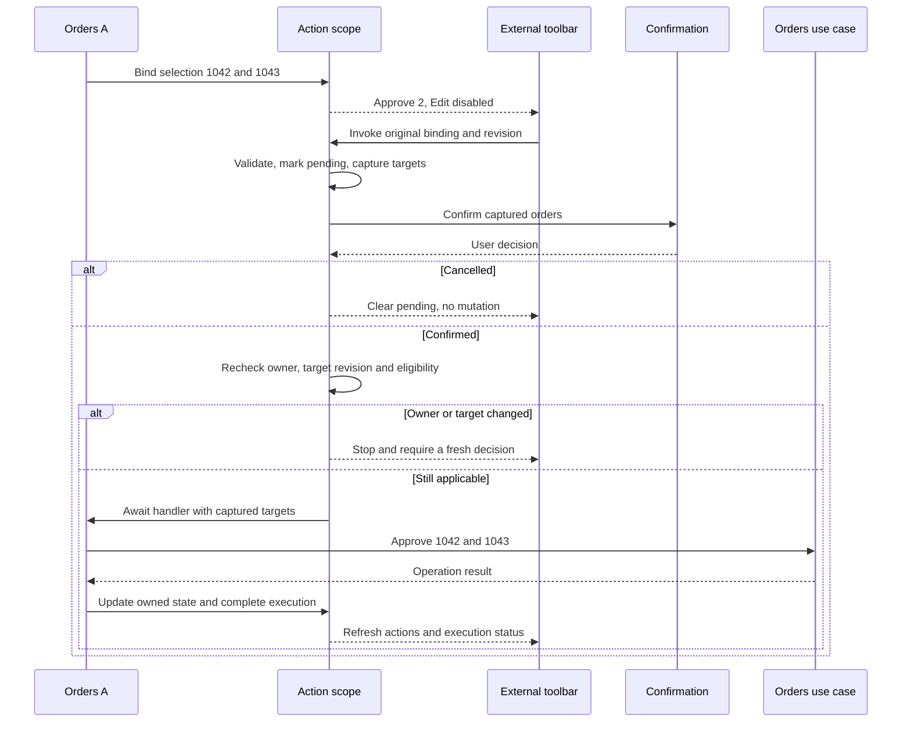

### Typed scopes and explicit placement

An interaction scope is a runtime owner of typed context and contribution bindings. The existing action-scope model provides this ownership for actions; introducing the term does not create a second scope registry or force unrelated capabilities into one execution contract.

A live scope identifies a particular page/component instance and its relevant context revision. It is distinct from the shared module registration and the reusable action definition. Two instances of the same grid or Order component have separate scope/binding identities, even when they use the same definition. Context snapshots must not retain mutable selection collections that can change an already prepared invocation.

A page can own a page scope and components can own child scopes. Nested scopes can cover sections, grids, selections, detail views, dialogs or drawers. The application explicitly associates a toolbar outlet with its intended scope and chooses which ancestor action groups, if any, it includes.

Composition validates the published action definition and attachment target. During activation, the shell validates live scope instances and resolves bindings. An unopened page does not constitute a missing composition target. Each live source evaluates its own typed context and supplies resolved actions to the renderer.

Default page toolbars show page actions. Component toolbars show their own scope's actions. Components contribute actions to an external page/shell toolbar through explicit attachment/activation; the shell must not automatically aggregate every mounted component's actions.

A page can opt into showing page actions plus one explicitly active child scope. For a page with two grids, this lets the header show actions for the selected grid while preserving page-level Create or Refresh actions. Selecting a tab or an explicit component activation changes that active scope. Focus-driven activation is an opt-in policy. Moving focus into the toolbar or opening its menu must retain the intended source context.

A toolbar stays attached to its explicitly selected scope. Default toolbar keyboard navigation and explicit local shortcuts preserve text-input/native control behavior and modal isolation; moving focus must not retarget the toolbar. General hierarchical shortcut routing, fallback/ambiguity resolution and command discovery are deferred. Local keyboard support does not require a global command-routing service.

Dialogs and drawers keep their actions local by default. A host can configure other placement deliberately. Navigation, component removal or scope deactivation removes the corresponding bindings from active outlets and invalidates stale evaluations.

Mounting a page/component creates runtime bindings for installed providers or page-local callbacks; disposal removes those bindings. This does not install/unload modules or mutate application DI registrations.


The external toolbar combines an explicitly included page action group with Orders A's actions. Orders B keeps its own selection and local Edit action. Approve uses Orders A's two captured targets; the toolbar does not acquire ownership of either grid's state or execution.

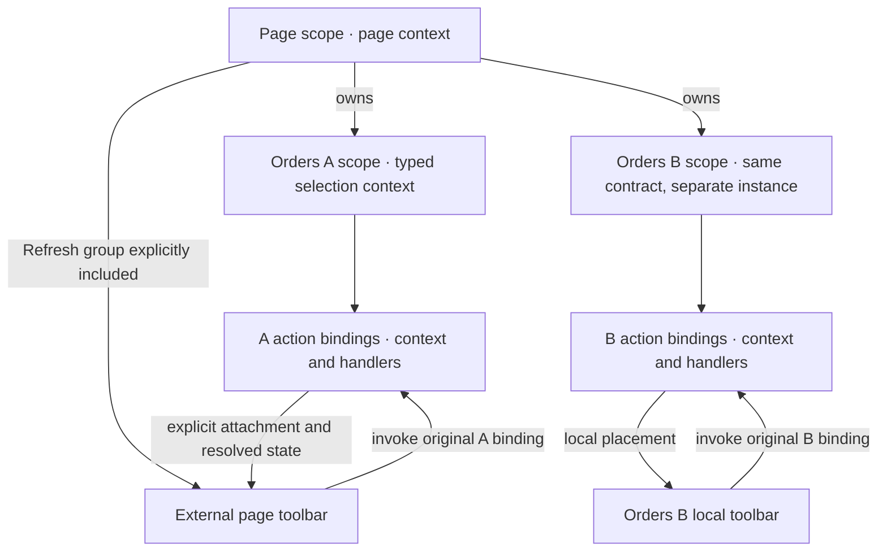

Both grids can implement the same published typed context contract while retaining distinct scope IDs, bindings, context revisions and selections. Each source evaluates its own context; the toolbar renders resolved actions and invokes their original bindings. The arrows describe ownership, attachment and invocation relationships within the existing action-scope model.

### Action and control contribution requirements

| Contribution concern | Required behavior |
| --- | --- |
| Identity and ownership | Distinct definition, placement, scope, binding and execution identities with module/provider/owner provenance. |
| Presentation | The feature supplies a localized label, optional icon and tooltip, group/order, emphasis and optional badge/count. Each placement can render icon only, text only, or icon and text. Icon-only actions keep an accessible name. |
| Contextual availability | Typed synchronous/asynchronous visible/enabled evaluation with an optional disabled reason and declared refresh dependencies. |
| Invocation | Awaitable binding to the intended owner and captured target context; applicability is checked at dispatch and again after confirmation. |
| Execution status | Shared per-binding pending/busy state and per-invocation identity/outcome, reported progress where available, duplicate-invocation prevention and cancellation/disposal handling. |
| Custom controls | Typed templates/components for quick search, filters, view selection, column tools or other feature controls; values update their owned state. |
| Responsive interaction | Feature priorities keep the current primary action visible when space permits. Secondary actions move into keyboard-accessible overflow in predictable order. Each presentation observes the same binding, including availability and pending state. An empty toolbar can collapse. |

An action can represent navigation through an ordinary destination or execute an asynchronous operation. Rendering/evaluating availability must never execute it. Feature code supplies confirmation meaning/content and business prerequisites; the action invocation contract enforces the checks around any confirmation. Backend services enforce authorization, concurrency and mutation rules independently. Authentication integration remains optional.

State dependencies, context updates and explicit invalidation re-evaluate the affected actions through the existing AppState/Notifier model. A selection change can enable Edit for one row or Approve for eligible selected rows without reloading unrelated data. Merely rendering the toolbar must not repeatedly query the backend.

### Action defaults and explicit feature decisions

| Concern | Framework default | Feature or host decision |
| --- | --- | --- |
| Execution ownership | Live action scope. | Select any longer-lived owner and declare its lifetime, cancellation and recovery semantics. |
| Placement | Local scope; dialogs/drawers keep local actions. | Explicit external outlet attachment, active child source and included ancestor groups. |
| Invocation | Awaited handler, captured context, eligibility checks and duplicate suppression per binding. | Target/submitted-value shape, relevant revisions and any stronger conflict policy. |
| Confirmation | No automatic confirmation for every action. | Whether confirmation is required, its meaning/content and applicable prerequisites. |
| Cancellation | Provide a cancellation signal, request cancellation on owner disposal and reject stale UI completion. | Underlying cancellation capability and whether a user-facing Cancel action is meaningful. |
| Feedback | Local busy state; shared execution state across presenters; one feedback owner. | Success messages, per-target outcomes and business recovery choices. |
| Refresh | React to declared dependencies without inferred backend reloads. | Which state/query/record changes invalidate which consumers. |
| Identity | Derive live scope/binding/execution identities and routine local keys. | Stable published definition/attachment identities when other packages must reference or override them. |

A local action can bind an ordinary typed callback without a separate provider class or manual registration of every diagnostic identity. Builders and runtime bindings infer owner/provenance and routine identities; developers publish explicit stable identities where cross-package attachment, replacement or compatibility requires them.

### Safe invocation and lifetime

Invocation follows one path regardless of its toolbar/menu placement:

1. Resolve the requested original binding and validate that its owner/target remain eligible.

2. Reserve its pending state to suppress duplicate invocation of that binding, including while confirmation is open.

3. Capture immutable invocation inputs: targets/selection, submitted values where applicable, and the relevant target/edit-context revisions.

4. If required, show feature-supplied confirmation for those captured targets.

5. If confirmation is declined or preparation is cancelled before dispatch, end without executing the business handler.

6. After confirmation, re-resolve the original binding and recheck owner lifetime, target context and current execution eligibility.

7. If the binding was disposed, retargeted or its relevant selection/context changed, stop and require a fresh decision. Never substitute a new selection or another Orders instance silently.

8. Execute the awaited handler against the captured snapshot and record its outcome.

A change unrelated to the action's declared target/applicability dependencies need not invalidate confirmation. A relevant change must be detected even when an earlier async availability request ignored cancellation. These checks apply to simple callbacks and provider-backed actions alike.

After execution starts, later selection changes cannot alter its captured targets. Feature code handles domain concurrency and recovery. UI duplicate suppression is not backend idempotency or a transaction across APIs. Cancellation/navigation cannot reverse a mutation that already committed, and cancellation requested must not be presented as confirmed cancellation.

Duplicate pending/running invocation is suppressed per binding by default. A toolbar and menu sharing that binding cannot open competing confirmations or start duplicate execution. Separate bindings, including two Orders grids using one action definition, retain independent execution state. Applications can declare stronger conflict policies where needed; backend rules remain authoritative for overlapping resources.

Execution helpers must express their actual policy: suppressing duplicate invocation, rejecting conflicting work and serializing accepted invocations are different behaviors. Serialization is explicit and scoped to a binding or feature-declared conflict boundary; it must not accidentally serialize unrelated actions through one client/circuit-wide gate. Any delayed dispatch rechecks the owner, relevant context revision and eligibility while preserving the accepted invocation's captured inputs. Cancelling/superseding obsolete evaluation or read work does not implicitly cancel, replace or replay a dispatched mutation. These rules do not require an additional execution registry, queue or scheduler.

When one binding is presented in several surfaces, those surfaces observe the same execution identity/state and share one feedback owner. Placement changes do not create a fresh invocation or reset its busy state.

Scope owners release bindings/subscriptions on disposal and request cancellation of work owned by that scope. Late completion must not update a removed component, a different scope or a newer identity/workspace context, even when the operation ignores cancellation. Work with an explicitly longer-lived owner follows that owner's lifetime. Failures remain local to the operation and do not turn a confirmed save into a failed save or cause automatic resubmission.

| Lifecycle change | Required behavior |
| --- | --- |
| Deactivation or hidden placement | Remove ineligible bindings from active outlets and invalidate relevant evaluations. Deactivation alone does not dispose the scope or automatically cancel a running mutation. |
| Owner disposal | Release bindings and subscriptions, invalidate pending confirmation and request cancellation of scope-owned work. Detach observation of explicitly longer-lived work. |
| Selection or target-context change before dispatch | Cancel or supersede dependent evaluations/preparation and revalidate after confirmation. Require a fresh decision when the relevant captured targets changed. |
| Selection change after dispatch | Preserve the invocation's captured targets. Never retarget, restart or automatically cancel a mutation merely because the selection changed. |
| Identity or workspace-context change | Invalidate old-context bindings and pending confirmations, request cancellation where supported, and clear or partition private state. Results from the old context must never update the new context. Backend-owned work follows backend authorization and cancellation rules. |

### Execution state and observation

Core action execution exposes identity, originating binding/scope, pending-confirmation/running state and terminal outcome through existing scoped state and diagnostics. Cancellation requested is separate from the terminal result; progress is shown only when supplied by the underlying work. Queued status is meaningful only when an actual execution source reports queueing.

Cancelling a confirmation ends preparation before dispatch. After dispatch, cancellation is a request to stop cooperative work. A confirmed successful result remains successful even if cancellation was requested. Enterprise readiness defines how to present confirmed, partial, cancelled and unknown business outcomes.

Execution observation and diagnostics expose cancellation requested, local execution completion and reported business outcome as separate values. A cancel affordance states whether it dismisses preparation, requests cancellation or stops observation. The feature reconciles unknown outcomes using the original target or operation reference when available.

The default execution owner is the live action scope. Toolbar/menu placement provides observation and invocation of its binding; it does not transfer execution ownership. Moving, hiding or disposing a presenter must not create a new execution or reset shared busy state. Presenters observe one execution identity and share one feedback owner.

| Execution owner | Intended use | When the originating page/component is disposed |
| --- | --- | --- |
| Live action scope — default | Actions whose execution belongs to a particular page/component instance | Remove bindings and subscriptions, request cancellation of owned work and prevent late UI updates. |
| Explicit client/circuit owner | Work deliberately continuing while the user navigates within that owner's lifetime | Detach page observation; execution continues under its declared owner and cancellation policy. |
| Backend operation/job | Work whose execution and any durability are owned by a backend integration | Detach frontend observation; backend contracts determine cancellation, completion, durability and recovery. |

Longer-lived ownership must be selected before execution and declare its lifetime, supported cancellation behavior, completion/feedback owner and recovery or reattachment semantics. Execution uses independent services and captured inputs without retaining disposed components, render fragments or page callbacks. A retained execution record alone does not extend task lifetime.

Client/application ownership is scoped to the relevant user's runtime or server circuit, never a process-wide singleton containing user work. It does not guarantee survival across browser closure, reload, lost circuits or separate Server/WASM roots. Features that support reattachment use an explicit execution/operation reference, not the reusable action definition ID, and revalidate the current identity/context. Durable continuation and recovery require the corresponding backend contract; the shell must not imply those guarantees.

A general operations panel and broader application-owned operation orchestration are separate optional design work. Core observation does not introduce a background scheduler, durable queue or execution registry parallel to existing services. Surviving browser closure or restart requires an appropriate backend job/operation integration.

### Approve Save and Export walkthroughs

| Action | Owner and invocation | Completion and recovery |
| --- | --- | --- |
| Approve selected orders | The Orders component owns the binding. Capture selected IDs and relevant context; confirm those targets and recheck eligibility before dispatch. Later selection changes cannot retarget execution. | Update confirmed results and invalidate affected lists/counts. A lost response may leave the outcome unknown. The feature declares atomic or partial-success batch behavior. |
| Save an editor | The editor owns the binding. Validate and capture submitted values and edit revision. An external toolbar invokes that same binding; ordinary Save need not require confirmation. | Confirmed success establishes the baseline for the submitted revision. Preserve later edits. Validation, conflicts and unknown outcomes must not silently clear dirty state or complete save-and-leave. |
| Export data | A normal request/download belongs to the initiating scope. Capture whether export means selected IDs or all records matching declared filter/query options. Longer-lived export uses an explicit owner. | Backend job acceptance confirms submission, not export completion. Progress, cancellation, result availability and retention follow that backend contract. Lost submission acknowledgement can leave acceptance unknown. |

For batch actions, the feature contract declares whether execution is atomic and, where partial completion is possible, provides enough information to distinguish confirmed success, failure and unknown/not-executed results for affected targets. Shared presentation may display these results, but it must not automatically retry the whole batch or infer transaction semantics.

Saving revision 7 while the user creates revision 8 must leave revision 8 dirty after revision 7 succeeds. Disabling editing while saving is an alternative feature policy. Neither path requires an edit-session coordinator.

If approval of order 1042 succeeds while order 1043 conflicts, preserve 1042's confirmed result and present 1043's conflict. Recovery follows feature-defined per-target rules.

After an export returns a backend operation reference, navigation detaches the page's observation and follows the declared backend ownership policy. Before acknowledgement, the frontend cannot assume that submission failed or automatically submit again. Exporting all matching records captures query intent; dataset snapshot consistency is a feature/backend guarantee only when explicitly supplied.

### Render modes and diagnostics

Physical placement outside the Order component does not require a different interactive runtime. The default external-toolbar pattern keeps the toolbar and action owner within a compatible interactive boundary.

Toolbar/owner coordination follows Supported hosting arrangements. The default keeps presenter and owner within one compatible interactive composition; documented same-runtime root coordination uses explicit scope association and renderer-safe dispatch. Callbacks, component instances and RenderFragments cannot cross boundaries requiring serializable parameters. Generic cross-runtime action transport is deferred; an application can supply an explicit integration preserving binding/scope/target identity, context revision, response and invalidation routing and the normal invocation safeguards. A diagnostics inspection bridge is not a business-action transport.

Diagnostics expose the scope hierarchy, active source, outlet placement, contribution ownership, action visibility/enabled reasons, dependencies, evaluation/invocation status and failures through the existing human/agent read model. Context/target details respect declared redaction and session boundaries.

## Navigation and page composition

Navigation belongs to the core shell, including menu composition, runtime hooks, dynamic hierarchy generation, availability, outlet placement and deep-link resolution. Optional modules contribute navigation through these core contracts.

Navigation is a logical hierarchy whose visual placement is configurable. The same module declarations can drive main navigation on the left, secondary navigation below it, deeper sections in the header and record-specific page tabs.

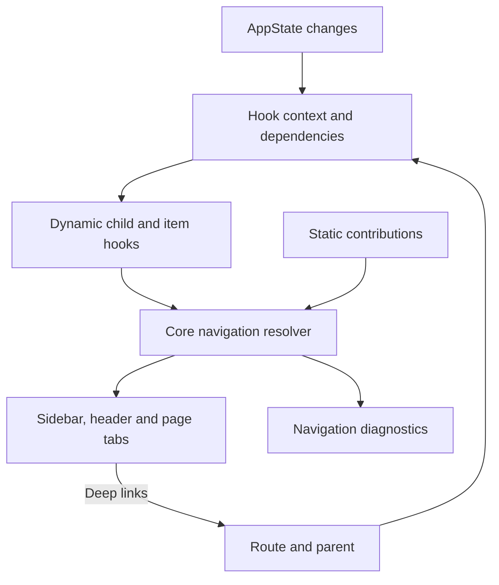

Main, Account and Footer menus are available defaults, and hosts can define additional menus and outlets. Groups, links and executable actions support nested composition. Active states and breadcrumbs derive from the resolved route and context.

Navigation items must support synchronous or asynchronous runtime evaluation of visibility, enabled state, text, icon, tooltip, badge/count, styling and custom rendering. A developer can, for example, hide an item based on application context or display an unread count supplied by a service.

Menus and subtrees must also support code-defined generation of items and children at runtime. For example, an Orders parent can contain a child link for each returned order; a Catalog parent can contain categories derived from products. A dynamic child can itself provide further dynamic children and ordinary item hooks. Simple cases use callbacks; reusable cases use contribution providers.

Static and dynamic children can coexist with documented placement and ordering. The host's overrides and the same availability/policy rules apply to generated items. Dynamic item generation is a core navigation behavior; it does not require the CRUD, administration or notification features.

### Navigation hook context

Navigation hooks use operation-specific typed contexts with consistent conventions for identity, hierarchy, route and change information. Child generation, item evaluation and action invocation receive the inputs needed for their operation. The table below is an inventory of relevant information, rather than a requirement for every hook to receive every field.

| Context input | Required information |
| --- | --- |
| Contribution identity | Application/module, menu, outlet, current item and owning contribution/provider. |
| Hierarchy | Parent item, ancestor path, depth and the current generation scope; a root operation has no parent. |
| Route and page | Current destination, route/query values, selected entity or context key where declared, and active navigation path. |
| Application context | Current workspace/tenant where applicable, culture and safe identity/permission information; identity integration remains optional. |
| State dependencies | Declared typed AppState access or safe snapshots/selectors, with the relevant version for detecting stale results. |
| Trigger | Initial resolution, expansion, route/context change, relevant state change or explicit refresh; change metadata when available. |
| Associated data | An optional feature-owned item key or typed payload, such as the category identifier represented by a generated node. |
| Execution | Runtime/root identity where relevant, cancellation and operation-specific inputs such as the invoked action or paging cursor. Services are normally supplied through constructor injection. |

Context represents the applicable evaluation scope and exposes narrow typed values, read-only views or snapshots. It must not become a mutable global object, an arbitrary payload dictionary or a service locator, and must not expose parent component internals. Feature state changes go through the owner's methods/commands. Exact signatures and context type names belong to API design.

### Dynamic hierarchy lifecycle

Child generation can be eager or lazy on expansion. Large collections must support bounded loading, paging or search rather than require rendering every record. Loading, empty and error states belong to the affected branch, with explicit retry and refresh behavior.

Generated items need stable identities derived from their contribution scope and domain keys. Ordering, duplicate detection, cycle/depth protection and retained expansion/selection behavior must be deterministic. A data or state change can invalidate one branch without rebuilding unrelated menus.

Every generated link uses an ordinary route or destination contract, such as an order detail route with an identifier. A deep link must resolve the page and record without first expanding or loading the entire navigation tree. Active-path resolution can locate the relevant branch or ancestor without enumerating all records.

An in-flight generation/evaluation result must be discarded when its parent, identity, route, state dependencies or application context becomes obsolete. Generated data and cached child collections follow the same privacy and scope rules as their source data.

Evaluation and action execution are separate. Rendering must not execute click behavior. Item actions can run asynchronous feature code, including opening a dialog or selecting a context.

Evaluation and child generation must have an explicit dependency and refresh/invalidation model. Hooks can declare relevant AppState subscriptions/selectors, route/context dependencies and explicit refresh triggers. A selected category change, for example, can refresh its product children while a changed unread count only updates the corresponding badge.

The framework must avoid repeated network requests on every render, coalesce relevant changes, cancel stale work, discard outdated results and contain callback/provider failures within the affected contribution or branch. Diagnostics must expose the owning hook, parent/context, dependencies, last trigger, duration, outcome and stale-result cancellation.

Policy checks, composition availability and host suppression remain authoritative after callback evaluation. Badge queries and their failures must not block unrelated navigation. Custom renderers receive the resolved model and documented action behavior.

### Orders navigation walkthrough

The Sales module contributes a static Orders parent. A child-generation hook queries a bounded set of orders for the current application context, using a frontend service or Requester. Each result produces an item with a stable identity based on the contribution and order identifier, a localized label and an ordinary detail URL such as /sales/orders/1042/overview.

| Situation | Hook context and expected behavior |
| --- | --- |
| First expansion | Parent is Orders; context includes the module/menu, current route, application context, declared filters/state and cancellation. Load the first bounded set of children and show loading, empty or error UI within this branch. |
| Generated child evaluation | The current item represents order 1042; its parent is Orders and its associated key is 1042. Item hooks evaluate its label, badge, enabled/visible state or custom rendering with the same context conventions. |
| Relevant filter change | A declared selector such as OrdersFilter.Status changes. Invalidate that branch, cancel obsolete work and reload the active/expanded branch using the new filter. |
| Unrelated state change | A change outside the hook's declared dependencies leaves its child collection and queries unchanged. |
| Confirmed order mutation | After the backend confirms creation, deletion or a status change, the feature updates owned state or explicitly invalidates the relevant collection/count. Refresh branch membership, order labels and counts only where those dependencies apply. |
| Context changes mid-query | A workspace/identity change cancels or supersedes the old evaluation. Old results cannot enter the new context's navigation, even if cancellation is not honored by the source. |
| Direct detail link | Opening /sales/orders/1042/items loads the page and record directly. Active-path resolution identifies Sales > Orders > 1042 without first fetching every sibling or expanding the menu. |
| Record leaves the filtered branch | Removing a child from a filtered list does not by itself close its detail page. The page remains available if the record and access permit it; a missing/deleted record receives the normal unavailable/not-found behavior. |

Navigation does not own the Orders collection or its backend query semantics. The hook declares the dependencies and maps feature results into navigation contributions. Shared feature state/query caching can serve both a page and a navigation branch; independently mounted consumers must not create accidental duplicate reloads.

Category navigation follows the same pattern: a Catalog parent derives distinct category entries from a feature query, and each category can generate its own product children. A product/category membership change explicitly invalidates the affected branch when it is not already represented by a declared state dependency.

## Visual consistency and styling

MudBlazor is the default component and interaction library. Tailwind CSS is the recommended utility layer for layout and styling needs that MudBlazor does not cover well. Applications must not need to choose between the two.

A shared semantic design vocabulary covers colors, typography, spacing and breakpoints. MudTheme remains the primary component-theme mechanism; utility styling must align with it. Theme identity and appearance mode are separate choices: a named theme can support light, dark and system appearance.

The first release supplies one reference theme with light, dark and system appearance modes. Hosts can add themes and restrict user choices. DoFiesta demonstrates a host theme whose semantic tokens are shared by MudBlazor and utility styles.

| Area | Requirement |
| --- | --- |
| CSS coexistence | Prefix utilities and avoid introducing a competing global reset by default. Document stylesheet ordering and ownership. |
| Overrides | Support Class/Style parameters and CSS isolation; ordinary customization must not depend on internal MudBlazor selectors or blanket !important rules. |
| Assets | Package compiled CSS or a documented build/source manifest for Razor class libraries and modules. |
| Utility detection | Ensure runtime variants are included reproducibly; arbitrary dynamically constructed class names cannot be assumed to appear in generated CSS. |
| Consumption | Consuming precompiled framework styling must not require an npm or JavaScript build. Authoring custom utilities may use a documented reproducible build. |

Semantic customization precedence is framework defaults, selected theme, host-wide choices, layout choices and explicit component choices. The actual CSS cascade must implement this predictably through documented layers and specificity. User preferences select only the choices exposed by the host.

### Module assets and JavaScript ownership

Module-owned styles and scripts use native Razor class library packaging, static web assets, CSS isolation and supported JavaScript module imports. Ordinary module installation handles those assets through package conventions, documented registration and component initialization. It must not require adding script or style tags to the host page for every module. Shared global dependencies, such as the selected renderer's MudBlazor assets, remain explicit and configured once. Document any exception and its setup in the module's consuming instructions.

Each module documents its public asset entry points, shared dependencies and applicable hosting arrangements. Prefer native asset resolution and imports over another asset manifest or resource manager. Any helper must solve demonstrated repeated setup and preserve ownership, ordering and failure attribution.

A component owns the JavaScript integration it creates, including listeners, observers, timers and interop references. An intentionally longer-lived integration has an explicit longer-lived owner. Initialize browser work only when the relevant interactive lifecycle is available. Release owned resources and reject late callbacks when the owner is disposed or its context becomes obsolete. Repeated mounting must not accumulate listeners or timers. Sharing module code or assets does not implicitly share mutable state or handlers between component instances.

Follow native Blazor interop and disposal patterns. DOM-dependent cleanup uses supported browser-side patterns, such as observing DOM removal, rather than relying on interop during .NET component disposal. Releasing interop references must account for a disconnected Server circuit. A central shell resource manager is not required; extract optional cleanup helpers only when repeated use justifies them.

## Optional authentication and authorization

Authentication is optional throughout the core shell. An anonymous application must work without an authentication provider, identity endpoints, fake user or authentication service registration. Public pages, mixed public/protected applications and protected-by-default applications are supported configurations.

Replaceable host integrations supply sign-in, sign-out, user information, session changes and policy evaluation. External identity providers and future local-identity features integrate through these contracts; the shell does not implement an identity server.

Protected pages use Blazor authorization mechanisms, and navigation/actions reflect matching policies. Backend services enforce authorization independently. Missing identity integration must not silently turn protected content into public content.

A module that requires identity integration declares that dependency so composition can report an actionable configuration error. A module with optional protected functionality can expose its public capabilities without it. Identity changes must cancel or invalidate private work and clear or partition user-specific state even when an unsaved-change helper exists.

## State, preferences and application context

Use existing AppState concepts for typed, scoped shell, application and module state. Component-local transient fields remain ordinary component state. The framework must not force every local interaction through a global store.

| State kind | Owner and behavior |
| --- | --- |
| Shell preferences | Theme, culture and sidebar state; non-sensitive persistence with host-selected storage. |
| Application context | Explicit owner and change lifecycle for such concepts as selected workspace or tenant. |
| Module state | Owned by the module, with declared reset and persistence behavior. |
| Route state | URL-authoritative destination, record and route-backed subsection. |
| View preferences | Optional filter, sort, paging and column persistence; query parameters take precedence where supported. |
| Drafts and business state | Feature-owned, with explicit privacy, lifetime and recovery rules. |

Logical UI/action scopes identify owners and component instances independently of .NET DI scopes. Server scoped services normally live for the circuit; client-side scoped registrations normally live for the application runtime. Separate interactive roots do not automatically imply separate DI containers. Bindings and subscriptions still have explicit page/component lifetimes even when their injected services live longer. A server singleton must not hold per-user UI state. Persisted keys must distinguish application, module, user/context and schema version as appropriate. Anonymous partitioning must be explicit.

Persisted values do not grant authorization. Sensitive business data and credentials must not be persisted by default. Corrupt optional preferences can fall back to defaults with diagnostics rather than prevent startup.

Context changes are accepted by the context owner, invalidate affected state and signal consumers. Results from an old context or identity must not overwrite current state. Disposal, cancellation and renderer dispatch must be handled safely.

### AppState adaptation

Existing AppState types, registration, managers and persistence providers can be changed and refactored to satisfy these requirements. Reuse does not require preserving unsafe lifetime or storage behavior. API design identifies any consumer migration required by those changes.

Managers and diagnostic state inventories belong to the user's runtime or Server circuit. They must distinguish live state instances and release registrations with their owner. A process-wide manager must not retain user state, expose another circuit's inventory or reset another circuit's stores. Reset and persistence operations use the originating owner's services rather than an unrelated service scope. Disposing a registration does not dispose a DI-owned shared service.

Persistence keys include the declared application, module, view or state instance, identity, workspace and schema dimensions. Anonymous context identity remains stable for its declared lifetime, including repeated provider calls and reloads when persistence is enabled. Sign-in, sign-out and workspace transitions apply the declared partitioning and cleanup policy. Two circuits using the same state type and two component instances within one circuit must retain their declared independent ownership.

### State change subscriptions

AppState changes are an event source for components, pages and navigation, independently of whether state is persisted. Existing bITdevKit AppState documentation provides StateChanged and StateChangeWithMetadata events; the metadata event describes the transition with state identity, operation, old/new values, reason and timestamp. Reuse this foundation. [AppState reference](https://bridgingit-gmbh.github.io/bITdevKit/reference/features-presentation-appstate/)

The presentation framework must support subscriptions to a specific state instance/type and to relevant changes through a selector, equality comparison, predicate or transition metadata. Examples include reacting when SelectedCategoryId changes, updating a badge when UnreadCount changes, or refreshing an order branch after its collection changes. Selector-aware subscription convenience is a framework requirement; it must not be assumed to exist already in AppState.

Subscribers react after an accepted state transition. They can update local presentation, invalidate a query or regenerate a navigation branch. Unrelated state changes must not force a reaction when a declared selector's value is unchanged. A newly mounted consumer reads the current state explicitly; ordinary change events are not durable replay streams.

Subscriptions must have scoped ownership, deterministic disposal, renderer-safe dispatch and explicit handling of asynchronous failures. Coalescing or debouncing can be selected for frequent changes. Cancellation and state/context versions prevent stale completion from overwriting newer views. Equality comparison must use stable selected values or snapshots where the underlying model is mutable.

Do not add another mandatory event bus. Direct AppState subscriptions serve state observers; Notifier serves explicit feature notifications and cross-component coordination within its runtime. Bridging a state transition to a Notifier event is opt-in, with ownership that prevents duplicate publication or feedback loops. State-change notifications do not automatically cross Server/WASM roots or browser sessions.

### Automatic refresh and explicit invalidation

Automatic refresh means an automatic reaction to an explicit, declared dependency. The shell must not infer arbitrary backend dependencies or poll every query. A state event can re-evaluate local presentation without issuing a network request; fetching is required only when the consumer's declared data dependencies have changed.

| Trigger | Default reaction |
| --- | --- |
| Initial activation or branch expansion | Read current state and load required data once for that activation if it is not already valid in the owning scope/cache. |
| Changed value of a declared state selector | Automatically re-evaluate affected presentation or invalidate dependent data. Unchanged selected values do not trigger work. |
| Route, record or declared query parameter change | Automatically update the affected page/navigation resolution and its declared data dependencies. |
| Identity or application-context change | Immediately cancel/supersede old work and clear or partition private data; active consumers load under the new context. Security cleanup is not deferred. |
| Culture, theme or layout preference change | Update affected presentation automatically. Query data again only where culture or another changed value is an explicit query dependency. |
| Explicit targeted invalidation from a confirmed feature operation | Mark matching data/branches stale. Active consumers refresh by their declared policy; inactive pages and collapsed branches normally reload on activation/expansion. |
| Data changed elsewhere with no declared signal | No automatic freshness guarantee. Use an explicit Refresh action, activation freshness policy or an opt-in remote/live-update integration that produces targeted invalidation. |
| Persistence completion, diagnostics capture or unrelated state | No business query reload by default. |

A feature can use updated AppState values or a typed Notifier notification to signal a confirmed mutation. It must choose a clear invalidation owner; observing both paths must not accidentally cause two reloads. When the feature already has an authoritative updated local result, it may update that state directly rather than immediately fetch it again.

Dependencies and invalidation targets can identify a module, query, collection, branch or record as appropriate. The framework provides targeted propagation; feature code defines which changes affect its data. Coalesce bursts, cancel/supersede obsolete requests and preserve a refresh request that arrives during an in-flight load so the final view reflects the newest dependency version.

Reactivity does not grant permission to replace unsaved edits. A page owns whether refreshed data is merged, shown as a stale-data/conflict prompt or deferred until editing is resolved. Refresh failure is localized, does not undo a confirmed save and must not create an unbounded retry loop.

The default is stale-on-activation for inactive consumers and lazy branches. Features may explicitly select immediate background refresh, freshness limits or live updates with documented cost and lifecycle behavior. These policies remain local to their runtime unless an explicit cross-runtime integration carries the invalidation.

### View restoration policy

Each restorable view declares a typed policy for its owned fields: URL representation, transient navigation/scope state, persisted preferences or defaults. Reuse existing AppState/preferences services and composition ownership metadata. Keys distinguish the application/module/view, applicable instance/user/application context and schema version.

For each declared field, an explicit URL value is authoritative; applicable navigation-entry/scope state can restore the previous view; allowed persisted preferences and defaults fill remaining values according to that view's declared policy. An explicitly empty URL value must not accidentally revive an older filter. A shareable URL reconstructs its represented view without depending on the recipient's local preferences.

Returning from details can restore the list's filter/sort/page position. Feature/data adapters decide how to recover from an out-of-range page, deleted record, obsolete tab or changed navigation branch: reset/clamp to a valid value or show a clear unavailable state. Restoration never grants access or assumes that the underlying data is unchanged.

Persist only declared safe values. Selections are transient by default; any explicit restoration stores appropriate stable keys and revalidates them rather than persisting arbitrary selected objects. Editable drafts remain a separate feature-owned capability, with no automatic persistence of arbitrary component state.

## Frontend coordination with Requester and Notifier

Reuse bITdevKit Common Requester and Notifier rather than introduce another frontend mediator. Requester supports a single-handler frontend request, for example querying through a typed API client. Notifier supports local typed change and invalidation notifications to multiple consumers.

Direct API calls and simple component callbacks remain supported. Mediation is useful when coordination is shared, not mandatory ceremony for every field or button.

Frontend registrations contain browser-safe handlers and services. Backend transaction behaviors, repositories and DbContext dependencies do not belong in browser handlers. Registration and publish/trimming behavior require representative validation.

| Concern | Requirement |
| --- | --- |
| Lifetime | Bind handlers and subscriptions to the actual frontend scope and dispose them with their owner. |
| Async execution | Avoid implicit detached or fire-and-forget work. Define cancellation and exception behavior. |
| Multiple handlers | Use existing Notifier execution options with explicit ordering/concurrency and failure semantics. |
| Refresh | Invalidate targeted state; consumers decide when to reload. Coalesce repeated signals and mark inactive views stale. |
| Mutation outcome | A failed refresh or subscriber must not resubmit or reclassify a confirmed backend save. |
| Runtime boundaries | Local mediation follows its explicitly shared service/runtime scope. It does not automatically cross runtimes, circuits, browser tabs, users or devices; same-runtime roots coordinate only through a supported scope/dispatch arrangement. |

Remote or durable coordination requires an explicit integration. Existing bITdevKit messaging/broadcast capabilities should be evaluated before adding another mechanism. Notification-center entries require their own explicit source or persistence path.

## Localization and culture

Use standard .NET localization, including IStringLocalizer-style resource ownership and resource-culture fallback. Resources may belong to the whole application, a presentation module or an individual component. Multiple independent resource sets can be consumed by the same screen.

A navigation label or shared contribution retains its resource identity, key and formatting arguments so it can resolve for the current culture. It must not permanently capture a localized string at startup. Resource ownership is distinct from culture fallback; the shell must not silently search unrelated module resource sets for missing keys.

The host defines supported and default cultures. Where enabled, explicit user choice takes precedence over browser preference and then the host default. Culture selection affects dates, numbers, parsing, document language and relevant MudBlazor culture settings. API interchange formats remain stable and culture-independent.

A controlled reload is acceptable for an initial culture-switch implementation if its behavior is documented and drafts are considered. Resource providers may be replaced while preserving the same ownership and fallback contracts.

## Shared interactions and operation feedback

The shell supplies consistent dialogs, confirmations, notifications, loading indicators, empty states and failure presentation. Ordinary MudBlazor dialogs and snackbars remain usable directly.

Use the operation outcomes and recovery contract in Enterprise readiness for bITdevKit Result values and application-client errors. Render field validation, business rejections and recovery choices through the same feedback model independently of the HTTP client.

Feedback ownership must prevent duplicate notifications when a page, handler and shared adapter observe the same operation. Success notifications are opt-in. Loading is local to the affected region by default; a whole-application overlay is explicit.

Error output can include a safe correlation identifier. Technical exception details and sensitive response payloads must not appear in user-facing messages. Feature code owns conflict resolution and business recovery decisions.

### Field validation and submitted revisions

Map application validation errors to matching edit-model property paths by default, including nested paths such as `Address.City`. Reuse the property information already carried by DevKit validation errors and the corresponding HTTP error representation. Features can declare explicit mappings when application DTO and form property names differ. Unmatched paths and model-level errors appear in the form summary rather than being dropped or assigned to a guessed field.

Provide thin integrations with native Blazor form validation and existing MudBlazor validation mechanisms. Keep form models, validation rules and submission behavior feature-owned. These adapters do not introduce another form engine, mandatory form base class or universal error envelope.

Associate returned validation feedback with the captured submission and edit revision. Apply field errors only while that submitted revision is still current. When the user has edited the form again, preserve the newer input and present the earlier save rejection in the form summary instead of marking current field values invalid. An older response must not replace feedback from a newer submission. Apply the same policy to direct Server Requester results and browser HTTP responses.

## Minimal unsaved-change support

Unsaved-change handling is an optional page-owned helper built on Blazor navigation locking and browser capabilities. A page reports whether it has changes and supplies localized confirmation behavior.

The core shell does not require a global dirty-state registry, cross-page save orchestration or automatic draft persistence. Drafts belong to the feature. Browser unload prompts have platform limitations, and asynchronous saving on browser termination is not guaranteed.

The edit-session coordinator is deferred. A future optional editing package may assess participant coordination and Save All separately. A page-owned save-and-leave flow keeps the page active and preserves edits/error presentation when validation or saving fails, the business outcome is unknown, or newer edits remain after the captured revision was saved. The page may offer an explicit discard/recovery choice; successful saving of an earlier revision alone must not complete navigation and discard later edits. This remains page-owned behavior without cross-page or cross-API save orchestration.

Identity/session changes and security-related cleanup must not be blocked indefinitely by an unsaved-change confirmation.

## Initialization, failures and recovery

Required shell initialization can block the shell with a clear recovery state. Required feature initialization blocks only the affected feature where possible. Optional preference restoration or optional integrations can fall back without making the whole application unavailable.

Initialization must have deterministic dependency ordering, cancellation, bounded execution and explicit retry behavior. Prerendering and repeated activation must not duplicate external writes or subscriptions.

For the same initialization owner and lifecycle generation, concurrent requests share one initialization attempt. Remounting a layout or outlet must not repeat completed initialization; retry after failure/cancellation and any reset follow an explicit owner policy. Attempt lifetime and cancellation are owner-controlled. Separate prerender/server/browser lifecycles are not treated as one shared in-memory attempt, and any reuse of safe initialization data across them is explicit. Anonymous shell initialization must not depend on an authentication event; identity-dependent activation and changing contextual availability use their own declared lifecycle/refresh rules.

Page and contribution-region boundaries contain rendering failures with customizable recovery UI and logging hooks. Asynchronous operation failures require explicit handling as well; an error boundary alone is insufficient. Retry must not create loops or duplicate a successful mutation.

Host or circuit loss uses the connection and recovery rules in Enterprise readiness. Component recovery remains scoped to the affected page or region.

## Host configuration and supported customization

The host owns module selection, layouts, themes, culture options, integrations and final contribution overrides. Configuration must be validated early, with errors identifying the responsible module, setting and supported correction.

All common customization paths must be documented with examples: adding a cross-package contribution through a published typed target, configuring/decorating/replacing/disabling a contribution where supported, removing a menu item, changing its placement, adding a badge callback, replacing navigation rendering, contributing a header control, using custom page tabs and composing public and protected layouts.

Configuration, templates, callbacks and service replacements must preserve framework upgrades without requiring routine copies of internal layout source. The compatibility policy must identify public contracts, supported override points and internal implementation details.

## Enterprise readiness

The enterprise baseline defines how the shell behaves across session changes, interrupted work, production deployments and upgrades.

| Owner | Responsibility |
| --- | --- |
| Host and host adapters | Establish identity and authorized workspace, validate return destinations, report transport and client compatibility, and own deployment topology, probes, rollout and telemetry export. |
| Shell | React to the supplied signals, control affected routes and UI bindings, isolate scoped state, present recovery, and publish shell initialization and telemetry signals. |
| Features and backend | Features own drafts, reconciliation and business recovery choices. Backend services enforce access, report committed outcomes and own durable execution. |
| Framework renderer and consuming app | The framework supplies accessible defaults and verifies complete reference flows. The consuming app owns the accessibility of its complete pages and workflows, including custom layouts and contributed controls. |

### Session and workspace transitions

The host adapters report identity and permissions, authorized workspace, transport and client compatibility separately. Shell and feature readiness are separate from those signals. Anonymous startup uses the same shell readiness model without identity integration. Public and unaffected capabilities continue to use their own readiness and policy.

| Host signal or transition | Shell response |
| --- | --- |
| Context resolving on startup or direct link | Resolve the requested destination and gate activation on its declared requirements. An identity-only destination can activate once the host establishes identity and eligibility. A workspace-scoped destination also waits for authorized workspace resolution. Public capabilities can activate independently. |
| Reauthentication required | Suspend affected protected reads and action dispatch. Hide private content when access can no longer be established. Offer the host's reauthentication path and restore the route only after the host validates the in-app return destination and rechecks access. |
| Same principal revalidated or effective permissions changed | Reevaluate affected eligibility, invalidate stale results and remove content no longer permitted. Recover a feature draft only when its identity, workspace, target and access still match its recovery policy. |
| Signed out or principal replaced | Detach private bindings and subscriptions, cancel eligible reads, and clear or isolate old private state, caches, preferences and diagnostics. Rebuild only what the new context authorizes. |
| Workspace change pending | Allow a feature's dirty-state decision before a voluntary switch. While the host validates the destination, pause work that depends on the changing workspace. |
| Workspace accepted or rejected | Activate the authorized destination and rebuild affected bindings on acceptance. On rejection, resume the previous workspace only if the host confirms its access is still valid. Otherwise use an authorized fallback. |
| Connection interrupted | Present reconnect or service-unavailable feedback as appropriate and pause dispatch that requires the affected connection. Preserve dispatched operation targets and the distinction between known and unknown outcomes. |
| Connection restored to the same runtime, or runtime replaced | Resume the surviving scope only after any required revalidation. A replacement runtime rebuilds authorized views and bindings from the route and permitted state. Resume observation of dispatched work through the feature's recovery contract. |

Adapters provide the current context and a way to observe its changes. Use opaque principal and workspace keys where applicable, effective access or an access-change signal, and the affected runtime or dependency. The presentation signal carries only the data needed for eligibility and recovery. The shell associates affected work with the owning runtime or scope and its current context revision. It advances that revision on an invalidating change and rejects late results for older revisions. Apply the same rule to actions, navigation children, badges, data and diagnostic views. Forced revocation or sign-out takes precedence over dirty-state prompts. Host authorization decisions remain authoritative for context selection, and backend services enforce access for reads and mutations. [Blazor authentication and authorization](https://learn.microsoft.com/en-us/aspnet/core/blazor/security/?view=aspnetcore-10.0)

### Operation outcomes and recovery

Use one outcome vocabulary across the shell's feedback adapters, action observations and diagnostics. Adapt bITdevKit Result and typed client responses at the feature boundary. Keep dispatch and execution phase, cancellation request, and reported business outcome distinct. The shell assigns one feedback owner per operation so the application can present the outcome without duplicate messages. The feature determines the next safe business action.

| Outcome | Default presentation and recovery |
| --- | --- |
| Confirmed success | Apply the result to the correct owner and submitted revision. If refresh fails, retain confirmed success, mark the affected view stale and offer a read retry. |
| Accepted for later execution | Show accepted or queued only as reported by the execution owner. Keep the operation reference and observe the backend lifecycle through the feature's authorized integration. |
| Validation or business rejection | Show field errors or a contextual explanation. Keep current input and let the user correct or resolve it. |
| Authentication required or forbidden | Use the host's reauthentication flow for an expired or missing session. Show access denied for an authenticated principal without permission. Reevaluate affected capabilities after a context change. |
| Concurrency conflict | Preserve edits and offer the feature's reload, merge or other conflict recovery choice. |
| Partial success | Present known per-target outcomes and any remaining uncertainty. Preserve completed work and scope any further attempt to the feature-approved targets. |
| Stopped before dispatch or confirmed cancelled | Report that no command was sent when preparation ended before dispatch. After dispatch, use confirmed cancellation only when the execution owner reports it. |
| Transient read failure | Keep the failure local and offer bounded read retry where the operation policy permits it. |
| Confirmed technical failure | Show a safe error and correlation reference where available. Preserve input and use the feature's recovery policy. A generic transport or server error by itself does not establish the outcome of a dispatched mutation. |
| Unknown mutation outcome | Preserve the draft or captured target and any safe correlation or operation reference. Reconcile through authorized status or a fresh read as the feature allows. A read establishes current state even when it cannot attribute the change to the original command. |

A timeout, disconnect or frontend cancellation after a possible dispatch can leave the business outcome unknown. Reconnection or reauthentication may resume observation. Any further mutation attempt after an uncertain outcome requires a fresh user decision. A confirmed save applies only to the submitted revision. Save and leave keeps the editor active when later edits remain or the outcome is unresolved. Page disposal follows the execution owner's lifetime and cancellation rules.

### Production hosting and rollout

Use a scaled Interactive Server reference deployment behind a reverse proxy with at least two app instances to validate production behavior. The deployment host owns transport and routing, forwarded headers, path base, circuit affinity for the chosen topology, protection key sharing where applicable, and probe configuration. Validate direct links and identity callbacks through the proxy when the profile uses identity. Record readiness latency, resource use under representative concurrent circuits and reconnect outcomes for the reference workload. [Blazor SignalR hosting guidance](https://learn.microsoft.com/en-us/aspnet/core/blazor/fundamentals/signalr?view=aspnetcore-10.0)

The deployment contract distinguishes reconnecting to a surviving circuit from starting a new runtime after circuit loss or replacement. The shell exposes appropriate reconnect, reload and recovery states. Durable work can be observed again through an authorized backend reference. The host documents which application versions may coexist during rollout or rollback and what is required to retire old instances.

For WebAssembly and Auto, the host owns asset delivery from a consistent build, the supported client and API version combinations, and the means of determining compatibility. The host reports compatibility for the affected backend or feature scope. The shell applies these states independently of identity and transport. [Blazor WebAssembly deployment](https://learn.microsoft.com/en-us/aspnet/core/blazor/host-and-deploy/webassembly/?view=aspnetcore-10.0)

| Compatibility signal | Shell response |
| --- | --- |
| Compatible | Enable the affected capabilities when readiness, connectivity and access also allow them. |
| Undetermined or check unavailable | Show checking or connectivity recovery as appropriate. Where the host requires a positive compatibility check, keep only the dependent capabilities pending. An unavailable check leaves any previously confirmed incompatibility in effect. |
| Known incompatibility | Show Update required for the affected capabilities and block incompatible dispatch. Offer the host's reload or update path and apply the feature's draft and unresolved-operation recovery policy before leaving. Reload never replays a mutation. |

The shell ignores obsolete compatibility results for a previous runtime, context or backend. The host defines how a confirmed incompatibility is resolved. Other ready and authorized capabilities remain usable when they have no dependency on the incompatible contract.

### Production observability

Expose structured logs, traces and bounded metrics using .NET logging, ActivitySource and Meter, with integration into the host's bITdevKit or OpenTelemetry configuration. Operational telemetry works with the developer drawer, captures and browser facade disabled. Emit correlation for shell initialization, navigation and provider evaluation, actions, and backend calls where the integration supports trace propagation. A user-facing error can show a safe reference that operators can look up. [.NET observability with OpenTelemetry](https://learn.microsoft.com/en-us/dotnet/core/diagnostics/observability-with-otel)

The shell emits bounded dimensions such as render mode, operation kind and outcome, and redacts sensitive data before emission. The host owns sampling, export, retention and alerting. Credentials, private request bodies and unbounded identifiers stay out of metric labels and default telemetry. Business auditing follows the backend integration's policies.

The shell publishes its own composition and required shared initialization status. The host decides how those signals affect deployment readiness and owns its health and readiness endpoints. Optional provider and page failures stay local and observable. Browser or circuit activation is reported separately from host readiness.

### Performance baselines and release acceptance

Use repeatable G1 and G2 measurements to establish reference workloads, baselines and realistic performance limits. Extend the evidence to the remaining supported profiles as they become runnable. Set limits from observed results before stabilization, rather than inventing universal latency or memory promises at specification time.

Cover startup and interactivity, navigation and action evaluation, browser download size, Server circuit resource use and diagnostics overhead where applicable. Measure with interactive diagnostics disabled and with the relevant inspection or capture capability enabled. Attribute measurements to their source and coverage, and distinguish framework overhead from feature/backend work. Reuse native .NET and Blazor instrumentation where it supplies the required evidence.

Record the build, runtime and browser versions, workload, host configuration, environment, sample count and measurement variability. Compare equivalent workloads and distinguish cold and warm behavior where relevant. A noisy single sample is insufficient to establish a regression.

Reproducible regressions beyond the documented limits block stable release. Investigate or correct the regression and rerun the applicable checks. An intentional baseline or limit change records its reason and supporting evidence rather than silently accepting slower behavior. The delivery gates retain the recorded performance results and their applicable limits alongside functional acceptance.

### Accessibility acceptance

Target WCAG 2.2 AA for the shipped shell renderers as exercised in complete reference pages and flows. Validate keyboard access, focus visibility and restoration, landmarks and accessible labels, contrast, zoom and reflow, and announcements for loading, errors and action feedback. Exercise navigation, dialogs and toolbar overflow with keyboard and screen reader checks in addition to automation. Describe the renderer responsibilities for custom layouts and the consuming application's responsibility for conformance of its complete pages and workflows. [WCAG 2.2](https://www.w3.org/TR/WCAG22/)

### Compatibility and upgrades

Publish the stable surface after the first stable release evidence in Acceptance scenarios is complete. The compatibility guarantee covers explicitly documented contracts within their supported package, platform and hosting combinations. The release documentation identifies the concrete names, keys, IDs and schema versions that form that surface.

| Compatibility surface | What consumers can rely on |
| --- | --- |
| Public .NET and Razor contracts | Published registration APIs, module and host integration contracts, typed extension points and handles, component parameters, callbacks and renderer contracts. Preserve documented ordering, cardinality, ownership, invocation and recovery semantics. |
| Published identities and destinations | Pinned module names and published extension point, contribution and attachment IDs. Preserve published framework destinations and route conventions. Feature modules own their own public routes and migration policy. |
| Host configuration | Documented option and configuration names, accepted values, defaults, precedence and startup or runtime behavior. A previously valid supported configuration continues to work under a compatible upgrade. |
| Preferences and restorable views | Published field semantics, ownership and partitioning, precedence, and supported schema migration. Previously supported preferences load or migrate within the same scope. Unreadable optional preferences can fall back safely. |
| Styling and assets | Published theme tokens, supported override points, component styling parameters and documented static asset entry points. |
| Diagnostics and telemetry | Published JavaScript discovery and query contracts within their supported schema version, plus documented event or metric names and dimensions where published as stable. Consumers tolerate additive optional fields. Live scope, binding and execution IDs are valid within their documented runtime or session lifetime. |
| Supported combinations | A release matrix lists supported .NET, Blazor, browser and render mode combinations, renderer and adapter package versions, and MudBlazor and Tailwind compatibility where applicable. |

Patch and minor updates preserve source compatibility and documented behavior of published contracts in supported combinations. Binary compatibility for independently compiled extensions applies to package combinations explicitly documented and validated for that use. Incompatible changes follow a documented major version or protocol version transition, with deprecation, replacement and migration guidance. Internal types, generated markup, private CSS selectors and incidental diagnostic message text may evolve as implementation details.

Verify the upgrade contract in a consuming application. Upgrade within a supported combination and exercise a custom typed contribution, an existing host configuration, saved preferences, a bookmarked destination, a theme override and a supported diagnostics query. An explicitly breaking upgrade follows its documented migration. Preview APIs remain subject to refinement until the stable surface is published.

## Developer diagnostics

The shell provides an interactive diagnostics drawer, an attached popout, bounded captures and a separately enabled browser facade. These surfaces are off by default outside development. A host can explicitly enable them in production for authorized investigation. The default drawer slides in from the right and provides filtering, detail views and a keyboard entry point. It organizes inspection into tabs or panels such as Page, Modules, Navigation, State, Data and Rendering. Modules can contribute panels through the published diagnostics contract.

| Inspection area | Information available |
| --- | --- |
| Composition | Modules, dependencies, typed extension points and targets, contract/cardinality validation, source contributions, resolved order and effective decoration/replacement/disable provenance. |
| Pages and routes | Current destination, route values, owning module, layout and render-mode/root identity. |
| Navigation | Hierarchy and dynamic children, parent/context, hook/provider ownership, dependencies and refresh triggers, outlet placement, active state, badges and availability reasons. |
| Contextual toolbars | Definition/placement/scope/binding/execution identities, active source, outlet placement, ownership, disabled/visibility reasons, relevant context revision, dependencies and confirmation/invocation/outcome state. |
| State and context | Declared stores, safe snapshots, context changes, invalidation and persistence status. |
| Data and operations | Opt-in request summaries, FilterModel information, action execution identity, confirmed/partial/unknown business outcomes where reported, supplied progress, cancellation requested versus completion, timing, errors and correlation. |
| Rendering | Available lifecycle, component/render-batch, transport and browser measurements with explicit source and coverage. |
| Coordination | Requester/Notifier activity and subscriber outcomes where instrumented. |
| Extensions | Published point/contribution identities, activation/visibility reasons, evaluation status and errors, alongside developer-supplied snapshots, events, timings and custom diagnostic panels. |

Framework-known metadata can appear automatically when diagnostics are enabled. Component internals, payloads, detailed state and render explanations require explicit instrumentation. Developers must not need a mandatory component base class simply to expose diagnostics.

Measurements must distinguish component lifecycle work, renderer batches/diffs, server transport and browser paint. A server render duration is not browser paint time. Unsupported or uninstrumented data is marked unavailable; the tools must not imply full-tree introspection or infer a cause from an unrelated timing.

Reuse standard .NET/Blazor diagnostic sources, Activity and Meter facilities and existing bITdevKit diagnostics where suitable. Bounded buffers, filters, lazy inspection, pause/resume/clear controls, sampling and disposal keep overhead controlled.

Snapshots and recordings must apply redaction and limits before exposure. Do not automatically dump credentials, arbitrary object graphs or all request bodies. Core inspection is read-oriented; business replay, time travel and automatic code modification are outside scope.

The attached popout is part of the first stable release. It inspects the originating session and reachable runtime or roots under the same access and redaction policy as the drawer. The in-page drawer remains available as the fallback when popout attachment fails.

## Agent-accessible diagnostics and discovery

The diagnostics model must be usable by browsing and development agents without requiring them to read pixels or open the developer drawer. Human-facing tools and machine-readable discovery query the same declared diagnostic sources and apply the same access, redaction and capability rules.

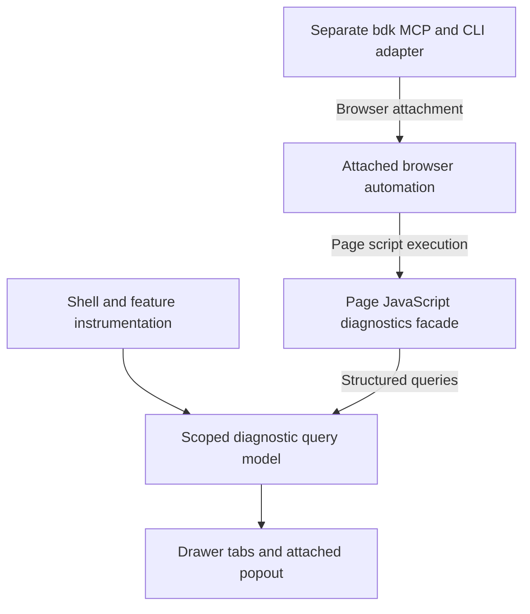

Discovery must identify the application, build/worktree where available, active browser/session, runtime and interactive root. An agent can obtain page details, routes, navigation, available declared components, data/state summaries and measurements with source and freshness information.

Provide versioned capability/schema discovery and structured, filterable, paged queries with stable diagnostic identities. Unsupported capabilities and errors must be explicit. Source-code identifiers can be opt-in hints; source files need not be served to the browser.

### Browser JavaScript diagnostics bridge

The host enables the documented JavaScript diagnostics facade separately from the drawer and popout, subject to the inspection policy for the environment. An attached browser agent with page-script execution capability can discover and query it in the originating tab, including while the drawer is closed.

The facade exposes asynchronous, versioned operations for capability discovery, current page/module/route/navigation information, declared state/data summaries, feature instrumentation and bounded recordings. Requests and responses use serializable structured data; filtering, paging, size limits and unsupported/not-ready/error results are explicit. Exact JavaScript names and signatures belong to API design.

The facade is an adapter over the same headless diagnostic query model used by the drawer and panels. It remains available while the drawer is closed and does not depend on UI components being mounted. It must not expose arbitrary .NET method invocation, application-service resolution or mutable internal state.

Semantic inspection identifies a particular action binding in its live scope and reports the same current availability/disabled reason seen by the UI, with freshness/version and redaction applied. Tests and agents can correlate an invocation with its execution outcome using these stable references. Business-action invocation remains separate: ordinary UI interactions use the normal pipeline; any separately enabled automation adapter must use that same resolution, applicability, confirmation and execution path rather than invoking arbitrary feature methods.

For WASM it queries the attached browser runtime; for Interactive Server it uses an explicit connection to the originating circuit/session. Mixed pages identify and expose reachable interactive roots separately, with capabilities and measurements attributed to their source. An unavailable or disconnected root is reported rather than replaced with another session's data.

The first release delivers and validates the browser facade with an attached browser adapter. A bdk MCP or CLI integration can use that adapter to query the selected page and is a separate deliverable. The browser adapter must support script execution in the attached page.

Diagnostic queries retain host and session access rules, bounded execution and redaction. The host can enable the drawer independently of the browser facade. Read-only inspection and optional capture controls remain separate from business actions.

Before/after performance investigations must support bounded recordings labeled with scenario, build, sample count and measurement coverage. Recording controls are distinct from read-only inspection. Business actions continue through normal application interactions and their authorization.

Outside development, interactive inspection, capture and agent access start disabled. Production use requires explicit host enablement and an access policy for the investigator, selected session and exposed capabilities. Enforce the policy at each diagnostic source or bridge before returning data or starting capture. Drawer, popout and browser queries expose only authorized sessions and reachable roots, with redaction and bounds applied before exposure. On access revocation, stop affected capture and close or clear the exposed inspection views. Use existing host access policies or a host-provided support access integration. Diagnostic-specific roles are optional. Anonymous development remains supported within its configured session access rules.

## Developer experience and compatibility

Deliver starters for the supported hosting arrangements, examples of ordinary modules and deep links, customization recipes, data-component examples and diagnostic instrumentation examples. The default path should minimize repeated registrations and naming ceremony.

Consumer-facing shell contracts remain in preview while the POC and applicable first-stable-release requirements are validated. The POC provides evidence for refining the contracts. Acceptance scenarios defines the release evidence, and Enterprise readiness defines the published compatibility surface.

Public examples must show both the default application and substantial customization using supported contracts. A developer must be able to identify the owner of a page, navigation item or service registration through diagnostics.

### Out-of-the-box greenfield starter

Deliver the starter through the standard .NET template workflow, building on the existing DevKit templates. After the documented SDK and package prerequisites, a newly generated application runs without a database, identity provider or other external application service. Its default profile is Interactive Server with prerendering disabled. It includes the shell and one small demonstration module using local demo data. Database and authentication integrations are explicit additions with documented setup.

The demonstration module uses ordinary Razor components and public framework APIs to show a page, navigation and contextual actions. Include a few focused tests demonstrating module registration and action behavior, runnable through normal `dotnet test`. Developers can extend the module and its tests as they build their application. The starter must not require a separate command runner or testing system.

Document the complete path from a generated application to adding a page, binding local and external actions, and creating a distributable module. Record the actual template names, options, commands and expected results once validated. Do not assume new switches exist in the current DevKit templates. A clean first-run check and the included tests form part of starter acceptance. Demonstration data and optional protected profiles remain separate from existing protected backend endpoints.

### Independent module tests

Module authors can test composition and action behavior without running DoFiesta or provisioning backend infrastructure. Start with existing xUnit, Shouldly, NSubstitute and .NET DI patterns, focused examples and a minimal test host using public framework APIs. Fake feature services can supply data and outcomes while the tests exercise real registration, ownership and action binding behavior.

Keep the test host limited to the composition or component behavior under test. Full browser and application checks continue to verify the relevant integration flows. Extract optional shared fixtures or helpers only when real module tests demonstrate repeated setup. A dedicated module-testing package, custom testing DSL and mandatory alternative testing framework are not requirements of the first release.

### Publishing and consuming a module

A distributable module documents its public registration entry point and stable identity, required and optional dependencies, supported runtimes, exposed options, resources and asset setup. Published extension handles and customization points identify the contracts consumers can use. Reuse project and NuGet metadata plus the typed registration contracts; a separate manifest system is not required.

Before a module is ready to publish, validate its actual packed `.nupkg` in a clean consuming application. Use a local package source and ordinary `dotnet pack`, restore, build, test and publish commands as applicable. The consumer uses public APIs and packaged assets, with no source-project reference to the module or access to its internals.

Verify registration, page discovery, resources, asset delivery and the module's declared hosting profiles. Include the applicable browser publishing and trimming checks. Source-project tests remain useful but do not replace this package check. Record the package version, tested host/profile and observed results so a module author can reproduce the failure or pass.

### Reuse and developer-experience evidence

DoFiesta supplies the primary migration evidence. ShopFiesta is the second, independently composed greenfield example that proves reuse with a different workflow and host layout. Both consume the shared packaged preferences module and published framework APIs, using their own feature services, configuration and branding. The appearance/culture settings scenario in Appendix A supplies that concrete domain-neutral package-reuse case. Changing hosting mode or rendering the same DoFiesta pages in another profile does not by itself satisfy this evidence.

The shared module must work in both applications without copying its source or editing framework internals. Exercise host customization and a shared package correction or upgrade in both consumers. Keep ShopFiesta's initial presentation slice focused on the assumptions that a single reference application cannot expose. Its intended long-term showcase is substantially broader than this first slice.

A developer unfamiliar with the framework internals must be able to follow the public documentation to add an ordinary page, bind a local action, place that action in an external toolbar and consume a reusable module. Record the required files, registrations, framework-specific concepts and any need for undocumented knowledge. Compare the integration effort with the corresponding ordinary Blazor workflow, accounting for the behavior the framework supplies. Use the findings to simplify preview APIs before stabilization; do not claim unmeasured productivity gains.

The developer workflow retains normal .NET build, test and debugging tools and the supported Blazor development loop. Existing DevKit tooling may offer conveniences. Creating an application, authoring a local page and diagnosing a registration error must not require a framework-specific command runner or inspection of internal registries.

### DoFiesta reference application

DoFiesta is the migration target and reference application for the bITdevKit Blazor presentation framework. Its references and migration walkthroughs remain part of this specification. Every capability delivered by the framework and shell must have a runnable DoFiesta scenario that consumes it through the same public contracts, registrations and assets available to other applications. Surface user-facing capabilities in ordinary workflows. Demonstrate configuration, extension contracts and diagnostic integrations through documented example code and runnable profiles. Record where to find each capability, how to enable it, and what observable behavior proves that it is in use.

DoFiesta can evolve its pages, domain and APIs to supply those workflows. The first task-list workflow proves the core integration. Subsequent workflows and profiles cover the rest of the delivered surface. Exercise optional packages in the profiles that enable them. When an optional feature ships, add or update its DoFiesta scenario with that delivery. The framework's release scope determines which capabilities need coverage.

| DoFiesta screen or profile | Capabilities demonstrated |
| --- | --- |
| All tasks · `/todos` | Typed FilterModel query, paging, sorting and filtering, URL-backed view state, selection adapters and local controls. The grid and handwritten view reuse the same query and action contracts. |
| Lists · `/todos/lists` and `/todos/lists/{listId}` | Create and rename lists, bounded dynamic sidebar children, stable links, active path and open-count badges. Move and Complete refresh the affected views and badges. The external toolbar follows the active task view. |
| Task detail · `/todos/tasks/{todoId}` | Canonical detail links, route-backed tabs, field validation, Edit and Save, dirty-state prompts and save revision safety. A task detail link stays valid after a move. |
| Compare lists · `/todos/compare` | Two independent task views, an explicit active-view selector, a shared header toolbar and a local action menu. Move selected demonstrates partial batch outcomes. Exercise independent bindings, confirmation, shared pending state, stale clicks, disposal and keyboard focus. |
| Preferences · `/preferences` | Shell and contributed settings, reference and host themes, light/dark/system mode, culture, localized app/module/component resources, and scoped display preferences. |
| Shell and extension profile | A companion module contributes navigation, Show overdue and chrome or settings content through published handles. Host configuration demonstrates ordering, customization, replacement and disablement, with the resolved contributions visible in diagnostics. |
| Plain Razor profile | A MudBlazor-free host renders task navigation and a contextual action using the same portable shell contracts. The MudBlazor consumer demonstrates packaged CSS and host theming alongside responsive chrome, icon and text modes, tooltips, keyboard access and overflow. |
| Hosting profiles | Run the POC matrix for Interactive Server, WASM, Auto, standalone WASM, mixed pages and sibling areas, and explicit prerendering. The mixed sibling profile pairs the WASM task view with a Server list summary. The public Help page demonstrates static SSR and ordinary deep links. |
| Identity profiles | Anonymous startup and protected task and list workflows. Exercise denied actions and identity changes with scoped state, preferences and backend permission enforcement. |
| Developer diagnostics | Drawer, attached popout and separately enabled browser facade on the same app tab. Show provenance, runtime, active scope, disabled reasons, captures and redaction. The non-development profile demonstrates default-off behavior and an explicit authorized production inspection session. |
| Developer validation profiles | Repeatable cases for invalid composition, initialization, slow or failing providers, subscription cleanup, conflict, lost responses, batch outcomes and backend-owned work. Document each case at the app surface it exercises. |
| Backend export validation profile | All tasks exposes a backend-owned export. The export interaction shows the operation reference and distinguishes accepted submission from completion, including after leaving the view. |
| Optional feature profiles | As each feature ships, demonstrate its real integration, configuration and degraded behavior. A profile with optional packages removed validates the core-only path. |
| Production hosting and telemetry profiles | Reverse proxy, reconnect and runtime replacement, rolling deployment behavior, version compatibility and operator telemetry with developer inspection disabled. |
| Upgrade validation profile | Verify a consuming app upgrade with a published contribution, stored preferences, a bookmarked destination and a theme override. |

### ShopFiesta greenfield showcase application

ShopFiesta is a planned new application under `examples/ShopFiesta`. This specification focuses first on its frontend design and architecture: module-owned pages, layouts, navigation, component contributions, state, forms, feedback, access and runtime-specific feature contracts. The appendix is a design walkthrough, not an implemented application. DoFiesta remains the reference migration and retains its own requirements and workflows.

The initial catalog contains road/race and gravel bicycle components, including manufacturer model designations. It excludes clothing, complete bicycles and general-purpose/computer hardware. Product types, categories, brands, attributes, facets and media remain Catalog data. The shop and presentation framework stay product-agnostic.

The six logical modules Catalog, Stock, Basket, Checkout, Marketing and Orders correspond across frontend and backend. Catalog defines products, variants and identifiers. Stock uses the same merchant SKUs and owns live availability, ordering policies and staff stock management. Orders owns customer history and protected staff operations. Marketing owns recommendations, their staff editor and the complete reporting overview. Its contract supplies all metric values, product-selection metadata and freshness. The overview does not query the other modules to assemble its data.

ShopFiesta will later become a broad DevKit showcase. Its [backend roadmap](spec-shopfiesta-backend-showcase.md) preserves the agreed direction:

| Backend concern | Agreed owner/direction | What the first frontend slice consumes |
| --- | --- | --- |
| Reporting and Messaging | Marketing captures source-module integration messages and stores its reporting projections. | Marketing-owned overview DTOs with capture time, revision and coverage, supplied by a small fixture handler initially. |
| Stock | Stock owns quantity, availability, sellability and per-SKU ordering policies using Catalog's SKU definitions. | SKU-based availability decisions, live updates, freshness and a protected native management page, initially fixture-backed. |
| Queueing | Orders schedules and handles order processing in the backend. | Accepted references, current status and recoverable outcomes; leaving a page only detaches observation. |
| Blob Storage | Catalog's product images come from blobs. | Image URLs, alt text, revision and local missing/failure presentation. |
| File Storage | Catalog's product manuals come from files. | Download links and document metadata/applicability. |
| Jobs | Modules own recurring backend tasks, including Marketing's daily summaries. | Returned calculation time and freshness; no page-owned scheduling. |
| Application Caching | Upcoming backend performance feature, pending merge. | The same feature contracts and truthful result freshness, with no frontend cache dependency. |

The first presentation slice can use minimal, fixture-backed or mocked backend behavior while preserving those owners and contracts. Server access evidence still dispatches real Requester calls to small handlers; WASM evidence uses real HTTP to those handlers. A component mock does not establish either transport path. Conversely, frontend fixtures do not prove backend queue, message, storage, scheduler or cache integration. Those later profiles have separate evidence in the roadmap.

No database, external broker, scheduler, storage provider, identity provider or payment system is required to design or validate the presentation contracts. Keep ordinary .NET/Blazor mechanisms and low setup friction. Backend implementation detail belongs to its own showcase work, not the presentation framework's API or the first frontend acceptance gate.

### DoFiesta proof of concept example application

The first DoFiesta POC proves hosting portability, presentation module composition and contextual interactions before the public APIs are finalized. It starts with the task-list workflow and the hosting and renderer checks below. The reference application expands its coverage as framework capabilities are delivered.

Reuse DoFiesta's existing Todo domain/API, .NET 10 Server/Client arrangement and MudBlazor assets while moving its application composition, layout, navigation and contextual actions onto the new shell. Its current App configures Interactive WebAssembly with prerendering disabled; Server and Auto therefore require additional host/service arrangements. Add documented hosting and validation profiles within the DoFiesta example. Any minimal companion host needed for standalone WASM belongs to that same example and consumes the same feature code. Use the POC build and dependency checks to determine exact assembly and package placement. [DoFiesta client project](https://github.com/BridgingIT-GmbH/bITdevKit/blob/b41782cbd1a2ae220027544fe34f2deefc6c0946/examples/DoFiesta/DoFiesta.Presentation.Web.Client/DoFiesta.Presentation.Web.Client.csproj) · [Current host component](https://github.com/BridgingIT-GmbH/bITdevKit/blob/b41782cbd1a2ae220027544fe34f2deefc6c0946/examples/DoFiesta/DoFiesta.Presentation.Web.Server/Components/App.razor)

Build on the existing Todo workflow with named task lists, task detail deep links, and Edit, Save, Move and Complete actions. Two simultaneous component instances have independent selection, context and pending state. A toolbar outside the owning component explicitly observes the selected scope. Host adapters supply direct Application Requester access on Server and typed HTTP clients in WASM through the portable feature's service contracts. Backend module startup, repositories and server-only registrations stay on the server.

The task-list walkthrough below defines the first extension to DoFiesta's frontend and backend and the shell contracts it exercises.

| POC arrangement | Required evidence |
| --- | --- |
| Interactive Server baseline | Full interactive shell, prerendering off, direct Application Requester dispatch, equivalent application authorization, correct circuit-scoped services and reconnect/unknown-outcome behavior. |
| Interactive WebAssembly | The same portable feature executes in the browser through a real typed HTTP client; no server-only dependency leaks. |
| Interactive Auto | Controlled cold and warm activations exercise Server and browser execution with their respective Requester and HTTP implementations. Record the actual selected renderer; no live instance or action migration is expected. |
| Different modes on different pages | Direct links, refresh and back/forward reconstruct the intended page/context, using full navigation where required. |
| Independent Server and WASM areas | Legal sibling boundaries coexist; each external toolbar remains with its owner runtime. One explicit invalidation integration demonstrates coordination without remote component callbacks. |
| Plain Razor renderer | A minimal DoFiesta host builds without direct or transitive MudBlazor references and runs navigation plus a contextual action through a plain Razor layout. |
| Grid and handwritten view | Both views use the same FilterModel query mapping and typed selection context to drive contextual actions. |
| Static SSR public surface | Ordinary links and SSR-compatible content work without interactive activation; no full static MudBlazor-shell promise. |
| Standalone WebAssembly host | A minimal browser-only startup consumes the same shared feature through an API. This is distinct from a Web App using Interactive WebAssembly. |
| Explicit prerendering opt-in | Dedicated Server, WASM and Auto cases exercise full-load prerendering, approved data transfer and fresh live bindings. Interactive navigation is tested separately. |

Profile selection is a host/startup or route-boundary concern. A demonstration control may navigate to another profile, but must not imply that changing a dropdown migrates live components or operations between runtimes. MudBlazor providers belong inside the compatible interactive compositions that use them.

The example contributes at least one static navigation item, bounded asynchronous children, a runtime badge and route-backed detail tabs. A second small consumer contribution attaches a contextual action or navigation provider and demonstrates explicit override/disable behavior. Application-, module- and component-owned translations coexist. The baseline runs without an identity provider; a separate opt-in identity profile demonstrates protected capabilities and backend enforcement. Existing protected DoFiesta endpoints are not made anonymous to satisfy the baseline; use isolated POC data/endpoints with deliberate access rules.

Development diagnostics expose the selected renderer, activation phase, module/contribution provenance, live scope attachment, evaluation counts and failures through the drawer and the read-oriented JavaScript facade. Browser checks verify that the separately enabled facade returns source-attributed diagnostics for the originating tab and its reachable runtimes with the drawer closed. Measure startup/interactivity timing, initial transfer size and initialization/query/action counts as observations for comparison; do not set unmeasured performance promises. Use those observations to establish the limits required by Performance baselines and release acceptance before stabilization.

Completion requires repeatable run instructions, the shared feature and minimal host arrangements, and recorded pass/fail evidence for the POC arrangement table and workflow checks in this section. Focused browser checks cover deep-link reloads, two independent toolbar scopes, selection/context changes during confirmation, stale asynchronous results, disposal, duplicate invocation prevention, unknown mutation outcomes and save-revision safety. Prerendered cases demonstrate no browser interop before activation, no unintended duplicate mutation/subscription, and no second initialization query for the read explicitly transferred. Auto results identify both actual runtimes. Fault injection and test data remain example-owned.

The POC validates the existing shell model. It does not add an operations registry, scheduler, edit-session coordinator, search/command discovery, generic cross-runtime action transport or offline synchronization engine. Findings can refine contracts and host profiles before public API stabilization.

### Delivery gates and evidence

A gate is a working checkpoint with recorded checks. A preview contract is a public registration API, typed context, component parameter or behavior agreement being tried before stable release. For example, the first gate proves that the external toolbar invokes the selected component's binding and rejects a stale confirmation.

Deliver the reference application in the following order. Gates G1 through G3 stage the POC evidence; G4 completes the production and stable-release evidence. The arrangement table and applicable acceptance scenarios remain required.

| Gate | Runnable application evidence | Preview contracts validated |
| --- | --- | --- |
| G1: Interactive Server foundation | Migrate the core shell and task workflow with prerendering off and direct command/query dispatch. Exercise two independent task scopes, an external toolbar, stale confirmation, disposal, protected direct links and AppState isolation. Run the greenfield starter with local demo data and its included tests without external services. Verify host-composed availability and generated links, and capture the initial Server performance baseline. | Module registration, page ownership and route availability, Server feature access, state ownership, typed action context, scope attachment, invocation lifecycle, starter integration and initial performance evidence. |
| G2: Portable consumers and adapters | Run the shared feature in Web App WASM and standalone WASM through real HTTP clients. Run navigation and an action in the MudBlazor-free Razor host. Verify the optional grid and handwritten-view selection policies, form error mapping and revision safety. ShopFiesta's focused greenfield slice installs the actual shared packed module through NuGet with its own workflow, services and layout. Compose its corresponding frontend/backend feature modules, including customer order history and protected operations views. Verify module assets, JavaScript cleanup, base-path links and any required browser availability projection. Capture the browser performance baseline. | Browser module registration and dependencies, frontend/backend module correspondence, runtime-specific feature access, headless renderer contracts, FilterModel and selection adapters, validation feedback, asset ownership, destination contracts, availability and reuse through public package contracts. |
| G3: Hosting and activation | Run cold and warm Auto visits, mixed pages and sibling roots, Static SSR and explicit prerender cases. Exercise context changes, data handoff, explicit invalidation and diagnostics attributed to the originating runtime. | Runtime and root ownership, prerender activation and transfer, context/invalidation integration and diagnostic source attribution. |
| G4: Production and stable release | Run scaled proxy/reconnect and rollout profiles, authorized diagnostics including popout and browser facade, operational telemetry, accessibility checks and a consuming-app upgrade. Verify supported profiles against their evidence-based performance limits. | Session and recovery integrations, diagnostic access and schemas, telemetry, accessible renderer behavior, configuration, assets, upgrade compatibility and performance acceptance. |

Each gate records its runnable profile, setup and execution commands, tested build, actual results and the concrete preview APIs and behavior contracts exercised. Automate repeatable core checks such as composition validation, route denial, scope isolation, selection transitions and stale-result rejection. Use browser checks for the relevant interaction flows. Record manual keyboard and screen-reader checks where human assessment is required. Keep application-specific execution records with the example or task outputs outside the documentation tree.

A failed or unavailable required check leaves the gate open. Record the limitation and rerun the check when its prerequisite is available. A later gate can refine a preview contract; rerun affected earlier checks after that change. Publish stable contracts after all applicable release evidence passes.

### Task lists in DoFiesta

A user creates a **Release prep** list, moves an existing task into it, opens the list from the sidebar, and completes the selected task from the page header. DoFiesta reuses its existing Todo search, detail read and application request path. It adds list reads and writes, task membership, and targeted Move and Complete commands. The existing bulk Complete operation retains its separate scope. [Todo page](https://github.com/BridgingIT-GmbH/bITdevKit/blob/b41782cbd1a2ae220027544fe34f2deefc6c0946/examples/DoFiesta/DoFiesta.Presentation.Web.Client/Pages/TodoItemIndex.razor) · [Todo endpoints](https://github.com/BridgingIT-GmbH/bITdevKit/blob/b41782cbd1a2ae220027544fe34f2deefc6c0946/examples/DoFiesta/DoFiesta.Presentation.Web.Server/Modules/Core/Endpoints/CoreTodoItemEndpoints.cs)

#### Task list screen

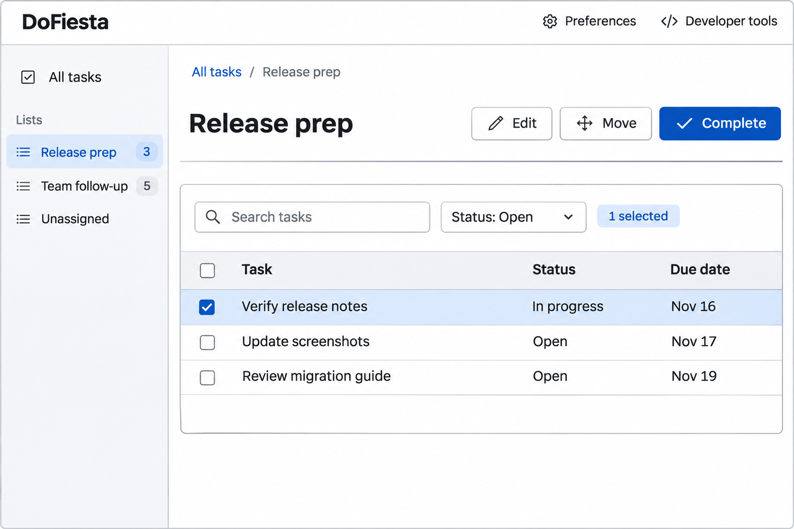

The page header hosts Edit, Move and Complete above the task view. The selected row belongs to the task view and supplies the context for those actions. The sidebar lists are dynamic destinations and their badges count readable unfinished tasks across each list. In this wireframe the Open filter includes tasks in progress. On narrow screens the same action bindings can appear as icons or in overflow.

#### Task list model and routes

| Model | Fields and rules |
| --- | --- |
| TaskList | Stable typed ID, name, owner and concurrency version. The server determines ownership. The initial operations are create, rename and read. Renaming preserves identity and links. |
| TodoItem | Add a nullable TaskListId. A task belongs to at most one list. Existing tasks remain unassigned and still appear in All tasks. A move preserves task identity and other task fields. |
| Task list summary | List ID, display name and open task count for tasks the caller can read. Count across the list's authorized tasks, independently of the current filter or loaded page. |

Keep `/todos` as **All tasks**, use `/todos/lists/{listId}` for a list and use `/todos/tasks/{todoId}` for the canonical task detail. The detail URL survives a move. Each route resolves its own IDs through an authorized read. The list view applies its list constraint together with supported FilterModel filters, ordering and paging. Supply a bounded, deterministically ordered list-summary query for navigation, with continuation where needed.

#### Move and Complete commands

| Command | Input | Successful result |
| --- | --- | --- |
| Move Todo | Task ID, expected task version, expected source list ID and destination list ID. An explicit null source means unassigned. An explicit null destination unassigns the task. | Updated task summary and version, previous and resulting list IDs, and whether membership changed. Preserve status and other edits. |
| Complete Todo | Task ID, expected task version and expected current list ID. An explicit null list means unassigned. | Updated task summary and version, current list ID and whether status changed. Preserve list membership and other edits. |

For browser execution, expose these through typed DoFiesta clients and targeted action endpoints, such as `POST /api/core/todoitems/{id}/actions/move` and `POST /api/core/todoitems/{id}/actions/complete`. The endpoints dispatch DoFiesta commands through Requester. Interactive Server dispatches those commands directly. Application authorization and validation apply to both paths. The backend checks task write access and list access, validates that a destination is in the permitted ownership scope, and enforces the expected membership and concurrency version when committing the update. A stale version or membership returns a conflict and leaves the task unchanged. Missing or inaccessible data follows the existing DoFiesta access policy. An already satisfied request with valid preconditions returns a successful no-op without advancing the version or publishing a change.

On a confirmed Move, refresh the affected source and destination views and badges. On a confirmed Complete, refresh the task and its list badge. Refresh All tasks only when the change affects its active query or projection. Use targeted feature invalidation after the commit. If a mutation response is lost, record an unknown outcome and reread the task before offering another attempt. A read can establish current state even when it cannot attribute that state to the original request.

#### Dynamic navigation and the external Complete action

The Todo presentation module publishes a typed navigation-children handle for the **Lists** parent. Its provider accepts the parent, relevant route and application context, paging input and cancellation. It queries the authorized list summaries through an injected client and returns bounded descriptors with stable identities and list destinations. The shell owns loading, retry, active path and stale-result handling. Creating or renaming a list invalidates the Lists children. Changes to open task counts invalidate the affected badges.

The module also publishes a typed Todo selection action handle. Each mounted list view exposes a live scope with an immutable selection snapshot. For a single selected task, Complete reads the task ID, list membership, version and relevant eligibility data from that snapshot. The page explicitly binds its header to the active view. The published handle identifies the contribution contract and the live scope reference identifies the component instance. The same action can render locally, in the header or in overflow while sharing its binding and pending state.

The following names illustrate the preview API shape.

```csharp
module.Navigation.AddChildren<TaskListChildrenProvider>(TodoPoints.ListChildren);
module.Actions.Add<CompleteTodoAction>(TodoPoints.SelectionActions);

headerToolbar.Observe(activeTodoViewScope);
```

Complete applies to one eligible task. The shell captures its target and context revision, reserves the binding, and rechecks applicability after confirmation. A selection or list change that invalidates the captured binding prevents dispatch. Once dispatched, the command keeps the captured task, list and version. The feature owns the command and subsequent refresh while the toolbar observes its binding.

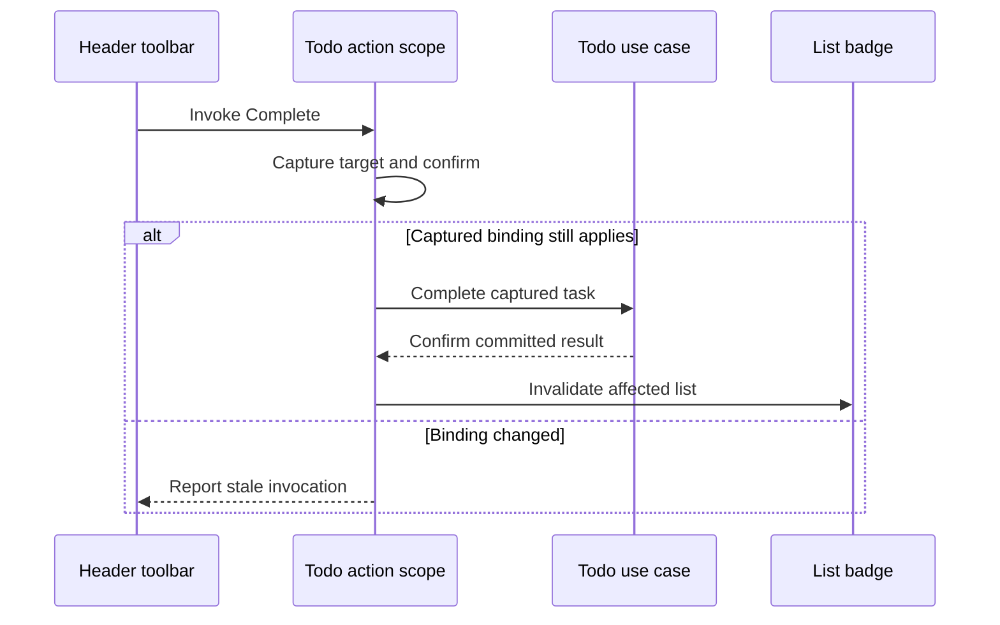

Run the same navigation provider and Complete binding through the MudBlazor and plain Razor hosts. The MudBlazor grid and handwritten task view use the same query and selection adapters. A second module contribution can attach an action through the published handle to demonstrate cross-module use.

### Additional DoFiesta reference workflows

| Scenario | Workflow and observable behavior |
| --- | --- |
| Batch move | In Compare lists, select two tasks and use Move selected. A concurrent edit makes one task stale. Show the successful move and the other task's conflict separately. Refresh the affected lists and offer recovery for the conflicted task. The existing Complete action targets a single task. |
| Backend-owned export | Submit an export of the filtered All tasks view, show the operation reference, leave the page and use the reference to observe completion. On lost acknowledgement, reconcile submission using its original correlation where supported. Keep an unresolved submission marked unknown and require a new user decision for any further submission. |
| Mixed runtime | Place the task view and its external toolbar in a WASM area beside an independent Server list summary. A confirmed Complete action refreshes the summary through explicit application invalidation. Diagnostics attribute action execution and summary refresh to their respective runtimes. |
| Save and leave | Edit Verify release notes and choose Save and leave. A validation error, version conflict or unknown response keeps the editor active and preserves the draft. Saving an earlier revision preserves later edits and prevents automatic navigation while those edits are dirty. |
| Identity change | Give two demo users different lists and preferences. Sign out during a delayed list read and sign in as the second user in the same tab. The old read must not populate the second user's sidebar, selection or diagnostics. |
| Cross-package customization | A companion module contributes Show overdue through the list's published toolbar handle. The host replaces that contribution by stable ID. Adjacent actions continue to work and diagnostics show the effective source. |

The sidebar selects Release prep, the header shows the current list and task ancestry, and the task detail tabs preserve the active route. The same resolved destinations and action behavior are available in the plain Razor renderer. Use the MudBlazor consumer to demonstrate packaged CSS and host theming, and the plain Razor host to verify the MudBlazor-free dependency boundary.

### Ordinary developer workflow

| Task | Developer supplies | Framework handles |
| --- | --- | --- |
| Add a presentation module | A module implementation and its contributions. | Type-derived default module name, source provenance and composition validation. |
| Add a page | An ordinary Razor component, route and optional navigation contribution. Explicit ownership mapping is needed when the page assembly's default is insufficient. | Resolve module ownership, integrate server and interactive page discovery, apply route availability, and preserve normal layout and deep-link behavior. |
| Add contextual actions | Typed context, callbacks and applicable availability rules. | Live binding identity, shared pending/busy state, invocation checks and lifecycle cleanup. |
| Show actions outside a component | Explicit attachment to the intended scope/outlet; active-source selection where needed. | Rendering and observation of the original bindings. |
| React to state changes | Relevant dependencies or explicit invalidation. | Subscription ownership, targeted reevaluation and stale-result rejection. |
| Package reusable behavior | A published typed contract, stable attachment target and a provider where useful. | Consistent registration, ordering, supported overrides and diagnostics. |

A handwritten Orders page can use ordinary Razor, injected services and a small typed action declaration. It must not require a framework page base class, provider class, mediator request, manually assigned execution IDs or separate duplicate registration for each button. Optional data components provide adapters through this same model.

Binding conveniences manage subscriptions, cancellation signals and disposal while preserving explicit context ownership. Disposing bindings releases their own resources without manually disposing DI-owned shared services. Ordinary local callbacks and templates remain first-class; provider contracts serve reusable or asynchronous contribution logic.

Publishing is deliberate. Routine local action identities are derived; stable public definitions and attachment targets are declared when another package must attach, reference or override them. More explicit configuration is appropriate for multiple exported component scopes, longer-lived execution and cross-runtime coordination. The simple path must not require that advanced configuration.

Examples must demonstrate a default local toolbar and an externally placed toolbar using the same action bindings, including two independent component instances. The module/navigation declarations are written once per applicable composition; ordinary pages do not repeat global host registration.

## Minimal Orders module walkthrough

This developer-experience example combines an ordinary Orders list and detail destination with an Approve extension. The read-only list/detail path works without CRUD packages, authentication integration or a mandatory framework page base. Approval is feature-supplied behavior. The screens are illustrative mockups, not an implemented application or finalized visual design; file names and routes illustrate ownership rather than public API signatures.

[Appendix A](#appendix-a-proposed-api-example-and-execution-contract) expands these contracts into a customer-facing e-commerce shop with a protected order-operations area, proposed public API usage and future executable checks.

### Module contribution and runtime registration

The host selects Orders once per applicable runtime composition. Its presentation contribution declares the page assembly, an Orders navigation entry, browser-safe frontend services and applicable resources. On Server it extends the existing module; WASM consumes the portable presentation definition without executing backend setup. Adapters preserve one logical module identity and do not require a second identity constant.

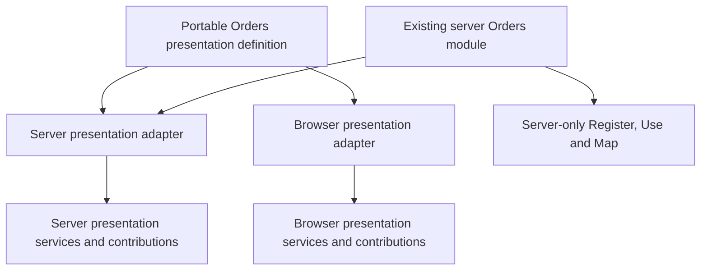

The two presentation paths execute in their respective runtime/container; the diagram does not imply shared service instances, selection or action bindings. Auto uses the appropriate path for the selected runtime. Resources may remain application-, module- or component-owned.

| Developer-owned part | Responsibility |
| --- | --- |
| Orders presentation contribution | Declare pages, navigation, frontend services and resource references once per applicable composition. |
| Orders.razor | Display/query the list and own its local filter/selection behavior. |
| OrderDetails.razor | Load the route-selected order and own its detail context and actions. |
| Orders feature access and DTOs | Reuse suitable feature service contracts with direct Requester access on Server and typed HTTP access in WASM. Keep repositories behind application use cases; add no wrapper solely for shell participation. |

### Orders list screen

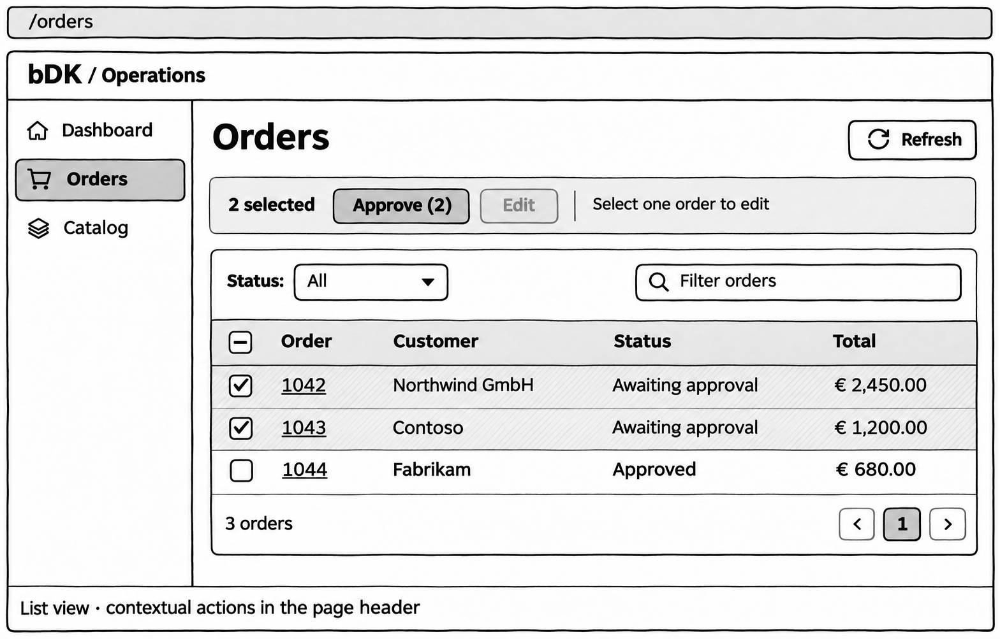

The list at /orders shows 1042 and 1043 selected. Approve targets those two records; Edit is disabled with a reason because it requires one selection. The action toolbar is above and outside the bordered list component. Refresh is explicitly connected to this list's query/consumer. Local filtering is part of this screen and does not imply global search.

A handwritten Razor implementation owns its data-loading code, columns, templates and query meaning. Optional grid/FilterModel adapters can supply paging/query lifecycle and selection integration; displaying a table does not make those packages mandatory. The shell supplies layout/action integration and standard presentation conventions. Local selection can remain component state.

### Declare Approve and bind the external toolbar

| Orders supplies | Framework handles |
| --- | --- |
| Typed selected IDs, relevant status/capability values and context revision. | Bind to the owning instance and derive routine runtime identities. |
| Explicit selection/context updates and declared availability dependencies. | Reevaluate affected action state and reject stale evaluations. |
| Feature-defined eligibility and confirmation content. | Capture immutable inputs, suppress duplicate invocation and recheck after confirmation. |
| An awaited approval callback using the Orders client. | Observe execution, share busy state across presenters and manage binding cleanup. |
| Known result updates or targeted invalidation; uncertainty/partial-result recovery. | Consistent feedback presentation with one owner and accurate outcome reporting. |

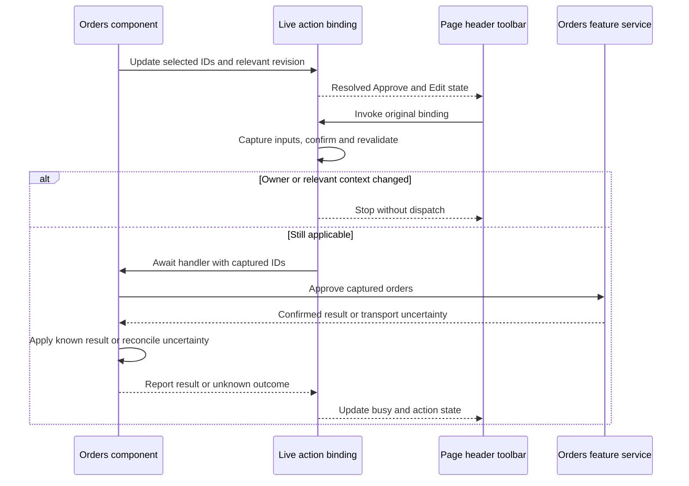

The default placement can be a local toolbar. Moving the same actions to the page header changes only the outlet attachment: definitions, callbacks, captured targets and execution state remain the same. A second Orders component has a separate context/binding; selecting which source supplies the header is explicit. Focusing the header/menu never silently changes that source.

Selection changes update the declared context; the framework does not discover changes by inspecting arbitrary mutable fields. A direct client call is sufficient, with Requester optional. Successful mutation and a later refresh/subscriber failure remain separate outcomes under the existing feedback rules.

### Detail screen from a direct URL


Opening /orders/1042/overview loads order 1042 from the route without first mounting the list or clicking its menu entry. Overview, Items and History use the example's route-backed tab policy. The detail component supplies its own Approve/Edit bindings, displayed above its content by the page frame. Its target does not depend on the list's earlier selection.

Edit invokes the feature's edit workflow; the read-only detail example does not require a generic editor. Adding editing introduces feature-owned validation, submitted edit revisions and the optional page-owned unsaved-change helper. Returning to the list uses its declared view-restoration policy; selection is transient by default.

### Developer experience acceptance

The example must be implementable with ordinary Razor, injected clients and small typed action declarations. It must not require a provider class for local callbacks, a mediator request for each button, a framework page base, manually assigned execution IDs or repeated global host registrations in pages. Binding conveniences own their subscriptions/cancellation/disposal while respecting DI-owned service lifetimes. The screens and diagrams are acceptance references; they do not prescribe internal implementation.

The same scenario must demonstrate local and external toolbar placement, direct detail loading, two independent Orders instances and disposal during an in-flight action. Existing confirmation, unknown-outcome, batch-result and save-revision acceptance rules continue to apply.

## Acceptance scenarios

The DoFiesta column identifies the runnable reference scenario for each acceptance requirement. The Orders walkthrough illustrates the same contracts in a different domain. DoFiesta exercises them through Todo workflows.

| Validation category | Required evidence |
| --- | --- |
| POC evidence | Pass the arrangement table and workflow checks in the DoFiesta proof of concept section. Use the results to refine preview contracts and hosting arrangements. |
| First stable release evidence | Verify the acceptance scenarios applicable to every capability and hosting profile in First stable release scope. Include enterprise, accessibility, production diagnostics and consumer upgrade evidence. Relevant POC results can count toward this evidence. |
| Optional capability delivery | Verify applicable scenarios when the optional capability ships, with DoFiesta showing the enabled behavior and its declared fallback or isolation. An optional capability delivered in the first stable release is covered by that release's evidence. |

| Scenario | Observable acceptance | DoFiesta screen or profile |
| --- | --- | --- |
| Minimal application | The shell starts with a single presentation module, no auth integration and no higher-level packages. | Anonymous / core-only profile |
| Out-of-the-box starter | Generate the documented starter and run it with local demo data, no database or identity provider, and no other external application service. Interactive Server uses prerendering off. Included registration and action tests pass through normal `dotnet test`. | Generated starter and G1 |
| Independent module testing | A module author uses the supplied examples and minimal host with standard .NET test tools to verify public composition and action behavior independently of DoFiesta and backend infrastructure. Shared helpers remain optional and evidence-driven. | Module test examples and G1 |
| Module composition | Registering an enabled module exposes its pages, routes, resources and contributions; suppression removes the intended capability with clear diagnostics. | Shell and extension profile |
| Single-host composition | One application host composes frontend and backend capabilities along the same logical module boundaries. Two feature modules integrate through published contracts without accessing each other's private state or implementation. Feature availability uses that host's configuration and existing services, with a safe browser projection only where needed. | Server and WASM profiles |
| Page ownership and route enforcement | An assembly default and explicit page mappings resolve ownership without duplicate URL declarations. Reject ambiguous ownership. Disabling one module in a shared assembly makes its destinations unavailable on full loads and interactive navigation before page initialization or protected reads. | Shell and extension profile, Hosting profiles and developer validation |
| Existing server module | A backend presentation module adds UI capabilities without duplicating module identity or executing server setup in WASM. | Server and WASM profiles |
| Composition validation | Duplicate identities/routes, missing required dependencies and cycles produce actionable startup diagnostics; optional dependencies follow declared fallbacks. | Developer validation profiles |
| Conventions and discovery | Selected modules and declared page assemblies supply unambiguous defaults without repeated per-page registration. Unselected modules remain absent. Explicit overrides take precedence and diagnostics identify each registration's source. | Starter and developer validation profiles |
| Generated registration, when supplied | Generated and explicit declarations follow the same composition rules without duplicate contributions. Host overrides remain effective, diagnostics are actionable and browser output passes the supported publishing checks without backend dependencies. | Applicable generator and WASM profiles |
| Deep linking | Bookmarking, refresh and back/forward reconstruct record pages and route-backed tabs without previous navigation clicks. | Lists and Task detail |
| Cross-module destination links | Typed destination helpers generate correctly encoded route and query values under the configured application base path while preserving published module routes. Absent optional targets are hidden by default or explicitly disabled with a reason. Missing required targets fail startup validation. | Lists, Task detail and developer validation |
| Required feature availability | Known configuration resolves directly. A delayed or failed required check keeps only dependent activation and actions pending or unavailable with bounded recovery. Unrelated features remain usable, obsolete identity or workspace results are rejected, and backend authorization remains authoritative. | Identity profiles and developer validation |
| Navigation customization | One hierarchy appears across sidebar, header and page tabs; replacing a renderer preserves availability and action behavior. | Lists, task-detail header and tabs, and Plain Razor profile |
| Dynamic navigation | Callbacks generate order/category children with contextual parent, route and state inputs; static and dynamic children coexist with stable identities, bounded loading and isolated failures. | Lists |
| Relevant state subscriptions | A selected state value change refreshes subscribed components/pages/navigation; unrelated changes do not, subscriptions dispose safely and stale work is discarded. | Lists |
| Dynamic deep links | Opening a generated order/category URL resolves directly without first loading or expanding the navigation tree. | Lists and Task detail |
| Headless composition | A minimal DoFiesta host without direct or transitive MudBlazor dependencies runs navigation and a contextual action with a plain Razor renderer. | Plain Razor profile |
| Mixed hosting | Standalone WASM, Interactive Server, Web App WASM/Auto, mixed pages and independent mixed-mode areas satisfy the hosting matrix, with correct service placement and explicit coordination. | Hosting profiles |
| Prerendering | Explicitly opted-in full loads avoid unintended duplicate writes/queries/subscriptions, restore approved data and activate browser services safely; cold/warm Auto and interactive routing are tested separately. | Prerendering profiles |
| Optional identity | Anonymous, mixed and protected applications behave correctly; missing auth never grants protected capabilities. | Identity profiles |
| Context and privacy | User/context changes invalidate old bindings, request cancellation/supersede stale work, partition private state/preferences and reject previous-context completion. No backend rollback is implied. | Identity profiles · two-user transition |
| Localization | App, module and component resources coexist; culture changes update contribution text and formatting with documented fallback. | Preferences and Lists |
| Styling and packaging | The reference theme, a host-added theme and utility styling coexist; a consuming application uses compiled assets without a mandatory JS build. | MudBlazor consumer and Preferences for assets and themes, Plain Razor profile for dependencies |
| Module asset setup | Installing a module supplies its own styles and scripts through native packaging and imports without per-module host-page edits. Global renderer dependencies are explicit and configured once. A clean package consumer resolves the declared assets. | Packaged module consumer and G2 |
| JavaScript owner cleanup | Repeated mounting and disposal leave only current listeners, observers, timers and interop references. Late callbacks cannot update disposed owners. Two component instances retain separate mutable context, and cleanup follows native patterns even when Server interop is disconnected. | Developer validation profiles and G2 |
| Data composition | A MudBlazor grid and handwritten view share FilterModel query and selection adapters and drive the same contextual actions. DoFiesta demonstrates editing and validation through runtime-specific feature access. | All tasks |
| Selection adapter defaults | Selection survives paging by default and clears when the view enables clear-on-paging. Filters or search clear selection. Sorting preserves it. Refresh updates selected target data and eligibility, removing only confirmed deleted or inaccessible records. A selected count and clear control expose off-page selection. Query-wide select-all remains deferred. | All tasks and Compare lists |
| Mutation and refresh | A confirmed save remains successful if refresh or a local subscriber fails; input survives a concurrency conflict. | Task detail and developer validation |
| Form field error mapping | Matching property paths map validation errors to fields, explicit aliases handle different names, and unmatched or model-level errors appear in the summary. Native Blazor and MudBlazor integrations apply the same behavior to Server and HTTP outcomes. | Task detail and developer validation |
| Validation revision safety | Reject an earlier submission after the user changes its values. Preserve current input and show the earlier rejection in the summary, with no stale field errors on the current revision. An older response cannot replace newer submission feedback. | Task detail and developer validation |
| Coordination | Requester/Notifier use correct lifetimes, execution semantics and targeted invalidation within the owning runtime. | Lists and Task detail |
| Failure containment | A failed optional contribution or initialization leaves unrelated features usable; recovery does not duplicate mutations. | Lists and developer validation |
| Unsaved changes | An opted-in page prompts on supported navigation paths without requiring global draft/save orchestration. | Task detail |
| Diagnostics | The shipped drawer and attached popout inspect the originating session under the same access and redaction rules. Failed popout attachment leaves the in-page drawer available. Navigation and measurements show context, source and coverage. | Developer diagnostics |
| Agent discovery | With the facade explicitly enabled and the drawer closed, an attached browser adapter retrieves source-attributed page and feature diagnostics for the originating tab. Drawer-only configuration leaves the facade disabled. | Developer diagnostics |
| Non-development behavior | Interactive inspection, capture and bridges are disabled by default. Explicit production opt-in allows authorized investigation within the selected session and capabilities. Unapproved sessions and revoked access are denied. The facade requires separate enablement, and returned data is bounded and redacted. | Non-development profile |
| Accessibility and responsiveness | Default layouts remain usable by keyboard at supported widths. Icon-only, text-only and combined action placements preserve accessible names and observe the same binding in the toolbar and overflow. | Lists and Compare lists |
| Optional features | Removing inbox, admin or data packages leaves the core shell valid; missing optional backends affect only their declared features. | Optional feature profiles |
| Orders navigation walkthrough | Expanding Orders produces stable data-derived children; a confirmed mutation updates relevant membership/counts, while direct detail links and unrelated state changes behave independently. | Lists and Plain Razor profile |
| Refresh policy | Declared dependencies trigger targeted reactions; unchanged selectors, persistence completion and diagnostics cause no business reload. Inactive views become stale, explicit invalidation is coalesced and unsaved edits remain page-owned. | Lists |
| Cross-package typed contribution | A customer module contributes navigation children or toolbar actions through another module's published contract/target, with source ownership inferred and no shell-source edits. | Shell and extension profile · Show overdue |
| Contract and attachment validation | Typed registrations constrain compatibility; missing required targets/contributions, invalid component parameters and cardinality violations produce actionable composition diagnostics. | Developer validation profiles |
| Predictable customization | Add/configure/decorate/replace/disable follow point-specific rules; competing replacements need host resolution and the effective order/provenance is inspectable. | Shell and extension profile |
| Scoped contribution lifecycle | Shared metadata contains no user-specific state or captured scoped services; runtime evaluation uses the correct DI scope and disposes subscriptions with its owner. | Lists and developer validation |
| Consistent contribution diagnostics | Human and agent diagnostics expose point/target identity, source module, effective ordering/override, activation reasons, evaluation status and local errors through the existing model. | Developer diagnostics |
| External contextual toolbar | A published placement composes before its page is mounted. On activation the external toolbar resolves the binding of the explicitly selected scope, invokes the correct behavior, and observes status changes. A local placement can use that same live binding. | Lists and Compare lists |
| Multiple contextual components | Two grids/detail instances retain separate live contexts; explicit activation controls exported actions and moving focus to the toolbar does not lose the source scope. | Lists and Compare lists |
| Toolbar lifecycle and stale clicks | Navigation/disposal removes bindings; obsolete clicks cannot target a newly selected order, and late results cannot update another scope. | Lists and Compare lists |
| Shared action surfaces | A toolbar and menu intentionally using the same binding share busy state, duplicate-invocation prevention and feedback ownership. | Lists and Compare lists |
| Core versus data toolbar behavior | A handwritten component uses the core toolbar without CRUD packages; optional grids/CRUD adapters contribute through the same contracts. | All tasks |
| Toolbar rendering boundaries | A presenter and owner work in their compatible composition or documented in-process arrangement. Generic Server/WASM component invocation is not assumed; unsupported attachment is diagnosed, while application integrations retain invocation safeguards. | Hosting profiles |
| Definition versus binding state | Two Orders components share an action definition but retain independent selection, availability and execution state. A toolbar/menu sharing one binding observes the same execution. | Lists and Compare lists |
| Confirmation target revision | Changing relevant selection, scope or application context during confirmation prevents stale execution and requires a fresh decision; cancelling confirmation performs no mutation. | Lists and Compare lists |
| Pending invocation conflict | Repeated invocation of one binding while confirmation or execution is pending cannot open duplicate prompts or dispatch duplicate operations. Separate bindings follow their own policy and backend concurrency rules. | Lists and Compare lists |
| Modal and local keyboard behavior | An editor modal has its own scope; toolbar/menu focus preserves target binding, accessible keyboard navigation and explicit local shortcuts respect modal/text-input behavior without a general routing service. | Task detail |
| Failed or uncertain save and navigation | Validation/failure/unknown outcome preserves edits and keeps the page active during save-and-leave. Newer edits also prevent automatic leave unless the user explicitly resolves/discards them. | Task detail · Save and leave |
| Restorable view precedence | URL, navigation/scope state, preferences and defaults follow the view's declared precedence; explicit empty filters, data changes and invalid page/tab values recover predictably. | All tasks |
| Navigation during action work | Owner disposal requests cancellation of scope-owned work and rejects stale UI completion without claiming backend rollback. Longer-lived work uses independent services/inputs and its declared recovery policy. | Task detail and Compare lists |
| Semantic disabled reasons and outcomes | Read-only inspection identifies the intended scope/binding, reports the UI's current disabled reason and correlates execution outcomes without dispatching a business action. | Developer diagnostics |
| Save revision safety | Saving revision 7 while editing revision 8 leaves the later edits dirty and intact; an explicit editing lock is an alternative supported policy. | Task detail · Save and leave |
| Batch action outcomes | A partial approval preserves order 1042's confirmed success and presents order 1043's conflict without retrying the complete batch or assuming atomicity. | Compare lists · Move selected |
| Unknown mutation outcome | A lost response after dispatch is distinguished from confirmed cancellation/failure; reconciliation uses original targets/reference where available and no automatic mutation resubmission occurs. | Task detail and developer validation |
| Presenter lifetime | Hiding, moving or disposing a toolbar/menu presenter does not transfer ownership, reset another presenter's busy state or cancel independently owned execution. | Lists and Compare lists |
| Backend export ownership | A returned operation reference confirms export submission, not completion; page disposal detaches observation and backend cancellation/recovery rules remain authoritative. Lost acknowledgement is handled as potentially unknown acceptance. | All tasks · backend export validation profile |
| Defaults and registration ceremony | A local typed callback receives scope identity, shared busy state and safe invocation defaults without manually registering every diagnostic identity or adding a provider class. | All tasks |
| Logical scope versus DI lifetime | Two component action scopes remain distinct even when they share a longer-lived injected service; disposing a binding does not manually dispose a DI-owned shared service. | Lists and Compare lists |
| Mixed page action ownership | A WASM Orders area renders its external toolbar and component together beside an independent Server area; selections, execution and diagnostics retain their originating identities without implicit shared state. | Mixed sibling profile · WASM task view and Server list summary |
| Static public composition | SSR-compatible public Razor/HTML and ordinary links render without authentication; no fully functional static-only MudBlazor shell is assumed. Live actions/providers/subscriptions activate inside compatible interactive areas. | Static SSR Help profile |
| Ordinary developer workflow | An ordinary Razor page contributes local or explicitly exported typed callbacks without a framework page base, mandatory provider/mediator class or manually assigned runtime IDs; binding conveniences handle cleanup and preserve DI ownership. | All tasks |
| Native platform and low-friction integration | A developer follows public documentation to add a page and local/external action using normal Blazor components and .NET tooling. Record integration effort and remove unnecessary framework-specific registrations or layers. Specialized pages can use applicable shell services and native controls directly. | All tasks and developer-experience evidence |
| Reuse across applications | DoFiesta and ShopFiesta consume the same packaged module with different workflows/layouts. Host customization and a shared correction or upgrade work in both without source copies or framework-internal changes. ShopFiesta's presentation slice can use minimal/mocked backend behavior while retaining its logical module boundaries. | DoFiesta, ShopFiesta and G2 |
| Minimal Orders walkthrough | One module supplies an ordinary list/detail and typed Approve callback, with local/external toolbar placement, direct detail URLs and independent component scopes; illustrative screens/diagrams correspond to the declared behavior without mandatory CRUD or mediator infrastructure. | Lists and Task detail |
| Resolved contribution isolation | Resolving a shared definition for one culture, user or component context leaves the source definition and other contexts unchanged, including visibility, badges and generated children. | Identity profiles and Compare lists |
| Temporary contribution cleanup | Repeatedly mounting/disposing page, layout and region owners leaves only current runtime controls/subscriptions; later events do not invoke disposed observers. Presenter detachment preserves independently owned execution. | Compare lists and developer validation |
| Initialization attempt ownership | Concurrent initialization requests for one owner/generation share one attempt; layout remount does not repeat success, failure/cancellation uses explicit retry/reset policy, and anonymous startup does not wait for authentication. Separate runtimes do not share an in-memory completion flag. | Lists and developer validation |
| Execution policy distinction | Duplicate invocation of a pending/running binding causes no queued second mutation. Independent bindings remain independent unless an explicit conflict policy applies; serialization rechecks delayed dispatch, and read supersession does not retarget or replay mutations. | Lists and Compare lists |
| Targeted contribution replacement | Replacing one stable contribution ID preserves unrelated contributors using the same service contract; generic service-type replacement cannot silently remove them. | Shell and extension profile · Show overdue |
| Snapshot safety independent of AppState | Captured selection/submitted inputs remain independent when AppState is disabled or its snapshot implementation returns a live object; later mutation cannot change an accepted invocation. | Lists and Compare lists |
| Host and presentation initialization boundary | Server host startup tasks remain host-owned; shell attempts are owned by their runtime/circuit generation. Browser presentation composition does not import Common.Modules server hosting dependencies. | Server and WASM profiles |
| Runtime-specific feature access | Server dispatches application commands and queries in-process and WASM calls the typed HTTP API. Both paths enforce equivalent validation, identity and permissions. Auto uses its actual runtime's implementation, and browser publishing excludes backend handlers and services. | Server, WASM and Auto profiles |
| AppState runtime and instance isolation | Two Server circuits cannot inspect or reset each other's state inventories. Independent component instances retain their own declared state ownership, disposed registrations disappear, and anonymous persisted preferences restore under stable keys. | Preferences, Compare lists and identity profiles |
| Utility-backed lifecycle and portability | Debounced work is disposed with its owner, observed and dispatched safely, with obsolete completion rejected. Scoped adapters retain correct service lifetimes; any dynamic interception used passes the declared publishing/runtime checks. | Lists |
| Prerendering default | Framework Server, WebAssembly and Auto interactive profiles disable prerendering unless the host explicitly opts in at an effective boundary. Static SSR remains independently selectable. | Prerendering profiles |
| Prerender data handoff and isolation | Approved initial DTOs restore under the correct view/instance/context keys without transferring live bindings or callbacks; two Orders instances remain independent and obsolete context data is rejected. | Prerendering profiles and Compare lists |
| Prerender capability activation | Browser-only services/JS never execute during prerendering; action previews remain inert and live scopes/providers are rebuilt within the correct interactive area. Missing server dependencies produce actionable configuration errors. | Prerendering profiles and Compare lists |
| Prerender lifecycle attribution | Full reload and interactive route tests distinguish owners, readiness and measurement sources. Optional badge/navigation work cannot indefinitely block initial content; browser diagnostics reports not-ready before activation. | Prerendering profiles |
| Auto versus mixed-mode placement | Auto runtime choice is tested independently of mixed pages/sibling areas. No test assumes a running Server component, execution or live state migrates to WASM, and illegal nested modes are rejected. | Hosting profiles |
| DoFiesta reference coverage | Each delivered framework capability has a documented, runnable DoFiesta scenario or profile that consumes it through public contracts and produces observable evidence. | Reference application coverage map |
| Task list deep links and mutations | List links survive rename and task detail links survive a move. A confirmed Move refreshes the source and destination, and Complete refreshes the affected list. A stale membership or version is rejected without mutation. | Lists and Task detail |
| Enterprise session transitions | An identity-only destination activates without workspace resolution. Workspace-scoped destinations wait for an authorized workspace. Reauthentication, permission changes, sign-out and workspace transitions pause affected bindings and reject stale work. Public capabilities retain independent readiness. | Identity profiles · protected task and list views |
| Reconnect and operation recovery | Interrupt a dispatched Save, then exercise a surviving circuit and a new runtime. The shell distinguishes reconnect from restart, preserves recoverable edits under their feature policy, and offers reconciliation before further submission. | Production hosting profile and Task detail |
| Consistent outcome presentation | The same Result or client outcome maps to one feedback owner and consistent recovery choices. Confirmed success remains visible after a failed refresh, accepted submission remains distinct from completion, and partial or unknown outcomes remain explicit. | Task detail, Compare lists and Backend export validation profile |
| Production rollout | The documented scaled Server topology serves direct links and recovers from instance replacement. Exercise compatible, unreachable and known incompatible backends. Only a confirmed incompatibility triggers Update required. Affected dispatch pauses and reload respects the feature recovery policy. | Production hosting profiles |
| Operational telemetry | With development inspection disabled, a failed provider or action is attributable to an authorized trace and emits bounded redacted metrics. Optional feature failures stay local. The host can use shell composition and required shared initialization status for its readiness probe. | Production telemetry profile |
| Performance release acceptance | Repeatable workloads establish G1 and G2 baselines and documented limits for supported profiles. Results identify framework and backend coverage, diagnostics state and variability. A reproducible regression beyond those limits blocks stable release. | G1, G2 and production validation in G4 |
| Accessibility baseline | Complete reference flows exercise the WCAG 2.2 AA target with automated and manual checks for keyboard, screen reader, focus, reflow and feedback behavior. | Lists, Task detail, Compare lists and Preferences |
| Consumer upgrade | A consuming app upgrades within the documented compatibility range. Its typed contribution, host configuration, saved preference, direct link, theme override and supported diagnostics query still work. An explicitly breaking upgrade follows the documented migration. | Upgrade validation profile |
| Distributable module package | A clean application installs the actual locally packed NuGet artifact and verifies public registration, pages, resources, assets and declared hosting profiles. Applicable publish/trimming checks pass with no source-project access to the module. | Clean package consumer and G2 |
| Published module identity | Rename a module's CLR type while retaining its pinned logical name. Server and browser report the same identity, and its exported attachments, configuration references and saved preferences continue to resolve. | Upgrade validation profile |
| Delivery gate evidence | Each gate supplies a runnable profile, repeatable core checks, recorded results and the preview contracts validated. Required failures or unavailable checks leave it open. Contract changes trigger affected earlier checks again. | Gates G1 through G4 |

## Implementation details to validate in DoFiesta

The POC exercises the defined package boundaries, typed attachment model, initial data scope, diagnostics policy and visual defaults. Use its results to settle these implementation details before stabilizing the public contracts.

| Area | Detail to validate |
| --- | --- |
| Packaging | Choose assembly and NuGet names and placement from the Server, Client and plain Razor dependency checks. |
| Frontend module boundaries | Compose two feature modules through published destinations and extension contracts, preserve ownership across runtime adapters, and validate dependencies without accessing another module's private state or implementation. |
| Starter and test examples | Validate the standard template workflow, first run with local data, included focused tests and the minimal host for independent module tests. |
| Form feedback | Validate property-path and alias mapping through native form mechanisms, summary fallback and submission-revision handling for direct and HTTP outcomes. |
| Assets and interop | Validate native packaged asset resolution, explicit shared dependencies and owner cleanup across repeated mounting and circuit loss. |
| Extension contracts | Sketch focused input and output types and registration signatures for dynamic navigation and the external toolbar using published typed handles. |
| Destinations and availability | Validate link helpers over native routes, base paths, required and optional destination dependencies, and host-supplied feature availability with stale-context rejection. |
| Performance acceptance | Establish repeatable workloads and evidence-based limits from the reference profiles, then validate regression detection before stabilization. |
| Data adapters | Validate typed field and operator mappings, grid event translation, selection and URL or preference behavior in the Todo workflow. |
| Diagnostics | Validate session and runtime attribution, popout linkage, version discovery, redaction and capture limits. |
| Renderer defaults | Validate semantic token mapping, keyboard and focus behavior, toolbar display modes and overflow at supported widths. |

Inbox details, edit-session coordination, search/command discovery, general shortcut routing, and generic cross-runtime business-action transport remain deferred to separate feature design. A broader operations panel/application-owned workflow capability is not required by the core action-observation contract. Appendix A proposes initial public API names and usage. These are design proposals to validate through the delivery gates, not implemented or stable contracts.

## Appendix A: Proposed API example and execution contract

This appendix designs **ShopFiesta**, the planned new DevKit e-commerce example, from browsing a catalog to placing an order, viewing past orders and operating fulfillment. Catalog, Stock, Basket, Checkout, Marketing and Orders are the same logical modules in frontend and backend. ShopFiesta will grow into a broad DevKit showcase; this first slice concentrates on the application framework and shell with minimal or mocked backend implementations.

This remains a specification. The presentation API names and signatures below are proposals, not implemented or stable contracts. Excerpts omit ordinary imports, handlers, DTO members and markup where those details do not explain integration. The wireframes contain fictional products and prices. The diagrams describe required behavior, not execution evidence. Implementation must turn the example into runnable evidence through the delivery gates.

The main specification defines the requirements. Each section links to the requirements it illustrates. This appendix focuses on frontend composition and behavior, using narrow backend contracts and fixture implementations where needed. Queueing, Messaging, Jobs, storage and caching remain backend showcase directions in the [separate roadmap](spec-shopfiesta-backend-showcase.md). They are not prerequisites for the first presentation slice. DoFiesta remains the reference migration.

Read the walkthrough as a developer building the UI: select modules, declare native pages/destinations, compose layouts, bind live component context, handle forms/state and consume feature results. Backend context appears only where it explains those contracts.

### A.0 Meet ShopFiesta

Spec references: [Purpose and developer promise](#purpose-and-developer-promise), [Low friction and native platform mechanisms](#low-friction-and-native-platform-mechanisms), [Modular monolith across backend and frontend](#modular-monolith-across-backend-and-frontend), and [ShopFiesta greenfield showcase application](#shopfiesta-greenfield-showcase-application).

ShopFiesta is a traditional online shop with a customer storefront and a protected staff workspace. Its first catalog contains road/race and gravel bicycle components. Customers shop by category, compare products, check availability, place an order and return to their order history. Staff manage recommendations and stock policies, handle orders and read commerce metrics.

The example makes the framework visible through ordinary application work. A product page combines contributions from Catalog, Stock, Basket and Marketing. The staff workspace uses the same module model for a different audience and layout. Product-specific rules stay in those modules, so another catalog can replace the bicycle components without changing the shell.

This introduction presents the intended experience. The existing wireframes are design concepts, and all amounts are fictional. The sections after it specify the proposed contracts and the evidence that an implementation must produce.

#### A.0.1 A customer buys components and follows an order

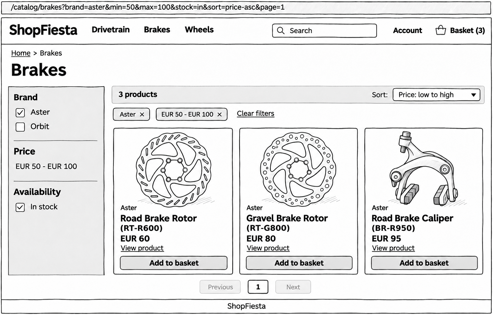

The customer starts in Brakes and filters by brand, price and availability. Product names include their technical model designation, such as `Gravel Brake Rotor (RT-G800)`. The selected filters, sort and page are represented in the URL, so a bookmarked view and a return from product detail describe the same query.

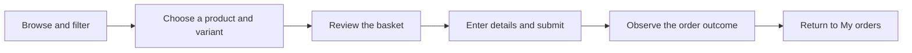

| Stop | What the customer sees | What the presentation design exercises |
| --- | --- | --- |
| [Catalog](#a4-browse-filter-and-return-to-the-same-catalog-view) | Categories, breadcrumbs, filters, model codes and independently actionable product cards. | URL-owned queries, native navigation and a purchase context per card. |
| [Product detail](#a5-open-a-product-with-a-local-purchase-context) | Aster's rotor, its 160 mm center-lock variant, merchant SKU, manual, availability and related components. | Catalog content, Stock availability, Basket's purchase contribution and Marketing's optional region on one page. |
| [Basket](#a8-keep-the-basket-page-and-header-summary-consistent) | Two rotors and one lockring, editable quantities and a matching header badge of three units. | One confirmed Basket snapshot across the page and shell summary. |
| [Checkout](#a9-use-native-checkout-forms-and-an-explicit-order-attempt) | Contact/delivery fields, validation, an order review and a recoverable submission outcome. | Native Blazor forms, submitted revisions and an attempt identity that prevents blind replay. |
| [My orders and order detail](#a101-customer-history-and-order-detail) | The signed-in customer's past orders, purchased product details and fulfillment status. | Authorized deep links, customer-owned data and historical product/price snapshots. |

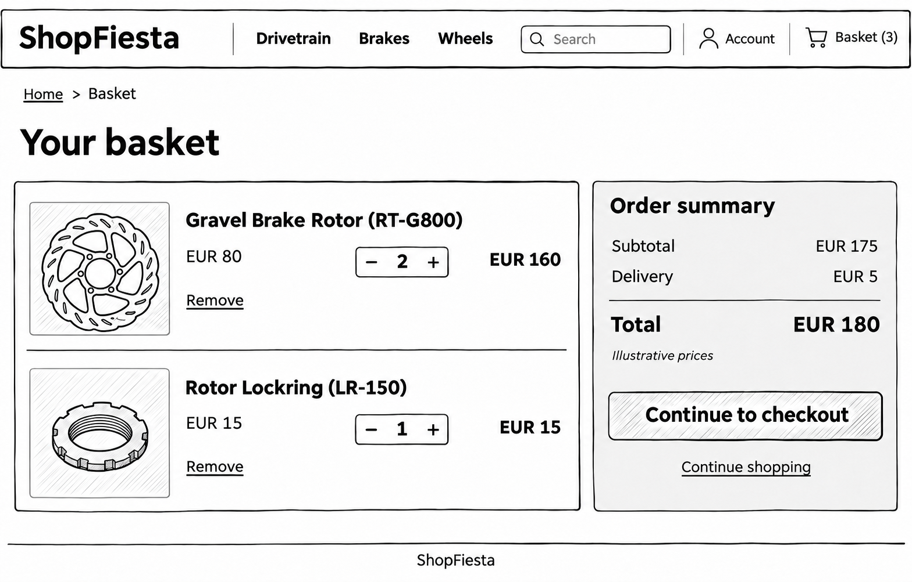

The basket totals EUR 175 in components and EUR 5 in delivery, for EUR 180. Checkout carries that review into a native form. An accepted submission provides an order reference; payment and fulfillment remain separate outcomes. The customer can later open that same order through My orders.

Availability follows the selected SKU and requested quantity. Stock can allow a preorder, reject an order below a configured threshold or allow ordering when quantity is unknown. A `null` quantity means unknown, and the per-SKU policy decides sellability. A Stock service failure is a separate unavailable state. The framework keeps the relevant component scope and updates current; Stock owns the ordering decision.

#### A.0.2 Staff run the same shop through a different layout

The operations layout provides a protected workspace for the same logical modules. Permissions remain specific to reporting, recommendations, stock management and order actions. Access to one staff page does not grant every operational capability.

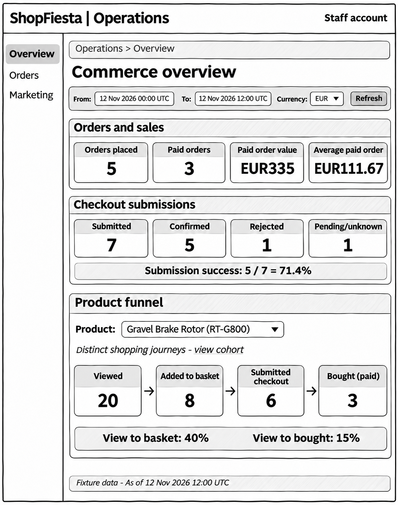

Marketing owns this complete overview. Its reporting result supplies the sales totals, checkout outcomes, product selector and funnel stages together with freshness and coverage. The example shows 20 product-view journeys, eight basket journeys, six submitted checkouts and three paid purchases. The page reads Marketing only. In the later backend showcase, Marketing captures inter-module messages into its reporting data.

| Staff screen | What staff do | What the presentation design exercises |
| --- | --- | --- |
| [Commerce overview](#a105-compose-staff-business-metrics-and-a-product-funnel) | Read order/sales metrics, checkout outcomes and a product funnel. | One Marketing-owned query snapshot across ordinary Razor components, with honest stale, partial and unavailable states. |
| [Recommendation management](#a7-let-marketing-fill-an-optional-product-region) | Choose an ordered set of related components for a source product and preview it. | A module-owned editor, inert previews, draft preservation and host authority over the public region. |
| [Stock management](#a52-compose-stock-availability-and-manage-ordering-policy) | Inspect SKU availability and edit thresholds, preorder/backorder rules and the unknown-quantity policy. | A protected native form, versioned saves and live updates that target the matching SKU and quantity. |
| [Order operations](#a102-staff-queues-and-safe-batch-actions) | Inspect Ready and Review queues and release selected orders. | Independent selection scopes, retained selection on paging, an external toolbar and explicit partial outcomes. |
| [Order export](#a104-distinguish-partial-release-from-backend-owned-export) | Start an export of a captured query and revisit its progress. | Observation of backend-owned work that survives page navigation without resubmission. |
| [Preferences](#a121-compose-settings-sections-and-restore-their-owned-preferences) | Change appearance, language and Orders display settings. | A shared packaged module plus independent feature-owned settings sections and persistence. |

#### A.0.3 One modular monolith, with a frontend developers can follow

Six commerce modules retain the same logical identities in the frontend and backend. The host selects their presentation contributions and maps native pages to the storefront or operations layout. A separate shared Preferences module supplies the reusable appearance/culture scenario.

| Logical module | Customer and staff presentation | Corresponding backend responsibility |
| --- | --- | --- |
| Catalog | Browsing, product content, filters, cards and breadcrumbs. | Products, variants, identifiers and content metadata. |
| Stock | Availability and stock-policy management. | SKU quantities and ordering decisions. |
| Basket | Purchase actions, basket editing and the header summary. | Current basket mutations and confirmed snapshots. |
| Checkout | Native checkout form, review, receipt and recovery. | Submission attempts and acceptance outcomes. |
| Marketing | Related products, recommendation management and the complete commerce overview. | Recommendation sets and captured reporting projections. |
| Orders | Customer history/detail, staff queues and operation status. | Order ownership, processing and fulfillment state. |

For a developer, the framework supplies the repeated application work: module composition, layouts, navigation contributions, typed extension points, action scopes, shared feedback and diagnostics. Pages still use ordinary Blazor routing, DI, parameters, callbacks and forms. MudBlazor supplies the default renderer. Fluent setup and conventions reduce declarations; discovery and optional generation must preserve the same explicit contracts. Business modules own product, stock, basket and order rules.

The [first validation slice](#a151-first-interactive-server-validation-slice) uses Interactive Server with prerendering off. Feature services call Requester directly in process, with small Application fixture handlers. A later WASM profile uses typed HTTP over the same feature contracts. AppState coordinates scoped presentation snapshots and preferences; it does not become an inventory authority or a reporting database.

ShopFiesta can later demonstrate queued order processing, inter-module Messaging, recurring Jobs, Blob Storage images, File Storage manuals and backend Application Caching after that feature is merged. Those integrations have their own [backend roadmap](spec-shopfiesta-backend-showcase.md). The frontend design and its first validation do not depend on them. DoFiesta remains the separate reference migration.

Continue with [module ownership and product identifiers](#a1-follow-one-shop-across-its-business-modules), then [host composition](#a2-compose-one-application-with-ordinary-host-setup). The remaining appendix follows the same screens into their proposed APIs, lifetime rules and validation cases.

### A.1 Follow one shop across its business modules

Spec references: [Modular monolith across backend and frontend](#modular-monolith-across-backend-and-frontend), [Vocabulary and ownership](#vocabulary-and-ownership), and [Product boundaries](#product-boundaries).

The customer browses Brakes, filters by brand and price, opens Gravel Brake Rotor, adds it to the basket and completes checkout. Marketing supplies related products on the detail page and manages their saved selection through its own protected staff pages. Signed-in customers can revisit their own order history and order details. Staff use a separate operations layout to inspect and release orders, read business metrics and examine a product's view-to-basket-to-purchase funnel. These are feature workflows within one composed application, with separate public, customer and staff access requirements.

The initial product data contains only road/race and gravel bicycle components. The application is not tied to those products. Product identity, category hierarchy, variant/attribute metadata, allowed facets and media belong to Catalog. Bike-specific values such as rotor diameter are data for this initial catalog, not shell types, hard-coded route branches or dependencies in Basket, Checkout, Marketing and Orders. Clothing, complete bicycles and general-purpose/computer hardware are outside the initial sample catalog.

Components also have manufacturer model designations alongside their customer-readable names. Shimano's naming illustrates the distinction: its technical catalog lists `FD-R8000-F` and `FD-R8000-B` front derailleurs, and `RT-CL800` disc brake rotors. These are naming references, not ShopFiesta fixture products, prices or compatibility claims. [Shimano front-derailleur designations](https://productinfo.shimano.com/index.html/spec/road-front-derailleur) and [Shimano rotor designations](https://productinfo.shimano.com/index.html/spec/general-rotor-center-lock).

The fictional Aster fixtures use the following codes without changing their existing names, routes or prices:

| Display name | Brand | Model designation | Illustrative price |
| --- | --- | --- | --- |
| Road Brake Rotor | Aster | `RT-R600` | EUR 60 |
| Gravel Brake Rotor | Aster | `RT-G800` | EUR 80 |
| Road Brake Caliper | Aster | `BR-R950` | EUR 95 |
| Rotor Lockring | Aster | `LR-150` | EUR 15 |
| Brake Adapter | Aster | `AD-200` | EUR 20 |

Catalog's public product summaries expose the display name, brand and optional `ModelDesignation`. A code can describe several variants, such as 140 mm and 160 mm rotors; the selected variant retains its own identity, attributes and merchant SKU. The example 160 mm center-lock `RT-G800` variant can use the fictional merchant SKU `AST-RTG800-160-CL`. A manufacturer model designation and a merchant SKU have separate meanings. Neither replaces `ProductId` or `VariantId`, and model codes need not be globally unique across manufacturers.

Whenever a product has a technical model designation, show it together with the product name. For example, render `Gravel Brake Rotor (RT-G800)` and `Rotor Lockring (LR-150)`. A narrow card or row can put `Model: RT-G800` directly beneath the name. Apply this to catalog/search cards, product headings/breadcrumbs, basket lines, checkout summaries, purchased order lines, recommendation selectors/editors/previews and reporting product selectors. Keep both parts readable and available to assistive technology; a tooltip alone does not satisfy the display rule.

Catalog search and Marketing lookup accept model designations as well as names and show brand/model/variant details to distinguish results. Basket/checkout DTOs include the applicable designation, and historical order lines use their recorded designation rather than a changed Catalog label. Keep the manufacturer's spelling and punctuation for display; search normalization belongs to Catalog. Use ordinary feature-owned Razor markup/templates for the combined label. No shell contract parses prefixes such as `FD`, requires a product-label abstraction or assumes every future catalog has a model code. When the optional value is absent, show the name without an empty suffix. Compact wireframes must retain available model designations too.

| Module | Frontend ownership | Published presentation integration | Service boundary |
| --- | --- | --- | --- |
| Catalog | Categories, filters, product details/cards, breadcrumbs and image/manual presentation. | Product/category destinations, public summaries, purchase-action target and related-products region. | Catalog owns product reads and content metadata. |
| Stock | Live SKU availability presentation, stock updates and protected stock/policy management. | Public SKU availability component/client and Stock-owned staff page. | Stock owns quantities and ordering decisions; Catalog supplies the SKU identity and public product labels. |
| Basket | Purchase contribution, header summary and basket editor. | Actions over Catalog's typed purchase target and confirmed basket snapshots. | Basket owns mutations, revisions and current-session scope. |
| Checkout | Native form, review, submission attempt, receipt and recovery presentation. | Checkout/receipt destinations and a narrow checkout feature contract. | The backend owns acceptance and subsequent processing; no worker runs in a component. |
| Marketing | Related products, staff recommendation editor and the full reporting overview. | Catalog region contribution, management destination and Marketing-only reporting contract. | Its backend owns recommendations and captured reporting data. |
| Orders | Customer history/detail and staff queues/details/actions under one identity. | Audience-specific destinations, read/action contracts and backend-owned operation status. | Orders owns order state and per-record access. |

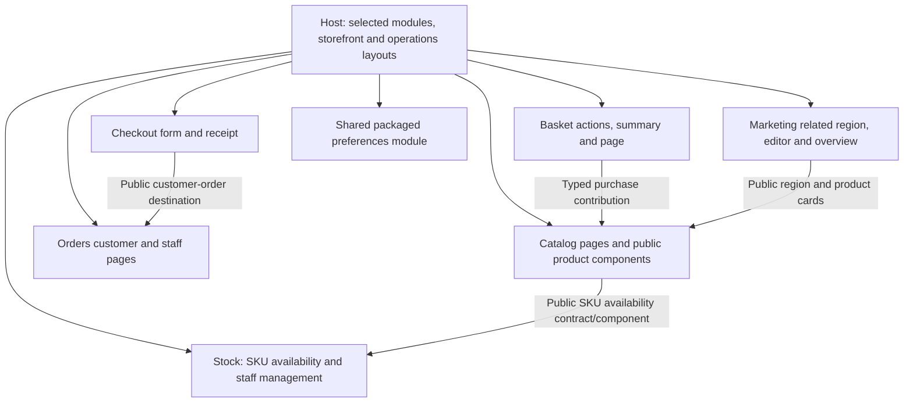

The module boundaries match the backend's logical ownership. Presentation integrates through public destinations, components and feature contracts, without private component-state access or another module's handlers/repositories. A Checkout link to customer history does not require the staff Orders assembly. Backend delivery and storage mechanics are deferred to the roadmap.

Public module identities are pinned once as `catalog`, `stock`, `basket`, `checkout`, `marketing` and `orders`. The corresponding `CatalogUi.Name`, `StockUi.Name`, `BasketUi.Name`, `CheckoutUi.Name`, `MarketingUi.Name` and `OrdersUi.Name` constants are shared by backend modules and portable presentation definitions. They are not separate frontend/backend identities. Customer and operations views are facets of Orders, not separately named modules.

The preferences scenario also selects a shared `PreferencesModule` under the stable identity `preferences`, using its corresponding server/portable registration and native preference providers. It is the reusable packaged module consumed by DoFiesta and ShopFiesta. It is a cross-cutting capability alongside the six commerce modules; its default local/scoped persistence does not require another business domain or an external service.

| Logical module | Minimal fixture-backed contract for frontend validation |
| --- | --- |
| Catalog | Product/category/facet/ancestry DTOs, model designations and working fixture content URLs. |
| Stock | Shared-SKU availability snapshots/updates, explicit ordering decisions and versioned stock/policy edit outcomes. |
| Basket | Current-session snapshots and deterministic versioned add/change/remove outcomes. |
| Checkout | Review, accepted/rejected/unknown attempt outcomes and status recovery. |
| Marketing | Versioned recommendation sets and authorized overview DTOs with revision, capture time and coverage states. |
| Orders | Own-customer history, separate staff projections, partial action outcomes and simulated backend-owned operation status. |

Fixture handlers keep those boundaries and access/concurrency rules. They do not merge module state or masquerade as real queue, message, storage or scheduler integration. Reads observe fixture state; they do not advance work. Test-owned controls can change it independently to exercise delayed results and transitions.

Marketing is optional. Without it, Catalog omits the related-products section and Marketing staff pages. Catalog can run alone as read-only browsing without a Stock client/component. The purchasing profile selects Stock and Basket; buying requires a current Stock decision, while Basket attaches through Catalog's public target. Checkout requires the declared Basket/Orders/Stock capabilities. Recommendation-only Marketing does not make the whole commerce backend mandatory. Missing availability/coverage is not a successful zero.

Checkout requires Orders business services, not its staff UI. A host can suppress the operations presentation while retaining Orders backend capabilities and customer history. Customer history and operations declare their respective identity/access requirements. The immediate receipt page remains Checkout-owned and can link to Orders' authorized customer detail; neither exposes staff-only data.

| Journey | What the reader should see | Concepts demonstrated |
| --- | --- | --- |
| [Browse Brakes](#a4-browse-filter-and-return-to-the-same-catalog-view) | Public top navigation, breadcrumbs, product filters, applied filters, sorting and paging. | Module ownership, native routing, dynamic navigation, query state and view restoration. |
| [Open Gravel Brake Rotor](#a5-open-a-product-with-a-local-purchase-context) | A direct product URL, quantity input, purchase action and related products. | Typed destinations, component-owned context, optional component regions and cross-module contributions. |
| [Follow live SKU availability](#a52-compose-stock-availability-and-manage-ordering-policy) | Stock changes for the selected SKU update its status and ordering decision without changing another card. Staff manage quantity and policy in Stock's own page. | Shared identifiers, public module components, live-context revisions, native forms and precise unknown/disabled states. |
| [Read product content](#a51-present-product-images-and-manuals) | Product image, alt text and a native Installation manual link. | Public content metadata, base-path-aware URLs, accessibility and local missing/failure states. |
| [Add from either product area](#a6-let-basket-contribute-purchasing-without-coupling-catalog-to-it) | The correct product and quantity are added, and the header basket summary changes. | Independent action scopes, immutable invocation inputs, confirmed-result updates and targeted invalidation. |
| [Manage related products](#a71-manage-recommendations-in-the-marketing-module) | Marketing staff choose, order and save recommendations for a source product, with an inert draft preview. | Native editors, module-owned management, concurrency, targeted invalidation and host authority. |
| [Review the basket](#a8-keep-the-basket-page-and-header-summary-consistent) | Quantity controls, removal, current totals and a checkout link. | Feature-owned shared state, backend authority, local feedback and optional destination availability. |
| [Submit checkout](#a9-use-native-checkout-forms-and-an-explicit-order-attempt) | Native form validation, a stable order attempt and an accurate result or recovery choice. | Submitted revisions, duplicate suppression, idempotency owned by the application and uncertain-outcome handling. |
| [Observe the accepted order](#a91-observe-backend-owned-order-processing) | Leave/revisit a receipt and observe the backend-owned status. | Acceptance versus completion, page lifetime, safe observation and recovery. |
| [Revisit my orders](#a101-customer-history-and-order-detail) | Own past purchases, bounded history and directly loadable read-only order details. | Same-module customer/backend ownership, per-record authorization, private state partitioning and durable order snapshots. |
| [Work operational orders](#a102-staff-queues-and-safe-batch-actions) | Protected list/detail routes, two independent queues and an external batch toolbar. | Authorization, explicit scope attachment, selection policy, safe confirmation and disposal. |
| [Use external queue controls](#a103-bind-typed-query-controls-to-the-same-queue) | Change the Ready queue's status/search from its external toolbar without changing Review. | Typed control parameters/callbacks, original-owner dispatch and targeted query invalidation. |
| [Review mixed outcomes and exports](#a104-distinguish-partial-release-from-backend-owned-export) | See one released order and one conflict; leave and revisit a submitted export. | Per-target outcomes, accepted versus completed work, backend ownership and scoped observation. |
| [Read business metrics and a product funnel](#a105-compose-staff-business-metrics-and-a-product-funnel) | Marketing supplies one overview result with sales, checkout, funnel and freshness data. | Module-owned page/query, native component composition, query revisions and truthful stale/partial presentation. |
| [Restore preferences](#a121-compose-settings-sections-and-restore-their-owned-preferences) | Save appearance/culture and Orders display settings, reload and switch identities. | Shared/module-owned settings sections, scoped persistence, schema fallback and native localization. |
| [Inspect host customization](#a131-replace-a-contribution-and-inspect-the-effective-result) | Compare default, replaced and suppressed recommendation profiles through read-only diagnostics. | Host authority, compatible replacement, provenance and safe inspection. |

#### A.1.1 Give products and sellable variants explicit identifiers

Spec references: [Product boundaries](#product-boundaries), [Modular monolith across backend and frontend](#modular-monolith-across-backend-and-frontend), [Published typed contracts](#published-typed-contracts), and [Low friction and native platform mechanisms](#low-friction-and-native-platform-mechanisms).

A product groups its description, brand/model, categories, media and selectable variants. Every sellable variant has a merchant SKU; a simple product has one default variant/SKU. Stock recognizes those same SKU strings within the same store/catalog namespace. A manufacturer model such as RT-G800 can cover several variants and is not the SKU or global trade identifier.

| Identifier | Placement and meaning |
| --- | --- |
| `ProductId` | Stable internal product identity for routes/relationships and product-level recommendations. |
| `VariantId` | Stable internal identity for the specific selectable sellable variant. |
| `Sku` | Required merchant-owned string per sellable variant, unique within the declared store/catalog namespace. Catalog defines it; Stock, Basket, Checkout and Orders use the same value. Do not change case/punctuation independently in each module or derive it from the display name. |
| `ModelDesignation` | Manufacturer's technical model/family label, normally displayed with the product name. It may be shared by several SKUs. |
| `ManufacturerPartNumber` | Optional manufacturer article/part number for the specific variant or supplied package. It can differ from both model designation and merchant SKU. |
| `Gtin` | Optional GS1 Global Trade Item Number for the relevant trade item/package, stored as a string. EAN/UPC are common GTIN formats; they do not replace the merchant SKU. |
| Supplier references | Optional supplier-scoped item/article numbers represented with their supplier identity. They are not another globally unique product key. |

Use `Gtin` for the trade-item identifier intended by the shorthand TIN. GTINs can have 8, 12, 13 or 14 digits. Keep leading zeros and validate supplied values at the Catalog boundary. Identifier editors use text inputs; do not parse SKU/MPN/GTIN values as numbers. Barcode artwork/symbology is a representation of an identifier rather than a separate SKU. Fixtures leave unassigned GTINs empty; do not manufacture apparently allocated GS1 numbers. [GS1 GTIN formats](https://support.gs1.org/support/solutions/articles/43000734124-what-is-the-difference-between-a-gs1-gtin-a-barcode-an-ean-and-a-upc-) and [GS1 product-identification overview](https://www.gs1us.org/upcs-barcodes-prefixes/what-is-a-gtin).

The ordinary product fields also have explicit homes:

| Product/variant data | Presentation contract |
| --- | --- |
| Product description | Display name, brand, manufacturer, technical model, short/full descriptions, publication state, categories, tags and typed/configured attributes. These remain Catalog data. |
| Sellable variant | Internal variant ID, SKU, manufacturer part number, optional GTIN, option values and sale unit/package quantity. A different saleable pack can have its own SKU/GTIN. |
| Purchase terms | Current display price/currency and the stated tax-display convention, minimum order quantity, quantity increment and optional maximum. Backend pricing/review remains authoritative. |
| Content and logistics | Product images/alt text and manual metadata; optional shipping weight/dimensions carry explicit units. Rich fulfillment data can be added later behind Catalog's boundary. |
| Stock | Separate Stock response by SKU, with availability, quantity if known, requested-quantity ordering decision, revision and freshness. Do not put a second mutable inventory count on the Catalog product object. |

These identifier-focused DTO excerpts illustrate the object shape. The full product view also contains the categories/content fields described above. They are ordinary feature contracts, not framework entities or a new generic product base class:

```csharp
public sealed record ProductView(
	Guid ProductId,
	string Slug,
	string DisplayName,
	string Brand,
	string Manufacturer,
	string ModelDesignation,
	string Description,
	ImmutableArray<ProductVariantView> Variants);

public sealed record ProductVariantView(
	Guid VariantId,
	string Sku,
	string ManufacturerPartNumber,
	string Gtin,
	ImmutableArray<SupplierItemReference> SupplierReferences,
	ImmutableDictionary<string, string> Options,
	decimal DisplayPrice,
	string Currency,
	string SaleUnit,
	int PackQuantity,
	int MinimumOrderQuantity,
	int OrderQuantityStep,
	int? MaximumOrderQuantity);

public sealed record SupplierItemReference(string SupplierId, string ItemNumber);
```

The initial component catalog sells whole units with `SaleUnit = EA`, pack quantity 1, minimum 1 and increment 1. Those are sample rules, not shell assumptions. For the selected 160 mm center-lock rotor, SKU is `AST-RTG800-160-CL`, model is `RT-G800`, fictional manufacturer part number is `RT-G800-160-CL`, and GTIN is unassigned. The SKU map used by Stock's fixtures is:

| Product label | Merchant SKU | Selected variant |
| --- | --- | --- |
| Road Brake Rotor (RT-R600) | `AST-RTR600-160-CL` | 160 mm, center-lock |
| Gravel Brake Rotor (RT-G800) | `AST-RTG800-160-CL` | 160 mm, center-lock |
| Road Brake Caliper (BR-R950) | `AST-BRR950-FRONT` | Front |
| Rotor Lockring (LR-150) | `AST-LR150-EA` | Single unit |
| Brake Adapter (AD-200) | `AST-AD200-EA` | Single unit |

SKU changes require an explicit cross-module remapping/alias policy; editing a model label never changes the SKU. Basket/checkout/order-line DTOs retain the selected SKU, part number and GTIN where supplied. Historical order lines retain their purchased identifier/description snapshot even if the live catalog changes. Technical model labels remain visible with names; secondary identifiers can appear in a normal product-details section and staff lookup without cluttering every card.

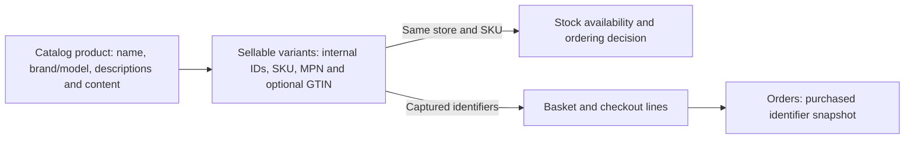

### A.2 Compose one application with ordinary host setup

Spec references: [Low friction and native platform mechanisms](#low-friction-and-native-platform-mechanisms), [Presentation module composition](#presentation-module-composition), [Extension contracts and host authority](#extension-contracts-and-host-authority), and [Recommended business application profile](#recommended-business-application-profile).

`WebModuleBase`, `AddModules`, `WithModule`, `UseModules`, `MapModules`, Requester, `Result<T>` and the native Blazor hosting APIs already exist. The following presentation contracts are proposed additions. They extend these foundations rather than replacing them.

| Proposed contract | Role in the shop |
| --- | --- |
| `IPresentationModule.RegisterPresentation(PresentationModuleBuilder)` | Optional presentation capability on an existing backend module, preserving its logical identity. |
| `WithPresentation(...)` | Collects presentation declarations from selected modules, applies host options and arranges composition validation. |
| `PresentationModuleBuilder` | Focused fluent registration for page assemblies, destinations, navigation, resources, action targets and component regions. |
| `AddPresentationMudBlazor()` | Selects the separately referenced default renderer and its shared services. |
| `IPresentationCatalog`, `PresentationRouteView`, `WithPresentationRoutes()` | Integrate effective ownership, assemblies and availability with native routing and initial endpoint processing. |
| `Destination<TParameters>` | A public typed link contract over an ordinary page route. |
| `ActionTarget<TContext>`, `IActionScopes`, `ActionScope<TContext>` | Publish a place for actions and bind them to a live component's immutable context and lifetime. |
| `IActionContributor<TContext>` | Optional reusable action contribution resolved through DI for a live target scope. Local feature callbacks can bind directly. |
| `RegionTarget<TContext>`, `ExtensionRegion` | Publish and render a typed component extension, such as related products, with normal Razor parameters. |
| `ActionToolbar` | Default renderer observing an explicitly supplied scope. It can appear as a compact purchase-action row or an operations toolbar. |
| `BindControl<TComponent, TValue>` | Bind normal typed Razor control parameters/callbacks to the same live owner used by an external toolbar. |
| `MapOutcome`, `OnConfirmedOutcome` | Map actual feature responses into the specified execution outcomes and apply confirmed receipts separately from refresh feedback. They do not replace feature result contracts. |
| `Settings.Add<TComponent>`, `SettingsSections` | Compose module-owned native settings components through the shared settings-section contract. |
| `PageLayouts` | Map ordinary page types to native layouts without changing module ownership. |

```csharp
builder.Services.AddModules(builder.Configuration, builder.Environment)
	.WithModule<CatalogModule>()
	.WithModule<StockModule>()
	.WithModule<BasketModule>()
	.WithModule<CheckoutModule>()
	.WithModule<MarketingModule>()
	.WithModule<OrdersModule>()
	.WithModule<PreferencesModule>()
	.WithPresentation(options =>
	{
		options.DefaultLayout = typeof(StorefrontLayout);
		options.PageLayouts[typeof(OperationsOverview)] = typeof(OperationsLayout);
		options.PageLayouts[typeof(StockManagement)] = typeof(OperationsLayout);
		options.PageLayouts[typeof(OperationsOrders)] = typeof(OperationsLayout);
		options.PageLayouts[typeof(OperationsOrderDetails)] = typeof(OperationsLayout);
		options.PageLayouts[typeof(OrderExportStatus)] = typeof(OperationsLayout);
		options.PageLayouts[typeof(RecommendationManagement)] = typeof(OperationsLayout);
		options.PageLayouts[typeof(RecommendationEditor)] = typeof(OperationsLayout);
	});

builder.Services.AddRazorComponents()
	.AddInteractiveServerComponents();
builder.Services.AddPresentationMudBlazor();
builder.Services.AddRequester().AddHandlers();

var app = builder.Build();
app.UseModules();
app.UseAntiforgery();
app.MapStaticAssets();
app.MapModules();
app.MapRazorComponents<App>()
	.AddInteractiveServerRenderMode()
	.WithPresentationRoutes();
app.Run();
```

The layout types are ordinary application-owned Blazor layouts. Orders customer history/detail use the default `StorefrontLayout`; explicitly mapped staff pages use `OperationsLayout`. Marketing registers `OperationsOverview` alongside its management pages under the same module identity. Module pages retain their module owner regardless of layout. Default shell renderers consume contributions in either layout. A custom storefront can replace chrome without copying module workflows.

The excerpt omits normal authentication, authorization, logging and Application pipeline setup. For the first slice, register small fixture-backed feature handlers. The public catalog needs no identity provider. Customer/history and staff pages require their declared access policies; named local test identities can supply them without an external service. Messaging, queue, scheduler, cache and storage registrations belong to the [later backend showcase](spec-shopfiesta-backend-showcase.md), not this presentation setup.

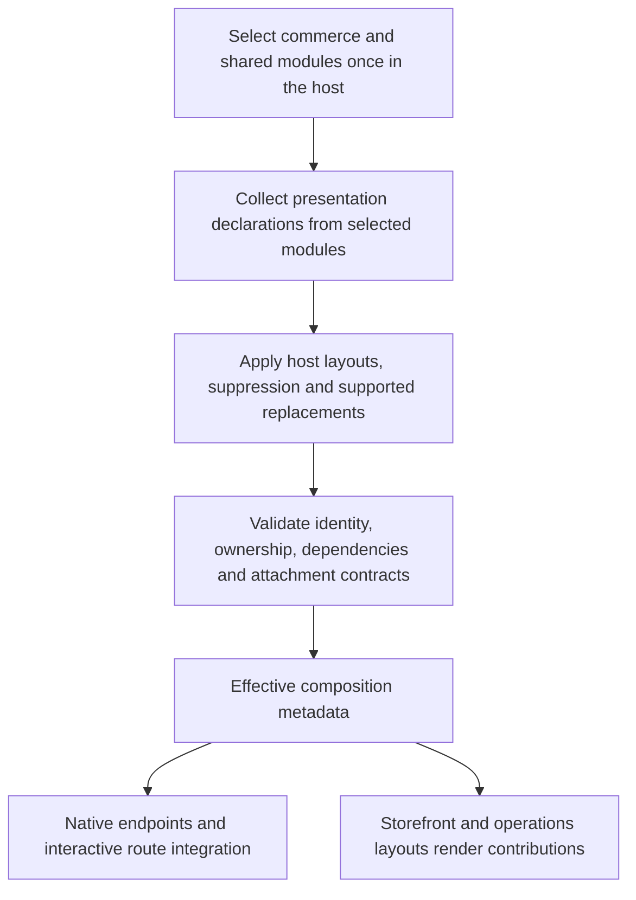

Discovery and optional generated registrations feed the same composition rules. Startup metadata holds no selected products, basket contents, component instances or scoped feature clients. Each live component creates its own runtime bindings later.

The initial connected profile is Interactive Server with prerendering off. `App.razor` uses the native boundary:

```razor
<HeadOutlet @rendermode="new InteractiveServerRenderMode(prerender: false)" />
<Routes @rendermode="new InteractiveServerRenderMode(prerender: false)" />
```

`Routes.razor` keeps Blazor's native router. The catalog supplies effective assemblies; the proposed route view applies the resolved ownership, availability, authorization integration and host layout options before constructing the page.

```razor
@inject IPresentationCatalog Presentation

<Router AppAssembly="typeof(App).Assembly"
        AdditionalAssemblies="this.Presentation.PageAssemblies">
	<Found Context="routeData">
		<PresentationRouteView RouteData="routeData" />
		<FocusOnNavigate RouteData="routeData" Selector="h1" />
	</Found>
</Router>
```

The normal host supplies not-found, denied and unavailable presentations. `WithPresentationRoutes()` applies the corresponding metadata and checks to initial server endpoint processing; the client route view alone is insufficient. Module-specific layouts are ordinary native layouts selected through the effective host options.

A public shop may also need server-rendered catalog content for its publishing requirements. That is a separate declared Static SSR or explicit prerender profile to validate, not a promise obtained by renaming the connected profile. An interactive purchase area, header badge and basket presenter share state only within their supported composition and runtime scope. Separate islands must declare their coordination path.

### A.3 Let routes and breadcrumbs describe the customer's location

Spec references: [Page ownership and route availability](#page-ownership-and-route-availability), [Destinations, availability and deep links](#destinations-availability-and-deep-links), [Destination contracts and link generation](#destination-contracts-and-link-generation), and [Navigation and page composition](#navigation-and-page-composition).

| Owner | Native route | Purpose and access |
| --- | --- | --- |
| Catalog | `/catalog` | Public catalog landing page. |
| Catalog | `/catalog/{CategorySlug}` | Public category listing with shareable filter, sort and page query values. |
| Catalog | `/products/{Slug}` | Public product detail, directly loadable without visiting a listing. |
| Basket | `/basket` | Current visitor's basket, resolved by the backend from the current session. |
| Checkout | `/checkout` | Review the current basket and enter contact/delivery details. |
| Checkout | `/checkout/complete/{OrderId:guid}` | Confirmed customer receipt, subject to access checks for that order. |
| Preferences | `/preferences` | Shared appearance/culture settings and eligible module-owned settings sections. Private sections apply their own identity requirements. |
| Orders | `/account/orders` | Signed-in current customer's bounded order history. |
| Orders | `/account/orders/{OrderId:guid}` | Read-only customer detail for an order owned by the current customer. |
| Orders | `/operations/orders` | Staff-only queue, filter state and batch actions. |
| Orders | `/operations/orders/{OrderId:guid}/{View}` | Staff-only order details with allowed route-backed views such as overview and history. |
| Orders | `/operations/exports/{OperationId:guid}` | Staff-only observation of a previously submitted export, including after navigation. |
| Marketing | `/operations/overview` | Staff business reporting over Marketing's stored projections under `Shop.Operations.ViewMetrics`, with period, currency and product query state. |
| Stock | `/operations/stock` | Stock-owned availability/policy management under `Shop.Stock.Manage`; an optional native `sku` query parameter restores the selected SKU. |
| Marketing | `/operations/marketing/recommendations` | Product selection and recommendation-set overview under `Shop.Marketing.ManageRecommendations`. |
| Marketing | `/operations/marketing/recommendations/{ProductId:guid}` | Directly loadable recommendation editor for the source product under the same management policy. |

Product display names, manufacturer model designations, merchant SKUs, slugs and IDs have different jobs. `RT-G800` is the Aster rotor's model designation, and `gravel-brake-rotor` is its public slug; a backend-issued product/variant ID identifies the mutation target. Renaming a product or correcting its model label does not retarget an existing action, recommendation or funnel record. The order number `SF-1042` is a display reference; the order route uses its actual GUID. No wireframe substitutes a display number for a declared route parameter.

```csharp
public static class CatalogUi
{
	public const string Name = "catalog";

	public static Destination<CategoryRoute> Category { get; } =
		Destination.ForPage<CategoryProducts, CategoryRoute>("catalog.category");

	public static Destination<ProductRoute> Product { get; } =
		Destination.ForPage<ProductDetails, ProductRoute>("catalog.product");

	public static ActionTarget<ProductPurchaseContext> PurchaseActions { get; } =
		new("catalog.product.purchase-actions");

	public static RegionTarget<ProductContext> RelatedProducts { get; } =
		new("catalog.product.related-products");
}

public sealed record CategoryRoute(string CategorySlug);

public sealed record ProductRoute(string Slug);
```

`CategoryProducts.razor` owns `@page "/catalog/{CategorySlug}"`; `ProductDetails.razor` owns `@page "/products/{Slug}"`. Registration does not repeat those patterns. `CatalogUi.Product.Uri(navigationManager, new ProductRoute(product.Slug))` supplies an encoded link under the configured application base path. The host does not arbitrarily remap the module's route patterns.

`Home > Brakes > Gravel Brake Rotor (RT-G800)` comes from the current product's category ancestry and destination contracts. A direct visit queries that ancestry when needed; it does not reconstruct the breadcrumb from a previously expanded menu or split the URL into guessed labels. Category navigation uses the same published category destinations, with native active-link behavior and the shell's resolved path. The hierarchy and product labels change with the Catalog data rather than application/framework code.

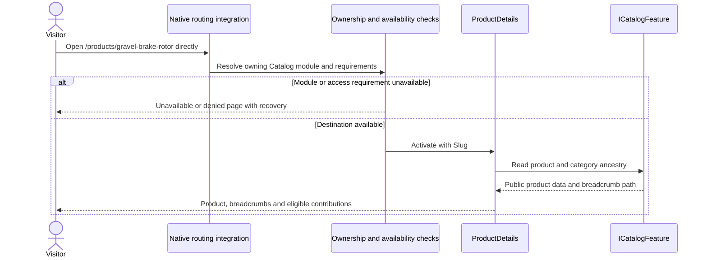

Apply the checks to initial server requests and interactive navigation before protected page construction and reads. A hidden operations link does not protect its route. Product-not-found, a failed product read and an unavailable module are different states with different recovery messages.

### A.4 Browse, filter and return to the same catalog view

Spec references: [Reusable data components and CRUD scaffolding](#reusable-data-components-and-crud-scaffolding), [Navigation hook context](#navigation-hook-context), [Dynamic hierarchy lifecycle](#dynamic-hierarchy-lifecycle), and [View restoration policy](#view-restoration-policy).


*Figure A.1. Catalog owns the category query, filters, product cards and breadcrumbs. Each product card exposes its own purchase context. Basket contributes the Add to basket action; the shop header displays Basket's summary contribution.*

The view `/catalog/brakes?brand=aster&min=50&max=100&stock=in&sort=price-asc&page=1` illustrates a familiar browsing state. Its selected filters are shareable query values. The wireframe shows fictional in-stock products between EUR 50 and EUR 100, ordered by price. The sample prices explain the UI; they are not authoritative values submitted at checkout.

```razor
@page "/catalog/{CategorySlug}"
@inject ICatalogFeature Catalog

@code {
	[Parameter]
	public string CategorySlug { get; set; }

	[SupplyParameterFromQuery(Name = "brand")]
	public string Brand { get; set; }

	[SupplyParameterFromQuery(Name = "min")]
	public decimal? MinPrice { get; set; }

	[SupplyParameterFromQuery(Name = "max")]
	public decimal? MaxPrice { get; set; }

	[SupplyParameterFromQuery(Name = "stock")]
	public string Stock { get; set; }

	[SupplyParameterFromQuery(Name = "sort")]
	public string Sort { get; set; }

	[SupplyParameterFromQuery(Name = "page")]
	public int? Page { get; set; }
}
```

These are native route/query parameters. Catalog validates allowed filters, sort keys and page bounds and translates them into its feature query. Optional FilterModel adapters can translate the same meaning for a reusable grid or handwritten list. They must not invent a second search language or require a generic CRUD page to display products.

The header search is a Catalog-owned product-search contribution using that same query meaning. It is not a universal shell search or command-discovery system.

| Interaction | Owned behavior |
| --- | --- |
| Change brand or price range | Update shareable query state, reset the page as the feature declares, supersede the previous read and retain the controls' focus. |
| Type product search | Debounce when appropriate, cancel obsolete reads and accept only the latest applicable query/context result. Cancellation alone is insufficient if a provider returns late. |
| Change sorting or page | Navigate using native query values and reload the declared query. A pending Add to basket invocation keeps its original captured product and quantity. |
| Open a product and use Back | Restore the category, filters, sorting and page from the URL. Scroll restoration follows the feature's explicit policy; temporary purchase state is not inferred from browser history. |
| Expand category navigation | A bounded navigation provider receives parent/path, culture, paging and cancellation context and returns category descriptors through the published target. |
| Change category membership | Invalidate the affected category branch and query explicitly. Do not refresh the entire shop for an unrelated badge change. |
| No matching products | Show a successful empty result with clear filter-reset controls. A failed or unavailable query must not appear as zero products. |

Product cards use normal Razor parameters and templates. A customer does not need operational row-selection checkboxes to shop. The operations example later demonstrates the separate selection adapter and its retained-on-paging default.

### A.5 Open a product with a local purchase context

Spec references: [Published typed contracts](#published-typed-contracts), [Action definition, placement, binding and execution](#action-definition-placement-binding-and-execution), and [Typed scopes and explicit placement](#typed-scopes-and-explicit-placement).

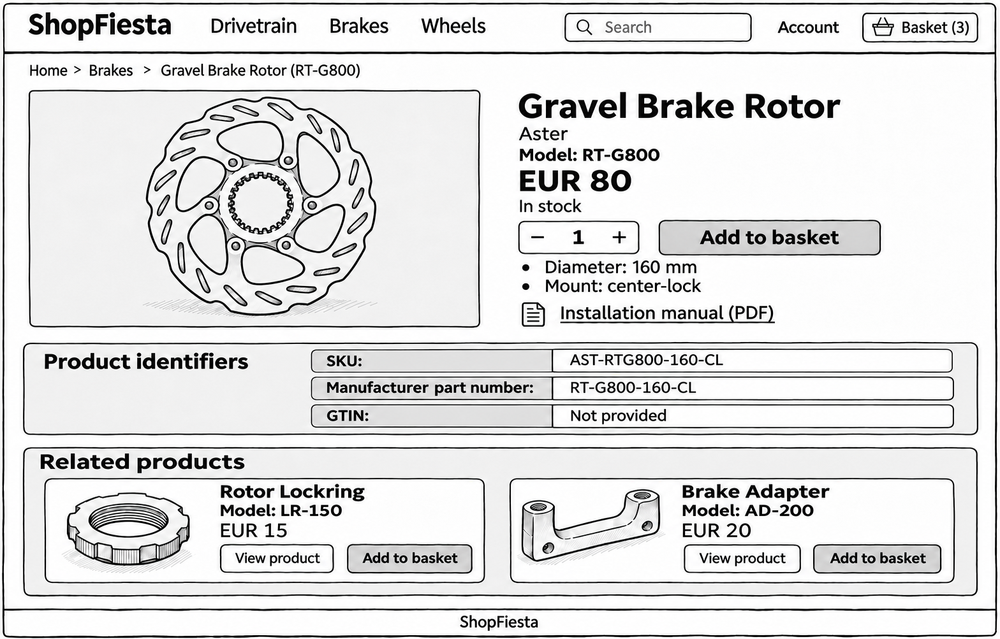

*Figure A.2. The main Gravel Brake Rotor (RT-G800) and each related card are independent live owners. The selected variant also shows its SKU, manufacturer part number and unassigned GTIN in secondary details. Catalog supplies content/identifiers; Stock supplies the availability decision. Selecting quantity two on the rotor does not change another card's target. Marketing supplies the related-products region.*

```csharp
public sealed record ProductContext(
	Guid ProductId,
	string Slug,
	string CategorySlug,
	long Version);

public sealed record ProductPurchaseContext(
	Guid ProductId,
	Guid? VariantId,
	string Sku,
	int Quantity,
	long ProductVersion,
	long? StockRevision,
	bool CanPurchase);
```

The context is a small immutable public contract, not an entity or a reference to the component's mutable fields. It contains the product/variant and quantity needed to prepare an invocation. Backend services still check stock, access, current price and quantity constraints. Client-supplied totals never establish the amount to charge.

Names, brands and model designations remain display data. SKU is the public cross-module key for the selected sellable variant; it accompanies internal IDs and the observed Stock revision. `StockRevision` is absent before a valid Stock decision, which disables buying. An explicit valid decision may permit ordering with a null numeric quantity. No variant selected means no SKU to buy. The backend checks that the supplied SKU belongs to the submitted product/variant and revalidates Stock; a revision is not a reservation or a stock guarantee.

The portable Catalog declaration is authored once:

```csharp
public static class CatalogPresentation
{
	public static void Configure(PresentationModuleBuilder module)
	{
		module.Pages.FromAssembly<CategoryProducts>();
		module.Resources.Use<CatalogResources>();
		module.Destinations.Add(CatalogUi.Category);
		module.Destinations.Add(CatalogUi.Product);
		module.Navigation.Add("catalog", href: "catalog", labelKey: "Shop");
		module.Actions.Export(CatalogUi.PurchaseActions);
		module.Regions.Export(CatalogUi.RelatedProducts,
			required: false, maxContributions: 1);
	}
}

public partial class CatalogModule : WebModuleBase, IPresentationModule
{
	public CatalogModule() : base(CatalogUi.Name) { }

	public void RegisterPresentation(PresentationModuleBuilder module) =>
		CatalogPresentation.Configure(module);
}
```

The existing server module's `Register`, `Use` and `Map` methods are omitted. They keep their normal backend responsibilities. Its pinned public identity is shared with the portable definition. Local unpublished modules can use the existing type-name convention.

`Pages.FromAssembly` supplies default module ownership for all routed pages in that assembly. Ordinary pages need no repeated ownership annotation. Shared assemblies use explicit page mappings, and ambiguous ownership is rejected. `Resources.Use<T>()` selects a native localization resource base; it is not another localization engine.

A product component creates one scope and disposes it with its own lifetime. The same pattern works in a product card and in the main product purchase area:

```razor
@implements IDisposable
@inject IActionScopes ActionScopes

<ActionToolbar Scope="this.purchaseActions" />

@code {
	[Parameter]
	public ProductPurchaseContext Purchase { get; set; }

	private ActionScope<ProductPurchaseContext> purchaseActions;

	protected override void OnInitialized() =>
		this.purchaseActions = this.ActionScopes.CreateScope(
			owner: this,
			target: CatalogUi.PurchaseActions,
			context: this.Purchase);

	protected override void OnParametersSet() =>
		this.purchaseActions?.UpdateContext(this.Purchase);

	public void Dispose() => this.purchaseActions?.Dispose();
}
```

Quantity and variant controls remain normal feature-owned Razor controls. They replace `Purchase` with a new snapshot. The binding factory associates callbacks/change delivery with the owner's Blazor dispatcher, derives runtime identities and attaches eligible contributors for that target. It does not register a global current product.

An action scope is a live ownership object, not another DI container. Feature services retain the executing runtime's normal DI lifetimes. Disposing this scope releases its own bindings and subscriptions without disposing DI-owned shared services.

`ActionToolbar` is a proposed default presenter, not a requirement that a shopping button look like an administrative toolbar. The host may supply a compact purchase renderer or ordinary Razor buttons consuming the same bindings. It must preserve availability, duplicate suppression, invocation and accessible feedback behavior.

#### A.5.1 Present product images and manuals

Spec references: [Product boundaries](#product-boundaries), [Module assets and JavaScript ownership](#module-assets-and-javascript-ownership), [Initialization, failures and recovery](#initialization-failures-and-recovery), and [Accessibility acceptance](#accessibility-acceptance).

Catalog's product DTO supplies a safe image URL, alt text and revision, plus manuals with title, language, revision, applicability and download URL. The page uses ordinary markup:

```razor


@foreach (var manual in this.product.Manuals)
{
	<a @key="manual.Id" href="@manual.DownloadUrl">@manual.Label</a>
}
```

The excerpt assumes available content. An absent image uses an accessible placeholder; a failed image/manual read stays local and does not disable purchasing. Manual labels identify the language/revision where useful. Catalog decides applicability to the selected product/model/variant. A late product DTO cannot attach the previous product's document to the new page context.

URLs respect the app base path and content revision. Native image/download requests are normal browser HTTP, including in Interactive Server. They do not change the rule that Server business feature commands/queries use Requester directly. The frontend sees no storage factory, credential, provider key or raw filesystem path. Content delivery enforces its declared publication/access policy independently of displaying a link.

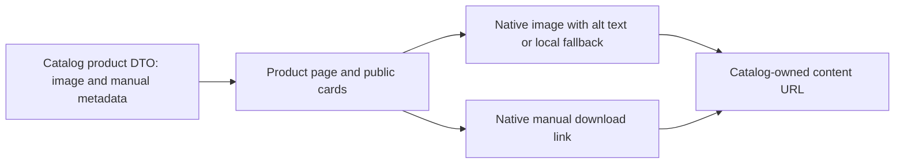

The agreed backend target is Blob Storage for images and File Storage for manuals. The first frontend slice can use tiny Catalog-owned fixture content endpoints. That validates URLs, markup, access and failure presentation, not provider integration. Provider setup and stream handling remain in the [backend roadmap](spec-shopfiesta-backend-showcase.md#product-images-and-manuals). Module CSS/JS/resources retain their native RCL/static-web-asset packaging.

#### A.5.2 Compose Stock availability and manage ordering policy

Spec references: [Modular monolith across backend and frontend](#modular-monolith-across-backend-and-frontend), [Automatic refresh and explicit invalidation](#automatic-refresh-and-explicit-invalidation), [Typed scopes and explicit placement](#typed-scopes-and-explicit-placement), [Safe invocation and lifetime](#safe-invocation-and-lifetime), and [Field validation and submitted revisions](#field-validation-and-submitted-revisions).

Stock is a separate logical module under `stock`, with corresponding backend ownership and browser-safe presentation contracts. It recognizes Catalog's exact SKU within the authorized store context. Catalog owns descriptions/identifiers and the product page; Stock owns quantity, availability and the ordering decision for that SKU. Basket and Checkout revalidate through backend contracts. Neither product labels, GTINs nor client-side quantity arithmetic substitute for the shared SKU.

The proposed read/observation contract is ordinary feature code:

```csharp
public sealed record StockRequest(string Sku, int RequestedQuantity);

public sealed record SkuAvailabilityView(
	string Sku,
	int RequestedQuantity,
	int? AvailableQuantity,
	string StatusCode,
	bool CanOrder,
	string ReasonCode,
	DateTimeOffset? ExpectedAvailableAtUtc,
	long Revision,
	DateTimeOffset ObservedAtUtc);

public interface IStockFeature
{
	Task<Result<SkuAvailabilityView>> GetAsync(
		StockRequest request,
		CancellationToken cancellationToken = default);

	Task<Result<ImmutableArray<SkuAvailabilityView>>> GetManyAsync(
		ImmutableArray<StockRequest> requests,
		CancellationToken cancellationToken = default);

	IAsyncEnumerable<SkuAvailabilityView> ObserveAsync(
		StockRequest request,
		CancellationToken cancellationToken = default);
}
```

`StatusCode`/`ReasonCode` have Stock-defined meanings and resources. The response is an ordering decision for its exact SKU and requested quantity, not a promise that any quantity can be ordered. A listing uses `GetManyAsync` for its bounded page and passes the returned values to ordinary Stock presenters; shared adapters can coalesce observations instead of sending one HTTP request per card/render. The observation adapter supplies live updates for currently observed requests. Server and WASM adapters follow their respective in-process/HTTP and explicitly supported notification paths; local AppState/Notifier is not a cross-circuit transport. The frontend slice can use controlled fixture snapshots/streams without implementing the eventual notification infrastructure.

For the full shop profile, Catalog can consume Stock's public component through ordinary Razor:

```razor
@if (this.stockEnabled && this.selectedVariant is not null)
{
	<SkuAvailability Sku="this.selectedVariant.Sku"
	                 Quantity="this.quantity"
	                 AvailabilityChanged="this.ApplyAvailabilityAsync" />
}
```

`SkuAvailability` belongs to Stock, uses native parameters and a typed `EventCallback<SkuAvailabilityView>`, and presents Stock's label/reason. Catalog's callback combines the current product/variant, SKU, requested quantity and returned Stock revision into its live `ProductPurchaseContext`. `CanPurchase` requires an eligible Catalog variant and a usable current Stock decision whose `CanOrder` is true for that quantity. The read-only Catalog profile omits this capability and buying; it does not construct a Stock component without its registered services. Reference public contracts/components through the appropriate browser-safe packages, not another module's private implementation or a new framework inventory abstraction.

| Stock response/situation | Frontend behavior |
| --- | --- |
| In stock | Show the supplied status and allow the captured quantity only when `CanOrder` is true. |
| Low stock | Show Stock's low-stock label/optional public quantity. A display threshold does not itself prohibit ordering; respect the returned decision. |
| Zero or below a configured sale threshold | Show Sold out or Stock's supplied reason. Disable purchase unless Stock explicitly permits the requested backorder/preorder or another configured policy. |
| Coming soon | Show the supplied expected date/window. A date alone does not enable purchase; `CanOrder` reflects whether preordering is allowed. |
| Null numeric quantity with ordering allowed | No known number is available, but the SKU's explicit policy permits the requested quantity. Show Available to order or a truthful unknown-quantity explanation; do not label it physically In stock or invent an unlimited count. |
| Null numeric quantity with ordering denied | Show the supplied availability/reason and disable purchase. Null is not converted to zero and does not grant permission implicitly. |
| Stock read/connection unavailable | Treat the current decision as unavailable, rather than invoking the null-quantity policy. Mark any retained value as last-known/stale and keep affected buying unavailable until the feature re-establishes a usable decision. |

The default unknown-quantity policy denies ordering until explicitly enabled for that SKU. Quantity, availability label and `CanOrder` remain separate values. A known response with `AvailableQuantity = null` can therefore be sellable; an absent/failed response cannot. This is a Stock business policy, not the shell's permission/availability rule or a global `null > 0` shortcut.

On SKU/variant/quantity/store change, supersede the old request/observation. Match incoming SKU, requested quantity and context before accepting it; reject older revisions even if an initial read arrives after a newer update. Apply updates through the owning component's Blazor dispatcher. A live change updates only interested SKU consumers and the affected purchase scope, not a global current product. If it invalidates a pending confirmation, reevaluate/reject that decision. Already dispatched work keeps its captured identifiers/revisions and actual backend outcome. Dispose owned observations with the component without disposing its DI-owned shared feature service; share/coalesce backend feeds where useful without sharing product-card action ownership.

The existing `stock=in` Catalog filter means physically in-stock/low-stock results, not every backorderable or unknown-quantity SKU. An explicit orderable filter can use Stock's broader decision. Apply stock-dependent filtering/counting before paging through the feature query contract; the page must not remove sold-out rows after fetching a Catalog page and report a false count. A relevant stock update invalidates the affected query as well as its visible badge. The query can preserve its existing filters/sort/page policy; no backend query/join mechanism is prescribed here.

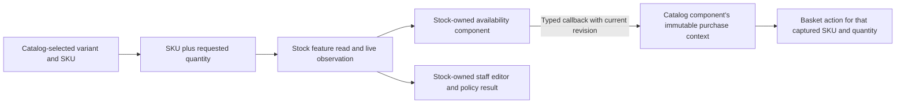

Stock also owns `/operations/stock`, mapped by the host to `OperationsLayout` and protected by `Shop.Stock.Manage` on direct routes, interactive activation and backend commands. Its SKU search/selection uses native URL query state. A separate `IStockManagementFeature` supplies authorized editor reads/commands; the public `IStockFeature` remains read/observation-only. Catalog's lookup supplies product names/model labels and SKU definitions; Stock manages quantity/policy against that existing identity. Staff cannot create an unrelated SKU by changing a text label, and read-only reporting access grants no stock-management permission.

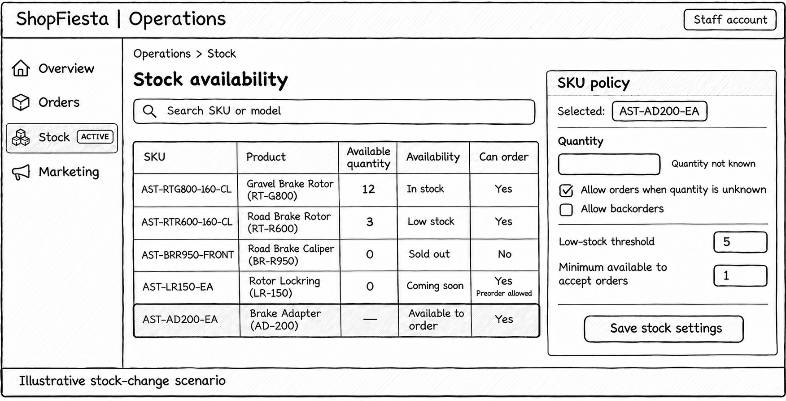

*Figure A.3. A separate stock-change fixture demonstrates normal, low, sold-out, preorder and null-quantity outcomes. Brake Adapter (AD-200) has no known quantity but explicitly permits ordering. The earlier Catalog wireframe is its all-in-stock browsing fixture before these scenario changes.*

| Native editor field | Stock-owned meaning |
| --- | --- |
| Reported quantity | Optional numeric input for the selected SKU's fixture quantity/adjustment. Empty remains null. The backend derives any reserved/available calculation; the page does not overwrite another module's counter. |
| Sales enabled | Master business switch, distinct from staff authorization and numeric quantity. |
| Minimum available to sell | The configured sale threshold used by Stock's ordering policy. |
| Low-stock threshold | Presentation/alert threshold, independent of the permission to sell. |
| Allow backorders / preorders | Explicit policy for insufficient current stock and future availability, with an expected date/window where applicable. |
| Allow orders when quantity is unknown | Explicit permission to order despite a null numeric quantity; false by default in the demo policy. |

Use `EditForm`/`EditContext`, normal inputs and the existing validation/revision feedback. Save captures the selected SKU, expected Stock revision and immutable edit values. A confirmed save returns the resulting revision and invalidates that SKU's observation; even a policy-only change can alter sellability. Preserve the draft on validation/conflict and reconcile an unknown outcome instead of replaying automatically. A late save/load cannot update another selected SKU. Other circuits update only through the explicitly implemented notification adapter. The fixture can simulate those events for frontend evidence; actual stock storage, reservations and broadcast delivery remain backend roadmap work.

### A.6 Let Basket contribute purchasing without coupling Catalog to it

Spec references: [Typed extension points as a design foundation](#typed-extension-points-as-a-design-foundation), [Predictable attachment and customization](#predictable-attachment-and-customization), [Composition and contextual execution](#composition-and-contextual-execution), and [Safe invocation and lifetime](#safe-invocation-and-lifetime).

Basket's presentation declaration attaches an action contributor to the public Catalog target. Catalog does not need to reference `IBasketFeature` or know how baskets are stored.

```csharp
module.Resources.Use<BasketResources>();
module.Actions.Contribute<AddToBasketActions>(
	CatalogUi.PurchaseActions,
	contributionId: "basket.catalog-purchase",
	required: true);
```

```csharp
public sealed class AddToBasketActions(IBasketFeature basket)
	: IActionContributor<ProductPurchaseContext>
{
	public void Bind(ActionScope<ProductPurchaseContext> scope) =>
		scope.Bind("add-to-basket", action => action
			.LabelKey("AddToBasket")
			.EnabledWhen(
				context => context.CanPurchase && context.Quantity > 0,
				disabledReasonKey: "ProductUnavailable")
			.ExecuteAsync((snapshot, cancellationToken) =>
				basket.AddAsync(new AddBasketItem(
					snapshot.ProductId,
					snapshot.VariantId,
					snapshot.Sku,
					snapshot.Quantity,
					snapshot.ProductVersion,
					snapshot.StockRevision), cancellationToken)));
}
```

`IBasketFeature`, `AddBasketItem`, the receipt and `BasketUiState` are feature-owned contracts/helpers. The presentation-side feature implementation accepts confirmed receipts into the current basket/session summary and invalidates relevant consumers as described below. `BasketUiState` uses existing scoped AppState and notification mechanisms. It is not another framework state store or a wrapper every feature must implement.

The contributor is resolved through normal DI for the live scope. Registration infers its service registration, module provenance and local identities. Its resource keys remain Basket-owned even though Catalog owns the target. Shared metadata does not retain the contributor, scoped basket client or component.

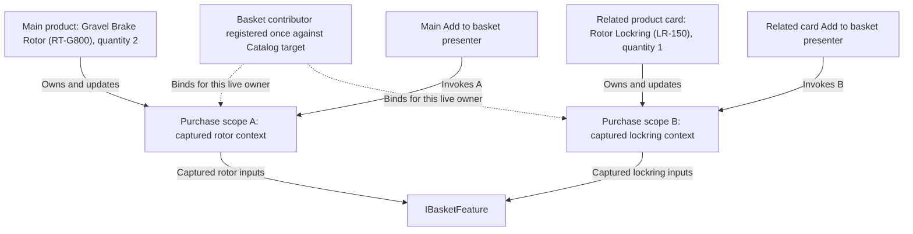

No confirmation is needed for the example's ordinary Add operation. Invocation still checks the owner and current required availability, reserves that binding's pending state and captures immutable inputs before dispatch. A quantity change after dispatch cannot retarget the accepted command. Duplicate clicks on the same binding are suppressed; independent cards are not serialized through a circuit-wide gate.

Backend basket concurrency/idempotency handles overlapping requests where required. UI suppression is not a transaction or a guarantee that two independent bindings can never affect the same product. An uncertain mutation result is not automatically retried. Disposal requests cancellation and prevents late UI updates without claiming to reverse an already committed basket change.

The same action binding can appear in a product's local purchase area and an explicitly attached sticky purchase bar. They share pending/busy state and feedback ownership. The sticky bar must retain its source when focus moves into it and must not silently select another product card.

### A.7 Let Marketing fill an optional product region

Spec references: [Published typed contracts](#published-typed-contracts), [Common composition metadata](#common-composition-metadata), [Host-supplied feature availability](#host-supplied-feature-availability), and [Initialization, failures and recovery](#initialization-failures-and-recovery).

Catalog publishes an optional, single-contribution region below the product details. Normal Razor supplies the typed context:

```razor
<ProductPurchase Purchase="this.currentPurchase" />

<ExtensionRegion Target="CatalogUi.RelatedProducts"
                 Context="this.productContext" />
```

Marketing registers a compatible component through that region:

```csharp
module.Regions.Contribute<RelatedProducts>(
	CatalogUi.RelatedProducts,
	contributionId: "marketing.related-products",
	required: true);
```

`RelatedProducts.razor` uses an ordinary `[Parameter] ProductContext Context` and an injected `IMarketingFeature`. Builder validation, and a generator diagnostic if supplied, checks the component's declared context parameter. No framework component base is required. C# generic handles do not by themselves prove every Razor parameter convention; composition must validate the remaining facts.

The feature queries recommendations for the current product and renders public Catalog `ProductCard` components from public product summaries. Each card creates its own purchase scope, so Basket's contributor works there without a Marketing-to-Basket dependency. `ProductCard` does not render the related-products region recursively; that region belongs to the product detail page.

| Situation | Visible and lifecycle behavior |
| --- | --- |
| Marketing not selected | The region collapses. Catalog browsing and purchasing remain usable. |
| One valid Marketing contribution | Render related products for the supplied product context, with Marketing provenance/resources. |
| Two competing replacements | Apply an explicit host replacement or reject the unresolved single-region conflict at composition. |
| Recommendation capability unavailable | Use the declared optional fallback. Do not block Add to basket or checkout. |
| Successful query with no recommendations | Collapse or show the feature's deliberate empty state. Do not label it a service failure. |
| Recommendation query fails | Contain failure to the region; show a local recovery affordance if the feature provides one. Do not turn failure into a successful zero result. |
| Navigate to another product during the read | Cancel/supersede the old read and reject its late result using the new product/context revision. |

The host can suppress or replace `marketing.related-products` through its published contribution ID. Ordinary integration does not require editing Catalog's source. Query evaluation does not start a purchase, subscribe to undeclared global state or enable personalization implicitly.

#### A.7.1 Manage recommendations in the Marketing module

Spec references: [Page ownership and route availability](#page-ownership-and-route-availability), [Field validation and submitted revisions](#field-validation-and-submitted-revisions), [Minimal unsaved-change support](#minimal-unsaved-change-support), [Automatic refresh and explicit invalidation](#automatic-refresh-and-explicit-invalidation), and [Extension contracts and host authority](#extension-contracts-and-host-authority).

Marketing staff manage the related-products data at `/operations/marketing/recommendations`. Selecting a source product opens `/operations/marketing/recommendations/{ProductId:guid}`. Both pages belong to the same Marketing module as the storefront contribution. They use `OperationsLayout` and the native `Shop.Marketing.ManageRecommendations` authorization policy. Hiding their navigation entries is only a presentation decision; initial requests, interactive activation and backend reads/writes enforce access independently. Permission to manage recommendations does not imply permission to release orders or view business reports.

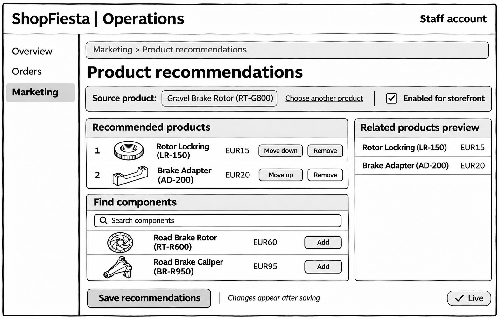

*Figure A.4. Marketing manages the Gravel Brake Rotor's ordered recommendations: Rotor Lockring and Brake Adapter. Catalog supplies product lookup and public summaries. The preview displays the local draft without live purchase actions; only a confirmed save changes the published recommendation set.*

The first slice uses manually curated, bounded sets. Marketing owns the source product ID, enabled flag, ordered recommended product IDs and version. Catalog owns product identity and current public product data. The editor uses Catalog's public lookup contract rather than private queries or repositories. Staff can find `RT-G800` by its model designation and verify the Aster brand and variant metadata, while the saved recommendation still references the stable product ID. Nothing in these contracts depends on bike components. This workflow needs neither a recommendation algorithm nor a generic administration framework.

```csharp
public static class MarketingUi
{
	public const string Name = "marketing";

	public static Destination<RecommendationRoute> RecommendationEditor { get; } =
		Destination.ForPage<RecommendationEditor, RecommendationRoute>(
			"marketing.recommendations.edit");
}

public sealed record RecommendationRoute(Guid ProductId);

public sealed record RecommendationSet(
	Guid ProductId,
	long Version,
	bool Enabled,
	ImmutableArray<Guid> RecommendedProductIds);

public sealed record RecommendationUpdate(
	Guid SaveId,
	Guid ProductId,
	long ExpectedVersion,
	bool Enabled,
	ImmutableArray<Guid> RecommendedProductIds);

public interface IMarketingManagementFeature
{
	Task<Result<RecommendationSet>> LoadAsync(
		Guid productId,
		CancellationToken cancellationToken = default);

	Task<Result<RecommendationSet>> SaveAsync(
		RecommendationUpdate update,
		CancellationToken cancellationToken = default);
}
```

These proposed DTOs illustrate feature ownership, not new shell primitives. `SaveId` identifies the submitted mutation for backend reconciliation; it is distinct from the live action binding. The feature also provides a bounded status lookup by that reference when a save's acknowledgement is lost. The tiny backend can simulate this contract in memory and must identify that process-lifetime limitation.

Marketing's presentation registration includes its page assembly, management destination and staff navigation entry through the same builders used elsewhere. Native `@page` declarations define the URLs. Ordinary module-assembly ownership avoids annotations on each page; if the staff facet uses a separate assembly, Marketing registers that assembly under the same identity. Customer-facing service contracts expose published recommendation reads only. Staff drafts and management endpoints remain authorized even when their assembly is browser-downloadable.

| Editor interaction | Required behavior |
| --- | --- |
| Open a source product | Load its saved set and current Catalog summaries. Cancel/supersede older reads; a late load cannot replace another product's draft. Missing/deleted source products receive an explicit unavailable result. |
| Add, remove or reorder | Update a page-owned draft with stable product keys. Allow at most six distinct recommendations, exclude the source itself and validate current store/catalog membership through backend contracts. A deleted/unavailable recommended product is marked for correction; it does not silently become another product. |
| Preview | Render names, media and prices through read-only Catalog presentation. Do not create purchase scopes, record customer views or invoke Add to basket from an administrative preview. |
| Save | Use native `EditForm`/`EditContext` and the existing validation adapter. Capture an immutable update with the source ID, expected version and save reference. Disable draft editing while this save is pending. Backend validation and authorization remain authoritative. |
| Confirmed save | Establish the returned version as the baseline and invalidate the declared recommendation read for that source product. Reordering preserves item identity. The next eligible storefront read uses the saved enabled set and current public product summaries. |
| Version conflict | Preserve the draft, show the conflict and offer reload/review of the current saved version. Do not overwrite another editor's changes or silently retry with its version. |
| Unknown save outcome | Keep the submitted reference and reconcile its backend status. Loading a newer version alone does not establish which editor saved it. Do not blindly replay the mutation or show success. |
| Leave, change source or switch identity | Use the feature's native dirty-navigation policy for voluntary navigation. Revoke access immediately on forced identity change. A late save/result cannot establish another product's or user's baseline. |

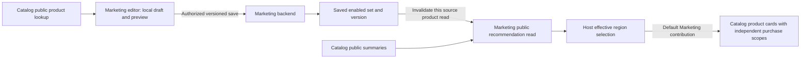

The save signal affects the source product's declared recommendation query, not every Catalog query, basket summary or checkout review. Local state/Notifier delivery reaches only its supported runtime/circuit. Other customers see the saved backend version on their next read or explicit refresh; automatic cross-circuit delivery requires a separately implemented backend broadcast path.

The host profiles in [A.13.1](#a131-replace-a-contribution-and-inspect-the-effective-result) remain authoritative. Under `featured-related` or `no-related`, saving Marketing data does not restore or replace the host-selected presentation. The editor can explain that this set is not currently shown by the shop configuration, and authorized diagnostics identifies the effective provider. The default profile demonstrates the saved set appearing in the public region. Disabling the set produces a successful empty recommendation result, not a failed query.

### A.8 Keep the basket page and header summary consistent

Spec references: [State, preferences and application context](#state-preferences-and-application-context), [AppState adaptation](#appstate-adaptation), [State change subscriptions](#state-change-subscriptions), and [Automatic refresh and explicit invalidation](#automatic-refresh-and-explicit-invalidation).


*Figure A.5. Two brakes at EUR 80 and one lockring at EUR 15 produce three units and a EUR 175 subtotal. Illustrative delivery is EUR 5 and the displayed total is EUR 180. Basket owns quantity/removal behavior and its confirmed summary; Checkout revalidates the payable review independently.*

The basket is backend-owned business state, including for an anonymous visitor. The backend resolves the current basket from the authenticated or guest session; the browser cannot establish ownership by supplying an arbitrary basket ID. A frontend AppState snapshot is a current presentation view, not the durable basket database.

Basket supplies the header badge through the shell's public header region, alongside its own `/basket` destination. The badge observes a narrow summary selector: unit count, display total, basket revision and load/availability status. It does not fetch on every render or subscribe to unrelated product filters.

The proposed registration targets a shell-owned region. Catalog can independently contribute its search component to the same multi-contribution region, with documented ordering.

```csharp
module.Regions.Contribute<BasketBadge>(
	ShellUi.HeaderEnd,
	contributionId: "basket.header-summary",
	required: true,
	order: 200);
```

`ShellUi.HeaderEnd` is a proposed public `RegionTarget<ShellContext>` exported by the headless shell. `BasketBadge` accepts the native context parameter and injects Basket's state. `StorefrontLayout` renders that region through `ExtensionRegion`; the operations layout can choose different chrome. Header placement does not change the badge's state owner or grant access to a basket.

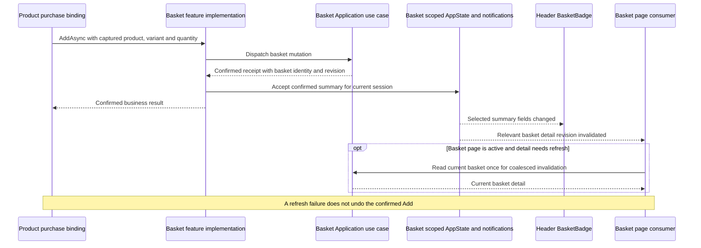

`BasketUiState.AcceptAsync` rejects an older summary for the same basket/session rather than letting out-of-order responses rewind the badge. The summary has explicit client/circuit ownership, independent of a product component. A known result can update that same-session summary after the product component disappears, while no callback updates the disposed component. Results for a previous identity/basket context are rejected. If completion remains unknown, recovery reads the original basket rather than replaying Add.

Confirmed mutation outcome and subscriber/read feedback are separate. A notification or refresh failure must not replace the returned success with a failed Add. Inactive detail consumers become stale and load on activation; unrelated catalog and Marketing reads do not restart.

| State | Owner and restoration policy |
| --- | --- |
| Category, filters, sort and page | Catalog query/URL. Shareable values remain in the URL. |
| Product quantity and variant being chosen | The live product component, transient unless the feature explicitly chooses otherwise. |
| Basket contents and revision | Backend Basket module, with a current scoped frontend snapshot. |
| Header basket count | A derived selector over Basket's confirmed summary. An unknown count is not displayed as zero. |
| Checkout form draft | Checkout page owner, private and transient by default. Contact/delivery data is not automatically persisted in browser preferences. |
| Customer history/detail snapshots | Orders presentation state scoped to the current customer, route/query and runtime context. Backend access checks remain authoritative. |
| Staff order selection | Each order-queue component instance. It is not shared with customer history, storefront state or another queue. |
| Theme, culture and benign view preferences | Explicitly scoped preferences using the framework's documented persistence policy. |

Refresh and state propagation use declared dependencies. Existing Notifier and AppState can carry typed local invalidation signals. Neither automatically crosses circuits, tabs, devices or a Server/browser boundary. Cross-device basket updates need an explicit backend notification or subsequent read; the example does not invent a global event bus.

Quantity and removal mutations keep their own captured line identities and versions. A backend price/stock change is presented as a current business result, not patched away by trusting the old summary. The checkout destination is hidden when its optional module is absent, or explicitly disabled with a reason where that presentation is chosen. A required but unknown checkout capability keeps that action unavailable until established.

### A.9 Use native checkout forms and an explicit order attempt

Spec references: [Shared interactions and operation feedback](#shared-interactions-and-operation-feedback), [Field validation and submitted revisions](#field-validation-and-submitted-revisions), [Minimal unsaved-change support](#minimal-unsaved-change-support), [Operation outcomes and recovery](#operation-outcomes-and-recovery), and [Session and workspace transitions](#session-and-workspace-transitions).

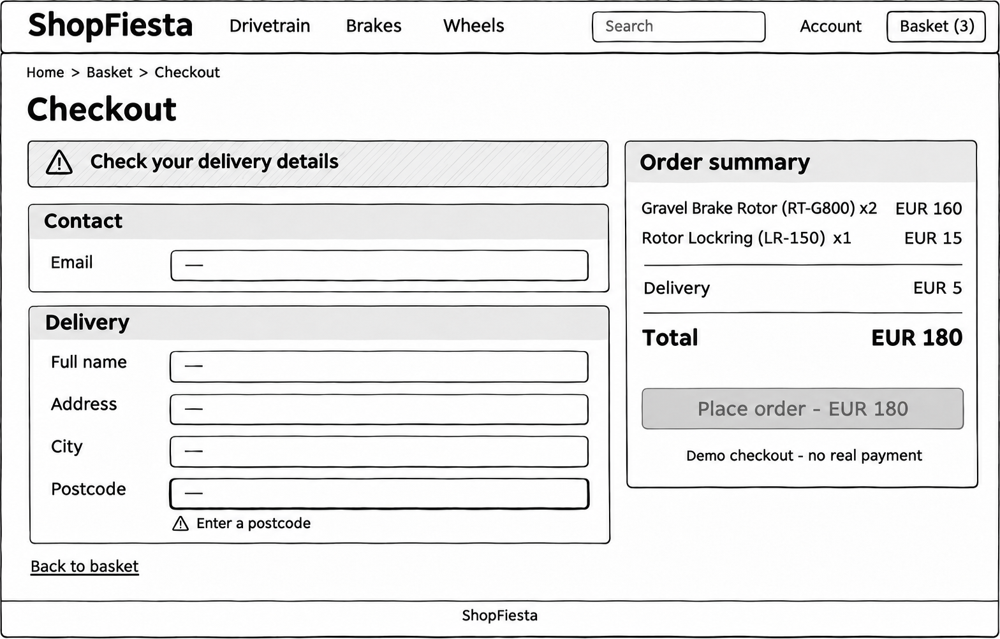

*Figure A.6. Checkout owns the form and its submission revision. The current postcode error appears beside the field and in a summary. The order review contains server-established values; the disabled Place order button does not imply that a payment or order has already succeeded.*

Checkout uses ordinary `EditForm`, `EditContext`, validation controls and injected services. It does not need a framework form base or an action registration for each field. A shared result-to-field adapter supplies the specified feedback behavior where needed.

```razor
<EditForm EditContext="this.editContext" OnValidSubmit="this.SubmitAsync">
	<DataAnnotationsValidator />
	<ValidationSummary />
	<InputText @bind-Value="this.draft.Shipping.Postcode" />
	<ValidationMessage For="() => this.draft.Shipping.Postcode" />
	<button type="submit" disabled="@this.submitting">Place order</button>
</EditForm>
```

The feature owns the omitted fields, submission method and current review. Field-level validation is usability feedback; Application validation and authorization still run for direct Server and HTTP execution.

| Checkout step | Contract and ownership |
| --- | --- |
| Load review | Read the current basket, stock/pricing/delivery decision and a versioned review through `ICheckoutFeature`. Display its actual availability and totals. |
| Edit contact and delivery | Native `EditContext` tracks fields. Checkout tracks the submitted edit revision and immutable values. Benign view preferences do not absorb personal draft data. |
| Prepare submission | Validate, reserve this form's pending state and capture the draft, basket/review versions and feature-owned attempt key. Prevent duplicate submits while preparation/dispatch is pending. |
| Place order | Checkout invokes its backend feature contract against the captured basket/review. The backend establishes acceptance and owns payment/processing. The UI consumes the outcome and does not run a worker or wait for fulfillment. |
| Map known rejection | Map matching property paths, such as `Shipping.Postcode`, to the current submitted fields. Use explicit aliases for different names. Unmatched/model errors go to the summary. |
| Reject old feedback | A rejection for an older edit revision does not mark newer field values invalid or overwrite a newer submission's feedback. The summary may explain that an earlier submission was rejected. |
| Confirmed success | An established order/receipt confirms acceptance, not completed payment or fulfillment. Navigate to its authorized receipt and invalidate relevant basket/order views. Later queue/processing or badge-refresh failure does not erase the order or resubmit checkout. |
| Price, stock or review changed | Present the new review and require the feature's fresh decision. Do not silently accept a higher amount or substitute a different basket. |
| Completion uncertain | Retain the original attempt reference and show a status/recovery path. Query the backend before any deliberate retry. Do not label a disconnected UI as a rejected or cancelled order. |

The application supplies a durable attempt/idempotency contract for order placement where required. Its key identifies the same business attempt, not every click or every retry. UI duplicate suppression cannot replace that backend contract. No real payment provider or card collection is required for the local demo; a deterministic fake can produce known success, rejection and uncertain-completion scenarios.

```mermaid
sequenceDiagram
    actor Customer
    participant Form as Checkout page
    participant Feature as ICheckoutFeature
    participant UseCase as Checkout Application use case
    participant Orders as Orders public backend contract
    Customer->>Form: Submit current validated review
    Form->>Form: Reserve pending and capture draft revision and attempt
    Form->>Feature: PlaceAsync with immutable submission
    Feature->>UseCase: Runtime-specific access
    UseCase->>UseCase: Validate access, basket version and current review
    alt Known validation or review rejection
        UseCase-->>Feature: Confirmed rejection and property/model errors
        Feature-->>Form: Result for the captured submission
        Form->>Form: Apply only to applicable submitted revision
    else Valid submission
        UseCase->>Orders: Place using the same business attempt
        alt Confirmed order
            Orders-->>UseCase: Receipt and affected basket/order references
            UseCase-->>Feature: Confirmed feature outcome
            Feature-->>Form: Receipt for the captured submission
            Form-->>Customer: Authorized confirmation destination
        else Completion not established
            UseCase-->>Feature: Business completion not established
            Feature-->>Form: Pending or uncertain completion
            Form-->>Customer: Pending or unknown outcome with recovery
            Customer->>Form: Check order status
            Form->>Feature: Find original attempt status
            Feature->>UseCase: Read attempt status without replaying placement
        end
    end
```

The checkout use case owns orchestration through the public backend contracts. The shell supplies feedback, lifetime and context rules without turning the workflow into a generic frontend command bus.

An unsaved-change helper can guard ordinary navigation away from a dirty draft. Forced sign-out or access revocation takes precedence. Disposing the page requests cancellation and rejects late UI updates, but cannot reverse a committed order. Recovery uses the backend attempt, not a recreated local component's guess.

#### A.9.1 Observe backend-owned order processing

Spec references: [Execution state and observation](#execution-state-and-observation), [Operation outcomes and recovery](#operation-outcomes-and-recovery), and [Safe invocation and lifetime](#safe-invocation-and-lifetime).

An accepted receipt confirms an established order, not completed payment or fulfillment. Checkout supplies its attempt/receipt reference; Orders supplies authorized customer/staff status. The frontend renders those outcomes and recovery choices through the existing feature contracts. The backend owns subsequent processing through Queueing in the full showcase.

| Frontend situation | Required presentation behavior |
| --- | --- |
| Order accepted | Display the established order/reference and its actual returned status. Do not infer Paid from successful submission. |
| Processing still pending | Show the feature's pending/processing state. Status reads observe it without advancing work or inventing progress. |
| Leave and revisit | Dispose the page's reads/subscriptions and reconstruct observation from the original authorized reference. Page disposal does not cancel accepted backend work. |
| Lost acknowledgement | Retain the submitted attempt/reference and use the feature's reconciliation path. Do not blindly repeat Checkout or Release. |
| Staff Release succeeds | Show the confirmed release/scheduling outcome, not shipment/delivery. Partial outcomes still belong to their captured targets. |

```mermaid
sequenceDiagram
    participant Page as Checkout or Orders page
    participant Feature as Runtime-specific feature service
    participant Backend as Owning backend contract or fixture handler
    Page->>Feature: Submit captured attempt or action
    Feature->>Backend: Direct Requester on Server or HTTP in WASM
    Backend-->>Feature: Accepted reference and actual outcome
    Feature-->>Page: Typed feature result
    Note over Page,Backend: Backend work outlives the originating page
    Page->>Feature: Read original authorized reference after revisit
    Feature->>Backend: Observe current status without replay
    Backend-->>Feature: Current status
    Feature-->>Page: Typed status result
```

The first slice uses deterministic backend-owned fixture transitions, advanced by test control rather than page reads/timers. Queue contracts, workers, retry and durable handoff are preserved in the [backend roadmap](spec-shopfiesta-backend-showcase.md#orders-queue-processing). The Ready/Review lists below remain independent UI scopes, not infrastructure queues.

### A.10 Show customer order history and protect staff operations

Spec references: [Optional authentication and authorization](#optional-authentication-and-authorization), [Selection ownership and defaults](#selection-ownership-and-defaults), [External toolbar and component-owned behavior](#external-toolbar-and-component-owned-behavior), [Typed scopes and explicit placement](#typed-scopes-and-explicit-placement), and [Safe invocation and lifetime](#safe-invocation-and-lifetime).

Orders owns both customer and operational views over its backend business state. Audience-specific routes, DTOs, policies and layouts keep the capabilities distinct. They do not split the logical module or duplicate the source of truth.

#### A.10.1 Customer history and order detail

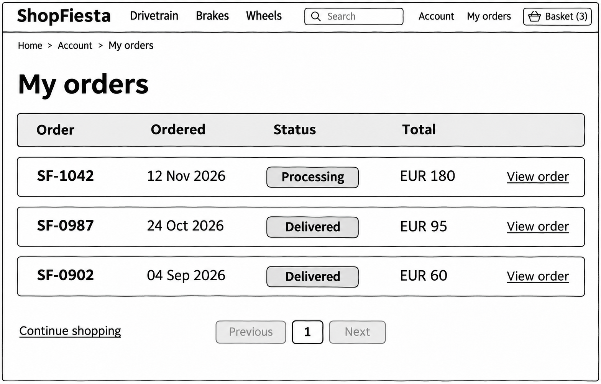

*Figure A.7. My orders lists the current customer's purchases with their order date, customer-visible status and total. The customer can open an order; operational selection and Release actions do not appear in this view.*

```razor
@page "/account/orders"
@attribute [Authorize(Policy = "Shop.Customer.Orders")]
@inject ICustomerOrdersFeature Orders
```

```csharp
public interface ICustomerOrdersFeature
{
	Task<Result<CustomerOrderPage>> FindAsync(
		int page,
		int pageSize,
		CancellationToken cancellationToken = default);

	Task<Result<CustomerOrderDetailsModel>> FindOneAsync(
		Guid orderId,
		CancellationToken cancellationToken = default);
}

public static class OrdersUi
{
	public const string Name = "orders";

	public static Destination<CustomerOrderRoute> CustomerOrder { get; } =
		Destination.ForPage<CustomerOrderDetails, CustomerOrderRoute>(
			"orders.customer-detail");
}

public sealed record CustomerOrderRoute(Guid OrderId);
```

`CustomerOrderDetails.razor` declares `@page "/account/orders/{OrderId:guid}"` and the same customer policy. The query derives the customer identity from the authenticated backend context; the browser does not choose a trusted customer ID. A guessed order ID cannot return another customer's record. The Application use case enforces current-owner access for in-process and HTTP calls independently of navigation visibility.

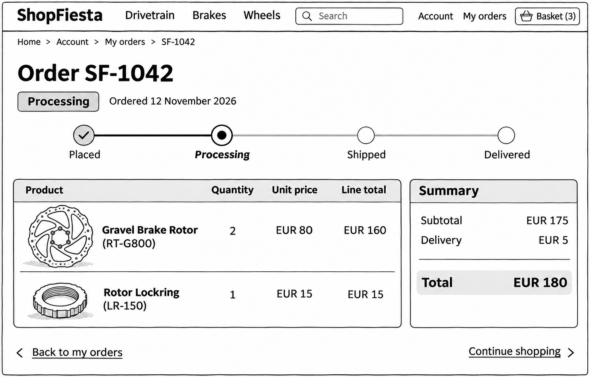

*Figure A.8. The customer detail shows the order snapshot: two Gravel Brake Rotors, one Rotor Lockring, delivery and the EUR 180 total. The customer-visible Processing status belongs to Orders. No staff queue state, internal review data or fulfillment action is exposed.*

The customer-facing fulfillment status and the staff queue's payment-readiness filter are different projections of the same order. The sample SF-1042 can be Processing for the customer and Paid in the staff queue. Neither page maintains a separate business status or order copy.

| Customer interaction | Required behavior |
| --- | --- |
| Open My orders | Read a bounded page belonging to the current customer. Preserve the feature's page/filter policy in native query state where appropriate. |
| Open a bookmarked detail | Resolve Orders ownership and customer policy, then fetch that customer's order without first mounting history. Build breadcrumbs from the authorized order result and public destinations. |
| Finish checkout | The immediate Checkout receipt can link through `OrdersUi.CustomerOrder` when customer history is available and authorized. Orders remains the owner of the later history/detail view. |
| Revisit after catalog changes | Display the purchased names, brands, model designations, selected variant/SKU, amounts and other order-line snapshots owned by Orders. Missing optional metadata in older fixtures remains absent. Do not rewrite a past purchase using current catalog labels, prices or categories. |
| Product removed or catalog replaced | Keep the historical line readable. An optional current-product link can be omitted or shown unavailable without losing the order history. |
| Sign out or switch customer | Invalidate private reads/state and reject old-customer completions. An AppState snapshot or a stale browser cache does not authorize later access. |
| View as a customer | Use customer-specific projections. The backend does not return staff-only review/fulfillment data and rely on the page to hide it. |
| Guest purchase | Preserve the feature's authorized immediate receipt. Attaching a verified guest purchase to a later account requires an explicit application policy; matching an email or retaining a local ID alone does not grant history access. |

```mermaid
flowchart LR
    CustomerUI["Orders customer pages: storefront layout"]
    StaffUI["Orders staff pages: operations layout"]
    subgraph OrdersBackend["One Orders backend module"]
        CustomerRead["Current-customer query and customer projection"]
        StaffUseCase["Staff-authorized query and fulfillment commands"]
        State["Order business state and historical snapshots"]
        CustomerRead --> State
        StaffUseCase --> State
    end
    CustomerUI -->|"Customer identity and owner checks"| CustomerRead
    StaffUI -->|"Staff policy and business checks"| StaffUseCase
```

Orders can place customer and operations presentation in separate assemblies when runtime/dependency boundaries need it. The same module registers their assemblies/capabilities under `orders`; the browser customer profile includes only its declared portable customer presentation. This is not a second module registration or a reason to ship operational DTOs into the customer read path.

#### A.10.2 Staff queues and safe batch actions

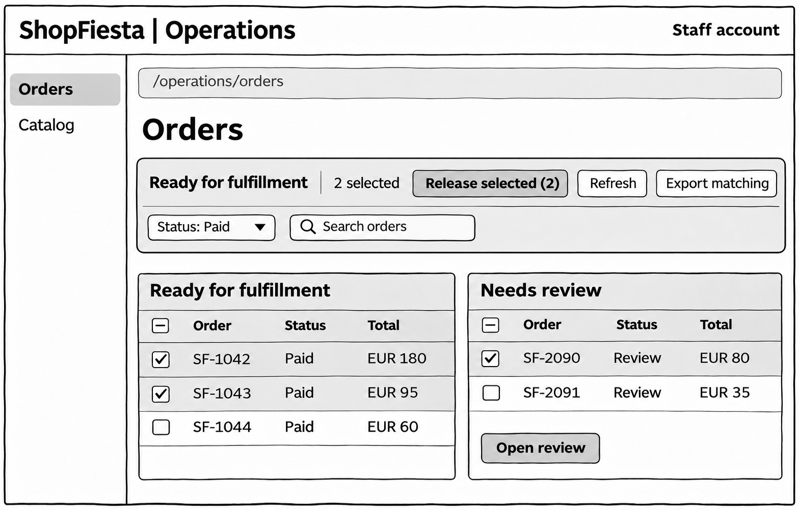

*Figure A.9. The header releases the two selected orders in Ready for fulfillment. The selected order in Needs review belongs to a different component and is excluded. Customer history and the public shop do not expose these controls or grant their permissions.*

The operations page uses native authorization metadata and its selected module layout. Backend handlers independently enforce the same relevant access and business rules.

```razor
@page "/operations/orders"
@attribute [Authorize(Policy = "Shop.Orders.Operate")]

<ActionToolbar Scope="this.readyActions" />
<OrderQueue Kind="OrderQueueKind.Ready"
            ShowLocalToolbar="false"
            ActionsReady="scope => this.readyActions = scope" />
<OrderQueue Kind="OrderQueueKind.Review" />

@code {
	private ActionScope<OrderQueueContext> readyActions;
}
```

The callback is an ordinary `EventCallback` from the first component. Each `OrderQueue` creates and disposes its own `ActionScope<OrderQueueContext>`. A missing or disposed scope exposes no invokable actions. No global current-grid state or component lookup is required.

```csharp
public sealed record OrderTarget(Guid OrderId, long Version);

public sealed record OrderQueueContext(
	ImmutableArray<OrderTarget> Targets,
	bool AllReleasable,
	OrderQueueQuery Query);

public sealed record OrderQueueQuery(string Status, string SearchText, string Sort);
```

The Ready queue binds its local callback through the same action API used for product purchasing, with a different typed context and business behavior:

```csharp
this.actions.Bind("release", action => action
	.LabelKey("ReleaseSelected")
	.EnabledWhen(
		context => !context.Targets.IsEmpty && context.AllReleasable,
		disabledReasonKey: "SelectReleasableOrders")
	.ConfirmWith(context => this.Text["ConfirmRelease", context.Targets.Length])
	.ExecuteAsync((snapshot, cancellationToken) =>
		this.Orders.ReleaseAsync(snapshot.Targets, cancellationToken))
	.MapOutcome(ReleaseFeedback.FromResult)
	.OnConfirmedOutcome((receipt, cancellationToken) =>
		this.ApplyReleaseReceiptAsync(receipt, cancellationToken)));
```

No contributor class is necessary for this feature-local callback. The module publishes a stable target or definition only when another package needs to attach or reference it. Routine definition, scope, binding and execution identities are inferred with module/owner provenance.

```mermaid
sequenceDiagram
    actor Staff
    participant Toolbar as Header ActionToolbar
    participant Scope as Ready queue binding
    participant Confirm as Confirmation
    participant Feature as Orders feature
    Staff->>Toolbar: Release selected
    Toolbar->>Scope: Invoke original Ready binding
    Scope->>Scope: Validate and reserve pending state
    Scope->>Confirm: Capture selected IDs and versions for confirmation
    Staff->>Confirm: Confirm or decline
    Confirm-->>Scope: Decision
    alt Declined or preparation cancelled
        Scope-->>Toolbar: End without dispatch
    else Confirmed
        Scope->>Scope: Recheck owner, target revision, availability and access
        alt Relevant context changed or owner invalid
            Scope-->>Toolbar: Require a fresh decision without dispatch
        else Still eligible
            Scope->>Feature: ReleaseAsync with captured Ready targets
            Note over Scope,Feature: Review queue selection and later paging cannot retarget this execution
            Feature-->>Scope: Actual outcome or uncertain completion
            Scope-->>Toolbar: Notify only current live observers
            opt Confirmed full or partial outcome and valid owner context
                Scope->>Feature: Feature-owned read or targeted invalidation
            end
        end
    end
```

| Selection or lifecycle change | Required result |
| --- | --- |
| Page forward or back | Keep selected IDs by default. An explicit selection-adapter option can clear on paging. |
| Change search or filters | Clear the applicable selection under the established defaults. Sorting retains it. |
| Refresh the visible page | Refresh versions/eligibility for available records. An off-page absence is not proof of deletion. Remove only confirmed deleted or inaccessible targets. |
| Relevant target changes during confirmation | Invalidate the old decision. Do not replace the targets with current selection silently. |
| Selection changes after dispatch | Keep the accepted invocation's captured IDs and versions. Do not restart or automatically cancel it merely because selection changed. |
| Present the same binding locally and externally | Share pending/busy state, outcome observation and one feedback owner. |
| Switch the explicitly active queue | Change future header attachment. Already accepted work keeps its original owner and captured inputs. |
| Dispose the owner or lose access | Remove bindings, invalidate pending confirmation, request supported cancellation and prevent stale UI updates. Backend effects retain their actual outcome. |

Batch selection is explicit selected IDs, not an implicit select-all-matching query. Exporting all matching orders is a separate declared feature operation. Operational reads and actions can use optional FilterModel/data adapters without forcing the customer product listing into the same presentation.

#### A.10.3 Bind typed query controls to the same queue

Spec references: [Published typed contracts](#published-typed-contracts), [Action and control contribution requirements](#action-and-control-contribution-requirements), [Typed scopes and explicit placement](#typed-scopes-and-explicit-placement), and [Automatic refresh and explicit invalidation](#automatic-refresh-and-explicit-invalidation).

The Status and Search controls in Figure A.9 belong to the Ready queue's external toolbar. They are controls supplied by that live queue, not header-owned copies of its query. The header observes actions and controls from the same explicit `readyActions` source. Review retains its independent query and selection.

The proposed binding convenience uses an ordinary Razor control component with a typed `Value` and `EventCallback<T>`:

```csharp
this.actions.BindControl<OrderQueueFilterControls, OrderQueueQuery>(
	"filters",
	control => control
		.Value(context => context.Query)
		.ValueChanged(this.ApplyQueryAsync));
```

```csharp
[Parameter]
public OrderQueueQuery Value { get; set; }

[Parameter]
public EventCallback<OrderQueueQuery> ValueChanged { get; set; }
```

`OrderQueueFilterControls` renders normal input/select controls and emits a new immutable query, preserving unchanged values such as sorting. It requires no framework component base or service lookup. The binding convenience validates its parameter contract, supplies the live value and dispatches callbacks through the original owner's Blazor dispatcher. A local toolbar can use the same Razor component directly when external placement is unnecessary.

`ApplyQueryAsync` is an ordinary Ready-queue callback. It validates allowed query values, updates that queue's native URL/view state, applies the established filter-selection policy, advances the relevant context revision and coalesces/cancels obsolete reads. It does not execute Release. Ready URL keys such as `readyStatus`, `readySearch`, `readySort` and `readyPage` distinguish this instance from any independently restorable Review view.

```mermaid
flowchart TD
    Header["External header toolbar: explicit Ready source"]
    Input["Status and Search controls"]
    Ready["Ready queue live scope: query, selection and bindings"]
    Read["Ready query consumer"]
    Review["Review queue: independent query and selection"]
    ReviewRead["Review query consumer"]
    Header -->|"Presents the same scope"| Input
    Ready -.->|"Current query and availability"| Input
    Input -->|"Typed ValueChanged to original owner"| Ready
    Header -->|"Release with captured selection"| Ready
    Ready -->|"Declared query invalidation"| Read
    Review -->|"Its own local controls and invalidation"| ReviewRead
```

| Control interaction | Observable result |
| --- | --- |
| Change Ready status or search | Only Ready's declared query reloads. Its filter change clears the applicable selection; Review remains unchanged. |
| Change sorting | Reorder the Ready result using its query contract while retaining selected IDs under the established default. |
| Enter the toolbar or an overflow menu | Keep the Ready source. Native text editing and keyboard behavior do not activate another queue. |
| Switch the explicitly attached source | Future controls display the newly selected scope. An older delayed callback is rejected or remains with its eligible originating owner; it can never mutate the new source. |
| Remove the Ready component | Detach control subscriptions and reject later callbacks/results for its disposed owner. Do not retain the component in shared metadata. |
| Change filters during Release confirmation | Invalidate the relevant selection/context and require a fresh decision. A Release already dispatched keeps its original captured targets. |

`BindControl` participates in the existing interaction scope; it does not introduce another control registry or a new CQRS request for each input. Published control contributions use the same compatibility, ordering and host-override rules when reuse across packages warrants registration.

#### A.10.4 Distinguish partial release from backend-owned export

Spec references: [Execution state and observation](#execution-state-and-observation), [Approve Save and Export walkthroughs](#approve-save-and-export-walkthroughs), [Operation outcomes and recovery](#operation-outcomes-and-recovery), and [Selection ownership and defaults](#selection-ownership-and-defaults).

Use two deterministic outcome cases in the minimal Orders backend. They expose presentation contracts without requiring a real broker, queue or file store.

**Partial release.** The submitted batch captures SF-1042 and SF-1043 with their versions. The first is released; the second conflicts with a newer backend version. The feature returns per-target facts rather than treating the entire batch as an atomic success or failure.

| Captured target | Reported result | Presentation and recovery |
| --- | --- | --- |
| SF-1042 | Confirmed released. | Preserve that success and update its known state/eligibility by ID. Do not release it again because another target failed. |
| SF-1043 | Confirmed concurrency conflict. | Show the conflict for that target and reload/review its current state. Any further release requires a fresh explicit selection/decision and current version. |
| Batch | Confirmed partial outcome. | Show one released and one requiring review. Do not retry the original batch automatically or show a generic all-or-nothing message. |

`ReleaseFeedback.FromResult` in the preceding action declaration is a pure feature-supplied mapping into the specified action outcome model. The proposed `MapOutcome` callback distinguishes confirmed full success, partial success and rejection from the actual response. It does not dispatch work or introduce a new business-result base class. A successful outer `Result<ReleaseReceipt>` can mean the batch was processed while the receipt still contains mixed per-target results. A missing authoritative response remains unknown, not a guessed partial result.

The proposed `OnConfirmedOutcome` callback receives the confirmed receipt only while its original owner/context can safely apply it. `ApplyReleaseReceiptAsync` applies known facts to the captured IDs, then refreshes/invalidates declared consumers as a separate feedback phase. A failed refresh cannot erase SF-1042's release or trigger another mutation. Selection follows its documented policy; reloading alone must not invent a new selection-clear rule. Single-target or all-success actions can continue to use `OnConfirmedSuccess`.

**Export matching orders.** The Export matching action in Figure A.9 captures Ready's filter/sort intent and the feature's query options. It exports all records matching that authorized query, independently of the two explicitly selected release targets. It does not turn row selection into query-wide select-all. Backend validation and the feature's declared dataset-consistency policy determine the actual export set; capturing a query alone does not promise a frozen database snapshot.

| Boundary | Owner and response |
| --- | --- |
| Submission | The initiating binding calls the Orders export-start use case through the runtime-specific feature service. Duplicate submission is suppressed while that binding is pending. |
| Accepted response | The backend returns an operation reference. Feedback says the export was accepted, not completed. The local submission execution and the longer-lived backend operation are distinct observations. |
| Backend operation | The example-owned operation source reports actual accepted/running/completed/failed states and any progress it supports. A later real queue/job adapter can implement the same feature contract. |
| Navigation | Disposing the order page detaches its observation and subscriptions. It does not cancel or restart an already accepted backend operation. |
| Return/status link | `/operations/exports/{OperationId:guid}` loads status by the returned reference, with current staff/object access checks. It does not require the original queue component to remain mounted. |
| Result artifact | A completed operation exposes an authorized download only when its result is available. An expired or failed artifact read is distinct from the operation's confirmed completion. |
| Lost submission acknowledgement | Preserve the feature's original request/correlation reference and reconcile acceptance before any deliberate further submission. No generic automatic replay is allowed. |
| Cancellation | Show a backend Cancel action only when that feature actually supports it. Leaving the page or stopping observation is not confirmed cancellation. |

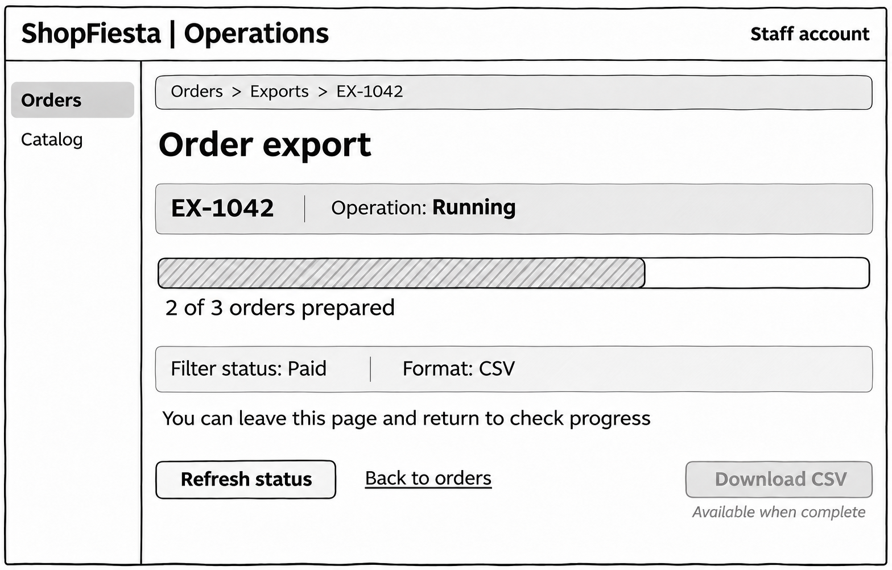

*Figure A.10. The status page observes EX-1042 independently of the initiating queue. Two of three records prepared is progress reported by the example source. Download remains unavailable while the operation is Running.*

```mermaid
sequenceDiagram
    actor Staff
    participant Page as Ready queue page
    participant Feature as Orders export feature
    participant Operation as Example backend operation source
    participant Status as OrderExportStatus page
    Staff->>Page: Export matching Ready query
    Page->>Feature: Start with captured query and request reference
    Feature->>Operation: Submit validated export
    Operation-->>Feature: Accepted operation reference
    Feature-->>Page: Accepted operation reference
    Page-->>Staff: Export accepted and status link
    Staff->>Page: Navigate away
    Page->>Page: Dispose local bindings and detach observation
    Operation->>Operation: Continue under backend ownership
    Staff->>Status: Open operation status link
    Status->>Feature: Read referenced operation under current access
    Feature->>Operation: Get status
    Operation-->>Feature: Reported progress and state
    Feature-->>Status: Current authorized status result
    Note over Page,Status: No retained queue component or automatic resubmission
```

The first Server slice uses a clearly identified simulated export source with deterministic states and an optional fixture CSV artifact. Order-processing status likewise follows the observation contract in [A.9.1](#a91-observe-backend-owned-order-processing). It proves page/operation ownership and response semantics, not durable export execution or survival of a backend process restart. Progress comes from that source, not elapsed UI time. Example-owned backend/test control advances the export fixture; status/diagnostic reads only observe it. No notification center, generic job scheduler or additional framework execution registry is required. Observation uses the existing feature access, scoped state and diagnostics contracts.

#### A.10.5 Compose staff business metrics and a product funnel

Spec references: [Modular monolith across backend and frontend](#modular-monolith-across-backend-and-frontend), [Page ownership and route availability](#page-ownership-and-route-availability), [Low friction and native platform mechanisms](#low-friction-and-native-platform-mechanisms), [Automatic refresh and explicit invalidation](#automatic-refresh-and-explicit-invalidation), [Session and workspace transitions](#session-and-workspace-transitions), and [Production observability](#production-observability).

Staff open `/operations/overview` to read order/sales summaries, checkout outcomes and a product funnel. Marketing owns `OperationsOverview` and its reporting contract; its backend owns captured metrics. The agreed backend captures source-module messages into Marketing projections. The first frontend slice can use a Marketing fixture handler with the same response contract. The page obtains every reporting value from Marketing's backend read models. Neither the page nor its reporting query fans out to source-module services, components or databases.

Marketing registers the native route and page ownership normally. The host maps it to `OperationsLayout`; the `Shop.Operations.ViewMetrics` policy protects initial activation, interactive navigation and backend reporting reads. A read-only reporting identity need not have recommendation-management or order-release access. The Catalog-only profile omits Marketing and this page. The staff-reporting facet declares its reporting capability separately from Marketing's optional related-products contribution.


*Figure A.11. Marketing supplies fictional overview data for 12 November 2026, 00:00 to 12:00 UTC: five placed orders, EUR 335 across three paid orders and seven submitted checkout attempts. Its product funnel shows 20/8/6/3 journeys. Every panel consumes Marketing's result, including its as-of/coverage metadata. A fixture handler can supply these values for frontend validation; the image does not establish backend message capture.*

Marketing uses ordinary Razor composition. Its page owns the period, currency, product selection, explicit refresh intent, reporting client and query lifetime. Its child components render the returned immutable report values; they have no Catalog, Basket, Checkout or Orders reporting clients. This needs no framework metrics registry, dashboard engine or additional state store.

```razor
@page "/operations/overview"
@attribute [Authorize(Policy = "Shop.Operations.ViewMetrics")]
@inject IMarketingReportingFeature Reporting

<SalesMetrics Value="this.snapshot.Sales" />
<CheckoutMetrics Value="this.snapshot.Checkout" />
<ProductFunnel Value="this.snapshot.ProductFunnel" />
```

`SalesMetrics`, `CheckoutMetrics` and `ProductFunnel` all belong to Marketing. The excerpt shows rendering after a successful read and omits ordinary loading/error markup. One narrow feature contract returns Marketing's stored overview snapshot:

```csharp
public sealed record MarketingOverviewQuery(
	DateTimeOffset FromUtc,
	DateTimeOffset ToUtc,
	string Currency,
	Guid? ProductId);

public interface IMarketingReportingFeature
{
	Task<Result<CommerceOverviewSnapshot>> ReadOverviewAsync(
		MarketingOverviewQuery query,
		CancellationToken cancellationToken = default);
}
```

The proposed `CommerceOverviewSnapshot` contains Marketing-owned sales, checkout and funnel DTOs, the applied query, projection revision, generation time and each stream's known freshness/coverage. Marketing also supplies bounded product-selection results from its stored product dimensions. Even the reporting selector's names, brands and model designations come from Marketing. Recommendation editing can still use Catalog's public product lookup; that separate management workflow does not change the reporting path.

The native query parameters `from`, `to`, `currency` and `product` describe shareable page state. A filter change or explicit Refresh advances the applicable query revision and asks Marketing for a new snapshot. An unrelated rerender does not reload it. All panels from that response describe the same returned projection revision. A read never triggers event publication, message consumption, projection rebuilding or source-module queries.

The frontend needs the response contract, not the message-processing algorithm:

| Returned data | Frontend responsibility |
| --- | --- |
| Applied period, currency and product | Keep controls/URL aligned with the result actually being shown. Supersede old reads when the query changes. |
| Projection revision and capture/calculation time | Display truthful freshness. A newer HTTP response does not imply newer captured facts. |
| Sales, checkout and funnel slices | Compose Marketing-owned native components. Show supplied measures with their labels/units/cohort scope; do not join Catalog, Basket or Orders data in the page. |
| Product-selection summaries | Render Marketing's product IDs, names, brands and model designations. Missing metadata gets an explicit unknown label instead of a Catalog lookup. |
| Coverage/warnings and unavailable ratios | Distinguish an empty result, still-maturing cohort, partial/stale data and failed read. Unknown stages are not zero; zero denominators do not fabricate percentages. |

The illustrative fixture shows EUR 335 across three paid orders, a EUR 111.67 average, and checkout success of 5/7 or 71.4%. Its product funnel is 20 viewing journeys, eight adding, six submitting and three buying, with 40% view-to-basket and 15% view-to-bought. Bought means a confirmed paid outcome. Those are Marketing-owned values/definitions supplied to the frontend, not counts inferred from UI clicks. Detailed cohorts, message payloads and calculation policies live in the [backend roadmap](spec-shopfiesta-backend-showcase.md#marketing-capture-and-reporting).

```mermaid
flowchart LR
    Route["Marketing route, policy and query parameters"] --> Page["OperationsOverview: query lifetime and revision"]
    Page --> Feature["IMarketingReportingFeature"]
    Feature --> Backend["Marketing backend query or fixture handler"]
    Backend --> Snapshot["Marketing snapshot, product choices and freshness"]
    Snapshot --> Sales["SalesMetrics"]
    Snapshot --> Checkout["CheckoutMetrics"]
    Snapshot --> Funnel["ProductFunnel"]
```

The page owns cancellation, loading/error state and the current query revision. Late results for another period/product/identity cannot replace it. All panels render the same returned snapshot revision. A refresh failure can leave the last-good snapshot explicitly stale, with its original filter/time labels. An unavailable slice retains its supplied warning without hiding other usable slices. Marketing query failure never falls back to source-module reads.

Opening, rendering, refreshing or inspecting the overview does not publish business events, start a job or advance backend processing. Fixture responses can exercise freshness/coverage transitions independently of a real messaging pipeline. AppState/Notifier can carry explicitly supported local invalidation, but imply no automatic cross-circuit delivery. This section validates native composition, module ownership, access and read lifecycle; backend capture and analytics have separate evidence.

### A.11 Keep Server and browser access honest

Spec references: [Reference application access paths](#reference-application-access-paths), [Hosting and render-mode interoperability](#hosting-and-render-mode-interoperability), [Prerendering policy and activation](#prerendering-policy-and-activation), and [Frontend coordination with Requester and Notifier](#frontend-coordination-with-requester-and-notifier).

Portable components consume narrow feature-owned contracts such as `ICatalogFeature`, `IStockFeature`, `IBasketFeature`, `ICheckoutFeature`, `IMarketingFeature`, `ICustomerOrdersFeature` and `IOperationsOrdersFeature`. The last two are audience-specific contracts of the same Orders module, not separate business modules. Reuse existing suitable contracts. A Server-only handwritten page may call Requester directly; participation in the shell does not require a new wrapper interface.

The same rule applies to `IMarketingManagementFeature` and `IMarketingReportingFeature`. On Server, the overview dispatches Marketing's reporting query directly through Requester to Marketing's store; WASM uses Marketing's typed HTTP reporting endpoint over that same read model. Reporting follows no query path to Catalog, Basket, Checkout or Orders. Backend event publication and Marketing consumers remain separate from these UI reads and from local AppState/Notifier. The browser cannot manufacture a paid stage, choose an unauthorized reporting context or bypass management authorization by supplying IDs.

```csharp
public interface ICheckoutFeature
{
	Task<Result<CheckoutReview>> ReviewAsync(
		CancellationToken cancellationToken = default);

	Task<Result<CheckoutOutcome>> PlaceAsync(
		CheckoutSubmission submission,
		CancellationToken cancellationToken = default);

	Task<Result<CheckoutAttemptStatus>> FindAttemptAsync(
		Guid attemptId,
		CancellationToken cancellationToken = default);
}

public sealed class ServerCheckoutFeature(IRequester requester) : ICheckoutFeature
{
	public Task<Result<CheckoutReview>> ReviewAsync(
		CancellationToken cancellationToken = default) =>
		requester.SendAsync(new CheckoutReviewQuery(),
			cancellationToken: cancellationToken);

	public Task<Result<CheckoutOutcome>> PlaceAsync(
		CheckoutSubmission submission,
		CancellationToken cancellationToken = default) =>
		requester.SendAsync(new CheckoutPlaceCommand(submission),
			cancellationToken: cancellationToken);

	public Task<Result<CheckoutAttemptStatus>> FindAttemptAsync(
		Guid attemptId,
		CancellationToken cancellationToken = default) =>
		requester.SendAsync(new CheckoutAttemptQuery(attemptId),
			cancellationToken: cancellationToken);
}
```

The query/command/outcome records are fictional Application contracts, not new shell result types. `CheckoutOutcome` carries the feature's reported business state where needed. Transport loss may still leave that state unknown. Use the named cancellation argument because Requester's preceding optional parameter is `SendOptions`.

```mermaid
flowchart LR
    subgraph Host["One composed application host"]
        ServerUI["Shop component: Server instance"]
        Direct["Server feature implementation"]
        Endpoint["Feature HTTP endpoint"]
        Requester["Application Requester"]
        UseCase["Module use case and public backend orchestration"]
        ServerUI --> Direct
        Direct -->|"In-process"| Requester
        Endpoint --> Requester --> UseCase
    end
    subgraph Browser["Browser runtime"]
        BrowserUI["Same portable component code"]
        Client["Typed HTTP feature client"]
        BrowserUI --> Client
    end
    Client -->|"HTTP"| Endpoint
```

| Runtime | Registration and boundary |
| --- | --- |
| Interactive Server | Register scoped Server feature implementations in the server modules. Dispatch commands/queries directly; do not call the host's own HTTP API. Current user/session services must follow the circuit's actual context rather than a stale startup request. |
| Web App WASM or standalone WASM | Register browser-safe typed HTTP feature clients. Endpoints dispatch the same Application use cases. No handler, repository, server module or transaction behavior enters the browser graph. |
| Auto | Supply both registrations and validate cold Server and warm browser visits. Each live instance uses its executing runtime; services and in-flight operations do not migrate. |
| Explicit prerender | Permit only the declared read initialization and safe transfer payload. Reconstruct live scopes/subscriptions on activation. Do not duplicate writes or transfer private scoped services. |
| Mixed roots | Keep owners and presenters requiring direct interaction in a compatible interactive area. Declare any integration between roots/runtimes; local AppState or Notifier does not imply a bridge. |

For browser composition, the proposed `AddPresentation().WithModule(CatalogUi.Name, CatalogPresentation.Configure)` reuses Catalog's portable definition under the same identity. Equivalent selected definitions and the proper clients are registered for other browser features. A generator may derive these registrations from the shared selected composition, but must not execute server `Register`, `Use` or `Map` code in the browser.

Only browser-executed presentation capabilities enter that client composition. Customer order-history components use Orders' customer contracts; Checkout can depend on safe Orders backend availability. Neither needs to download or reference the staff operations UI. The application host still composes those facets under the same Orders module identity and backend ownership.

Backend Queueing, Messaging, Jobs, storage and the upcoming Application.Caching feature remain behind these service/content contracts. They add no provider or scheduler dependency to a page. The [backend roadmap](spec-shopfiesta-backend-showcase.md) retains their design. AppState remains scoped presentation state; the pending cache integration remains a backend concern.

### A.12 Make the two layouts consistent, accessible and replaceable

Spec references: [Headless behavior and opinionated defaults](#headless-behavior-and-opinionated-defaults), [Shell layouts and application chrome](#shell-layouts-and-application-chrome), [Visual consistency and styling](#visual-consistency-and-styling), [Module assets and JavaScript ownership](#module-assets-and-javascript-ownership), [Localization and culture](#localization-and-culture), and [Accessibility acceptance](#accessibility-acceptance).

`StorefrontLayout` uses the shop header, category navigation, search, account access, Basket's summary and a compact footer. `OperationsLayout` uses staff navigation, breadcrumbs and contextual toolbars, including Overview, Orders and Marketing links when their capabilities and policies allow them. Both consume the same headless composition/availability contracts. Neither owns product pricing, basket persistence or fulfillment decisions.

The storefront layout renders the published header region rather than hard-coding Basket into shared shell source. This proposed excerpt uses the normal shell context supplied through a native cascading value by route integration:

```razor
@inherits LayoutComponentBase

<header>
	<a href="catalog">ShopFiesta</a>
	<ShellNavigation Menu="Main" />
	<ExtensionRegion Target="ShellUi.HeaderEnd" Context="this.ShellContext" />
</header>
<main>@Body</main>

@code {
	[CascadingParameter]
	public ShellContext ShellContext { get; set; }
}
```

`ShellNavigation` is a proposed default navigation renderer. `ShellContext` is a browser-safe presentation context for this runtime/owner, not a global container for business state. Catalog search and Basket's badge can occupy the header through their own registered contributions. Installing Marketing adds its product region without changing this layout.

| Concern | Shop example |
| --- | --- |
| Native component use | Handwritten product cards, `EditForm`, ordinary parameters, `EventCallback` and layouts remain valid. Optional framework adapters supply repeated behavior only where needed. |
| Renderer replacement | Run the same purchase binding, related region and operational batch binding with plain Razor presenters. The headless consumer has no transitive MudBlazor dependency. |
| Shared look | Use the published design tokens and module-scoped CSS. The host can brand the storefront while operational pages retain consistent focus, spacing and feedback behavior. |
| Localization | Catalog, Basket, Marketing, Checkout and Orders own their resource keys. A Marketing contribution keeps its own resources in a Catalog region. Culture changes refresh declared presentation dependencies; actual currency/pricing choices remain feature/backend decisions. |
| Narrow screens | Product grids collapse, filters use an accessible compact presentation, basket lines remain readable and the operations toolbar uses predictable overflow. Retain the originating scope while opening menus or drawers. |
| Keyboard and focus | Labels and controls have accessible names. Filter changes, validation summaries, dialogs and navigation have explicit focus behavior. Opening an overflow menu never retargets a purchase or selected orders. |
| Feedback | Announce adding, successful basket changes, validation and unavailable states without duplicating feedback across presenters. A failed optional recommendation region does not seize focus from checkout. |
| Assets | Module resources/CSS/JS ship through RCL static web assets, CSS isolation and supported JS imports. Shared MudBlazor setup is documented once. A shop host does not edit its HTML for each newly installed module. |
| JavaScript lifetime | A filter drawer observer or sticky purchase-bar listener belongs to its live component. Dispose subscriptions/interop references and use browser-side DOM cleanup where required. Handle disconnected Server circuits without leaking owners. |

The wireframes show ownership and layout concepts, not completed responsive or accessibility evidence. Implementation must exercise narrow views, keyboard interaction, zoom/reflow and screen-reader behavior in the actual rendered flows.

#### A.12.1 Compose settings sections and restore their owned preferences

Spec references: [Public core extension points and defaults](#public-core-extension-points-and-defaults), [State, preferences and application context](#state-preferences-and-application-context), [View restoration policy](#view-restoration-policy), [Localization and culture](#localization-and-culture), and [Compatibility and upgrades](#compatibility-and-upgrades).

The shared `PreferencesModule` supplies the native `/preferences` page, appearance/culture section and the integration with existing preference/AppState providers. Orders contributes its display section. Both sections use normal forms/components; the shell supplies the settings-section contract, composition, localization and state ownership rather than a generated form language.

The shared appearance/culture package uses browser-safe contracts and ordinary Razor controls. Renderer-specific styling/adapters remain separate, so consuming the shared module does not force a MudBlazor dependency into the headless consumer.

```csharp
module.Settings.Add<OrderDisplaySettings>(
	"orders.display-settings",
	labelKey: "OrderDisplay",
	order: 200);
```

```razor
@page "/preferences"

<PageTitle>Preferences</PageTitle>
<h1>Preferences</h1>
<SettingsSections />
```

`SettingsSections` and `Settings.Add<TComponent>` are proposed conveniences over the published settings contract and native Razor components. They render the shell-owned settings-sections point with a browser-safe `SettingsContext`: the applicable owner, opaque identity/context partition, culture and context revision. A section uses the documented normal `[Parameter] SettingsContext Context` contract and constructor/injected services; composition validates that parameter contract. It does not receive a universal service/state dictionary.

`OrderDisplaySettings` uses its injected feature preferences and `EditForm` or the selected library's existing form. Each section owns its draft, save callback and feedback. Save appearance and Save order display are independent operations; composing the sections does not add a page-wide Save All, cross-module transaction or edit-session coordinator. Composition retains section identity, source module, resource base, order and availability without another settings store or a provider class for each control.

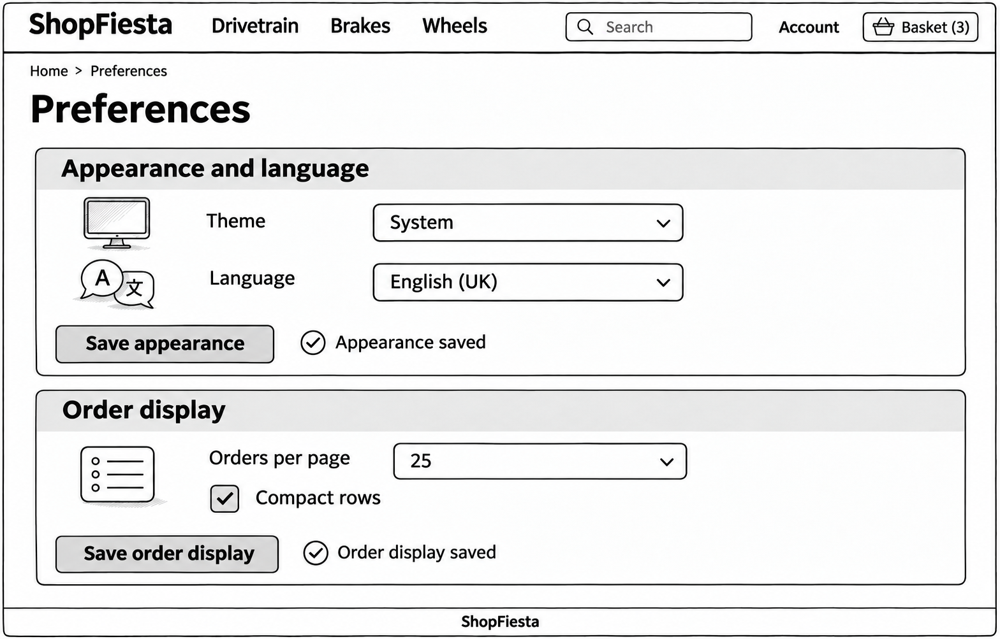

*Figure A.12. The shared module supplies Theme and Language; Orders supplies Orders per page and Compact rows. Each section saves and reports its own result while retaining module/resource and persistence ownership.*

| Preference | Owner, scope and observable effect |
| --- | --- |
| Theme: light, dark or system | Shared preferences. Store an allowed choice, not arbitrary CSS. Apply through the selected renderer's theme integration. A system-theme listener belongs to its live component. |
| Culture: supported values such as `en-GB` and `nl-NL` | Shared preferences plus the host's native localization integration. Update labels and formatting, including module resources. Culture selection alone does not change the basket's currency or pricing market. |
| Customer orders per page: default 25 | Orders, partitioned by application, identity, customer-history view and schema version. Supported values are 10, 25 and 50 in the fixture. An explicit valid URL value takes precedence. |
| Compact customer rows | Orders-owned benign display preference. Update that declared presentation consumer without refetching unrelated Catalog, Basket or Marketing data. |
| Staff queue display choices | Orders-owned operations-view keys, separate from customer history and from the other live queue's transient selection/query context. |

Anonymous visitors can use available appearance/culture settings. Private Orders sections require their declared identity context. The local sample uses the configured browser/scoped preference provider and a minimal Orders preference adapter where needed; no external preference server is required. Keys use stable module/view identities, opaque identity/context partitions and schema versions. They do not use incidental component-instance names or store contact/delivery drafts, basket credentials or authorization decisions.

The first Server profile applies culture through the host's supported native culture provider and a deliberate reload when required to establish the new circuit culture. It preserves only declared safe view state, reconstructs scopes and does not replay mutations. User-specific choices must not change another Server circuit's culture. Browser/prerender profiles follow their own validated native activation rules.

A culture-triggered reload follows any active section's declared unsaved-change policy. It does not save or silently discard another section's draft. Each section still owns its result when another section saves or fails.

```mermaid
sequenceDiagram
    actor User
    participant Page as Composed preferences page
    participant State as Existing scoped preferences and AppState
    participant Store as Configured preference provider
    participant View as Declared theme, culture or Orders consumer
    User->>Page: Change and save owned preference fields
    Page->>State: Validate values under current owner and context
    State->>Store: Persist allowed values and schema version
    Store-->>State: Saved or persistence failure
    State-->>View: Notify only relevant selectors
    View-->>User: Apply presentation or supported culture reload
    Note over State,View: Persistence completion itself does not reload business queries
```

| Restoration case | Expected evidence |
| --- | --- |
| Save and reload | Theme/culture and applicable Orders values restore using their declared keys/defaults. Route query values still take precedence over saved view defaults. |
| Switch between two test customers | Each private Orders preference partition restores its own values. A late previous-user save/read cannot overwrite the new user's state. |
| Optional storage unavailable | Keep the documented in-memory/default behavior and report that persistence failed. Do not prevent the shop from starting or pretend that values were durably saved. |
| Old or corrupt optional payload | Apply the declared migration or safe defaults. For example, an unsupported historical page size falls back to 25 with an attributable diagnostic. Preserve unrelated module preferences. |
| Change culture | Shared, Catalog, Basket, Orders and Marketing resources follow the new culture, with supported native reload/activation behavior. Only explicitly culture-dependent queries rerun. |
| Reuse the package | DoFiesta and ShopFiesta consume the same packed Preferences module and its assets through public APIs, while Orders contributes its ShopFiesta-specific section separately. |

### A.13 Keep availability, identity and diagnostics out of the wrong scope

Spec references: [Host-supplied feature availability](#host-supplied-feature-availability), [Optional authentication and authorization](#optional-authentication-and-authorization), [Session and workspace transitions](#session-and-workspace-transitions), [Production hosting and rollout](#production-hosting-and-rollout), [Developer diagnostics](#developer-diagnostics), and [Agent-accessible diagnostics and discovery](#agent-accessible-diagnostics-and-discovery).

| Event | Required behavior in ShopFiesta |
| --- | --- |
| Catalog available, Marketing absent | Browse and buy normally with the related region omitted. Installation and user permission remain distinct inputs. |
| Checkout's required capability unknown | Keep only dependent submission/activation pending or unavailable with a reason and bounded retry. Do not infer readiness from a previously enabled button. |
| Basket service fails | Show its actual unavailable/error state. Do not claim the basket is empty or silently discard known items. Unrelated product reads can remain usable. |
| Guest signs in | Apply the application's explicit guest-basket ownership/merge policy. Invalidate old-context reads and rebind private state to the new session. The shell does not invent the merge policy. |
| Sign-out or access revocation | Invalidate private bindings and pending confirmations, clear or partition basket/customer-order/draft snapshots and reject late old-context results. Dirty checkout state cannot block forced revocation. |
| Staff loses the operations policy | Deny further route activation and invocations, invalidate stale confirmations and preserve accurate already-dispatched outcomes. Backend checks remain authoritative. |
| Culture or store context changes | Update declared localized presentation and re-query pricing only if that context affects the query. Partition sensitive state where the application's store/workspace model requires it. |
| Circuit or network disappears during placement | Present recovery based on the original order attempt. Reconnect does not prove success, failure or cancellation. Never replay a purchase as a generic recovery action. |
| A deployment changes client/server compatibility | Use the declared compatibility/readiness integration. Unrelated compatible features remain usable. In-flight checkout uses its business recovery contract. |
| Optional region throws | Contain the region error, retain page/owner attribution and keep independent basket/checkout interactions available. |

Authorized developer diagnostics can explain why Add to basket is disabled, which product scope the sticky bar observes, why Marketing was omitted and which module supplied Release. A useful record includes stable contribution identity, live owner/binding/execution references, relevant context revision, availability reason and originating runtime. It does not need contact addresses, basket secrets or payment data.

The diagnostic overlay, popout and agent-readable facade use the existing specified discovery/query model. A read does not execute a purchase, enable capture or bypass staff authorization. Capture remains explicit, bounded and redacted. A browser view of Server-origin execution labels that origin rather than pretending all work ran in WASM.

Operational telemetry and performance baselines cover public route activation, category/read latency, action evaluation, basket mutation observation, per-circuit resources, browser download cost and diagnostic overhead where applicable. Framework overhead is distinguished from Catalog/Checkout backend work. This appendix supplies scenarios, not invented performance numbers.

#### A.13.1 Replace a contribution and inspect the effective result

Spec references: [Extension contracts and host authority](#extension-contracts-and-host-authority), [Predictable attachment and customization](#predictable-attachment-and-customization), [Developer diagnostics](#developer-diagnostics), and [Agent-accessible diagnostics and discovery](#agent-accessible-diagnostics-and-discovery).

Use three named startup profiles to make host authority visible. They are ordinary application configuration profiles, not a new runtime feature-management service or an end-user provider switcher.

| ShopFiesta presentation profile | Effective recommendation region |
| --- | --- |
| `default` | Marketing supplies `marketing.related-products` using the public Catalog context. |
| `featured-related` | Host-owned `FeaturedComponents` replaces that identified contribution while retaining its public target/identity and single-region cardinality. |
| `no-related` | The host suppresses the optional contribution; the region collapses and product purchasing remains usable. |

The proposed host override methods operate in the existing `WithPresentation` configuration callback:

```csharp
// featured-related profile
options.ReplaceContribution<FeaturedComponents>("marketing.related-products");

// Alternative no-related profile
options.DisableContribution("marketing.related-products");
```

These are alternative profiles. `FeaturedComponents` is an ordinary compatible Razor component with `[Parameter] ProductContext Context`, host-owned resources and a fixture-backed feature service. It renders public Catalog product cards and therefore retains their independent Basket purchase bindings. It references no Marketing private component, state or backend handler.

Replacement preserves the identified attachment instead of adding a second competing contribution. Effective provenance records the original Marketing registration and the host replacement. Host configuration is applied before compatibility/cardinality validation. An incompatible context parameter or an unresolved required override target produces a source-attributed composition error. Overrides cannot grant execution permission or bypass backend authorization.

The effective replacement keeps point-required availability/access rules and declares the dependencies its own provider actually uses. Diagnostics distinguish target requirements, provider requirements and the host decision rather than assuming a replacement uses Marketing's private services.

```mermaid
flowchart TD
    Target["Catalog related-products target: ProductContext, optional single region"]
    Default["Marketing default contribution"]
    Override["Host startup profile: replace or suppress identified contribution"]
    Validate["Validate effective context, dependencies and cardinality"]
    Render["Render one compatible contribution or collapse optional region"]
    Inspect["Read-only diagnostics: original source and effective host decision"]
    Target --> Default --> Override --> Validate --> Render
    Validate -.-> Inspect
    Render -.->|"Current availability and runtime attribution"| Inspect
```

Walk through the following observations using the same product URL and the appropriate authorized development identity:

1. In `default`, inspect the region's published target, Marketing source, effective order and availability. Opening inspection does not reload recommendations or execute a purchase.
2. In `featured-related`, inspect the same contribution/target identity and its replacement provenance. The visible component changes while Catalog and Basket contracts remain unchanged.
3. In `no-related`, inspect the explicit host suppression reason and optional-region fallback. Its absence is distinguishable from a failed recommendation read.
4. Inspect the main product and a recommended card as two live purchase scopes. Their owner, binding/context revision and source runtime differ even though both use Basket's action definition.
5. Use an example fault profile to make the required purchase availability unknown or the product ineligible. Inspect the actual disabled reason without invoking Add to basket. The diagnostic query must not establish eligibility by dispatching the action.
6. Attach the diagnostic popout and inspect the same originating session. Failed attachment leaves the drawer usable. With the browser facade separately enabled, perform a read-only discovery/query with the drawer closed; drawer-only configuration leaves the facade disabled.

These observations use the existing specified diagnostic model, not a second registry or a new schema invented for ShopFiesta. Record composition/owner references, effective source and reason, evaluation status and runtime attribution. Capture is a separate explicit, bounded choice. Sign-out/revocation invalidates private inspection and attached views; no contact details, payment data, basket secrets or other customers' order payloads are needed. Non-development inspection remains off unless explicitly enabled and authorized.

### A.14 Use conventions, builders and generators to reduce actual setup

Spec references: [Fluent setup, conventions and discovery](#fluent-setup-conventions-and-discovery), [Low friction and native platform mechanisms](#low-friction-and-native-platform-mechanisms), [Publishing and consuming a module](#publishing-and-consuming-a-module), [Reuse and developer-experience evidence](#reuse-and-developer-experience-evidence), and [Compatibility and upgrades](#compatibility-and-upgrades).

| Ordinary path | Explicit departure or published contract |
| --- | --- |
| Select a module once with the existing host builder. | Supply its supported options or host overrides; do not select the same module again in a parallel shell registry. |
| Infer a local module identity from its type. | Pin a public identity once before publishing destinations, persistence namespaces or extension targets. Share it between runtime adapters. |
| Declare a page assembly once and discover native routes. | Map page owners explicitly in a shared assembly or report ambiguity. Never infer ownership from URL naming alone. |
| Bind a local action with a semantic local key and ordinary callback. | Publish stable action/attachment identities when another package must reference them. Runtime IDs remain derived. |
| Use native Razor parameters and component lifetimes. | Publish a typed region/context when cross-module composition requires it. Do not wrap every child component in an extension abstraction. |
| Use feature services and existing AppState/Notifier. | Declare shared dependencies and invalidation targets where independent consumers need them. Do not introduce another state container or mandatory event bus. |
| Consume shipped assets through the standard RCL pipeline. | Document exceptional shared prerequisites once, such as renderer services/providers. |

Fluent builders group related declarations and preserve compile-time context types. They do not perform remote reads, invoke business operations or resolve live scoped clients at startup. Discovery is bounded to selected modules and their declared assemblies; a loaded assembly is not permission to install its module.

Generators may emit typed destination helpers, explicit page/contribution registrations, browser-safe selected definitions or actionable diagnostics for repeated conventions. Generated and explicit registrations use the same public contracts, validation and host-override precedence. Generated output must be inspectable and must not duplicate already registered contributions, invent a second router or leak server dependencies into WASM.

A generator cannot establish the current basket owner, staff permission, stock availability or a live component's context revision. Supported trimming must validate the actual registration strategy. A new mandatory generator/build tool is not a prerequisite for an ordinary handwritten page or callback.

Before claiming reuse, pack the shared Preferences module and consume the actual `.nupkg` from a local source in DoFiesta and ShopFiesta with their different branding/layouts and feature services. Do not copy its source. Its appearance/culture settings supply the concrete reuse case without coupling their business domains; Orders adds its own section in ShopFiesta. A plain Razor or browser profile of ShopFiesta alone does not establish independent application reuse. DoFiesta remains the reference migration; ShopFiesta is the new greenfield showcase whose first presentation slice grows into the broader DevKit application later.

### A.15 Turn the complete journey into runnable evidence later

Spec references: [Delivery gates and evidence](#delivery-gates-and-evidence), [Acceptance scenarios](#acceptance-scenarios), [Independent module tests](#independent-module-tests), [Performance baselines and release acceptance](#performance-baselines-and-release-acceptance), and [Accessibility acceptance](#accessibility-acceptance).

The first slice validates frontend design and architecture against small feature handlers and fixture content. Use ordinary .NET tools and deterministic data. It needs no real message broker, work queue, scheduler, blob/file provider or application cache. Fixture outcomes must still preserve module ownership, access, revisions and truthful loading/failure/recovery behavior. Backend integration proof belongs to the [separate roadmap](spec-shopfiesta-backend-showcase.md#deferred-backend-integration-evidence).

| Scenario | Observable proof | Gate |
| --- | --- | --- |
| Minimal public shop | Catalog alone runs without auth integration or higher-level packages. Optional Basket/Marketing/Checkout absence follows the declared presentation. | G1 |
| Frontend/backend correspondence | Each of the six business modules shares its identity, ownership and contract boundary across presentation and backend. Catalog defines the SKU and Stock uses that exact identity for its independent availability/policy state. Customer and staff Orders facets remain in the same module. | G1 and G2 |
| Replaceable product catalog | Replace the initial road/gravel-component fixtures, categories and attribute/facet metadata with another catalog without changing shell, Basket, Checkout, Marketing or Orders business-module boundaries. Existing order snapshots remain readable. | G2 |
| Product names and model designations | Every displayed product label includes its available designation, inline or directly beneath the name, including basket/checkout/order lines, recommendations and report selectors. Search by name or code and distinguish brands/variants using public metadata and stable IDs. Label corrections preserve action/recommendation identity; historical lines retain their recorded values. No code means no empty suffix. Verify narrow layouts and accessible names too. | G1 and G2 |
| Modular composition | Selected modules register once. Required target/dependency failures, duplicate IDs, shared-assembly ownership and replacement conflicts identify their source. | G1 |
| Native routes and deep links | Category, product, basket, receipt, customer-history/detail and operations URLs load directly with their declared access checks. Orders owns its customer/staff order pages; Marketing owns overview and recommendation-management pages. Customer pages use the storefront layout and mapped staff pages use the operations layout. Typed links respect a non-root base path and valid query encoding. | G1 and G2 |
| Catalog state | Filters, search, sorting, paging, breadcrumbs and Back reconstruct the right view. Late category/product results cannot replace a newer context. | G1 |
| Product-content presentation | Catalog fixture URLs/metadata drive native images and manual links. Verify base paths, revision identity, alt text, applicability and local missing/failure states. This proves the frontend contract, not blob/file integration. | G1 and G2 |
| Stock composition and live updates | Catalog/Basket/Checkout use Stock's decisions for the same SKU and requested quantity. Render in-stock, low, sold-out, coming-soon and null-quantity policy states distinctly; reject stale SKU/quantity/revision updates and dispose subscriptions. Stock failure is not a null quantity or a sellable decision. | G1 and G2 |
| Stock management | A Stock-owned protected page edits quantity/policy for an existing Catalog SKU through native forms. Revision conflicts, delayed saves, identity changes and per-SKU updates preserve the originating context. Reporting permission alone cannot manage Stock. | G1 and G2 |
| Cross-module Add | The main product and related cards invoke Basket through the public target with the right captured product, variant, quantity and version. Catalog does not depend on Basket internals. | G1 and G2 |
| Shared binding presentation | A local purchase button and an explicitly attached sticky presenter share one pending state, result and feedback owner. Another product scope remains independent. | G1 |
| Marketing region | Optional absence, empty success, failed read, host replacement and stale product results behave distinctly. Public product cards work without a Marketing-to-Basket dependency. | G2 |
| Marketing management | Authorized staff load, order, enable/disable and save a source product's recommendations using public Catalog lookup. Draft preview is inert; conflicts/unknown outcomes preserve the right draft/reference. Successful save invalidates only that source read, and host replacement/suppression remains authoritative. | G1 and G2 |
| Basket summary | Confirmed revisions update the badge without out-of-order rewind. Targeted invalidation coalesces reads; inactive views become stale. A failed refresh does not undo a committed Add. | G1 |
| Native form feedback | Default property paths, aliases, model errors and submitted-revision checks work with `EditContext`, including an old rejection arriving after a field edit or newer submit. | G1 and G2 |
| Checkout outcome | One pending submit, stable backend attempt identity, changed-review handling, known rejection, confirmed receipt and unknown-status recovery are distinct. No generic automatic replay occurs. | G1 |
| Backend-owned processing presentation | Accepted receipt, payment, processing and fulfillment remain distinct in feature DTOs. Revisit the original reference after page disposal, reject stale reads and avoid replay/progress side effects. Fixture transitions stand in for backend execution. | G1 and G2 |
| Customer past orders | Two customer fixtures expose different bounded histories. A bookmarked or guessed ID cannot read another customer's order through either transport. Detail uses purchased snapshots, shows only customer projections and rejects late results after a customer switch. | G1 and G2 |
| Protected operations | Anonymous/customer access cannot activate protected pages or invoke Release. Current circuit identity and backend authorization agree. Revocation invalidates pending work. | G1 and G3 |
| Two queue scopes | Header targets only Ready selection. Review selection is independent. Paging retains selected IDs by default, explicit clear-on-paging works and off-page absence does not imply deletion. | G1 and G2 |
| Safe batch confirmation | Duplicate invocation is suppressed, relevant changes reject stale decisions and dispatch retains original IDs/versions. Disposal or late completion cannot update another owner. | G1 |
| Typed external toolbar controls | Status/search controls render from the same Ready scope as its actions, dispatch native typed callbacks to that owner, and invalidate only its declared query. Review and a later retargeted header cannot receive the old control event. | G1 and G2 |
| Partial release | The fixture releases SF-1042 and returns a version conflict for SF-1043. Feedback preserves each known result, classifies the aggregate as partial and never retries the original batch automatically. | G1 |
| Backend export observation | Export matching captures query intent, distinguishes acceptance from completion and survives page navigation under the example backend owner. The status link reauthorizes reads, reports source progress and exposes download only when ready; lost acknowledgement does not cause replay. | G1 and G2 |
| Staff reporting presentation | Marketing owns the page and every reporting read, including product choices. Fixture snapshots exercise filters, freshness/coverage, authorization, stale-result rejection and one response across panels. No source-module query fan-out. | G1 and G2 |
| Product funnel presentation | Render Marketing-provided stages, ratios and cohort/coverage labels. Unavailable or still-maturing data is distinct from zero. UI rendering and refresh neither create stages nor calculate cross-module analytics. | G1 and G2 |
| Honest runtime access | Server reaches Requester in-process; WASM uses real typed HTTP clients; Auto/mixed/prerender profiles preserve their declared boundaries and transfer rules. | G1 through G3 |
| Session transitions | Guest/sign-in/store-context changes apply the feature's basket policy and partition private state. Forced revocation takes precedence over dirty-state prompts. | G3 and G4 |
| Replaceable rendering | Product actions, typed regions, navigation and operational actions work in a MudBlazor-free consumer using the same headless contracts. | G2 |
| Assets, culture and cleanup | Packaged CSS/resources/JS resolve without per-module host edits. Culture changes are targeted, and repeated mounting/disposal or circuit loss leaks no owned subscriptions/interop. | G2 through G4 |
| Composed settings and restoration | Shared appearance/culture settings and Orders display settings retain their source/resource/key ownership. Reload, per-user restoration, URL precedence, unsupported schema/value fallback and persistence failure preserve the declared behavior without unrelated query reloads. | G1 and G2 |
| Host customization profiles | Default, host-replaced and suppressed Marketing profiles preserve typed target/cardinality rules. The drawer/popout/facade explains original/effective provenance and availability without invoking actions or implicitly enabling capture. | G1 through G4 |
| Publishing and reuse | DoFiesta and ShopFiesta consume the same actual packed reusable presentation module through public APIs and ordinary tools, apply host customization and validate a shared package upgrade. ShopFiesta can keep its first backend minimal/mocked. | G2 and G4 |
| Conventions and optional generation | Measure declarations/files against ordinary Blazor. Explicit/discovered/generated paths preserve effective composition, host authority and supported trimming. | G1 and G2 |
| Authorized diagnostics | Inspect source, availability, scope and outcome without exposing private checkout data. Popout/agent reads retain access rules, source attribution and bounded capture. | G3 and G4 |
| Accessibility and performance | Exercise customer and staff flows on narrow screens, keyboard and screen reader. Record comparable baselines/limits and diagnose reproducible regressions before stable release. | G1 through G4 |

Each check records its real commands, profile, build, result and exact preview signatures exercised. Missing or failing required evidence leaves its gate open. The shop images, snippets and Mermaid diagrams explain what implementation must prove; they do not substitute for that proof.

#### A.15.1 First Interactive Server validation slice

Spec references: [Recommended business application profile](#recommended-business-application-profile), [Delivery gates and evidence](#delivery-gates-and-evidence), [Out-of-the-box greenfield starter](#out-of-the-box-greenfield-starter), [Independent module tests](#independent-module-tests), and [Performance baselines and release acceptance](#performance-baselines-and-release-acceptance).

Use one ShopFiesta host, Interactive Server with prerendering off, the six commerce modules plus shared Preferences, two customer test identities and scoped staff identities. Small fixture handlers supply catalog identifiers/content, Stock snapshots/live transitions/policy edits, basket state, checkout outcomes, Marketing recommendations/reports and Orders projections/status. Keep metrics, recommendation, stock-management and order-operation permissions distinct. No real inventory, reservation or broadcast backend is required for this frontend slice.

The actual composition, route/access handling and Requester path are the subjects under test. Server feature services call Requester directly to the fixture Application handlers. Isolated component mocks do not establish that dispatch path. Fixtures can simulate processing/coverage and allow test control to advance outcomes independently of reads; they do not establish real Messaging, Queueing, Jobs, blob/file storage or caching. Those integrations remain deferred to the roadmap and must not be reported as passed by this slice.

Normal browser navigation, asset/download requests and native culture selection remain valid HTTP. Business feature commands/queries stay in process on Server. Later WASM evidence uses real typed HTTP clients over the same feature contracts. No backend showcase capability or pending cache merge is required to validate this first frontend slice.

| Case | Exercise | Expected result and preview contracts validated |
| --- | --- | --- |
| SV-01 Composition and startup | Build/start the documented local profile, then run missing-target, duplicate-ID and incompatible-component fixtures. | Ordinary public setup works; invalid composition identifies its source. Validate module identity, page ownership, native asset setup and parameter/cardinality validation. |
| SV-02 Direct feature access | Trace a product read, Add to basket, checkout submission and order read to small Application handlers. | Correct current context reaches Requester; no Server feature self-HTTP call occurs. Validate feature contracts, cancellation and normal DI lifetimes. |
| SV-03 Routes and access | Open product, customer detail and staff detail URLs directly and through interactive navigation, including a non-root base path and another customer's order ID. | Both activation paths enforce ownership/access; customer and operations layouts remain distinct. Validate destinations, initial endpoints, native router integration and current-owner reads. |
| SV-04 Catalog restoration | Change filters/sorting/page, find RT-G800 by model designation, open a product and go Back. Deliver an old response after a new query, correct fixture metadata and include same-code products from different brands and a product without a designation. | Restore the represented view and reject obsolete data. Labels do not replace stable action/recommendation identity. Marketing shows its own supplied metadata revision, and historical order snapshots remain unchanged. Validate public DTOs, URL precedence, breadcrumbs and state restoration. |
| SV-05 Independent purchases | Add from the main product and a related card; double-click one binding; change quantity or dispose the originating component during work. | Captured inputs remain stable, duplicate suppression is per binding and summary updates respect current basket/session ownership. Validate live scopes, dispatcher delivery and AppState selectors. |
| SV-06 Preferences | Save/reload theme/culture and Orders display values; switch customers; supply corrupt/old values and a failing optional persistence provider. | Restore only the appropriate partition/defaults with accurate feedback. Validate settings composition, native culture activation, persistence/schema policy and targeted state changes. |
| SV-07 Host authority and inspection | Run `default`, `featured-related` and `no-related`; inspect effective contributions and a disabled purchase reason. Query the separately enabled facade with the drawer closed. | Observe exact replacement/suppression and live provenance without dispatching business work or enabling capture. Validate host overrides and read-only diagnostic discovery; include attachment/access negatives for the popout when that capability is present. |
| SV-08 External query controls | Type/change Ready filters while Review is independently selected; move focus into the header; retarget or remove the source during a delayed callback. | Only the originating eligible queue changes. Filter changes apply its selection policy and invalidate pending confirmation where relevant. Validate `BindControl`, typed callbacks and explicit outlet ownership. |
| SV-09 Batch invocation and partial result | Confirm two Ready targets, change a relevant revision before dispatch in one run, and return the one-success/one-conflict receipt in another. | Reject the stale decision; preserve actual per-target/aggregate outcomes and never retry the original batch implicitly. Validate confirmation, `MapOutcome`, receipt application and separate refresh feedback. |
| SV-10 Checkout revisions and recovery | Return a field rejection after editing that field/newer submission; exercise known success, changed review and lost completion acknowledgement. | No stale invalid markers or replay. Receipt/recovery uses the original submission/attempt. Validate native form feedback, captured draft revisions and unknown-outcome handling. |
| SV-11 Export ownership | Submit Export matching, navigate away, open its status reference and advance the example backend fixture independently of reads. Exercise lost acknowledgement and unavailable result artifact. | Submission is not completion; page disposal does not cancel the backend operation; reads only observe and reauthorize. Validate operation-reference observation and artifact/outcome separation. |
| SV-12 Lifecycle and identity | Repeatedly mount/remove purchase, region, control and diagnostic consumers; revoke or switch identity with reads/confirmations pending. | Bindings/subscriptions detach and obsolete callbacks cannot update another owner/context. Validate cleanup and declared state/inspection isolation. |
| SV-13 Public developer path | Have an engineer unfamiliar with internals add a local action and consume the settings/contribution examples using public documentation. | Record actual declarations/files and undocumented knowledge. Simplify preview APIs when ordinary setup needs excess ceremony; do not claim productivity from the diagrams alone. |
| SV-14 Interaction and baseline | Exercise keyboard/narrow layouts for the slice and record repeatable startup, action-evaluation, circuit and diagnostic-overhead measurements where applicable. | Capture real accessibility observations and an initial comparable Server baseline. Validate renderer responsibilities and source-attributed measurements without inventing limits or broader hosting passes. |
| SV-15 Marketing metrics reads | Open the overview with authorized/unauthorized test identities. Return the fixture snapshot, change filters during a delayed read, and fail the next Marketing query. | All panels and product choices use Marketing alone. Preserve query/revision/time labels, reject stale results and distinguish failure from zero. Read-only access cannot release orders or save recommendations. Validate page ownership, the reporting feature contract, native composition and read lifecycle. |
| SV-16 Recommendation management | Use Catalog lookup to edit/save/reorder a set, conflict two editors and lose one save acknowledgement. Navigate to another source during delayed work, preview unsaved changes, then compare the default/replaced/suppressed host profiles. | Only authorized writes publish the correct versioned source set. Draft preview has no purchase/view side effects; no overwrite or blind replay. Only that source read becomes stale, and host configuration stays authoritative. Validate native forms, submitted context, management access, typed destinations and targeted invalidation. |
| SV-17 Report freshness and funnel presentation | Return the 20/8/6/3 fixture, then still-maturing, partial, stale, unavailable-ratio and failed-read responses. Render and refresh repeatedly. | Show supplied stages, 40%/15% and scope/freshness accurately without inferring purchases or joining source modules. Reads create no business work. Validate Marketing DTO presentation and feedback; this does not prove backend event correlation. |
| SV-18 Product-content presentation | Open fixture image/manual URLs from product details/cards under a non-root base path. Switch product during a delayed metadata read and exercise missing content, failure and access denial. | Preserve correct alt text, document labels/applicability, native link behavior and local failure feedback without changing a purchase target. Validate Catalog DTO/content boundaries and lifecycle; provider-backed delivery is deferred. |
| SV-19 Live Stock decisions | Deliver SKU/quantity-specific stock changes while the main product and cards are independently active. Include zero, low, coming-soon, null quantity allowed/denied, lost connection, and an old update after a SKU/quantity/store change. | Only the matching current scope changes. Explicit sellability drives buying; null never becomes zero/unlimited, and service failure does not invoke the unknown-quantity allowance. Pending decisions are reevaluated, dispatched targets remain captured and observations detach. Validate Stock's public contracts, native callbacks, AppState selectors and live revision handling. |
| SV-20 Stock management | Directly open the staff page with authorized/unauthorized identities, select a known SKU, edit quantity/policy, conflict two saves and switch selection during delayed work. | Only Stock management permission can save. Preserve correct SKU/revision/draft and field feedback, reconcile unknown outcomes and update only interested SKU consumers. Validate module ownership, layout/policy, native forms and targeted invalidation using fixture transitions. |
| SV-21 Product identifiers | Round-trip a multi-variant product with distinct SKUs/MPNs, optional GTIN, a leading-zero GTIN fixture and supplier-scoped references. Select another variant and exercise duplicate model labels across brands. | Stable IDs and the exact SKU remain consistent across Catalog, Stock, Basket and Checkout; MPN/model/GTIN are not substituted as SKU. Strings retain leading zeros and missing identifiers stay absent. Historical order lines keep their captured identifiers. Validate the product-view contract and propagation, not GS1 allocation or a full inventory backend. |

Run normal .NET build/test commands and focused browser checks against the real implementation when it exists. Record the actual project/run commands, fixture/profile names, tested signatures, results and limitations outside the documentation tree with the application/task evidence. Do not publish fabricated commands or mark this checklist passed from a code excerpt or static image.

Passing this ShopFiesta slice validates its exercised Server preview contracts. DoFiesta's migration, starter checks and all other required gate evidence still apply. WASM/Auto, explicit prerender, mixed runtimes, clean package consumption, production inspection/reconnect and the full stable-release accessibility/performance evidence remain their own applicable gates. Until a runnable implementation exists and these checks execute, runtime validation of this slice remains pending.

## References

- [bITdevKit modules](https://bridgingit-gmbh.github.io/bITdevKit/reference/features-modules/)

- [bITdevKit Requester and Notifier](https://bridgingit-gmbh.github.io/bITdevKit/reference/features-requester-notifier/)

- [bITdevKit Messaging and outbox delivery](../features-messaging.md)

- [bITdevKit Queueing and provider semantics](../features-queueing.md)

- [bITdevKit Blob Storage](../features-storage-blobs.md)

- [bITdevKit File Storage](../features-storage-files.md)

- [bITdevKit outbound Notifications](https://bridgingit-gmbh.github.io/bITdevKit/reference/features-notifications/)

- [bITdevKit Jobs](https://bridgingit-gmbh.github.io/bITdevKit/reference/features-jobs/)

- [bITdevKit AppState](https://bridgingit-gmbh.github.io/bITdevKit/reference/features-presentation-appstate/)

- [Upcoming backend Application Caching design, pending merge](spec-application-caching.md)

- [Blazor routing](https://learn.microsoft.com/en-us/aspnet/core/blazor/fundamentals/routing?view=aspnetcore-10.0)

- [Blazor Razor class libraries and packaged assets](https://learn.microsoft.com/en-us/aspnet/core/blazor/components/class-libraries?view=aspnetcore-10.0)

- [Blazor native forms and validation](https://learn.microsoft.com/en-us/aspnet/core/blazor/forms/validation?view=aspnetcore-10.0)

- [Blazor JavaScript interop and component cleanup](https://learn.microsoft.com/en-us/aspnet/core/blazor/javascript-interoperability/?view=aspnetcore-10.0)

- [Blazor render modes](https://learn.microsoft.com/en-us/aspnet/core/blazor/components/render-modes?view=aspnetcore-10.0)

- [Blazor prerendering configuration](https://learn.microsoft.com/en-us/aspnet/core/blazor/components/prerender?view=aspnetcore-10.0)

- [Blazor prerendered state persistence](https://learn.microsoft.com/en-us/aspnet/core/blazor/state-management/prerendered-state-persistence?view=aspnetcore-10.0)

- [MudBlazor provider and interactive boundary placement](https://github.com/MudBlazor/MudBlazor/blob/dev/src/MudBlazor.Docs/Pages/Getting%20Started/Installation/Installation.razor)

- [Blazor dependency injection and service lifetimes](https://learn.microsoft.com/en-us/aspnet/core/blazor/fundamentals/dependency-injection?view=aspnetcore-10.0)

- [Blazor localization](https://learn.microsoft.com/en-us/aspnet/core/blazor/globalization-localization?view=aspnetcore-10.0)

- [Tailwind Preflight and coexistence controls](https://tailwindcss.com/docs/preflight)

- [Tailwind class detection and explicit sources](https://tailwindcss.com/docs/detecting-classes-in-source-files)

- [Tailwind CLI and standalone build option](https://tailwindcss.com/docs/installation/tailwind-cli)

- [Headless UI behavior and rendering separation illustrated by TanStack Table](https://tanstack.com/table/v8/docs/overview)

- [Blazor performance metrics and tracing](https://learn.microsoft.com/en-us/aspnet/core/blazor/performance/?view=aspnetcore-10.0)

- [Blazor mixed render modes and propagation rules](https://learn.microsoft.com/en-us/aspnet/core/blazor/components/render-modes?view=aspnetcore-10.0)

- [Existing devKit agent/runtime discovery and diagnostics](https://bridgingit-gmbh.github.io/bITdevKit/agent-support/)

- [Playwright page JavaScript evaluation](https://playwright.dev/docs/evaluating)

The requirements describe the proposed presentation framework, not an assertion that all capabilities already exist.
