# bITdevKit Blazor Presentation Framework

**Finalized requirements baseline.** Target platform is .NET 10 and Blazor, with MudBlazor as the default renderer.

The standalone AppState changes required by this specification are implemented in the existing `Presentation.Web.Client` package. Treat [AppState implementation status](#appstate-implementation-status) as a delivered prerequisite when planning the framework. Do not schedule that refactor again. The remaining scope is [AppState integration work](#remaining-appstate-integration-work), the shell and its complete hosting acceptance matrix.

## Problem and solution

### Problem

bITdevKit gives teams reusable building blocks for backend modules, commands, queries and data access. Teams still have to assemble the application shell for each Blazor app. Adding a feature can mean editing shared navigation and layouts, wiring an external toolbar to the right component, and deciding how links, permissions and failures behave. Repeating those decisions across apps and hosting modes makes features harder to reuse and behavior harder to keep consistent.

### Solution

Provide a browser-safe shell with a separately referenced default MudBlazor renderer. Presentation modules use typed contracts to contribute pages, navigation and contextual actions. A module can add a list and expose its actions in the page header while its own component keeps ownership of selection and behavior.

The shell handles composition, deep links, action placement, and common lifecycle and recovery behavior. Hosts choose the layout, rendering and identity integrations. Features own their workflows, and backend services enforce business rules and access.

## Purpose and developer promise

Developers can add a feature using ordinary Razor components and a presentation module registration. An enabled module makes its declared contributions available to the host, which can use the defaults or customize them through published contracts.

The framework targets multiple applications using DevKit. Its purpose is to reuse presentation patterns, application foundations and packaged features across projects. Teams should spend less effort assembling navigation, layouts, contextual interactions and failure handling, and carry that knowledge into the next application. Features retain their business workflows, application contracts and backend authorization.

The guiding architecture is a modular monolith across backend and frontend. Logical feature boundaries continue into presentation, where modules own their pages, state and contributions and integrate through published contracts. One application host selects and composes the modules into a coherent application. The same framework and module packages can be reused by other independently composed applications. Supported render modes retain their runtime boundaries within this application model, and a scaled deployment can run multiple instances of the same configured host.

Consuming applications start as greenfield projects. TaskFiesta is the new application developed alongside the framework to validate it. DoFiesta remains unchanged: this feature does not migrate its shell, refactor its AppState integration or add workflows, dependencies or validation profiles to that application. Its existing visual design and module naming are reference material only. General adoption into existing applications, legacy-shell compatibility layers and migration tooling are outside scope.

Public website hosting and fast first content are reusable framework responsibilities. The framework supplies the [public website profile](#recommended-public-website-profile) and [shared hosting/startup integration](#reusable-hosting-and-startup-support), including SSR-compatible shell rendering, selective interactivity, prerender handoff, native forms, asset defaults and diagnostics. Applications consume these through public APIs and package upgrades. TaskFiesta validates this capability together with an independent consumer.

TaskFiesta is the compact validation application developed alongside the complete framework. [Appendix A](#appendix-a-taskfiesta-validation-application) specifies its task/list domain, public website and connected profiles, wireframes and requirement-to-evidence map. ShopFiesta is a separate follow-on application, implemented only after the framework meets its complete validation requirements. Its [application specification](spec-shopfiesta.md) remains a future consumer design, not a prerequisite or validation vehicle for framework completion.

Reusable modules can supply pages, navigation, contextual actions, resources and documented customization points. Consuming applications select and adapt those capabilities through public contracts. Shared fixes and improvements reach those applications through supported package upgrades. The framework owns the compatibility, accessibility and lifecycle behavior it promises; consuming applications remain responsible for their complete user experience.

These benefits must be demonstrated in TaskFiesta and an independent packaged consumer. A comprehensive shell or multiple hosting profiles of one application alone do not establish lower development effort or reuse across applications.

### Low friction and native platform mechanisms

Low friction for application developers is a design requirement. The ordinary path uses familiar .NET and Blazor code with small, focused integration points. Advanced composition concepts become necessary when a developer publishes reusable extensions, coordinates multiple live owners or changes the default behavior.

Use native mechanisms and existing DevKit capabilities where they fit:

| Concern | Default foundation | Framework responsibility |
| --- | --- | --- |
| Services and configuration | .NET DI, options, configuration and validation. | Register feature contributions and validate their composition. |
| Pages and navigation | Razor components, `@page`, Blazor routing, layouts and `NavigationManager`. | Associate module ownership and availability, discover contributed pages and compose navigation. |
| Component interaction | Parameters, `EventCallback`, typed callbacks, `RenderFragment`, cascading values and normal component lifecycle. | Add explicit owner-bound action placement, invocation safety and cleanup where those behaviors are needed. |
| Dialogs and controls | MudBlazor services/components and native Blazor controls, used directly by features. | Compose required providers in compatible interactive roots and enforce action safeguards around feature-supplied confirmation callbacks. |
| Menus and toolbars | MudBlazor menus, toolbars and buttons, or native Razor/HTML and local callbacks. | Compose contributed navigation and scoped actions where needed. Ordinary local menus/toolbars require no framework registration, wrapper or action scope. |
| Forms and validation | Blazor `EditForm` and `EditContext`, or the selected component library's existing forms. | Adapt application outcomes and field errors where shared feedback requires it. |
| Resources and assets | .NET localization, Razor class libraries, static web assets, CSS isolation and supported JavaScript interop. | Preserve contribution ownership and supply documented packaging and customization conventions. |
| Diagnostics | .NET logging, `ActivitySource`, `Meter` and supported Blazor instrumentation. | Attribute composition and live behavior to their owners through the shared diagnostic model. |

Add a public abstraction when it owns required behavior or removes repeated integration work that these foundations do not already provide. State the problem and the existing mechanisms considered. Wrapping another abstraction solely to rename it or route calls through an additional layer is insufficient. Avoid parallel service locators, routing engines, mandatory event buses and universal execution or form systems.

Ordinary pages can use native components and MudBlazor controls directly. Their local callbacks and state remain local unless a shared behavior requires participation. Custom layouts and specialized pages can use the applicable shell services without adopting every page pattern or optional adapter. Developer convenience must preserve the declared authorization, ownership and lifecycle rules.

### Fluent setup, conventions and discovery

Design the public API around a short ordinary path, with fluent builders for related setup and explicit configuration where an application differs from the defaults. Prefer existing DevKit builder conventions and native .NET options over another configuration language. Builders collect registrations and validate composition. They must not hide network calls, start business operations or resolve live scoped services during startup.

| Mechanism | Design requirement |
| --- | --- |
| Fluent builders | Group module capabilities and action configuration through focused, typed methods. Keep ordinary DI registrations and native Razor parameters usable directly. Avoid a chain of builders that merely forwards the same options. |
| Convention over configuration | Infer local module names, page ownership within a declared assembly, routine contribution keys and live binding identities where unambiguous. Declare an assembly once rather than annotate every page. Pin public identities when publishing contracts, as required by the module identity policy. |
| Discovery | Discover presentation capabilities from the host's selected modules and pages from their declared assemblies. Discovery respects enablement and declared dependencies. It does not install modules merely because their assemblies happen to be loaded. Ambiguity produces a source-attributed configuration error. |
| Explicit configuration | Allow a focused override for shared-assembly ownership, dependencies, placement and other departures from convention. Host overrides apply after module defaults, whether those defaults were explicit, discovered or generated. Diagnostics show the effective result and its source. |
| Source generators | Consider generators for repeated registration, typed destination helpers and composition diagnostics when they reduce demonstrated developer work or enable supported trimming. Generated code uses the same contracts and validation rules as explicit registration. It must be inspectable, produce actionable diagnostics and preserve the host's final authority. |

Source generation is an implementation option, not a requirement for each ordinary page or callback. Reuse existing DevKit generator patterns where suitable. A generator must not create another module system, service locator or source of route truth. Build-time discovery cannot establish runtime permissions, backend availability or live component ownership. Supported browser publishing must use a validated discovery strategy, such as explicit or generated registrations, rather than assume unrestricted reflection survives trimming.

The [TaskFiesta validation appendix](#appendix-a-taskfiesta-validation-application) supplies the ordinary consumer journey. Compare required declarations/setup with native Blazor and use executable results to refine conventions and optional generation. The complete feature is specified here; implementation sequencing belongs in a separate future plan.

## Vocabulary and ownership

| Term | Meaning |
| --- | --- |
| Application host | The application that selects modules, integrations, configuration and final UI composition. |
| Core shell (headless shell) | Browser-safe composition infrastructure, contracts and shared application behavior. |
| Default renderer | Separately referenced MudBlazor implementation of shell layouts, chrome and contribution outlets using the headless shell contracts. |
| Presentation module | The frontend part of a logical feature module, owning its presentation contributions and frontend service registrations. A module can also provide presentation-only capabilities. |
| Page or destination | A navigable feature entry with a stable URL and declared availability requirements. |
| Extension point | A deliberately published, typed contract accepting contributions at a declared place in the shell or a presentation module. |
| Attachment target | The specific menu item, page, region or other owner instance to which a compatible contribution attaches. |
| Contribution | A module-provided navigation item, region component, action, resource, setting or other documented extension. |
| Interaction scope | A live page/component/application owner of typed context and contribution bindings; action scopes use this ownership model. |
| UI action definition | Reusable action identity, typed context contract and default presentation/policy, distinct from a backend CQRS command. |
| Action placement | The action's presentation and location. A published placement declares an action definition and attachment target. A runtime placement presents a live binding. |
| Action binding | An action connected to one live scope, target context and handler/services, with its own observable execution state. |
| Action execution | One accepted invocation with its own identity, captured targets and outcome. |
| Renderer | A component that displays a behavior model, such as navigation or a page header. |
| Higher-level feature | An optional package or module built on shell contracts, potentially with backend integration. |

The host has final authority over composition and customization. Modules own the meaning and behavior of their features. Backend services remain authoritative for business rules and authorization.

## Product boundaries

The framework separates the core shell, focused data adapters and optional application features. Applications can adopt each without acquiring unrelated capabilities.

The framework is not a UI component library. MudBlazor and native Blazor supply general-purpose controls, menus, toolbars, dialogs and forms. Framework components render shell-owned behavior such as contributed navigation, contribution regions, contextual actions and diagnostics. A reusable integration must add application coordination or composition behavior; a wrapper that only forwards another control's parameters or service calls is outside scope.

| Layer | Delivered responsibilities | Boundary |
| --- | --- | --- |
| Headless shell | Module composition, routing integration, navigation, scoped contextual actions, toolbar contracts, extension regions, localization, optional identity integration, preferences, action invocation and feedback coordination, fault containment and developer diagnostics. | Browser-safe contracts and behavior with no direct or transitive MudBlazor dependency. |
| Default MudBlazor renderer | App layouts, contributed navigation, scoped action outlets, diagnostics UI and integrations for action confirmation and feedback. | Separately referenced. It uses MudBlazor controls directly, consumes the headless shell contracts and can be replaced by host renderers. Its menu/toolbar presenters render composed application behavior; they are not general-purpose control wrappers. |
| Data adapters | FilterModel query and selection adapters connect existing grids and handwritten views to application contracts and scoped actions. | Optional. They do not introduce replacement grids, form controls or a CRUD component library. Broader business-page workflows require separate feature designs. |
| Application features | Notification center and inbox integration, administration and other reusable application capabilities. | Optional modules with explicit backend requirements. |
| Starters and examples | Ready-to-run hosts, module examples, common page patterns and customization guidance. | Examples demonstrate composition through the public contracts. |

### Complete feature scope

The complete feature includes the browser-safe headless shell, the separately referenced MudBlazor renderer, and the initial FilterModel query and selection adapters as optional dependencies. It includes the documented hosting arrangements, anonymous and protected configurations, and the enterprise requirements for session handling, recovery, production hosting, observability, accessibility and upgrades.

The public website profile is part of that scope, including its SSR-compatible chrome defaults, native navigation/forms, declared contribution compatibility and selective interactive composition. It uses the same module/headless contracts and semantic styling tokens rather than another shell. TaskFiesta supplies complete framework/public-site validation, the separate technical harness supplies cross-module evidence, and an independent consumer proves package reuse. DoFiesta is not a validation or migration dependency.

Interactive diagnostics include the drawer, attached popout, bounded capture and separately enabled browser facade. Hosts may opt into authorized production inspection. Interactive inspection is off by default outside development. The feature also includes host starters, extension/upgrade documentation and complete TaskFiesta and technical-host evidence.

Higher-level modules such as the notification center and inbox, administration and reusable CRUD screens are separate feature designs. The bdk MCP and CLI adapter is a separate integration. These scope boundaries are not later implementation phases of this specification. Optional packages included here have enabled/removed-configuration evidence in TaskFiesta and its technical hosts. Out-of-scope packages are not prerequisites for those checks.

### Capability boundaries and status

| Capability | Placement | Defined scope or decision |
| --- | --- | --- |
| Public website hosting and startup | Framework host integration and SSR-compatible shell renderers. | Deliver reusable profile setup, native SSR/prerender/interactive composition, lifecycle/handoff support and asset/readiness defaults. A starter and independent packaged consumer must prove reuse. Feature content, business actions and app-specific performance budgets remain application-owned. |
| Shared contextual UI actions | Headless shell behavior, default renderer presentation and feature-owned business handlers. | One definition/placement/binding model supports toolbars and context menus with scoped availability and execution. UI actions can call APIs or Requester without becoming backend commands. |
| Interaction scopes and explicit target binding | New core shell contract specified here. | One shared ownership model supports page/component instances and scoped action bindings. Define owner identity, context revision, typed publication, attachment/detachment and disposal. Reuse native lifecycle/DI primitives, not an assumed existing DevKit UI-scope implementation. |
| Edit-session coordinator | Deferred optional editing capability. | Keep the current page-owned unsaved-change helper. Global participant coordination, nested-editor save orchestration and Save All are not requirements of the current core shell. |
| Restorable view state | Core AppState/preferences conventions with optional view/data adapters. | Declare per-view URL/transient/preference policy, identity/version/defaults and stale-value recovery. Editable drafts are separately owned feature data. |
| Asynchronous operation observation | Per-binding execution state in core; broader operations panel and application-owned workflows are separate optional design work. | Expose execution identity/outcome/cancellation/progress where available. Navigation survival requires an explicit longer-lived owner; restart durability belongs to backend capabilities. |
| Reusable business-page components | Separate application/data feature designs beyond the initial adapters. | TaskFiesta demonstrates handwritten list, detail and edit workflows using existing controls. Extract a workflow component only when another consumer demonstrates repeated application behavior; generic control wrappers remain outside this framework. |
| Search and command discovery | Deferred optional application capability. | No global search surface, command palette, federated provider model or shortcut-discovery catalog is required now. Local page/grid filtering remains available. |
| General shortcut routing | Deferred optional interaction capability. | Keep accessible toolbar navigation and explicit local shortcuts. Hierarchical scope routing, fallback and ambiguity resolution require separate justified design. |
| Semantic inspection and testing | Existing core diagnostics, with separately enabled adapters for any programmatic business-action invocation. | Inspect stable page/scope/action/binding/execution identities and reasons through the shared read model. Normal UI invocation remains the default execution path. |

Common composition metadata supplies identity, ownership, attachment, ordering and diagnostic provenance. Focused contracts continue to own action execution, view restoration and feature behavior; these capabilities do not require parallel registries or a universal service interface.

The core shell must run with no authentication integration and no higher-level modules. It must also support protected business applications. Removing an optional feature must leave the core application composition valid.

The framework does not provide a UI component library, generic dialog platform, CMS, runtime page designer, automatic domain-entity screen generator or replacement Blazor router. General-purpose wrappers for native or MudBlazor controls are outside scope. Runtime installation and unloading of modules is outside scope. Developers use ordinary Razor components, MudBlazor controls/services, callbacks and typed API clients directly.

## Architecture and bITdevKit synergy

The framework reuses existing bITdevKit concepts where they fit: module identity and composition, Result-based operations, AppState, Requester and Notifier, FilterModel, diagnostics, auditing, jobs and agent support. Frontend integration must respect browser compatibility and service lifetimes.

Contracts, public APIs, namespaces, implementation and lifecycle semantics remain owned by bITdevKit. Elsa Studio is architectural reference material only: no Elsa package/project dependency, public Elsa type, runtime integration or Elsa backend is required.

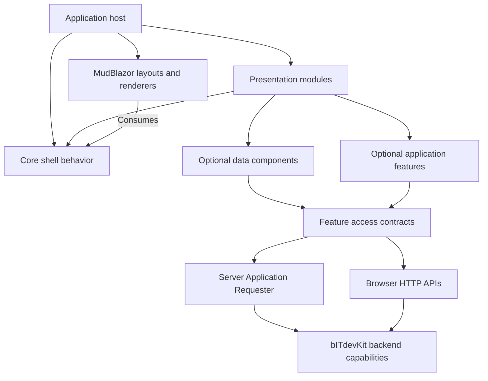

Presentation modules declare contributions; the shell composes and resolves them; default or custom renderers display the result. Higher-level modules build on these contracts. Runtime-specific feature adapters reach the same application use cases. Backend repositories and domain entities remain behind those use cases.

### Modular monolith across backend and frontend

Extend the module boundaries in [ADR-0003: Modular Monolith Architecture](../adr/0003-modular-monolith-architecture.md) into the frontend. A logical feature module owns its applicable backend use cases and presentation behavior. Its pages, components, local state and assets follow that ownership. Presentation extending an existing backend module retains its logical identity. A module can provide backend capabilities, presentation capabilities or both, without requiring a separate project for every layer or capability.

TaskFiesta has one application module, `CoreModule` with identity `core`, owning its task/list state, public sharing, settings and public/connected pages across frontend and backend. Cross-module composition is exercised in a separate minimal framework test host, not by splitting the MVP's domain. The later ShopFiesta application uses the same modular-monolith concept for its commerce domains; it is not required to validate this framework.

The host is the application composition root. It selects modules and shared integrations, validates their dependencies and composes their contributions through the shell. Modules can be developed, tested and packaged independently. The consuming application builds and releases its selected module versions and assets together. Separate Server and browser execution does not change those logical boundaries. Distributed module discovery, remote module loading and independent frontend deployment are outside the core model.

Cross-module frontend integration uses published destinations, typed extension points and public service or notification contracts where needed. A consuming module does not reach into another module's private components, state or implementation services. Shared workflows remain owned by feature or Application code. The shell supplies common composition and interaction behavior, and the host connects modules through their declared contracts. Ordinary Razor components, .NET DI and the existing registration conventions remain the implementation foundation.

### Reuse of existing bITdevKit capabilities

Use ordinary .NET DI and existing bITdevKit utilities where their semantics fit. Reuse supplies underlying mechanisms; presentation contracts continue to define attachment, live context, refresh and execution ownership. The source references below are pinned to a repository revision. Supported browser publishing, trimming and runtime behavior must be demonstrated by the hosting acceptance scenarios.

| Existing capability | Reuse direction | Required boundary |
| --- | --- | --- |
| ModuleBase and WebModuleBase | Reuse server identity, naming, enablement and registration conventions. | [Common.Modules](https://github.com/BridgingIT-GmbH/bITdevKit/blob/b41782cbd1a2ae220027544fe34f2deefc6c0946/src/Common.Modules/Common.Modules.csproj) references Microsoft.AspNetCore.App, and the base contracts expose server hosting types. Keep them server-side; portable presentation definitions preserve logical identity without importing server setup. |
| Common.Utilities.Composition | Use service registration, concrete decorators, adapters, composites and strategy selection where useful. | [Composition builders](https://github.com/BridgingIT-GmbH/bITdevKit/blob/b41782cbd1a2ae220027544fe34f2deefc6c0946/src/Common.Utilities/Composition/Composition.cs) do not supply shell contribution IDs, attachment/cardinality validation, deterministic contextual composition or live bindings. Focused presentation builders still own those semantics. |
| AppState | Implemented prerequisite. Consume its public APIs when integrating presentation owners. | The [delivered capabilities](#appstate-implementation-status) and [current AppState guide](../features-presentation-appstate.md) replace the older pinned-source assessment. Framework work adds adapters and bindings to the existing services. Component-local state remains valid. |
| Requester and Notifier | Optional typed frontend dispatch and explicit local invalidation/change notifications; reuse registration information for diagnostics where useful. | [Requester](https://github.com/BridgingIT-GmbH/bITdevKit/blob/b41782cbd1a2ae220027544fe34f2deefc6c0946/src/Common.Utilities/Requester/Requester.cs) and [Notifier](https://github.com/BridgingIT-GmbH/bITdevKit/blob/b41782cbd1a2ae220027544fe34f2deefc6c0946/src/Common.Utilities/Requester/Notifier.cs) keep their own contracts. Browser-safe handlers only; direct callbacks remain supported, and local mediation does not become durable or cross-runtime messaging. |
| Result, Result<T> and ResultPaged<T> | Reuse application outcomes and paged query responses, with presentation feedback adapters. | A confirmed business result remains distinct from transport uncertainty and later refresh failure. [Result operation scopes](https://github.com/BridgingIT-GmbH/bITdevKit/blob/b41782cbd1a2ae220027544fe34f2deefc6c0946/src/Common.Results/Result{T}OperationScope.cs) are not UI action/component scopes or transactions across APIs. |
| FilterModel and its typed builder | Reuse query contracts in optional grid/filter adapters. | [FilterModelBuilder](https://github.com/BridgingIT-GmbH/bITdevKit/blob/b41782cbd1a2ae220027544fe34f2deefc6c0946/src/Common.Abstractions/Filtering/FilterModelBuilder.cs) does not infer UI columns, supported backend fields/operators or authorization. Feature/API contracts define those mappings. |
| Debouncer | Coalesce declared read/evaluation triggers, such as filter changes and badge refresh. | [Debouncer](https://github.com/BridgingIT-GmbH/bITdevKit/blob/b41782cbd1a2ae220027544fe34f2deefc6c0946/src/Common.Utilities/Resiliancy/Debouncer.cs) is scoped/disposed with its consumer; observe failures, dispatch UI changes safely and retain context/version checks. It is not a mutation cancellation policy. |
| Retry, Retryer and TimeoutHandler | Reuse resilience mechanics for explicitly selected operations. | Policies are feature-defined. Do not retry unknown mutations automatically or interpret timeout as rollback. [TimeoutHandler](https://github.com/BridgingIT-GmbH/bITdevKit/blob/b41782cbd1a2ae220027544fe34f2deefc6c0946/src/Common.Utilities/Resiliancy/TimeoutHandler.cs) does not determine the business outcome. |
| Bulkhead | Optional concurrency limiting for deliberately grouped work. | [Bulkhead](https://github.com/BridgingIT-GmbH/bITdevKit/blob/b41782cbd1a2ae220027544fe34f2deefc6c0946/src/Common.Utilities/Resiliancy/Bulkhead.cs) waits for capacity; it is not duplicate-click suppression. A shared client/circuit gate must not accidentally serialize unrelated actions. |
| Startup-task contracts and behaviors | Reuse suitable task contracts and resilience conventions; retain existing host tasks for backend startup. | [StartupTasksService](https://github.com/BridgingIT-GmbH/bITdevKit/blob/b41782cbd1a2ae220027544fe34f2deefc6c0946/src/Application.Utilities/StartupTasks/StartupTasksService.cs) is a host-wide IHostedService. Per-user/circuit initialization, dependency ordering and shared-attempt ownership remain presentation responsibilities rather than assumed runner capabilities. |

### Constraints on utility reuse

Shell contribution replacement is resolved by stable contribution identity before applying underlying DI/service composition. The referenced Composition ReplaceExisting behavior removes registrations for a service type; it must not be used as if it replaced one identified navigation item or toolbar contribution. A provider composite supplies aggregation mechanics while the shell supplies ordering, applicability, local failure handling and diagnostic provenance.

Invocation capture must remain safe regardless of AppState enablement. The current `TakeSnapshot` creates independent mutable values even when optional history and persistence are disabled. Use generated JSON metadata or a deliberate copying override for supported models. Capture narrow independent action inputs, such as selected ID arrays and relevant revisions. Contribution graphs containing callbacks, services or components require deliberate immutable models or copying on change.

Concrete typed decorators are the baseline where service wrapping is needed. The referenced [generic interception path](https://github.com/BridgingIT-GmbH/bITdevKit/blob/b41782cbd1a2ae220027544fe34f2deefc6c0946/src/Common.Utilities/Composition/Composition.Interception.cs) uses DispatchProxy and reflection; validate supported managed WASM and trimming paths before relying on it. [Adapter factory](https://github.com/BridgingIT-GmbH/bITdevKit/blob/b41782cbd1a2ae220027544fe34f2deefc6c0946/src/Common.Utilities/Composition/Composition.Adapters.cs) lifetime and service-provider capture must preserve scoped resolution and DI disposal ownership. Helper reuse does not waive those requirements.

### Presentation behavior built on the utilities

| Presentation requirement | Existing foundation | Focused behavior still required |
| --- | --- | --- |
| Isolated resolved models | Typed models and ordinary immutable values. | Resolve without mutating definitions; copy mutable target/input values deliberately. |
| Temporary contribution cleanup | AppState leases, selector subscriptions, version guards and .NET disposal/cancellation primitives. | Bind contribution attachments and callbacks to page/action owners and their declared refresh policies. |
| Shared initialization attempts | Suitable startup-task contracts and resilience helpers. | One owner-local attempt/state per lifecycle generation, with explicit retry/reset semantics. |
| Explicit execution policies | Existing resilience/concurrency primitives where their semantics fit. | Per-binding invocation reservation, captured context and declared conflict behavior. |

The shell owns the contribution inventory/resolution and live action lifecycle defined by this specification. These are presentation-specific behavior, not an existing generic Composition registry or justification for another service locator, global scheduler or universal execution system. AppState/Notifier adapters and diagnostics consume the same ownership model. Pipelines remain available for genuinely multi-step feature workflows; ordinary UI actions do not require a pipeline definition.

## Typed extension points as a design foundation

Typed extension points are the framework's grounding model for integrating reusable functionality from shared packages. The shell or a presentation module deliberately publishes a place where other code can participate. A C# contract defines the inputs supplied to that code and the result or component contract it must provide. A registered implementation is a contribution.

An extension point describes a kind of participation, such as supplying navigation children. An attachment target identifies the particular owner accepting it, such as the Orders navigation item. Several targets can use the same kind of contract. Contributions can come from the framework, another presentation module or a customer application.

The model makes a familiar separation explicit: the point's owner defines what is accepted and how it is used; the contributor supplies compatible feature behavior; the application host controls the final composition. It extends ordinary providers, callbacks and component slots through consistent contracts and metadata.

### What typed means

Typed means that inputs and accepted outputs have explicit C# shapes. A navigation provider receives navigation-specific context and produces navigation descriptors; a page-toolbar contribution receives its declared page or selection context. Developers can discover these contracts and get compiler assistance when implementing or registering contributions.

Types establish compatibility, while stable identities establish which point/target a contribution attaches to and how it can be overridden or inspected. Composition validation checks target availability, duplicate identities, cardinality and conflicts that cannot be proven by the compiler.

An event contract describes information emitted to subscribers. An extension-point contract also describes the functionality or output accepted at a particular participation point and the rules for composing and using it. Existing AppState and Notifier events remain the mechanism for relevant runtime change signals.

### Example of an Orders contribution

| Part of the model | Orders example |
| --- | --- |
| Published extension point | The shell accepts typed navigation-children providers. |
| Published attachment target | The Orders presentation module exposes its Orders navigation item as a supported target. |
| Contribution | A customer package registers an orders-children provider against that target. |
| Runtime input | The provider receives the applicable parent/route, culture, declared state/context values and cancellation/paging information. Its API client is supplied through DI. |
| Typed output | The provider returns bounded child descriptors containing stable identities, labels and detail destinations. |
| Owner behavior | The shell composes the results, applies availability and ordering, resolves active paths, renders children and contains branch failures. |

At composition time, the host selects the provider and any supported overrides. At runtime, the provider evaluates the current context. A relevant state change can invalidate that evaluation and regenerate the children through the existing refresh rules. The registration itself remains the same.

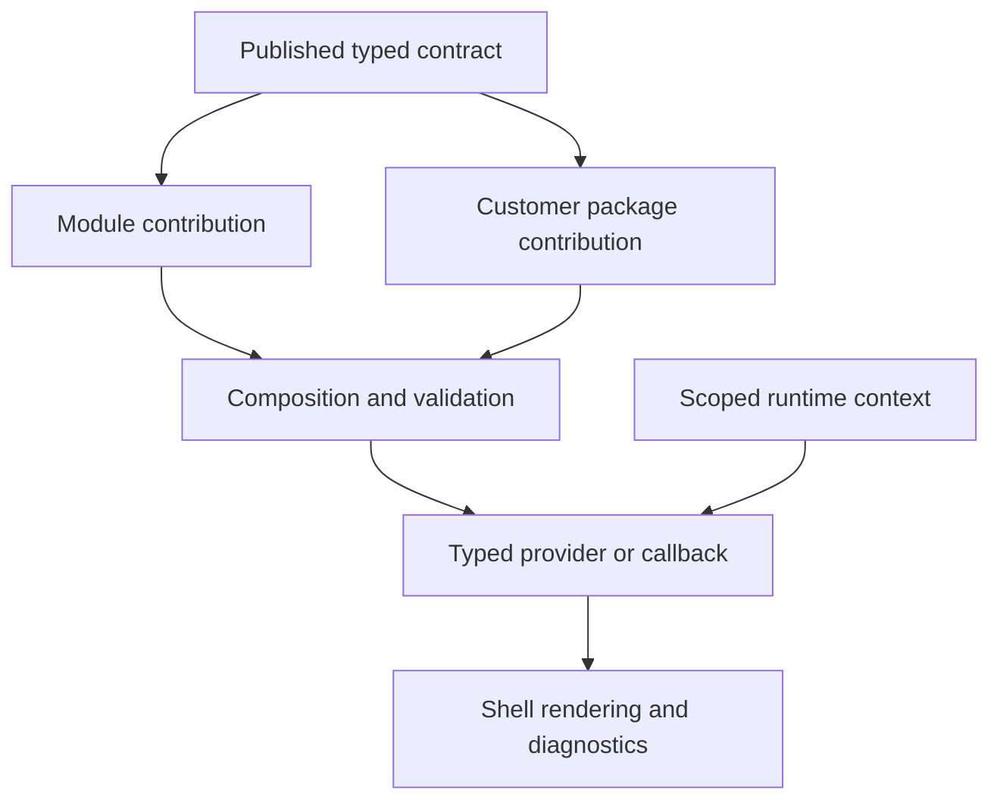

### Why the framework uses this model

A package can publish a supported contract and attachment target that multiple applications consume without copying shell layout source. The same contribution behavior can work with default or custom renderers, supporting the headless separation. Business behavior remains owned by feature code.

Separate typed contracts preserve the needs of navigation, actions, settings and diagnostic panels. Common composition metadata gives them consistent identity, attachment, ordering, override provenance and diagnostics. Focused registration builders and existing .NET DI provide the integration convenience; detailed rules are defined in Extension contracts and host authority.

## Query and selection adapters

The feature ships optional FilterModel query and selection adapters. Typed field and operator mapping, paging, sorting, filtering and selection context work independently of the grid renderer. A focused MudBlazor adapter translates existing grid events and supported field mappings. A handwritten Razor view can use the same query mapping, selection context and contextual actions. TaskFiesta owns its forms, validation and business operations.

The table defines adapter behavior within this feature. It does not require framework grids, CRUD screens, editors, lookup controls or a form engine. Broader reusable business workflows require separate feature designs and evidence of repeated application behavior.

| Capability | Target behavior |
| --- | --- |
| Existing grids and handwritten views | Translate query/selection inputs and expose resolved state to feature-owned controls without replacing their rendering, cell templates or local callbacks. |
| FilterModel integration | Typed filter definitions, supported operator selection, query construction and integration with backend FilterModel APIs. |
| Feature operations | Connect explicitly selected query/selection state to the existing action and feedback contracts. Feature code owns commands, forms, lookup queries and business recovery. |
| View state | Configurable filters, sorting, paging and column preferences, with URL and persistence rules. |
| Toolbar integration | Expose grid selection to core contextual actions/outlets. Existing MudBlazor or native controls present actions and filters through ordinary typed parameters/callbacks. |
| Customization | Use explicit field/operator mappings, selection policy and target attachment. No generated CRUD controls or mandatory framework page inheritance. |

Create, edit and delete remain feature-owned operations. A read-only grid or an archive-only workflow can use only the query/selection adapters it needs. Handwritten pages and existing controls participate without a framework page class.

Backend filtering and authorization remain authoritative. Field and operator mappings must be explicit enough to prevent unsupported queries. Concurrency conflicts must preserve user input and provide a feature-owned recovery choice. A confirmed save remains successful if a subsequent refresh fails.

An editor captures the submitted values and edit revision before dispatch. Confirmed success establishes the saved baseline for that revision; it must not clear changes made after submission or overwrite them with a later response. A feature may disable editing during saving instead. Validation failures, conflicts and unknown mutation outcomes preserve the current edits and require feature-owned recovery.

Scaffolding means reusable composition patterns and starter code. It does not require metadata-driven runtime generation, direct repository access from the browser or a universal CRUD endpoint.

### Selection ownership and defaults

Selection policy belongs to the optional data adapters and the feature view using them. AppState can hold the state and supply notifications where useful; component-local state also works. The core shell consumes the view's typed action context and enforces binding, confirmation and execution rules. It does not manage grid paging or define which records a filter matches.

The initial selection adapter tracks explicitly selected stable record IDs. Its defaults apply to both grid and handwritten views:

| Change | Selection behavior |
| --- | --- |
| Paging | Retain selection across pages by default. A view can explicitly enable clearing selection on paging. |
| Filter or search criteria | Clear selection because the query represents a different working set. |
| Sorting | Preserve selected IDs. |
| Data refresh | Preserve selected IDs, update available record data and versions, and reevaluate action eligibility. Remove only confirmed deleted or inaccessible records. Absence from the loaded page does not establish either condition. |
| Relevant target change during confirmation | Invalidate the pending confirmation and require a fresh decision under the action invocation rules. |
| Change after dispatch | Keep the accepted execution's captured inputs. Selection changes do not retarget dispatched work. |
| Identity or workspace change | Invalidate old-context selection under the normal privacy and context-transition rules. |

When selected records can be outside the visible page, show the total selected count and a clear-selection control. Feature adapters supply the target data and versions needed by an action, with authorized reads where required. Selection alone does not establish current eligibility or grant access.

Selection uses explicit IDs across pages. Query-wide selection of records never loaded is deferred until a concrete feature defines backend consistency, authorization and batch-outcome semantics. An explicit Export all matching action can capture query intent independently of row selection.

## Optional application features

| Feature | Direction and scope |
| --- | --- |
| Notification center | A contributed shell control and destination combining notification sources, badges, lists, actions and deep links. |
| Inbox | An optional frontend/backend capability for durable recipient notifications and read state. Its detailed design is deferred to a separate specification. |
| Administration | Optional module/configuration inspection, preference management and adapters for existing backend capabilities. |
| Auditing and change history | Read-oriented views over existing backend features, subject to their permissions and availability. |
| Jobs administration | Monitoring first; backend actions appear only when the host explicitly enables supported operations. |
| Additional capabilities | Tenant switching, import/export and specialized data management can be supplied as optional modules. |
| Edit-session coordination | Deferred; any future optional coordinator requires its own design beyond the page-owned unsaved-change helper. |
| Search and command discovery | Deferred; the current specification does not require global search or a command-discovery UI. |
| General shortcut routing | Deferred; local shortcuts and toolbar keyboard accessibility remain supported without a global scope-routing facility. |

The inbox direction includes querying notifications, unread counts and explicit read operations, with InMemory and EF Core provider candidates. Recipient resolution, delivery, retention, deduplication, persistence details and API contracts remain for its own design. Local Notifier events do not become durable user notifications automatically.

Notification counts must represent their source's defined scope rather than only loaded rows. Source failures and failed read updates must remain distinguishable from navigation failures. Optional backend integrations must fail within their own region or feature.

Administration reuses the shell's composition and diagnostic models. It does not introduce a separate identity product, unrestricted secret/configuration editor or workflow designer.

## Hosting and render-mode interoperability

The framework supports Static SSR for static-compatible content, Interactive Server, Interactive WebAssembly and Interactive Auto within Blazor's legal boundaries, plus standalone WebAssembly hosting. Prerendering is disabled by default for the framework's interactive hosting profiles and is an explicit host opt-in. Static SSR is a distinct rendering choice, not prerendering awaiting activation. Mixed page/component arrangements are supported as defined below; Interactive Auto is not a synonym for per-component mode selection.

AOT compilation is out of scope and is not an acceptance gate. Browser support targets managed WebAssembly. Applicable browser publishing and trimming checks remain required.

| Concern | Requirement |
| --- | --- |
| Portable composition | Shared presentation definitions can be registered in both server and browser runtimes. Backend registrations and secrets never flow into the browser. |
| Interactive boundaries | Follow Blazor's legal component boundaries and serializable parameter requirements. Delegates, RenderFragments and scoped services are not cross-runtime contracts. |
| Auto rendering | Auto selects Server or WebAssembly interactivity for a component lifetime. It is separate from host-selected per-page/component mixing, does not migrate running work and keeps prerendering off unless explicitly enabled. |
| State ownership | Give state, providers and mediation explicit logical owners within their actual runtime/circuit. Track interactive-root identity without assuming one DI scope per root or per component. |
| Coordination | Use an explicit serializable bridge or application service when separate runtimes need to coordinate preferences, context or invalidation. |
| Prerendering | Disabled by default for interactive profiles. Explicit opt-in follows the phase, service, state-transfer and activation rules below; browser-only services activate only when available. |
| Navigation | Direct URLs reconstruct destinations even when navigation crosses runtime or full-page boundaries. |

A visually shared shell does not imply shared DI services or in-memory state. Provider placement and context propagation follow the supported hosting matrix. Acceptance covers each supported arrangement, prerendering, cold/warm Auto visits, identity/context changes and diagnostics attribution. Cross-runtime changes affect only explicitly coordinated consumers; old-context results must still be rejected in every participating area.

Browser publishing and trimming behavior must be validated for reused Common features and frontend handler discovery. Compatibility must be demonstrated rather than inferred from a shared namespace.

### Supported hosting arrangements

The support boundary follows Blazor's legal component hierarchy and parameter rules. Tightly coupled actions and their presenters normally share one compatible interactive composition; independent Server and WASM areas can coexist in the same application and page.

| Arrangement | Support | Required boundary |
| --- | --- | --- |
| Standalone WebAssembly | Supported. | Shell, pages and frontend services execute in the browser. |
| Interactive Server application | Supported; prerendering off by default. | Event handling uses the originating server circuit and logical owners. A server-generated interactive UI does not require a preceding prerender phase. |
| Blazor Web App using Interactive WebAssembly | Supported; prerendering off by default. | UI runs in the browser; initial runtime/assets must load. Explicit prerendering opt-in also requires suitable server dependencies. |
| Interactive Auto | Supported; prerendering off by default. | Server interactivity is used initially and WebAssembly can be selected on later activations when available. Portable definitions/services support either runtime; active instances, bindings and work do not migrate. |
| Different modes on different pages | Supported independently of Auto. | The host chooses legal route/root arrangements; each destination reconstructs its context, using full-page navigation where needed. |
| Server and WASM areas on the same page | Supported as independent interactive areas. | Each area owns its state and direct interactions. Shared context/invalidation requires explicit coordination. |
| Separate roots sharing a compatible runtime/circuit | Supported through a documented in-process coordination arrangement. | Explicit scope association, owner lifetime and renderer-safe dispatch; no automatic cascading context between roots or assumption of one DI scope per root. |
| Server presenter directly invoking a WASM component, or the reverse | Generic cross-runtime action transport is deferred. | Keep the presenter with its owner or supply an explicit application integration; no implicit remote component invocation. |
| Public website profile | Supported as a reusable profile. | Static SSR pages/chrome, native navigation/forms and explicitly selected interactive boundaries. Use SSR-compatible Razor/HTML and styling; the full interactive MudBlazor shell is not guaranteed in static-only mode. No live action subscriptions exist in static output. |

The ordinary application pattern places shell interaction, contextual toolbar and feature content within one compatible interactive composition. Mixed applications use an outer host composition containing independent interactive areas; each area contains the presenters and owners requiring direct interaction. A WASM Orders area can therefore contain a page header, external Approve toolbar and Orders component while a Server navigation/reporting area coexists beside it.

Visual placement outside a component does not imply crossing its runtime boundary. Framework layouts and examples must not pass callbacks or RenderFragments through static-to-interactive serialization boundaries or nest incompatible interactive modes. Unsupported arrangements receive actionable configuration/activation diagnostics rather than silently losing actions or binding to another instance.

Generic cross-runtime business-action transport is deferred without deferring mixed-mode hosting, diagnostics attachment or explicitly configured context/invalidation coordination. Application-provided action integrations must preserve original binding/target identity, eligibility, confirmation, cancellation and stale-result rules. No UI/runtime bridge bypasses backend authorization.

### Recommended business application profile

The recommended starting profile for connected bITdevKit business applications is Interactive Server with prerendering explicitly disabled. It integrates naturally with existing server presentation modules and server-side services, avoids downloading a WebAssembly runtime before first interaction and reduces the extra activation and state-handoff concerns of prerendering. This is a starter/host recommendation; reusable presentation contracts and components retain the supported hosting portability.

This profile assumes reliable connectivity and acceptable server round-trip latency. Capacity planning includes per-circuit resources, connection handling and reconnect behavior. A lost circuit does not establish whether an already dispatched business operation succeeded; the normal unknown-outcome and recovery rules still apply. [Blazor hosting characteristics](https://learn.microsoft.com/en-us/aspnet/core/blazor/hosting-models?view=aspnetcore-10.0)

Choose WebAssembly when browser-side execution, deployment requirements or interaction characteristics justify its startup and API-integration costs. Choose Auto deliberately when the same feature and its dependencies have been validated in both runtimes; Auto adds runtime coverage rather than removing that work. Static SSR remains appropriate for static-compatible public content. Prerendering is an independent opt-in decision for a legal boundary, not a consequence of selecting Server or Auto. [Blazor render modes](https://learn.microsoft.com/en-us/aspnet/core/blazor/components/render-modes?view=aspnetcore-10.0)

### Recommended public website profile

Public-facing applications need useful initial HTML and responsive navigation without requiring a browser .NET runtime before visitors can read or use basic content. Supply a reusable public website profile alongside the connected business-application profile. TaskFiesta is its reference consumer; the same profile applies to other catalog, content and public-service applications. This is native Blazor Web App composition, not a new rendering engine or router. [Blazor static SSR and component-library compatibility](https://learn.microsoft.com/en-us/aspnet/core/blazor/components/class-libraries-and-static-server-side-rendering?view=aspnetcore-10.0)

| Concern | Public website requirement |
| --- | --- |
| Initial document | Static SSR produces the real page heading, navigation, primary content and head metadata. An empty application mount, spinner or client bootstrap is not an acceptable substitute for that content. |
| Native baseline | Ordinary links and GET forms support browsing, search, filtering, paging and back/forward. A feature can supply an authorized native POST form for an action that must work without interactivity. Server form handling uses its ordinary Application boundary. |
| Progressive enhancement | Use Blazor's native enhanced navigation/forms where the target supports them. Without JavaScript, the declared baseline still works through full requests and normal form feedback. Ordinary links/forms do not depend on a live action binding. |
| Interactive boundaries | Add Interactive Server only to the controls/pages needing live state, or choose another explicitly validated mode for a measured requirement. Prerender compatible public interactive areas so their useful initial content does not wait for connection. Selection of a boundary is not an automatic viewport/on-demand activation mechanism. |
| Browser payload | Public baseline browsing does not require WebAssembly, the browser .NET runtime, the whole business UI or developer tooling. Do not choose Auto by default for this profile because it also downloads the browser runtime/bundle for future browser execution. |
| Static styling | Provide the supported public chrome/navigation/content defaults using ordinary Razor/HTML and shared semantic tokens. Use interactive MudBlazor components within compatible interactive compositions. Static defaults need no MudBlazor live providers or event system. |
| Module contributions | Ownership, resources, published destinations and host replacement/suppression remain effective in SSR and interactive composition. A contribution requiring interactivity declares that requirement and a static view, native-form alternative or explicit unavailable presentation where the target requires one. |

The host keeps public static routes outside an unconditional global interactive `Routes` boundary. Select legal native route/page/component modes and matching head rendering. Use Blazor's normal document navigation/full reload when changing an incompatible route/root arrangement. Native static SSR, prerendering an interactive component and later interactive activation are separate phases with separate owners. [Render-mode composition](https://learn.microsoft.com/en-us/aspnet/core/blazor/components/render-modes?view=aspnetcore-10.0)

Render/form alternatives are feature-owned ordinary Razor components, not a universal conversion of contextual actions to HTTP calls. A form names its target/input and stable mutation intent, supplies antiforgery protection, and reauthorizes/revalidates on the server. Rendering a form does not execute the action. A later enhancement cannot redispatch a previously accepted or uncertain POST. The framework does not serialize a live scope, callback or component reference into form fields or across an interactive boundary. [Native forms across render modes](https://learn.microsoft.com/en-us/aspnet/core/blazor/components/class-libraries-and-static-server-side-rendering?view=aspnetcore-10.0#using-forms-across-render-modes)

Resolve read-only SSR/prerender data through server-capable feature services. For a prerendered interactive area, use native `PersistentComponentState` or applicable `PersistentState` support for explicitly safe data so activation need not duplicate the initial query or replace content with a loading flash. Revalidate freshness/context before actions. Rebuild live scopes/subscriptions; never transfer live bindings or operation owners. Static SSR form feedback is request-owned, while live field feedback follows its interactive owner. Existing field-error/revision rules apply in both cases.

Public first content must not wait on optional navigation children, personalization, a badge, diagnostics or an optional recommendation query. Bound required reads and use native streaming/deferred noncritical regions where appropriate. Keep unavailable optional content truthful and reserve space where needed. Streaming and prerendering do not make a slow mandatory source fast; record server time-to-first-byte separately from browser download/activation.

Apply normal web delivery practices: appropriately sized images with dimensions, prioritized primary imagery, deferred off-screen media, bounded CSS/JavaScript/fonts and versioned static assets. Use native HTTP/output caching or owning-module data caches only with complete culture/query/access keys and safe invalidation. Shared public output cannot contain personal data, basket content, antiforgery tokens or mutation-intent IDs. Application.Caching is available for backend data caching and is not a prerequisite for server rendering or native HTTP asset caching.

Measure both initial content and actual interaction. Interactive Server removes the browser .NET download but still has connection/per-event network costs. Prefer native browser behavior for basic input/navigation and avoid a server round trip for every unnecessary keystroke. A browser/WASM area is a deliberate alternative when measured interaction requirements justify its extra payload and runtime coverage. No single render mode is declared universally fastest.

Composition diagnostics identify effective render mode, prerender/static capability, deferred/unavailable contributions and request versus interactive owner. Startup validation rejects incompatible required arrangements rather than silently making the entire public page interactive. The framework's ordinary interactive profile still defaults to prerendering off; this explicitly selected public profile supplies its own static/prerender policy.

### Reusable hosting and startup support

The public website profile must be a packaged framework capability with runnable starter/consumer evidence, not a checklist that every application reimplements. Ship reusable integration for the repeated host, rendering and lifecycle work. Add the proposed presentation configuration to the existing DevKit host builder and reuse native Blazor/.NET mechanisms underneath it. No presentation-specific builder/profile API is claimed to exist today.

The proposed ordinary entry is `WithPresentation(options => options.UsePublicWebsite())` on the DevKit host builder. Both `WithPresentation` and `UsePublicWebsite` are proposed names, not implemented APIs. Presentation setup sits alongside the existing `AddModules`/`WithModules` registration, whose callback uses `WithModule<CoreModule>()` to select modules once. It consumes that same host module catalog; it does not select modules a second time or create a parallel registry. The profile selects SSR/public defaults and compatible services/renderers while the application supplies branding/layout choices and native pages. It does not make every component interactive, infer business actions or replace native render-mode precedence. Ordinary connected applications retain their default profile. Exact signatures and supported registration ordering are validated through the starter and independent-consumer evidence.

| Reusable framework deliverable | What the consuming application supplies |
| --- | --- |
| Host registration and starter wiring | The framework supplies the profile registration, suitable native Blazor service/endpoint integration and an inspectable starter with the appropriate `App`, `Routes` and head composition. The app selects modules, explicit profile overrides and application middleware/authentication. A hand-authored host uses the same public integration points. |
| Static-compatible public shell | Shared public header/navigation/breadcrumb/region renderers use the headless contribution catalog, semantic tokens and ordinary Razor/HTML. The app supplies branding, layouts where needed and feature content. Static support does not require copying the shell into each app. |
| Render compatibility validation | The framework evaluates declared module/contribution capabilities, host overrides and known native boundaries before activation where possible. The app declares any required interactivity or static/form alternative. Diagnostics identify the source/target and effective policy for incompatible or deferred contributions. |
| Request and interactive context integration | Shared hosting support distinguishes SSR/prerender request ownership from live circuit ownership using native context/lifecycle facilities and suitable existing identity APIs. The app registers its feature services and authorization. Browser-safe core contracts do not expose `HttpContext`, server services or provider types. |
| Read initialization and handoff conventions | Supply documented opt-in key/lifetime conventions and only evidence-backed helpers around native `PersistentComponentState`/`PersistentState`, including cleanup and stale-context rejection. The feature selects transferable DTOs, identity/context keys, freshness and permissions. No automatic AppState serialization or second hydration store is introduced. |
| Native forms and feedback integration | Reuse ordinary `EditForm`/HTML forms, native form names/binding, antiforgery and the existing Result-to-field/summary mapping. The feature supplies its form/model and server use case, including authorization and mutation identity. A reusable module can share a compatible native form across modes without a mandatory framework form base. |
| Critical-content readiness | Framework chrome/contribution composition can render ready static content while optional contributions are deferred or unavailable, with request/live phase attribution. The app identifies genuinely required source reads and feature fallbacks. No global all-modules-ready spinner, warmup barrier or replacement job scheduler is required. |
| Assets and delivery defaults | Reuse RCL/static-web-asset packaging, selected-renderer assets and native HTTP/static-asset facilities. The profile avoids requiring the WASM/staff/debug payload for baseline public routes. The app provides media/content sizes, optional output/data-cache policy and any additional declared asset dependencies. This does not create a bundler or promise arbitrary component-level code splitting. |
| Diagnostics and performance evidence | Shared diagnostics expose effective profile, native mode, SSR/prerender/activation phase, contribution readiness and applicable resource/timing attribution. Provide repeatable sample workloads using ordinary tools. The app supplies its workload and budgets; actual backend/host/network costs stay visible. |

Shared support belongs in the appropriate framework host/renderer packages. Native server registration, request adaptation and protected handoff implementation remain outside the browser-safe headless core. Domain-specific handlers, public POST endpoints, data-query batching and business cache/invalidation policy remain in their owning application modules.

The profile may choose safe defaults, but it must not discover and persist arbitrary user state, silently move an active instance between runtimes or override a legal explicit native mode without an actionable conflict. SSR is read-only initialization; live observers and action bindings are rebuilt on activation. Feature-owned POST processing is a separate explicit request, never a prerender side effect.

Prefer short native configuration to a new wrapper. A helper is justified when the actual starter and independent consumers demonstrate the same repeated lifecycle/error-prone work. It must remove setup without requiring new base classes, a service locator, another initialization graph or a parallel event/persistence system. Optional generation can emit the same inspectable native host declarations and metadata; generated and handwritten hosts use the same public contracts and validation.

Framework fixes to these shared renderers, conventions and host services must reach consumers through package upgrades. Profile defaults and their supported overrides are documented compatibility commitments. Applications still choose their page modes and content behavior; selecting the profile does not guarantee a latency number or repair a slow feature query automatically.

### Reference application access paths

TaskFiesta uses different application access paths for Server and browser execution. Shared portable components consume narrow feature-owned service contracts. Hosts register the appropriate implementation in each executing runtime. Existing suitable service contracts can be reused; the shell does not require a universal application-service wrapper.

| Executing runtime | Reference path |
| --- | --- |
| Interactive Server | Dispatch commands and queries in-process through Application Requester. The reference workflow does not call its own HTTP API. |
| Interactive WebAssembly or standalone WASM | Use typed HTTP clients. Server endpoints dispatch to the same application commands and queries. Backend handlers and their dependencies remain outside the browser assembly graph. |
| Interactive Auto | Use the Server implementation while executing on Server and the HTTP implementation while executing in the browser. Select the implementation through runtime registration; active instances and work do not migrate. |
| Explicit prerendering | Resolve suitable server-side feature services for approved read-only initialization. Apply the prerender request's identity and lifetime rules, then reconstruct live services and bindings on activation. |

The Server adapter obtains the current user and application context from the originating circuit. Application handlers or their behaviors enforce validation and permissions for both entry paths, including checks otherwise performed only by HTTP endpoint filters. Backend authorization remains authoritative. A direct Requester call must not bypass required policy or entity checks.

The Server profile supplies a circuit-aware implementation of the existing `ICurrentUserAccessor`. Its principal comes from native `AuthenticationStateProvider`/circuit lifecycle integration and follows authentication-state changes. A live circuit must not use the HTTP-only `HttpCurrentUserAccessor` as its identity source: `IHttpContextAccessor` may be absent or retain an earlier principal. SSR/prerender and HTTP endpoints retain their request-owned identity handling. Browser-supplied identity is not authoritative for Application authorization. [Blazor HttpContext guidance](https://learn.microsoft.com/en-us/aspnet/core/blazor/components/httpcontext?view=aspnetcore-10.0), [circuit user capture](https://learn.microsoft.com/en-us/aspnet/core/blazor/security/additional-scenarios?view=aspnetcore-10.0#circuit-handler-to-capture-users-for-custom-services).

Before each in-process dispatch, obtain the authenticated circuit principal and permitted application context for that invocation. If a use case opens a short-lived DI scope, its `ICurrentUserAccessor` must receive that principal/context explicitly rather than resolve an anonymous HTTP accessor or a different circuit's state. Clear pending eligibility and invalidate affected bindings when identity changes; checks resumed after confirmation use the current identity. Unknown/failed identity resolution cannot grant a protected action. Do not cache the initial principal for the circuit lifetime, share mutable user state between circuits or retain a circuit/provider reference in a longer-lived background operation. The application boundary continues to enforce policy/entity checks, with operation-appropriate authorization context for accepted backend-owned work.

Resolve operation dependencies with lifetimes appropriate to each use case. A long-lived circuit or UI binding must not retain an operation-owned DbContext or repository beyond that operation. The presentation adapter handles access and mapping; application use cases continue to own business orchestration. Feature results, field errors, conflicts and unknown outcomes map to the same presentation feedback contract in both paths.

### Prerendering policy and activation

Framework interactive hosting profiles explicitly disable prerendering by default, including Server, WebAssembly and Auto. This reduces duplicated initialization, browser-service and state-handoff complexity for ordinary business applications. Hosts can opt in for a particular legal interactive boundary where initial server-produced content is useful. Choosing Static SSR does not enable prerendering for unrelated interactive areas.

The host configures this at the effective top-level interactive boundaries, including applicable routing and head outlets. A child contribution cannot override an ancestor's effective render/prerender policy. Reusable components should normally remain mode-agnostic and declare required capabilities rather than force an incompatible mode. An incompatible arrangement is diagnosed early where possible. [Blazor prerender configuration](https://learn.microsoft.com/en-us/aspnet/core/blazor/components/prerender?view=aspnetcore-10.0)

| Phase or capability | Required behavior |
| --- | --- |
| Prerender request | Produce static markup and approved read-only presentation data. Do not execute UI business actions, start user jobs or establish a continuing live interaction scope. Any request-local subscriptions/resources are disposed with that request owner. |
| Interactive activation | Create new live component scopes, bindings, subscriptions and cancellation ownership. Restore declared data where applicable, revalidate context/eligibility and activate browser-dependent capabilities when ready. |
| Frontend services | A prerendered component has suitable server-resolvable dependencies as well as the services required by its interactive runtime. Browser-only implementations are deferred or replaced by a suitable rendering abstraction; checking interactivity inside a method cannot repair failed construction/injection. |
| Browser preferences and JS | Browser storage, DOM-dependent work and browser measurements wait for supported interactive lifecycle hooks. Use server-known safe values/defaults before that point; defer browser preferences without performing browser interop during prerendering. |
| Toolbar and navigation previews | Render static descriptors, inert/disabled action previews or stable placeholders where available. Rebuild live invocation bindings on activation; child registrations made only after interactive rendering cannot be assumed present in the initial HTML. |
| MudBlazor providers | Dialog, popover, snackbar and theme/provider placement follows the compatible interactive composition using them. A static outer layout alone does not provide the live context needed by a separate interactive area. |
| Diagnostics | Attribute request/prerender, Server, WASM and browser measurements separately. Browser agents receive an explicit not-ready/unavailable state until the relevant bridge/runtime is available; opening the drawer is not required. |

Interactivity detection uses Blazor's supported renderer information, such as RendererInfo.IsInteractive. Running on the server alone does not distinguish prerendering from Interactive Server. OnAfterRender/OnAfterRenderAsync are interactive lifecycle hooks and do not run during prerendering. Shared-attempt initialization remains scoped to its actual owner/generation; it does not bridge prerender and interactive instances.

State handoff uses standard Blazor PersistentComponentState or applicable PersistentState support rather than a new shell persistence engine. Transfer only explicitly declared data appropriate to the receiving runtime and user, with keys distinguishing destination/view, component instance, identity/workspace and relevant schema/context. Orders A and B must not restore each other's data. Restored values follow freshness and context-validation rules; browser/Auto transfer must not contain credentials, server-only objects or unapproved private data. Do not transfer callbacks, component instances, live binding/execution identities, subscriptions or cancellation sources. These are reconstructed. Prerender handoff is distinct from long-term AppState preference/draft persistence. [Blazor prerendered state persistence](https://learn.microsoft.com/en-us/aspnet/core/blazor/state-management/prerendered-state-persistence?view=aspnetcore-10.0)

For AppState-owned models, reuse the delivered `AppStateLifecycle.Attach` adapter described in [AppState implementation status](#appstate-implementation-status). It connects approved snapshots to native initial-value and circuit-snapshot restoration. Framework work selects participating models, establishes host context and render-mode placement, and rebuilds live owners. Do not implement another generic AppState handoff engine. The adapter's native string serialization requires JSON reflection in the host; reflection-disabled native persistence is unsupported. AOT compilation is out of scope.

Optional badge queries, dynamic navigation and diagnostics must not hold up all initial content. Bound prerender work and use placeholders, deferred evaluation or explicitly configured streaming where appropriate. Test full document loads/reloads separately from already-interactive route navigation; a successful interactive navigation does not prove a component can prerender.

MudBlazor static-only rendering is outside the default interactive renderer guarantee. Static content uses compatible Razor/HTML with theme-aligned styling; an application can host interactive MudBlazor areas beside it. Global-interactivity examples place MudBlazor providers within that shared composition; per-page/area examples place them within the applicable interactive area. Initial prerendering of an interactive arrangement is distinct from a permanently static application. [MudBlazor provider placement](https://github.com/MudBlazor/MudBlazor/blob/dev/src/MudBlazor.Docs/Pages/Getting%20Started/Installation/Installation.razor)

### Render mode selection and optional offline behavior

Interactive Auto selects an interactive runtime; per-page/per-component rendering is the host's placement of modes at legal boundaries. Different sibling areas may use different modes; an interactive child cannot switch to an incompatible mode beneath its parent. A static outer composition can contain interactive areas, but ordinary callbacks, RenderFragments and in-memory state are not transports across serialization/runtime boundaries. Generic cross-runtime action transport remains deferred.

WebAssembly hosting does not make the application offline-capable automatically. Optional PWA/service-worker packaging, offline data, synchronization and operation recovery require their own application/feature contracts. Standalone WebAssembly is a suitable direction for an offline-oriented host; supporting Interactive WebAssembly or Auto alone does not promise offline navigation or business operations. No mandatory service worker, offline queue or synchronization engine is introduced by the core shell. [Blazor PWA guidance](https://learn.microsoft.com/en-us/aspnet/core/blazor/progressive-web-app/?view=aspnetcore-10.0)

## Presentation module composition

On the server, existing bITdevKit modules already located in the Presentation project should gain presentation capabilities through the existing module system. An optional IPresentationModule capability adds UI registrations and contributions while preserving module identity, configuration, ordering and enablement.

A reusable presentation base derives the logical module name from the type name using the same convention as backend modules. Local modules can use this default. Before a module publishes a cross-package attachment, a supported configuration reference or a persisted namespace, explicitly pin its logical name to the value consumers will use. Use the existing name override for this purpose and preserve the backend module identity when extending an existing module.

For WebAssembly, portable presentation definitions belong in browser-compatible assemblies or Razor class libraries. The browser registers frontend services and contributions without executing server Register, Use or Map behavior. Server and browser adapters reuse the same presentation definitions where appropriate.

Presentation definitions and browser-safe registration logic are authored once and reused by host adapters. Each executing DI container is configured once through the appropriate adapter; reuse does not imply a shared server/browser service instance. Prerendering resolves suitable server services or is explicitly disabled for that area. Existing server module behavior remains server-only.

Composition is selected and validated at startup. Enabling a module exposes its configured contributions. The host can replace, suppress or reorder them before composition is finalized. This requirement does not imply runtime DI unregistration or assembly unloading. Configuration changes do not imply automatic reconfiguration of already-running browsers or circuits.

Modules can contribute page/component assemblies, frontend services and API clients, navigation, typed state, resources/assets, named-region components, initialization tasks, handwritten settings sections and contextual toolbar actions. The host controls placement; modules own business meaning, behavior and feature-specific persistence.

Validation must identify duplicate contribution identities, route conflicts, missing required dependencies, dependency cycles and contributions targeting unavailable required regions. Typed extension points additionally validate attachment compatibility, required/optional participation, cardinality and unresolved competing replacements as defined in Extension contracts and host authority. Optional dependencies and attachments follow their documented fallbacks. Diagnostics identify the source module, point, target and effective composition.

A pinned name identifies the same logical module across the server and browser compositions. Qualified public extension and contribution IDs retain their published values. For example, a module initially named orders can rename its CLR type and keep the pinned orders name and its exported attachment IDs. Startup validation reports duplicate module identities and conflicting declarations where both are visible. Changing a published identity follows the compatibility and migration policy.

### Page ownership and route availability

A module can declare default ownership of its registered page assembly. Explicit page-type mappings override that default where multiple modules share an assembly. Composition resolves one effective owner for each framework-managed destination and reports ambiguous or missing ownership. A host-owned page can explicitly belong to the host composition. Ordinary pages in an unambiguous module assembly need no repeated module annotation.

Blazor `@page` declarations remain the source of URLs. Ownership metadata associates the page type and its routes with the stable module identity. The owning module supplies declared capability and availability defaults; page requirements and host destination overrides contribute to the effective requirements. Navigation visibility is evaluated separately. Namespace or URL naming alone does not establish ownership.

Host adapters use that resolved metadata for both initial server endpoint processing and interactive route activation. Configure Blazor's server and interactive page-assembly discovery from the effective composition. A disabled module's pages remain unavailable even when another enabled module requires the same assembly. Gate activation before constructing the feature page or running its protected reads and initialization.

Initial server requests use applicable ASP.NET Core endpoint authorization and availability handling. Interactive navigation uses the corresponding Blazor route integration. Both paths provide the declared denied or unavailable behavior and safe return destination. A client route view alone cannot supply server-request enforcement. These adapters extend normal Blazor routing and do not introduce a replacement router.

## Destinations, availability and deep links

Pages and destinations must work through direct URLs by default: opening a bookmark, refreshing a detail page, using browser back/forward and following a link from another module must reconstruct the correct page, module context and route-backed tabs without a previous menu click.

The URL is authoritative for destination identity, selected record and route-backed subsection. Navigation models reflect the destination; clicking a menu item must not be required to initialize it. Transient UI details and unsaved drafts remain outside the URL unless explicitly designed otherwise.

Availability has separate inputs:

- Composition availability: whether the module, dependency or capability exists.

- Policy availability: whether the current user is permitted to enter or act.

- Host customization: whether a contribution or destination is explicitly suppressed.

- Runtime presentation state: whether a particular item is hidden, disabled or decorated.

Hiding a navigation item alone must not disable its route. Conversely, a callback must not make an unavailable or unauthorized destination usable. A denied or unavailable direct link receives a consistent, customizable page with a safe recovery path. Authentication redirects preserve the intended authorized destination.

Cross-module links use stable destination contracts and normal Blazor routing. The shell must not create a competing router. Local component tabs may remain local; tabs representing a navigable page subsection require a deep-link strategy.

### Destination contracts and link generation

Modules publish stable destination identities and `@page` route patterns. Small typed destination helpers supply the required route parameters and supported query values for cross-module links. Generated links use correct URI encoding and respect the application's configured base path. Ordinary local links remain valid and need no extra registration merely to participate in the shell.

The feature preserves the module's published route patterns. Arbitrary host remapping of module pages to different URL patterns is deferred until a concrete application requirement justifies it. Destination helpers describe and generate links to the existing Blazor routes rather than maintaining a second routing engine.

Destination dependencies use the existing module and contribution composition metadata. A missing required module or destination fails startup validation with its source and target identified. Links to absent optional modules are hidden by default. A feature can explicitly show a disabled link with an availability reason instead. Runtime policy and capability checks remain authoritative after composition. Direct visits receive the established denied or unavailable behavior, independently of whether a link was rendered.

### Host-supplied feature availability

Feature availability uses the host's module composition, configuration and existing application services through the same availability model. Keep module installation, feature enablement, required backend capability and user permission as distinct inputs. An installed module does not establish that every feature is enabled or that the current user may invoke it.

Known module and configuration values resolve directly. An asynchronous check is needed only when a declared input requires it. The shell does not require a separate capability-discovery service, standardized discovery endpoint, distributed registry or feature-management engine. Server execution can resolve the relevant application services directly. Browser execution can consume a safe projection from the same application's backend where a feature requires it. That projection supplies declared availability information rather than secrets or arbitrary server configuration.

| Required availability | Default behavior |
| --- | --- |
| Established and available | Allow the dependent route or action when its other readiness and authorization requirements also pass. |
| Unknown or a required check cannot complete | Keep affected actions pending or unavailable with a reason and bounded retry. Dependent activation waits for its declared requirements. Unrelated features remain usable. |
| Established and unavailable | Apply the destination or contribution's declared hidden, disabled or unavailable presentation. An absent optional module follows the link defaults above. |

Scope results to the applicable host and runtime, backend, identity and workspace context. Reject results from obsolete context revisions, and invalidate affected consumers through the existing state and refresh rules. A previous enabled answer must not silently permit dispatch while its required availability is unknown. Backend services still enforce authorization and business rules independently.

## Headless behavior and opinionated defaults

The shell separates composition, navigation resolution, availability, state and diagnostics from the components that render them. An application can replace a sidebar, header, page frame or feedback renderer while retaining the same behavior and contribution contracts.

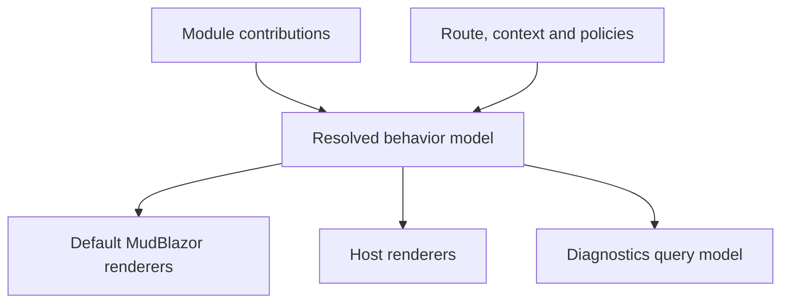

This headless separation is a customization seam within a Blazor framework. It does not require framework-independent UI code, a new library of unstyled controls or a mandatory controller for every component. Backend business logic remains independent of UI and routing.

The browser-safe shell contracts and behavior have no direct or transitive dependency on MudBlazor. Applications reference the default MudBlazor shell renderer separately. Feature UI packages may use MudBlazor directly; headless shell contracts do not require every feature control to be renderer-independent. The shell composes the required MudBlazor providers in the compatible interactive composition described in Hosting and render-mode interoperability. Static-only content uses SSR-compatible rendering.

## Shell layouts and application chrome

The default Backoffice layout provides a header, sidebar, content region and footer. A Website layout provides a header and footer with content-oriented navigation. Both must coexist with custom layouts in the same host using ordinary Blazor layout mechanisms.

Layouts expose documented regions for branding, account controls, header actions, navigation, footer content and page content. Hosts can contribute additional named regions. Contributions can use templates or components within legal rendering boundaries.

Page composition supports optional titles, breadcrumbs, actions and sections, with slots or native `RenderFragment`s for loading, empty and error presentation. Features fill those slots with native markup or existing MudBlazor controls; this does not require a shipped catalog of state-panel components. A page can opt into these patterns or provide a completely custom body. A page frame or shell region can render contextual actions outside the component that supplies their behavior, using the scoped binding model in Contextual toolbars and action scopes.

Responsive behavior must preserve usable navigation, actions and focus order. Default renderers must support keyboard operation, meaningful focus after navigation, accessible labels and error announcements. Custom renderers inherit documented accessibility responsibilities.

## Conceptual layout wireframes

These image wireframes illustrate Backoffice, Website and Developer Tools compositions. They establish region arrangements and customization requirements rather than final visual design. Labels, counts and sample data are illustrative. Architecture diagrams describe behavior and relationships; the images show screen layouts.

### Backoffice: multiple navigation levels


The logical navigation hierarchy supplies sidebar, header and page-tab outlets. Order tabs have stable deep links; badges are runtime contributions.

### Website: public content with optional identity

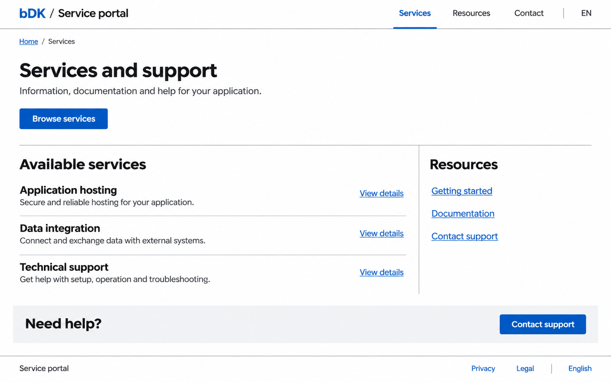

A different layout uses the same composition infrastructure. Authentication is unnecessary for this public configuration.

### Developer tools: attached to the active page

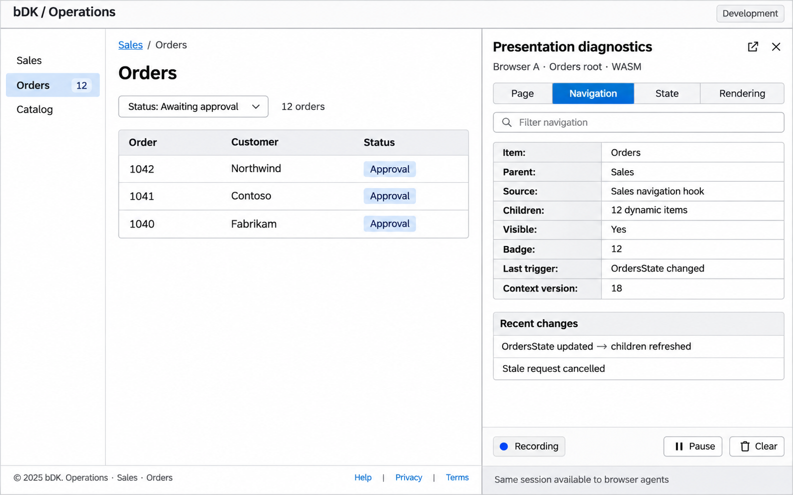

The drawer inspects the current session. An attached popout or agent queries that same diagnostic model; opening another circuit with unrelated state is insufficient. On narrow screens, the diagnostic region can overlay or reflow according to the chosen layout.

## Extension contracts and host authority

The framework uses separate typed contracts backed by common composition metadata. Each public extension point defines the context supplied to contributors, the accepted output or component contract, the attachment scope and the rules for composition and lifecycle.

These contracts strengthen the existing hooks, providers, component slots and presentation modules. Ordinary customization uses configuration, typed callbacks/templates, contribution providers and replaceable services through this same model.

| Extension mechanism | Intended use |
| --- | --- |
| Configuration | Select defaults, ordering, placement, capabilities and shared behavior. |
| Component slots and templates | Contribute or replace visible content without copying the entire shell. |
| Runtime callbacks | Evaluate simple context-dependent state or execute an action. |
| Contribution providers | Supply reusable or asynchronous collections and evaluation logic. |
| Replaceable services | Change behavior behind a documented contract. |
| Host overrides | Replace, remove or reorder module contributions with final authority. |

Modules must not require hosts to edit shell layout source for ordinary integration. Stable contribution identities support targeted host overrides. Types establish compatibility; identities establish attachment, override and diagnostic references. Composition validates facts that the compiler cannot establish, including whether an installed target exists.

Simple runtime behavior can use typed callbacks or Razor templates without an extra provider class. Reusable contributions can use provider interfaces. Focused registration builders make both paths convenient, attach common metadata and participate in the existing module-composition validation.

### Published typed contracts

Each public extension point documents its input context, accepted result/component contract, target scope, cardinality, ordering, supported customization operations, refresh dependencies and failure behavior. Descriptor-producing providers and UI-rendering components may use different contracts.

| Extension point | Focused context | Accepted contribution |
| --- | --- | --- |
| Navigation children | Parent/ancestors, relevant route and declared state/context inputs, culture, trigger, paging and cancellation. | Bounded navigation descriptor results. |
| Header actions | Applicable application/page context and declared capabilities. | Action descriptors or typed component contributions. |
| Contextual actions | Typed page, component, entity or selection context in a specific runtime scope. | Action descriptors with scoped, awaitable invocation bindings. |
| Toolbar controls | The declared typed toolbar scope and its relevant state. | Typed templates/components for search, filters, view selectors or custom controls. |
| Settings sections | Declared settings scope and relevant preference contracts. | Section descriptors or typed components. |
| Diagnostic panels | Supported diagnostic read model and inspection context. | Diagnostic panel components/templates. |

Toolbar control contributions place feature-owned native/MudBlazor components in an explicitly published, typed outlet. They can coordinate filters or view selectors with that owner without becoming action definitions. A plain local control needs no contribution registration. The framework does not discover/register controls globally, create control schemas or mirror component parameters into a widget registry.

The shell and presentation modules can publish additional typed points through shared contract assemblies or Razor class libraries. Feature-owned points remain defined by their owning module; a customer package can contribute to an Orders toolbar or navigation parent by referencing its public contracts. Framework core must not require changes for every new feature-specific point.

### Public core extension points and defaults

The headless shell publishes browser-compatible contracts for the generic integration points below. The separately referenced default MudBlazor renderer consumes these contracts. Business-specific toolbar actions, grid adapters, administration screens and notification persistence are optional feature contributions.

| Public point | Default cardinality per target | Default composition behavior |
| --- | --- | --- |
| Navigation menu items and children providers | Zero or many contributions. | Compose static/dynamic contributions in deterministic order; each provider can return a bounded set of items. |
| Application header actions | Zero or many contributions. | Application-level actions coexist; page/component actions appear here only through explicit scope/outlet placement. |
| Page and component contextual actions | Zero or many contributions per live scope. | Compose actions for the explicitly selected scope; page and component contracts retain their typed contexts. |
| Toolbar controls/templates | Zero or many contributions per toolbar target. | Compose declared groups/order with actions; custom controls use the target's typed context. |
| Named content regions | Zero or many by default. | Region owners may declare a stricter cardinality; required content is validated during composition. |
| Branding region | Zero or one effective content contribution. | Optional framework default; a host can replace or disable it. Multiple competing effective contents are invalid. |
| Navigation and toolbar renderer selection | One effective renderer for each used outlet. | The selected renderer package can supply defaults. A host can choose an explicit compatible replacement. Each used outlet requires one effective renderer. |
| Settings sections | Zero or many contributions. | Core provides the section contract; modules own settings meaning/persistence and optional administration adapters. |
| Diagnostic panels/tabs | Zero or many contributions alongside framework panels. | Panels use supported diagnostic contracts and share normal ordering/override rules. |

These cardinalities apply to composed contributions or renderer selections. They do not require a minimum number of visible runtime actions, generated navigation children or controls.

The baseline supports adding to multi-contribution points, configuring exposed options, replacing an identified contribution and disabling optional contributions. Decoration is supported only where the point publishes a compatible typed decoration contract. Required-point constraints remain valid after customization.

Host order overrides take precedence over declared defaults. Across contribution registrations, default numeric order is zero; equal orders use ordinal comparison of stable, qualified contribution identities. Within a provider's output, declared item/group order or the returned sequence determines presentation as documented by that point. Incidental DI registration enumeration must not choose the order or replacement winner.

Registered contribution identities must be unique in their declared scope. Runtime actions and dynamic children also require stable keys within their source contribution and live scope; duplicate runtime keys produce a local diagnostic/failure rather than silently selecting one result.

Routing/page discovery continues through Blazor and presentation-module integration. Ordinary services, API clients and localization use existing .NET DI/localization contracts. They do not require parallel generic extension registries.

Published contracts must be portable across their supported server/browser runtimes and have documented compatibility guarantees. Breaking changes to context/output semantics, public attachment identities or required component parameters follow the compatibility policy. Application-, module- and component-owned localization resources retain their existing ownership.

Contexts are narrow contracts for the particular operation. Feature clients and other dependencies normally use constructor injection. Arbitrary object dictionaries and a universal context exposing every service/state store are not the public integration model.

Typed Razor templates can provide context-safe local slots. Registered component contributions require a documented typed adapter or parameter-contract validation; accepting a component type alone does not establish that it accepts the intended context. RenderFragments, callbacks and component instances remain within legal rendering boundaries.

### Common composition metadata

Shared registration metadata feeds the shell's composition validation and diagnostic inventory. It describes contributions while their typed contracts retain operation-specific execution and rendering semantics. This shell-specific inventory is built on ordinary DI and applicable composition utilities; Common.Utilities.Composition is not assumed to provide a pre-existing shell extension registry.

| Metadata | Purpose |
| --- | --- |
| Extension-point identity and owner | Identifies the published participation contract and its owning shell capability or presentation module. |
| Contribution identity and source | Gives the contribution a stable reference and records its source presentation module. |
| Attachment target | Identifies the particular parent, region, page or scope accepting the contribution. |
| Contract and cardinality | Describes compatible input/output or component contracts and whether the point accepts zero/one/many contributions. |
| Ordering and customization | Records declared order, supported host configuration and explicit decoration/replacement/disable decisions. |
| Action references | Definitions and placements have stable composition references; live scope/binding/execution IDs are recorded in scoped runtime diagnostics, without storing user state in shared registration metadata. |
| Declared runtime dependencies | Describes refresh dependencies and lifecycle policy without retaining current user-specific values or subscriptions in shared metadata. |
| Rendering capabilities | Describes static/prerender compatibility, required interactivity and declared native-form/static alternatives where relevant. The host remains responsible for legal native render boundaries; this metadata does not create another renderer. |

Registration builders infer module ownership and ordinary identity defaults where possible. The owner exports typed handles for cross-module extension points and attachment targets with stable IDs under its published module identity. The handle expresses compatibility in C# and supplies its stable ID for configuration and diagnostics. Startup validation checks whether the target is installed and compatible. Local page and component hooks can use ordinary Razor and callbacks.

### Predictable attachment and customization

Composition validates attachment targets, contract compatibility, required/optional participation and point cardinality after host composition overrides are applied. Missing required targets or required contributions are configuration errors. Optional attachments use their documented fallback and remain visible in diagnostics. Invalid registrations must identify the source contribution, target and violated contract.

Cardinality counts composed contributions, such as children providers, rather than the number of runtime items returned by a provider. A valid provider may return an empty collection. Runtime visibility changes do not redefine composition cardinality.

| Operation | Meaning |
| --- | --- |
| Add | Register an additional contribution where the point permits it. |
| Configure | Change options explicitly exposed by the contribution or point. |
| Decorate | Wrap or augment an existing contribution through a supported typed decoration contract. |
| Replace | Explicitly substitute an identified contribution with a compatible implementation. |
| Disable | Exclude an installed contribution from the effective application composition. |

Each point documents which operations it supports. Multiple additions follow its deterministic ordering rules, including a stable tie-break. Host ordering overrides have final authority. Decoration order is explicit. Competing replacements require explicit host resolution; incidental registration order must not silently select a winner.

Replacement and decoration preserve the point's compatibility requirements, authorization/availability rules and lifecycle expectations. Diagnostics retain both the effective implementation and its source/override provenance.

### Composition and contextual execution

Application composition selects implementations and installed contributions. Per-user evaluation, action execution and component rendering use their appropriate runtime/circuit/root scopes. Shared registration metadata and factories must not capture user-specific state, components or scoped services.

Contextual evaluation produces an isolated resolved model for the applicable owner/context. Filtering, localization, visibility, enabled state, badges and child composition must not mutate shared contribution definitions, registration metadata or provider-owned reusable descriptors. Immutable models or copying on change can satisfy this rule; immutable values may be shared without cloning an entire hierarchy. Changes to feature state still go through its owning contract.

Existing .NET DI interfaces, service registrations and container lifetimes provide dependency resolution and disposal ownership. Registration builders use these mechanisms. The framework does not require another service locator, a universal execution registry or a separate blueprint engine. Additional reusable factories are justified by concrete repeated patterns.

AppState subscriptions, typed Notifier signals and the existing targeted invalidation rules drive contextual updates. A composition-level disable/replace decision is distinct from runtime visibility, enabled state, badges or generated children. Providers and rendering components retain their existing, distinct failure boundaries and recovery behavior.

Temporary runtime contributions to headers, content regions and other outlets follow the same ownership rules as action bindings. Owner disposal releases their attachments and subscriptions, and late notifications/results must not render into a removed owner. Repeated mounting must not accumulate duplicate controls or observers. This cleanup concerns runtime bindings and owned resources, not DI unregistration or removal of installed module definitions. Detaching a presenter does not cancel work with an independent declared execution owner.

## Contextual toolbars and action scopes

A contextual toolbar renders actions and controls for what a page or component is currently displaying or editing. The framework supplies core action/scope contracts, runtime binding, typed providers/callbacks and a reusable default MudBlazor toolbar renderer. Hosts can place that toolbar in a page header, shell region, component, dialog or drawer.

Contextual toolbar contracts and binding behavior belong to the headless shell. The separately referenced MudBlazor renderer supplies the default toolbar component. Optional data adapters expose grid selection through the same contracts. Features own the business behavior behind actions such as Approve, Edit, Save and Archive.

These contracts apply when a feature needs contributed actions, shared invocation safeguards or explicit placement outside the owning component. Ordinary local menus, toolbars and buttons use MudBlazor or native Razor/HTML directly with local callbacks. They require no action definition, provider, framework registration or scope. A developer does not have to turn every click handler into a framework action.

The default action outlet is a focused presenter of resolved bindings. It uses existing MudBlazor menu, toolbar and button components for rendering and interaction. The framework owns contribution ordering/grouping, explicit target association, shared execution state and action overflow placement. It does not introduce a generic menu/toolbar widget API, parallel control options or a new popup, focus or keyboard engine. Renderer integration still verifies accessible focus and keyboard behavior in the composed flow.

A feature can render an existing binding through its own MudBlazor toolbar/menu or ordinary Razor controls. That presenter observes the same availability/pending state and invokes the original binding through the same safeguards. Replacing presentation must not call the business handler directly or reconstruct a target from the current selection.

### Action definition, placement, binding and execution

UI actions define behavior independently of the control presenting it. Toolbar buttons and context-menu entries can invoke the same live action binding through the same applicability, confirmation and execution path. UI handlers can call existing APIs or Requester; they are not a second backend CQRS model.

| Concept | Owns | Lifetime boundary |
| --- | --- | --- |
| Definition | Stable semantic action identity, typed context contract, default resource-based label/icon and default invocation/confirmation policy. | Reusable package contract/metadata; no selected records, component instances or per-user busy state in shared registration metadata. |
| Placement | Target toolbar, menu or control, group and order, and permitted presentation overrides. | A composition declaration references the action definition and published attachment target. At runtime the outlet resolves the binding for the explicitly selected scope. A scope-owned local placement can reference that live binding directly. |
| Binding | Definition connected to a particular live scope and typed context, handler/services, relevant context revision and execution state. | Runtime owner; scoped clients and component callbacks may be referenced only while that owner remains valid. |
| Execution | One accepted invocation, its identity, captured targets, completion/outcome and cancellation/progress state. | Owned by the binding's declared execution owner, with bounded diagnostic retention. |

Definition identity, placement/contribution identity, live scope identity, binding identity and execution identity are distinct diagnostic references. Binding identity includes its live owner and instance key, so two Orders components can use the same definition independently.

A toolbar and menu intentionally sharing one binding also share pending/busy state and feedback ownership. Two distinct bindings do not share selection or execution state merely because their definition IDs match.

Default presentation comes from the definition's resource identity and is resolved for the current culture. A placement can apply permitted presentation/visibility choices; it cannot grant execution eligibility or bypass the binding's business/policy checks.

### External toolbar and component-owned behavior

An Order detail component can supply Approve and Edit while a page frame renders those buttons outside the component. The component exposes action descriptors and binds their invocation to its own asynchronous handlers or feature services in a live action scope. The toolbar resolves and invokes those bindings; it does not need to find the Order component through the DOM or hold an arbitrary component reference.

Simple pages/components can bind typed callbacks directly. Reusable module packages can supply typed action providers using constructor-injected clients/state. Both paths participate in the same scoped action model. Existing Requester can dispatch a feature operation; Notifier/AppState can announce its outcome or invalidate dependent views. Invocation must remain awaitable rather than becoming a fire-and-forget notification.

In the Order 1042 example, the component supplies the current order identity, status and relevant editing/selection capabilities through its declared typed context. Approve invokes the owning feature's approval behavior for that order. Edit activates the owning feature's edit workflow or edit mode. Updating the order/status/edit state invalidates the relevant action evaluation, and the external toolbar updates accordingly.

### External toolbar example

The page frame owns the toolbar shown above two independent Orders components. It is explicitly bound to Orders A: Approve targets orders 1042 and 1043, while Edit is disabled because two rows are selected. Orders B's selected order 2090 is outside that binding. The image is illustrative; component boundaries and target ownership are the concepts being specified.

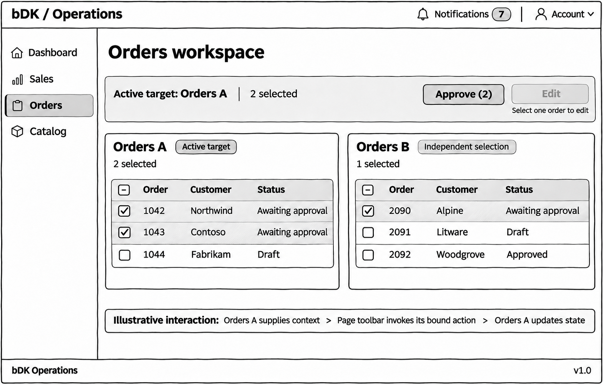

Opening the toolbar menu or a confirmation preserves the originating binding. A modal editor using scoped framework actions creates its own scope and local bindings; it must not inherit a grid's selected rows implicitly. An ordinary feature-owned dialog using local callbacks needs no action scope or framework registration.

### Confirmation and invocation flow

Feature code supplies an awaitable confirmation callback when an action needs confirmation. The default renderer may offer an opt-in MudBlazor confirmation integration through that same callback. Resolve the callback in the owning live scope; shared action metadata must not capture component instances or scoped services. Before awaiting confirmation, the invocation pipeline captures the targets/revision and reserves the binding. After acceptance, the pipeline rechecks owner lifetime, relevant context revision and eligibility before dispatch. Cancellation or a failed confirmation performs no mutation and releases the pending invocation. This integration does not require a general-purpose dialog service or renderer-neutral copies of dialog parameters/results.

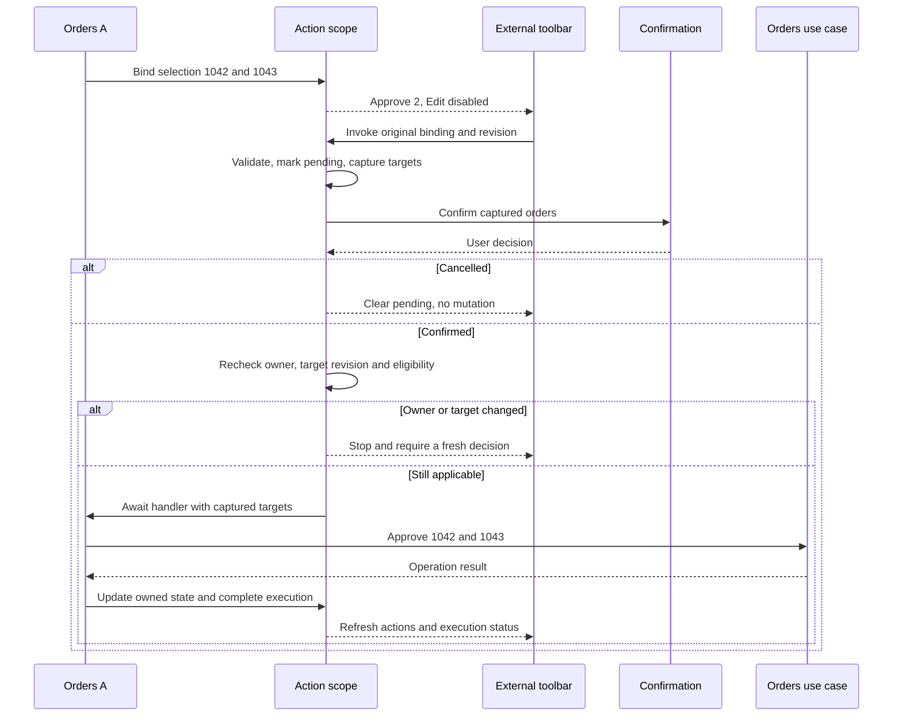

### Typed scopes and explicit placement

An interaction scope is a runtime owner of typed context and contribution bindings. This is a new framework contract specified here. Action scopes use that same ownership model; the wider term must not lead to a second registry or force unrelated capabilities into one execution contract. It is not an existing AppState or Result operation-scope API.

A live scope identifies a particular page/component instance and its relevant context revision. It is distinct from the shared module registration and the reusable action definition. Two instances of the same grid or Order component have separate scope/binding identities, even when they use the same definition. Context snapshots must not retain mutable selection collections that can change an already prepared invocation.

The public scope contract must define these operations, independently of final API names:

| Operation | Minimum contract |
| --- | --- |
| Create or explicitly join | Create one typed live owner with an inferred instance identity. Joining requires an explicit compatible scope reference and must not transfer ownership or use whichever selection happens to be active globally. |
| Publish context | Supply an immutable/captured typed value and relevant revision; invalidate only dependent availability/presentation. The feature defines which changes make a prepared invocation obsolete. |
| Bind actions | Bind local typed callbacks or a reusable provider in that owner. Shared definitions must not retain live components, mutable targets or scoped services. |
| Attach and observe | Explicitly attach an outlet to the intended scope and expose its resolved actions/pending state. Return an owner-bound disposable attachment; moving a presenter does not replace the execution owner. |
| Detach and dispose | Detach releases only the attachment. Owner disposal removes its live bindings/subscriptions, requests cancellation of owner-bound work and rejects late results. DI-owned services remain DI-owned. |

The following is an illustrative authoring sketch, not shipped or stable API. An ordinary Razor component can use these operations from native initialization/context-change/disposal hooks without a framework page base or provider class. The header outlet is passed explicitly; the sketch does not introduce global toolbar discovery. Complete and confirmation callbacks are feature-owned.

```csharp
// Component initialization: create, bind and attach to an explicit outlet.
scope = actions.CreateScope(this, TaskSelection.Empty);
scope.Bind(CompleteAsync, confirm: ConfirmCompleteAsync);
headerAttachment = headerToolbar.Observe(scope);

// Relevant selection/context change: publish an independent snapshot.
scope.Publish(selectionSnapshot, revision: selectionRevision);

// Component disposal: remove the attachment and release this live owner.
headerAttachment.Dispose();
await scope.DisposeAsync();
```

An illustrative confirmation delegate is `ValueTask<bool> ConfirmAction<TContext>(TContext capturedContext, CancellationToken cancellationToken)`. The owning live binding resolves it with the captured input, never through shared registration metadata. Acceptance returns true; cancellation or rejection prevents dispatch. The invocation pipeline supplies an owner/execution-linked cancellation token and checks cancellation, current identity, owner lifetime, relevant revision and eligibility again before dispatch. If the underlying dialog cannot cancel promptly, its late answer cannot revive the invalidated invocation. The pending reservation is released on every pre-dispatch exit, including callback failure. Features can await MudBlazor directly inside this callback; no framework dialog API is required.

A page can own a page scope and components can own child scopes. Nested scopes can cover sections, grids, selections, detail views, dialogs or drawers. The application explicitly associates a toolbar outlet with its intended scope and chooses which ancestor action groups, if any, it includes.

Composition validates the published action definition and attachment target. During activation, the shell validates live scope instances and resolves bindings. An unopened page does not constitute a missing composition target. Each live source evaluates its own typed context and supplies resolved actions to the renderer.

Default page toolbars show page actions. Component toolbars show their own scope's actions. Components contribute actions to an external page/shell toolbar through explicit attachment/activation; the shell must not automatically aggregate every mounted component's actions.

A page can opt into showing page actions plus one explicitly active child scope. For a page with two grids, this lets the header show actions for the selected grid while preserving page-level Create or Refresh actions. Selecting a tab or an explicit component activation changes that active scope. Focus-driven activation is an opt-in policy. Moving focus into the toolbar or opening its menu must retain the intended source context.

A toolbar stays attached to its explicitly selected scope. Default toolbar keyboard navigation and explicit local shortcuts preserve text-input/native control behavior and modal isolation; moving focus must not retarget the toolbar. General hierarchical shortcut routing, fallback/ambiguity resolution and command discovery are deferred. Local keyboard support does not require a global command-routing service.

Dialogs and drawers that participate in scoped actions keep those actions local by default. A host can configure other placement deliberately. Opening a dialog does not automatically create a framework scope. Navigation, component removal or scope deactivation removes the corresponding bindings from active outlets and invalidates stale evaluations.

Mounting a page/component creates runtime bindings for installed providers or page-local callbacks; disposal removes those bindings. This does not install/unload modules or mutate application DI registrations.

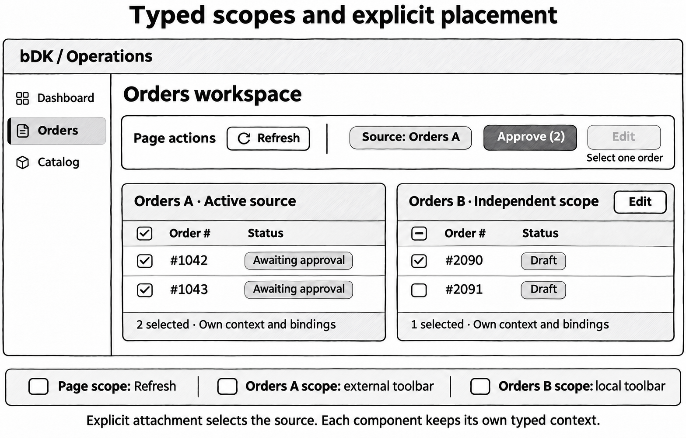

The external toolbar combines an explicitly included page action group with Orders A's actions. Orders B keeps its own selection and local Edit action. Approve uses Orders A's two captured targets; the toolbar does not acquire ownership of either grid's state or execution.

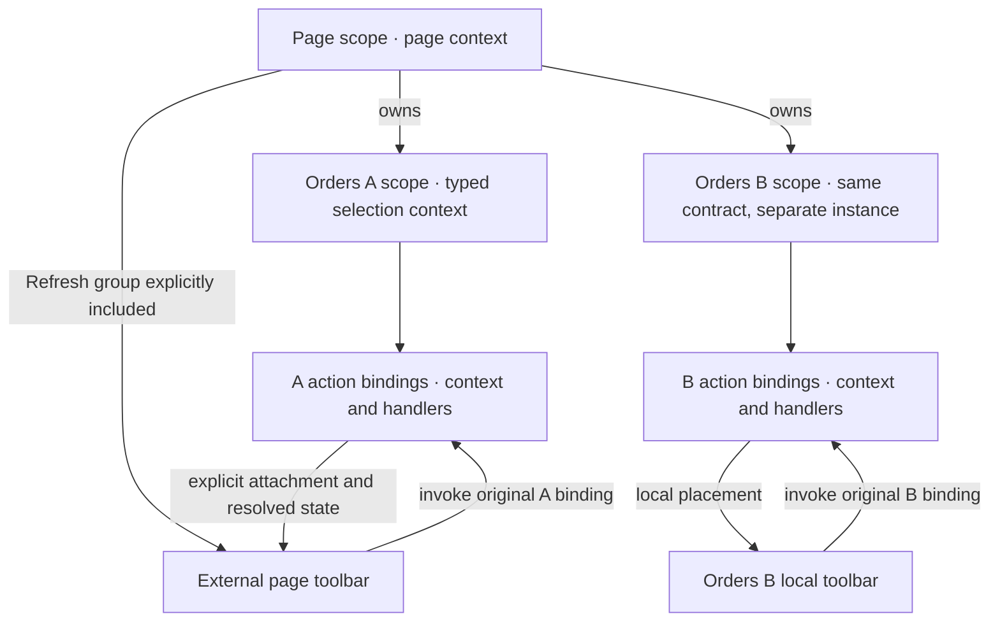

Both grids can implement the same published typed context contract while retaining distinct scope IDs, bindings, context revisions and selections. Each source evaluates its own context; the toolbar renders resolved actions and invokes their original bindings. The arrows describe ownership, attachment and invocation relationships within the single scope model specified here.

### Action and control contribution requirements

| Contribution concern | Required behavior |
| --- | --- |
| Identity and ownership | Distinct definition, placement, scope, binding and execution identities with module/provider/owner provenance. |
| Presentation | The feature supplies a localized label, optional icon and tooltip, group/order, emphasis and optional badge/count. Each placement can render icon only, text only, or icon and text. Icon-only actions keep an accessible name. |
| Contextual availability | Typed synchronous/asynchronous visible/enabled evaluation with an optional disabled reason and declared refresh dependencies. |
| Invocation | Awaitable binding to the intended owner and captured target context; applicability is checked at dispatch and again after confirmation. |
| Execution status | Shared per-binding pending/busy state and per-invocation identity/outcome, reported progress where available, duplicate-invocation prevention and cancellation/disposal handling. |
| Custom controls | Feature-owned native or MudBlazor components/templates for quick search, filters, view selection and column tools; values update their owned state through normal typed parameters/callbacks. Contribution placement does not require framework versions of these controls. |
| Responsive interaction | Feature priorities keep the current primary action visible when space permits. Secondary actions move into keyboard-accessible overflow in predictable order. Each presentation observes the same binding, including availability and pending state. An empty toolbar can collapse. |

An action can represent navigation through an ordinary destination or execute an asynchronous operation. Rendering/evaluating availability must never execute it. Feature code supplies confirmation meaning/content and business prerequisites; the action invocation contract enforces the checks around any confirmation. Backend services enforce authorization, concurrency and mutation rules independently. Authentication integration remains optional.

State dependencies, context updates and explicit invalidation re-evaluate the affected actions through the existing AppState/Notifier model. A selection change can enable Edit for one row or Approve for eligible selected rows without reloading unrelated data. Merely rendering the toolbar must not repeatedly query the backend.

### Action defaults and explicit feature decisions

| Concern | Framework default | Feature or host decision |
| --- | --- | --- |
| Execution ownership | Live action scope. | Select any longer-lived owner and declare its lifetime, cancellation and recovery semantics. |
| Placement | Local scope; dialogs/drawers keep local actions. | Explicit external outlet attachment, active child source and included ancestor groups. |
| Invocation | Awaited handler, captured context, eligibility checks and duplicate suppression per binding. | Target/submitted-value shape, relevant revisions and any stronger conflict policy. |
| Confirmation | No automatic confirmation for every action. | Whether confirmation is required, its meaning/content and applicable prerequisites. |
| Cancellation | Provide a cancellation signal, request cancellation on owner disposal and reject stale UI completion. | Underlying cancellation capability and whether a user-facing Cancel action is meaningful. |
| Feedback | Local busy state; shared execution state across presenters; one feedback owner. | Success messages, per-target outcomes and business recovery choices. |
| Refresh | React to declared dependencies without inferred backend reloads. | Which state/query/record changes invalidate which consumers. |
| Identity | Derive live scope/binding/execution identities and routine local keys. | Stable published definition/attachment identities when other packages must reference or override them. |

A framework-bound local action can bind an ordinary typed callback without a separate provider class or manual registration of every diagnostic identity. Builders and runtime bindings infer owner/provenance and routine identities; developers publish explicit stable identities where cross-package attachment, replacement or compatibility requires them. Local callbacks outside this action model remain ordinary component behavior.

### Safe invocation and lifetime

Framework-bound action invocation follows one path regardless of its toolbar/menu placement:

1. Resolve the requested original binding and validate that its owner/target remain eligible.

2. Reserve its pending state to suppress duplicate invocation of that binding, including while confirmation is open.

3. Capture immutable invocation inputs: targets/selection, submitted values where applicable, and the relevant target/edit-context revisions.

4. If required, show feature-supplied confirmation for those captured targets.

5. If confirmation is declined or preparation is cancelled before dispatch, end without executing the business handler.

6. After confirmation, re-resolve the original binding and recheck owner lifetime, target context and current execution eligibility.

7. If the binding was disposed, retargeted or its relevant selection/context changed, stop and require a fresh decision. Never substitute a new selection or another Orders instance silently.

8. Execute the awaited handler against the captured snapshot and record its outcome.

A change unrelated to the action's declared target/applicability dependencies need not invalidate confirmation. A relevant change must be detected even when an earlier async availability request ignored cancellation. These checks apply to simple callbacks and provider-backed actions alike.

After execution starts, later selection changes cannot alter its captured targets. Feature code handles domain concurrency and recovery. UI duplicate suppression is not backend idempotency or a transaction across APIs. Cancellation/navigation cannot reverse a mutation that already committed, and cancellation requested must not be presented as confirmed cancellation.

Duplicate pending/running invocation is suppressed per binding by default. A toolbar and menu sharing that binding cannot open competing confirmations or start duplicate execution. Separate bindings, including two Orders grids using one action definition, retain independent execution state. Applications can declare stronger conflict policies where needed; backend rules remain authoritative for overlapping resources.

Execution helpers must express their actual policy: suppressing duplicate invocation, rejecting conflicting work and serializing accepted invocations are different behaviors. Serialization is explicit and scoped to a binding or feature-declared conflict boundary; it must not accidentally serialize unrelated actions through one client/circuit-wide gate. Any delayed dispatch rechecks the owner, relevant context revision and eligibility while preserving the accepted invocation's captured inputs. Cancelling/superseding obsolete evaluation or read work does not implicitly cancel, replace or replay a dispatched mutation. These rules do not require an additional execution registry, queue or scheduler.

When one binding is presented in several surfaces, those surfaces observe the same execution identity/state and share one feedback owner. Placement changes do not create a fresh invocation or reset its busy state.

Scope owners release bindings/subscriptions on disposal and request cancellation of work owned by that scope. Late completion must not update a removed component, a different scope or a newer identity/workspace context, even when the operation ignores cancellation. Work with an explicitly longer-lived owner follows that owner's lifetime. Failures remain local to the operation and do not turn a confirmed save into a failed save or cause automatic resubmission.

| Lifecycle change | Required behavior |
| --- | --- |
| Deactivation or hidden placement | Remove ineligible bindings from active outlets and invalidate relevant evaluations. Deactivation alone does not dispose the scope or automatically cancel a running mutation. |
| Owner disposal | Release bindings and subscriptions, invalidate pending confirmation and request cancellation of scope-owned work. Detach observation of explicitly longer-lived work. |
| Selection or target-context change before dispatch | Cancel or supersede dependent evaluations/preparation and revalidate after confirmation. Require a fresh decision when the relevant captured targets changed. |
| Selection change after dispatch | Preserve the invocation's captured targets. Never retarget, restart or automatically cancel a mutation merely because the selection changed. |
| Identity or workspace-context change | Invalidate old-context bindings and pending confirmations, request cancellation where supported, and clear or partition private state. Results from the old context must never update the new context. Backend-owned work follows backend authorization and cancellation rules. |

### Execution state and observation

Core action execution exposes identity, originating binding/scope, pending-confirmation/running state and terminal outcome through existing scoped state and diagnostics. Cancellation requested is separate from the terminal result; progress is shown only when supplied by the underlying work. Queued status is meaningful only when an actual execution source reports queueing.

Cancelling a confirmation ends preparation before dispatch. After dispatch, cancellation is a request to stop cooperative work. A confirmed successful result remains successful even if cancellation was requested. Enterprise readiness defines how to present confirmed, partial, cancelled and unknown business outcomes.

Execution observation and diagnostics expose cancellation requested, local execution completion and reported business outcome as separate values. A cancel affordance states whether it dismisses preparation, requests cancellation or stops observation. The feature reconciles unknown outcomes using the original target or operation reference when available.

The default execution owner is the live action scope. Toolbar/menu placement provides observation and invocation of its binding; it does not transfer execution ownership. Moving, hiding or disposing a presenter must not create a new execution or reset shared busy state. Presenters observe one execution identity and share one feedback owner.

| Execution owner | Intended use | When the originating page/component is disposed |
| --- | --- | --- |
| Live action scope — default | Actions whose execution belongs to a particular page/component instance | Remove bindings and subscriptions, request cancellation of owned work and prevent late UI updates. |
| Explicit client/circuit owner | Work deliberately continuing while the user navigates within that owner's lifetime | Detach page observation; execution continues under its declared owner and cancellation policy. |
| Backend operation/job | Work whose execution and any durability are owned by a backend integration | Detach frontend observation; backend contracts determine cancellation, completion, durability and recovery. |

Longer-lived ownership must be selected before execution and declare its lifetime, supported cancellation behavior, completion/feedback owner and recovery or reattachment semantics. Execution uses independent services and captured inputs without retaining disposed components, render fragments or page callbacks. A retained execution record alone does not extend task lifetime.

Client/application ownership is scoped to the relevant user's runtime or server circuit, never a process-wide singleton containing user work. It does not guarantee survival across browser closure, reload, lost circuits or separate Server/WASM roots. Features that support reattachment use an explicit execution/operation reference, not the reusable action definition ID, and revalidate the current identity/context. Durable continuation and recovery require the corresponding backend contract; the shell must not imply those guarantees.

A general operations panel and broader application-owned operation orchestration are separate optional design work. Core observation does not introduce a background scheduler, durable queue or execution registry parallel to existing services. Surviving browser closure or restart requires an appropriate backend job/operation integration.

### Approve Save and Export walkthroughs

| Action | Owner and invocation | Completion and recovery |
| --- | --- | --- |
| Approve selected orders | The Orders component owns the binding. Capture selected IDs and relevant context; confirm those targets and recheck eligibility before dispatch. Later selection changes cannot retarget execution. | Update confirmed results and invalidate affected lists/counts. A lost response may leave the outcome unknown. The feature declares atomic or partial-success batch behavior. |
| Save an editor | The editor owns the binding. Validate and capture submitted values and edit revision. An external toolbar invokes that same binding; ordinary Save need not require confirmation. | Confirmed success establishes the baseline for the submitted revision. Preserve later edits. Validation, conflicts and unknown outcomes must not silently clear dirty state or complete save-and-leave. |
| Export data | A normal request/download belongs to the initiating scope. Capture whether export means selected IDs or all records matching declared filter/query options. Longer-lived export uses an explicit owner. | Backend job acceptance confirms submission, not export completion. Progress, cancellation, result availability and retention follow that backend contract. Lost submission acknowledgement can leave acceptance unknown. |

For batch actions, the feature contract declares whether execution is atomic and, where partial completion is possible, provides enough information to distinguish confirmed success, failure and unknown/not-executed results for affected targets. Shared presentation may display these results, but it must not automatically retry the whole batch or infer transaction semantics.

Saving revision 7 while the user creates revision 8 must leave revision 8 dirty after revision 7 succeeds. Disabling editing while saving is an alternative feature policy. Neither path requires an edit-session coordinator.

If approval of order 1042 succeeds while order 1043 conflicts, preserve 1042's confirmed result and present 1043's conflict. Recovery follows feature-defined per-target rules.

After an export returns a backend operation reference, navigation detaches the page's observation and follows the declared backend ownership policy. Before acknowledgement, the frontend cannot assume that submission failed or automatically submit again. Exporting all matching records captures query intent; dataset snapshot consistency is a feature/backend guarantee only when explicitly supplied.

### Render modes and diagnostics

Physical placement outside the Order component does not require a different interactive runtime. The default external-toolbar pattern keeps the toolbar and action owner within a compatible interactive boundary.

Toolbar/owner coordination follows Supported hosting arrangements. The default keeps presenter and owner within one compatible interactive composition; documented same-runtime root coordination uses explicit scope association and renderer-safe dispatch. Callbacks, component instances and RenderFragments cannot cross boundaries requiring serializable parameters. Generic cross-runtime action transport is deferred; an application can supply an explicit integration preserving binding/scope/target identity, context revision, response and invalidation routing and the normal invocation safeguards. A diagnostics inspection bridge is not a business-action transport.

Diagnostics expose the scope hierarchy, active source, outlet placement, contribution ownership, action visibility/enabled reasons, dependencies, evaluation/invocation status and failures through the existing human/agent read model. Context/target details respect declared redaction and session boundaries.

## Navigation and page composition

Navigation belongs to the core shell, including menu composition, runtime hooks, dynamic hierarchy generation, availability, outlet placement and deep-link resolution. Optional modules contribute navigation through these core contracts.

Navigation is a logical hierarchy whose visual placement is configurable. The same module declarations can drive main navigation on the left, secondary navigation below it, deeper sections in the header and record-specific page tabs.

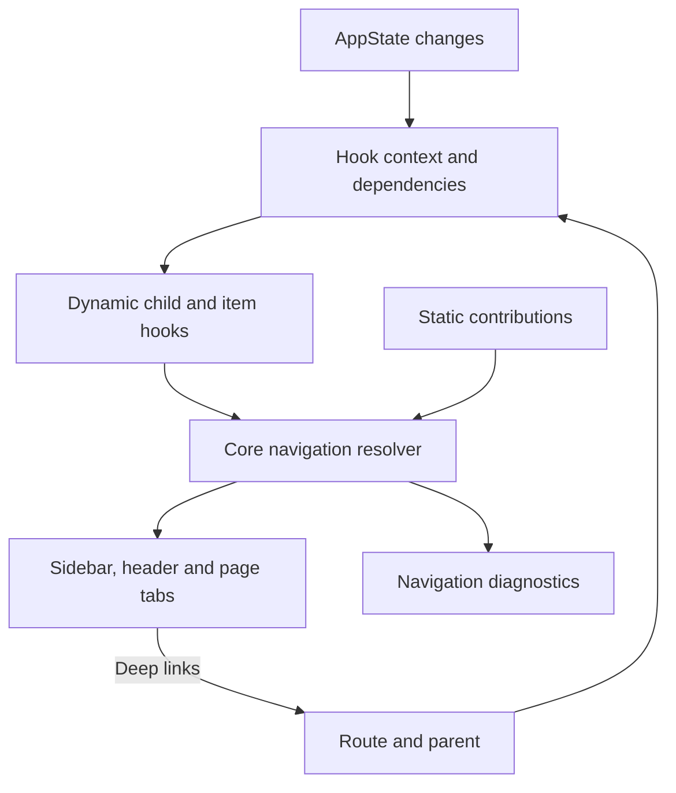

Main, Account and Footer menus are available defaults, and hosts can define additional menus and outlets. Groups, links and executable actions support nested composition. Active states and breadcrumbs derive from the resolved route and context.

These names identify logical navigation contribution locations, not new menu control types. Their renderers consume the resolved hierarchy through existing MudBlazor controls or native Razor links. Feature-local dropdowns and context menus need no navigation registration or participation in the shell hierarchy. When a menu intentionally presents a framework-bound action, it invokes that original binding and retains its ownership and execution safeguards.

Navigation items must support synchronous or asynchronous runtime evaluation of visibility, enabled state, text, icon, tooltip, badge/count, styling and custom rendering. A developer can, for example, hide an item based on application context or display an unread count supplied by a service.

Menus and subtrees must also support code-defined generation of items and children at runtime. For example, an Orders parent can contain a child link for each returned order; a Catalog parent can contain categories derived from products. A dynamic child can itself provide further dynamic children and ordinary item hooks. Simple cases use callbacks; reusable cases use contribution providers.

Static and dynamic children can coexist with documented placement and ordering. The host's overrides and the same availability/policy rules apply to generated items. Dynamic item generation is a core navigation behavior; it does not require the CRUD, administration or notification features.

### Navigation hook context

Navigation hooks use operation-specific typed contexts with consistent conventions for identity, hierarchy, route and change information. Child generation, item evaluation and action invocation receive the inputs needed for their operation. The table below is an inventory of relevant information, rather than a requirement for every hook to receive every field.

| Context input | Required information |
| --- | --- |
| Contribution identity | Application/module, menu, outlet, current item and owning contribution/provider. |
| Hierarchy | Parent item, ancestor path, depth and the current generation scope; a root operation has no parent. |
| Route and page | Current destination, route/query values, selected entity or context key where declared, and active navigation path. |
| Application context | Current workspace/tenant where applicable, culture and safe identity/permission information; identity integration remains optional. |
| State dependencies | Declared typed AppState access or safe snapshots/selectors, with the relevant version for detecting stale results. |
| Trigger | Initial resolution, expansion, route/context change, relevant state change or explicit refresh; change metadata when available. |
| Associated data | An optional feature-owned item key or typed payload, such as the category identifier represented by a generated node. |
| Execution | Runtime/root identity where relevant, cancellation and operation-specific inputs such as the invoked action or paging cursor. Services are normally supplied through constructor injection. |

Context represents the applicable evaluation scope and exposes narrow typed values, read-only views or snapshots. It must not become a mutable global object, an arbitrary payload dictionary or a service locator, and must not expose parent component internals. Feature state changes go through the owner's methods/commands. Exact signatures and context type names belong to API design.

### Dynamic hierarchy lifecycle

Child generation can be eager or lazy on expansion. Large collections must support bounded loading, paging or search rather than require rendering every record. Loading, empty and error states belong to the affected branch, with explicit retry and refresh behavior.

Generated items need stable identities derived from their contribution scope and domain keys. Ordering, duplicate detection, cycle/depth protection and retained expansion/selection behavior must be deterministic. A data or state change can invalidate one branch without rebuilding unrelated menus.

Every generated link uses an ordinary route or destination contract, such as an order detail route with an identifier. A deep link must resolve the page and record without first expanding or loading the entire navigation tree. Active-path resolution can locate the relevant branch or ancestor without enumerating all records.

An in-flight generation/evaluation result must be discarded when its parent, identity, route, state dependencies or application context becomes obsolete. Generated data and cached child collections follow the same privacy and scope rules as their source data.

Evaluation and action execution are separate. Rendering must not execute click behavior. Item actions can run asynchronous feature code, including opening a dialog or selecting a context.

Evaluation and child generation must have an explicit dependency and refresh/invalidation model. Hooks can declare relevant AppState subscriptions/selectors, route/context dependencies and explicit refresh triggers. A selected category change, for example, can refresh its product children while a changed unread count only updates the corresponding badge.

The framework must avoid repeated network requests on every render, coalesce relevant changes, cancel stale work, discard outdated results and contain callback/provider failures within the affected contribution or branch. Diagnostics must expose the owning hook, parent/context, dependencies, last trigger, duration, outcome and stale-result cancellation.

Policy checks, composition availability and host suppression remain authoritative after callback evaluation. Badge queries and their failures must not block unrelated navigation. Custom renderers receive the resolved model and documented action behavior.

### Orders navigation walkthrough

The Sales module contributes a static Orders parent. A child-generation hook queries a bounded set of orders for the current application context, using a frontend service or Requester. Each result produces an item with a stable identity based on the contribution and order identifier, a localized label and an ordinary detail URL such as /sales/orders/1042/overview.

| Situation | Hook context and expected behavior |
| --- | --- |
| First expansion | Parent is Orders; context includes the module/menu, current route, application context, declared filters/state and cancellation. Load the first bounded set of children and show loading, empty or error UI within this branch. |
| Generated child evaluation | The current item represents order 1042; its parent is Orders and its associated key is 1042. Item hooks evaluate its label, badge, enabled/visible state or custom rendering with the same context conventions. |
| Relevant filter change | A declared selector such as OrdersFilter.Status changes. Invalidate that branch, cancel obsolete work and reload the active/expanded branch using the new filter. |
| Unrelated state change | A change outside the hook's declared dependencies leaves its child collection and queries unchanged. |
| Confirmed order mutation | After the backend confirms creation, deletion or a status change, the feature updates owned state or explicitly invalidates the relevant collection/count. Refresh branch membership, order labels and counts only where those dependencies apply. |
| Context changes mid-query | A workspace/identity change cancels or supersedes the old evaluation. Old results cannot enter the new context's navigation, even if cancellation is not honored by the source. |
| Direct detail link | Opening /sales/orders/1042/items loads the page and record directly. Active-path resolution identifies Sales > Orders > 1042 without first fetching every sibling or expanding the menu. |
| Record leaves the filtered branch | Removing a child from a filtered list does not by itself close its detail page. The page remains available if the record and access permit it; a missing/deleted record receives the normal unavailable/not-found behavior. |

Navigation does not own the Orders collection or its backend query semantics. The hook declares the dependencies and maps feature results into navigation contributions. Shared feature state/query caching can serve both a page and a navigation branch; independently mounted consumers must not create accidental duplicate reloads.

Category navigation follows the same pattern: a Catalog parent derives distinct category entries from a feature query, and each category can generate its own product children. A product/category membership change explicitly invalidates the affected branch when it is not already represented by a declared state dependency.

## Visual consistency and styling

MudBlazor is the default component and interaction library. Tailwind CSS is the recommended utility layer for layout and styling needs that MudBlazor does not cover well. Applications must not need to choose between the two.

A shared semantic design vocabulary covers colors, typography, spacing and breakpoints. MudTheme remains the primary component-theme mechanism; utility styling must align with it. Theme identity and appearance mode are separate choices: a named theme can support light, dark and system appearance.

The feature supplies one reference theme with light, dark and system appearance modes. Hosts can add themes and restrict user choices. TaskFiesta demonstrates a host theme whose semantic tokens are shared by MudBlazor and utility styles, using DoFiesta's existing visual design as reference without modifying that application.

| Area | Requirement |
| --- | --- |
| CSS coexistence | Prefix utilities and avoid introducing a competing global reset by default. Document stylesheet ordering and ownership. |
| Overrides | Support Class/Style parameters and CSS isolation; ordinary customization must not depend on internal MudBlazor selectors or blanket !important rules. |
| Assets | Package compiled CSS or a documented build/source manifest for Razor class libraries and modules. |
| Utility detection | Ensure runtime variants are included reproducibly; arbitrary dynamically constructed class names cannot be assumed to appear in generated CSS. |
| Consumption | Consuming precompiled framework styling must not require an npm or JavaScript build. Authoring custom utilities may use a documented reproducible build. |

Semantic customization precedence is framework defaults, selected theme, host-wide choices, layout choices and explicit component choices. The actual CSS cascade must implement this predictably through documented layers and specificity. User preferences select only the choices exposed by the host.

### Module assets and JavaScript ownership

Module-owned styles and scripts use native Razor class library packaging, static web assets, CSS isolation and supported JavaScript module imports. Ordinary module installation handles those assets through package conventions, documented registration and component initialization. It must not require adding script or style tags to the host page for every module. Shared global dependencies, such as the selected renderer's MudBlazor assets, remain explicit and configured once. Document any exception and its setup in the module's consuming instructions.

Each module documents its public asset entry points, shared dependencies and applicable hosting arrangements. Prefer native asset resolution and imports over another asset manifest or resource manager. Any helper must solve demonstrated repeated setup and preserve ownership, ordering and failure attribution.

A component owns the JavaScript integration it creates, including listeners, observers, timers and interop references. An intentionally longer-lived integration has an explicit longer-lived owner. Initialize browser work only when the relevant interactive lifecycle is available. Release owned resources and reject late callbacks when the owner is disposed or its context becomes obsolete. Repeated mounting must not accumulate listeners or timers. Sharing module code or assets does not implicitly share mutable state or handlers between component instances.

Follow native Blazor interop and disposal patterns. DOM-dependent cleanup uses supported browser-side patterns, such as observing DOM removal, rather than relying on interop during .NET component disposal. Releasing interop references must account for a disconnected Server circuit. A central shell resource manager is not required; extract optional cleanup helpers only when repeated use justifies them.

## Optional authentication and authorization

Authentication is optional throughout the core shell. An anonymous application must work without an authentication provider, identity endpoints, fake user or authentication service registration. Public pages, mixed public/protected applications and protected-by-default applications are supported configurations.

Replaceable host integrations supply sign-in, sign-out, user information, session changes and policy evaluation. External identity providers and future local-identity features integrate through these contracts; the shell does not implement an identity server.

Protected pages use Blazor authorization mechanisms, and navigation/actions reflect matching policies. Backend services enforce authorization independently. Missing identity integration must not silently turn protected content into public content.

A module that requires identity integration declares that dependency so composition can report an actionable configuration error. A module with optional protected functionality can expose its public capabilities without it. Identity changes must cancel or invalidate private work and clear or partition user-specific state even when an unsaved-change helper exists.

## State, preferences and application context

Use existing AppState concepts for typed, scoped shell, application and module state. Component-local transient fields remain ordinary component state. The framework must not force every local interaction through a global store.

| State kind | Owner and behavior |
| --- | --- |
| Shell preferences | Theme, culture and sidebar state; non-sensitive persistence with host-selected storage. |
| Application context | Explicit owner and change lifecycle for such concepts as selected workspace or tenant. |
| Module state | Owned by the module, with declared reset and persistence behavior. |
| Route state | URL-authoritative destination, record and route-backed subsection. |
| View preferences | Optional filter, sort, paging and column persistence; query parameters take precedence where supported. |
| Drafts and business state | Feature-owned, with explicit privacy, lifetime and recovery rules. |

Logical UI/action scopes identify owners and component instances independently of .NET DI scopes. Server scoped services normally live for the circuit; client-side scoped registrations normally live for the application runtime. Separate interactive roots do not automatically imply separate DI containers. Bindings and subscriptions still have explicit page/component lifetimes even when their injected services live longer. A server singleton must not hold per-user UI state. Persisted keys must distinguish application, module, user/context and schema version as appropriate. Anonymous partitioning must be explicit.

Persisted values do not grant authorization. Sensitive business data and credentials must not be persisted by default. Corrupt optional preferences can fall back to defaults with diagnostics rather than prevent startup.

Context changes are accepted by the context owner, invalidate affected state and signal consumers. Results from an old context or identity must not overwrite current state. Disposal, cancellation and renderer dispatch must be handled safely.

### AppState adaptation

The standalone AppState adaptation required here is complete in this repository. Its capabilities below are existing dependencies, not a new implementation phase. Framework plans reuse them and retain their regression tests. Address a demonstrated integration gap in the existing package rather than build a second generic state manager, instance factory, selector engine, persistence coordinator or state-change history.

The derived-state authoring pattern remains supported. Existing callers and custom implementations adopt the reviewed operation names documented in the feature guide. New shell integration belongs in the framework's validation consumers. The following ownership and persistence requirements are invariants that integration must preserve:

Managers and diagnostic state inventories belong to the user's runtime or Server circuit. They must distinguish live state instances and release registrations with their owner. A process-wide manager must not retain user state, expose another circuit's inventory or reset another circuit's stores. Reset and persistence operations use the originating owner's services rather than an unrelated service scope. Disposing a registration does not dispose a DI-owned shared service.

Persistence keys include the declared application, module, view or state instance, identity, workspace and schema dimensions. Anonymous context identity remains stable for its declared lifetime, including repeated provider calls and reloads when persistence is enabled. Sign-in, sign-out and workspace transitions apply the declared partitioning and cleanup policy. Two circuits using the same state type and two component instances within one circuit must retain their declared independent ownership.

### AppState implementation status

Status: implemented on 2026-11-17 in `BridgingIT.DevKit.Presentation.Web.Client`, independently of the presentation shell. The following work is complete and must be reused:

- `AddAppState()` provides scoped registration and works without authentication, JS, debugging or renderer services. Concrete and `IAppState` aliases resolve the same scoped object. Singleton state registration is rejected.
- `AppStateFactory.Create<TState>()` returns an owned `AppStateLease<TState>` for independent component instances. Logical `StateId`, runtime `InstanceId` and optional stable persistence instance keys have distinct roles. Lease disposal removes its inventory entry and retains DI ownership of shared services.
- `AppStateVersion`, `IsCurrent` and `TryRestoreSnapshot` guard asynchronous results against newer edits, context changes, resets and disposal. Independent snapshots, bounded undo/redo and isolated legacy observers preserve accepted transitions. `TakeSnapshot` stays independent when optional history and persistence are disabled. `CloneState` overrides and generated JSON metadata support deliberate model copying.
- `Subscribe` supports selectors, equality comparison, cancellation, explicit renderer dispatch and deterministic disposal. Callback failures are observed. Consumers still check versions before applying asynchronous results.
- `AppStateLifecycle.Attach` provides opt-in native prerender handoff and new-circuit snapshot restoration using `PersistentComponentState` callbacks. Hosts approve model metadata and render mode and can disable circuit restoration independently. `CaptureHandoff` and `TryRestoreHandoff` preserve logical instance/context/schema matching and destination-version checks. Initialization rejects prior edits and creates no history or automatic save; accepted native values take precedence over later preference loads until reset. Runtime IDs, versions, history, callbacks and services are rebuilt. One owner reserves each logical identity within the native persistence service. Reuse this implementation rather than adding another generic lifecycle adapter.
- `Save`, `Load`, `Reset`, `Undo` and `Redo` use short operation names and return Tasks. Storage providers expose `SaveAsync`, `LoadAsync`, `ClearAsync` and `ClearAllAsync`. Explicit saves await captured writes. Automatic saves debounce, concurrent loads share an attempt, and stale loads cannot replace newer edits. `AppStateManager.ResetAll` uses the originating instances and providers. Reset and `AppStateManager.ChangeContext` invalidate old values before awaiting captured-key cleanup. Default persistence is disabled; persisted factory instances require explicit stable keys. Constructors and service registration perform no browser or storage I/O. Consumers load browser preferences explicitly after interactive lifecycle readiness.
- Built-in keys encode application, module, state, instance, principal, workspace and schema dimensions. Anonymous browser partitions survive reloads. Legacy preference import requires explicitly matching principal and workspace declarations. Storage availability and failures remain visible through `AppStatePersistenceStatus`.
- `AppStateManager.GetInstances` and `AppStateDebugger.GetStateChanges` expose owner-local inventories and bounded diagnostic metadata. Detailed values require an explicit host projection. Public and protected contracts have XML documentation; the advanced manager integration contract is public as `IAppStateRuntime`.

Review hardening stops old-context notifications after reentrant invalidation, orders reloads after reset cleanup, commits undo/redo history atomically, and restores settled persistence status after cancellation. Controlled-interleaving regression tests cover these cases.

Manager acceptance invalidates old tokens across registered instances before per-instance notifications finish. Superseded propagation and default commits cannot restore an older context or erase newer-context edits. Async-only leased states require asynchronous disposal; a rejected synchronous attempt retains ownership for cleanup through `DisposeAsync`.

Use the [existing implementation](../../src/Presentation.Web.Client/AppState/), [feature guide](../features-presentation-appstate.md), [completed AppState plan](../../plan/pln-refactor-appstate-1.md), [regression suite](../../tests/Presentation.UnitTests/Web/Client/AppState/) and [benchmark workloads](../../benchmarks/Presentation.Benchmarks/AppState/) as the starting point. The [verification record](../../plan/appstate-verification.md) records 48 passing AppState cases within 2,016 passing Presentation tests, executed XML examples and the performance/allocation checks. Generated benchmark evidence and one-off verification helpers remain Git-ignored.

`Presentation.TestHost` and `Presentation.WasmTestHost` are shared Presentation test hosts for Server/SSR and standalone browser scenarios. AppState supplies their initial probes; later presentation-framework scenarios can reuse these hosts.

Native Server, standalone WASM, JS-disabled SSR and a package-only consumer supplied earlier foundation evidence. The managed-trimmed WASM fixture uses generated JSON metadata. Its publish currently needs trim-analysis and configuration-binding-generator overrides for inherited Common-package diagnostics. The later coordination fixes have unit, XML and focused performance validation recorded separately. Native lifecycle follow-up also exercises real prerender activation and circuit pause/resume from prerendered and interactive-only Server pages: initialization markers and complete filters survive under new runtime IDs, subscriptions are rebuilt, and stale browser preferences do not replace accepted snapshots. The adapter's imperative native serialization requires JSON reflection; model serialization uses supplied metadata. This does not establish a clean default trimmed publish or the framework's complete hosting acceptance matrix. AOT is excluded from the required support scope, and reflection-disabled native persistence is unsupported.

### Remaining AppState integration work

Plan framework work for the following adapters, policies and consumer validation:

- Connect authoritative host identity, permissions and workspace signals to the existing `ChangeContext` and reset entry points. The host selects authorized context and the affected state. AppState partition keys do not grant access.
- Attach existing leases and subscriptions to the new page, component and action owners where AppState is used. Action bindings still own their target identity, invocation revisions and execution policy. Ordinary component fields and callbacks remain valid.
- Define shell initialization and profile-specific activation around explicit `Load` calls and the delivered `AppStateLifecycle.Attach` adapter. Approve transferred models, choose native mode/instance placement and coordinate URL/preference/default precedence. Rebuild live owners and subscriptions on activation and circuit restoration. The generic native adapter and guarded initialization are already implemented; remaining work validates their use in framework Server, WASM, Auto and mixed-root composition.
- Connect `Subscribe` to declared navigation, badge and data dependencies, targeted invalidation and refresh policy. Add URL/navigation/preference/default precedence and stale-value recovery for restorable views. These are consumer policies over existing state and providers.
- Present existing state inventories, persistence status and diagnostic metadata through the framework's drawer and agent contracts. Validate their ownership, access and redaction alongside Server, WASM, Auto and mixed-root integration, packaging and supported publishing profiles.

Retain the standalone AppState regression suite as a prerequisite gate. AppState-dependent framework acceptance scenarios validate composition and consumer behavior using that implementation. Passing the standalone suite does not close those scenarios, and their remaining UI or hosting work does not reopen the completed AppState refactor.

### State change subscriptions

`StateChanged`, `StateChangeWithMetadata` and `Subscribe` are implemented event and selector APIs for components, pages and navigation, independently of persistence. Transition metadata includes state identity, operation, old/new values, reason, timestamp and version. Framework work connects these APIs to its consumers and refresh policies. See the [AppState guide](../features-presentation-appstate.md).

The presentation framework must connect subscriptions to the owning state instance and relevant changes through a selector, equality comparison, predicate or transition metadata. Examples include reacting when SelectedCategoryId changes, updating a badge when UnreadCount changes, or refreshing an order branch after its collection changes. AppState now supplies instance-bound selector subscriptions through `Subscribe`; framework bindings still own their attachment and refresh policy.

Subscribers react after an accepted state transition. They can update local presentation, invalidate a query or regenerate a navigation branch. Unrelated state changes must not force a reaction when a declared selector's value is unchanged. A newly mounted consumer reads the current state explicitly; ordinary change events are not durable replay streams.

Subscriptions must have scoped ownership, deterministic disposal, renderer-safe dispatch and explicit handling of asynchronous failures. Coalescing or debouncing can be selected for frequent changes. Cancellation and state/context versions prevent stale completion from overwriting newer views. Equality comparison must use stable selected values or snapshots where the underlying model is mutable.

Do not add another mandatory event bus. Direct AppState subscriptions serve state observers; Notifier serves explicit feature notifications and cross-component coordination within its runtime. Bridging a state transition to a Notifier event is opt-in, with ownership that prevents duplicate publication or feedback loops. State-change notifications do not automatically cross Server/WASM roots or browser sessions.

### Automatic refresh and explicit invalidation

Automatic refresh means an automatic reaction to an explicit, declared dependency. The shell must not infer arbitrary backend dependencies or poll every query. A state event can re-evaluate local presentation without issuing a network request; fetching is required only when the consumer's declared data dependencies have changed.

| Trigger | Default reaction |
| --- | --- |
| Initial activation or branch expansion | Read current state and load required data once for that activation if it is not already valid in the owning scope/cache. |
| Changed value of a declared state selector | Automatically re-evaluate affected presentation or invalidate dependent data. Unchanged selected values do not trigger work. |
| Route, record or declared query parameter change | Automatically update the affected page/navigation resolution and its declared data dependencies. |
| Identity or application-context change | Immediately cancel/supersede old work and clear or partition private data; active consumers load under the new context. Security cleanup is not deferred. |
| Culture, theme or layout preference change | Update affected presentation automatically. Query data again only where culture or another changed value is an explicit query dependency. |
| Explicit targeted invalidation from a confirmed feature operation | Mark matching data/branches stale. Active consumers refresh by their declared policy; inactive pages and collapsed branches normally reload on activation/expansion. |
| Data changed elsewhere with no declared signal | No automatic freshness guarantee. Use an explicit Refresh action, activation freshness policy or an opt-in remote/live-update integration that produces targeted invalidation. |
| Persistence completion, diagnostics capture or unrelated state | No business query reload by default. |

A feature can use updated AppState values or a typed Notifier notification to signal a confirmed mutation. It must choose a clear invalidation owner; observing both paths must not accidentally cause two reloads. When the feature already has an authoritative updated local result, it may update that state directly rather than immediately fetch it again.

Dependencies and invalidation targets can identify a module, query, collection, branch or record as appropriate. The framework provides targeted propagation; feature code defines which changes affect its data. Coalesce bursts, cancel/supersede obsolete requests and preserve a refresh request that arrives during an in-flight load so the final view reflects the newest dependency version.

Reactivity does not grant permission to replace unsaved edits. A page owns whether refreshed data is merged, shown as a stale-data/conflict prompt or deferred until editing is resolved. Refresh failure is localized, does not undo a confirmed save and must not create an unbounded retry loop.

The default is stale-on-activation for inactive consumers and lazy branches. Features may explicitly select immediate background refresh, freshness limits or live updates with documented cost and lifecycle behavior. These policies remain local to their runtime unless an explicit cross-runtime integration carries the invalidation.

### View restoration policy

Each restorable view declares a typed policy for its owned fields: URL representation, transient navigation/scope state, persisted preferences or defaults. Reuse existing AppState/preferences services and composition ownership metadata. Keys distinguish the application/module/view, applicable instance/user/application context and schema version.

For each declared field, an explicit URL value is authoritative; applicable navigation-entry/scope state can restore the previous view; allowed persisted preferences and defaults fill remaining values according to that view's declared policy. An explicitly empty URL value must not accidentally revive an older filter. A shareable URL reconstructs its represented view without depending on the recipient's local preferences.

Returning from details can restore the list's filter/sort/page position. Feature/data adapters decide how to recover from an out-of-range page, deleted record, obsolete tab or changed navigation branch: reset/clamp to a valid value or show a clear unavailable state. Restoration never grants access or assumes that the underlying data is unchanged.

Persist only declared safe values. Selections are transient by default; any explicit restoration stores appropriate stable keys and revalidates them rather than persisting arbitrary selected objects. Editable drafts remain a separate feature-owned capability, with no automatic persistence of arbitrary component state.

## Frontend coordination with Requester and Notifier

Reuse bITdevKit Common Requester and Notifier rather than introduce another frontend mediator. Requester supports a single-handler frontend request, for example querying through a typed API client. Notifier supports local typed change and invalidation notifications to multiple consumers.

Direct API calls and simple component callbacks remain supported. Mediation is useful when coordination is shared, not mandatory ceremony for every field or button.

Frontend registrations contain browser-safe handlers and services. Backend transaction behaviors, repositories and DbContext dependencies do not belong in browser handlers. Registration and publish/trimming behavior require representative validation.

| Concern | Requirement |
| --- | --- |
| Lifetime | Bind handlers and subscriptions to the actual frontend scope and dispose them with their owner. |
| Async execution | Avoid implicit detached or fire-and-forget work. Define cancellation and exception behavior. |
| Multiple handlers | Use existing Notifier execution options with explicit ordering/concurrency and failure semantics. |
| Refresh | Invalidate targeted state; consumers decide when to reload. Coalesce repeated signals and mark inactive views stale. |
| Mutation outcome | A failed refresh or subscriber must not resubmit or reclassify a confirmed backend save. |
| Runtime boundaries | Local mediation follows its explicitly shared service/runtime scope. It does not automatically cross runtimes, circuits, browser tabs, users or devices; same-runtime roots coordinate only through a supported scope/dispatch arrangement. |

Remote or durable coordination requires an explicit integration. Existing bITdevKit messaging/broadcast capabilities should be evaluated before adding another mechanism. Notification-center entries require their own explicit source or persistence path.

## Localization and culture

Use standard .NET localization, including IStringLocalizer-style resource ownership and resource-culture fallback. Resources may belong to the whole application, a presentation module or an individual component. Multiple independent resource sets can be consumed by the same screen.

A navigation label or shared contribution retains its resource identity, key and formatting arguments so it can resolve for the current culture. It must not permanently capture a localized string at startup. Resource ownership is distinct from culture fallback; the shell must not silently search unrelated module resource sets for missing keys.

The host defines supported and default cultures. Where enabled, explicit user choice takes precedence over browser preference and then the host default. Culture selection affects dates, numbers, parsing, document language and relevant MudBlazor culture settings. API interchange formats remain stable and culture-independent.

A controlled reload is acceptable for an initial culture-switch implementation if its behavior is documented and drafts are considered. Resource providers may be replaced while preserving the same ownership and fallback contracts.

## Shared interactions and operation feedback

The framework coordinates operation outcomes, feedback ownership and guarded action confirmation. The selected renderer and feature components present the resulting state using MudBlazor or native Blazor directly. Shared feedback behavior does not introduce a catalog of dialog, snackbar, loading, empty-state or error controls.

Features use MudBlazor's `IDialogService`, dialog components, parameters, options and results directly. MudBlazor owns dialog rendering and interaction mechanics. Features own modal contents, edit models, validation, localized wording and the meaning of the result. The default shell configures the required providers in compatible interactive roots. There is no framework modal service, dialog registry, mandatory dialog base class or parallel dialog parameter/result model.

For framework-bound actions, a confirmation callback participates in the [confirmation and invocation flow](#confirmation-and-invocation-flow). It preserves captured target identity, cancellation, duplicate-invocation suppression and stale-context checks without changing the feature's dialog API. Static public workflows use native forms and review/confirmation pages where needed; essential public behavior must not depend on an interactive dialog.

Use the operation outcomes and recovery contract in Enterprise readiness for bITdevKit Result values and application-client errors. Render field validation, business rejections and recovery choices through the same feedback model independently of the HTTP client.

Feedback ownership must prevent duplicate notifications when a page, handler and shared adapter observe the same operation. Success notifications are opt-in. Loading is local to the affected region by default; a whole-application overlay is explicit.

Error output can include a safe correlation identifier. Technical exception details and sensitive response payloads must not appear in user-facing messages. Feature code owns conflict resolution and business recovery decisions.

### Field validation and submitted revisions

Map application validation errors to matching edit-model property paths by default, including nested paths such as `Address.City`. Reuse the property information already carried by DevKit validation errors and the corresponding HTTP error representation. Features can declare explicit mappings when application DTO and form property names differ. Unmatched paths and model-level errors appear in the form summary rather than being dropped or assigned to a guessed field.

Provide thin integrations with native Blazor form validation and existing MudBlazor validation mechanisms. Keep form models, validation rules and submission behavior feature-owned. These adapters do not introduce another form engine, mandatory form base class or universal error envelope.

Associate returned validation feedback with the captured submission and edit revision. Apply field errors only while that submitted revision is still current. When the user has edited the form again, preserve the newer input and present the earlier save rejection in the form summary instead of marking current field values invalid. An older response must not replace feedback from a newer submission. Apply the same policy to direct Server Requester results and browser HTTP responses.

## Minimal unsaved-change support

Unsaved-change handling is an optional page-owned helper built on Blazor navigation locking and browser capabilities. A page reports whether it has changes and supplies localized confirmation behavior.

The core shell does not require a global dirty-state registry, cross-page save orchestration or automatic draft persistence. Drafts belong to the feature. Browser unload prompts have platform limitations, and asynchronous saving on browser termination is not guaranteed.

The edit-session coordinator is deferred. A future optional editing package may assess participant coordination and Save All separately. A page-owned save-and-leave flow keeps the page active and preserves edits/error presentation when validation or saving fails, the business outcome is unknown, or newer edits remain after the captured revision was saved. The page may offer an explicit discard/recovery choice; successful saving of an earlier revision alone must not complete navigation and discard later edits. This remains page-owned behavior without cross-page or cross-API save orchestration.

Identity/session changes and security-related cleanup must not be blocked indefinitely by an unsaved-change confirmation.

## Initialization, failures and recovery

Required shell initialization can block the shell with a clear recovery state. Required feature initialization blocks only the affected feature where possible. Optional preference restoration or optional integrations can fall back without making the whole application unavailable.

Initialization must have deterministic dependency ordering, cancellation, bounded execution and explicit retry behavior. Prerendering and repeated activation must not duplicate external writes or subscriptions.

For the same initialization owner and lifecycle generation, concurrent requests share one initialization attempt. Remounting a layout or outlet must not repeat completed initialization; retry after failure/cancellation and any reset follow an explicit owner policy. Attempt lifetime and cancellation are owner-controlled. Separate prerender/server/browser lifecycles are not treated as one shared in-memory attempt, and any reuse of safe initialization data across them is explicit. Anonymous shell initialization must not depend on an authentication event; identity-dependent activation and changing contextual availability use their own declared lifecycle/refresh rules.

Page and contribution-region boundaries contain rendering failures with customizable recovery UI and logging hooks. Asynchronous operation failures require explicit handling as well; an error boundary alone is insufficient. Retry must not create loops or duplicate a successful mutation.

Host or circuit loss uses the connection and recovery rules in Enterprise readiness. Component recovery remains scoped to the affected page or region.

## Host configuration and supported customization

The host owns module selection, layouts, themes, culture options, integrations and final contribution overrides. Configuration must be validated early, with errors identifying the responsible module, setting and supported correction.

All common customization paths must be documented with examples: adding a cross-package contribution through a published typed target, configuring/decorating/replacing/disabling a contribution where supported, removing a menu item, changing its placement, adding a badge callback, replacing navigation rendering, contributing a header control, using custom page tabs and composing public and protected layouts.

Configuration, templates, callbacks and service replacements must preserve framework upgrades without requiring routine copies of internal layout source. The compatibility policy must identify public contracts, supported override points and internal implementation details.

## Enterprise readiness

The enterprise baseline defines how the shell behaves across session changes, interrupted work, production deployments and upgrades.

| Owner | Responsibility |
| --- | --- |
| Host and host adapters | Establish identity and authorized workspace, validate return destinations, report transport and client compatibility, and own deployment topology, probes, rollout and telemetry export. |
| Shell | React to the supplied signals, control affected routes and UI bindings, isolate scoped state, present recovery, and publish shell initialization and telemetry signals. |
| Features and backend | Features own drafts, reconciliation and business recovery choices. Backend services enforce access, report committed outcomes and own durable execution. |
| Framework renderer and consuming app | The framework supplies accessible defaults and verifies complete reference flows. The consuming app owns the accessibility of its complete pages and workflows, including custom layouts and contributed controls. |

### Session and workspace transitions

The host adapters report identity and permissions, authorized workspace, transport and client compatibility separately. Shell and feature readiness are separate from those signals. Anonymous startup uses the same shell readiness model without identity integration. Public and unaffected capabilities continue to use their own readiness and policy.

| Host signal or transition | Shell response |
| --- | --- |
| Context resolving on startup or direct link | Resolve the requested destination and gate activation on its declared requirements. An identity-only destination can activate once the host establishes identity and eligibility. A workspace-scoped destination also waits for authorized workspace resolution. Public capabilities can activate independently. |
| Reauthentication required | Suspend affected protected reads and action dispatch. Hide private content when access can no longer be established. Offer the host's reauthentication path and restore the route only after the host validates the in-app return destination and rechecks access. |
| Same principal revalidated or effective permissions changed | Reevaluate affected eligibility, invalidate stale results and remove content no longer permitted. Recover a feature draft only when its identity, workspace, target and access still match its recovery policy. |
| Signed out or principal replaced | Detach private bindings and subscriptions, cancel eligible reads, and clear or isolate old private state, caches, preferences and diagnostics. Rebuild only what the new context authorizes. |
| Workspace change pending | Allow a feature's dirty-state decision before a voluntary switch. While the host validates the destination, pause work that depends on the changing workspace. |
| Workspace accepted or rejected | Activate the authorized destination and rebuild affected bindings on acceptance. On rejection, resume the previous workspace only if the host confirms its access is still valid. Otherwise use an authorized fallback. |
| Connection interrupted | Present reconnect or service-unavailable feedback as appropriate and pause dispatch that requires the affected connection. Preserve dispatched operation targets and the distinction between known and unknown outcomes. |
| Connection restored to the same runtime, or runtime replaced | Resume the surviving scope only after any required revalidation. A replacement runtime rebuilds authorized views and bindings from the route and permitted state. Resume observation of dispatched work through the feature's recovery contract. |

Adapters provide the current context and a way to observe its changes. Use opaque principal and workspace keys where applicable, effective access or an access-change signal, and the affected runtime or dependency. The presentation signal carries only the data needed for eligibility and recovery. The shell associates affected work with the owning runtime or scope and its current context revision. It advances that revision on an invalidating change and rejects late results for older revisions. Apply the same rule to actions, navigation children, badges, data and diagnostic views. Forced revocation or sign-out takes precedence over dirty-state prompts. Host authorization decisions remain authoritative for context selection, and backend services enforce access for reads and mutations. [Blazor authentication and authorization](https://learn.microsoft.com/en-us/aspnet/core/blazor/security/?view=aspnetcore-10.0)

### Operation outcomes and recovery

Use one outcome vocabulary across the shell's feedback adapters, action observations and diagnostics. Adapt bITdevKit Result and typed client responses at the feature boundary. Keep dispatch and execution phase, cancellation request, and reported business outcome distinct. The shell assigns one feedback owner per operation so the application can present the outcome without duplicate messages. The feature determines the next safe business action.

| Outcome | Default presentation and recovery |
| --- | --- |
| Confirmed success | Apply the result to the correct owner and submitted revision. If refresh fails, retain confirmed success, mark the affected view stale and offer a read retry. |
| Accepted for later execution | Show accepted or queued only as reported by the execution owner. Keep the operation reference and observe the backend lifecycle through the feature's authorized integration. |
| Validation or business rejection | Show field errors or a contextual explanation. Keep current input and let the user correct or resolve it. |
| Authentication required or forbidden | Use the host's reauthentication flow for an expired or missing session. Show access denied for an authenticated principal without permission. Reevaluate affected capabilities after a context change. |
| Concurrency conflict | Preserve edits and offer the feature's reload, merge or other conflict recovery choice. |
| Partial success | Present known per-target outcomes and any remaining uncertainty. Preserve completed work and scope any further attempt to the feature-approved targets. |
| Stopped before dispatch or confirmed cancelled | Report that no command was sent when preparation ended before dispatch. After dispatch, use confirmed cancellation only when the execution owner reports it. |
| Transient read failure | Keep the failure local and offer bounded read retry where the operation policy permits it. |
| Confirmed technical failure | Show a safe error and correlation reference where available. Preserve input and use the feature's recovery policy. A generic transport or server error by itself does not establish the outcome of a dispatched mutation. |
| Unknown mutation outcome | Preserve the draft or captured target and any safe correlation or operation reference. Reconcile through authorized status or a fresh read as the feature allows. A read establishes current state even when it cannot attribute the change to the original command. |

A timeout, disconnect or frontend cancellation after a possible dispatch can leave the business outcome unknown. Reconnection or reauthentication may resume observation. Any further mutation attempt after an uncertain outcome requires a fresh user decision. A confirmed save applies only to the submitted revision. Save and leave keeps the editor active when later edits remain or the outcome is unresolved. Page disposal follows the execution owner's lifetime and cancellation rules.

### Production hosting and rollout

Use a scaled Interactive Server reference deployment behind a reverse proxy with at least two app instances to validate production behavior. The deployment host owns transport and routing, forwarded headers, path base, circuit affinity for the chosen topology, protection key sharing where applicable, and probe configuration. Validate direct links and identity callbacks through the proxy when the profile uses identity. Record readiness latency, resource use under representative concurrent circuits and reconnect outcomes for the reference workload. [Blazor SignalR hosting guidance](https://learn.microsoft.com/en-us/aspnet/core/blazor/fundamentals/signalr?view=aspnetcore-10.0)

The deployment contract distinguishes reconnecting to a surviving circuit from starting a new runtime after circuit loss or replacement. The shell exposes appropriate reconnect, reload and recovery states. Durable work can be observed again through an authorized backend reference. The host documents which application versions may coexist during rollout or rollback and what is required to retire old instances.

For WebAssembly and Auto, the host owns asset delivery from a consistent build, the supported client and API version combinations, and the means of determining compatibility. The host reports compatibility for the affected backend or feature scope. The shell applies these states independently of identity and transport. [Blazor WebAssembly deployment](https://learn.microsoft.com/en-us/aspnet/core/blazor/host-and-deploy/webassembly/?view=aspnetcore-10.0)

| Compatibility signal | Shell response |
| --- | --- |
| Compatible | Enable the affected capabilities when readiness, connectivity and access also allow them. |
| Undetermined or check unavailable | Show checking or connectivity recovery as appropriate. Where the host requires a positive compatibility check, keep only the dependent capabilities pending. An unavailable check leaves any previously confirmed incompatibility in effect. |
| Known incompatibility | Show Update required for the affected capabilities and block incompatible dispatch. Offer the host's reload or update path and apply the feature's draft and unresolved-operation recovery policy before leaving. Reload never replays a mutation. |

The shell ignores obsolete compatibility results for a previous runtime, context or backend. The host defines how a confirmed incompatibility is resolved. Other ready and authorized capabilities remain usable when they have no dependency on the incompatible contract.

### Production observability

Expose structured logs, traces and bounded metrics using .NET logging, ActivitySource and Meter, with integration into the host's bITdevKit or OpenTelemetry configuration. Operational telemetry works with the developer drawer, captures and browser facade disabled. Emit correlation for shell initialization, navigation and provider evaluation, actions, and backend calls where the integration supports trace propagation. A user-facing error can show a safe reference that operators can look up. [.NET observability with OpenTelemetry](https://learn.microsoft.com/en-us/dotnet/core/diagnostics/observability-with-otel)

The shell emits bounded dimensions such as render mode, operation kind and outcome, and redacts sensitive data before emission. The host owns sampling, export, retention and alerting. Credentials, private request bodies and unbounded identifiers stay out of metric labels and default telemetry. Business auditing follows the backend integration's policies.

The shell publishes its own composition and required shared initialization status. The host decides how those signals affect deployment readiness and owns its health and readiness endpoints. Optional provider and page failures stay local and observable. Browser or circuit activation is reported separately from host readiness.

### Performance baselines and release acceptance

Use repeatable measurements across the complete supported profile matrix to establish reference workloads, baselines and realistic performance limits. Set limits from observed results before stabilization, rather than inventing universal latency or memory promises at specification time.

Cover startup and interactivity, navigation and action evaluation, browser download size, Server circuit resource use and diagnostics overhead where applicable. Measure with interactive diagnostics disabled and with the relevant inspection or capture capability enabled. Attribute measurements to their source and coverage, and distinguish framework overhead from feature/backend work. Reuse native .NET and Blazor instrumentation where it supplies the required evidence.

For the public website profile, record initial HTML usefulness, server time-to-first-byte, content paint, transferred resources, layout stability, navigation/form response and interactive readiness separately. Exercise mobile network/CPU constraints, cold and warm caches, a cold host where relevant, delayed/blocked JavaScript and optional-source failure. Use current Core Web Vitals guidance as a reference, with workload-specific limits established by the gates; lab measurements are not production field-percentile evidence. [Core Web Vitals and field/lab measurement](https://web.dev/articles/vitals)

Record the build, runtime and browser versions, workload, host configuration, environment, sample count and measurement variability. Compare equivalent workloads and distinguish cold and warm behavior where relevant. A noisy single sample is insufficient to establish a regression.

Reproducible regressions beyond the documented limits block stable release. Investigate or correct the regression and rerun the applicable checks. An intentional baseline or limit change records its reason and supporting evidence rather than silently accepting slower behavior. The evidence requirements retain the recorded performance results and their applicable limits alongside functional acceptance.

### Accessibility acceptance

Target WCAG 2.2 AA for the shipped shell renderers as exercised in complete reference pages and flows. Validate keyboard access, focus visibility and restoration, landmarks and accessible labels, contrast, zoom and reflow, and announcements for loading, errors and action feedback. Exercise navigation, dialogs and toolbar overflow with keyboard and screen reader checks in addition to automation. Describe the renderer responsibilities for custom layouts and the consuming application's responsibility for conformance of its complete pages and workflows. [WCAG 2.2](https://www.w3.org/TR/WCAG22/)

### Compatibility and upgrades

Publish the stable surface after the complete feature evidence in Acceptance scenarios is complete. The compatibility guarantee covers explicitly documented contracts within their supported package, platform and hosting combinations. The release documentation identifies the concrete names, keys, IDs and schema versions that form that surface.

| Compatibility surface | What consumers can rely on |
| --- | --- |
| Public .NET and Razor contracts | Published registration APIs, module and host integration contracts, typed extension points and handles, component parameters, callbacks and renderer contracts. Preserve documented ordering, cardinality, ownership, invocation and recovery semantics. |
| Published identities and destinations | Pinned module names and published extension point, contribution and attachment IDs. Preserve published framework destinations and route conventions. Feature modules own their own public routes and migration policy. |
| Host configuration | Documented option and configuration names, accepted values, defaults, precedence and startup or runtime behavior. A previously valid supported configuration continues to work under a compatible upgrade. |
| Preferences and restorable views | Published field semantics, ownership and partitioning, precedence, and supported schema migration. Previously supported preferences load or migrate within the same scope. Unreadable optional preferences can fall back safely. |
| Styling and assets | Published theme tokens, supported override points, component styling parameters and documented static asset entry points. |
| Diagnostics and telemetry | Published JavaScript discovery and query contracts within their supported schema version, plus documented event or metric names and dimensions where published as stable. Consumers tolerate additive optional fields. Live scope, binding and execution IDs are valid within their documented runtime or session lifetime. |
| Supported combinations | A release matrix lists supported .NET, Blazor, browser and render mode combinations, renderer and adapter package versions, and MudBlazor and Tailwind compatibility where applicable. |

Patch and minor updates preserve source compatibility and documented behavior of published contracts in supported combinations. Binary compatibility for independently compiled extensions applies to package combinations explicitly documented and validated for that use. Incompatible changes follow a documented major version or protocol version transition, with deprecation, replacement and migration guidance. Internal types, generated markup, private CSS selectors and incidental diagnostic message text may evolve as implementation details.

Verify the upgrade contract in a consuming application. Upgrade within a supported combination and exercise a custom typed contribution, an existing host configuration, saved preferences, a bookmarked destination, a theme override and a supported diagnostics query. An explicitly breaking upgrade follows its documented migration. Preview APIs remain subject to refinement until the stable surface is published.

## Developer diagnostics

The shell provides an interactive diagnostics drawer, an attached popout, bounded captures and a separately enabled browser facade. These surfaces are off by default outside development. A host can explicitly enable them in production for authorized investigation. The default drawer slides in from the right and provides filtering, detail views and a keyboard entry point. It organizes inspection into tabs or panels such as Page, Modules, Navigation, State, Data and Rendering. Modules can contribute panels through the published diagnostics contract.

| Inspection area | Information available |
| --- | --- |
| Composition | Modules, dependencies, typed extension points and targets, contract/cardinality validation, source contributions, resolved order and effective decoration/replacement/disable provenance. |
| Pages and routes | Current destination, route values, owning module, layout and render-mode/root identity. |
| Navigation | Hierarchy and dynamic children, parent/context, hook/provider ownership, dependencies and refresh triggers, outlet placement, active state, badges and availability reasons. |
| Contextual toolbars | Definition/placement/scope/binding/execution identities, active source, outlet placement, ownership, disabled/visibility reasons, relevant context revision, dependencies and confirmation/invocation/outcome state. |
| State and context | Declared stores, safe snapshots, context changes, invalidation and persistence status. |
| Data and operations | Opt-in request summaries, FilterModel information, action execution identity, confirmed/partial/unknown business outcomes where reported, supplied progress, cancellation requested versus completion, timing, errors and correlation. |
| Rendering | Available lifecycle, component/render-batch, transport and browser measurements with explicit source and coverage. |
| Coordination | Requester/Notifier activity and subscriber outcomes where instrumented. |
| Extensions | Published point/contribution identities, activation/visibility reasons, evaluation status and errors, alongside developer-supplied snapshots, events, timings and custom diagnostic panels. |

Framework-known metadata can appear automatically when diagnostics are enabled. Component internals, payloads, detailed state and render explanations require explicit instrumentation. Developers must not need a mandatory component base class simply to expose diagnostics.

Measurements must distinguish component lifecycle work, renderer batches/diffs, server transport and browser paint. A server render duration is not browser paint time. Unsupported or uninstrumented data is marked unavailable; the tools must not imply full-tree introspection or infer a cause from an unrelated timing.

Reuse standard .NET/Blazor diagnostic sources, Activity and Meter facilities and existing bITdevKit diagnostics where suitable. Bounded buffers, filters, lazy inspection, pause/resume/clear controls, sampling and disposal keep overhead controlled.

Snapshots and recordings must apply redaction and limits before exposure. Do not automatically dump credentials, arbitrary object graphs or all request bodies. Core inspection is read-oriented; business replay, time travel and automatic code modification are outside scope.

The attached popout is part of the complete feature. It inspects the originating session and reachable runtime or roots under the same access and redaction policy as the drawer. The in-page drawer remains available as the fallback when popout attachment fails.

## Agent-accessible diagnostics and discovery

The diagnostics model must be usable by browsing and development agents without requiring them to read pixels or open the developer drawer. Human-facing tools and machine-readable discovery query the same declared diagnostic sources and apply the same access, redaction and capability rules.

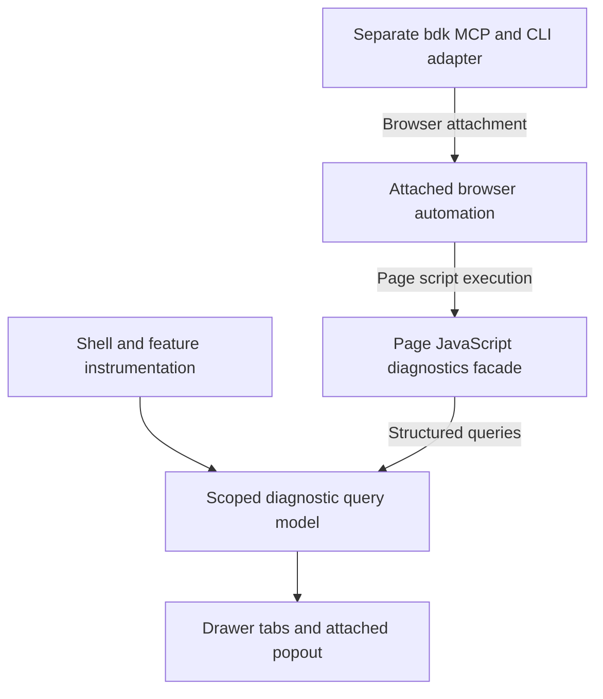

Discovery must identify the application, build/worktree where available, active browser/session, runtime and interactive root. An agent can obtain page details, routes, navigation, available declared components, data/state summaries and measurements with source and freshness information.

Provide versioned capability/schema discovery and structured, filterable, paged queries with stable diagnostic identities. Unsupported capabilities and errors must be explicit. Source-code identifiers can be opt-in hints; source files need not be served to the browser.

### Browser JavaScript diagnostics bridge

The host enables the documented JavaScript diagnostics facade separately from the drawer and popout, subject to the inspection policy for the environment. An attached browser agent with page-script execution capability can discover and query it in the originating tab, including while the drawer is closed.

The facade exposes asynchronous, versioned operations for capability discovery, current page/module/route/navigation information, declared state/data summaries, feature instrumentation and bounded recordings. Requests and responses use serializable structured data; filtering, paging, size limits and unsupported/not-ready/error results are explicit. Exact JavaScript names and signatures belong to API design.

The facade is an adapter over the same headless diagnostic query model used by the drawer and panels. It remains available while the drawer is closed and does not depend on UI components being mounted. It must not expose arbitrary .NET method invocation, application-service resolution or mutable internal state.

Semantic inspection identifies a particular action binding in its live scope and reports the same current availability/disabled reason seen by the UI, with freshness/version and redaction applied. Tests and agents can correlate an invocation with its execution outcome using these stable references. Business-action invocation remains separate: ordinary UI interactions use the normal pipeline; any separately enabled automation adapter must use that same resolution, applicability, confirmation and execution path rather than invoking arbitrary feature methods.

For WASM it queries the attached browser runtime; for Interactive Server it uses an explicit connection to the originating circuit/session. Mixed pages identify and expose reachable interactive roots separately, with capabilities and measurements attributed to their source. An unavailable or disconnected root is reported rather than replaced with another session's data.

The feature includes and validates the browser facade with an attached browser adapter. A bdk MCP or CLI integration can use that adapter to query the selected page and is a separate deliverable. The browser adapter must support script execution in the attached page.

Diagnostic queries retain host and session access rules, bounded execution and redaction. The host can enable the drawer independently of the browser facade. Read-only inspection and optional capture controls remain separate from business actions.

Before/after performance investigations must support bounded recordings labeled with scenario, build, sample count and measurement coverage. Recording controls are distinct from read-only inspection. Business actions continue through normal application interactions and their authorization.

Outside development, interactive inspection, capture and agent access start disabled. Production use requires explicit host enablement and an access policy for the investigator, selected session and exposed capabilities. Enforce the policy at each diagnostic source or bridge before returning data or starting capture. Drawer, popout and browser queries expose only authorized sessions and reachable roots, with redaction and bounds applied before exposure. On access revocation, stop affected capture and close or clear the exposed inspection views. Use existing host access policies or a host-provided support access integration. Diagnostic-specific roles are optional. Anonymous development remains supported within its configured session access rules.

## Developer experience and compatibility

Deliver starters for the supported hosting arrangements, examples of ordinary modules and deep links, customization recipes, data-component examples and diagnostic instrumentation examples. The default path should minimize repeated registrations and naming ceremony.

Consumer-facing shell contracts remain proposed/preview until the complete applicable evidence is available. TaskFiesta provides executable evidence for refining those contracts. Acceptance scenarios defines the release evidence, and Enterprise readiness defines the published compatibility surface.

Public examples must show both the default application and substantial customization using supported contracts. A developer must be able to identify the owner of a page, navigation item or service registration through diagnostics.

### Out-of-the-box greenfield starter

Deliver the starter through the standard .NET template workflow, building on the existing DevKit templates. After the documented SDK and package prerequisites, a newly generated application runs without a database, identity provider or other external application service. Its default profile is Interactive Server with prerendering disabled. It includes the shell and one small demonstration module using local demo data. Database and authentication integrations are explicit additions with documented setup.

Also supply an explicitly selectable public website starter/profile using the same public composition APIs and module packaging. It demonstrates a server-rendered public page, native navigation/form behavior and a bounded prerendered Interactive Server area using local data. The profile documents which contributions are static-compatible and requires no bespoke host rendering infrastructure. The template's exact selection syntax follows the ordinary DevKit template design rather than being invented here.

The public starter consumes the [reusable hosting and startup support](#reusable-hosting-and-startup-support) through its ordinary profile entry. It emits the small inspectable native root wiring an app must own, while packaged framework services/renderers own the shared behavior. Do not put the only working lifecycle/handoff implementation into generated app source or require applications to copy it from TaskFiesta.

The demonstration module uses ordinary Razor components and public framework APIs to show a page, navigation and contextual actions. Include a few focused tests demonstrating module registration and action behavior, runnable through normal `dotnet test`. Developers can extend the module and its tests as they build their application. The starter must not require a separate command runner or testing system.

Document the complete path from a generated application to adding a page, binding local and external actions, and creating a distributable module. Record the actual template names, options, commands and expected results once validated. Do not assume new switches exist in the current DevKit templates. A clean first-run check and the included tests form part of starter acceptance. Demonstration data and optional protected profiles remain separate from existing protected backend endpoints.

### Independent module tests

Module authors can test composition and action behavior without running TaskFiesta or provisioning backend infrastructure. Start with existing xUnit, Shouldly, NSubstitute and .NET DI patterns, focused examples and a minimal test host using public framework APIs. Fake feature services can supply data and outcomes while the tests exercise real registration, ownership and action binding behavior.

Keep the test host limited to the composition or component behavior under test. Full browser and application checks continue to verify the relevant integration flows. Extract optional shared fixtures or helpers only when real module tests demonstrate repeated setup. A dedicated module-testing package, custom testing DSL and mandatory alternative testing framework are not requirements of this feature.

### Publishing and consuming a module

A distributable module documents its public registration entry point and stable identity, required and optional dependencies, supported runtimes, exposed options, resources and asset setup. Published extension handles and customization points identify the contracts consumers can use. Reuse project and NuGet metadata plus the typed registration contracts; a separate manifest system is not required.

Before a module is ready to publish, validate its actual packed `.nupkg` in a clean consuming application. Use a local package source and ordinary `dotnet pack`, restore, build, test and publish commands as applicable. The consumer uses public APIs and packaged assets, with no source-project reference to the module or access to its internals.

Verify registration, page discovery, resources, asset delivery and the module's declared hosting profiles. Include the applicable browser publishing and trimming checks. Source-project tests remain useful but do not replace this package check. Record the package version, tested host/profile and observed results so a module author can reproduce the failure or pass.

### Reuse and developer-experience evidence

TaskFiesta and its small technical test/consumer hosts supply complete framework validation. The application itself has one `CoreModule`. A clean, independently composed consumer installs its actual packed portable presentation-module artifact with different branding/layout and feature-service registration. Both consumers exercise customization and a package upgrade without source copies. Cross-module checks use a tiny external fixture module only in the dedicated test host. DoFiesta remains unchanged; ShopFiesta is implemented after framework readiness.

The shared module must work in TaskFiesta and the clean consumer without editing framework internals. Record public setup, required files, host overrides and the actual package version. Changing hosting mode inside the same application does not establish independent-consumer reuse.

A developer unfamiliar with the framework internals must be able to follow the public documentation to add an ordinary page, bind a local action, place that action in an external toolbar and consume a reusable module. Record the required files, registrations, framework-specific concepts and any need for undocumented knowledge. Compare the integration effort with the corresponding ordinary Blazor workflow, accounting for the behavior the framework supplies. Use the findings to simplify preview APIs before stabilization; do not claim unmeasured productivity gains.

The developer workflow retains normal .NET build, test and debugging tools and the supported Blazor development loop. Existing DevKit tooling may offer conveniences. Creating an application, authoring a local page and diagnosing a registration error must not require a framework-specific command runner or inspection of internal registries.

### TaskFiesta validation application

TaskFiesta is the new reference application developed alongside the framework. Its one `CoreModule` owns tasks, lists, sharing and application settings. [Appendix A](#appendix-a-taskfiesta-validation-application) defines the data, native routes, wireframes and complete requirement-to-case map. Its domain remains small while the runnable profiles cover the whole feature.

| Evidence owner | Responsibility |
| --- | --- |
| TaskFiesta | Public and connected task/list flows, state, forms, actions, diagnostics, identity, runtime and operational behavior. |
| Dedicated technical composition host | Cross-module contracts, disabled/invalid composition and optional-package isolation using CoreModule and a tiny external fixture module. |
| Headless technical host | Core shell packages with a plain Razor renderer, no direct/transitive MudBlazor dependency, working navigation/action invocation and renderer replacement. |
| Clean independent package consumer | Actual packed portable module and framework packages, own composition/branding/services, native asset delivery and a supported upgrade without source copies. |

Every acceptance result names its evidence owner and actual runtime/profile. None of these hosts adds a second business module to normal TaskFiesta. Shared portable application contracts may use only the dependencies declared for the tested host; a MudBlazor-dependent feature UI package is not part of the headless fixture.

DoFiesta is unchanged and supplies no framework acceptance evidence. Its existing naming and visual design remain references. No implementation task, API migration, new route, package consumption check or new test profile in this specification applies to DoFiesta.

### Deferred ShopFiesta consumer

ShopFiesta is implemented only after the complete framework has been validated with TaskFiesta and the technical/package-consumer hosts. Its single [application specification](spec-shopfiesta.md) defines the complete customer/staff experience and backend commerce/showcase design. ShopFiesta consumes the resulting public APIs and packages; no commerce page, module or provider is required for framework completion.

### Validation and evidence requirements

This is one specification for the complete presentation framework feature. It does not define delivery phases, staged subsets, task order or implementation milestones. A later implementation plan can choose phases and tasks without reducing these requirements. Runtime lifecycle phases and alternative hosting/test profiles describe behavior, not delivery sequencing.

TaskFiesta is the compact executable validation app developed alongside the framework. Its minimal domain must cover the complete feature. The coverage areas below are unordered labels for organizing evidence, not stages or gates. Every applicable requirement must pass before the framework is considered ready; ShopFiesta starts afterward.

| Coverage area | Runnable evidence | Contracts validated |
| --- | --- | --- |
| Behavior | TaskFiesta's task/list CRUD, two independent task views, external toolbar, confirmations, state, validation, dirty edits, partial/unknown outcomes and backend-owned work observation. Real Server feature clients dispatch Requester to bounded fixture Application handlers. | Composition, ownership/routes, actions/scopes, data adapters, state, forms, feedback, navigation and cleanup. |
| Reuse | Independent module tests, ordinary starter use, actual packed module consumption in TaskFiesta and a clean host, plain Razor and MudBlazor renderers, supported browser publication and a package upgrade. | Public registration/components/resources/assets, headless boundaries, conventions/discovery/generation, native integration and developer setup. |
| Hosting | Server, Web App WASM, standalone WASM, Auto, mixed pages/roots, Static SSR/public forms and explicit prerender/handoff arrangements. Browser modes use real HTTP clients, Server uses Requester directly. | Runtime-specific access, legal boundaries, context/lifetime, native form fallback, transfer isolation and phase-attributed diagnostics. |
| Quality | Identity/workspace transitions, denied routes/actions, proxy/reconnect/rollout, diagnostic drawer/popout/facade, redaction, telemetry, localization, accessibility, performance and consumer compatibility. | Complete operational, security, recovery, styling, publishing and quality requirements for all supported combinations. |

Each case records the actual runnable profile, commands, tested build, result and concrete public API/behavior contracts exercised. Automate repeatable composition, route, scope, selection and stale-result checks; use browser checks for interaction and recorded human checks where appropriate. Keep execution records outside this specification. Missing/unavailable evidence remains unresolved, and a changed contract requires rechecking affected evidence. Images and diagrams do not establish a runtime pass.

### TaskFiesta task/list evidence

Use the [task/list and sharing workflows](#a3-lists-tasks-and-public-sharing) and [runnable arrangements](#a5-composition-rendering-and-controlled-outcomes) in Appendix A instead of adding task-list features to DoFiesta. TaskFiesta's native `/tasks`, `/lists`, comparison, detail and preferences routes are the named reference surfaces in acceptance scenarios.

TF-02/TF-04 prove bounded dynamic list navigation, stable task URLs after a move and targeted membership/count invalidation. TF-08/TF-09 prove two independent task-view scopes, explicitly attached external actions and guarded invocation. TF-03/TF-10/TF-11 prove save revisions, partial outcomes and refresh failure after a confirmed mutation. TF-12 observes controlled backend-owned work without claiming real Queueing or durable job execution.

Cross-module attachment and replacement run only in the dedicated composition harness under TF-14. The separate headless host and actual NuGet consumer supply TF-15/TF-22 evidence. Public SSR, read-only sharing and native forms use TF-05/TF-06/TF-16. These links identify executable obligations, not passing results.

### Ordinary developer workflow

| Task | Developer supplies | Framework handles |
| --- | --- | --- |
| Add a presentation module | A module implementation and its contributions. | Type-derived default module name, source provenance and composition validation. |
| Add a page | An ordinary Razor component, route and optional navigation contribution. Explicit ownership mapping is needed when the page assembly's default is insufficient. | Resolve module ownership, integrate server and interactive page discovery, apply route availability, and preserve normal layout and deep-link behavior. |
| Add contextual actions | Typed context, callbacks and applicable availability rules. | Live binding identity, shared pending/busy state, invocation checks and lifecycle cleanup. |
| Show actions outside a component | Explicit attachment to the intended scope/outlet; active-source selection where needed. | Rendering and observation of the original bindings. |
| React to state changes | Relevant dependencies or explicit invalidation. | Subscription ownership, targeted reevaluation and stale-result rejection. |
| Package reusable behavior | A published typed contract, stable attachment target and a provider where useful. | Consistent registration, ordering, supported overrides and diagnostics. |

A handwritten Orders page can use ordinary Razor, injected services and a small typed action declaration. It must not require a framework page base class, provider class, mediator request, manually assigned execution IDs or separate duplicate registration for each button. Optional data components provide adapters through this same model.

Binding conveniences manage subscriptions, cancellation signals and disposal while preserving explicit context ownership. Disposing bindings releases their own resources without manually disposing DI-owned shared services. Ordinary local callbacks and templates remain first-class; provider contracts serve reusable or asynchronous contribution logic.

Publishing is deliberate. Routine local action identities are derived; stable public definitions and attachment targets are declared when another package must attach, reference or override them. More explicit configuration is appropriate for multiple exported component scopes, longer-lived execution and cross-runtime coordination. The simple path must not require that advanced configuration.

Examples must demonstrate a default local toolbar and an externally placed toolbar using the same action bindings, including two independent component instances. The module/navigation declarations are written once per applicable composition; ordinary pages do not repeat global host registration.

## Minimal Orders module walkthrough

This developer-experience example combines an ordinary Orders list and detail destination with an Approve extension. The read-only list/detail path works without CRUD packages, authentication integration or a mandatory framework page base. Approval is feature-supplied behavior. The screens are illustrative mockups, not an implemented application or finalized visual design; file names and routes illustrate ownership rather than public API signatures.

[The later ShopFiesta application specification](spec-shopfiesta.md) expands these contracts into a customer-facing e-commerce shop with a protected order-operations area, proposed public API usage and future executable checks.

### Module contribution and runtime registration

The host selects Orders once per applicable runtime composition. Its presentation contribution declares the page assembly, an Orders navigation entry, browser-safe frontend services and applicable resources. On Server it extends the existing module; WASM consumes the portable presentation definition without executing backend setup. Adapters preserve one logical module identity and do not require a second identity constant.

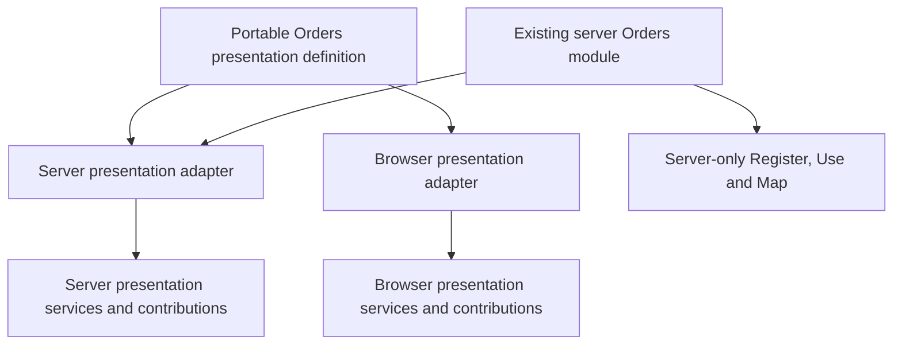

The two presentation paths execute in their respective runtime/container; the diagram does not imply shared service instances, selection or action bindings. Auto uses the appropriate path for the selected runtime. Resources may remain application-, module- or component-owned.

| Developer-owned part | Responsibility |
| --- | --- |
| Orders presentation contribution | Declare pages, navigation, frontend services and resource references once per applicable composition. |
| Orders.razor | Display/query the list and own its local filter/selection behavior. |
| OrderDetails.razor | Load the route-selected order and own its detail context and actions. |
| Orders feature access and DTOs | Reuse suitable feature service contracts with direct Requester access on Server and typed HTTP access in WASM. Keep repositories behind application use cases; add no wrapper solely for shell participation. |

### Orders list screen


The list at /orders shows 1042 and 1043 selected. Approve targets those two records; Edit is disabled with a reason because it requires one selection. The action toolbar is above and outside the bordered list component. Refresh is explicitly connected to this list's query/consumer. Local filtering is part of this screen and does not imply global search.

A handwritten Razor implementation owns its data-loading code, columns, templates and query meaning. Optional grid/FilterModel adapters can supply paging/query lifecycle and selection integration; displaying a table does not make those packages mandatory. The shell supplies layout/action integration and standard presentation conventions. Local selection can remain component state.

### Declare Approve and bind the external toolbar

| Orders supplies | Framework handles |
| --- | --- |
| Typed selected IDs, relevant status/capability values and context revision. | Bind to the owning instance and derive routine runtime identities. |
| Explicit selection/context updates and declared availability dependencies. | Reevaluate affected action state and reject stale evaluations. |
| Feature-defined eligibility and confirmation content. | Capture immutable inputs, suppress duplicate invocation and recheck after confirmation. |
| An awaited approval callback using the Orders client. | Observe execution, share busy state across presenters and manage binding cleanup. |
| Known result updates or targeted invalidation; uncertainty/partial-result recovery. | Consistent feedback presentation with one owner and accurate outcome reporting. |

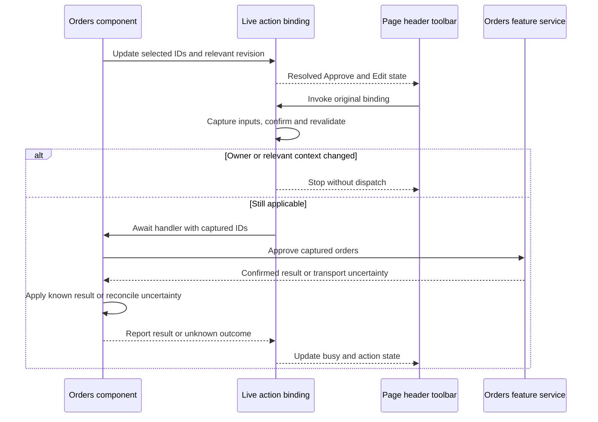

The default placement can be a local toolbar. Moving the same actions to the page header changes only the outlet attachment: definitions, callbacks, captured targets and execution state remain the same. A second Orders component has a separate context/binding; selecting which source supplies the header is explicit. Focusing the header/menu never silently changes that source.

Selection changes update the declared context; the framework does not discover changes by inspecting arbitrary mutable fields. A direct client call is sufficient, with Requester optional. Successful mutation and a later refresh/subscriber failure remain separate outcomes under the existing feedback rules.

### Detail screen from a direct URL

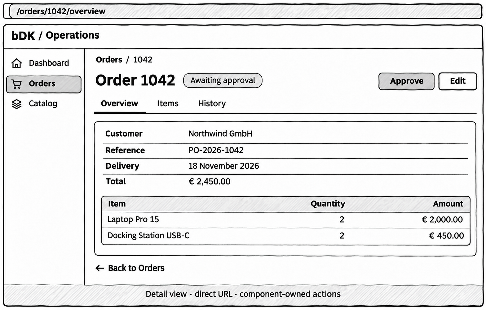

Opening /orders/1042/overview loads order 1042 from the route without first mounting the list or clicking its menu entry. Overview, Items and History use the example's route-backed tab policy. The detail component supplies its own Approve/Edit bindings, displayed above its content by the page frame. Its target does not depend on the list's earlier selection.

Edit invokes the feature's edit workflow; the read-only detail example does not require a generic editor. Adding editing introduces feature-owned validation, submitted edit revisions and the optional page-owned unsaved-change helper. Returning to the list uses its declared view-restoration policy; selection is transient by default.

### Developer experience acceptance

The example must be implementable with ordinary Razor, injected clients and small typed action declarations. It must not require a provider class for local callbacks, a mediator request for each button, a framework page base, manually assigned execution IDs or repeated global host registrations in pages. Binding conveniences own their subscriptions/cancellation/disposal while respecting DI-owned service lifetimes. The screens and diagrams are acceptance references; they do not prescribe internal implementation.

The same scenario must demonstrate local and external toolbar placement, direct detail loading, two independent Orders instances and disposal during an in-flight action. Existing confirmation, unknown-outcome, batch-result and save-revision acceptance rules continue to apply.

## Acceptance scenarios

TaskFiesta and its explicitly named technical/package-consumer hosts cover every requirement in the [appendix coverage table](#a7-complete-framework-feature-coverage). The reference column names TaskFiesta surfaces and runnable arrangements; it never assigns work to DoFiesta. The fictional Orders walkthrough illustrates the same contracts in another domain and does not make ShopFiesta a dependency.

AppState-dependent scenarios below are framework integration gates over the [delivered AppState implementation](#appstate-implementation-status). Reuse its APIs and existing regression suite. Implement the remaining owners, adapters and consumer behavior identified in [remaining AppState integration work](#remaining-appstate-integration-work), rather than repeat the standalone state changes.

| Validation category | Required evidence |
| --- | --- |
| Framework MVP evidence | Verify the complete TaskFiesta coverage map and all supported arrangements through actual public contracts. The small app domain does not reduce framework scope. |
| Complete feature evidence | Verify every applicable acceptance requirement, including enterprise behavior, accessibility, public hosting, diagnostics, packaging and consumer upgrades. Record actual contract coverage and unresolved limitations. |
| Optional configurations | Verify enabled optional packages and their removed/disabled fallback or isolation. Optional installation is a configuration choice, not an implementation phase. Features outside this specification retain their explicit scope boundary. |

| Scenario | Observable acceptance | TaskFiesta surface or technical evidence owner |
| --- | --- | --- |
| Minimal application | The shell starts with a single presentation module, no auth integration and no higher-level packages. | Anonymous / core-only profile |
| Out-of-the-box starter | Generate the documented starter and run it with local demo data, no database or identity provider, and no other external application service. Interactive Server uses prerendering off. Included registration and action tests pass through normal `dotnet test`. | Generated starter and Behavior |
| Independent module testing | A module author uses the supplied examples and minimal host with standard .NET test tools to verify public composition and action behavior independently of TaskFiesta and backend infrastructure. Shared helpers remain optional and evidence-driven. | Module test examples and Behavior |
| Module composition | Registering an enabled module exposes its pages, routes, resources and contributions; suppression removes the intended capability with clear diagnostics. | Shell and extension profile |
| Single-host composition | One application host composes frontend and backend capabilities along the same logical module boundaries. Two feature modules integrate through published contracts without accessing each other's private state or implementation. Feature availability uses that host's configuration and existing services, with a safe browser projection only where needed. | Technical composition harness, Server and WASM profiles |
| Page ownership and route enforcement | An assembly default and explicit page mappings resolve ownership without duplicate URL declarations. Reject ambiguous ownership. Disabling one module in a shared assembly makes its destinations unavailable on full loads and interactive navigation before page initialization or protected reads. | Shell and extension profile, Hosting profiles and developer validation |
| Existing server module | A backend presentation module adds UI capabilities without duplicating module identity or executing server setup in WASM. | Server and WASM profiles |
| Composition validation | Duplicate identities/routes, missing required dependencies and cycles produce actionable startup diagnostics; optional dependencies follow declared fallbacks. | Developer validation profiles |
| Conventions and discovery | Selected modules and declared page assemblies supply unambiguous defaults without repeated per-page registration. Unselected modules remain absent. Explicit overrides take precedence and diagnostics identify each registration's source. | Starter and developer validation profiles |
| Generated registration, when supplied | Generated and explicit declarations follow the same composition rules without duplicate contributions. Host overrides remain effective, diagnostics are actionable and browser output passes the supported publishing checks without backend dependencies. | Applicable generator and WASM profiles |
| Deep linking | Bookmarking, refresh and back/forward reconstruct record pages and route-backed tabs without previous navigation clicks. | Lists and Task detail |
| Cross-module destination links | Typed destination helpers generate correctly encoded route and query values under the configured application base path while preserving published module routes. Absent optional targets are hidden by default or explicitly disabled with a reason. Missing required targets fail startup validation. | Lists, Task detail and developer validation |
| Required feature availability | Known configuration resolves directly. A delayed or failed required check keeps only dependent activation and actions pending or unavailable with bounded recovery. Unrelated features remain usable, obsolete identity or workspace results are rejected, and backend authorization remains authoritative. | Identity profiles and developer validation |
| Navigation customization | One hierarchy appears across sidebar, header and page tabs; replacing a renderer preserves availability and action behavior. | Lists, task-detail header and tabs, and Plain Razor profile |
| Dynamic navigation | Callbacks generate order/category children with contextual parent, route and state inputs; static and dynamic children coexist with stable identities, bounded loading and isolated failures. | Lists |
| Relevant state subscriptions | Use the existing `Subscribe` API in framework bindings. A selected state value change refreshes subscribed components/pages/navigation; unrelated changes do not, subscriptions dispose safely and stale work is discarded. | Existing AppState regressions; Lists integration |
| Dynamic deep links | Opening a generated order/category URL resolves directly without first loading or expanding the navigation tree. | Lists and Task detail |
| Headless composition | A dedicated core-only technical host builds/publishes without direct or transitive MudBlazor packages or assemblies. A plain Razor renderer runs navigation and one framework-bound action; replacing its navigation/action presenter preserves availability and guarded invocation. Record package-graph and publish-artifact checks, not only source imports. | Headless technical host, TF-15 |
| Mixed hosting | Standalone WASM, Interactive Server, Web App WASM/Auto, mixed pages and independent mixed-mode areas satisfy the hosting matrix, with correct service placement and explicit coordination. | Hosting profiles |
| Prerendering | Explicitly opted-in full loads avoid unintended duplicate writes/queries/subscriptions, restore approved data and activate browser services safely; cold/warm Auto and interactive routing are tested separately. | Prerendering profiles |
| Optional identity | Anonymous, mixed and protected applications behave correctly; missing auth never grants protected capabilities. | Identity profiles |
| Context and privacy | User/context changes invalidate old bindings, request cancellation/supersede stale work, partition private state/preferences and reject previous-context completion. No backend rollback is implied. | Identity profiles · two-user transition |
| Localization | App, module and component resources coexist; culture changes update contribution text and formatting with documented fallback. | Preferences and Lists |
| Styling and packaging | The reference theme, a host-added theme and utility styling coexist; a consuming application uses compiled assets without a mandatory JS build. | MudBlazor consumer and Preferences for assets and themes, Plain Razor profile for dependencies |
| Module asset setup | Installing a module supplies its own styles and scripts through native packaging and imports without per-module host-page edits. Global renderer dependencies are explicit and configured once. A clean package consumer resolves the declared assets. | Packaged module consumer and Reuse |
| JavaScript owner cleanup | Repeated mounting and disposal leave only current listeners, observers, timers and interop references. Late callbacks cannot update disposed owners. Two component instances retain separate mutable context, and cleanup follows native patterns even when Server interop is disconnected. | Developer validation profiles and Reuse |
| Data composition | A MudBlazor grid and handwritten view share FilterModel query and selection adapters and drive the same contextual actions. TaskFiesta demonstrates editing and validation through runtime-specific feature access. | All tasks |
| Selection adapter defaults | Selection survives paging by default and clears when the view enables clear-on-paging. Filters or search clear selection. Sorting preserves it. Refresh updates selected target data and eligibility, removing only confirmed deleted or inaccessible records. A selected count and clear control expose off-page selection. Query-wide select-all remains deferred. | All tasks and Compare lists |
| Mutation and refresh | A confirmed save remains successful if refresh or a local subscriber fails; input survives a concurrency conflict. | Task detail and developer validation |
| Form field error mapping | Matching property paths map validation errors to fields, explicit aliases handle different names, and unmatched or model-level errors appear in the summary. Native Blazor and MudBlazor integrations apply the same behavior to Server and HTTP outcomes. | Task detail and developer validation |
| Validation revision safety | Reject an earlier submission after the user changes its values. Preserve current input and show the earlier rejection in the summary, with no stale field errors on the current revision. An older response cannot replace newer submission feedback. | Task detail and developer validation |
| Coordination | Requester/Notifier use correct lifetimes, execution semantics and targeted invalidation within the owning runtime. | Lists and Task detail |
| Failure containment | A failed optional contribution or initialization leaves unrelated features usable; recovery does not duplicate mutations. | Lists and developer validation |
| Unsaved changes | An opted-in page prompts on supported navigation paths without requiring global draft/save orchestration. | Task detail |
| Diagnostics | The shipped drawer and attached popout inspect the originating session under the same access and redaction rules. Failed popout attachment leaves the in-page drawer available. Navigation and measurements show context, source and coverage. | Developer diagnostics |
| Agent discovery | With the facade explicitly enabled and the drawer closed, an attached browser adapter retrieves source-attributed page and feature diagnostics for the originating tab. Drawer-only configuration leaves the facade disabled. | Developer diagnostics |
| Non-development behavior | Interactive inspection, capture and bridges are disabled by default. Explicit production opt-in allows authorized investigation within the selected session and capabilities. Unapproved sessions and revoked access are denied. The facade requires separate enablement, and returned data is bounded and redacted. | Non-development profile |
| Accessibility and responsiveness | Default layouts remain usable by keyboard at supported widths. Icon-only, text-only and combined action placements preserve accessible names and observe the same binding in the toolbar and overflow. | Lists and Compare lists |
| Optional features | Removing the included optional query/selection adapters or omitting the separate MudBlazor renderer leaves a valid configured core host with an explicit native renderer. Required missing renderers fail composition clearly. Optional fixture providers fail only within their declared region; inbox/admin packages outside this specification are not required. | TaskFiesta core-only profile and technical hosts, TF-01/TF-14/TF-15 |
| Orders navigation walkthrough | Expanding Orders produces stable data-derived children; a confirmed mutation updates relevant membership/counts, while direct detail links and unrelated state changes behave independently. | Lists and Plain Razor profile |
| Refresh policy | Declared dependencies trigger targeted reactions; unchanged selectors, persistence completion and diagnostics cause no business reload. Inactive views become stale, explicit invalidation is coalesced and unsaved edits remain page-owned. | Lists |
| Cross-package typed contribution | A customer module contributes navigation children or toolbar actions through another module's published contract/target, with source ownership inferred and no shell-source edits. | Shell and extension profile · Show overdue |
| Contract and attachment validation | Typed registrations constrain compatibility; missing required targets/contributions, invalid component parameters and cardinality violations produce actionable composition diagnostics. | Developer validation profiles |
| Predictable customization | Add/configure/decorate/replace/disable follow point-specific rules; competing replacements need host resolution and the effective order/provenance is inspectable. | Shell and extension profile |
| Scoped contribution lifecycle | Shared metadata contains no user-specific state or captured scoped services; runtime evaluation uses the correct DI scope and disposes subscriptions with its owner. | Lists and developer validation |
| Consistent contribution diagnostics | Human and agent diagnostics expose point/target identity, source module, effective ordering/override, activation reasons, evaluation status and local errors through the existing model. | Developer diagnostics |
| External contextual toolbar | A published placement composes before its page is mounted. On activation the external toolbar resolves the binding of the explicitly selected scope, invokes the correct behavior, and observes status changes. A local placement can use that same live binding. | Lists and Compare lists |
| Multiple contextual components | Two grids/detail instances retain separate live contexts; explicit activation controls exported actions and moving focus to the toolbar does not lose the source scope. | Lists and Compare lists |
| Toolbar lifecycle and stale clicks | Navigation/disposal removes bindings; obsolete clicks cannot target a newly selected order, and late results cannot update another scope. | Lists and Compare lists |
| Shared action surfaces | A toolbar and menu intentionally using the same binding share busy state, duplicate-invocation prevention and feedback ownership. | Lists and Compare lists |
| Core versus data toolbar behavior | A handwritten component uses the scoped action outlet without CRUD packages. A custom MudBlazor toolbar/menu presents the same binding and preserves availability, pending state and guarded invocation without framework control wrappers. Optional data adapters contribute through the same contracts. | All tasks and Compare lists |
| Toolbar rendering boundaries | A presenter and owner work in their compatible composition or documented in-process arrangement. Generic Server/WASM component invocation is not assumed; unsupported attachment is diagnosed, while application integrations retain invocation safeguards. | Hosting profiles |
| Definition versus binding state | Two Orders components share an action definition but retain independent selection, availability and execution state. A toolbar/menu sharing one binding observes the same execution. | Lists and Compare lists |
| Confirmation target revision | Changing relevant selection, scope or application context during confirmation prevents stale execution and requires a fresh decision; cancelling confirmation performs no mutation. | Lists and Compare lists |
| Pending invocation conflict | Repeated invocation of one binding while confirmation or execution is pending cannot open duplicate prompts or dispatch duplicate operations. Separate bindings follow their own policy and backend concurrency rules. | Lists and Compare lists |
| Modal and local keyboard behavior | An ordinary feature editor uses MudBlazor directly without framework dialog registration or a mandatory action scope. A modal using framework-bound actions owns its local scope. Confirmation callbacks preserve cancellation, captured targets and stale-owner checks; toolbar/menu focus and local shortcuts respect modal/text-input behavior. | Task detail and Compare lists |
| Failed or uncertain save and navigation | Validation/failure/unknown outcome preserves edits and keeps the page active during save-and-leave. Newer edits also prevent automatic leave unless the user explicitly resolves/discards them. | Task detail · Save and leave |
| Restorable view precedence | URL, navigation/scope state, preferences and defaults follow the view's declared precedence; explicit empty filters, data changes and invalid page/tab values recover predictably. | All tasks |
| Navigation during action work | Owner disposal requests cancellation of scope-owned work and rejects stale UI completion without claiming backend rollback. Longer-lived work uses independent services/inputs and its declared recovery policy. | Task detail and Compare lists |
| Semantic disabled reasons and outcomes | Read-only inspection identifies the intended scope/binding, reports the UI's current disabled reason and correlates execution outcomes without dispatching a business action. | Developer diagnostics |
| Save revision safety | Saving revision 7 while editing revision 8 leaves the later edits dirty and intact; an explicit editing lock is an alternative supported policy. | Task detail · Save and leave |
| Batch action outcomes | A partial approval preserves order 1042's confirmed success and presents order 1043's conflict without retrying the complete batch or assuming atomicity. | Compare lists · Move selected |
| Unknown mutation outcome | A lost response after dispatch is distinguished from confirmed cancellation/failure; reconciliation uses original targets/reference where available and no automatic mutation resubmission occurs. | Task detail and developer validation |
| Presenter lifetime | Hiding, moving or disposing a toolbar/menu presenter does not transfer ownership, reset another presenter's busy state or cancel independently owned execution. | Lists and Compare lists |
| Backend export ownership | A returned operation reference confirms export submission, not completion; page disposal detaches observation and backend cancellation/recovery rules remain authoritative. Lost acknowledgement is handled as potentially unknown acceptance. | All tasks · backend export validation profile |
| Defaults and registration ceremony | A local typed callback receives scope identity, shared busy state and safe invocation defaults without manually registering every diagnostic identity or adding a provider class. | All tasks |
| Logical scope versus DI lifetime | Two component action scopes remain distinct even when they share a longer-lived injected service; disposing a binding does not manually dispose a DI-owned shared service. | Lists and Compare lists |
| Mixed page action ownership | A WASM Orders area renders its external toolbar and component together beside an independent Server area; selections, execution and diagnostics retain their originating identities without implicit shared state. | Mixed sibling profile · WASM task view and Server list summary |
| Static public composition | SSR-compatible public Razor/HTML and ordinary links render without authentication; no fully functional static-only MudBlazor shell is assumed. Live actions/providers/subscriptions activate inside compatible interactive areas. | TaskFiesta public home, board and shared-list profiles |
| Ordinary developer workflow | An ordinary Razor page contributes local or explicitly exported typed callbacks without a framework page base, mandatory provider/mediator class or manually assigned runtime IDs; binding conveniences handle cleanup and preserve DI ownership. | All tasks |
| Native platform and low-friction integration | A developer follows public documentation to add a page, local/external action, ordinary editor dialog and local menu/toolbar using normal Blazor components, MudBlazor services and .NET tooling. Ordinary controls, dialogs, menus and toolbars need no framework wrapper, registry, base class or action scope. Record integration effort and remove unnecessary registrations or layers. Specialized pages can use applicable shell services directly. | All tasks and developer-experience evidence |
| Reuse across applications | TaskFiesta and a clean independent host consume the same packed module with different composition/layouts. Host customization and a shared package upgrade work without source copies or framework-internal changes. DoFiesta remains unchanged and ShopFiesta is a later consumer, not a prerequisite. | TaskFiesta and independent consumer |
| Minimal Orders walkthrough | One module supplies an ordinary list/detail and typed Approve callback, with local/external toolbar placement, direct detail URLs and independent component scopes; illustrative screens/diagrams correspond to the declared behavior without mandatory CRUD or mediator infrastructure. | Lists and Task detail |
| Resolved contribution isolation | Resolving a shared definition for one culture, user or component context leaves the source definition and other contexts unchanged, including visibility, badges and generated children. | Identity profiles and Compare lists |
| Temporary contribution cleanup | Repeatedly mounting/disposing page, layout and region owners leaves only current runtime controls/subscriptions; later events do not invoke disposed observers. Presenter detachment preserves independently owned execution. | Compare lists and developer validation |
| Initialization attempt ownership | Concurrent initialization requests for one owner/generation share one attempt; layout remount does not repeat success, failure/cancellation uses explicit retry/reset policy, and anonymous startup does not wait for authentication. Separate runtimes do not share an in-memory completion flag. | Lists and developer validation |
| Execution policy distinction | Duplicate invocation of a pending/running binding causes no queued second mutation. Independent bindings remain independent unless an explicit conflict policy applies; serialization rechecks delayed dispatch, and read supersession does not retarget or replay mutations. | Lists and Compare lists |
| Targeted contribution replacement | Replacing one stable contribution ID preserves unrelated contributors using the same service contract; generic service-type replacement cannot silently remove them. | Shell and extension profile · Show overdue |
| Snapshot safety independent of AppState | Reuse the implemented independent snapshots with AppState enabled or disabled. Action-specific captures and component-local models also preserve independent submitted inputs; later mutation cannot change an accepted invocation. | Existing AppState regressions; Lists and Compare lists integration |
| Host and presentation initialization boundary | Server host startup tasks remain host-owned; shell attempts are owned by their runtime/circuit generation. Browser presentation composition does not import Common.Modules server hosting dependencies. | Server and WASM profiles |
| Runtime-specific feature access | Server dispatches application commands and queries in-process and WASM calls the typed HTTP API. Both paths enforce equivalent validation, identity and permissions. Auto uses its actual runtime's implementation, and browser publishing excludes backend handlers and services. | Server, WASM and Auto profiles |
| AppState runtime and instance isolation | Preserve the delivered ownership and partitioning behavior in framework composition. Two Server circuits cannot inspect or reset each other's state inventories. Independent component instances retain their own declared ownership, disposed registrations disappear, and anonymous persisted preferences restore under stable keys. | Existing AppState regressions; Preferences, Compare lists and identity integration |
| Utility-backed lifecycle and portability | Debounced work is disposed with its owner, observed and dispatched safely, with obsolete completion rejected. Scoped adapters retain correct service lifetimes; any dynamic interception used passes the declared publishing/runtime checks. | Lists |
| Prerendering default | Framework Server, WebAssembly and Auto interactive profiles disable prerendering unless the host explicitly opts in at an effective boundary. Static SSR remains independently selectable. | Prerendering profiles |
| Prerender data handoff and isolation | Approved initial DTOs restore under the correct view/instance/context keys without transferring live bindings or callbacks; two Orders instances remain independent and obsolete context data is rejected. | Prerendering profiles and Compare lists |
| Prerender capability activation | Browser-only services/JS never execute during prerendering; action previews remain inert and live scopes/providers are rebuilt within the correct interactive area. Missing server dependencies produce actionable configuration errors. | Prerendering profiles and Compare lists |
| Prerender lifecycle attribution | Full reload and interactive route tests distinguish owners, readiness and measurement sources. Optional badge/navigation work cannot indefinitely block initial content; browser diagnostics reports not-ready before activation. | Prerendering profiles |
| Auto versus mixed-mode placement | Auto runtime choice is tested independently of mixed pages/sibling areas. No test assumes a running Server component, execution or live state migrates to WASM, and illegal nested modes are rejected. | Hosting profiles |
| Complete reference coverage | Every framework acceptance requirement maps to a documented TaskFiesta case and profile that consumes public APIs and records observable evidence. Each assertion names TaskFiesta, the technical composition/headless host or the independent package consumer as its evidence owner. | TaskFiesta appendix coverage table |
| Task list deep links and mutations | List links survive rename and task detail links survive a move. A confirmed Move refreshes the source and destination, and Complete refreshes the affected list. A stale membership or version is rejected without mutation. | Lists and Task detail |
| Enterprise session transitions | An identity-only destination activates without workspace resolution. Workspace-scoped destinations wait for an authorized workspace. Reauthentication, permission changes, sign-out and workspace transitions pause affected bindings and reject stale work. Public capabilities retain independent readiness. | Identity profiles · protected task and list views |
| Reconnect and operation recovery | Interrupt a dispatched Save, then exercise a surviving circuit and a new runtime. The shell distinguishes reconnect from restart, preserves recoverable edits under their feature policy, and offers reconciliation before further submission. | Production hosting profile and Task detail |
| Consistent outcome presentation | The same Result or client outcome maps to one feedback owner and consistent recovery choices. Confirmed success remains visible after a failed refresh, accepted submission remains distinct from completion, and partial or unknown outcomes remain explicit. | Task detail, Compare lists and Backend export validation profile |
| Production rollout | The documented scaled Server topology serves direct links and recovers from instance replacement. Exercise compatible, unreachable and known incompatible backends. Only a confirmed incompatibility triggers Update required. Affected dispatch pauses and reload respects the feature recovery policy. | Production hosting profiles |
| Operational telemetry | With development inspection disabled, a failed provider or action is attributable to an authorized trace and emits bounded redacted metrics. Optional feature failures stay local. The host can use shell composition and required shared initialization status for its readiness probe. | Production telemetry profile |
| Performance release acceptance | Repeatable TaskFiesta and independent-consumer workloads establish measured baselines and documented limits for supported profiles. Results identify framework and backend coverage, diagnostics state and variability. A reproducible regression beyond those limits blocks stable release. | Behavior, Reuse and production validation in Quality |
| Accessibility baseline | Complete reference flows exercise the WCAG 2.2 AA target with automated and manual checks for keyboard, screen reader, focus, reflow and feedback behavior. | Lists, Task detail, Compare lists and Preferences |
| Consumer upgrade | A consuming app upgrades within the documented compatibility range. Its typed contribution, host configuration, saved preference, direct link, theme override and supported diagnostics query still work. An explicitly breaking upgrade follows the documented migration. | Upgrade validation profile |
| Distributable module package | A clean application installs the actual locally packed NuGet artifact and verifies public registration, pages, resources, assets and declared hosting profiles. Applicable publish/trimming checks pass with no source-project access to the module. | Clean package consumer and Reuse |
| Published module identity | Rename a module's CLR type while retaining its pinned logical name. Server and browser report the same identity, and its exported attachments, configuration references and saved preferences continue to resolve. | Upgrade validation profile |
| Complete validation evidence | Every required case supplies a runnable profile, repeatable checks, results and the concrete contracts validated. Missing evidence prevents a complete validation claim; contract changes trigger the affected checks again. | All coverage areas |

### Public website acceptance

The public profile is a reusable framework capability validated by TaskFiesta's public board/shared lists and a clean independent consumer. These cases apply to the whole feature; they are not an implementation phase. ShopFiesta will consume the profile after framework readiness.

| Scenario | Required evidence | Coverage |
| --- | --- | --- |
| Useful SSR baseline | With JavaScript delayed/disabled, inspect actual initial HTML, head metadata and static navigation/content. Exercise native links, GET forms and a declared feature-owned POST without live scopes or browser .NET startup. Verify ownership, disabled-module access and native validation/antiforgery behavior. | Behavior and Reuse |
| Compatible module rendering | Compose the same packaged module in public/static and connected profiles. Required interactive-only contributions have a declared alternative/unavailable state or actionable configuration failure. Host overrides and source attribution remain effective without silently making all routes interactive. | Behavior and Reuse |
| Reusable host setup | Start a clean independent consumer using the public profile entry, selected packaged modules and the documented native host wiring. Exercise static chrome, compatible forms, read handoff, phase/context handling and optional contribution failure without copied TaskFiesta startup/lifecycle code. Apply a framework package upgrade and verify the shared behavior is still consumed. Record declarations/files needed versus ordinary Blazor and any evidence justifying helpers. | Behavior, Reuse and Quality |
| Interactive enhancement | Exercise legal static/Server boundaries, read-only prerender handoff, delayed activation, route/context switches and cleanup. No callbacks/live owners cross serialization boundaries and no mutation repeats on activation, enhanced-form response or reconnect. | Behavior, Reuse and Hosting |
| Performance and delivery | Record cold/warm mobile workloads, initial-content timing, transferred resources, layout/interaction measures and server/circuit costs. Public baseline requires no WASM runtime, staff bundle or debugger. Optional failures and streaming do not block all useful content. | Behavior, Reuse, Hosting and Quality |
| Public output safety and reuse | Test personal/token-bearing versus shared-public content, cache keys/invalidation, two users and a clean packaged public-profile consumer. Preserve access and context; no private/token output is shared or packaged sample internals copied into the consumer. | Reuse, Hosting and Quality |

## Contract details requiring executable validation

TaskFiesta exercises the complete package boundaries, typed attachment model, state/query behavior, diagnostics, hosting and rendering defaults. Use its mapped cases and the technical/package-consumer hosts to settle these contract details without changing DoFiesta. This table is a validation checklist, not an implementation plan.

| Area | Detail to validate |
| --- | --- |
| Packaging | Choose assembly and NuGet names and placement from the Server, Client and plain Razor dependency checks. |
| Frontend module boundaries | Compose two feature modules through published destinations and extension contracts, preserve ownership across runtime adapters, and validate dependencies without accessing another module's private state or implementation. |
| Starter and test examples | Validate the standard template workflow, first run with local data, included focused tests and the minimal host for independent module tests. |
| Form feedback | Validate property-path and alias mapping through native form mechanisms, summary fallback and submission-revision handling for direct and HTTP outcomes. |
| Assets and interop | Validate native packaged asset resolution, explicit shared dependencies and owner cleanup across repeated mounting and circuit loss. |
| Extension contracts | Sketch focused input and output types and registration signatures for dynamic navigation and the external toolbar using published typed handles. |
| Destinations and availability | Validate link helpers over native routes, base paths, required and optional destination dependencies, and host-supplied feature availability with stale-context rejection. |
| Performance acceptance | Establish repeatable workloads and evidence-based limits from the reference profiles, then validate regression detection before stabilization. |
| Data adapters | Validate typed field and operator mappings, grid event translation, selection and URL or preference behavior in the TaskFiesta task/list workflow. |
| Diagnostics | Validate session and runtime attribution, popout linkage, version discovery, redaction and capture limits. |
| Renderer defaults | Validate semantic token mapping, keyboard and focus behavior, toolbar display modes and overflow at supported widths. |

Inbox details, edit-session coordination, search/command discovery, general shortcut routing, and generic cross-runtime business-action transport remain deferred to separate feature design. A broader operations panel/application-owned workflow capability is not required by the core action-observation contract. The [TaskFiesta appendix](#appendix-a-taskfiesta-validation-application) defines the compact full-feature validation application. The separate [ShopFiesta application specification](spec-shopfiesta.md) preserves the later commerce design. These are design proposals to validate through the evidence requirements, not implemented or stable contracts.

## Appendix A: TaskFiesta validation application

### A.1 Purpose and scope

TaskFiesta is a small task/to-do application planned under `examples/TaskFiesta` and developed alongside the complete presentation framework. It is the framework's executable validation consumer. MVP means minimal domain complexity with complete framework-feature coverage. It does not mean an implementation phase, reduced contract scope or permission to leave supported hosting/quality requirements untested.

This appendix specifies the intended application, not an implemented sample. All images are conceptual wireframes. A later implementation plan defines phases, steps and tasks. ShopFiesta starts after the framework satisfies the complete validation requirements; it is not needed to build or validate TaskFiesta. DoFiesta remains unchanged and is not migrated or used for framework acceptance.

TaskFiesta's tone is playful: polish an invisible trophy, teach a rubber duck to take minutes and water the office cactus politely. The real purpose is to expose framework behavior with a small, understandable domain. No commerce, payment, warehouse, notification-delivery, messaging broker, database or business scheduler is required.

Use a bounded module-owned in-memory fixture backend and real Application commands/queries. Server clients call Requester directly. Browser profiles use real typed HTTP clients to endpoints dispatching those same use cases. Isolated component mocks cannot establish those paths. Read-only requests, diagnostics and fixture polling never advance work or invoke mutations.

### A.2 Single module, data and ownership

| Module | Owned behavior | Public integration |
| --- | --- | --- |
| `CoreModule`, identity `core` | All TaskFiesta task/list data, membership, sharing, public boards, workbench/detail/edit/compare views, settings, encouragement content and operation status. | Task/list destinations, reusable task cards/views, typed action/region targets, native forms, framework appearance/culture components and portable feature contracts. |

TaskFiesta registers exactly one application module in its ordinary public and connected profiles. Tasks, lists, sharing and preferences are features of that module, not separate modules. Encouragement is an ordinary local component. Framework-provided settings components/services can be reused without registering another application module. List membership/deletion checks can be atomic in the minimal backend; layout and audience do not create another identity.

Use `CoreModule`, matching DoFiesta's module-class convention, and register it through the ordinary `WithModule<CoreModule>()` API. Its default logical name is `core`; use that same identity in server and portable presentation definitions, resources, ownership and diagnostics. Task/list/settings labels are feature names, not additional module identities. The name does not introduce a special framework module type.

To validate requirements that inherently need multiple modules, a dedicated technical composition host registers the packaged TaskFiesta module plus a tiny `fixture-extension` test module. That fixture has a dummy destination and typed contribution/assets, no business domain. It exercises cross-module links, ownership, required/optional dependencies, replacement and isolation through public contracts. It is not part of the normal TaskFiesta application. Invalid-composition hosts and the clean package consumer are likewise test infrastructure. The coverage report identifies these locations explicitly.

| Record | Minimum data and rules |
| --- | --- |
| Task item | Stable ID, readable number, title, optional notes/due date, priority, Proposed/Ready/Done status, list ID, owner/workspace context and revision. Title is required. Mutation commands carry the relevant expected revision. |
| Task list | Stable ID, name, slug where public links use it, owner/workspace, revision and explicitly configured public-demo status. Every task belongs to one list. Public demo publication and private link sharing have distinct policies. |
| List share | List ID, opaque read-only link identity/token, owner, revision and enabled/revoked state. Normal share tokens are unguessable; deterministic test fixtures are clearly identified. The server stores/compares them under an explicit policy and does not expose raw tokens through diagnostics. |
| Operation | Stable request/operation reference, authorized owner/query/context, reported Accepted/Running/Completed/Failed/Unknown state, optional progress and result-artifact reference. This is example-owned state, not a new framework operation registry. |

Seed TF-101 `Polish the invisible trophy` and TF-102 `Teach the rubber duck to take minutes` in Office mysteries, TF-103 `Water the office cactus politely` in Tiny victories, and TF-201/TF-202 as Proposed tasks in Inbox. Weekend nonsense is an empty list for deletion tests. Office mysteries and Tiny victories have explicitly public demonstration projections; Inbox remains private. Record IDs are stable GUID fixtures; readable numbers are labels, not route identities.

The pagination test variant adds bounded records for the second page shown in Figure T.2. Figure T.3 uses the small base fixture with counts 2/1/2/0. Its Sharing column describes owner-issued link access; the separately declared public demonstration projection is not inferred from that column or enabled for other private lists.

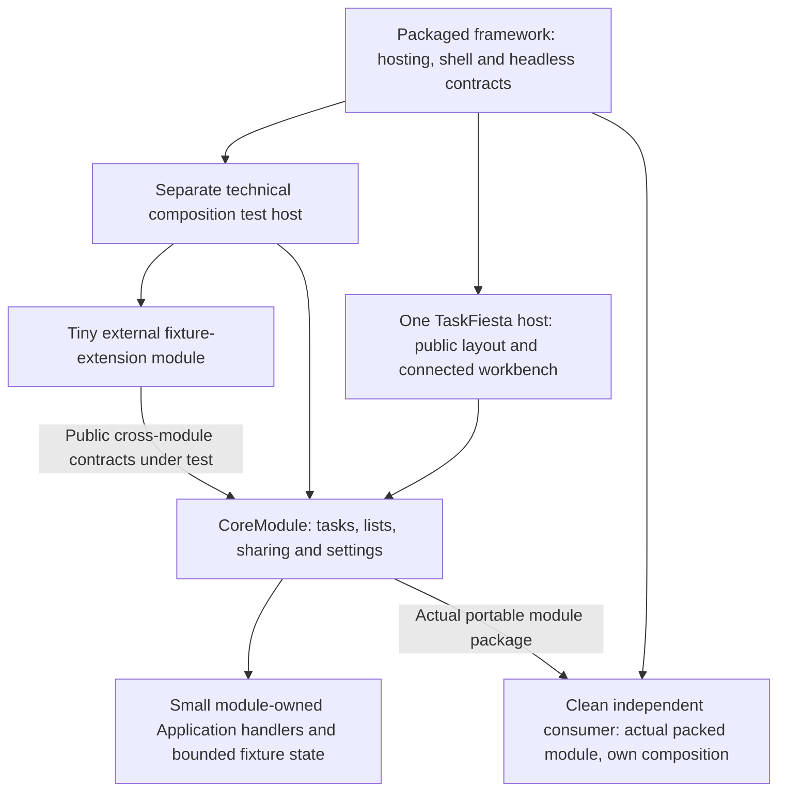

### A.3 Lists, tasks and public sharing

List creation, rename and deletion are real backend commands. A create/rename conflict or validation failure retains the correct draft. Delete only an empty authorized list; a non-empty list returns a clear explanation to move its tasks first. Validate this atomically with membership changes so an arriving task cannot disappear in a delete race. The MVP does not cascade-delete tasks silently.

Tasks support create, edit, complete and delete through captured IDs/revisions and the applicable authorization. Destructive confirmation belongs to the original owner/context. A confirmed deletion removes only the known task and updates its declared list/count consumers; a failed or unknown outcome is not retried automatically and does not clear another task view's selection.

Create a task inside a chosen list, or choose its list in the task form. Move one or several selected tasks through the public Tasks use case. Capture task IDs/versions and destination list ID/revision. Return per-task results if some moves conflict. The task's own detail URL remains stable, while list counts, membership queries and dynamic navigation invalidate only their declared dependencies. A deleted/denied destination cannot receive an old confirmation.

Owners can create/copy a read-only list link, revoke it and issue a replacement. A shared link opens without an account and exposes only the explicitly allowed task/list projection. It grants no editing, completion, moving, export of private data or task/workspace ownership. Public task links retain their list/share context; a task moved out of that list is no longer readable through its old share URL.

| Surface | Native route and expected behavior |
| --- | --- |
| Public home and board | `/` and `/boards/{Slug}` use the public website profile. Render meaningful headings, list/task content, filter/sort/page links and a native Suggest a task form. Suggestions enter the private Inbox as Proposed tasks, not the public board automatically. |
| Shared list | `/shared/lists/{ShareToken}` and an optional task-detail route beneath it render an unlisted read-only projection with server-enforced scope and `noindex` metadata. Revoked/deleted/mismatched links return the declared unavailable response. |
| Lists | `/lists` and `/lists/{ListId:guid}` provide create/rename/delete, add-task, list-bound query state and owner-only sharing controls. The share URL remains selectable/copyable even without a clipboard enhancement. |
| Tasks | `/tasks` and `/tasks/{TaskId:guid}/{View}` provide bounded queries, task detail and route-backed Overview/History views. Edit uses native forms, field feedback, dirty-state prompts and captured revisions. |
| Compare | `/tasks/compare` mounts Ready and Needs review views with independent filter, page, selection and lifetime. An explicit active-view selector binds the external toolbar to one view. |
| Preferences | `/preferences` is owned by `CoreModule` and combines reusable framework appearance/language components and task-display settings with independent saves. |
| Operation status | `/tasks/exports/{OperationId:guid}` observes a submitted matching-query export after leaving the initiating task view. |

The anonymous public baseline and configured identity/workspace profiles are separate runnable configurations. Protected cases use at least two local test identities and two workspace contexts with distinct data. No external identity service or registration flow is required. Authoritative access checks run in both Requester and HTTP paths, including direct links and mutation/status requests.

Revocation stops subsequent reads and live updates; previously delivered HTML cannot be recalled. Shared pages do not use a stale shared-output cache that bypasses revocation. Share tokens, notes, hidden task fields and private identity/workspace data stay out of diagnostic capture. Explicit public-demo content may use the declared safe public cache policy; owner forms and token-bearing/private output do not become shared public output.

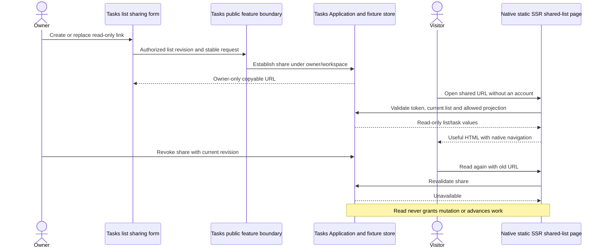

### A.4 Conceptual wireframes

The figures describe UI intent only. Their desktop sketch layout does not establish keyboard, screen-reader, narrow-screen, hosting or performance acceptance. Those require runnable cases below. Exact prompts are retained in [the wireframe prompt log](assets/taskfiesta/wireframes.prompt.md).

#### Visual direction from DoFiesta

TaskFiesta's intended visual design follows the existing DoFiesta Wayfind design language. The monochrome figures remain structural wireframes; their paper palette is not the final application theme. Primary application navigation follows DoFiesta's horizontal top bar with a temporary narrow-screen menu. Any list navigation in the workbench is subordinate content navigation.

| Visual concern | TaskFiesta direction |
| --- | --- |
| Surfaces and rules | Use the current DoFiesta blue-black canvas `#181d27`, secondary surface `#242c39`, deep plate `#0d121a`, light text `#e7edf7`, muted text `#acb7c8` and neutral rules `#465267` as the reference dark palette. Square controls/surfaces, clear hierarchy and restrained separators; avoid decorative gradients or card shadows. |
| Actions and emphasis | Cobalt `#315bf0` for primary actions, amber `#f4c34c` for focused/due-date/numeric emphasis, and semantic feedback colors. Keep focus and status recognizable without relying only on color. |
| Typography and spacing | Chivo Mono with a local/system monospace fallback, compact readable tables/forms, consistent spacing and a desktop content cap around DoFiesta's 1216 px. Responsive reflow and readable zoom take precedence over a fixed desktop arrangement. |
| Interactive renderer | Style MudBlazor through the specified semantic theme/renderer contracts to match this language. Keep native component behavior, forms and accessibility. TaskFiesta branding replaces the DoFiesta wordmark. |
| Public/SSR renderer | Use ordinary Razor/HTML with the same semantic colors, type and spacing. The visual reference does not require an interactive MudBlazor provider, browser .NET startup or a blocking font request for first public content. |
| Theme validation | The reference dark appearance establishes the design direction. Light/system modes, a host theme override and contrast/focus behavior remain required framework tests. Do not copy DoFiesta's hard-coded dark-mode host behavior as a restriction on the framework. |

Current source references are [DoFiesta tokens](../../examples/DoFiesta/DoFiesta.Presentation.Web.Client/wwwroot/styles/tokens.css), [Wayfind component styling](../../examples/DoFiesta/DoFiesta.Presentation.Web.Client/wwwroot/styles/wayfind.css), [MudBlazor theme mapping](../../examples/DoFiesta/DoFiesta.Presentation.Web.Client/Layout/Themes.cs) and [navigation/layout](../../examples/DoFiesta/DoFiesta.Presentation.Web.Client/Layout/MainLayout.razor). Map the selected values into the framework's public semantic tokens and packaged styling. TaskFiesta must not depend on the DoFiesta application project or require copied app-internal runtime code.

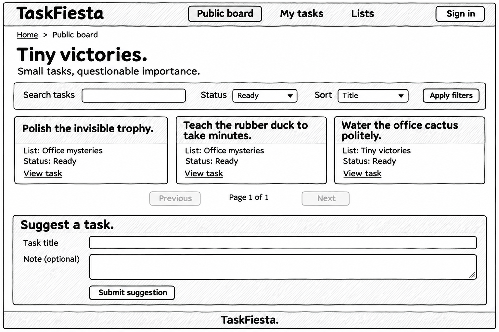

*Figure T.1. The public board presents real task content before interactivity. Its links and native form exercise the reusable public website profile without a required browser .NET runtime.*

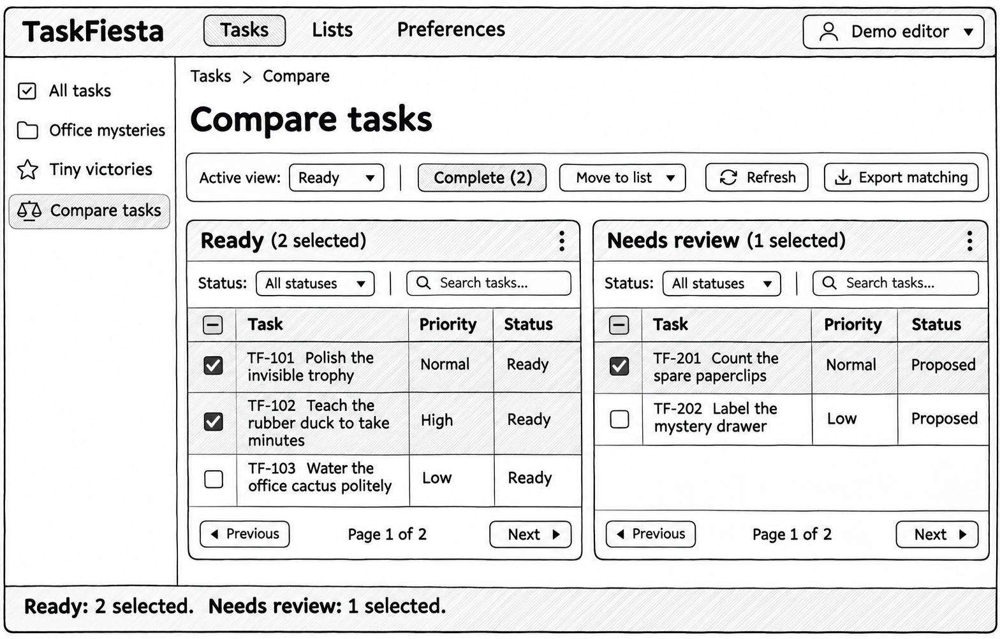

*Figure T.2. Ready has two selected tasks and Needs review has one. Complete (2) targets Ready alone. Each view retains its own query, page, selection, binding and lifetime.*

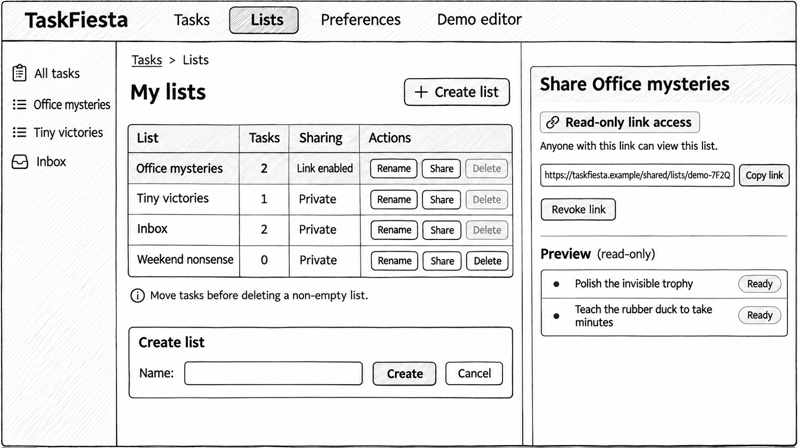

*Figure T.3. Multiple lists have independent identities and counts. A non-empty list requires moving its tasks before deletion. Owner-only controls create/revoke a public read-only link; the shared view has no edit actions.*

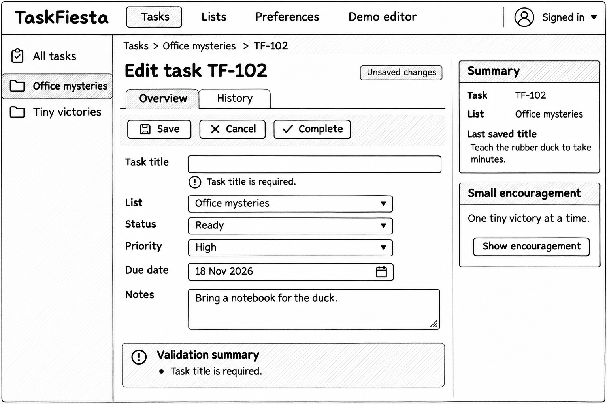

*Figure T.4. An empty title receives native field and summary feedback. The last saved snapshot is separate from the current draft. Encouragement is a local `CoreModule` component, not another application module.*

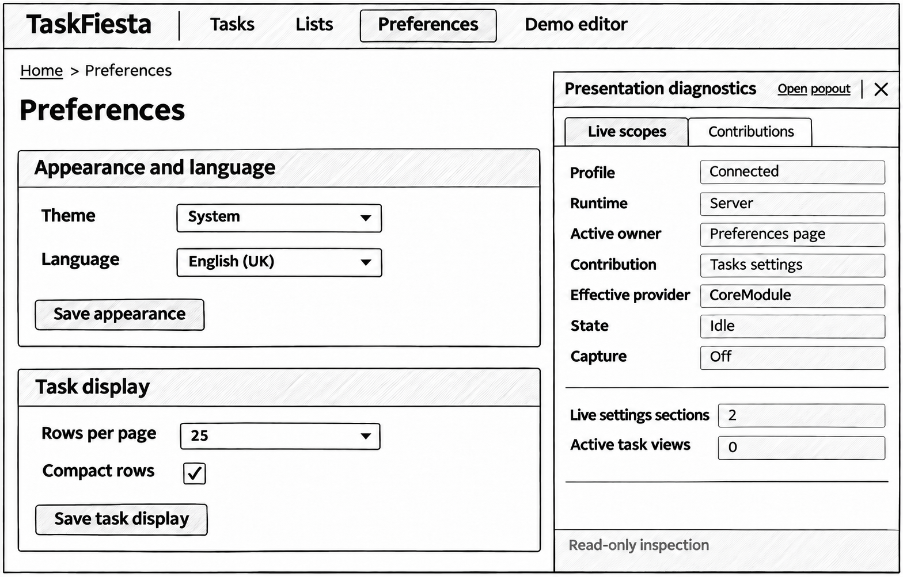

*Figure T.5. Shared settings and Tasks settings save independently. Diagnostics identifies the actual runtime, owner, contribution and effective provider without invoking a task action.*

### A.5 Composition, rendering and controlled outcomes

TaskFiesta consumes the ordinary public hosting/profile registration and the specified module/action APIs. Reuse native routes, layouts, forms, DI, parameters and callbacks. No MVP-specific framework shortcut, private registry hook, extra global store or general HTTP command relay is permitted. Public website and connected workbench behavior must come from the packaged framework integrations being validated.

The public profile serves home, boards and shared lists through Static SSR with native navigation/GET filters/POST suggestion handling. It uses approved read-only data, real head metadata, safe cache boundaries and selective prerender-compatible Server enhancements. Essential public reading/sharing works with JavaScript disabled. A shared read-only page does not need a live action scope or a circuit. Connected task editing, grids, dialogs and external toolbar composition use compatible interactive roots.

| Runnable arrangement | Evidence required without imposing an implementation order |
| --- | --- |
| Minimal/core-only and generated starter | One `CoreModule`, local data and no auth/external service. Also run the ordinary generated starter/tests. Remove optional renderer/data packages without breaking core navigation/actions. |
| External module composition harness | A separate test host combines TaskFiesta's portable `CoreModule` and a tiny fixture module to validate cross-module contracts. This does not add a module to normal TaskFiesta profiles. |
| Interactive Server | Prerender off in the connected profile. Real feature implementations dispatch Requester in process with current circuit identity and operation-appropriate lifetimes. |
| Web App WASM and standalone WASM | Real typed HTTP clients/authorized endpoints for the same Task/list use cases. Browser packages contain no server handler, repository or host-only dependency. |
| Auto | Record actual Server/browser execution on cold/warm visits. Existing instances, pending actions and state do not migrate because a runtime becomes available. |
| Mixed pages and sibling roots | Keep each toolbar with the task owner it invokes. Cross-root coordination is explicit; no callback/RenderFragment or scoped service crosses an incompatible serialization/runtime boundary. |
| Public/static and explicit prerender | Useful initial HTML, native forms, delayed/blocked JS, safe read-state handoff, source attribution and no duplicated initial query/write/subscription. |
| Plain Razor and MudBlazor | A dedicated core-only technical host with a tiny native fixture module builds/publishes without MudBlazor and runs navigation plus a guarded action. Replace its renderer and preserve behavior. TaskFiesta separately exercises the default MudBlazor renderer, public static shell and host styling through the same headless contracts. The headless host does not load TaskFiesta's MudBlazor-dependent feature UI. |
| Identity, faults and operational arrangements | Use controlled identities/workspaces, slow/failing sources, proxy/reconnect/rollout and explicit diagnostic-access settings to validate actual supported behavior. A fixture cannot establish independent-host or production field results. |

The default app requires no external infrastructure. Where an operational arrangement needs multiple hosts, shared technical state/keys or a proxy, provide the appropriate existing test-provider/host configuration and record it explicitly. A process-local fixture pass cannot establish shared-state or restart behavior. These arrangements exercise framework requirements without expanding the task/list business domain.

Example-owned fault controls can hold/release a query, return field errors, advance a revision, deny/revoke access, lose an acknowledgement or dispose an owner during work. Their state changes require explicit test/control operations. Do not hide them in status reads, wall-clock UI timers or diagnostic inspection. They are not additional end-user features or framework orchestration APIs.

For batch Complete/Move, TF-101 can succeed while TF-102 conflicts. A repeated delivery/response cannot repeat the successful mutation. Save feedback belongs to the submitted edit revision. Opening another task during a delayed response cannot update that new task. Selection remains across paging by default with an explicit clear-on-paging option, and query-wide Export matching is separate from selected IDs.

The export fixture establishes a stable operation reference and source-reported progress, with a small controlled CSV artifact. Navigation detaches observation; it does not cancel/restart accepted work. Unknown acknowledgement reconciles the original request. This validates presentation ownership and recovery, not real Queueing, DataPorter or durable job execution.

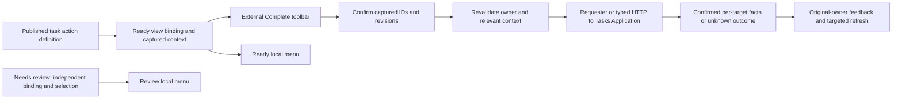

### A.6 Validation cases and observable evidence

Case IDs are evidence references, not phases, milestones or implementation tasks. Every case can have multiple assertions/profiles and must report their individual results. The one-to-one acceptance map in A.7 identifies which cases are responsible for each requirement. Use actual public APIs, handlers, HTTP, files and browser behavior where specified.

| Case | TaskFiesta surface/profile | Observable evidence |
| --- | --- | --- |
| TF-01 Composition and first run | Single-module TaskFiesta, starter and separate valid/invalid composition hosts. | Native pages/resources/routes and clear duplicate/missing/cyclic registration errors; ownership conventions/overrides and single-host module correspondence. Remove optional query/selection adapters in TaskFiesta. The core-only technical host omits the MudBlazor renderer and configures native outlets; required missing outlets/renderers fail composition clearly. Multi-module assertions run in the fixture host. Disabled pages never initialize protected reads. |
| TF-02 Navigation and destinations | Task/list navigation, sidebar/header/detail tabs/direct URLs and the external fixture's optional destination. | One resolved hierarchy drives placements; bounded children/counts, encoded base-path links, unavailable/deleted targets, native history and no unrelated query reload from cosmetic state. Direct task URLs work without opening a list first. Cross-module links run in the composition harness; TF-15 proves renderer replacement. |
| TF-03 Task editing | Task detail and Overview/History routes. | Create/edit/complete/delete, required title, typed server field aliases/summary fallback, dirty-state prompts, correct save revision and late-result rejection. A concurrency rejection preserves current input; feature-owned recovery does not overwrite newer edits. |
| TF-04 Multiple lists | Lists page, list-bound task view and Move action. | Create/rename/delete empty lists, reject non-empty/concurrent deletion, add tasks to a chosen list, partial/conflicting move outcomes, stable task detail links and targeted count/membership updates. |
| TF-05 Read-only sharing | Owner Share controls and anonymous shared-list links. | Copy/revoke/replace link, no-account read, correct membership/projection, no mutation authority, revoked/deleted access denial and no private/token cache or diagnostic leak. |
| TF-06 Public website | Home/public board/shared page with JS delayed/disabled and native Suggest form. | Useful initial HTML/head metadata, native links/GET/POST validation and antiforgery, stable mutation intent, no browser .NET baseline and optional-source isolation. |
| TF-07 Query and selection | Default grid and handwritten task view. | Typed FilterModel fields/operators, search/filter/sort/page URLs, selection retained on paging, explicit clearing, independent headers and distinction between selected IDs and matching-query export. |
| TF-08 Contextual presenters | Compare tasks, active-view selector, default action outlet and handwritten MudBlazor toolbar/menu presenting the same live binding. | Equivalent availability, shared pending state and guarded invocation through the original binding without generic control wrappers. Verify independent sibling selection, explicit toolbar/control placement, overflow and presenter disposal without owner reassignment. |
| TF-09 Invocation and confirmation | Delayed Complete/Move, delete-list/task confirmation through MudBlazor and local keyboard/modal actions. | Direct MudBlazor dialogs without framework wrappers/registration; local editors need no action scope. Framework-bound confirmations preserve captured targets/versions, cancel without mutation, reject stale context/disposed owners and suppress duplicate prompts/dispatch. Explicit execution conflict/serialization policy, captured snapshots even with AppState off and no global shortcuts remain covered. |
| TF-10 Save and navigation | Delayed/failed/unknown saves, refresh/subscriber failures after a confirmed save and dirty edit transitions. | Matching submitted field feedback, preserved input on concurrency rejection, no overwrite of newer edits, accurate partial/failed/unknown outcomes and no automatic replay when a user navigates or reconnects. A confirmed save stays successful when refresh or a local subscriber subsequently fails; retry refresh without replaying the mutation. |
| TF-11 Batch and result mapping | TF-101 success and TF-102 conflict fixture. | Per-target facts survive aggregate feedback/refresh failure; selected/captured identities stay independent of mutable state and repeated observations do not repeat successes. |
| TF-12 Backend-owned operation | Export matching and operation status deep link. | Acceptance differs from completion; leave/revisit, authorize status/artifact reads, unknown acknowledgement and source progress without page-owned execution. |
| TF-13 State, preferences and culture | The `CoreModule` preferences page with reusable framework components and task-display/query settings. | Reuse delivered AppState ownership, partitions and storage-failure handling. Validate instance/runtime/identity/workspace isolation in framework composition, URL precedence, schema/corrupt fallback, targeted AppState/Notifier invalidation, language/theme and independent section saves without another application module. |
| TF-14 Published extensions | Separate composition harness: TaskFiesta's `CoreModule` plus external fixture/default/replaced/suppressed contributions. | Public cross-package context/callback attachment, required/optional target resolution, order/cardinality validation, original/effective provenance, targeted replacement and no retained live state in static registration. Remove the optional fixture contribution/provider or make its declared optional source unavailable; unrelated routes/outlets remain usable. The normal application remains single-module. |
| TF-15 Runtime access and ownership | Server/WASM/standalone/Auto/mixed arrangements and a separate core-only headless host. | Real Requester versus HTTP, circuit-aware Application identity/policy enforcement including short-lived DI scopes, browser-safe graphs and legal runtime boundaries. The headless host proves no direct/transitive/published MudBlazor dependency, working native navigation/action invocation and renderer replacement. Record each applicable assertion below. |
| TF-16 Prerender and activation | Static/prerender/interactive profiles with two task views. | Correct default/opt-in behavior, safe distinct handoff keys, no browser interop before activation, no second transferred-read query and reconstruction/cleanup of live owners. Interactive-only contributions use their declared static alternative/unavailable state or produce an actionable configuration failure; composition never silently escalates the whole public route to interactivity. |
| TF-17 Identity and workspace | Anonymous, owner/editor/viewer, two concurrent circuits and two-workspace arrangements. | Direct-route/action authorization on both transports, safe pending availability, forced revocation/sign-out transitions, private-state partition and no identity-only dependency on workspace readiness. A circuit identity change invalidates pending confirmations and old results; the next Requester dispatch and operation-scope accessor use the updated permitted principal without another circuit's identity. |
| TF-18 Initialization and faults | Slow/failing optional provider, retry/reset and disposal controls. | Owner/generation-specific initialization and cancellation, known/unknown capability states, renderer-safe notification, unrelated content survival and no invented query success. |
| TF-19 Diagnostics and discovery | Drawer, attached popout and separately enabled browser facade. | Same-session/runtime/scope provenance, versioned read schema, the UI's current disabled reason for the intended binding, and correlated execution outcomes. Inspection never invokes a business action. Verify redaction, bounded opt-in capture and production default-off/authorized access. |
| TF-20 Packaged assets and cleanup | RCL resources/styles/JS and repeated mount/navigation. | Base-path-aware assets without per-module host tags; listeners/timers/observers/interop dispose correctly; independent instances and optional-package removal remain correct. |
| TF-21 Native developer path | Starter, handwritten page, isolated module composition/action tests, direct MudBlazor dialog/editor and local menu/toolbar, explicit/discovered registrations and optional generated equivalent. | Normal build/test/debug workflow and minimal independent test hosts using standard .NET tools, few measured declarations, native routing/forms and actionable failures. Ordinary dialogs, menus, toolbars and controls use local callbacks without framework wrappers, registration, base classes or action scopes. Applicable generated/trimming/publish cases use the same public contracts. |
| TF-22 Independent package consumer | Clean host with the actual portable TaskFiesta module NuGet artifact, no source-project references. | Public module resources/actions/settings and compatible hosting, host overrides and a package upgrade with own branding/services. A rebuilt module fixture renames its CLR type while retaining the pinned logical identity; server/browser ownership, exported attachments, configuration and saved preferences still resolve. Runtime variants alone do not count as another application. |
| TF-23 Visual/accessibility behavior | DoFiesta-inspired public/connected styling at wide/narrow/zoom layouts. | Wayfind-aligned semantic/host themes, light/dark/system, localization, keyboard/focus, labels/landmarks, validation announcements, dialog/menu behavior and screen-reader checks under the specified accessibility target. |
| TF-24 Operational quality | Controlled proxy/reconnect, compatible/incompatible deployment, measured workloads and the complete evidence report. | Real recovery/unknown-outcome behavior, version/config compatibility, telemetry and cold/warm mobile resource/content/interaction/circuit measures. Audit assertion-level report entries for evidence owners, commands, versions, outcomes and unresolved limitations; missing required evidence prevents completion. No fake production pass. |

#### TF-15 runtime, identity and headless assertions

Record a separate result for each applicable arrangement and assertion. The headless fixture uses only core shell packages, ordinary Razor/HTML and a tiny native fixture module; it does not require TaskFiesta's default feature UI to become renderer-independent.

| Assertion | Runnable evidence required |
| --- | --- |
| TF-15.1 Runtime dispatch | Server invokes the real Application handler through Requester without an HTTP round trip to its own API. WASM uses the real typed HTTP client and authorized endpoint. Auto reports the actual runtime on cold/warm activations. |
| TF-15.2 Circuit identity | With no usable HTTP context, invoke Requester from two authenticated circuits with distinct users. Each handler and policy/entity check sees only its circuit's principal. Repeat with a deliberately stale HTTP principal and with a newly created operation DI scope; neither may replace the originating circuit identity. |
| TF-15.3 Authorization parity | A denied role/policy/entity operation is rejected by the Application boundary for Server Requester and HTTP entry paths. Repeat after authentication changes and during confirmation under TF-17. No stale UI eligibility or endpoint-only filter grants permission. |
| TF-15.4 Headless package boundary | Restore/build/publish the core-only native host and inspect its resolved package graph and published assemblies for direct/transitive MudBlazor dependencies. Run a native destination and one framework-bound action through its real binding; source-import checks alone are insufficient. |
| TF-15.5 Renderer replacement | Replace the headless fixture's navigation/action presenter with another native renderer using the same resolved hierarchy and binding. Availability, pending state, captured targets, confirmation cancellation, duplicate suppression and stale-owner rejection remain effective. No business-handler shortcut is used. |

### A.7 Complete framework feature coverage

This table maps every named framework acceptance requirement and public-website acceptance requirement to TaskFiesta cases. A case reference is a coverage commitment, not a passing result. The implementation report must retain one result per requirement and relevant arrangement, including evidence location, tested API/package versions, commands, actual outcome and limitations. A missing mapping or unresolved required result prevents a complete validation claim.

The normal TaskFiesta app is single-module. Cases needing a second module use the explicitly separate composition harness, and package-reuse cases use the independent consumer identified in A.6. Those technical hosts preserve complete framework coverage without turning the MVP into a multi-module business application.

Check the coverage inventory against the current acceptance/section headings when this specification changes. Flag both unmapped new requirements and obsolete entries. Each mapped case must state the requirement's observable assertion in its evidence column or its linked detailed assertions. Split a compound requirement across explicit cases when needed. Matching names/counts or a broad case-family label establishes only inventory completeness, not semantic coverage or a passing result. Record an assertion-level result and evidence owner before closing each requirement.

#### Framework acceptance requirements

| Framework requirement | TaskFiesta cases | Where the evidence is exercised |
| --- | --- | --- |
| Minimal application | TF-01 | Composition and first run |
| Out-of-the-box starter | TF-21, TF-22 | Native developer path; Independent package consumer |
| Independent module testing | TF-21, TF-22 | Native developer path; Independent package consumer |
| Module composition | TF-01 | Composition and first run |
| Single-host composition | TF-01 | Composition and first run |
| Page ownership and route enforcement | TF-01 | Composition and first run |
| Existing server module | TF-01 | Composition and first run |
| Composition validation | TF-01 | Composition and first run |
| Conventions and discovery | TF-01 | Composition and first run |
| Generated registration, when supplied | TF-21, TF-22 | Native developer path; Independent package consumer |
| Deep linking | TF-02, TF-04 | Navigation and destinations; Multiple lists |
| Cross-module destination links | TF-02, TF-14 | Destination resolution in the technical composition harness; Required/optional cross-package targets |
| Required feature availability | TF-17, TF-18 | Identity and workspace; Initialization and faults |
| Navigation customization | TF-02, TF-15 | Shared navigation hierarchy; Headless renderer replacement |
| Dynamic navigation | TF-02, TF-04 | Navigation and destinations; Multiple lists |
| Relevant state subscriptions | TF-13, TF-02 | State, preferences and culture; Navigation and destinations |
| Dynamic deep links | TF-02, TF-04 | Navigation and destinations; Multiple lists |
| Headless composition | TF-15 | Core-only technical host: package/publish graph, native behavior and renderer replacement |
| Mixed hosting | TF-15, TF-22 | Runtime access and ownership; Independent package consumer |
| Prerendering | TF-16 | Prerender and activation |
| Optional identity | TF-17, TF-18 | Identity and workspace; Initialization and faults |
| Context and privacy | TF-17, TF-18 | Identity and workspace; Initialization and faults |
| Localization | TF-13, TF-23 | State, preferences and culture; Visual/accessibility behavior |
| Styling and packaging | TF-13, TF-23 | State, preferences and culture; Visual/accessibility behavior |
| Module asset setup | TF-20, TF-22 | Packaged assets and cleanup; Independent package consumer |
| JavaScript owner cleanup | TF-20, TF-22 | Packaged assets and cleanup; Independent package consumer |
| Data composition | TF-07, TF-08 | Query and selection; Contextual presenters |
| Selection adapter defaults | TF-07, TF-08 | Query and selection; Contextual presenters |
| Mutation and refresh | TF-03, TF-10 | Concurrency rejection preserves edits; Confirmed save survives refresh/subscriber failure |
| Form field error mapping | TF-03, TF-10 | Task editing; Save and navigation |
| Validation revision safety | TF-03, TF-10 | Task editing; Save and navigation |
| Coordination | TF-13, TF-02 | State, preferences and culture; Navigation and destinations |
| Failure containment | TF-18 | Initialization and faults |
| Unsaved changes | TF-03, TF-10 | Task editing; Save and navigation |
| Diagnostics | TF-19 | Diagnostics and discovery |
| Agent discovery | TF-19 | Diagnostics and discovery |
| Non-development behavior | TF-19 | Diagnostics and discovery |
| Accessibility and responsiveness | TF-23, TF-24 | Visual/accessibility behavior; Operational quality |
| Optional features | TF-01, TF-14, TF-15 | Included optional-package removal; Fixture-provider isolation; Core-only native host |
| Orders navigation walkthrough | TF-02, TF-04 | Navigation and destinations; Multiple lists |
| Refresh policy | TF-13, TF-02 | State, preferences and culture; Navigation and destinations |
| Cross-package typed contribution | TF-14, TF-01 | Published extensions; Composition and first run |
| Contract and attachment validation | TF-01 | Composition and first run |
| Predictable customization | TF-14, TF-01 | Published extensions; Composition and first run |
| Scoped contribution lifecycle | TF-14, TF-20 | Published extensions; Packaged assets and cleanup |
| Consistent contribution diagnostics | TF-19 | Diagnostics and discovery |
| External contextual toolbar | TF-08 | Contextual presenters |
| Multiple contextual components | TF-08 | Contextual presenters |
| Toolbar lifecycle and stale clicks | TF-09, TF-08 | Invocation and confirmation; Contextual presenters |
| Shared action surfaces | TF-08 | Contextual presenters |
| Core versus data toolbar behavior | TF-07, TF-08 | Query and selection; Contextual presenters |
| Toolbar rendering boundaries | TF-08 | Contextual presenters |
| Definition versus binding state | TF-08 | Contextual presenters |
| Confirmation target revision | TF-09, TF-08 | Invocation and confirmation; Contextual presenters |
| Pending invocation conflict | TF-09, TF-08 | Invocation and confirmation; Contextual presenters |
| Modal and local keyboard behavior | TF-09, TF-08 | Invocation and confirmation; Contextual presenters |
| Failed or uncertain save and navigation | TF-03, TF-10 | Task editing; Save and navigation |
| Restorable view precedence | TF-13, TF-02 | State, preferences and culture; Navigation and destinations |
| Navigation during action work | TF-10, TF-12 | Save and navigation; Backend-owned operation |
| Semantic disabled reasons and outcomes | TF-19 | Read-only inspection of the intended binding, current UI reason and correlated outcome |
| Save revision safety | TF-03, TF-10 | Task editing; Save and navigation |
| Batch action outcomes | TF-10, TF-11 | Save and navigation; Batch and result mapping |
| Unknown mutation outcome | TF-10, TF-12 | Save and navigation; Backend-owned operation |
| Presenter lifetime | TF-08 | Contextual presenters |
| Backend export ownership | TF-12 | Backend-owned operation |
| Defaults and registration ceremony | TF-21, TF-22 | Native developer path; Independent package consumer |
| Logical scope versus DI lifetime | TF-15, TF-22 | Runtime access and ownership; Independent package consumer |
| Mixed page action ownership | TF-15, TF-22 | Runtime access and ownership; Independent package consumer |
| Static public composition | TF-06, TF-05 | Public website; Read-only sharing |
| Ordinary developer workflow | TF-21, TF-22 | Native developer path; Independent package consumer |
| Native platform and low-friction integration | TF-21, TF-22 | Native developer path; Independent package consumer |
| Reuse across applications | TF-22 | Independent package consumer |
| Minimal Orders walkthrough | TF-02, TF-08 | Direct detail loading; Local/external presenters and independent component bindings |
| Resolved contribution isolation | TF-14, TF-01 | Published extensions; Composition and first run |
| Temporary contribution cleanup | TF-14, TF-20 | Published extensions; Packaged assets and cleanup |
| Initialization attempt ownership | TF-18 | Initialization and faults |
| Execution policy distinction | TF-09, TF-08 | Invocation and confirmation; Contextual presenters |
| Targeted contribution replacement | TF-14, TF-01 | Published extensions; Composition and first run |
| Snapshot safety independent of AppState | TF-09, TF-08 | Invocation and confirmation; Contextual presenters |
| Host and presentation initialization boundary | TF-18 | Initialization and faults |
| Runtime-specific feature access | TF-15, TF-22 | Runtime access and ownership; Independent package consumer |
| AppState runtime and instance isolation | TF-13, TF-02 | State, preferences and culture; Navigation and destinations |
| Utility-backed lifecycle and portability | TF-18 | Initialization and faults |
| Prerendering default | TF-16 | Prerender and activation |
| Prerender data handoff and isolation | TF-16 | Prerender and activation |
| Prerender capability activation | TF-16 | Prerender and activation |
| Prerender lifecycle attribution | TF-16 | Prerender and activation |
| Auto versus mixed-mode placement | TF-15, TF-22 | Runtime access and ownership; Independent package consumer |
| Complete reference coverage | TF-01, TF-22, TF-24 | Composition and first run; Independent package consumer; Operational quality |
| Task list deep links and mutations | TF-02, TF-04 | Navigation and destinations; Multiple lists |
| Enterprise session transitions | TF-17, TF-18 | Identity and workspace; Initialization and faults |
| Reconnect and operation recovery | TF-24, TF-12 | Operational quality; Backend-owned operation |
| Consistent outcome presentation | TF-10, TF-11 | Save and navigation; Batch and result mapping |
| Production rollout | TF-24 | Operational quality |
| Operational telemetry | TF-24 | Operational quality |
| Performance release acceptance | TF-24 | Operational quality |
| Accessibility baseline | TF-23, TF-24 | Visual/accessibility behavior; Operational quality |
| Consumer upgrade | TF-22 | Independent package consumer |
| Distributable module package | TF-22 | Independent package consumer |
| Published module identity | TF-22 | Independent package consumer |
| Complete validation evidence | TF-01, TF-22, TF-24 | Composition and first run; Independent package consumer; Operational quality |

#### Public website requirements

| Framework requirement | TaskFiesta cases | Where the evidence is exercised |
| --- | --- | --- |
| Useful SSR baseline | TF-06, TF-05 | Public website; Read-only sharing |
| Compatible module rendering | TF-01, TF-14, TF-16 | Module enablement/composition; Typed contributions; Static alternatives and compatible activation |
| Reusable host setup | TF-21, TF-22 | Native developer path; Independent package consumer |
| Interactive enhancement | TF-16, TF-15 | Prerender and activation; Runtime access and ownership |
| Performance and delivery | TF-24, TF-06 | Operational quality; Public website |
| Public output safety and reuse | TF-05, TF-17, TF-22 | Read-only sharing; Identity and workspace; Independent package consumer |

Coverage inventory: 101 framework acceptance requirements and 6 public-website requirements mapped to 24 TaskFiesta case families. This is a design coverage report; runnable evidence is still pending.


#### Specification section index

Every main specification section is indexed below as an additional completeness check. The acceptance map above remains the per-requirement report. Scope exclusions are checked as exclusions; they do not become hidden implementation phases.

| Specification section | TaskFiesta coverage cases |
| --- | --- |
| [Problem and solution](#problem-and-solution) | TF-01, TF-21 |
| [Purpose and developer promise](#purpose-and-developer-promise) | TF-01, TF-21 |
| [Vocabulary and ownership](#vocabulary-and-ownership) | TF-01, TF-21 |
| [Product boundaries](#product-boundaries) | TF-01, TF-21 |
| [Architecture and bITdevKit synergy](#architecture-and-bitdevkit-synergy) | TF-01, TF-21 |
| [Typed extension points as a design foundation](#typed-extension-points-as-a-design-foundation) | TF-14, TF-01 |
| [Query and selection adapters](#query-and-selection-adapters) | TF-07, TF-03 |
| [Optional application features](#optional-application-features) | TF-01, TF-14 |
| [Hosting and render-mode interoperability](#hosting-and-render-mode-interoperability) | TF-06, TF-15, TF-16 |
| [Presentation module composition](#presentation-module-composition) | TF-14, TF-01 |
| [Destinations, availability and deep links](#destinations-availability-and-deep-links) | TF-02, TF-05 |
| [Headless behavior and opinionated defaults](#headless-behavior-and-opinionated-defaults) | TF-15, TF-22 |
| [Shell layouts and application chrome](#shell-layouts-and-application-chrome) | TF-22, TF-23 |
| [Conceptual layout wireframes](#conceptual-layout-wireframes) | TF-22, TF-23 |
| [Extension contracts and host authority](#extension-contracts-and-host-authority) | TF-14, TF-01 |
| [Contextual toolbars and action scopes](#contextual-toolbars-and-action-scopes) | TF-08, TF-09, TF-11, TF-12 |
| [Navigation and page composition](#navigation-and-page-composition) | TF-02, TF-05 |
| [Visual consistency and styling](#visual-consistency-and-styling) | TF-22, TF-23 |
| [Optional authentication and authorization](#optional-authentication-and-authorization) | TF-17, TF-05 |
| [State, preferences and application context](#state-preferences-and-application-context) | TF-13, TF-17 |
| [Frontend coordination with Requester and Notifier](#frontend-coordination-with-requester-and-notifier) | TF-13, TF-17 |
| [Localization and culture](#localization-and-culture) | TF-13, TF-23 |
| [Shared interactions and operation feedback](#shared-interactions-and-operation-feedback) | TF-03, TF-10, TF-11 |
| [Minimal unsaved-change support](#minimal-unsaved-change-support) | TF-03, TF-10, TF-11 |
| [Initialization, failures and recovery](#initialization-failures-and-recovery) | TF-18, TF-10 |
| [Host configuration and supported customization](#host-configuration-and-supported-customization) | TF-14, TF-01 |
| [Enterprise readiness](#enterprise-readiness) | TF-17, TF-23, TF-24 |
| [Developer diagnostics](#developer-diagnostics) | TF-19, TF-24 |
| [Agent-accessible diagnostics and discovery](#agent-accessible-diagnostics-and-discovery) | TF-19, TF-24 |
| [Developer experience and compatibility](#developer-experience-and-compatibility) | TF-21, TF-22, TF-24 |
| [Minimal Orders module walkthrough](#minimal-orders-module-walkthrough) | TF-08, TF-02 |
| [Acceptance scenarios](#acceptance-scenarios) | TF-01, TF-22, TF-24 |
| [Contract details requiring executable validation](#contract-details-requiring-executable-validation) | TF-01, TF-22, TF-24 |

The task/list-specific create/delete/move and link-sharing behavior is additionally explicit in TF-04 and TF-05. It supplies concrete domain behavior for framework requirements; it is not a new reusable domain module promised by the framework.

### A.8 Completion and handover

TaskFiesta validates the whole specified feature alongside its development. Completion requires actual runnable evidence for the full acceptance/coverage matrix, independent module and package-consumer verification, supported render/hosting profiles and applicable operational/accessibility/performance checks. Record unresolved or unavailable results honestly. Static wireframes, method names and diagrams cannot close a requirement.

The framework is ready for the subsequent ShopFiesta implementation when those complete requirements and documented public contracts/package compatibility are satisfied. Keep TaskFiesta as a small regression/reference application afterward. DoFiesta remains unchanged; ShopFiesta becomes a separate later commerce/showcase consumer. Implementation phases, task breakdown and scheduling belong in a future implementation plan, not this specification.

## References

- [bITdevKit modules](https://bridgingit-gmbh.github.io/bITdevKit/reference/features-modules/)

- [bITdevKit Requester and Notifier](https://bridgingit-gmbh.github.io/bITdevKit/reference/features-requester-notifier/)

- [bITdevKit Messaging and outbox delivery](../features-messaging.md)

- [bITdevKit Queueing and provider semantics](../features-queueing.md)

- [bITdevKit Blob Storage](../features-storage-blobs.md)

- [bITdevKit File Storage](../features-storage-files.md)

- [bITdevKit outbound Notifications](https://bridgingit-gmbh.github.io/bITdevKit/reference/features-notifications/)

- [bITdevKit Jobs](https://bridgingit-gmbh.github.io/bITdevKit/reference/features-jobs/)

- [bITdevKit AppState](https://bridgingit-gmbh.github.io/bITdevKit/reference/features-presentation-appstate/)

- [bITdevKit Application Caching](../features-application-caching.md)

- [Blazor routing](https://learn.microsoft.com/en-us/aspnet/core/blazor/fundamentals/routing?view=aspnetcore-10.0)

- [Blazor Razor class libraries and packaged assets](https://learn.microsoft.com/en-us/aspnet/core/blazor/components/class-libraries?view=aspnetcore-10.0)

- [Blazor native forms and validation](https://learn.microsoft.com/en-us/aspnet/core/blazor/forms/validation?view=aspnetcore-10.0)

- [Blazor JavaScript interop and component cleanup](https://learn.microsoft.com/en-us/aspnet/core/blazor/javascript-interoperability/?view=aspnetcore-10.0)

- [Blazor render modes](https://learn.microsoft.com/en-us/aspnet/core/blazor/components/render-modes?view=aspnetcore-10.0)

- [Blazor prerendering configuration](https://learn.microsoft.com/en-us/aspnet/core/blazor/components/prerender?view=aspnetcore-10.0)

- [Blazor prerendered state persistence](https://learn.microsoft.com/en-us/aspnet/core/blazor/state-management/prerendered-state-persistence?view=aspnetcore-10.0)

- [MudBlazor provider and interactive boundary placement](https://github.com/MudBlazor/MudBlazor/blob/dev/src/MudBlazor.Docs/Pages/Getting%20Started/Installation/Installation.razor)

- [Blazor dependency injection and service lifetimes](https://learn.microsoft.com/en-us/aspnet/core/blazor/fundamentals/dependency-injection?view=aspnetcore-10.0)

- [Blazor localization](https://learn.microsoft.com/en-us/aspnet/core/blazor/globalization-localization?view=aspnetcore-10.0)

- [Tailwind Preflight and coexistence controls](https://tailwindcss.com/docs/preflight)

- [Tailwind class detection and explicit sources](https://tailwindcss.com/docs/detecting-classes-in-source-files)

- [Tailwind CLI and standalone build option](https://tailwindcss.com/docs/installation/tailwind-cli)

- [Headless UI behavior and rendering separation illustrated by TanStack Table](https://tanstack.com/table/v8/docs/overview)

- [Blazor performance metrics and tracing](https://learn.microsoft.com/en-us/aspnet/core/blazor/performance/?view=aspnetcore-10.0)

- [Blazor mixed render modes and propagation rules](https://learn.microsoft.com/en-us/aspnet/core/blazor/components/render-modes?view=aspnetcore-10.0)

- [Existing devKit agent/runtime discovery and diagnostics](https://bridgingit-gmbh.github.io/bITdevKit/agent-support/)

- [Playwright page JavaScript evaluation](https://playwright.dev/docs/evaluating)

The requirements describe the proposed presentation framework, not an assertion that all capabilities already exist.
