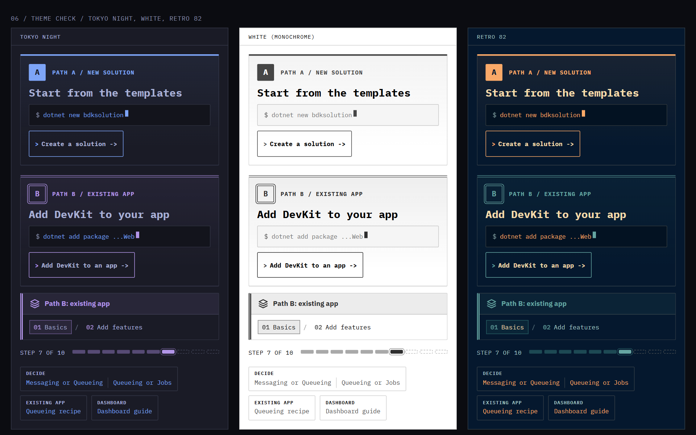
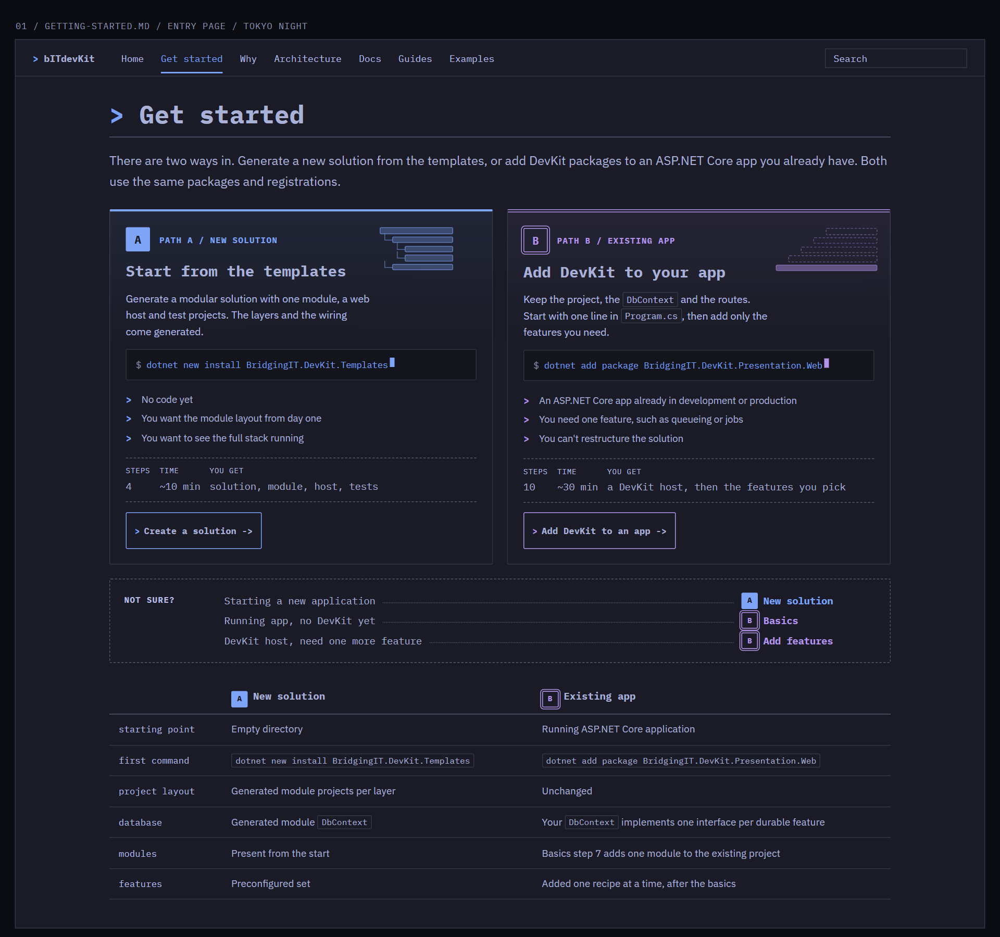
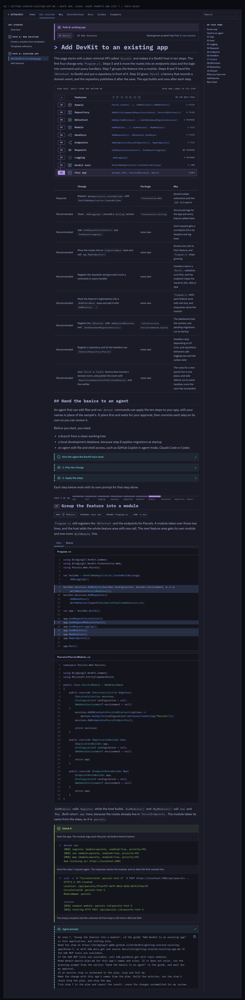
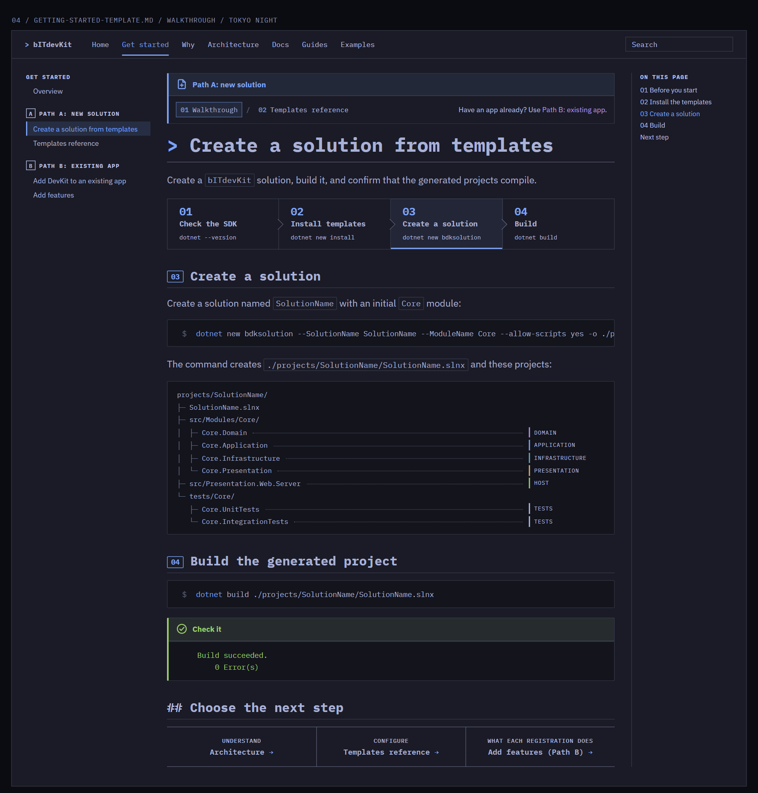
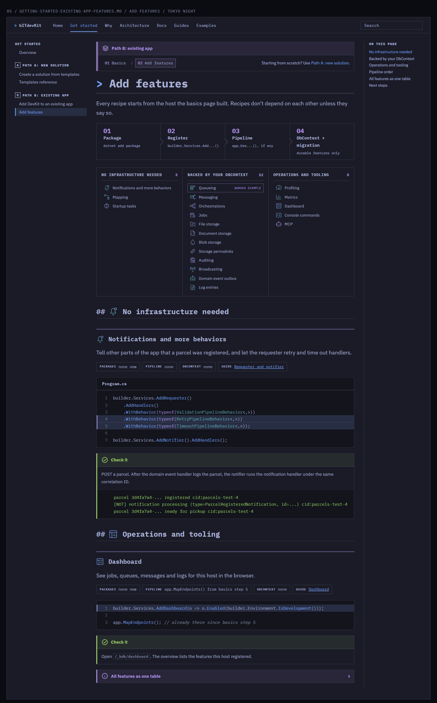
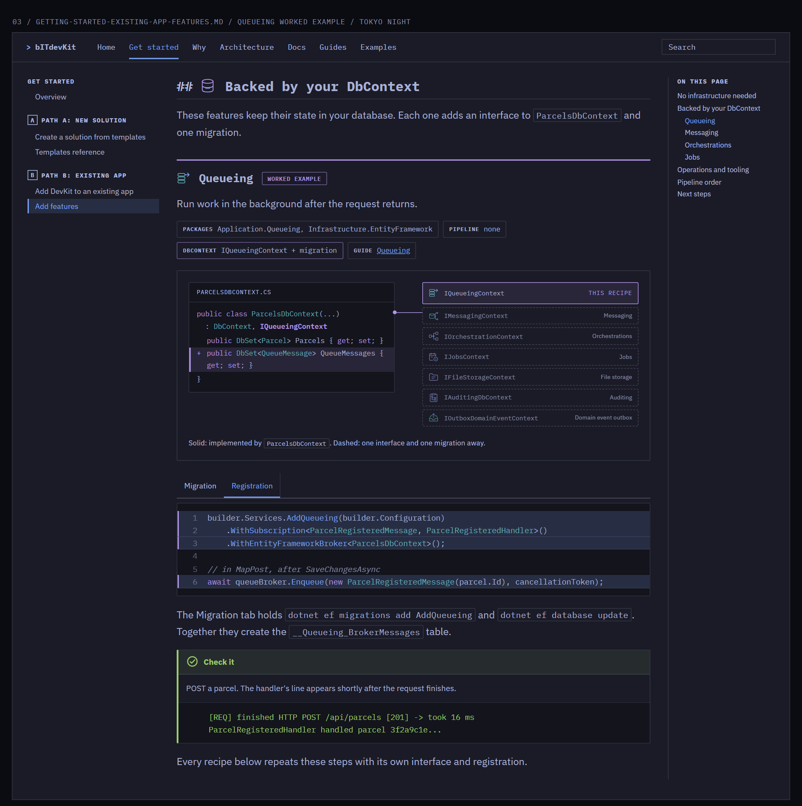
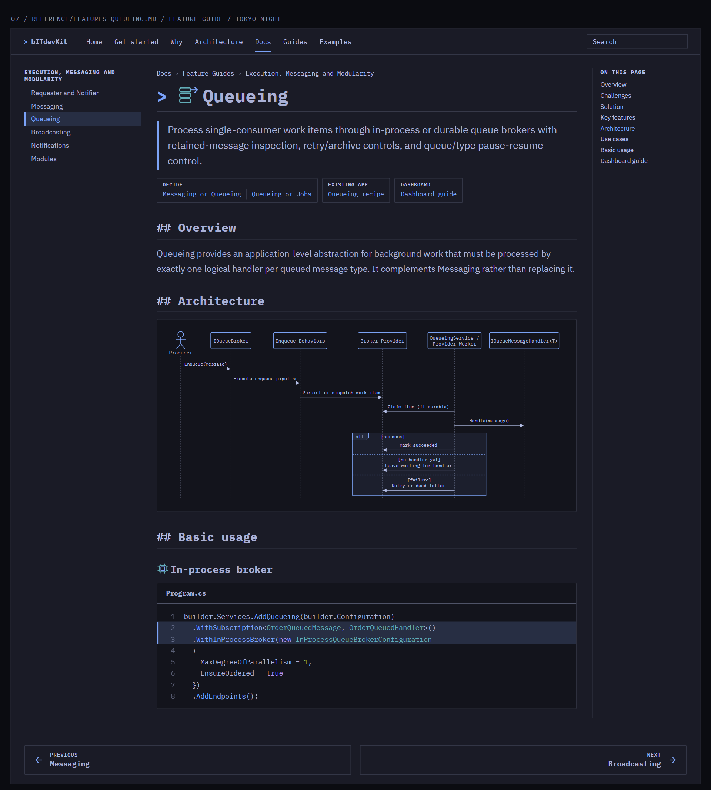
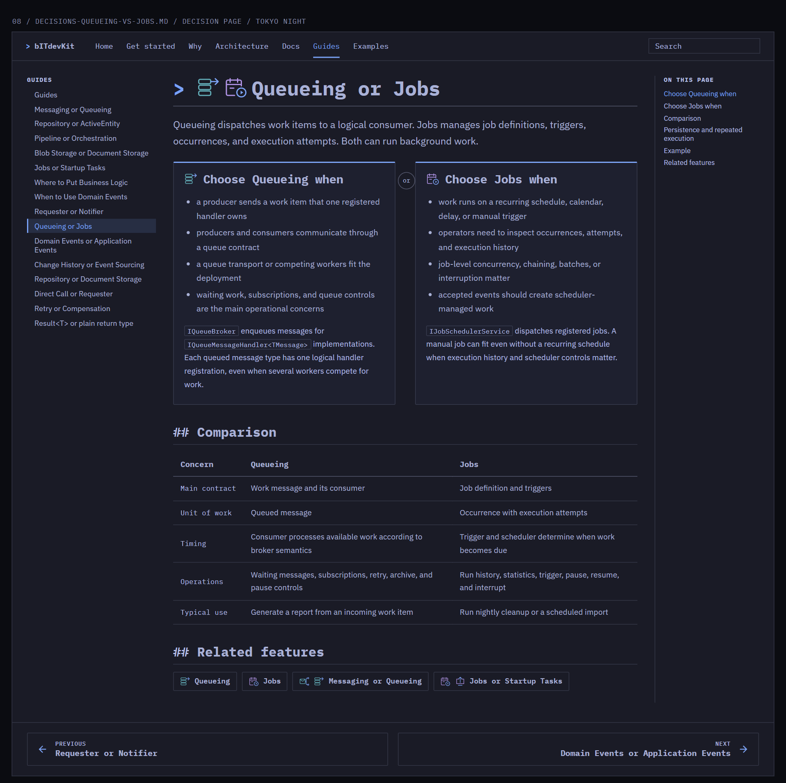
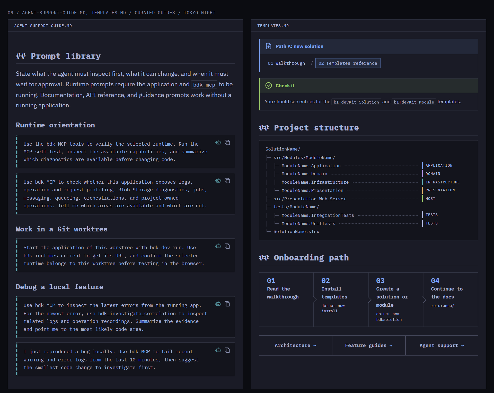

# Specification: Getting started paths

> This document splits onboarding on the public documentation site into two paths. Path A creates a new solution from the templates and keeps its current content. Path B is new. It starts with the minimum that turns an existing ASP.NET Core host into a DevKit host, then adds features one recipe at a time.

[TOC]

The implemented walkthrough uses a `Customer` with `FirstName`, `LastName`, and `Email`, matching the template's terminology. The earlier `Parcels` names in this design and its captured output are historical. The current examples live in the two existing-app pages under `docs/site/`.

## 1. Introduction

The public site at `https://bridgingit-gmbh.github.io/bITdevKit/` has one onboarding path. Every entry point leads to `dotnet new bdksolution`:

- The home page hero button reads "Create a project" and links to the Quickstart.
- The home page section "Start in two commands" installs the templates and creates a solution.
- The "Quickstart" navigation tab holds `getting-started.md`, the template walkthrough, and `templates.md`, the template reference.
- `why.md` lists "Generated project structure" as a reason to adopt the kit.

That path suits greenfield work, but it hides how DevKit is built. Each feature is a separate package with its own `Add...` registration. Some add `Use...` middleware. Durable features add an interface that the application's own `DbContext` implements. A team with a running app can change one line in `Program.cs`, add logging and request correlation, and ship that. Queueing, the requester or the dashboard can follow a week later, one at a time, without moving code into generated projects. The site never tells this story.

The pieces exist but are scattered:

- `reference/features-presentation.md` has "Recommended setup" and "Migrating an existing host". Both stop after replacing `WebApplication.CreateBuilder` with `DevKitWebApplication.CreateBuilder`.
- Each feature guide explains its own registration. No page says what a host needs first, how several features combine, or what order their middleware needs.

The WeatherFiesta host, `examples/WeatherFiesta/WeatherFiesta.Presentation.Web.Server/Program.cs`, is a working host assembled feature by feature. It is the source material for Path B. Section 12 explains why the new pages must not show it.

## 2. Goals

The documentation shall:

- organize "Get started" into exactly two paths with equal weight in navigation and on the home page: Path A, a new solution from templates, and Path B, an existing application
- assign every onboarding page to one path
- keep Path A content as it is today
- show a Path B reader the smallest change that makes a running ASP.NET Core app a DevKit host: one required package, one changed line and two recommended additions
- show the same reader where routes and request handling go in a DevKit app: an endpoints class per feature that sends commands and queries through the requester
- show how a feature's registrations move into a module, so the host adds each feature area with one line
- show how the application's existing `DbContext` becomes a DevKit registration that applies pending migrations at startup, and how handlers read and write through a repository instead of the `DbContext`
- show how the entity becomes an aggregate root that records a domain event, and how the repository publishes that event to a handler after the save
- keep all of this on one page, the basics page, in ten steps that each build and run, with at most three DevKit packages
- let the reader hand the basics to an AI coding agent. A planning prompt inspects the app, maps the sample names to the app's names and waits for approval. A second prompt applies the open steps one at a time and runs each check. Steps 2 to 10 each end with a short prompt for that step alone.
- put every feature on a second page, Add features, as a recipe that works on top of the basics result
- explain once, with a worked example, how durable features use the application's existing `DbContext` through an interface and a migration
- document the middleware order that combined features need
- carry the getting-started visual direction to the rest of the site: feature guides, decision pages, a few curated guides and the page footer, without changing the feature guide sources
- keep every existing link to `getting-started/` working

## 3. Non-goals

This work shall not:

- change the templates or the Path A walkthrough content beyond its title, path banner, links and the presentation in section 11.3.3
- change DevKit runtime code or public API
- add a meta package or a new builder extension to shorten setup. Section 15 lists follow-up ideas.
- put features on the basics page beyond endpoints, the requester, modules, the `DbContext` registration, repositories and the domain model with its events. The basics page registers the notifier only to deliver domain events. Notifications that handlers publish themselves, further pipeline behaviors, mapping, queueing and the dashboard live on the Add features page. Problem details, the result and rule loggers and OpenTelemetry stay in their guides.
- document every option of every feature. Each recipe shows the smallest working registration and links to its guide.
- cover non-web hosts in Path B. `DevKitApplication` for console apps and workers stays documented in `features-presentation.md`, and the entry page links to it.
- add a third path. Adopting features one at a time is part of Path B.
- add agent prompts to the Add features page or the Path A walkthrough. Section 15 lists recipe prompts as a follow-up.
- edit the Markdown of `docs/features-*.md`, `docs/common-*.md` or the decision pages for the site-wide styling. The hook and CSS in section 11.11 work on the built HTML.
- publish or link a new example repository

## 4. Audience

| Path | Reader |
| --- | --- |
| A, new solution | Developers starting a new application who want the DevKit structure from the first commit |
| B, existing app | Developers who own a running ASP.NET Core application and want DevKit in it, often for one specific feature. Technical leads judging how invasive adoption is. |

The technical lead's question gets its answer in the scope table at the top of the basics page, before step 1. Path A readers who want to know what a generated registration does are pointed to the Add features page.

Tone matches the existing site: technical, direct, short sentences, commands followed by expected output.

## 5. Current documentation analysis

### 5.1 Content sources

| Location | Role |
| --- | --- |
| `docs/site/*.md` | Curated site pages: home, quickstart, architecture, guides, examples |
| `docs/*.md` | Feature guides, synced to `docs/site/reference/` by `docs/site/scripts/sync-docs.ps1` |
| `mkdocs.yml` | Navigation, theme and Markdown extensions such as `pymdownx.tabbed`, `admonition` and `md_in_html` |
| `docs/assets/features/*.svg` | Feature icon sources, synced to `docs/site/assets/features/` and used in headings and cards |
| `docs/site/hooks/feature_icons.py` | Inlines `bdk-doc-icon` images as theme-aware SVG and adds title icons to the navigation |
| `docs/site/assets/stylesheets/extra.css`, `themes.css` | Site components and the theme tokens every component uses |

All onboarding pages are curated site pages and belong in `docs/site/`.

### 5.2 Style conventions to follow

- Front matter with `title`.
- One H1, then sentence-case H2 headings phrased as actions: "Install the templates", "Build the generated project".
- Short paragraphs. Commands in fenced `powershell` blocks, followed by the expected output in a `text` block.
- A closing "Choose the next step" list.
- Feature icons in headings: `.svg" width="24" height="24" alt="">`. The hook in section 5.1 turns them into inline SVG.
- Landing-style pages use the existing CSS classes `capability-grid`, `capability-card`, `next-step-strip`, `section-linkout` and `cta-button`.
- The getting-started pages add the components in section 11.4. They follow the same rules: theme tokens only, `--bdk-radius` corners, IBM Plex headings. Most of them are site components that other pages can use too, see section 11.11.
- Writing follows the `technical-writing` and `unslop` repository skills.

### 5.3 What WeatherFiesta's host demonstrates

The host is a single `Program.cs` built from these layers:

1. **Host builder.** `DevKitWebApplication.CreateBuilder(args)` with `AddConfiguration()`, `AddLogging()`, `AddModules(...)` and `AddMcp(...)`.
2. **Application flow.** `AddRequester()` and `AddNotifier()` with `AddHandlers()` and an explicit behavior chain: profiling, metrics, tracing, module scope, database transaction, validation, retry, timeout.
3. **Infrastructure features.** Auditing, messaging, queueing, orchestrations, broadcasting, storage permalinks, file, document and blob storage, and log entries. Each is opt-in and most use the same `CoreDbContext`.
4. **Operations.** Profiling, metrics, dashboard, entities dashboard, console commands, health checks, OpenTelemetry.
5. **Request pipeline.** `UseRequestCorrelation`, `UseRequestProfiling`, `UseRuleLogger`, `UseResultLogger`, `UseRequestProfilingExceptionObserver`, `UseRouting`, `UseRequestModuleContext`, `UseRequestLogging`, `UseRequestMetrics`, `UseModules`, `UseAuthentication`, `UseAuditing`, `UseProblemDetails`, `UseAuthorization`, `MapModules`, `MapEndpoints`, `UseConsoleCommandsInteractive`.

`CoreDbContext` derives from `ModuleDbContextBase` and implements `IOutboxDomainEventContext`, `IOrchestrationContext`, `IJobsContext`, `IMessagingContext`, `IQueueingContext`, `ILoggingContext`, `IFileStorageContext`, `IDocumentStoreContext`, `IBlobStoreContext`, `IStoragePermalinkRegistryContext`, `IBroadcastingContext` and `IAuditingDbContext`. Each interface adds one or more `DbSet` properties. Path B has to explain this mechanism. It is how a plain `DbContext` takes on durable features.

### 5.4 What a host needs before any feature

The basics page rests on these facts, checked in `src/` when this specification was written:

- `DevKitWebApplication.CreateBuilder(args)` is in package `BridgingIT.DevKit.Presentation.Web`, namespace `BridgingIT.DevKit.Presentation.Web`. It returns `DevKitWebApplicationBuilder`, which exposes `Services`, `Configuration`, `Environment`, `Host`, `WebHost`, `Logging` and `WebApplicationBuilder`. `Build()` returns a normal `WebApplication`.
- In `Development`, the DevKit builder writes a host descriptor, opens a named-pipe endpoint for the `bdk` CLI and registers console commands and MCP. Outside `Development` it adds none of these.
- `builder.Services.Add...` feature registrations also work on a plain `WebApplication.CreateBuilder`. The builder extensions `.AddLogging()`, `.AddConfiguration()`, `.AddModules()` and `.AddMcp()` do not, because they extend `IDevKitApplicationBuilder`. They return the concrete builder type, so they chain.
- Those builder extensions and the CLI connection are the reasons the basics page swaps the builder.
- `DevKitWebApplicationBuilder` does not implement `IHostApplicationBuilder`. Extensions written for that interface, such as Aspire's `AddServiceDefaults()`, take `builder.WebApplicationBuilder`.
- `Presentation.Web` references `Application.Identity`, `Application.Utilities`, `Common.Extensions.Web`, `Common.Mapping`, `Common.Utilities`, `Domain` and `Presentation`. The requester, notifier, mapping, startup tasks, profiling, metrics and broadcasting need no further package.
- `UseRequestCorrelation()` and `UseRequestLogging()` ship in `Presentation.Web`, in namespace `Microsoft.AspNetCore.Builder`. Request logging writes through Serilog's static logger, so it logs nothing until `.AddLogging()` configures Serilog.
- `AddSqliteDbContext<TContext>(string connectionString)` ships in `BridgingIT.DevKit.Infrastructure.EntityFramework.Sqlite`, namespace `Microsoft.Extensions.DependencyInjection`. It calls `AddDbContext` with `UseSqlite`, records the context for the dashboard and adds the Sqlite bulk insert provider. The package brings `Infrastructure.EntityFramework` and `Domain` with it. SQL Server, PostgreSQL and Cosmos DB have their own provider packages.
- `.WithDatabaseMigratorService()` on the returned builder adds a hosted service that applies pending migrations after the app starts. A failed migration is logged and the app keeps running, unless the options call `HaltOnFailure()`, which ends the process.
- `AddEntityFrameworkRepository<TEntity, TContext>()` registers `IGenericRepository<TEntity>` over the context, scoped by default. Read-only handlers that want `IGenericReadOnlyRepository<TEntity>` need the separate `AddEntityFrameworkReadonlyRepository` registration. The entity must implement `IEntity`. Deriving from `AggregateRoot<Guid>` in `BridgingIT.DevKit.Domain.Model` gives it an `Id` and does not change the EF model of an entity that already had a `Guid Id`.
- `IGenericRepository<TEntity>`, `RepositoryLoggingBehavior<TEntity>` and the result extension `FindOneResultAsync` are in `BridgingIT.DevKit.Domain.Repositories`. `FindOneResultAsync` returns a failed `Result<TEntity>` with a `NotFoundError` when the row is missing.
- `Requester` resolves handlers from the request scope. When resolving a handler throws, for example because a repository it needs is not registered, the requester reports "No handler found for request type" and keeps the real cause as the inner exception.
- `EntityFrameworkGenericRepository<TEntity>.InsertAsync` calls `UpsertAsync`. When the entity's ID is not the default value, the upsert loads the row first to choose between insert and update.
- `DomainEventBase` and `DomainEventHandlerBase<TEvent>` are in namespace `BridgingIT.DevKit.Domain`. `AggregateRoot<TId>` exposes a `DomainEvents` collection with `Register`, `GetAll` and `Clear`, which EF Core does not map.
- `RepositoryDomainEventPublisherBehavior<TEntity>`, in `BridgingIT.DevKit.Domain.Repositories`, runs the inner insert, update, upsert or delete, publishes every event in `DomainEvents` and then clears the collection. It needs an `INotifier`. `AddNotifier().AddHandlers()` lives in `BridgingIT.DevKit.Common` and registers every `INotificationHandler<T>` it finds, which includes `DomainEventHandlerBase<TEvent>` types. The domain log key is `DOM`.
- The notifier calls `DomainEventHandlerBase.HandleAsync`, which goes straight to `Process`. The `[DOM] event processing` lines that `Handle` writes do not appear on this path.

## 6. Path model

### 6.1 The two paths

| | Path A: New solution | Path B: Existing app |
| --- | --- | --- |
| Starting point | Empty directory | Running ASP.NET Core application |
| First command | `dotnet new install BridgingIT.DevKit.Templates` | `dotnet add package BridgingIT.DevKit.Presentation.Web` |
| Project layout | Generated module projects per layer | Unchanged |
| Database | Generated module `DbContext` | Basics step 8 registers the application's `DbContext` through DevKit. It implements one interface per durable feature. |
| Modules | Present from the start | Basics step 7 adds one module to the existing project |
| Features | Preconfigured set | Added one recipe at a time, after the basics |
| First page | `getting-started-template.md` | `getting-started-existing-app.md` |
| Second page | `templates.md` | `getting-started-existing-app-features.md` |

### 6.2 Rules shared by both paths

- **Entry.** Both paths start from `getting-started.md`, which presents them side by side and nothing else.
- **Path banner.** Every path page starts with a `path-a` or `path-b` admonition. It names the path, holds the pager for that path's two pages and links to the other path. Section 11.4.1 has the markup.
- **Shared destinations.** Both paths end with the same next steps: `architecture.md`, `docs.md` and `guides.md`. Each adds its own second page.
- **Cross-link.** The Path A walkthrough links to the Add features page, which explains each registration the template generated.
- **Prerequisites.** Both paths state the same SDK prerequisite. The implementer resolves the version from `global.json` and `Directory.Build.props` and corrects the current ".NET 9 SDK or later" text if it no longer matches.

## 7. Information architecture

### 7.1 Navigation

Replace the `Quickstart` block in `mkdocs.yml` with:

```yaml
- Get started:
    - Overview: getting-started.md
    - "Path A: New solution":
        - Create a solution from templates: getting-started-template.md
        - Templates reference: templates.md
    - "Path B: Existing app":
        - Add DevKit to an existing app: getting-started-existing-app.md
        - Add features: getting-started-existing-app-features.md
```

The file name prefixes keep each page's path visible in the URL: `getting-started-template*` for Path A and `getting-started-existing-app*` for Path B. `templates.md` keeps its URL because external links point to it.

### 7.2 URL stability

- `getting-started.md` keeps its path and becomes the entry page. Existing links in `README.md`, `index.md`, `packages.md` and `templates.md` keep resolving.
- Links that mean the template walkthrough specifically change to `getting-started-template.md`. The implementer checks each of the files above.

## 8. Entry page: `getting-started.md`

The reader should pick a path in under a minute.

Content:

1. Title "Get started" and a one-sentence intro: there are two ways to start with DevKit.
2. Two `path-card` elements in a `path-fork`, same size, Path A on the left. Section 11.3.1 has the layout.
   - **Path A: New solution.** The templates generate a modular solution with application, domain, infrastructure, presentation and test projects. Use this for new applications.
   - **Path B: Existing app.** Keep the project, the `DbContext` and the routes. Start with one line in `Program.cs`, then add only the features you need. Use this for applications already in development or production, or when you need one specific feature.
3. A `path-decide` strip with three one-line situations:
   - "Starting a new application" points to the Path A walkthrough.
   - "Running app, no DevKit yet" points to the basics page.
   - "DevKit host, need one more feature" points to the Add features page.
4. The comparison table from section 6.1 without its last two rows, inside a `cmp` wrapper with path badges in the column headers.
5. A note for non-web hosts that links to the console section of `reference/features-presentation.md`.

Front matter sets `hide: [navigation, toc]`. The page has nothing else on it.

## 9. Path A: New solution from templates

### 9.1 `getting-started-template.md`: Create a solution from templates

The current `getting-started.md` content, moved without wording changes, plus:

- `title: Create a solution from templates`
- the Path A banner from section 6.2
- a next-step link to the Add features page, labelled as the explanation of each generated registration
- the presentation from section 11.3.3: flow strip, numbered headings, solution tree, verify admonition and next-step strip

### 9.2 `templates.md`: Templates reference

Content unchanged. Add the Path A banner and update the link back to the walkthrough.

## 10. Path B: Existing application

Path B has two pages. The basics page makes the host a DevKit host, moves the routes into an endpoints class and their logic into commands and queries, groups the feature into a module, hands the `DbContext` registration to DevKit, puts a repository between the handlers and the database, and turns the entity into an aggregate that records domain events. Then it stops. The Add features page holds one recipe per feature. A reader can finish the basics in one sitting, ship the result, and return for a recipe when a feature is needed.

### 10.1 `getting-started-existing-app.md`: Add DevKit to an existing app

This page takes a running minimal API app to a DevKit host in ten steps, and the app builds and runs after each one. Steps 2 to 4 change only `Program.cs` and make the app a DevKit host. Steps 5 to 10 answer the next question a reader has, which is where the app's own code goes. Step 5 moves the two routes into an endpoints class. Step 6 moves the route logic into a command and a query. Step 7 moves the feature's registrations out of `Program.cs` into a module. Step 8 registers the `DbContext` through DevKit, which adds the third and last DevKit package and applies migrations at startup. Step 9 lets the handlers read and write through a repository. Step 10 gives `Parcel` a factory that records a domain event, and the repository publishes the event to a handler after the save. No step changes the database schema. A section before step 1 gives the reader prompts to hand the steps to an AI coding agent instead. Section 10.1.6 specifies them.

#### 10.1.1 Sample application

The page uses a fictional application named `Parcels`:

- one Web project, `Parcels.Web`, with minimal APIs
- `ParcelsDbContext : DbContext` with one `Parcel` entity, on SQLite through `Microsoft.EntityFrameworkCore.Sqlite`, so every step runs without Docker or a database server
- EF Core migrations already in use, with `dotnet-ef` as a local tool
- the `dotnet new web` project defaults, including `<Nullable>enable</Nullable>` and implicit usings
- `Parcel.cs` and `ParcelsDbContext.cs` in the project root, in namespace `Parcels.Web`. `Parcel` has three properties: `Id` as a `Guid` that EF Core generates on insert, `TrackingNumber` and `Recipient`. Step 9 replaces the `Id` property with the `AggregateRoot<Guid>` base class. Step 10 makes the setters private and adds a `Create` factory.
- `GET /api/parcels/{id}` and `POST /api/parcels`
- the POST endpoint writes one line through an injected `ILogger<Program>`: `parcel {ParcelId} registered`. Step 4 uses that line to show the correlation ID. Step 5 moves it to the endpoints class, step 6 moves it into the command handler and step 10 moves it into a domain event handler.

The basics page never changes `ParcelsDbContext`. Step 6 injects it into the two handlers, and step 7 moves its registration into the module. Step 8 hands that registration to DevKit, and step 9 puts a repository in front of the context, so the handlers stop using it directly. The Add features page builds on the same app, and its worked example adds an interface to the context.

#### 10.1.2 Scope table

After the intro and the route map, the page shows what it changes:

| | Change | Package | Why |
| --- | --- | --- | --- |
| Required | Replace `WebApplication.CreateBuilder` with `DevKitWebApplication.CreateBuilder` | `BridgingIT.DevKit.Presentation.Web` | DevKit builder extensions and the `bdk` CLI need it |
| Recommended | Chain `.AddLogging()` and add a `Serilog` section to `appsettings.json` | `BridgingIT.DevKit.Presentation.Serilog` | Structured logs for the app, the request middleware and every feature added later |
| Recommended | Add `app.UseRequestCorrelation()` and `app.UseRequestLogging()` | none new | Each request gets a correlation ID in its response headers and log lines |
| Recommended | Move the routes into an `EndpointsBase` class, register it with `AddEndpoints<T>()` and map it with `app.MapEndpoints()` | none new | Routes live next to their feature, and `Program.cs` stays the same length as features grow |
| Recommended | Register the requester and turn each route's logic into a command or query with a handler | none new | Handlers return a `Result`, validation runs before the handler, and the endpoint maps the result to an HTTP response |
| Recommended | Move the feature's registrations into a `WebModuleBase` class and add it with `AddModules(...)` | none new | `Program.cs` adds each feature area with one line, and the logs and response headers name the module that handled a request |
| Recommended | Register the `DbContext` with `AddSqliteDbContext` and `.WithDatabaseMigratorService()` | `BridgingIT.DevKit.Infrastructure.EntityFramework.Sqlite`, or the package for your database | The dashboard lists the context, and pending migrations run when the app starts |
| Recommended | Register a repository with `AddEntityFrameworkRepository` and let the handlers use `IGenericRepository<Parcel>` | none new | Handlers stop depending on EF Core, a missing parcel comes back as a failed result, and repository behaviors add logging now and the outbox later |
| Recommended | Give `Parcel` a `Create` factory that records a domain event, and publish the event with `RepositoryDomainEventPublisherBehavior` and the notifier | none new | The rules for a new parcel live in one place, and side effects run in event handlers once the save has succeeded |

Below the table, two sentences. `.AddConfiguration()` from `BridgingIT.DevKit.Presentation.Configuration` adds Azure Key Vault and App Configuration sources, and the page mentions it once at the end. Notifications that handlers publish themselves, further pipeline behaviors and the dashboard are on the Add features page. Exception handling stays as the app has it.

#### 10.1.3 Steps

Every step has the same parts: one or two sentences on what it adds, the package command if there is one, the `Program.cs` change in "After" and "Before" tabs, and a `verify` admonition with a command and its expected output. Steps 5 to 7 also create files. Each new file appears in a code block titled with its path, such as `Modules/Parcels/ParcelEndpoints.cs`. Step 6 also changes `ParcelEndpoints.cs`, so it has a second tab set for that file. Steps 8 and 9 leave `Program.cs` alone and have no `Program.cs` tabs. Step 8 has one tab set for `Modules/Parcels/ParcelsModule.cs`. Step 9 has four, one per changed file. Step 10 has four tab sets, for `Parcel.cs`, `Modules/Parcels/ParcelsModule.cs`, the command handler and `Program.cs`, and two new files as titled code blocks. Handler tabs show the handler class and the new `using`, not the whole file. Inside a tab set, each code block carries the file path as its title. Steps 2 to 10 end with a collapsed agent prompt after their links, and step 1 ends with a link to the agent section. Section 10.1.6 has the prompt template. Section 11.3.2 turns these parts into components.

1. **Start from your app.**
   - Show the plain `Program.cs`, `Parcel` and `ParcelsDbContext`. Section 10.1.4 has the code.
   - State the assumptions: the SDK from section 6.2 and minimal APIs. One sentence says an app built on controllers follows every step except 5, and leaves the `AddEndpoints` line out of its module.
   - Check: run the app and POST a parcel with `curl -i`. The response is `201 Created`. Every later step repeats this request.

2. **Swap the host builder.**
   - Package: `BridgingIT.DevKit.Presentation.Web`.
   - Change: add `using BridgingIT.DevKit.Presentation.Web;` and replace `WebApplication.CreateBuilder(args)` with `DevKitWebApplication.CreateBuilder(args)`. No other line changes.
   - What stays: every `builder.Services` registration, `builder.Configuration`, the pipeline and `app.Run()`. `Build()` still returns a `WebApplication`.
   - What changes: in `Development`, the host announces itself to the `bdk` CLI and MCP tooling. Outside `Development`, the swap adds nothing at runtime.
   - One note for code that expects `IHostApplicationBuilder`, such as Aspire service defaults: pass `builder.WebApplicationBuilder`.
   - A `tip` admonition on versions: every DevKit package the app adds must have the same version. An app that already uses Central Package Management adds the DevKit packages to `Directory.Packages.props`.
   - Check: the step 1 request still returns `201 Created`. A second, optional check sits in a collapsed block. It installs the CLI with `dotnet new tool-manifest` and `dotnet tool install BridgingIT.DevKit.Cli`, runs `dotnet tool run bdk hosts list` and shows the host with status `Ready`.
   - Links: `reference/features-presentation.md`, `reference/features-cli.md`.

3. **Add DevKit logging.**
   - Package: `BridgingIT.DevKit.Presentation.Serilog`.
   - Change: chain `.AddLogging()` on the builder. Add a `Serilog` section to `appsettings.json` with the Console sink, `"Enrich": ["FromLogContext"]` and an output template that prints `cid:{CorrelationId}`. Its `MinimumLevel.Override` sets `Microsoft.AspNetCore` and `Microsoft.EntityFrameworkCore` to Warning, so the SQL that EF Core logs at Information does not bury the checks. Section 10.1.4 has the JSON.
   - Explain: `.AddLogging()` replaces the default logging providers with Serilog, reads the `Serilog` section and sets the global `Log.Logger`. Existing `ILogger<T>` calls keep working and now go through Serilog. The namespace is the same as in step 2, so no new `using` is needed.
   - Gotchas, as a two-item list:
     - With no `WriteTo` entry, the app logs nothing.
     - An app that configures Serilog itself before building the host keeps its own logger. `.AddLogging()` only acts while `Log.Logger` is still Serilog's silent default.
   - Check: startup prints `[LOG] logging configured using appsettings (MinimumLevel: Information).`
   - Link: `reference/features-presentation-logging.md`.

4. **Correlate and log requests.**
   - Packages: none new.
   - Change: add `app.UseRequestCorrelation();` and `app.UseRequestLogging();` directly after `var app = builder.Build();`.
   - Placement for apps with more middleware: `UseRequestCorrelation()` comes first, so everything after it logs with the ID. If the app calls `UseRouting()` itself, `UseRequestLogging()` goes after that call. Both go before `UseAuthentication()`. The pipeline order reference on the Add features page shows the full sequence.
   - Explain: the correlation middleware reads an incoming `CorrelationId` header or creates one. It returns the ID in the `CorrelationId` response header, together with `FlowId` and, when a trace is active, `TraceId`. It adds the IDs to the log scope for the rest of the request. It accepts an incoming value of 1 to 128 ASCII letters, digits or `-_.:` and replaces anything else.
   - Gotcha: request logging writes through Serilog. Without step 3 it writes nothing.
   - Check: `curl -i -H "CorrelationId: parcels-test-1" -X POST ...`. The response carries `CorrelationId: parcels-test-1` and a `FlowId` header. The console shows `[REQ] starting HTTP POST /api/parcels`, the endpoint's `parcel ... registered` line and `[REQ] finished HTTP POST /api/parcels [201] -> took ... ms`. All three lines end in `cid:parcels-test-1`.
   - Implementer note: a run of the spec listings confirmed `cid:` on the `[REQ]` lines as well as on the endpoint line. Section 11.10 has the captured output.
   - Links: `reference/features-presentation-correlationid.md`, `reference/features-presentation-logging.md`.

5. **Move routes into an endpoints class.**
   - Packages: none new. `EndpointsBase`, `AddEndpoints` and `MapEndpoints` come with `BridgingIT.DevKit.Presentation.Web` from step 2.
   - Change: create `Modules/Parcels/ParcelEndpoints.cs`. The class derives from `EndpointsBase` and overrides `Map`. It creates a route group with `app.MapGroup("api/parcels").WithTags("Parcels")` and maps the two routes on that group. The route lambdas move over unchanged, except the POST logger becomes `ILogger<ParcelEndpoints>`. In `Program.cs`, add `using Parcels.Web.Modules.Parcels;`, register the class with `builder.Services.AddEndpoints<ParcelEndpoints>();` and replace the two `app.Map...` calls with `app.MapEndpoints();`.
   - Explain: `AddEndpoints<T>()` registers the class as a singleton `IEndpoints`. `MapEndpoints()` maps every registered class once and skips a class whose `Enabled` property is false. A second call maps nothing new. A new feature adds one endpoints class and one `AddEndpoints<T>()` line, and the `app.MapEndpoints()` line stays as it is. The dashboard and metrics recipes on the Add features page register their own endpoint classes and rely on this call.
   - "Where your code goes", as an `info` admonition: this page keeps one project with one feature folder, `Modules/Parcels/`. When the app later splits into layers, the endpoints class moves to the Presentation project and the commands, queries and handlers from step 6 move to the Application project. The code stays the same. Link: `architecture.md`.
   - Gotcha: forget `app.MapEndpoints()` and every route returns `404 Not Found`. The app still starts.
   - Check: the step 1 request returns `201 Created`. A GET with the returned `id` returns the parcel. The console shows the same lines as in step 4.
   - Link: `reference/features-presentation-endpoints.md`.

6. **Handle requests with commands and queries.**
   - Packages: none new. The requester and FluentValidation come with the step 2 package.
   - Change, in three files:
     - Create `Modules/Parcels/CreateParcelCommand.cs`. It holds the command with `TrackingNumber` and `Recipient`, a nested `Validator` with two `NotEmpty` rules, and the handler. The handler saves the parcel, writes the `parcel {ParcelId} registered` line and returns the parcel.
     - Create `Modules/Parcels/ParcelFindOneQuery.cs`. It holds the query with an `Id` and a handler that returns the parcel or a `NotFoundError`.
     - In `Program.cs`, add `using BridgingIT.DevKit.Common;` and `builder.Services.AddRequester().AddHandlers().WithBehavior(typeof(ValidationPipelineBehavior<,>));`.
     - In `ParcelEndpoints`, each lambda takes an `IRequester`, sends its command or query and maps the result with `MapHttpCreated` or `MapHttpOk`. The endpoint no longer needs `ParcelsDbContext` or a logger.
   - Explain, in four short paragraphs:
     - A command changes state and a query reads it. Each derives from `RequestBase<TValue>` and has one handler that derives from `RequestHandlerBase<TRequest, TValue>`. The handler returns `Result<TValue>`. A missing parcel is a failed result with a `NotFoundError`, not an exception.
     - `AddHandlers()` finds the handlers and the nested `Validator` classes in the app and registers them as scoped, so a handler can take `ParcelsDbContext` in its constructor.
     - `ValidationPipelineBehavior` runs the validator before the handler. When a rule fails, the requester returns a failed result with a `FluentValidationError` and the handler does not run.
     - `MapHttpCreated` and `MapHttpOk` turn the result into a response. Success becomes `201` with a `Location` header or `200`. A `NotFoundError` becomes `404`. A validation error becomes `400` with a ProblemDetails body.
   - Gotchas, as a two-item list:
     - Without `.WithBehavior(typeof(ValidationPipelineBehavior<,>))` the validator never runs and an empty recipient reaches the database.
     - The endpoint binds `CreateParcelCommand` straight from the JSON body, so the request body stays the same as in step 1. `RequestId` and `RequestTimestamp` have no setter, and a client cannot set them.
   - Check, as three requests:
     - The step 1 request returns `201 Created` with a `Location` header. The console shows `[REQ] request processing (type=CreateParcelCommand, ...)`, the handler's `parcel ... registered` line with the correlation ID, and `[REQ] request success ... -> took ... ms`.
     - The same request with an empty `recipient` returns `400 Bad Request` with a ProblemDetails body titled "Validation Error". Its `data.errors` holds `"Recipient": ["'Recipient' must not be empty."]`. The `parcel ... registered` line does not appear.
     - A GET with a random GUID returns `404 Not Found`.
   - After the checks, one sentence warns that the 400 and the 404 each print two `ERR` lines, `[REQ] request failed (...)` and `[REQ] request failed with errors: ...`. The requester logs every failed result at Error level. Nothing crashed.
   - Implementer note: section 11.10 has the console output and the ProblemDetails body from a run of the spec listings. Show the same lines, with your own IDs and timings.
   - Links: `reference/features-requester-notifier.md`, `reference/features-results.md`, `decisions-direct-call-vs-requester.md`.
   - A collapsed `note` block on source-generated handlers. `[Command]` or `[Query]` on a partial class with a `[Handle]` method generates the request and its handler. It needs the `BridgingIT.DevKit.Common.Utilities.CodeGen` package, so the basics page sticks to the hand-written classes. Link: the source generator appendix of `reference/features-requester-notifier.md`.

7. **Group the feature into a module.**
   - Packages: none new. `WebModuleBase`, `AddModules`, `UseModules` and `MapModules` come with the step 2 package.
   - Change, in two files:
     - Create `Modules/Parcels/ParcelsModule.cs`. The class derives from `WebModuleBase` and overrides `Register`, `Use` and `Map`. `Register` takes over the `AddDbContext<ParcelsDbContext>` and `AddEndpoints<ParcelEndpoints>()` lines from `Program.cs`. `Use` and `Map` return `app`.
     - In `Program.cs`, replace those two lines with `builder.Services.AddModules(builder.Configuration, builder.Environment, m => m.WithModule<ParcelsModule>());`. Remove `using Microsoft.EntityFrameworkCore;` and `using Parcels.Web;`, which nothing in the file uses any more. In the pipeline, add `app.UseRequestModuleContext();` after `UseRequestCorrelation()`, and `app.UseModules();` and `app.MapModules();` before `app.MapEndpoints();`.
     - The requester registration stays in `Program.cs`. Every module shares one requester.
   - Explain, in three short paragraphs:
     - A module is how one feature area plugs into the host. `AddModules` calls each module's `Register` while the host builds. `UseModules()` calls each `Use` to add middleware, and `MapModules()` calls each `Map` to add routes. The module name is the class name without "Module", in lowercase, so `ParcelsModule` is `parcels`. A second feature area gets its own module and one more `WithModule<T>()` call.
     - The Parcels module has no middleware, and its routes already live in `ParcelEndpoints`. So `Use` and `Map` have nothing to do, but the base class declares them abstract and the module still overrides them. `MapEndpoints()` keeps mapping the routes, because `Register` added the endpoints class.
     - `UseRequestModuleContext()` works out which module a request belongs to. For these routes it finds `parcels` in the path. It adds a `ModuleName` response header and a `ModuleName` property to the log scope.
   - Gotchas, as a three-item list:
     - Forget `app.UseModules()` or `app.MapModules()` and the module's `Use` or `Map` never runs. Nothing breaks yet, because both are empty here. The first module with its own middleware or routes needs them.
     - The listing writes `IConfiguration?` and `IWebHostEnvironment?` to match `<Nullable>enable</Nullable>`. With nullable disabled, drop the `?`.
     - `"Modules": { "parcels": { "Enabled": false } }` in `appsettings.json` does not unload the module. `Register`, `Use` and `Map` still run. `UseRequestModuleContext()` rejects each request to the module with a `ModuleNotEnabledException`, and without a global exception handler the client gets `500 Internal Server Error`.
   - Check:
     - Startup prints three lines before `Now listening on`: `[MOD] register (module=parcels, enabled=True, priority=99)`, then the same line with `use` and with `map`.
     - The step 1 request returns `201 Created` with a `ModuleName: parcels` header. The console shows `[REQ] request module: parcels` before `[REQ] starting HTTP POST /api/parcels`.
     - The empty recipient and the random GUID from step 6 still return `400` and `404`.
   - Implementer note: section 11.10 has the startup and request output from a run of the spec listings.
   - Links: `reference/features-modules.md`, `architecture.md`, and `templates.md` for the `bdkmodule` template, which generates a module with its own layer projects.
   - A collapsed `note` block on namespaces. Lookups that start from a type, such as the module scope pipeline behavior, read the module name from a `.Modules.<name>.` segment in the namespace. That is why step 5 put the feature files in `Modules/Parcels/` with namespace `Parcels.Web.Modules.Parcels`. A feature folder outside `Modules/` still works for everything on this page, but those lookups find no module for it. Link: the modules guide.

8. **Register the `DbContext` with DevKit.**
   - Package: `BridgingIT.DevKit.Infrastructure.EntityFramework.Sqlite`. It is the third and last DevKit package on the page. An app on SQL Server or PostgreSQL adds `BridgingIT.DevKit.Infrastructure.EntityFramework.SqlServer` or `.Postgres` and calls `AddSqlServerDbContext` or `AddPostgresDbContext` instead. A tab set shows the three `dotnet add package` lines.
   - Change, in `Modules/Parcels/ParcelsModule.cs` only: replace the `AddDbContext<ParcelsDbContext>(...)` call with `services.AddSqliteDbContext<ParcelsDbContext>(configuration?.GetConnectionString("Parcels")).WithDatabaseMigratorService();` and remove `using Microsoft.EntityFrameworkCore;`. The new methods live in `Microsoft.Extensions.DependencyInjection`, which implicit usings already import.
   - Explain, in two short paragraphs:
     - `AddSqliteDbContext` makes the same `AddDbContext` call with `UseSqlite`. It also records the context, so the dashboard recipe on the Add features page can list it, and registers the Sqlite bulk insert provider. The step 6 handlers still get `ParcelsDbContext` injected and do not change.
     - `WithDatabaseMigratorService()` adds a hosted service that applies pending migrations once the app has started, so `dotnet ef database update` stops being a manual step. A team that applies migrations from its deployment pipeline leaves the call out, or turns it off per environment with `o => o.Enabled(...)`.
   - Gotchas, as a two-item list:
     - Use the overload that takes the connection string. The overload that takes an options builder throws a `NullReferenceException` when no Sqlite options delegate is passed. With a delegate it moves the migrations history to a table named `__MigrationsHistory`, finds no applied migrations there and runs `InitialCreate` again, which fails because the tables exist. Section 15 lists both.
     - A failed migration logs `[IFR] database migrator failed: ...` and the app keeps running, so the first request that touches the database fails. `o => o.HaltOnFailure()` ends the process instead.
   - Check:
     - After the host's `Application started`, `Hosting environment` and `Content root path` lines, the console prints three lines: `[IFR] database migrator started (context=ParcelsDbContext, provider=Microsoft.EntityFrameworkCore.Sqlite)`, `[IFR] database migrator get pending migrations (context=ParcelsDbContext)` and `[IFR] database migrator skipped, no pending migrations (context=ParcelsDbContext)`.
     - The step 1 request still returns `201 Created`.
     - An optional check in a collapsed block: stop the app, delete `parcels.db` and start it again. The migrator logs `apply pending migrations` with the `InitialCreate` migration name, then `[IFR] database migrator finished (...)`, and the step 1 request works on the new file.
   - Implementer note: the `apply pending migrations` line prints `IFR` without brackets. That is a log template bug, listed in section 15. Show it as captured. Section 11.10 has the output from a run of the spec listings.
   - Links: `reference/features-modules.md`, whose module example registers a SQL Server context with migrator options, and `reference/features-domain-repositories.md`.

9. **Read and write through a repository.**
   - Packages: none new. `AddEntityFrameworkRepository` comes with the step 8 package. `IGenericRepository<TEntity>` and `AggregateRoot<TId>` come with `BridgingIT.DevKit.Domain`, which the step 2 package already references.
   - Change, in four files:
     - `Parcel.cs`: derive from `AggregateRoot<Guid>`, delete the `Id` property and add `using BridgingIT.DevKit.Domain.Model;`.
     - `Modules/Parcels/ParcelsModule.cs`: after the step 8 call, add `services.AddEntityFrameworkRepository<Parcel, ParcelsDbContext>().WithBehavior<RepositoryLoggingBehavior<Parcel>>();` and `using BridgingIT.DevKit.Domain.Repositories;`.
     - `CreateParcelCommandHandler`: take `IGenericRepository<Parcel>` instead of `ParcelsDbContext`, and replace `Add` and `SaveChangesAsync` with `await repository.InsertAsync(parcel, cancellationToken);`.
     - `ParcelFindOneQueryHandler`: take `IGenericRepository<Parcel>` and return `await repository.FindOneResultAsync(request.Id, cancellationToken: cancellationToken);`. The `null` check and the hand-built `NotFoundError` go away.
     - `ParcelsDbContext`, the migrations, `ParcelEndpoints` and `Program.cs` stay as they are.
   - Explain, in four short paragraphs:
     - A handler that takes `IGenericRepository<Parcel>` no longer knows about EF Core. A unit test hands it an `InMemoryRepository<Parcel>` or a substitute instead of a database. The same interface takes specifications, paging and projections when the queries grow.
     - `InsertAsync` adds the entity and saves it in one call. `FindOneResultAsync` returns the failed `Result` with a `NotFoundError` that the step 6 handler built by hand, so the query handler is down to one line.
     - `WithBehavior` wraps the repository in decorators. `RepositoryLoggingBehavior` logs every call. Step 10 adds a behavior that publishes domain events after the save, and the outbox recipe on the Add features page swaps it for one that stores the events with the entity. `AggregateRoot<Guid>` gives `Parcel` its `Id` and the `DomainEvents` collection those behaviors read. EF Core does not map the collection, so the schema stays the same.
     - The "Where your code goes" admonition from step 5 gets one more sentence: when the app splits into layers, `Parcel` moves to the Domain project and `ParcelsDbContext` with its registration to the Infrastructure project.
   - Gotchas, as a two-item list:
     - Forget the `AddEntityFrameworkRepository` line and, in `Development`, the app stops at startup. `builder.Build()` validates the container and throws an `AggregateException` that names the gap: "Unable to resolve service for type 'BridgingIT.DevKit.Domain.Repositories.IGenericRepository`1[Parcels.Web.Parcel]' while attempting to activate 'Parcels.Web.Modules.Parcels.CreateParcelCommandHandler'". Outside `Development` the app starts, and the POST returns `500 Internal Server Error` with "No handler found for request type CreateParcelCommand" in the log. The handler exists. The requester could not build it, and the missing `IGenericRepository<Parcel>` is in the inner exception. Section 15 lists this.
     - The 404 now logs `[REQ] request failed with errors: Not found` without the parcel ID, where step 6 logged the handler's own message. Section 15 lists this.
   - Check:
     - `dotnet ef migrations has-pending-model-changes` prints "No changes have been made to the model since the last migration." The new base class changed no column.
     - The step 1 request returns `201 Created`. Before the `parcel ... registered` line, the console shows `[DOM] repository: insert (type=Parcel, id=00000000-0000-0000-0000-000000000000)`. The empty ID is expected, because the behavior logs before EF Core generates the key.
     - A GET with the returned `id` returns `200 OK` and logs `[DOM] repository: findone (type=Parcel, id=...)`.
     - A random GUID returns `404 Not Found` after a `findone` line. The empty recipient returns `400` with no repository line, because validation stops the request before the handler runs.
   - Implementer note: section 11.10 has the console output from a run of the spec listings.
   - Links: `reference/features-domain-repositories.md`, `reference/features-domain.md`, `decisions-repository-vs-activeentity.md`.

10. **Give `Parcel` a domain model.**
   - Packages: none new. `DomainEventBase`, `DomainEventHandlerBase` and `RepositoryDomainEventPublisherBehavior` come with `BridgingIT.DevKit.Domain`. The notifier comes with the step 2 package.
   - Change, in four files, plus two new ones:
     - `Parcel.cs`: make both setters private and add a private parameterless constructor. Add a static `Create(trackingNumber, recipient)` method that sets a new `Id`, copies the two values and registers a `ParcelRegisteredDomainEvent` in `DomainEvents`.
     - Create `ParcelRegisteredDomainEvent.cs` next to `Parcel.cs`, in namespace `Parcels.Web`. It derives from `DomainEventBase` and carries the parcel ID.
     - Create `Modules/Parcels/ParcelRegisteredDomainEventHandler.cs`. It derives from `DomainEventHandlerBase<ParcelRegisteredDomainEvent>`, and its `Process` method writes the `parcel {ParcelId} registered` line.
     - `CreateParcelCommandHandler`: build the parcel with `Parcel.Create(...)` and drop the logger and its log line.
     - `Modules/Parcels/ParcelsModule.cs`: chain `.WithBehavior<RepositoryDomainEventPublisherBehavior<Parcel>>()` after the logging behavior.
     - `Program.cs`: add `builder.Services.AddNotifier().AddHandlers();` below the requester registration. `AddNotifier` is in `BridgingIT.DevKit.Common`, which step 6 already imports.
     - `ParcelsDbContext`, the migrations, `ParcelEndpoints` and `ParcelFindOneQuery.cs` stay as they are.
   - Explain, in four short paragraphs:
     - An aggregate root is the entity a repository loads and saves as a whole. Each aggregate root gets one repository. Child entities and value objects inside the aggregate load and save through the root and get no repository of their own. `Parcel` has no children yet, so the root is the whole aggregate. This is why step 9 registered the repository for `Parcel` and why the base class is called `AggregateRoot`.
     - The private setters and the `Create` factory keep the rules for a new parcel in one place. Code outside `Parcel` cannot set `Recipient`, and every new parcel records its event. EF Core and the JSON serializer still read and write the private setters. `Create` has no guard of its own, because the step 6 validator rejects empty values before the handler runs.
     - The aggregate records events and never publishes them. `RepositoryDomainEventPublisherBehavior` publishes them through the notifier after the repository has saved the parcel, then clears the collection. When the save fails, the behavior publishes nothing. The notifier hands each event to every handler registered for its type, and `AddHandlers()` finds `ParcelRegisteredDomainEventHandler` the same way the requester found the command handler in step 6.
     - The command handler now creates and saves, and nothing else. The `parcel ... registered` line moved into the event handler. The next side effect, such as an email to the recipient, gets its own event handler, and the command handler stays as it is.
   - The "Where your code goes" admonition from step 5 gets one more sentence: `ParcelRegisteredDomainEvent` moves to the Domain project with `Parcel`, and the event handler moves to the Application project.
   - Gotchas, as a three-item list:
     - Forget `AddNotifier()` and the POST returns `500 Internal Server Error` with "No handler found for request type CreateParcelCommand" in the log, as in step 9. This time the inner exception says "Multiple constructors accepting all given argument types have been found in type RepositoryDomainEventPublisherBehavior", which hides the missing `INotifier`. The app still starts in `Development`, because the startup check does not build the repository decorators. In `Development` the 500 body is the developer exception page with the same two messages. Section 15 lists this.
     - Keep the event in `Parcels.Web` next to `Parcel`. The aggregate and its events move to the Domain project together when the app splits into layers, and the Domain project cannot reference the module folder.
     - `InsertAsync` decides between insert and update. Because `Create` already set the `Id`, every insert first reads the row by ID. One extra query per new parcel is fine here. Section 15 lists it.
   - Check:
     - `dotnet ef migrations has-pending-model-changes` again prints "No changes have been made to the model since the last migration." Private setters and a private constructor change no column.
     - The step 1 request returns `201 Created` with the same JSON body as before. `DomainEvents` is not part of it. The console shows `[DOM] repository: insert (type=Parcel, id=...)`, now with the real ID, then `[DOM] publish domain event (eventId=..., eventType=ParcelRegisteredDomainEvent)`, `[NOT] notification processing (type=ParcelRegisteredDomainEvent, ...)` and the event handler's `parcel ... registered` line. All of them end in the request's `cid:`.
     - The GET with the returned `id`, the random GUID and the empty recipient behave as in step 9.
   - After the checks, one sentence says the notifier prints `[NOT] notification success` three times for the one handler. That is a logging quirk listed in section 15, not three handlers.
   - Implementer note: section 11.10 has the console output from a run of the spec listings. The insert line shows the real ID because `Create` sets it before the repository runs, so the step 9 sentence about the empty ID does not apply here.
   - Links: `reference/features-domain.md`, `reference/features-domain-events.md`, `reference/features-requester-notifier.md` and `reference/features-domain-repositories.md`. One sentence points to the domain guide for value objects, child entities and `Change()` rules on an existing aggregate.

#### 10.1.4 After the steps

Three plain H2 sections without step numbers:

1. **What you have now.** A file tree of the project with the five new files under `Modules/Parcels/`, the new `ParcelRegisteredDomainEvent.cs` and the changed `Parcel.cs`, then the complete `Program.cs`, the `Serilog` section and the three `dotnet add package` lines. The tree links each file to its listing in the step that last changed it. One sentence on `.AddConfiguration()` with its package and a link to `reference/features-presentation-configuration.md`. A second sentence says the same package adds `.AddModules(m => ...)` on the DevKit builder, which does the same as the step 7 line.
2. **Add features.** Three sentences: each feature is a package plus a registration, some add one middleware line, and durable features add an interface to your `DbContext`. Then the three group names from section 10.2.3, each linking to its group on the Add features page.
3. **Choose the next step.** The Add features page first, then the shared destinations from section 6.2.

Step 1 `Program.cs`, the starting point:

```csharp
using Microsoft.EntityFrameworkCore;
using Parcels.Web;

var builder = WebApplication.CreateBuilder(args);

builder.Services.AddDbContext<ParcelsDbContext>(options =>
    options.UseSqlite(builder.Configuration.GetConnectionString("Parcels")));

var app = builder.Build();

app.MapGet("/api/parcels/{id:guid}", async (Guid id, ParcelsDbContext db, CancellationToken cancellationToken) =>
    await db.Parcels.FindAsync([id], cancellationToken) is { } parcel
        ? Results.Ok(parcel)
        : Results.NotFound());

app.MapPost("/api/parcels", async (Parcel parcel, ParcelsDbContext db, ILogger<Program> logger, CancellationToken cancellationToken) =>
{
    db.Parcels.Add(parcel);
    await db.SaveChangesAsync(cancellationToken);
    logger.LogInformation("parcel {ParcelId} registered", parcel.Id);

    return Results.Created($"/api/parcels/{parcel.Id}", parcel);
});

app.Run();
```

Step 1 `Parcel.cs`. `ParcelsDbContext` is a plain `DbContext` with `DbSet<Parcel> Parcels`:

```csharp
namespace Parcels.Web;

public class Parcel
{
    public Guid Id { get; set; }

    public string TrackingNumber { get; set; } = string.Empty;

    public string Recipient { get; set; } = string.Empty;
}
```

Target `Program.cs` after step 10. The step 7 version is the same file without the `AddNotifier` registration, and steps 8 and 9 leave it as it is. The step 4 "After" tab is the step 1 file with the DevKit builder, `.AddLogging()` and the two `Use...` lines. The step 6 "After" tab still registers `ParcelsDbContext` and `ParcelEndpoints` in `Program.cs`, keeps the `Microsoft.EntityFrameworkCore` and `Parcels.Web` usings, and has only `UseRequestCorrelation`, `UseRequestLogging` and `MapEndpoints` in the pipeline:

```csharp
using BridgingIT.DevKit.Common;
using BridgingIT.DevKit.Presentation.Web;
using Parcels.Web.Modules.Parcels;

var builder = DevKitWebApplication.CreateBuilder(args)
    .AddLogging();

builder.Services.AddModules(builder.Configuration, builder.Environment, m => m
    .WithModule<ParcelsModule>());
builder.Services.AddRequester()
    .AddHandlers()
    .WithBehavior(typeof(ValidationPipelineBehavior<,>));
builder.Services.AddNotifier()
    .AddHandlers();

var app = builder.Build();

app.UseRequestCorrelation();
app.UseRequestModuleContext();
app.UseRequestLogging();
app.UseModules();
app.MapModules();
app.MapEndpoints();

app.Run();
```

Target `Modules/Parcels/ParcelEndpoints.cs` after step 6. The step 5 version holds the two step 1 lambdas on the route group, with `ILogger<ParcelEndpoints>`:

```csharp
namespace Parcels.Web.Modules.Parcels;

using BridgingIT.DevKit.Common;
using BridgingIT.DevKit.Presentation.Web;
using Microsoft.AspNetCore.Mvc;

public class ParcelEndpoints : EndpointsBase
{
    public override void Map(IEndpointRouteBuilder app)
    {
        var group = app.MapGroup("api/parcels").WithTags("Parcels");

        group.MapGet("/{id:guid}", async (
            Guid id,
            [FromServices] IRequester requester,
            CancellationToken cancellationToken) =>
        {
            var query = new ParcelFindOneQuery(id);
            var result = await requester.SendAsync(
                query, cancellationToken: cancellationToken);

            return result.MapHttpOk();
        });

        group.MapPost("/", async (
            [FromBody] CreateParcelCommand command,
            [FromServices] IRequester requester,
            CancellationToken cancellationToken) =>
        {
            var result = await requester.SendAsync(
                command, cancellationToken: cancellationToken);

            return result.MapHttpCreated(parcel => $"/api/parcels/{parcel.Id}");
        });
    }
}
```

Target `Modules/Parcels/CreateParcelCommand.cs` after step 6:

```csharp
namespace Parcels.Web.Modules.Parcels;

using BridgingIT.DevKit.Common;
using FluentValidation;

public class CreateParcelCommand : RequestBase<Parcel>
{
    public string TrackingNumber { get; set; } = string.Empty;

    public string Recipient { get; set; } = string.Empty;

    public class Validator : AbstractValidator<CreateParcelCommand>
    {
        public Validator()
        {
            this.RuleFor(c => c.TrackingNumber).NotEmpty();
            this.RuleFor(c => c.Recipient).NotEmpty();
        }
    }
}

public class CreateParcelCommandHandler(
    ParcelsDbContext dbContext,
    ILogger<CreateParcelCommandHandler> logger)
    : RequestHandlerBase<CreateParcelCommand, Parcel>
{
    protected override async Task<Result<Parcel>> HandleAsync(
        CreateParcelCommand request, SendOptions options, CancellationToken cancellationToken)
    {
        var parcel = new Parcel
        {
            TrackingNumber = request.TrackingNumber,
            Recipient = request.Recipient,
        };
        dbContext.Parcels.Add(parcel);
        await dbContext.SaveChangesAsync(cancellationToken);
        logger.LogInformation("parcel {ParcelId} registered", parcel.Id);

        return parcel;
    }
}
```

Target `Modules/Parcels/ParcelFindOneQuery.cs` after step 6:

```csharp
namespace Parcels.Web.Modules.Parcels;

using BridgingIT.DevKit.Common;

public class ParcelFindOneQuery(Guid id) : RequestBase<Parcel>
{
    public Guid Id { get; } = id;
}

public class ParcelFindOneQueryHandler(ParcelsDbContext dbContext)
    : RequestHandlerBase<ParcelFindOneQuery, Parcel>
{
    protected override async Task<Result<Parcel>> HandleAsync(
        ParcelFindOneQuery request, SendOptions options, CancellationToken cancellationToken)
    {
        var parcel = await dbContext.Parcels.FindAsync([request.Id], cancellationToken);

        return parcel is null
            ? Result<Parcel>.Failure(new NotFoundError($"parcel {request.Id} not found"))
            : Result<Parcel>.Success(parcel);
    }
}
```

Target `Modules/Parcels/ParcelsModule.cs` after step 7:

```csharp
namespace Parcels.Web.Modules.Parcels;

using BridgingIT.DevKit.Common;
using Microsoft.EntityFrameworkCore;

public class ParcelsModule : WebModuleBase
{
    public override IServiceCollection Register(
        IServiceCollection services,
        IConfiguration? configuration = null,
        IWebHostEnvironment? environment = null)
    {
        services.AddDbContext<ParcelsDbContext>(options =>
            options.UseSqlite(configuration?.GetConnectionString("Parcels")));
        services.AddEndpoints<ParcelEndpoints>();

        return services;
    }

    public override IApplicationBuilder Use(
        IApplicationBuilder app,
        IConfiguration? configuration = null,
        IWebHostEnvironment? environment = null)
    {
        return app;
    }

    public override IEndpointRouteBuilder Map(
        IEndpointRouteBuilder app,
        IConfiguration? configuration = null,
        IWebHostEnvironment? environment = null)
    {
        return app;
    }
}
```

Target files after step 9. `Program.cs`, `ParcelEndpoints.cs` and `ParcelsDbContext.cs` do not change in steps 8 and 9. The step 8 "After" tab is the step 7 module with the `AddSqliteDbContext` call below and without `using Microsoft.EntityFrameworkCore;`. These listings are the step 9 "After" tabs and the step 10 "Before" tabs.

`Parcel.cs`:

```csharp
namespace Parcels.Web;

using BridgingIT.DevKit.Domain.Model;

public class Parcel : AggregateRoot<Guid>
{
    public string TrackingNumber { get; set; } = string.Empty;

    public string Recipient { get; set; } = string.Empty;
}
```

`Modules/Parcels/ParcelsModule.cs`. `Use` and `Map` are the same as after step 7:

```csharp
namespace Parcels.Web.Modules.Parcels;

using BridgingIT.DevKit.Common;
using BridgingIT.DevKit.Domain.Repositories;

public class ParcelsModule : WebModuleBase
{
    public override IServiceCollection Register(
        IServiceCollection services,
        IConfiguration? configuration = null,
        IWebHostEnvironment? environment = null)
    {
        services.AddSqliteDbContext<ParcelsDbContext>(configuration?.GetConnectionString("Parcels"))
            .WithDatabaseMigratorService();
        services.AddEntityFrameworkRepository<Parcel, ParcelsDbContext>()
            .WithBehavior<RepositoryLoggingBehavior<Parcel>>();
        services.AddEndpoints<ParcelEndpoints>();

        return services;
    }

    // Use and Map as after step 7
}
```

The two handlers. Each file adds `using BridgingIT.DevKit.Domain.Repositories;`, and the request classes and the validator stay as after step 6:

```csharp
public class CreateParcelCommandHandler(
    IGenericRepository<Parcel> repository,
    ILogger<CreateParcelCommandHandler> logger)
    : RequestHandlerBase<CreateParcelCommand, Parcel>
{
    protected override async Task<Result<Parcel>> HandleAsync(
        CreateParcelCommand request, SendOptions options, CancellationToken cancellationToken)
    {
        var parcel = new Parcel
        {
            TrackingNumber = request.TrackingNumber,
            Recipient = request.Recipient,
        };
        await repository.InsertAsync(parcel, cancellationToken);
        logger.LogInformation("parcel {ParcelId} registered", parcel.Id);

        return parcel;
    }
}
```

```csharp
public class ParcelFindOneQueryHandler(IGenericRepository<Parcel> repository)
    : RequestHandlerBase<ParcelFindOneQuery, Parcel>
{
    protected override async Task<Result<Parcel>> HandleAsync(
        ParcelFindOneQuery request, SendOptions options, CancellationToken cancellationToken)
    {
        return await repository.FindOneResultAsync(
            request.Id, cancellationToken: cancellationToken);
    }
}
```

Target files after step 10. `Program.cs` is the listing above. `ParcelsDbContext.cs`, `ParcelEndpoints.cs`, `ParcelFindOneQuery.cs` and the command class with its validator stay as after step 9.

`Parcel.cs`:

```csharp
namespace Parcels.Web;

using BridgingIT.DevKit.Domain.Model;

public class Parcel : AggregateRoot<Guid>
{
    private Parcel()
    {
    }

    public string TrackingNumber { get; private set; } = string.Empty;

    public string Recipient { get; private set; } = string.Empty;

    public static Parcel Create(string trackingNumber, string recipient)
    {
        var parcel = new Parcel
        {
            Id = Guid.NewGuid(),
            TrackingNumber = trackingNumber,
            Recipient = recipient,
        };
        parcel.DomainEvents.Register(new ParcelRegisteredDomainEvent(parcel.Id));

        return parcel;
    }
}
```

`ParcelRegisteredDomainEvent.cs`, a new file next to `Parcel.cs`:

```csharp
namespace Parcels.Web;

using BridgingIT.DevKit.Domain;

public class ParcelRegisteredDomainEvent(Guid parcelId) : DomainEventBase
{
    public Guid ParcelId { get; } = parcelId;
}
```

`Modules/Parcels/ParcelRegisteredDomainEventHandler.cs`, a new file. The base class creates `this.Logger` from the logger factory:

```csharp
namespace Parcels.Web.Modules.Parcels;

using BridgingIT.DevKit.Domain;

public class ParcelRegisteredDomainEventHandler(ILoggerFactory loggerFactory)
    : DomainEventHandlerBase<ParcelRegisteredDomainEvent>(loggerFactory)
{
    public override bool CanHandle(ParcelRegisteredDomainEvent @event) => true;

    public override Task Process(ParcelRegisteredDomainEvent @event, CancellationToken cancellationToken)
    {
        this.Logger.LogInformation("parcel {ParcelId} registered", @event.ParcelId);

        return Task.CompletedTask;
    }
}
```

The repository registration in `ParcelsModule.Register`. The rest of the module stays as after step 9:

```csharp
services.AddEntityFrameworkRepository<Parcel, ParcelsDbContext>()
    .WithBehavior<RepositoryLoggingBehavior<Parcel>>()
    .WithBehavior<RepositoryDomainEventPublisherBehavior<Parcel>>();
```

`CreateParcelCommandHandler`. The file keeps `using BridgingIT.DevKit.Domain.Repositories;`:

```csharp
public class CreateParcelCommandHandler(IGenericRepository<Parcel> repository)
    : RequestHandlerBase<CreateParcelCommand, Parcel>
{
    protected override async Task<Result<Parcel>> HandleAsync(
        CreateParcelCommand request, SendOptions options, CancellationToken cancellationToken)
    {
        var parcel = Parcel.Create(request.TrackingNumber, request.Recipient);
        await repository.InsertAsync(parcel, cancellationToken);

        return parcel;
    }
}
```

Target `Serilog` section:

```json
"Serilog": {
  "MinimumLevel": {
    "Default": "Information",
    "Override": {
      "Microsoft.AspNetCore": "Warning",
      "Microsoft.EntityFrameworkCore": "Warning"
    }
  },
  "WriteTo": [
    {
      "Name": "Console",
      "Args": {
        "outputTemplate": "[{Timestamp:HH:mm:ss} {Level:u3}] {Message:lj} cid:{CorrelationId}{NewLine}{Exception}"
      }
    }
  ],
  "Enrich": ["FromLogContext"]
}
```

#### 10.1.5 Code requirements

- Every snippet compiles against the current packages. The implementer builds the `Parcels` sample in a scratch directory outside the repository, runs every check, and deletes the directory afterwards.
- The final `Program.cs` equals step 1 plus the changes from steps 2 to 7 and step 10. No line appears that a step did not introduce. `Parcel.cs`, `ParcelRegisteredDomainEvent.cs` and the five files under `Modules/Parcels/` equal the listings in section 10.1.4, with the step 10 versions where step 10 changed them and the step 9 versions elsewhere.
- The page installs at most three DevKit packages.
- No step adds a migration. Steps 9 and 10 prove it with `dotnet ef migrations has-pending-model-changes`.
- Snippets follow `.editorconfig`: file-scoped namespaces, `using` directives after the namespace, `this.` qualification, no underscore field prefixes.
- Inside `Parcels.Web.Modules.Parcels`, the name `Parcels` binds to that namespace, so `using Parcels.Web...;` fails to compile there. The files reach `Parcel`, `ParcelsDbContext` and `ParcelRegisteredDomainEvent` through the enclosing `Parcels.Web` namespace and need no `using` for them. The implementer confirms this in the scratch build.

#### 10.1.6 Agent prompts

The steps show the change on a sample. A reader with a real app has to translate every name and compare every output. An AI coding agent with file and shell access can do that work, as long as the prompt keeps it on the reader's path. The prompts make it do one step at a time, build and run the check after each, and stop when the app does not match the guide. The developer approves the plan, reviews each step and merges the result. The prompts never push, add a migration or touch a shared database.

There are three kinds of prompt:

- a planning prompt, which inspects the app, writes `devkit-basics-plan.md` and waits
- an apply prompt, which works through the plan's open steps and commits each one
- a step prompt at the end of each of steps 2 to 10, for a reader who wants one step done

##### Placement

A plain H2, "Hand the basics to an agent", sits between the scope table and step 1. That is where a lead decides whether to follow the steps or hand them over. The section holds, in this order:

1. A short paragraph. An agent that can edit files and run `dotnet` commands can apply the ten steps to your app, with your names in place of the sample's. It plans first and waits for your approval, then commits each step on its own so you can review it.
2. A "Before you start" list:
   - a branch from a clean working tree
   - a local development database, because step 8 applies migrations at startup
   - an agent with file and shell access, such as GitHub Copilot in agent mode, Claude Code or Codex
3. A collapsed `??? note "Give the agent the DevKit docs tools"` block.
4. `??? prompt "1. Plan the change"` with the planning prompt.
5. `??? prompt "2. Apply the steps"` with the apply prompt. One sentence below the prompt, inside the block, tells readers who want to commit by hand to delete item 7.
6. One closing sentence. Each step below ends with its own prompt for that step alone.

The H2 carries `{ #hand-to-an-agent data-toc-label="Hand to an agent" }`, so the TOC lists it as "Hand to an agent" before "01 App", and the step 1 sentence links to a stable anchor.

##### Docs tools

The note block gives the agent the bdk MCP docs tools. It is optional. Without the tools, the prompts tell the agent to fetch the page from the documentation site. The block has:

- the CLI install, `dotnet new tool-manifest` and `dotnet tool install BridgingIT.DevKit.Cli`, the same two lines as step 2's optional check. A reader who runs them here skips them in step 2.
- a workspace-root `.mcp.json` with the `bdk` server from `agent-support.md`, without `--toolset`. The docs, guidance and API reference tools work without a running host. The basics never add `.AddMcp(...)`, so the diagnostics-only server is enough.
- one sentence that links `agent-support.md` for the client setup and `reference/features-cli-mcp-clients.md` for other clients

```json title=".mcp.json"
{
  "mcpServers": {
    "bdk": {
      "command": "dotnet",
      "args": ["tool", "run", "bdk", "mcp"]
    }
  }
}
```

##### Planning prompt

The planning prompt changes no code. It writes the plan file and stops. The plan holds the name mapping, so the agent decides each name once and every later step uses the same one. It also holds the rules and the checklist, so a later session in a fresh context picks up where the last one stopped.

```text
Plan how to add the bITdevKit basics to this application. Do not change any code yet.

Read the guide "Add DevKit to an existing app" from start to end.
If the bdk MCP tools are available, call bdk_docs_get with source docs/site/getting-started-existing-app.md.
Otherwise fetch https://bridgingit-gmbh.github.io/bITdevKit/getting-started-existing-app/.

Inspect this repository:
- the ASP.NET Core host project, its Program.cs, target framework and Nullable setting
- how logging is set up and which middleware the pipeline uses
- whether the routes are minimal APIs or controllers
- the DbContext, its database provider and connection string name
- whether the app uses EF Core migrations and the dotnet-ef tool, or creates its schema another way
- the test projects, and any CI or deployment step that applies migrations

Write devkit-basics-plan.md in the repository root with five sections:
1. Names. A table that maps each sample name in the guide to its name in this app. Cover Parcels.Web, Parcel, ParcelsDbContext, the Parcels feature folder and its namespace, the two routes, the URL the app listens on, the POST log line, and the provider package with its Add...DbContext method. If the app has no matching log line, write "none, the checks use the [REQ] lines".
2. Steps. For each of the ten steps, the files it changes and every deviation from the guide. Check at least these cases:
   - controllers instead of minimal APIs, which skips step 5
   - Serilog already set up before the host builds
   - a key type other than Guid
   - code outside the entity that sets its properties, which step 10's private setters break
   - a schema created without migrations, or migrations applied by a pipeline, which changes step 8
   - a database provider the guide does not cover
3. Checks. Each step's check, rewritten for this app's routes, names and URL.
4. Rules. The rules below, copied word for word.
5. Checklist. Steps 1 to 10 as checkboxes. Tick a step only if the app already contains its change.

If the app has more than one entity or feature area, pick one to start with and say why.
Then stop and wait for my approval. I may edit the plan before you continue.

Rules:
- Before step 1, the working tree must be clean apart from devkit-basics-plan.md. If it is not, stop and tell me.
- Work on a branch made for this change, never on the default branch.
- Change only what the current step changes. Routes, successful responses and the DbContext model stay as they are.
- Install the latest stable BridgingIT.DevKit packages, all on the same version.
- Never add an EF Core migration. After steps 9 and 10, dotnet ef migrations has-pending-model-changes must report no changes.
- Run the app only against a local development database. Step 8 applies migrations at startup.
- If a check fails, or the app needs a change the guide does not show, stop and report. Do not work around it.
- If the guide names a type or method that the installed packages do not have, stop and report.
- Stop every process you started before you finish a step.
- Never commit devkit-basics-plan.md.
```

##### Apply prompt

The apply prompt works through the unchecked steps only. A reader who stops after step 5 runs it again in a new session, and the agent picks up at step 6. The step prompts tick the same checklist.

```text
Add the bITdevKit basics to this application, following devkit-basics-plan.md and the guide "Add DevKit to an existing app".
If devkit-basics-plan.md does not exist, stop and ask me to run the planning prompt first.
Read the whole plan and follow its rules in every step.
If you are not on a branch for this work, create one named devkit-basics.

Work through the unchecked steps of the checklist in order. For each step:
1. Read the step in the guide, including its gotchas. Use bdk_docs_get with source docs/site/getting-started-existing-app.md if the bdk MCP tools are available, otherwise the page URL with #step-N for the step number.
2. If the bdk MCP tools are available, call bdk_guidance_get for the step's topics and check every DevKit type and method you use with bdk_api_search or bdk_api_get. The topics are commands_queries, requester_notifier and results for step 6, modules for step 7, repositories for step 9, and domain and domain_events for step 10. The other steps have none.
3. Make the change with the names from the plan. Step 1 has no change.
4. Build the whole solution, test projects included. Fix build errors this step caused. If the fix needs a change the guide does not show, stop and report.
5. Start the app, run the step's check from the plan, and compare status codes, response headers and console lines with the guide. Stop the app.
6. Tick the step in the checklist and add a one-line result.
7. Commit the step on its own in this repository's commit message style. Leave out devkit-basics-plan.md and do not push.

After the last step, run the existing tests.
Report the steps you finished, the files each step changed, each check result, and every deviation from the guide.
```

##### Step prompts

Steps 2 to 10 end with a collapsed `??? prompt "Agent prompt"` block after the step's links. Step 1 changes nothing, so it ends with one sentence that links to the agent section instead. Every step prompt follows this template:

```text
Do step <N>, "<heading>", of the guide "Add DevKit to an existing app" in this application, and nothing else.
Read the step at https://bridgingit-gmbh.github.io/bITdevKit/getting-started-existing-app/#step-<N>, or with bdk_docs_get and source docs/site/getting-started-existing-app.md if the bdk MCP tools are available.
<guidance line>
Read devkit-basics-plan.md for this app's names and rules. If it does not exist, run the planning prompt from the section "Hand the basics to an agent" in the guide, and wait for my approval.
If an earlier step is unchecked in the plan, stop and tell me.
Make the change with this app's names from the plan. Build the solution, run the step's check from the plan, and stop the app.
Tick step <N> in the plan and report the result. Leave the changes uncommitted for my review.
```

The guidance line takes one of two forms. A step with guidance topics gets `If the bdk MCP tools are available, call bdk_guidance_get with topic <topic>.`, and with several topics `call bdk_guidance_get once for each of the topics <topics>.` A step without one gets `Also read the reference guide the step links. With the bdk MCP tools, call bdk_docs_get with source <source>.` Steps 2 to 5 and 8 have no guidance topic, because `bdk_guidance_get` has none for the host builder, logging, request correlation, endpoints or the `DbContext` registration. Section 15 lists this.

| Step | Heading in the prompt | Guidance line |
| --- | --- | --- |
| 2 | Swap the host builder | source `docs/features-presentation.md` |
| 3 | Add DevKit logging | source `docs/features-presentation-logging.md` |
| 4 | Correlate and log requests | source `docs/features-presentation-correlationid.md` |
| 5 | Move routes into an endpoints class | source `docs/features-presentation-endpoints.md` |
| 6 | Handle requests with commands and queries | topics `commands_queries`, `requester_notifier` and `results` |
| 7 | Group the feature into a module | topic `modules` |
| 8 | Register the DbContext with DevKit | source `docs/features-modules.md` |
| 9 | Read and write through a repository | topic `repositories` |
| 10 | Give Parcel a domain model | topics `domain` and `domain_events` |

The step 7 prompt, as the page shows it:

```text
Do step 7, "Group the feature into a module", of the guide "Add DevKit to an existing app" in this application, and nothing else.
Read the step at https://bridgingit-gmbh.github.io/bITdevKit/getting-started-existing-app/#step-7, or with bdk_docs_get and source docs/site/getting-started-existing-app.md if the bdk MCP tools are available.
If the bdk MCP tools are available, call bdk_guidance_get with topic modules.
Read devkit-basics-plan.md for this app's names and rules. If it does not exist, run the planning prompt from the section "Hand the basics to an agent" in the guide, and wait for my approval.
If an earlier step is unchecked in the plan, stop and tell me.
Make the change with this app's names from the plan. Build the solution, run the step's check from the plan, and stop the app.
Tick step 7 in the plan and report the result. Leave the changes uncommitted for my review.
```

##### Prompt requirements

- Every prompt sits in a `text` code block, one sentence or list item per line. No line breaks inside a sentence, so the text wraps at any width and pastes as written.
- Step headings in the prompts match the page headings without the Markdown code marks. Anchors match the `#step-N` ids from section 11.4.2.
- Every guidance topic appears in `bdk_guidance_list`. Every `bdk_docs_get` source is a Markdown file under `docs/` in this repository. `bdk_docs_get` reads from the main branch, so section 14 checks the sources and the page URL again after the merge.
- The prompts name only DevKit tools and this guide. They name no repository example and no AI product.
- Apart from the step 10 heading, sample names appear only in the planning prompt's name table, where the agent maps them.
- A commit that changes a step's heading, anchor or check also updates its prompt and the planning prompt's deviation list if needed.

#### 10.1.7 Page markers

`feature_icons.py` expands two HTML comment markers in `on_page_markdown`, before the Markdown converts. A page without markers is left alone. A malformed marker stays in the page as a comment and the hook logs a warning.

`<!-- stack-meter N -->` renders the stack meter from section 11.4.3 for step `N`, 1 to 10. The hook writes the `nav` with the label "Step N of 10" and the ten segments app, host, logging, requests, endpoints, handlers, module, dbcontext, repository and domain. Each segment links to `#step-K`. Segments before `N` get `is-done` and segment `N` gets `aria-current="step"`.

`<!-- agent-prompt N topics="a b c" -->` and `<!-- agent-prompt N source="docs/features-x.md" -->` render the step prompt from section 10.1.6 as a `??? prompt "Agent prompt"` block with an indented `text` code block. The hook reads the heading from the page's own `## ... { #step-N ... }` line and strips the attribute list, the step number span and the code marks. One topic gives "with topic X". Several give "once for each of the topics X, Y and Z". A source gives the reference-guide line. The step table above is the data for the nine markers on the page.

### 10.2 `getting-started-existing-app-features.md`: Add features

One recipe per feature, each working on top of the basics result. A reader who wants queueing reads the queueing recipe and nothing else. Path A readers use the page to see what each generated registration does.

#### 10.2.1 Layout

1. Path B banner with the pager "**01** Basics" and "**02** Add features".
2. H1 "Add features" and a two-sentence intro. Every recipe starts from the host the basics page built. Recipes do not depend on each other unless they say so.
3. A four-item `flow-strip` naming the pattern every recipe follows:
   1. Package
   2. Register
   3. Pipeline, if the feature has middleware
   4. DbContext interface and migration, for durable features
4. A `feature-picker` with three columns, one per group. Each column lists its features as icon links to the recipes.
5. One H2 per group, with its recipes. Section 10.2.3 lists them.
6. H2 "Pipeline order", section 10.2.4.
7. `??? abstract "All features as one table"`, section 10.2.5.
8. H2 "Choose the next step": the shared destinations from section 6.2.

#### 10.2.2 Recipe shape

Each recipe is an H3 with the feature icon, for example `###  Queueing { #queueing .feature-recipe }`. Under it:

1. One sentence on what the feature does for this app: "Run work in the background after the request returns."
2. `step-meta` chips: Packages, Pipeline, DbContext, Guide. "none new" means `Presentation.Web` already brings the package. "none" means the feature has no pipeline call or no interface.
3. A "Needs" line, only when the recipe depends on another recipe or on a database provider.
4. The smallest registration that works, plus usage code only where the feature does nothing without it.
5. `!!! verify "Check it"` with one command and one expected result.

Recipes mostly add lines. When a recipe changes a file from the basics page, it shows that file in "After" and "Before" tabs. The notifications and queueing recipes change `CreateParcelCommandHandler`. The notifications and mapping recipes change `ParcelFindOneQuery.cs`.

The basics page already calls `app.MapEndpoints()`. Recipes that bring their own endpoint classes, such as the dashboard and metrics, need no extra pipeline line, and each of them says so in one sentence.

Recipes register in `Program.cs`. One sentence after the flow strip says that a registration only the Parcels area uses, such as a queue subscription, can go in `ParcelsModule.Register` instead. Shared services like the notifier stay in `Program.cs`.

#### 10.2.3 Groups and recipes

Each group H2 carries one icon: `notifications.svg`, `storage.svg` and `dashboard.svg`. The basics page uses `endpoints.svg`, `requester.svg` and `modules.svg` for steps 5 to 7, `provider-entityframework.svg` for step 8, `repositories.svg` for step 9 and `domain.svg` for step 10. Recipe guide links use the existing file names, for example `common-mapping.md` for mapping, the "Outbox publication" section of `features-domain-events.md` for the outbox, `features-cli-mcp.md` for MCP and `features-log-entries.md` for log entries.

**No infrastructure needed.** Three recipes:

| Recipe | Registration | Pipeline | Check |
| --- | --- | --- | --- |
| Notifications and more behaviors | A `NotificationBase` published with the `INotifier` from basics step 10. On the basics requester registration, `.WithBehavior(typeof(RetryPipelineBehavior<,>))` and `.WithBehavior(typeof(TimeoutPipelineBehavior<,>))` | none | After the event handler's `parcel ... registered` line, the console shows `[NOT] notification processing (type=ParcelRegisteredNotification, ...)` and the handler's `parcel ... ready for pickup` line, all with the same correlation ID |
| Mapping | `AddMapping().WithMapster()` | none | `GET /api/parcels/{id}` returns a `ParcelModel` from the query handler |
| Startup tasks | `AddStartupTasks().WithTask<SeedParcelsTask>()` | none | The seed task's log line appears at startup |

The notifications recipe builds on the command from basics step 6 and the notifier from step 10:

- One sentence tells it apart from step 10. A domain event says what happened to an aggregate, and the repository publishes it after the save. A notification is a message that application code publishes itself, for example to tell other modules.
- Add `ParcelRegisteredNotification : NotificationBase` with the parcel ID, and a handler that derives from `NotificationHandlerBase<ParcelRegisteredNotification>` and logs `parcel {ParcelId} ready for pickup`.
- `CreateParcelCommandHandler` takes an `INotifier` and calls `PublishAsync(new ParcelRegisteredNotification(parcel.Id), cancellationToken: cancellationToken)` after `InsertAsync`. The recipe shows the handler in "After" and "Before" tabs. `AddNotifier().AddHandlers()` from step 10 already finds the new handler.
- A command has one handler. A notification can have none or many. One sentence says that and links to the "Requester or notifier" guide.
- Retry and timeout act only on handlers marked `[HandlerRetry]` or `[HandlerTimeout]`. The behaviors sit on the requester registration, so they apply to command and query handlers, not to notification handlers. The recipe marks `ParcelFindOneQueryHandler` with `[HandlerTimeout(500)]` and says what the GET returns when the handler runs longer. The implementer confirms the attribute arguments in the requester guide.
- Links: requester and notifier, `decisions-requester-vs-notifier.md`.

The mapping recipe changes the query from basics step 6 to return `Result<ParcelModel>`, so the entity no longer leaves the API. It shows `ParcelFindOneQuery.cs` in "After" and "Before" tabs.

**Backed by your DbContext.** Twelve recipes. Queueing comes first as the worked example and is the only long recipe on the page. The other eleven follow its pattern.

Queueing worked example:

1. The `context-board` from section 11.4.6, with `IQueueingContext` plugged in and the other interfaces dashed.
2. Package: `BridgingIT.DevKit.Application.Queueing`. `BridgingIT.DevKit.Infrastructure.EntityFramework`, which holds `IQueueingContext`, came with the basics step 8 package.
3. Add `IQueueingContext` to `ParcelsDbContext`:

    ```csharp
    public class ParcelsDbContext(DbContextOptions<ParcelsDbContext> options)
        : DbContext(options), IQueueingContext
    {
        public DbSet<Parcel> Parcels { get; set; }

        public DbSet<QueueMessage> QueueMessages { get; set; }
    }
    ```

4. Run `dotnet ef migrations add AddQueueing`. The migrator from basics step 8 applies it at the next start and logs `apply pending migrations` with its name. The migration creates the `__Queueing_BrokerMessages` table.
5. Add `ParcelRegisteredMessage : QueueMessageBase` and `ParcelRegisteredHandler : IQueueMessageHandler<ParcelRegisteredMessage>`. The handler logs one line.
6. Register `AddQueueing(builder.Configuration).WithSubscription<ParcelRegisteredMessage, ParcelRegisteredHandler>().WithEntityFrameworkBroker<ParcelsDbContext>()`.
7. `CreateParcelCommandHandler` takes an `IQueueBroker` and calls `Enqueue(new ParcelRegisteredMessage(parcel.Id), cancellationToken)` after saving. The recipe shows the handler in "After" and "Before" tabs.
8. Check: POST a parcel. The queue handler's line appears shortly after `[REQ] finished`. The implementer records the real output.
9. One closing sentence: every recipe below repeats steps 2 to 6 with its own interface and registration.
10. Links: queueing guide, "Messaging or queueing" guide.

The other eleven recipes:

| Recipe | DbContext interface | Registration | Pipeline | Needs |
| --- | --- | --- | --- | --- |
| Messaging | `IMessagingContext` | `AddMessaging(builder.Configuration).WithSubscription<M, H>().WithEntityFrameworkBroker<ParcelsDbContext>()` | none | |
| Orchestrations | `IOrchestrationContext` | `AddOrchestrations(o => o.Enabled()).WithEntityFramework<ParcelsDbContext>()` | none | |
| Jobs | `IJobsContext` | `AddJobScheduler().WithJob<T>(...).WithEntityFramework<ParcelsDbContext>()` | none | |
| File storage | `IFileStorageContext` | `AddFileStorage(f => f.RegisterProvider("parcels", s => s.UseEntityFramework<ParcelsDbContext>(...)))` | none | |
| Document storage | `IDocumentStoreContext` | `AddDocumentStorage(o => o.Enabled()).WithEntityFrameworkClient<TDocument, ParcelsDbContext>()` | none | |
| Blob storage | `IBlobStoreContext` | `AddBlobStorage(o => o.Enabled()).WithEntityFrameworkClient<ParcelsDbContext>()` | none | |
| Storage permalinks | `IStoragePermalinkRegistryContext` | `AddStoragePermalinks()` with the EF registry | none | File or blob storage |
| Auditing | `IAuditingDbContext` | `AddAuditing().WithEntityFrameworkProvider<ParcelsDbContext>()` | `app.UseAuditing()` | |
| Broadcasting | `IBroadcastingContext` | `AddBroadcasting().WithEntityFrameworkRegistry<ParcelsDbContext>()` | none | |
| Domain event outbox | `IOutboxDomainEventContext` | see "Outbox publication" in the domain events guide | none | The step 10 domain event. `RepositoryOutboxDomainEventBehavior` replaces `RepositoryDomainEventPublisherBehavior` on the repository, so each event is stored with the parcel and published later. The implementer takes the remaining steps from that guide. |
| Log entries | `ILoggingContext` | `AddLogEntryServices<ParcelsDbContext>(...)` | none | SQL Server. The SQLite sample cannot run it, and the recipe says so. |

`AddJobScheduling(...)` is a different, Quartz-based feature documented in `features-jobscheduling.md`. The jobs recipe uses `AddJobScheduler()` from `Application.Jobs` and links to `features-jobs.md`.

**Operations and tooling.** Five recipes:

| Recipe | Registration | Pipeline | Check | Needs |
| --- | --- | --- | --- | --- |
| Profiling | `AddProfiling(o => o.Enabled(builder.Environment.IsDevelopment())).WithOperationProfiling().WithRequestProfiling()` | `app.UseRequestProfiling()` before error handling, `app.UseRequestProfilingExceptionObserver()` after it | The request appears on the dashboard's profiling page | The dashboard recipe, to see results |
| Metrics | `AddMetrics(o => o.Enabled().AddEndpoints())` | `app.UseRequestMetrics()`. The metrics endpoints use `MapEndpoints()` from the basics | `curl .../_bdk/api/metrics/bdk` returns the request series | |
| Dashboard | `AddDashboard(o => o.Enabled(builder.Environment.IsDevelopment()))` | none new. The dashboard uses `MapEndpoints()` from the basics | `/_bdk/dashboard` opens | |
| Console commands | `AddConsoleCommandsInteractive(c => c.WithCommand<SeedParcelsCommand>())` | `app.UseConsoleCommandsInteractive()` | The command runs from the console in `Development` | |
| MCP | `.AddMcp(c => c.WithHandler<T>())` on the builder | none | The handler shows up in the host's MCP tool list | |

Notes for this group:

- `WithRequestProfiling()` fails setup validation unless `WithOperationProfiling()` is also called. The recipe shows both.
- Metrics endpoints require authorization by default. The recipe shows `AddMetricsEndpoints(o => o.RequireAuthorization(false))` for local development, with a comment that says so.
- The dashboard allows anonymous access only while the host has no authentication schemes. The recipe says this in one sentence and links to the dashboard guide's authorization section. The capture from section 11.8 goes here.

#### 10.2.4 Pipeline order

One annotated block with every pipeline call from the basics page and the recipes, in the order the WeatherFiesta host uses. Each line has a short comment that names the recipe it comes from and why it sits there:

```csharp
app.UseRequestCorrelation();                 // basics: first, so every later log line carries the ID
app.UseRequestProfiling();                   // profiling: outside error handling, so failures are measured
app.UseExceptionHandler();                   // the app's own error handling
app.UseRequestProfilingExceptionObserver();  // profiling: just inside the handler
app.UseRouting();                            // only if the app calls it
app.UseRequestModuleContext();               // basics: before request logging, so its lines name the module
app.UseRequestLogging();                     // basics: after routing
app.UseRequestMetrics();                     // metrics
app.UseModules();                            // basics: runs each module's Use
app.UseAuthentication();
app.UseAuditing();                           // auditing: needs the authenticated user
app.UseAuthorization();
app.MapModules();                            // basics: runs each module's Map
app.MapEndpoints();                          // basics: maps every endpoint class once, including dashboard and metrics
app.UseConsoleCommandsInteractive();         // console commands: Development only
```

The implementer checks this block against the source host and the feature guides before publishing.

#### 10.2.5 All features as one table

The collapsed table lists every feature with these columns: Feature, Package, Registration, Pipeline, DbContext interface, Where. "Where" is "Basics page" for the first twelve rows and the recipe anchor for the rest. Package IDs are the project name with the `BridgingIT.DevKit.` prefix. The implementer confirms each one.

| Feature | Project | Registration | DbContext interface | Where |
| --- | --- | --- | --- | --- |
| Host builder | `Presentation.Web` | `DevKitWebApplication.CreateBuilder` | none | Basics page |
| Logging | `Presentation.Serilog` | `.AddLogging()` | none | Basics page |
| Correlation IDs | `Presentation.Web` | `app.UseRequestCorrelation()` | none | Basics page |
| Request logging | `Presentation.Web` | `app.UseRequestLogging()` | none | Basics page |
| Endpoints | `Presentation.Web` | `AddEndpoints<T>()`, `app.MapEndpoints()` | none | Basics page |
| Requester | `Common.Utilities`, via `Presentation.Web` | `AddRequester().AddHandlers()` | none | Basics page |
| Modules | `Common.Modules`, via `Presentation.Web` | `AddModules(...)`, `app.UseModules()`, `app.MapModules()` | none | Basics page |
| DbContext registration | `Infrastructure.EntityFramework.Sqlite`, or the package for your database | `AddSqliteDbContext<T>(...).WithDatabaseMigratorService()` | none | Basics page |
| Repositories | `Infrastructure.EntityFramework`, via the step 8 package | `AddEntityFrameworkRepository<TEntity, T>()` | none | Basics page |
| Domain model and events | `Domain`, via `Presentation.Web` | `AggregateRoot<TId>`, `DomainEventBase`, `.WithBehavior<RepositoryDomainEventPublisherBehavior<T>>()` | none | Basics page |
| Notifier | `Common.Utilities`, via `Presentation.Web` | `AddNotifier().AddHandlers()` | none | Basics page |
| Configuration | `Presentation.Configuration` | `.AddConfiguration()` | none | Basics page, one sentence |
| Mapping | `Common.Mapping`, via `Presentation.Web` | `AddMapping().WithMapster()` | none | Recipe |
| Startup tasks | `Application.Utilities`, via `Presentation.Web` | `AddStartupTasks().WithTask<T>()` | none | Recipe |
| Queueing | `Application.Queueing`, `Infrastructure.EntityFramework` | `AddQueueing(...).WithEntityFrameworkBroker<T>()` | `IQueueingContext` | Worked example |
| Messaging | `Application.Messaging`, `Infrastructure.EntityFramework` | `AddMessaging(...).WithEntityFrameworkBroker<T>()` | `IMessagingContext` | Recipe |
| Orchestrations | `Application.Orchestrations`, `Infrastructure.EntityFramework` | `AddOrchestrations(...).WithEntityFramework<T>()` | `IOrchestrationContext` | Recipe |
| Jobs | `Application.Jobs`, `Infrastructure.EntityFramework` | `AddJobScheduler().WithEntityFramework<T>()` | `IJobsContext` | Recipe |
| File storage | `Application.Storage`, `Infrastructure.EntityFramework` | `AddFileStorage(...)` | `IFileStorageContext` | Recipe |
| Document storage | `Application.Storage`, `Infrastructure.EntityFramework` | `AddDocumentStorage(...).WithEntityFrameworkClient<TDocument, T>()` | `IDocumentStoreContext` | Recipe |
| Blob storage | `Application.Storage`, `Infrastructure.EntityFramework` | `AddBlobStorage(...).WithEntityFrameworkClient<T>()` | `IBlobStoreContext` | Recipe |
| Storage permalinks | `Application.Storage`, `Infrastructure.EntityFramework` | `AddStoragePermalinks()` | `IStoragePermalinkRegistryContext` | Recipe |
| Auditing | `Application.Auditing`, `Infrastructure.EntityFramework` | `AddAuditing().WithEntityFrameworkProvider<T>()` | `IAuditingDbContext` | Recipe |
| Broadcasting | `Common.Utilities`, `Infrastructure.EntityFramework` | `AddBroadcasting().WithEntityFrameworkRegistry<T>()` | `IBroadcastingContext` | Recipe |
| Domain event outbox | `Infrastructure.EntityFramework` | see the domain events guide | `IOutboxDomainEventContext` | Recipe |
| Log entries | `Infrastructure.EntityFramework.SqlServer` | `AddLogEntryServices<T>(...)` | `ILoggingContext` | Recipe, SQL Server only |
| Profiling | `Common.Utilities`, via `Presentation.Web` | `AddProfiling(...)` | none | Recipe |
| Metrics | `Common.Utilities`, via `Presentation.Web` | `AddMetrics(...)` | none | Recipe |
| Dashboard | `Presentation.Web` | `AddDashboard(...)` | none | Recipe |
| Console commands | `Presentation.Web` | `AddConsoleCommandsInteractive(...)` | none | Recipe |
| MCP | `Presentation.Web` | `.AddMcp(...)` | none | Recipe |

Notes for the implementer:

- Each context interface lives in `Infrastructure.EntityFramework` and works on a plain `DbContext`. The `IQueueingContext` XML example shows `public class AppDbContext : DbContext, IQueueingContext`.
- The production table adds a Pipeline column. Its values come from section 10.2.3.
- The `Configure` class behind `Configure.ProblemDetails` is marked `[Obsolete]` in favor of the global exception handler, so the pages never set up problem details middleware. The ProblemDetails body in the basics step 6 check needs none. `MapHttpCreated` builds it as a `ProblemHttpResult` titled "Validation Error", with the field errors under `data.errors`.

## 11. Visual design

The visual proposal is [mockup.html](assets/getting-started-paths/mockup.html). Open it in a browser and append `#entry`, `#path-b`, `#context`, `#path-a`, `#features`, `#feature-guide`, `#decision`, `#site-pages` or `#themes` to the URL to show a single artboard. The PNGs in this section are screenshots of those artboards. The two CSS blocks marked `PROPOSED` in the mockup are where the production stylesheet starts: `Site components` for every page and `Getting started paths` for the path pages. Section 11.11 explains the split. Everything else in the mockup stands in for Material and Pygments and is not part of the proposal: the top bar, sidebar, TOC, `.artboard`, `.frame`, and the `tok-*` and `.ln` code colors.

### 11.1 Concept

The site already reads like a terminal. Headings use IBM Plex Mono with `>` and `##` prefixes, corners are square, borders are one pixel, and every color comes from a theme token. The getting-started pages keep all of that and add three things:

1. **Path identity.** Each path has an accent, a badge and a border style. They appear on the entry page and in the banner of every path page, so a reader can tell which path a page belongs to without reading the title.
2. **Progress.** Path A gets a four-step flow strip. The Path B basics page gets a ten-segment meter and a route map of the host it builds.
3. **Two diagrams for ideas that prose explains badly.** The route map on the basics page shows the ten basics steps stacking into a DevKit host, with features waiting on the next page. The context board on the Add features page shows durable features plugging into the reader's own `DbContext`.

The proposal adds no fonts, no colors and no JavaScript. All colors come from `themes.css` tokens, so every theme works without theme-specific rules.

Path identity and the two diagrams stay on the path pages. The rest is not specific to paths, and section 11.11 brings it to the feature guides, the decision pages and a few curated guides, so the site keeps one visual language.

### 11.2 Path identity

| Cue | Path A: new solution | Path B: existing app |
| --- | --- | --- |
| Accent token | `--bdk-primary` | `--bdk-secondary` |
| Badge | Filled square, letter "A" | Outlined square with a double ring, letter "B" |
| Card and banner border | Solid | Double |
| Card art | Solid indented tree: everything is generated at once | Dashed bands on a solid base: layers are added over time |
| Banner icon | Document with a plus | Layer stack |

Rules:

- Color is never the only cue. The White theme is monochrome, and badge shape, border style and card art still separate the paths there. See `06-theme-check.png`.
- Components read `--bdk-accent`, `--bdk-accent-rgb` and `--bdk-on-accent`. They never use `--bdk-primary` or `--bdk-secondary` directly, so one component serves both paths and the rest of the site. `.md-container` sets the three variables to primary, and the path scopes below override them. The defaults can't sit on `.md-typeset`: Material renders `div.md-content` around `article.md-typeset`, so a default on the article would win over the path scope on its parent. `.md-container` also wraps the footer, which section 11.11.6 styles.
- A path page takes its accent from its banner. `.md-content:has(.admonition.path-a)` and `.md-content:has(.admonition.path-b)` set the three variables. Authors never set the accent per component.
- Outside path pages, on the entry page and the home page, the accent comes from `.path-card.path-a`, `.path-card.path-b`, `.path-a-scope` or `.path-b-scope`.
- A browser without `:has()` falls back to `--bdk-primary` on every page. Banner titles and badges still name the path, so nothing breaks.



### 11.3 Page layouts

#### 11.3.1 Entry page



Top to bottom:

1. H1 "Get started" and the one-sentence intro from section 8.
2. `path-fork` with two equal `path-card` elements, Path A on the left. Each card has a badge and kicker, an H3, a two-line description, its first command with a blinking cursor, a "fits when" list of three items, a meta row and a `cta-button`. The meta row shows steps, time and what you get. Path B shows 10 steps.
3. `path-decide`: "Not sure?" followed by the three situations from section 8. Each line ends in a badge and the target page.
4. `cmp`: the comparison table from section 6.1 with badges in the column headers.
5. The non-web host note from section 8.

Front matter sets `hide: [navigation, toc]` so the cards get the full content width.

#### 11.3.2 Path B basics page



The figure shows the step 7 prompt open, so its wrapped lines and copy button are visible. On the page it starts collapsed.

Top of the page:

1. Path B banner with the pager and the link to Path A.
2. H1 and intro.
3. `host-stack` route map. Ten rows run from "10 Domain" at the top down to "01 Your app", drawn solid as the base. Above them sits a dashed `.is-next` row, "Features, on the next page", which links to the Add features page. Each step row links to its step and shows the number, icon, name, main API call and a short tag such as "1 line", "1 package" or "2 files".
4. The scope table from section 10.1.2.
5. The "Hand the basics to an agent" section from section 10.1.6. Its three blocks stay collapsed, so the section takes about as much height as the scope table.

Every step then has this shape:

1. `stack-meter` with the finished segments filled and the current one outlined.
2. Numbered step heading, `h2.tutorial-step`.
3. `step-meta` chips: Adds, Packages, Touches, Time.
4. One short paragraph.
5. Code in linked "After" and "Before" tabs. "After" is selected and the changed lines are highlighted. Each code block carries its file path as a `title`. Step 6 has two tab sets, `Program.cs` then `Modules/Parcels/ParcelEndpoints.cs`. Steps 5 to 7 add their new files as titled code blocks below the tabs. Step 8 has one tab set for `Modules/Parcels/ParcelsModule.cs` and a tab set for the three provider packages. Step 9 has tab sets for `Parcel.cs`, `Modules/Parcels/ParcelsModule.cs` and the two handler files. Step 10 has tab sets for `Parcel.cs`, `Modules/Parcels/ParcelsModule.cs`, the command handler and `Program.cs`, and its two new files as titled code blocks below them.
6. `!!! verify "Check it"` with the command and its expected output.
7. The step's links, then a collapsed `??? prompt "Agent prompt"` as the last element of steps 2 to 10. Step 1 ends with one sentence that links to `#hand-to-an-agent`.

Only steps 1 to 10 appear on the route map and the meter. The agent section and the three sections from section 10.1.4 use plain H2 headings.

#### 11.3.3 Path A walkthrough



1. Path A banner with the pager, Walkthrough and Templates reference, and the link to Path B.
2. H1 and the existing intro.
3. `flow-strip` that links the four existing H2 sections.
4. The existing H2 headings as `tutorial-step` headings, numbered 01 to 04.
5. In "Create a solution", a `solution-tree` after the existing sentence about the generated projects. The implementer copies the rows from real `dotnet new bdksolution` output. The tree in the mockup is illustrative.
6. The existing build output inside `!!! verify "Check it"`.
7. "Choose the next step" as a `next-step-strip`, with the Add features page as one of its links.

Section 9.1 still applies. Paragraphs, commands and output keep their current wording.

#### 11.3.4 Add features page





1. Path B banner with the pager.
2. H1 and intro.
3. `flow-strip` with the four-part recipe pattern.
4. `feature-picker`: three columns, each with the group name, its recipe count and one icon link per recipe. The counts must match the recipes on the page: 3, 12 and 5.
5. One H2 per group. Recipes are H3 `feature-recipe` headings, each with `step-meta` chips, a snippet and a `verify` admonition. The queueing worked example puts the `context-board` before its first snippet.
6. "Pipeline order" with the annotated block.
7. `??? abstract "All features as one table"`: the table from section 10.2.5, collapsed. It keeps every row searchable, printable and easy to compare.

#### 11.3.5 Home page

The hero buttons from section 13 carry the small A and B badges and their path accent. The "Choose your path" tabs need no new components.

### 11.4 Components

| Component | Used on | Markup |
| --- | --- | --- |
| `path-fork`, `path-card` | Entry page | `<div markdown>` blocks, md_in_html |
| `path-badge` with `.is-a`, `.is-b`, `.is-sm` | Entry page, table headers, home hero | `<span>` |
| `path-decide` | Entry page | HTML list of links |
| `cmp` | Entry page | `<div class="cmp" markdown>` around a Markdown table |
| `path-a`, `path-b` admonitions | Every path page | `!!! path-b "Path B: existing app"` |
| `path-pager` | Inside the banner | A paragraph ending in `{ .path-pager }` |
| `verify` admonition | Both walkthroughs, every recipe | `!!! verify "Check it"` |
| `prompt` admonition | Basics page | `??? prompt "Agent prompt"` around a `text` code block |
| `tutorial-step` heading | Path A walkthrough, basics page | attr_list on the H2 |
| `flow-strip` | Path A walkthrough, Add features page | HTML `<ol>` |
| `solution-tree` | Path A walkthrough | HTML rows |
| `host-stack` | Basics page | HTML `<ol>` |
| `stack-meter` | Basics page | HTML `<nav>` |
| `step-meta` | Basics page, every recipe | HTML chips |
| Before and After tabs | Basics page | `pymdownx.tabbed` with `hl_lines` |
| `feature-picker` | Add features page | HTML `<nav>` |
| `feature-recipe` heading | Add features page | attr_list on the H3 |
| `context-board` | Add features page, queueing worked example | HTML `<figure>` |
| `next-step-strip` | Both paths | Existing component |

Prefer Markdown links inside `markdown` blocks, because MkDocs rewrites and validates those. Raw HTML links use built URLs, as `index.md` already does, and the implementer checks them in the built site. Pages with raw HTML start with `<!-- markdownlint-disable-file MD033 -->`, like `index.md`.

`cmp`, `verify`, `prompt`, `tutorial-step`, `flow-strip`, `solution-tree`, `step-meta`, titled code blocks and `next-step-strip` belong to the site block. The path pages are their first users, not their only ones. Section 11.11 adds `bdk-lede`, `bdk-facts`, `choice-fork`, `related-strip`, `prompt-list`, the mermaid styling and the footer pager for the rest of the site.

#### 11.4.1 Banner and pager

```markdown
!!! path-b "Path B: existing app"

    [**01** Basics](getting-started-existing-app.md){ aria-current="page" }
    [**02** Add features](getting-started-existing-app-features.md)
    <span class="switch">Starting from scratch? Use [Path A: new solution](getting-started-template.md).</span>
    { .path-pager }
```

The CSS draws the `/` between pager links. md_in_html does not run inside an indented admonition body, so the pager is a plain paragraph that gets its class from attr_list, and the selectors match `p.path-pager > a`. The switch link takes the other path's accent, so a Path A banner shows its Path B link in `--bdk-secondary`. The mockup sets that color inline. Production uses `.path-a .path-pager .switch a` and `.path-b .path-pager .switch a`.

#### 11.4.2 Step heading

```markdown
## Correlate and log requests { #step-4 .tutorial-step data-step="04" data-toc-label="04 Requests" }
```

- `#step-4` gives the route map, meter and flow strip a stable anchor.
- The CSS shows `data-step` in a bordered box in place of the `## ` prefix, for these headings only.
- `data-toc-label` keeps the TOC entries short and numbered.

#### 11.4.3 Stack meter

```html
<nav class="stack-meter" aria-label="Basics progress">
  <span class="stack-meter__label">Step 7 of 10</span>
  <ol>
    <li class="is-done"><a href="#step-1">app</a></li>
    <li class="is-done"><a href="#step-2">host</a></li>
    <li class="is-done"><a href="#step-3">logging</a></li>
    <li class="is-done"><a href="#step-4">requests</a></li>
    <li class="is-done"><a href="#step-5">endpoints</a></li>
    <li class="is-done"><a href="#step-6">handlers</a></li>
    <li><a href="#step-7" aria-current="step">module</a></li>
    <li><a href="#step-8">dbcontext</a></li>
    <li><a href="#step-9">repository</a></li>
    <li><a href="#step-10">domain</a></li>
  </ol>
</nav>
```

Each segment links to its step, so the meter also works as navigation. The mockup renders it as `role="img"`. Production uses the `<nav>` form above.

#### 11.4.4 Step meta

On the basics page:

```html
<div class="step-meta">
  <span class="is-feature"><b>Adds</b>Correlation IDs</span>
  <span><b>Packages</b>none new</span>
  <span><b>Touches</b>Program.cs</span>
  <span><b>Time</b>~3 min</span>
</div>
```

In a recipe, the chips are Packages, Pipeline, DbContext and Guide:

```html
<div class="step-meta">
  <span><b>Packages</b>Application.Queueing</span>
  <span><b>Pipeline</b>none</span>
  <span><b>DbContext</b>IQueueingContext + migration</span>
  <span><b>Guide</b><a href="../reference/features-queueing/">Queueing</a></span>
</div>
```

Icon paths follow the convention in section 5.2. Time values come from the implementer's own run, rounded up to whole minutes. The mockup values are guesses.

#### 11.4.5 Host stack

One `<li>` per row inside `<ol>`, top row first. Each step row is a single link containing the step number, an icon with `alt=""`, the name, the main API call in `<code>` and a tag. Step 1 gets `.is-base` and is drawn solid. The top row gets `.is-next`, a dashed border and a muted color. It links to the Add features page and shows a row of small feature icons in place of the API call. The numbers are real text, so a screen reader announces "04 Requests".

#### 11.4.6 Context board

A `<figure>` with three parts:

- `.context-board__class`: the `ParcelsDbContext` declaration. The new interface and the new `DbSet` are highlighted with the accent.
- `.context-board__ports`: a `<ul>` with one row per context interface, showing icon, interface name and feature name. `IQueueingContext` gets `.is-plugged`, is drawn solid and says "this recipe". The others are dashed, and each feature name links to its recipe on the same page.
- `<figcaption>`: "Solid: implemented by `ParcelsDbContext`. Dashed: one interface and one migration away."

The wire between the class and the ports is decorative and has `aria-hidden="true"`. The mockup uses `div` rows and a `p.context-board__foot`. Production uses list items and the `<figcaption>`, and the selectors follow.

#### 11.4.7 Before and after tabs

````markdown
===+ "After"

    ```csharp hl_lines="1 4-5"
    using BridgingIT.DevKit.Presentation.Web;
    ...
    ```

=== "Before"

    ```csharp
    ...
    ```
````

- `===+` selects "After" by default. "After" comes first because it is what the reader copies.
- Every step uses the same two labels. With `content.tabs.link`, choosing "Before" once switches every step on the page.
- Confirm that `hl_lines` renders with the current `mkdocs.yml`. If it does not, add `pymdownx.highlight` to the extensions.
- The CSS adds an accent bar to highlighted lines, `.hll`, on every page. Material's highlight color stays as the background. See section 11.11.5.

#### 11.4.8 Custom admonitions

Register `path-a`, `path-b`, `verify` and `prompt` the way Material documents custom admonitions: an `--md-admonition-icon--<type>` variable holding an SVG, and a `::before` mask on the title. The colors plug into the existing `--bdk-admonition-color` and `--bdk-admonition-rgb` variables in `extra.css`. `path-a` uses primary, `path-b` uses secondary with a double left border, and `verify` uses `--bdk-success`.

`prompt` uses `--bdk-info` with a dashed left border, so it reads apart from `note`, which shares the color. Its icon is the Material Design Icons `robot-outline` glyph. The page always writes it collapsed, with `???`, and `pymdownx.details` renders it as `<details>` and `<summary>`:

````markdown
??? prompt "Agent prompt"

    ```text
    Do step 7, "Group the feature into a module", of the guide "Add DevKit to an existing app" in this application, and nothing else.
    ...
    ```
````

Code inside `.admonition.prompt` sets `white-space: pre-wrap` and `overflow-wrap: anywhere`, so long prompt lines wrap. That is the one exception to the scroll rule in section 11.7. A prompt is prose, and a reader should read it whole before pasting it. `content.code.copy` is already on in `mkdocs.yml`, so every prompt gets Material's copy button.

#### 11.4.9 Feature recipe

```markdown
###  Queueing { #queueing .feature-recipe }
```

- The CSS gives `.feature-recipe` a top rule in the path accent and spacing that groups the heading with its `step-meta` row.
- The queueing worked example adds `.is-worked`. The CSS prints a small "Worked example" label after the title.
- The anchor is the feature name in lowercase with hyphens, so the picker, the context board and the all-features table can link to it.

#### 11.4.10 Feature picker

```html
<nav class="feature-picker" aria-label="Features on this page">
  <div>
    <p class="feature-picker__group"><a href="#no-infrastructure-needed">No infrastructure needed</a> <span>3</span></p>
    <ul>
      <li><a href="#notifications-and-more-behaviors">Notifications and more behaviors</a></li>
      ...
    </ul>
  </div>
  ...
</nav>
```

Three columns on wide screens, one on narrow screens. Each link is a single line with its icon. The group link goes to the H2 of that group.

### 11.5 Motion

| Effect | Where | Detail |
| --- | --- | --- |
| `path-rise` | Entry page cards | Fade and rise by .5rem over .5s. The Path B card starts .09s later. |
| Cursor blink | Commands on the entry cards | Block cursor, steps timing, 1.1s |
| Arrow nudge | `cta-button` on hover and focus | The arrow moves .18rem right |
| Arrow nudge | Footer pager links on hover and focus, section 11.11.6 | The arrow moves .18rem outward, left for "Previous" and right for "Next" |

Nothing else moves, and nothing animates on scroll. `prefers-reduced-motion: reduce` turns off all four effects.

### 11.6 Accessibility

- Decorative art, meaning the card art and the context board wire, has `aria-hidden="true"`. Icons have `alt=""` because a text label always follows.
- The current pager link has `aria-current="page"`. The current meter segment has `aria-current="step"`.
- Every link in the new components shows a `:focus-visible` outline, 2px in the accent with a 2px offset. That includes the facts chips, the related strip and the footer pager from section 11.11.
- Text on accent tints has at least 4.5:1 contrast in every theme. Check Retro 82, which has a light secondary, and the light themes.
- With CSS disabled, every page still reads in order. All components are built from headings, lists, tables and figures. The facts strip is a `<dl>`, and the choice cards are `<section>` elements around the original H2s.
- Generated text that only decorates, like the "or" badge between choice cards, uses `content: "or" / ""` so screen readers skip it.
- Prompt blocks are native `<details>` elements. The summary takes keyboard focus and opens with Enter or Space, and the copy button inside is Material's labelled button.

### 11.7 Responsive behavior

At the existing mobile breakpoint in `extra.css`, `max-width: 44.984375em`, where the mockup uses `45em`:

- `path-fork`, `path-decide` and `feature-picker` collapse to one column.
- `host-stack` rows move the API call and the tag under the name.
- `context-board` stacks the class above the ports and hides the wire.
- `flow-strip` becomes a vertical list.
- `stack-meter` hides the segment labels and keeps the bar and "Step 7 of 10". The mockup does not do this yet.
- `choice-fork` and the footer pager stack. `bdk-facts` and `related-strip` wrap.
- Code blocks scroll inside themselves, except prompts and the `prompt-list` blocks, which wrap. The page never scrolls horizontally.

### 11.8 Screenshots

The dashboard recipe shows one capture of the DevKit dashboard index from the `Parcels` sample, never from a repository example. Section 12 has the rule. If the capture also shows a queueing panel, the caption says it appears after the queueing recipe. Captures go to `docs/site/assets/images/getting-started/`, cropped to the relevant panel. Each `alt` text says what the reader should look for.

### 11.9 Stylesheet placement

- Add two blocks to `docs/site/assets/stylesheets/extra.css` after the `docs-path-grid` rules: `/* Site components */`, then `/* Getting started paths */`. Section 11.11.1 lists what goes in each.
- Site block selectors restyle markup that Material, Pygments and the hook already emit, or new class names. Path block selectors use only the path class names and admonition types.
- The rules use only `themes.css` tokens and the existing `--bdk-heading-font` and `--bdk-radius`.
- Adjust the mockup selectors to the HTML that Markdown emits. Two examples: md_in_html wraps inline content in `<p>`, and `**01**` becomes `<strong>`, not `<b>`.
- Put every `:has()` selector in its own rule. The mockup lists `.md-content:has(.admonition.path-b)` together with `.path-card.path-b` and `.path-b-scope`. A browser without `:has()` drops that whole rule, and the path cards would lose their accent too. Separate rules keep the fallback described in section 11.2.
- Material already lays out `span.filename` above titled code blocks. The site block only sets its font, background and border, so it joins the block as a tab. Drop any declaration in the mockup rule that repeats Material's layout.
- Leave out two mockup-only rules. The `--md-admonition-icon--note` override is not needed because Material ships that icon. `.path-pager .sep` is not needed because CSS draws the separator.

### 11.10 Illustrative mockup content

These mockup values are placeholders. The implementer takes the real ones from their own run:

- the handler log line in the queueing check
- all time estimates on the cards and in `step-meta`
- the rows of the generated solution tree

The `[LOG]` line in step 3, the `[REQ]` message formats and the `__Queueing_BrokerMessages` table name come from `src/` and are real.

The step 4 and step 6 to 10 output below comes from a run of the section 10.1.4 listings against this repository. The run used the `Serilog` section from 10.1.4, whose `Microsoft.EntityFrameworkCore` override at Warning hides the SQL that EF Core logs at Information. It started the app with the `http` launch profile that `dotnet new web` creates, so the app ran in `Development`. Request IDs and timings change on every run, and the page shows the implementer's own.

In `Development`, the host also logs a `[BDK]` block right after `Now listening on`. It comes from the step 2 builder and tells the `bdk` CLI where the host listens:

```text
[18:02:11 INF] Now listening on: http://localhost:5199 cid:
[18:02:11 INF] [BDK] worktree isolation inactive, host listening (app=parcels)
      Open:       http://localhost:5199 cid:
```

Step 6, the valid POST. Request logging adds the first and last lines, which are the step 4 lines:

```text
[14:32:00 INF] [REQ] starting HTTP POST /api/parcels cid:parcels-test-1
[14:32:00 INF] [REQ] request processing (type=CreateParcelCommand, id=c7680000e03c10ffa80d08df418a7f5e) cid:parcels-test-1
[14:32:00 INF] parcel 47d09a9d-a708-4a38-9131-184a7b51c625 registered cid:parcels-test-1
[14:32:00 INF] [REQ] request success (type=CreateParcelCommand, id=c7680000e03c10ffa80d08df418a7f5e) -> took 141 ms cid:parcels-test-1
[14:32:00 INF] [REQ] finished HTTP POST /api/parcels [201] -> took 214.5828 ms cid:parcels-test-1
```

Step 6, the empty recipient:

```text
[14:32:01 INF] [REQ] request processing (type=CreateParcelCommand, id=c7680000e03c10fffd4a08df418a7f7d) cid:parcels-test-2
[14:32:01 ERR] [REQ] request failed (type=CreateParcelCommand, id=c7680000e03c10fffd4a08df418a7f7d) -> took 15 ms cid:parcels-test-2
[14:32:01 ERR] [REQ] request failed with errors: Validation not satisfied, see errors for details cid:parcels-test-2
[14:32:01 INF] [REQ] finished HTTP POST /api/parcels [400] -> took 27.2383 ms cid:parcels-test-2
```

```json
{
  "type": "https://developer.mozilla.org/en-US/docs/Web/HTTP/Status/400",
  "title": "Validation Error",
  "status": 400,
  "detail": "Result failed - errors: [FluentValidationError] Validation not satisfied, see errors for details",
  "data": {
    "result": {
      "isSuccess": false,
      "isFailure": true,
      "messages": [],
      "errors": [{ "properties": [], "message": "Validation not satisfied, see errors for details" }]
    },
    "errors": { "Recipient": ["'Recipient' must not be empty."] }
  }
}
```

Step 6, the random GUID. The 404 has no body:

```text
[14:32:01 INF] [REQ] request processing (type=ParcelFindOneQuery, id=c7680000e03c10ff65fc08df418a7f89) cid:parcels-test-3
[14:32:01 ERR] [REQ] request failed (type=ParcelFindOneQuery, id=c7680000e03c10ff65fc08df418a7f89) -> took 187 ms cid:parcels-test-3
[14:32:01 ERR] [REQ] request failed with errors: parcel 43be1ff8-7cd3-4f99-be0b-1ec81b2f9364 not found cid:parcels-test-3
[14:32:01 INF] [REQ] finished HTTP GET /api/parcels/43be1ff8-7cd3-4f99-be0b-1ec81b2f9364 [404] -> took 191.5688 ms cid:parcels-test-3
```

The page can trim the ProblemDetails body to `title`, `status` and `data.errors`, with a sentence saying the full body also carries the failed result.

Step 7, startup. The module logs one line per lifecycle call before Kestrel starts listening:

```text
[14:56:26 INF] [LOG] logging configured using appsettings (MinimumLevel: Information). cid:
[14:56:26 INF] [MOD] register (module=parcels, enabled=True, priority=99)  cid:
[14:56:26 INF] [MOD] use (module=parcels, enabled=True, priority=99)  cid:
[14:56:26 INF] [MOD] map (module=parcels, enabled=True, priority=99)  cid:
[14:56:27 INF] Now listening on: http://localhost:5199 cid:
```

Step 7, the valid POST. `UseRequestModuleContext()` adds the first line, before request logging starts:

```text
[14:56:40 INF] [REQ] request module: parcels cid:parcels-test-5
[14:56:40 INF] [REQ] starting HTTP POST /api/parcels cid:parcels-test-5
[14:56:40 INF] [REQ] request processing (type=CreateParcelCommand, id=c7680000e03c10ffd8bc08df418df141) cid:parcels-test-5
[14:56:40 INF] parcel 371ee757-8e79-48cb-bbfb-b67fc27a6c70 registered cid:parcels-test-5
[14:56:40 INF] [REQ] request success (type=CreateParcelCommand, id=c7680000e03c10ffd8bc08df418df141) -> took 62 ms cid:parcels-test-5
[14:56:40 INF] [REQ] finished HTTP POST /api/parcels [201] -> took 73.0772 ms cid:parcels-test-5
```

The response carried `Location: /api/parcels/371ee757-8e79-48cb-bbfb-b67fc27a6c70`, `CorrelationId: parcels-test-5` and `ModuleName: parcels`. The 400 and 404 requests log the same lines as in step 6, each preceded by `[REQ] request module: parcels`.

Step 8, startup on the database from step 7. The migrator starts after the host's `Application started`, `Hosting environment` and `Content root path` lines:

```text
[15:19:49 INF] [IFR] database migrator started (context=ParcelsDbContext, provider=Microsoft.EntityFrameworkCore.Sqlite) cid:
[15:19:49 INF] [IFR] database migrator get pending migrations (context=ParcelsDbContext) cid:
[15:19:49 INF] [IFR] database migrator skipped, no pending migrations (context=ParcelsDbContext) cid:
```

Step 8, startup after deleting `parcels.db`. The third line is missing its brackets, see section 15 item 15:

```text
[15:19:23 INF] [IFR] database migrator started (context=ParcelsDbContext, provider=Microsoft.EntityFrameworkCore.Sqlite) cid:
[15:19:23 INF] [IFR] database migrator get pending migrations (context=ParcelsDbContext) cid:
[15:19:23 INF] IFR database migrator apply pending migrations (context=ParcelsDbContext) 20261113165229_InitialCreate cid:
[15:19:23 INF] [IFR] database migrator finished (context=ParcelsDbContext, dbexists(True), provider=Microsoft.EntityFrameworkCore.Sqlite) cid:
```

Step 9, the valid POST. The repository behavior logs the insert before EF Core sets the key:

```text
[15:20:05 INF] [REQ] request module: parcels cid:parcels-test-6
[15:20:05 INF] [REQ] starting HTTP POST /api/parcels cid:parcels-test-6
[15:20:05 INF] [REQ] request processing (type=CreateParcelCommand, id=c7680000e03c10ff39b608df419136d7) cid:parcels-test-6
[15:20:05 INF] [DOM] repository: insert (type=Parcel, id=00000000-0000-0000-0000-000000000000) cid:parcels-test-6
[15:20:05 INF] parcel 18d522eb-86d5-4f85-82a5-a987ccf329e9 registered cid:parcels-test-6
[15:20:05 INF] [REQ] request success (type=CreateParcelCommand, id=c7680000e03c10ff39b608df419136d7) -> took 110 ms cid:parcels-test-6
[15:20:05 INF] [REQ] finished HTTP POST /api/parcels [201] -> took 149.0386 ms cid:parcels-test-6
```

Step 9, the random GUID. The 404 has no body, and the error message has no ID, see section 15 item 16:

```text
[15:20:05 INF] [REQ] request processing (type=ParcelFindOneQuery, id=c7680000e03c10ffac9e08df4191370a) cid:parcels-test-8
[15:20:05 INF] [DOM] repository: findone (type=Parcel, id=37b19a9b-2fce-4d29-8d9f-8e6c7c90aa71) cid:parcels-test-8
[15:20:05 ERR] [REQ] request failed (type=ParcelFindOneQuery, id=c7680000e03c10ffac9e08df4191370a) -> took 0 ms cid:parcels-test-8
[15:20:05 ERR] [REQ] request failed with errors: Not found cid:parcels-test-8
```

A GET with the returned ID answered `200 OK` after a `[DOM] repository: findone` line. The empty recipient answered `400` with the step 6 lines and no `[DOM]` line. `dotnet ef migrations has-pending-model-changes` printed "No changes have been made to the model since the last migration."

Step 10, the valid POST. The insert line now carries the ID that `Create` set. The notifier wrote `notification success` three times for one handler, see section 15 item 11:

```text
[15:33:29 INF] [REQ] request module: parcels cid:parcels-test-10
[15:33:29 INF] [REQ] starting HTTP POST /api/parcels cid:parcels-test-10
[15:33:29 INF] [REQ] request processing (type=CreateParcelCommand, id=c7680000e03c10ff88ce08df419315ea) cid:parcels-test-10
[15:33:29 INF] [DOM] repository: insert (type=Parcel, id=c058b560-82af-4c51-a1f8-0e4f07d91c01) cid:parcels-test-10
[15:33:29 INF] [DOM] publish domain event (eventId=c7680000e03c10ff417808df419315ef, eventType=ParcelRegisteredDomainEvent) cid:parcels-test-10
[15:33:29 INF] [NOT] notification processing (type=ParcelRegisteredDomainEvent, id=c7680000e03c10ff417808df419315ef) cid:parcels-test-10
[15:33:29 INF] parcel c058b560-82af-4c51-a1f8-0e4f07d91c01 registered cid:parcels-test-10
[15:33:29 INF] [NOT] notification success (type=ParcelRegisteredDomainEvent, id=c7680000e03c10ff417808df419315ef) -> took 0 ms cid:parcels-test-10
[15:33:29 INF] [NOT] notification success (type=ParcelRegisteredDomainEvent, id=c7680000e03c10ff417808df419315ef) -> took 15 ms cid:parcels-test-10
[15:33:29 INF] [NOT] notification success (type=ParcelRegisteredDomainEvent, id=c7680000e03c10ff417808df419315ef) -> took 15 ms cid:parcels-test-10
[15:33:29 INF] [REQ] request success (type=CreateParcelCommand, id=c7680000e03c10ff88ce08df419315ea) -> took 281 ms cid:parcels-test-10
[15:33:29 INF] [REQ] finished HTTP POST /api/parcels [201] -> took 311.0279 ms cid:parcels-test-10
```

The response body was `{"trackingNumber":"PX-1001","recipient":"Ada Lovelace","id":"c058b560-82af-4c51-a1f8-0e4f07d91c01"}`, without `DomainEvents`. The GET, the random GUID and the empty recipient answered as in step 9, and `has-pending-model-changes` again found no changes. With the `AddNotifier` lines removed, the app still started and the POST answered `500`. In `Development` the body is the developer exception page, which starts with the same exception. The requester logged "No handler found for request type CreateParcelCommand", and the inner exception began "Multiple constructors accepting all given argument types have been found in type 'BridgingIT.DevKit.Domain.Repositories.RepositoryDomainEventPublisherBehavior".

The notifications recipe was run before step 10 existed, against the step 6 app with the recipe's changes applied. The excerpt below is the part the recipe's check shows. On top of step 10, the event handler's `parcel ... registered` line comes first. The implementer runs the recipe again on the step 10 result:

```text
[14:40:37 INF] parcel 3d4fa7a4-1859-4768-b20a-14ba4eb4d2e7 registered cid:parcels-test-4
[14:40:37 INF] [NOT] notification processing (type=ParcelRegisteredNotification, id=c7680000e03c10ff870708df418bb351) cid:parcels-test-4
[14:40:37 INF] parcel 3d4fa7a4-1859-4768-b20a-14ba4eb4d2e7 ready for pickup cid:parcels-test-4
```

### 11.11 Across the site

Most components in section 11.4 have nothing to do with paths. A check admonition, a highlighted line, a flow strip or a folder tree helps any page with commands, code or structure. If they only appear on four getting-started pages, the site gets two visual languages, and a reader leaving the basics page for the Queueing guide lands somewhere that looks older.

So the direction carries over to the rest of the site: the feature guides, the decision pages, a few curated guides and the page footer. Three mechanisms do it, cheapest first:

1. **CSS.** Rules that restyle markup every page already emits: blockquote ledes, highlighted lines, titled code blocks, mermaid diagrams, the footer and the next-step strip.
2. **Hook transforms.** `feature_icons.py` gets an `on_page_content` step that adds classes and small blocks to the built HTML of feature guides and decision pages. Their Markdown sources don't change, so `docs/features-*.md` reads the same on GitHub.
3. **Markup.** Curated pages under `docs/site/` use the components directly, as the path pages do.

#### 11.11.1 Two stylesheet layers

Section 11.9's single block becomes two blocks in `extra.css`, in this order. The mockup marks them `PROPOSED: Site components` and `PROPOSED: Getting started paths`.

| Block | Contains |
| --- | --- |
| Site components | Admonition icons, the accent defaults on `.md-container`, titled code blocks, `.hll`, `cmp`, `verify`, `prompt`, `prompt-list`, `tutorial-step`, `step-meta`, `flow-strip`, `solution-tree`, `bdk-lede`, `bdk-facts`, `choice-fork`, `related-strip`, mermaid variables, the footer pager, the `next-step-strip` kicker, and the focus, motion and responsive rules for all of these |
| Getting started paths | The path scopes from section 11.2, `path-badge`, `path-fork`, `path-card` and its art, `path-decide`, banner and `path-pager`, `stack-meter`, `host-stack`, `context-board`, `feature-picker`, `feature-recipe`, and their focus, motion and responsive rules |

- The accent tokens lose their `path-` prefix. Components read `--bdk-accent`, `--bdk-accent-rgb` and `--bdk-on-accent`. `.md-container` sets them to primary, and the path scopes override them with the path color. A `tutorial-step` number is primary on a feature guide and secondary on the basics page, from the same rule.
- The path block only sets variables and styles its own components. It never restyles a site component.
- `prompt-list` is new in the site block. Section 11.11.7 describes it.

#### 11.11.2 Page kinds

| Page kind | Pages | Mechanism | What changes |
| --- | --- | --- | --- |
| Feature guide | The 57 `reference/features-*.md` and `common-*.md` pages with a blockquote lede | Hook and CSS | Lede, facts strip, `.hll`, mermaid, footer pager |
| Feature guide without a lede | `features-cli-mcp-clients`, `presentation-streaming`, `storage-documents`, `storage-permalinks` | CSS | `.hll`, mermaid, footer pager. No lede, so no facts strip |
| Decision page | The 15 `decisions-*.md` pages | Hook and CSS | Choice cards, `cmp` table, related strip, footer pager |
| Curated guide | `templates.md`, `agent-support-guide.md`, `architecture.md`, `index.md` | Markup and CSS | Section 11.11.7 |
| Path page | The pages in section 7.1 | Markup | Sections 11.3 and 11.4. The footer pager is hidden |
| Any other page | | CSS | `.hll`, titled code, mermaid, footer pager |

#### 11.11.3 Feature guide header

57 guides open the same way: a title icon, the H1, a one-sentence blockquote and `[TOC]`, which the site hides. Today the blockquote looks like a quote, with a thin secondary border and muted text, and the page body starts right after it.

The hook adds `class="bdk-lede"` to the first `<blockquote>` that directly follows the H1. The lede gets a .2rem accent border, body text color and .9rem type. It reads as the page summary.

Right after the lede, the hook inserts a facts strip. Every chip is a link back from somewhere else on the site:

```html
<dl class="bdk-facts">
  <div><dt>Decide</dt><dd><a href="../../decisions-messaging-vs-queueing/">Messaging or Queueing</a><a href="../../decisions-queueing-vs-jobs/">Queueing or Jobs</a></dd></div>
  <div><dt>Existing app</dt><dd><a href="../../getting-started-existing-app-features/#queueing">Queueing recipe</a></dd></div>
  <div><dt>Dashboard</dt><dd><a href="#dashboard-guide">Dashboard guide</a></dd></div>
</dl>
```

| Chip | Source | Left out when |
| --- | --- | --- |
| Decide | Every decision page that links this guide, in nav order, labelled with the decision page title | No decision page links the guide |
| Existing app | The `feature-recipe` H3 on the Add features page whose section links this guide, labelled "<recipe> recipe" | No recipe links the guide |
| Dashboard | A `## Dashboard guide` heading on the page | The page has no such heading |

- The two back-links are why the strip exists. Decision pages link 19 guides between them, but only one guide links back to a decision page. Nothing on a guide says that the Add features page has a recipe for it.
- There is no group chip. `navigation.path` already shows the nav group as a breadcrumb above the H1.
- `on_nav` already reads every page source. It builds both maps there: guide URL to decision pages, and guide URL to recipe anchor. A link counts when it resolves to a page under `reference/`.
- If no chip has data, the hook inserts nothing.
- Ten guides have a `## Dashboard guide` section today. The chip helps operators who open a guide only for that section.
- The chips follow `step-meta`: an uppercase .44rem muted `dt` label above the value, a panel border, and links in the accent. Several links in one `dd` are separated by a left border. The strip wraps on narrow screens.



#### 11.11.4 Decision pages

Every decision page answers one question with two choices, and its first two H2s name them: "Choose Queueing when" and "Choose Jobs when". Today they render as two consecutive sections, and the reader has to scroll to compare them.

The hook wraps each of the two sections, from its H2 to the next H2, in a card, and the two cards in a fork:

```html
<div class="choice-fork">
  <section class="choice-card">
    <h2 id="choose-queueing-when"><span class="bdk-feature-icon" aria-hidden="true">…</span>Choose Queueing when</h2>
    <ul>…</ul>
    <p>…</p>
  </section>
  <section class="choice-card">…</section>
</div>
```

- The H2 elements keep their ids, so the TOC and existing anchors still work.
- Card icon: the H2's own icon, as on messaging-vs-queueing and requester-vs-notifier. Otherwise the title icon at the same position. Otherwise none, which is the case for the second card on the four pages with one title icon.
- The cards sit side by side with an "or" badge on the seam. CSS draws it with `content: "or" / ""`, so screen readers skip it. The headings already say "Choose X when". The badge never says A or B, because those letters belong to the paths.
- Each card has a 2px accent top border and a 4% accent tint, and its H2 drops the `##` prefix. Below the breakpoint the cards stack and the badge sits in the gap between them.
- The first table after `## Comparison` is wrapped in `div.cmp`, the table style from the entry page. 14 pages have that heading. decisions-domain-events has none and keeps its plain layout below the cards.
- The list under `## Related features` becomes a `related-strip`: one chip link per item, each with the target page's title icons from the navigation map. 13 pages have that heading. messaging-vs-queueing and repository-vs-activeentity link inline and have a `## Decision rule` instead, so they get no strip.



#### 11.11.5 Code and diagrams

- **Titled code blocks.** ```` ```csharp title="Program.cs" ```` renders a `span.filename` above the block. The site block styles it as a tab joined to the block: mono .6rem, code background, panel border. No feature guide uses titles yet, so nothing changes until a page adopts them. The basics and Add features artboards show them on listings that name a file.
- **Highlighted lines.** `.md-typeset .hll` keeps Material's highlight background and adds a 2px inset bar in the accent, on every page. Pages without `hl_lines` see no change.
- **Mermaid.** 36 guides and `architecture.md` have mermaid diagrams. Material already colors them from its own variables, so the site block only re-points those variables to the DevKit tokens:

  | Variable | Value |
  | --- | --- |
  | `--md-mermaid-font-family` | `var(--bdk-heading-font), monospace` |
  | `--md-mermaid-node-bg-color` | `rgba(var(--bdk-accent-rgb), .08)` |
  | `--md-mermaid-node-fg-color` | `var(--bdk-accent)` |
  | `--md-mermaid-edge-color` | `var(--bdk-muted)` |
  | `--md-mermaid-label-bg-color` | `var(--bdk-code-bg)` |
  | `--md-mermaid-label-fg-color` | `var(--bdk-text)` |

  Declare them on `.md-typeset`, not on `:root`. A custom property that uses `var()` resolves where it is declared. `--bdk-accent-rgb` only exists from `.md-container` down, and path pages change it on `div.md-content`, so the article is the first element that sees the right value. Material declares all its mermaid variables on `:root > *`, which is `body`. Its sequence diagram variables reference the six, for example `--md-mermaid-sequence-actor-border-color: var(--md-mermaid-node-fg-color)`, and they resolve on `body` against Material's defaults. The site block therefore redeclares those sequence variables on `.md-typeset` too, with Material's own expressions. That is 18 of the 20, all except `--md-mermaid-sequence-actor-line-color` and `--md-mermaid-sequence-number-fg-color`, which read Material tokens directly. `.md-typeset .mermaid` also becomes a panel: code background, panel border, .8rem padding. Material themes flowchart, sequence, class, state and entity relationship diagrams. Other diagram types keep mermaid's own colors.

#### 11.11.6 Footer pager

- Turn on `navigation.footer` in `mkdocs.yml`. Material then renders previous and next links under each page. The site has never shown them, so a reader at the end of a guide has only the sidebar to go on.
- The site block turns the two links into bordered panels side by side, on a two-column grid. Material shows the footer with `.md-footer__inner:not([hidden])`, so the grid rule uses that selector too and wins on source order. Each link has a mono uppercase kicker, "Previous" or "Next", the page title in the heading font and an accent arrow. On hover and focus the arrow moves .18rem outward, the same nudge as `cta-button`. Reduced motion turns it off.
- Material 9 lays the link out for a bare footer. The link has `margin-block`, `align-items: end`, a tiny `flex-grow` and drops to 70% opacity on hover. The title has 1rem side padding, a bottom margin and .9rem type, and the button has its own padding and margin. The override resets these on `.md-footer__link`, `.md-footer__title` and `.md-footer__button`, so the kicker and title sit inside the panel. Hover changes the border color, not the opacity.
- On mobile Material hides `.md-footer__title` on the previous link, and the kicker lives inside that element. Below the breakpoint the two panels stack and each gets the full width, so the override shows that title again.
- Path pages set `hide: [footer]` in their front matter. They already have the banner pager, and one pager per page is enough.

#### 11.11.7 Curated guides

| Page | Change |
| --- | --- |
| `templates.md` | The Path A banner from section 13. A `verify` admonition around "You should see entries for the `bITdevKit Solution` and `bITdevKit Module` templates." A `solution-tree` replaces the `text` listing under "Project structure". A `flow-strip` replaces the numbered list under "Onboarding path" |
| `agent-support-guide.md` | `<div class="prompt-list" markdown>` wraps the "Prompt library" section from its first H3 to the end of "Admin operations" |
| `architecture.md` | Its two mermaid diagrams pick up the site styling with no source change. A `solution-tree` replaces the `text` listing under "Modular vertical slices" |
| `index.md` | Each link in the next-step strip gets a `small` kicker |

`prompt-list` styles every code block inside it like the `prompt` admonition on the basics page: a dashed left border in `--bdk-info`, the robot icon in the top corner, `white-space: pre-wrap` and `overflow-wrap: anywhere`. The prompts stay open. Each is one or two sentences, they currently run off the right edge of their code blocks, and readers scan the list for one to copy. Collapsing 24 short prompts would hide the thing they came for.

The `next-step-strip` rule gets a `small` kicker above the link label and an accent arrow after it, as in the path page artboards. A strip without `small`, like the ones on existing pages, only gains the arrow.



#### 11.11.8 Rules

- A transform that doesn't find its marker leaves the page alone. A guide without a lede, a decision page without a comparison table or a guide no recipe links never fails the build or logs a warning.
- Transforms run only on pages under `reference/` and on `decisions-*.md`. The hook never writes to Markdown sources.
- Every new rule uses `themes.css` tokens only. Check each page kind in Tokyo Night, White, Retro 82, Vantablack and Flexoki Light. In White, the choice cards rely on the border and the "or" badge, not on the tint.
- Facts chips, related-strip links, footer links and flow-strip links show the 2px accent focus outline with a 2px offset.
- Below the breakpoint, the facts strip and the related strip wrap, and the choice fork and the footer pager stack. The page never scrolls sideways.

## 12. Sample and naming rules

`AGENTS.md` requires fictional, self-contained samples in guides and forbids naming, linking or showing repository example applications in them. Therefore:

- The Path B pages use the `Parcels` sample only. They do not mention WeatherFiesta, DoFiesta or GettingStarted, and the sample does not resemble them in names, entities or routes.
- The Path A walkthrough keeps its existing link to the GettingStarted example repository.
- `examples.md`, which already describes repository examples, gets the WeatherFiesta reference. See section 13.

## 13. Changes to existing pages

| File | Change |
| --- | --- |
| `mkdocs.yml` | Replace the `Quickstart` navigation block with the one in section 7.1. Turn on `navigation.footer`, see section 11.11.6. Add `pymdownx.highlight` only if `hl_lines` does not render, see section 11.4.7 |
| `docs/site/assets/stylesheets/extra.css` | Add the "Site components" and "Getting started paths" blocks from sections 11.9 and 11.11.1 |
| `docs/site/hooks/feature_icons.py` | In `on_nav`, build the guide-to-decision and guide-to-recipe maps. Add `on_page_content` with the lede, facts strip, choice card, `cmp` and related strip transforms from sections 11.11.3 and 11.11.4 |
| Path pages from section 7.1 | Add `hide: [footer]` to the front matter |
| `docs/site/assets/images/getting-started/` | New folder for the dashboard recipe capture from section 11.8 |
| `docs/site/getting-started.md` | Rewrite as the entry page from section 8. Move the current content to `getting-started-template.md` |
| `docs/site/templates.md` | Add the Path A banner and update walkthrough links. Add the `verify` admonition, `solution-tree` and `flow-strip` from section 11.11.7 |
| `docs/site/index.md` | Hero: replace "Create a project" with two equal buttons, "New solution" for `getting-started-template/` and "Existing app" for `getting-started-existing-app/`, each with its path badge and accent. Rename "Start in two commands" to "Choose your path" and turn it into two `pymdownx.tabbed` tabs. "Path A: New solution" keeps the current commands. "Path B: Existing app" shows the `dotnet add package BridgingIT.DevKit.Presentation.Web` line and the one-line builder swap. Each tab ends with a link to its first page. Add a `small` kicker to each next-step strip link, see section 11.11.7 |
| `docs/site/why.md` | Reword "Generated project structure" so it covers both paths and says features can be adopted one at a time |
| `docs/site/examples.md` | Extend the WeatherFiesta entry: its `Program.cs` shows a host assembled from individual features and is the full reference for Path B |
| `docs/site/docs.md` | Link the Add features page from the introduction |
| `docs/site/packages.md`, `README.md` | Update links that mean the template walkthrough to `getting-started-template.md` |
| `docs/features-presentation.md` | In "Migrating an existing host", link to the basics page for the minimum setup and to the Add features page for the next steps |
| `docs/site/agent-support.md` | In "Go further", add one sentence that links to `getting-started-existing-app.md#hand-to-an-agent` for prompts that add the basics to an existing app |
| `docs/site/agent-support-guide.md` | In "Prompt library", add an H3 "Add DevKit to an existing app" after "Documentation-aware coding". It links to `getting-started-existing-app.md#hand-to-an-agent` and does not copy the prompts, so they live in one place. Wrap the prompt library in `prompt-list`, see section 11.11.7 |
| `docs/site/architecture.md` | Replace the `text` listing under "Modular vertical slices" with a `solution-tree`, see section 11.11.7 |

The feature guides and the decision pages need no source change. The hook and CSS restyle them in the build.

## 14. Acceptance criteria

1. The "Get started" tab shows an Overview entry and exactly two groups, "Path A: New solution" and "Path B: Existing app", with the pages from section 7.1.
2. `/getting-started/` presents both paths with equal weight and contains no tutorial content.
3. Every path page starts with its path banner and links to the other path.
4. The Path A walkthrough text, commands and output are unchanged. Only the title, banner, links and presentation from section 11.3.3 differ.
5. The basics page has exactly ten steps and installs at most three DevKit packages.
6. A reader can follow the basics page from the step 1 sample to a running `Parcels` host that logs through Serilog and answers with a `CorrelationId` header. Its routes live in `ParcelEndpoints`, and its handlers return `201`, `400` and `404` for the three step 6 requests. `ParcelsModule` registers the `DbContext`, the repository and the endpoints, and responses carry a `ModuleName: parcels` header. The migrator applies pending migrations at startup, and the handlers read and write `Parcel` through `IGenericRepository<Parcel>`. `Parcel.Create` records a `ParcelRegisteredDomainEvent`, the repository publishes it after the insert, and its handler writes the `parcel ... registered` line. The implementer has done this once against the current packages.
7. On top of that result, the queueing worked example, the notifications recipe and the dashboard recipe each work when applied alone. The implementer has run all three.
8. Every recipe either works on top of the basics result alone or names what it needs in a "Needs" line.
9. Every package ID, extension method and interface named on the Path B pages exists in `src/`.
10. The Path B pages contain no reference to repository example applications.
11. The home page offers both paths above the fold with equal visual weight.
12. `pwsh -File ./docs/site/scripts/build-pages.ps1` completes and reports no broken-link warnings for the changed pages.
13. All existing links to `getting-started/` still resolve.
14. The entry page and both Path B pages look correct in Tokyo Night, White, Retro 82, Vantablack and Flexoki Light. In White, badge shape, border style and card art tell the paths apart.
15. With `prefers-reduced-motion: reduce`, nothing on the new pages animates.
16. At a viewport of 44.98em or narrower, the new pages have no horizontal page scroll and every component stays readable.
17. Every link in the new components shows a visible focus outline when reached by keyboard.
18. Only the pages in section 13 and the page kinds in section 11.11.2 change appearance.
19. All 15 decision pages show two choice cards with the "or" badge. The 14 pages with a "Comparison" section show it as `cmp`, and the 13 pages with "Related features" show a related strip. The other headings render as before.
20. The facts strip appears only on guides with at least one chip. The four guides without a lede render as before.
21. Mermaid diagrams on feature guides are readable in Tokyo Night, White, Retro 82, Vantablack and Flexoki Light.
22. `docs/features-*.md`, `docs/common-*.md` and the decision pages render on GitHub exactly as before, because their sources are unchanged.
23. The build reports no new warnings from `feature_icons.py`.
24. The footer pager appears on every page except the path pages.
25. The implementer has dry-run the agent prompts. An agent with the bdk MCP tools runs the planning prompt, then the apply prompt, on a scratch app with other names, for example `Tickets.Api` with a `Ticket` entity on SQLite. Before the merge, point the agent at the local Markdown file instead of the `bdk_docs_get` source and the URL. The run passes when:
    - the plan has a complete name table, and the agent stops before it changes any code
    - all ten checks pass, no migration file appears, and each step is its own commit
    - the diff matches the step listings with the mapped names
    Delete the scratch app afterwards.
26. After the merge, every `bdk_docs_get` source, guidance topic, page URL and `#step-N` anchor in the prompts resolves.

## 15. Open questions and follow-ups

1. **`bdkmodule` in a non-template solution.** The templates live outside this repository. Confirm whether `dotnet new bdkmodule` works in a solution the templates did not create. If it does, basics step 7 mentions it as the way to add the next module with its own layer projects. If not, step 7 links to `templates.md` only.
2. **Shared versions.** Decided. Step 2 has a `tip` admonition: all DevKit packages must share one version, and an app that already uses Central Package Management adds them to `Directory.Packages.props`. The page does not ask other apps to adopt it.
3. **Behavior chain defaults.** The requester behavior chain in the WeatherFiesta host has eight entries. A follow-up could add a `WithDefaultBehaviors()` convenience so basics step 6 and the notifications recipe need fewer lines. That change is out of scope here and needs its own specification.
4. **Log entries on other providers.** `AddLogEntryServices` is SQL Server only. The recipe documents the limitation. Extending it is separate work.
5. **Correlation ID on request log lines.** Resolved. A run of the spec listings printed `cid:parcels-test-1` on the `[REQ]` lines from request logging and from the requester. Section 11.10 has the output.
6. **Correlation in queue handlers.** Resolved. The queueing recipe run retained `cid:parcels-queue-1` on the background handler's line after the HTTP request finished. The page's check now shows that correlation ID.
7. **Path badges in the navigation.** Showing the A and B badges next to the nav groups needs `:has()` selectors on Material's nav markup, which can break on a Material upgrade. Until someone decides, the plain group titles "Path A: New solution" and "Path B: Existing app" carry the path.
8. **Generated stack meter.** Decided. `feature_icons.py` renders the meter from a `<!-- stack-meter N -->` marker in `on_page_markdown`. Section 10.1.7 has the marker contract.
9. **Mockup placeholders.** The placeholder values listed at the top of section 11.10 come from the implementer's run of the sample and the templates, not from the mockup.
10. **Failed results logged as errors.** The requester logs a validation failure and a `NotFoundError` as two `ERR` lines. Readers of the basics page will see them on the 400 and 404 checks, and the page has to tell them it is expected. Logging expected failures at Warning would be a runtime change and needs its own specification.
11. **Repeated notification success lines.** With one handler and no notifier behaviors, `Notifier.PublishAsync` logged `[NOT] notification success` three times for one notification. It logs once after each handler, once after the aggregate check and once after the outer pipeline. Basics step 10 shows all three lines in its check, so the page tells readers in one sentence that it is one handler. Logging once per publish is a runtime fix and needs its own issue.
12. **Module namespace.** Decided. The step 5 files go under `Modules/Parcels/` in namespace `Parcels.Web.Modules.Parcels`, so lookups that read a `.Modules.<name>.` namespace segment find `parcels` from step 7 on. `Parcel.cs`, `ParcelsDbContext.cs` and `ParcelRegisteredDomainEvent.cs` stay in the project root in namespace `Parcels.Web`.
13. **Disabled module returns 500.** With `Modules:parcels:Enabled` set to false, `UseRequestModuleContext()` throws `ModuleNotEnabledException` and a host without a global exception handler answers `500`. In `Development` the body is the developer exception page. Step 7 lists this as a gotcha. Having the middleware answer `503` by itself would be a runtime change and needs its own issue.
14. **Options overload of `AddSqliteDbContext`.** Called without a Sqlite options delegate, it throws a `NullReferenceException` in `src/Infrastructure.EntityFramework.Sqlite/ServiceCollectionExtensions.cs`, because migrations are on by default and the code calls the missing delegate. With a delegate, it sets the history table to `__MigrationsHistory`. On a database that `dotnet ef database update` created, EF finds no applied migrations in that table and runs `InitialCreate` again, which fails with "table "Parcels" already exists". Step 8 avoids the overload and lists both cases as a gotcha. Check whether the SQL Server and PostgreSQL overloads behave the same, then fix the null check and decide whether the history table name should follow EF's default. Both need their own issue.
15. **Migrator log template.** `DatabaseMigratorService` logs `apply pending migrations` as `IFR ...` without the brackets every other line has. Step 8 shows the line as captured. A one-character template fix needs its own issue, and the page updates once it ships.
16. **Not-found message without the ID.** `FindOneResultAsync` returns a `NotFoundError` with the message "Not found". Step 6 logged "parcel ... not found" from the handler's own error, so step 9 loses detail. Adding the entity type and ID to the message would be a runtime change and needs its own issue.
17. **"No handler found" hides DI failures.** When the container cannot build a handler at request time, the requester logs "No handler found for request type CreateParcelCommand" and keeps the real cause in the inner exception. For a missing `IGenericRepository<Parcel>` this only happens outside `Development`, because the startup container check in `Development` throws an `AggregateException` first. For a missing `INotifier` it happens in every environment, because the startup check does not build the repository decorators. Steps 9 and 10 list these as gotchas. A message that separates "no handler registered" from "handler could not be built" would be a runtime change and needs its own issue.
18. **Insert reads before it writes.** `EntityFrameworkGenericRepository<TEntity>.InsertAsync` calls `UpsertAsync`, which loads the entity by ID whenever the ID is not the default value. Because `Parcel.Create` sets the ID, every insert in step 10 runs one extra SELECT. Step 10 lists this as a gotcha. An insert that skips the lookup would be a runtime change and needs its own issue.
19. **Missing notifier reported as a constructor clash.** Without `AddNotifier()`, the container cannot pick a constructor for `RepositoryDomainEventPublisherBehavior<Parcel>` and reports "Multiple constructors accepting all given argument types", wrapped in the step 9 "No handler found" message. Step 10 lists this as a gotcha. A clearer error, or a registration check at startup, would be a runtime change and needs its own issue.
20. **Domain event handler logging.** `DomainEventHandlerBase.Handle` writes `[DOM] event processing` lines, but the notifier calls `HandleAsync`, which skips them. Step 10 shows only the `[NOT]` lines. Decide whether `HandleAsync` should log the same lines. That would be a runtime change and needs its own issue.
21. **Recipe prompts.** The Add features page has no agent prompts yet. Wait until readers have used the basics prompts on real apps, then add a prompt to each recipe with the same step template and the recipe's anchor.
22. **Generated step prompts.** Decided. The hook renders each step prompt from a `<!-- agent-prompt N ... -->` marker and takes the heading from the step's own H2, so prompt and heading cannot drift. Section 10.1.7 has the marker contract.
23. **Guidance topic for the basics.** `bdk_guidance_get` has no topic for the host builder, logging, request correlation, endpoints or the `DbContext` registration, so the prompts for steps 2 to 5 and 8 point the agent at reference guides. A `getting_started` topic in the MCP guidance tools would give those steps the same help steps 6, 7, 9 and 10 get. That needs its own issue.
24. **Prompt drift check.** Not needed. Item 22 generates the prompt heading from the step heading.
25. **Package chips in the facts strip.** A "Package" chip would name the NuGet package for each guide. The guides don't state their package in one consistent place, so the hook would need a map. Add it once the facts strip has shipped and readers ask for it.
26. **Guidance topic chips.** An "Agent" chip could name the `bdk_guidance_get` topic for the guide. The topic list lives in the MCP server, not in the docs, so the hook can't check the names at build time. Decide whether a hard-coded map is acceptable.
27. **Icons in decision table headers.** The `cmp` header could repeat the two feature icons from the choice cards. Only two decision pages have H2 icons today, so the hook would need its own map. Leave the headers as text for now.
28. **Requester timeout response.** A handler that exceeds `[HandlerTimeout(500)]` throws a timeout exception. With the default `SendOptions.HandleExceptionsAsResultError`, the requester wraps it in `ExceptionError` and `MapHttpOk` returns `500`, not the `504` reserved for an explicit `TimeoutError`. The notifications recipe states the observed result. Changing the error type needs a separate runtime change.
29. **SQLite blob expiration.** The EF blob retention query compares `DateTimeOffset` values that SQLite cannot translate with the default mapping. The SQLite blob recipe disables retention sweeping and states the limitation. Upload and download still work. A provider mapping or query change needs separate runtime work.
