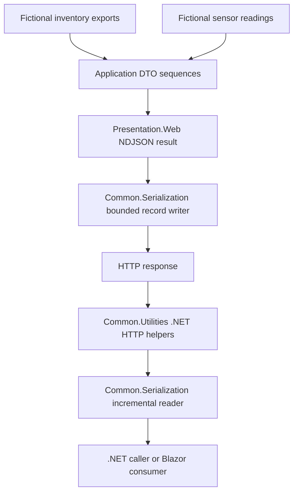

# Design Specification: NDJSON Streaming

> Provide reusable NDJSON sequence serialization, streaming REST endpoint results, and incremental client consumption across bITdevKit applications.

[TOC]

## 1. Purpose and status

This feature supplies the building blocks for endpoints that send typed records incrementally. It belongs to the general DevKit libraries. Applications supply their own data sources, DTOs, access rules, and completion contracts.

Auditing is a future consumer. The streaming feature has no dependency on Auditing and does not adopt its export schema, persistence model, cursors, metadata endpoint, or record types.

This document records the agreed design and delivered contracts. Domain models, services, and routes used for illustration are fictional. Section 9 records the decisions, section 10 defines delivery order, and section 12 links the implementation and validation evidence.

## 2. Agreed scope

- Deliver a separate, reusable NDJSON streaming feature.
- Include both finite result streams and long-lived streams in the final feature specification. Neither mode is deferred out of the target scope.
- Default to raw DTO records and provide an explicit opt-in, versioned envelope with `data`, `heartbeat`, `completed`, and `error` record kinds.
- Limit each encoded record to 1 MiB by default, with a configurable finite limit. Buffer one record at a time and reject an oversized record before writing its bytes.
- Flush every complete record by default. Allow explicit bounded batching, with immediate flushing for heartbeats and terminal records.
- In envelope mode, send an initial heartbeat after validation and further heartbeats after 15 seconds without output by default. Allow a configurable heartbeat interval.
- Apply no overall stream-duration limit by default. Allow an explicit positive, finite maximum duration per endpoint.
- Apply a configurable 30-second deadline to response writes and flushes. On expiry, cancel the producer and abort the response.
- Bound asynchronous producer cleanup with a configurable five-second grace period. Report cleanup timeout and incomplete cleanup without claiming that arbitrary producer code was forcibly stopped.
- Default .NET envelope-client inactivity to 45 seconds while awaiting the next complete record. Exclude application processing time. Raw-client inactivity limits are opt-in.
- Default NDJSON endpoint delivery to unbuffered, uncompressed responses. Compression is an explicit opt-in with end-to-end streaming verification.
- Keep client reconnection off by default. Reconnection and resumption require an explicit application-controlled opt-in and an endpoint-specific replay contract where resumption is needed.
- Support ASP.NET Core Minimal API endpoints built with the existing `EndpointsBase` and Result mapping conventions.
- Offer streaming through explicitly mapped, dedicated endpoints.
- Let a SPA process records as they arrive without saving a file.
- Make attachment headers and download filenames explicit endpoint options.
- Configure shared server defaults once and allow per-endpoint overrides. Each endpoint declares its wire mode and matching OpenAPI metadata.
- Keep application DTOs and data retrieval independent of HTTP.
- Preserve the existing requester preparation pipeline. HTTP response execution owns stream enumeration and cancellation, while producers own their data-access resources.
- Deliver asynchronous `NdjsonWriter` and `NdjsonReader` APIs in `Common.Serialization`, usable with caller-owned streams outside HTTP.
- Expose bounded encoded-record ownership and original received-record bytes for consumer-defined byte budgets and digests, without reserializing values or buffering a whole response.
- Expose one terminal output outcome to an optional per-response observer after output stops and cleanup finishes, fails, or exhausts its grace period. Keep transport success separate from consumer-defined business completion.
- Deliver .NET HTTP client helpers, including support for Blazor. JavaScript modules, TypeScript definitions, and other non-.NET client SDKs are outside the delivery scope.
- Support future adoption by Auditing without making Auditing the owner of the streaming components.
- Verify finite and live authenticated producers, a bounded-history Blazor consumer, and a user-scoped stored-record feed. Use fictional inventory and sensor domains in documentation.
- Produce a specification before implementing the feature.

The feature does not require same-URL content negotiation. An endpoint can declare NDJSON as its success representation. Authentication and authorization remain host and endpoint responsibilities.

## 3. Existing repository contracts

The design builds on these existing components:

- [`Common.Serialization/ISerializer`](../../src/Common.Serialization/ISerializer.cs) synchronously serializes one value to a `Stream`. `ITextSerializer` identifies text serializers. Neither contract describes asynchronous sequence consumption.
- [`DefaultJsonSerializerOptions`](../../src/Common.Serialization/DefaultJsonSerializerOptions.cs) supplies the canonical JSON converters and naming policy. Its defaults enable indentation.
- [`Presentation.Web` JSON configuration](../../src/Presentation.Web/Json/ServiceCollectionExtensions.cs) configures the effective ASP.NET Core HTTP JSON options.
- [`EndpointsBase`](../../src/Presentation.Web/Endpoints/EndpointsBase.cs) organizes Minimal API endpoint sets.
- [`ResultMapExtensions`](../../src/Presentation.Web/Result/Map/ResultMapExtensions.cs) provides the existing `MapHttp*` entry points. [`ResultMapHttpExtensions`](../../src/Presentation.Web/Result/Map/ResultMapHttpExtensions.cs) implements typed HTTP success and failure mapping.
- [`IRequester` and `Requester`](../../src/Common.Utilities/Requester/Requester.cs) return `Task<Result<TValue>>`. Their current dispatch pipeline surrounds handler invocation, rather than later enumeration of a lazy result value.
- [`Presentation.Web.Client`](../../src/Presentation.Web.Client/Presentation.Web.Client.csproj) targets .NET 10 and already supplies Blazor client support. Its current [`ApiClientBase`](../../src/Presentation.Web.Client/ApiClientBase.cs) prepares authenticated requests.

Existing serialization and endpoint behavior remains compatible. This feature adds sequence-specific APIs instead of changing the meaning of `ISerializer.Serialize(object, Stream)`.

## 4. Architecture



### 4.1 Application data source

Use the BCL `IAsyncEnumerable<T>` for an asynchronous sequence of application DTOs. A producer retrieves records incrementally and observes enumeration cancellation.

Finite sources finish after their selected records. Long-lived sources can wait for new records indefinitely and must remain cancellable while idle. Both modes use the same sequence and record-writing primitives. Sections 5 and 6 define completion, heartbeat, reconnection, and timeout behavior.

For operations that can fail before enumeration starts, a handler can return `Result<IAsyncEnumerable<T>>`. The outer Result describes admission and initial validation. It does not assert that the entire stream has completed successfully.

Support `IEnumerable<T>` for existing bounded collections. Adapting a materialized collection does not make its retrieval incremental. Do not imply that wrapping `ToListAsync()` produces bounded end-to-end memory use.

### 4.2 Common serialization

Place HTTP-independent `NdjsonWriter` and `NdjsonReader` APIs in `Common.Serialization`. Both support configurable record limits, caller-provided JSON settings, and cancellation. They leave caller-owned streams open.

The sequence operations have these shapes:

```csharp
Task WriteAsync<T>(
	IAsyncEnumerable<T> items,
	Stream destination,
	CancellationToken cancellationToken = default);

Task WriteAsync<T>(
	IEnumerable<T> items,
	Stream destination,
	CancellationToken cancellationToken = default);

IAsyncEnumerable<T> ReadAsync<T>(
	Stream source,
	CancellationToken cancellationToken = default);
```

Also expose a single-record `WriteRecordAsync<T>` primitive for coordinators that own heartbeat and flush scheduling. It writes one capped JSON value and its line feed without flushing. Sequence `WriteAsync` applies the configured flushing policy. HTTP results use the same encoding primitive rather than duplicating record serialization.

Each supplied item represents one complete JSON value. A collection supplied as an item remains an array within that record. A string item remains one JSON string. A dictionary item remains one JSON object. A null item is a JSON `null` record and is not silently skipped. The writer does not infer a different record boundary from a runtime `object` value.

The writer uses `System.Text.Json` with the effective converters and naming policy. Derive compact options without mutating the shared options instance. The writer owns JSON record framing and leaves the destination open.

The reader yields records incrementally and enforces its configured record-size limit while assembling each line. It does not load the source to completion, require seeking, or use synchronous I/O on the source stream. Early exit and cancellation release reader-owned buffers without closing the caller's stream.

Constructors accept effective `JsonSerializerOptions` and writer or reader options. Both option types include `MaxRecordBytes`, defaulting to 1,048,576. Writer options also describe flushing and optional batching. Options are validated and captured without mutating caller settings. Sections 6.2 and 6.3 define encoding limits, buffering, and flushing behavior. HTTP validation and shared-envelope lifecycle handling belong above the raw record reader.

#### 4.2.1 Exact encoded and received record bytes

Expose these additional members on `NdjsonWriter` and `NdjsonReader`, respectively:

```csharp
// NdjsonWriter
Task<NdjsonEncodedRecord> EncodeRecordAsync<T>(
	T value,
	CancellationToken cancellationToken = default);

Task WriteEncodedRecordAsync(
	NdjsonEncodedRecord record,
	Stream destination,
	CancellationToken cancellationToken = default);

// NdjsonReader
IAsyncEnumerable<NdjsonReadRecord> ReadRecordsAsync(
	Stream source,
	CancellationToken cancellationToken = default);

T Deserialize<T>(NdjsonReadRecord record);
```

Both record types expose `ReadOnlyMemory<byte>` views named `JsonBytes`, `DelimiterBytes`, and `FramedBytes`. `JsonBytes` contains the exact UTF-8 JSON value, including any original permitted surrounding whitespace. `DelimiterBytes` contains its actual delimiter. `FramedBytes` contains both, in order, and its length is the exact framed byte count. These are read-only views of one bounded record, not additional full-record copies. `MaxRecordBytes` applies to `JsonBytes`; reserve at most two additional delimiter bytes when reading and one when encoding.

`EncodeRecordAsync` serializes and validates once into a capped owned buffer. It performs no destination I/O. The returned `NdjsonEncodedRecord` implements `IDisposable`; its caller owns the lease and releases it after budgeting, hashing, and any awaited write. Disposal is idempotent and invalidates its memory views. The writer always encodes LF as the delimiter. An oversized or invalid value yields no usable record and emits no bytes. Encoded records have no public unchecked construction path.

`WriteEncodedRecordAsync` writes those exact framed bytes without serializing again, flushing, or disposing the record. Reject a disposed record or one exceeding the destination writer's configured record limit before writing. Keep the lease valid through the awaited write. A completed write means that the destination's asynchronous writes returned successfully, not that a recipient received or persisted the record. Failure can leave a partial record on the destination; never retry it automatically. The existing `WriteRecordAsync<T>` convenience encodes, writes, and disposes through this same path.

`ReadRecordsAsync` yields validated `NdjsonReadRecord` views borrowed from the current reader iteration. They remain valid until the next `MoveNextAsync` or enumerator disposal, whichever occurs first. Process or hash a record before advancing. Retention requires an explicit caller-bounded copy. Advancing, early exit, cancellation, and failure release reader-owned buffers; the source stream stays open. Reader read-ahead is bounded and cannot invalidate the current views.

Preserve original JSON spelling, escaping, whitespace, and delimiters. An accepted CRLF remains CRLF; do not normalize it to LF for a consumer's digest. The optional unterminated-final-record compatibility mode exposes an empty delimiter, never an invented newline. Empty-line compatibility can skip empty lines, so consumers requiring byte-exact protocol verification use strict mode. `Deserialize<T>` uses the reader's captured JSON settings on `JsonBytes` without advancing or changing the views. Typed `ReadAsync<T>` uses the same framing implementation and releases each view before yielding the independent deserialized value.

Consumers choose which records and bytes enter their digest. The library neither hashes a whole response implicitly nor treats reserialization as the original bytes. Consumer hashing observes uncompressed representation bytes after HTTP content decoding, before any JSON normalization. Keep outstanding encoded records and any explicit copies bounded; these APIs do not authorize a full-response buffer or an unbounded frame queue.

### 4.3 HTTP result and endpoint mapping

Place the ASP.NET Core integration in `Presentation.Web`. The type is `NdjsonHttpResult<T>`, implementing the framework's HTTP `IResult` contract.

The result sets the NDJSON content type, consumes the sequence asynchronously, propagates request cancellation, and delegates record encoding to the Common writer. It also provides response metadata for endpoint documentation.

The `MapHttpNdjson()` extensions accept `Result<IAsyncEnumerable<T>>` and bounded collection results. They reuse existing Result error mapping before success output begins. A typed direct result factory supports service-based endpoints that do not use `IRequester`.

After authentication, authorization, requester admission, and option validation succeed, commit the raw response's success headers before requesting its first item. Apply the response write deadline to this start operation. Do not prefetch a record to delay header commitment. This rule is the same for finite and live raw sources, so opening an admitted idle source does not wait indefinitely for its first value. Admission failures remain ordinary HTTP failures. A first-record source, encoding, or size failure after header commitment aborts the response, even if no record bytes were written. The HTTP success status describes admission, not successful stream completion. Envelope mode commits success through its initial heartbeat after the same admission checks.

The `ProducesNdjson<T>()` helper describes the media type and the record model. The implementation must represent a sequence honestly for the selected OpenAPI version. An ordinary JSON array schema does not describe NDJSON bytes. Generated clients must not be assumed to support incremental NDJSON consumption.

The result method `WithObserver(INdjsonStreamObserver observer)` attaches the per-response terminal observer in section 6.11. It does not register a global observer or change the wire mode. The HTTP executor owns its invocation; do not also attach the same observer to an inner writer and notify it twice.

Provide a raw-only factory on the non-generic `NdjsonHttpResult` factory type for coordinators that have already encoded and budgeted records:

```csharp
NdjsonHttpResult<TRecord> FromEncodedRecords<TRecord>(
	IAsyncEnumerable<NdjsonEncodedRecord> records,
	NdjsonEndpointOptions options = null);
```

`TRecord` declares the application record schema for metadata; it does not cause another serialization or runtime type activation. This path uses the same HTTP execution, deadlines, flushing, and observer accounting as typed output, writing each frame through `WriteEncodedRecordAsync`. It never serializes the buffer-owner object. The executor takes ownership of each yielded frame. It disposes the frame after its awaited destination write, or after copying its bytes into an explicitly configured bounded batch buffer, before requesting another. Staging a batch is not confirmed output. The producer releases frames it does not yield. Reject envelope mode or contradictory metadata before output begins. Consumers can therefore inspect exact bytes before admission without introducing another HTTP streaming implementation.

### 4.4 Client readers

Maintained client helpers are limited to .NET, including Blazor. The public wire format remains usable by other SPAs, but this feature does not deliver a JavaScript reader, TypeScript definitions, or an npm package.

A client reader decodes UTF-8 incrementally, assembles complete lines across network chunks, parses each JSON record, and yields records to its caller. Network chunks can split a UTF-8 character, split a record, or contain several records.

The client must inspect status and content type before parsing a success stream. A normal HTTP failure can have a Problem Details body instead of NDJSON. Reading the whole response as text defeats incremental delivery. Parsing the entire NDJSON response as one JSON document is invalid.

Provide .NET `HttpClient` helpers over the Common reader, with raw-record and shared-envelope consumption. Cancellation and early enumeration exit must release the response and helper-owned resources. Keep a caller-provided `HttpClient` open.

Place general HTTP helpers with the existing HTTP utilities in `Common.Utilities`. This keeps ordinary .NET clients independent of Blazor and server Presentation dependencies. Reuse those helpers from Blazor rather than maintaining a second parser.

Provide request-based APIs that preserve caller authentication and support GET and POST endpoints. The response-open phase validates status, media type, and declared mode before returning a stream handle, using DevKit Results for recoverable initial failures. The handle owns the HTTP response and is asynchronously disposable. It exposes a single-use raw or envelope enumeration. Do not dispose caller-owned requests or clients. A convenience GET helper can own the request it creates.

The raw response handle also exposes `ReadRecordsAsync` with section 4.2.1's original-byte views and borrowed lifetime. Typed, framed, and envelope consumption are alternative single-use paths over the same response, not separate enumerations. This lets a consumer inspect its own entry kind and hash selected original records while reusing the shared framing and HTTP handling.

Mid-enumeration I/O and framing failures must be observable to the caller, with cancellation, inactivity, malformed input, and incomplete envelope output distinguished. An envelope `error` is a terminal failure, not normal successful enumeration. Reading data without exposing control frames must preserve the same failure semantics. Do not allow two enumerators to read one response concurrently.

Both `ReadEnvelopesAsync` and `ReadDataAsync`, and their Common envelope-reader counterparts, throw `NdjsonStreamException` from the `MoveNextAsync` that parses a valid terminal `error`. Set the local `ReasonCode` to `stream_terminal_error`. Preserve its remote `error.code` as `RemoteErrorCode` and optional `error.traceId` as `TraceId`. The exception message is `NDJSON stream terminated with an error.` and does not echo the remote message or record bytes. Do not yield the error envelope before throwing, wait for another pull to throw, or turn the error into normal EOF. These fields are diagnostic input and must not be logged without validation. Opening failures still use Results.

The envelope path yields valid `heartbeat`, `data`, and `completed` frames. The data-only path yields only data values. A validated `completed` ends either path successfully, after yielding that frame only on the envelope path. Terminal handling stops reads and releases the HTTP response without waiting for transport EOF or draining later bytes. Bytes sent after a terminal frame violate the server contract; the helper does not claim to inspect them. Malformed frames, unsupported versions, incomplete output, and caller cancellation retain their distinct existing failure rules.

Use `HttpCompletionOption.ResponseHeadersRead` and asynchronous body reads. Do not buffer the complete body, require synchronous reads, or assume a seekable response stream. .NET 10 browser HTTP response streaming is enabled by default. Verify the shared helper in Blazor WebAssembly rather than adding a separate transport to enable that existing framework feature.

Client record-size limits remain explicit caller-controlled settings. A response cannot silently raise a client's configured limit. Verify raw and envelope behavior, cancellation, incomplete output, and disposal in native .NET and Blazor tests.

### 4.5 Server defaults and endpoint overrides

Provide one server registration for shared NDJSON defaults. The registration name is `AddNdjsonStreaming`. It configures limits, flushing, and other streaming policies without mapping endpoints or changing existing JSON responses.

An endpoint can override those defaults. Resolve effective values in this order: built-in defaults, configured server defaults, then explicit endpoint overrides. Omitted endpoint settings inherit the effective server value. Validate invalid sizes and batching settings before accepting requests.

Each dedicated endpoint declares raw or envelope mode and uses the same normalized configuration for response execution and OpenAPI metadata. Raw remains the default. Do not infer the wire mode from a payload or switch it based on a record's fields. Download presentation remains an explicit endpoint option.

Use the host's effective HTTP JSON converters and naming policy unless an endpoint explicitly supplies different JSON settings. Clone effective options to disable indentation without mutating shared options. Capture a consistent options snapshot for a response so configuration changes cannot alter framing or limits halfway through a live stream.

The options types are `NdjsonStreamingOptions` for server defaults and `NdjsonEndpointOptions` for endpoint overrides. Allow a default raw endpoint with minimal ceremony and explicit overrides for limits, batching, envelope mode, and a safe download filename. Share one normalized endpoint descriptor between execution and metadata. Reject contradictory declarations rather than documenting a different mode from the one sent.

An override must distinguish an omitted duration setting from explicitly selecting no overall duration limit. Validate positive record limits, positive finite heartbeat and write intervals, and both batching bounds. Client options remain independent. The standalone Common reader and writer remain usable without ASP.NET Core or dependency injection.

OpenAPI metadata must include the success media type, declared wire mode, versioned envelope contract when selected, per-record model, examples, and normal pre-stream HTTP errors. Describe streaming behavior and the terminal error policy. Use a representation supported by the document's OpenAPI version and attach per-record metadata separately when that version cannot express an item sequence directly. Do not publish NDJSON as an ordinary JSON array or promise that generated clients parse it incrementally.

## 5. Wire format and browser behavior

NDJSON has a published community specification. It uses standard JSON values separated by newlines. It is distinct from RFC 7464 JSON Text Sequences.

The writer contract requires:

- UTF-8 without a byte order mark.
- One complete JSON value per record.
- A line-feed byte after every emitted record, including the last record.
- No outer array and no commas between records.
- No literal carriage returns or line feeds inside an encoded record. JSON string escapes remain valid.
- No indentation, despite the normal DevKit JSON defaults.
- The baseline writer serializes supplied values without inserting control records. The optional envelope supplies the shared control-record protocol described below.

The success media type is `application/x-ndjson`. A saved file uses `.ndjson`.

For ordinary SPA consumption, omit `Content-Disposition`. A supplied download filename can request `Content-Disposition: attachment` with a safely encoded filename. This is a response presentation option and does not require creation of a server-side file.

Calling the endpoint through `fetch()` exposes its response body to JavaScript. It does not automatically save the response as a file, including when an attachment header is present. Direct browser navigation can invoke download behavior.

### 5.1 Raw records and the optional envelope

Raw NDJSON is the default. Each line contains a supplied value with no DevKit wrapper. Applications can use their own DTOs and versioned record contracts in this mode.

Endpoints can explicitly select the shared, versioned envelope. It defines four record kinds:

- `data` carries one application value.
- `heartbeat` communicates that the stream remains active during an idle period.
- `completed` communicates successful stream completion.
- `error` communicates a stream failure when the agreed failure policy allows an in-band record.

The endpoint contract declares its wire mode. Readers must not infer control records from properties on an ordinary DTO. Both modes remain NDJSON, with one complete JSON value per line.

The envelope protocol is general-purpose and independent of Auditing. A stream completion signal does not by itself prove application-specific export completeness, database commit, or client processing of all records.

Sections 5.2, 6.1, and 6.5 define the versioned contract, terminal error handling, and heartbeat scheduling.

### 5.2 Envelope version 1

Define `NdjsonEnvelope<T>` in `Common.Serialization` without ASP.NET Core dependencies. Reserve fixed, case-sensitive structural JSON names independent of the host's naming policy. Only the application value inside `data` uses the effective application JSON settings.

Every envelope has integer `version` equal to `1` and a string `kind`. The four forms are:

```json
{"version":1,"kind":"heartbeat"}
{"version":1,"kind":"data","data":{"id":"todo-1","title":"Try streaming"}}
{"version":1,"kind":"completed","recordCount":1}
{"version":1,"kind":"error","error":{"code":"stream_source_failed","message":"The stream could not continue.","traceId":"optional-correlation-id"}}
```

Each example is one complete newline-terminated record on the wire. `data` requires a `data` property, including when its value is JSON `null`. `completed` requires a non-negative 64-bit `recordCount` counting fully emitted data records, excluding control records. The count is scoped to this response and is not a cursor. An empty finite envelope stream emits its initial heartbeat and `completed` with count zero.

`error` requires a stable code and a safe message. `traceId` is optional. Map known timeout, size, and producer failures to stable codes without exposing exception details. Error projection must not depend on serializing the failed application DTO. The error envelope remains subject to the record-size and write limits.

An envelope-aware reader rejects unsupported versions, unknown kinds, missing required properties, invalid counts, and duplicate reserved properties. The terminal `recordCount` must match the data records observed in that response. Additional non-reserved properties can be ignored within version 1. A data-only convenience reader still validates control records and completion. It must surface failure or incomplete output instead of silently ending successfully.

DevKit HTTP endpoints advertise `X-Ndjson-Mode: raw` or `X-Ndjson-Mode: envelope`. Envelope mode also advertises `X-Ndjson-Envelope-Version: 1`. These headers describe the fixed endpoint contract and do not negotiate a different mode. Generic raw helpers can consume ordinary NDJSON servers without these headers, but reject a declared incompatible mode. Envelope HTTP helpers require the declared supported envelope contract. For cross-origin Blazor clients, the existing host CORS policy must expose these headers. The feature does not grant cross-origin access automatically.

### 5.3 Reader framing and strictness

The reader accepts LF and CRLF delimiters and enforces one complete JSON value per record. The size cap counts JSON bytes and excludes delimiter bytes. A possible CR before LF requires only bounded delimiter lookahead.

Reject a BOM, invalid UTF-8, malformed JSON, multiple JSON values on one line, and literal line breaks within a record. Nested arrays and objects remain valid when serialized on that line. A low-level deserializer accepting arbitrary whitespace-separated top-level values is insufficient to enforce these record boundaries by itself.

By default, reject empty lines and a nonempty final record without its newline. Reader options can explicitly enable documented compatibility with empty lines and an unterminated final record for external sources. These options do not weaken envelope completion requirements. Never silently skip malformed or oversized records. Error diagnostics can identify a record number and failure code but must not echo the record contents.

The writer verifies that custom converter output preserves the single-line record contract before emission. Both reader and writer keep record limits active in compatibility modes.

## 6. Stream lifecycle requirements

The implementation must address these boundaries explicitly:

- Complete authentication, authorization, and initial validation before committing success output.
- Propagate cancellation through enumeration, producer I/O, encoding, and response writes.
- Await writes so a slow client applies backpressure. Avoid an unbounded producer queue.
- Dispose the sequence enumerator after success, cancellation, a write failure, and early termination, subject to section 6.4.1's bounded cleanup contract.
- Keep producer resources valid until enumeration ends. Do not return a sequence that captures an already-disposed context.
- Distinguish a source failure from a client disconnect in diagnostics.
- Before the HTTP response starts, use normal HTTP failure handling.
- After it starts, preserve the selected NDJSON wire mode and do not append an unwrapped HTTP Problem Details document as a data record. Apply the terminal error policy in section 6.1.
- Do not retry a partially transmitted response automatically.
- Do not cache a live sequence, serialize it through ordinary requester caching, or treat dispatch completion as stream completion.

The existing requester pipeline covers stream preparation. Its retry, transaction, logging scope, and duration measurement do not automatically extend over deferred enumeration. Section 6.4 defines the supported ownership model.

The consumer owns ordering, consistency across data batches, continuation tokens, replay, deduplication, and proof of business completion. Transport EOF alone does not prove that a particular business export is complete.

### 6.1 Failures after output starts

Raw mode aborts the response after a producer, encoding, limit, or transport failure. It does not inject an error record into the application's DTO sequence.

Envelope mode attempts one terminal `error` record only when the response remains writable and the error can follow a complete record. The error contains sanitized information. It must not expose exception stacks, credentials, or application payload values. After writing the terminal error, terminate the response and release producer resources.

If the transport fails, cancellation prevents further writes, or a partial record has reached the response, abort without attempting another record. The server cannot guarantee delivery of an error record after a connection fails.

Send `completed` only for successful stream completion. Never send it after an error. Neither `error` nor `completed` permits later data or heartbeat records.

Envelope clients distinguish these outcomes:

- A complete `completed` record indicates successful stream completion, subject to the consumer's separate business contract.
- A complete `error` record indicates failure, even if the HTTP connection subsequently ends normally.
- Unexpected EOF or transport termination without a complete terminal record indicates an incomplete stream.
- Explicit caller cancellation indicates a locally canceled operation. It does not imply successful server completion.

Already-sent records remain observable after a failure. The streaming feature does not undo their processing and does not transparently retry the response.

### 6.2 Record size and bounded encoding

The default maximum encoded record size is 1 MiB, equal to 1,048,576 bytes. Count UTF-8 JSON bytes, including all envelope fields when envelope mode is selected. The terminating line-feed byte is outside this limit.

Allow a configurable positive, finite limit so endpoints can support larger DTOs. Do not silently truncate a value, split one value across multiple logical records, or drop an oversized record.

Serialize one record into a capped buffer before writing that record to the destination. Enforce the logical JSON cap on every buffer commit before any destination write. Account separately for the bounded reservation contract of `Utf8JsonWriter`: its writer can request up to three bytes per UTF-16 character plus a 4,096-byte growth window before committing actual bytes. The implementation bounds reservations to `3 * MaxRecordBytes + 4096`, with ArrayPool bucket rounding. A growth copy can temporarily retain the previous allocation. This bounded allowance accepts exact-limit ASCII values; it does not raise the JSON byte limit. Serializing into an unbounded buffer and checking its final length does not meet this requirement.

Use section 4.2.1's encoded-record path for both sequence and single-record output. A coordinator can inspect the complete framed length before spending its remaining byte budget, then write the same bytes. Do not serialize twice or allocate a second full-sized encoding buffer to measure or hash a record. Independent producer graphs and explicitly configured batching buffers retain their separate bounds.

Reject an oversized record before any of its bytes reach the destination. Previously emitted records remain observable. Apply normal HTTP errors before output starts and the failure policy in section 6.1 afterward.

All envelope record kinds use the same size limit. If a terminal error cannot fit within the configured limit, abort rather than bypassing the cap.

Do not accumulate the entire response or prefetch an unbounded sequence. The record buffer bounds encoded framing memory. It does not by itself bound producer batches, the source DTO's object graph, custom converter allocations, or downstream HTTP buffers. Those components retain their own bounded-memory responsibilities.

### 6.3 Flushing and optional batching

By default, write the complete encoded record followed by its line feed, then flush the destination before continuing. This supports incremental SPA consumption without waiting for another producer record.

Endpoints can explicitly select bounded batching for higher throughput. Batching must configure both a positive, finite byte threshold and a positive, finite maximum delay. Start the delay when the first pending record enters the batch. Additional records do not reset that deadline.

Enforce the delay even while the producer waits for new records. Await all response writes and serialize access to the destination. A delay limit bounds when a flush is attempted on a usable connection. It cannot guarantee transmission time while a client or network is blocked.

Count the batched bytes as framed output, including line-feed bytes. Keep additional encoded batching storage bounded independently of the one-record encoding buffer. Do not queue unbounded DTOs. A record larger than the configured batch capacity but within the record-size limit must bypass batching after pending output is flushed.

Heartbeats, `completed`, and `error` records always trigger an immediate flush, including all preceding pending data in order. Successful raw-source completion also flushes pending data before ending the response.

A server flush does not promise one network chunk per record or immediate delivery through every proxy and compression layer. End-to-end verification must cover the supported hosting configuration.

### 6.4 Preparation, enumeration, and resource ownership

Keep the current `IRequester.SendAsync()` contract. A handler validates and prepares a stream, then returns `Result<IAsyncEnumerable<T>>`. Existing requester behaviors surround that preparation operation. This feature does not introduce a second requester pipeline that silently extends those behaviors over enumeration.

Preparation retries and timeouts retain their existing meaning. They do not retry an emitted stream or impose a deadline on later enumeration. A successful preparation Result means the operation can start, not that all records have been produced.

HTTP response execution consumes the sequence once and owns propagation of request cancellation and asynchronous enumerator disposal. The implementation can delegate enumeration to the Common writer, but that delegation does not transfer ownership of the HTTP response. Maintain at most one pending producer `MoveNextAsync()` and serialize writes to the destination.

The producer owns its resource scopes inside the iterator and releases them through iterator cleanup. A handler must not return a lazy sequence that depends on a resource already disposed by handler preparation.

Use bounded data-access scopes. Do not hold a database transaction open for an entire live feed. For paged database sources, release the page's reader and context before yielding detached DTOs to a consumer that can pause for network backpressure. Application code continues to use its data-access abstractions, with provider-specific work behind the established architecture boundaries.

Observe stream lifetime separately from requester preparation. Stream diagnostics cover enumeration through cleanup and distinguish success, producer failure, incomplete transmission, and cancellation. Emitted-record and byte counts describe server output, not acknowledged client processing. Do not log record payloads by default.

#### 6.4.1 Bounded cleanup and non-cooperative producers

Provide `CleanupTimeout` on Common writer options and server defaults, with inheritable endpoint overrides. Its default is five seconds. Validate a positive, finite value and measure it with `TimeProvider`. This is a separate cleanup grace period, not an overall stream-duration cap or the observer timeout.

Start one cleanup budget when production ends naturally or the executor stops normal production after failure or cancellation. Stop heartbeat and batch scheduling. Request producer cancellation when work remains. The budget covers settlement of an outstanding producer move and one enumerator-disposal attempt. Wait for a pending `MoveNextAsync` to settle before calling `DisposeAsync`; never invoke them concurrently. Discard a late value without writing it, and dispose a late yielded encoded-record lease. Do not reset the budget between these steps. A raw success final flush and an envelope success footer are permitted only after cleanup succeeds. A safe error footer may precede cleanup, using its separate output deadline.

If cleanup throws or the budget expires, the execution is `Failed` and must not emit `completed`. On expiry, use `FailureStage.Cleanup` and `stream_cleanup_timeout` when no earlier execution failure exists. A preceding cancellation alone does not hide a cleanup failure. Preserve an earlier execution failure and report the secondary cleanup failure separately. Abort an HTTP response on cleanup timeout. A Common writer leaves its caller-owned stream open and propagates the failure. Neither path emits more output after finalization.

An expired budget ends the executor's wait, not the producer's code. Set `CleanupCompleted` to false. Install one observed continuation for unfinished asynchronous work: observe its eventual exception, release late owned leases, and attempt disposal once after a pending move settles. Never restart production, retry disposal, change a published outcome, or notify the observer again. A write that still uses an owned buffer retains that buffer until the operation settles; returning its storage early is invalid. Late cleanup cannot use the HTTP response or callback observer. Producer-owned scopes needed by unfinished work remain that work's responsibility.

Producer methods must return promptly or await cancellable I/O, and producer cleanup must cooperate. A detached producer must not depend on request-scoped services or `HttpContext`; capture immutable identity and selection data, and create independently owned scopes inside the iterator. The library cannot preempt a synchronous blocking `MoveNext` or disposal call, terminate arbitrary code, or guarantee resource release when that code never settles. Record safe cleanup-timeout diagnostics and document this limit. During host shutdown, signal producer cancellation and apply the same grace period, subject to an earlier host/process shutdown deadline. Do not claim graceful completion for a live source stopped by shutdown.

### 6.5 Envelope heartbeats

After authentication, authorization, and preparation validation succeed, envelope mode writes and immediately flushes an initial `heartbeat` record. This makes the accepted stream observable before the first data item is available. The same rule applies to finite and long-lived envelope streams.

The initial heartbeat starts the success response. A subsequent producer failure follows section 6.1 even when no data record has been emitted yet. Rejected preparation must not emit a heartbeat or commit success headers.

By default, emit another heartbeat after 15 seconds without output. Allow a configurable positive, finite interval through the shared defaults and endpoint overrides. Ordinary data output resets the idle interval, so an active stream does not accumulate redundant heartbeats.

Heartbeats use the same capped encoding and ordered response writer as other records, and always flush immediately. A pending source read must not prevent an idle heartbeat. Maintain one pending `MoveNextAsync()` while waiting for data and serialize heartbeat writes with data writes. Do not start concurrent enumeration operations or inject a heartbeat into an unfinished record.

Stop scheduling heartbeats when the stream completes, fails, or is canceled. Dispose timer resources during response cleanup. A heartbeat reports stream activity, not database health, successful business progress, or client acknowledgment.

Raw mode does not inject heartbeat values, empty lines, or other keepalive bytes into the supplied record sequence. Its hosting configuration must support the source's expected idle periods.

Sections 6.6 through 6.10 define duration, connection deadlines, client inactivity, hosting, and application-controlled reconnection requirements.

### 6.6 Overall stream duration

The built-in default has no overall stream-duration limit. This supports long-lived feeds without forcing periodic completion or reconnection. Finite sources still end naturally when their records are exhausted.

Allow a configured positive, finite maximum duration through server defaults and endpoint overrides. The duration covers response execution, including enumeration, producer waits, encoding, heartbeats, and writes. Requester preparation retains its own existing timeout behavior.

When a configured duration expires, cancel the producer and stop normal output. Expiry is a timeout, not successful completion. Apply normal HTTP timeout handling before output begins. After output begins, use the failure policy in section 6.1 when a bounded terminal error can still be written safely. Otherwise abort. Never label a duration-limited partial stream as `completed`.

The duration deadline stops normal production. A safe terminal error uses a separate bounded write deadline linked to request cancellation, so an already-expired producer token cannot prevent the error attempt by itself. Terminal signaling and cooperative cleanup can extend past the production deadline. A write timeout or disconnected request still requires an immediate abort without another write attempt.

Request cancellation remains active regardless of the duration setting. An absent overall duration cap does not disable the separate connection write and client inactivity policies. Host and reverse-proxy timeouts can also end a connection and must be documented for deployment.

### 6.7 Response write deadlines

The default deadline for an awaited response write or flush is 30 seconds. Allow a configurable positive, finite deadline through server defaults and endpoint overrides. Apply it consistently to data, heartbeat, batch, and terminal output.

This is a deadline for completion of an asynchronous write or flush operation. It does not promise detection of every period without network progress, and it is independent of the overall stream-duration setting. A healthy long-lived stream can continue indefinitely while its individual output operations meet their deadlines.

If the deadline expires, cancel the producer and abort the HTTP response. A stalled or partially written connection is not a safe destination for another terminal error attempt. Do not emit `completed` or retry the response after a write timeout.

Link each output deadline to request cancellation and dispose per-operation cancellation resources. Once a timed-out write has caused an abort, do not start competing output operations. Complete iterator cleanup through the established cancellation and disposal contract.

### 6.8 .NET client inactivity

The .NET envelope helper defaults to a 45-second inactivity timeout while actively awaiting the next complete, valid envelope record. This permits three default server heartbeat intervals. Allow an explicit client timeout appropriate to the endpoint's documented heartbeat interval.

Data and heartbeat records count as activity. Partial bytes do not reset the complete-record deadline. A terminal `completed` or `error` record ends consumption according to its protocol meaning.

Run the timer only while the client is awaiting input. Do not count time spent processing a yielded data item or otherwise pausing enumeration. Restart the input-wait interval when the caller requests the next record. This preserves pull-based backpressure without treating slow application processing as a dead server.

On inactivity expiry, stop reading, release the HTTP response and parser resources, and surface a timeout or incomplete-stream outcome. Do not report successful completion. Explicit caller cancellation remains distinguishable from inactivity timeout.

Raw helpers have no inactivity timeout by default because the source can legitimately remain idle without automatic heartbeats. A caller can configure one explicitly. Server-side settings do not silently raise a client timeout or memory limit, and neither helper mutates the caller's `HttpClient` configuration.

### 6.9 Buffering, compression, and hosting

Default NDJSON endpoint delivery to unbuffered, uncompressed responses. Request streaming behavior from the supported ASP.NET Core response-body feature and avoid middleware that materializes a full response. This does not remove the bounded record and optional batching buffers defined above.

Compression requires an explicit endpoint opt-in. Reuse supported ASP.NET Core and host compression facilities rather than implementing a codec in the NDJSON writer. Verify that the selected provider and middleware order preserve incremental record delivery, idle heartbeats, terminal records, and cancellation.

The default hosting recipe must keep NDJSON out of automatic compression. The compressed recipe must be explicit. Do not claim that an endpoint option alone controls compression applied by an external web server or proxy.

Document reverse-proxy settings that disable response buffering and permit the intended response lifetime and idle intervals. Verify first-record delivery and heartbeat timing through the supported proxy setup. A server flush or a local test alone does not prove end-to-end delivery timing.

Do not set a guessed full-response `Content-Length`, force HTTP/1.1 transfer-encoding headers, or assume one transport chunk per record. Let the host select appropriate HTTP framing.

### 6.10 Application-controlled reconnection

Reconnection is off by default and requires an explicit application-controlled opt-in. The base .NET HTTP helpers consume one response and surface terminal errors, timeout, disconnection, and incomplete output. They do not silently reopen the endpoint.

An application can explicitly open a new request after deciding whether retry is appropriate. It supplies any endpoint-specific resume cursor and retry delay, and remains responsible for cancellation of its reconnect loop. The generic NDJSON feature does not create replay identifiers, persist checkpoints, or claim exactly-once delivery.

A reconnect is a new request with normal authentication, authorization, validation, and limits. It does not turn an incomplete previous response into successful completion. A yielded item is not a durable acknowledgment that application processing has completed, so the application owns checkpoint advancement and deduplication.

If the endpoint has no replay contract, document whether a new connection starts a fresh snapshot or only observes future records. Do not present that behavior as a guaranteed continuation of the previous sequence.

### 6.11 Terminal output outcome and observer

Provide these HTTP-independent contracts in `Common.Serialization`:

```csharp
public enum NdjsonStreamStatus { Succeeded, Failed, Canceled }

public enum NdjsonStreamFailureStage { Source, Encoding, Write, Flush, Cleanup }

public sealed record NdjsonStreamOutcome(
	NdjsonStreamStatus Status,
	bool SourceCompleted,
	bool CleanupCompleted,
	long WrittenRecordCount,
	long WrittenFramedByteCount,
	long FlushedRecordCount,
	long FlushedFramedByteCount,
	bool PartialWritePossible,
	NdjsonStreamFailureStage? FailureStage = null,
	string ReasonCode = null);

public interface INdjsonStreamObserver
{
	Task OnFinishedAsync(
		NdjsonStreamOutcome outcome,
		CancellationToken cancellationToken = default);
}
```

Supply observer-taking overloads of both sequence `WriteAsync` methods alongside the existing overloads. Single-record writes leave overall completion to their caller, who can await `WriteEncodedRecordAsync` and the destination's `FlushAsync` directly. The HTTP result uses the same outcome accounting across its complete response execution, including shared envelope records and configured batching. No Application or Auditing types enter these contracts.

An observed execution attempts `OnFinishedAsync` once after output has stopped, any permitted terminal output/final flush has finished or failed, and producer cleanup has completed, failed, or exhausted `CleanupTimeout`. Failures before the first record are observed too when the result/writer execution actually began. Result-mapping rejection before creating a streaming execution remains ordinary request handling. Do not notify on source exhaustion alone. Double disposal and late cleanup must not repeat notification. Abrupt process termination cannot guarantee a callback.

`SourceCompleted` means enumeration reached its natural end. `CleanupCompleted` is true only when pending producer work has settled, enumerator disposal succeeded, and executor-owned resources were safely released. It is false after cleanup failure or timeout, including an output operation that still owns a buffer. An execution with no acquired resources has completed cleanup. `Succeeded` additionally requires all selected output, the final flush, and cleanup to succeed. Shared envelope mode also requires its terminal `completed` record to be written and flushed; finish source cleanup before emitting that success record. A source error, encoding/size failure, write/flush failure, or cleanup failure produces `Failed` even if earlier records were written. Observed request/source cancellation with successful cleanup is `Canceled`; a duration, write, or cleanup timeout remains `Failed` with a stable reason code. Do not classify an arbitrary unrelated `OperationCanceledException` as request cancellation.

Written counts cover only complete record writes confirmed by the destination, including delimiters. Copying bytes into the batching buffer is not a destination write. Flushed counts identify the contiguous complete-record prefix covered by the last successful destination flush. With batching, do not claim records from a failed batch as confirmed merely because its staging buffer was filled. After an ambiguous/partial write or failed flush, retain the last confirmed counts, set `PartialWritePossible` conservatively, and do not guess how many bytes reached the client. Counts include raw application records or all shared envelope kinds; they are not business-record counts or recipient acknowledgements.

The immutable outcome contains safe counts/stages/reason codes, never DTOs, encoded payloads, principals, exception objects, or credentials. Preserve the first execution failure in `FailureStage`/`ReasonCode`; secondary cleanup failures are reported safely without replacing it. An observer can publish application-owned completion metadata, but cannot write response bytes, retry enumeration, change the finalized transport outcome, or convert a failure to success. Existing writer failure/cancellation propagation and HTTP failure policy remain unchanged.

Give observer notification its own positive finite `ObserverTimeout`, defaulting to five seconds on writer/server options and inheritable endpoint overrides. Capture the observer per execution; shared options cannot retain a request-scoped observer. Use a fresh budget token rather than an already-canceled producer token; link host shutdown when available. Observers must honor cancellation. The caller bounds its wait, reports observer failure/timeout safely, and never retries the callback or replaces the original stream failure. A non-cooperative callback is not forcibly terminated and must not retain request services. Notification cannot reopen output or extend an expired output deadline.

An observer failure is a metadata/reporting failure, not proof that a successful output was undelivered. Report it separately; do not append another error/footer or claim the callback published metadata. Consumers own durable metadata delivery, business completion, checkpoints, and acknowledgement. For example, a transport-successful raw response can carry an application-defined Partial export, while a source-complete response whose final flush failed cannot publish successful export completion.

## 7. Fictional endpoint samples

The inventory and sensor types below illustrate application-owned models and producers. They are not DevKit APIs or claims about shipped routes.

### 7.1 Prepare an inventory export

A fictional `StockExportQuery` performs admission checks and returns `Result<IAsyncEnumerable<StockRecord>>`. It prepares the lazy source without enumerating it inside requester transactions or retries.

```csharp
group.MapGet("/inventory/stream",
	async (IRequester requester, CancellationToken ct) =>
		(await requester.SendAsync(
			new StockExportQuery(), cancellationToken: ct))
		.MapHttpNdjson())
	.WithName("Inventory.Stream")
	.WithNdjson<StockRecord>()
	.ProducesResultProblem(StatusCodes.Status400BadRequest);
```

`StockExportQuery` and `StockRecord` belong to the fictional application. `MapHttpNdjson` and `WithNdjson<T>` are implemented DevKit APIs. Select envelope mode through the endpoint descriptor when the caller needs protocol completion records.

### 7.2 Finite inventory and live sensor streams

The fictional API uses these dedicated routes:

- `GET /api/inventory/stream`: finite raw stock records from bounded retrieval.
- `GET /api/inventory/stream/enveloped`: the same selection with version 1 envelopes, including valid empty completion.
- `GET /api/sensors/readings/stream`: a live envelope sequence of synthetic sensor readings until cancellation or a configured limit.

A sensor reading contains a sequence number, sensor identifier, value, and UTC timestamp. The sample demonstrates transport without adding durable storage, replay, or a change-subscription contract. Use a controllable time source for deterministic tests. Test a reading interval longer than the heartbeat interval to prove idle activity.

A Blazor dashboard starts and cancels streams through the .NET helpers. It shows total count, heartbeat, terminal status, and at most 200 recent values. Switching sources and component disposal cancel and dispose the previous response. An invalid sensor interval does not prevent a finite inventory export.

Verify long-lived sources independently in raw and envelope modes. Tests must demonstrate finite and long-lived producers without buffering their complete output.

### 7.3 User-scoped stored inventory

A fictional warehouse export emits one `StockRecord` per inventory entry visible to the caller. Capture the caller's scope and selection during admission. Retrieve at most 100 source rows per page with a stable SKU order and identity tie-breaker. Apply item-level authorization and map detached records before releasing the data-access scope.

Read stored values. Opening an export does not require an upstream refresh per row. Do not materialize an entire collection and wrap it in an async iterator. An ordinary SPA response has no attachment header unless the endpoint explicitly configures a filename.

Document the record shape, access rules, ordering, cancellation, and lack of snapshot or replay guarantees. Integration tests cover caller isolation, zero and multiple batches, cancellation cleanup, record limits, and unchanged neighboring JSON endpoints.

## 8. Required verification

Acceptance evidence must cover:

- Valid compact JSON records, UTF-8, escaping, nested values, and final newlines.
- A first record reaching the consumer before the producer completes.
- Finite streams with zero records and with multiple records reaching natural completion.
- Long-lived streams remaining open between records and releasing resources when canceled while idle.
- A slow reader without unbounded read-ahead.
- Cancellation during source retrieval and blocked response writes.
- Enumerator disposal and producer resource lifetime.
- Initial Result failures, first-record failures, and failures after output starts.
- Correct content type and optional safe attachment headers.
- SPA consumption without a file download.
- Client parsing across split records and split UTF-8 characters.
- Client rejection of invalid status, media type, malformed records, and oversized records.
- Raw mode preserving DTO shapes without injected control records, including DTOs whose properties resemble envelope fields.
- Envelope-aware consumption recognizing the declared protocol and its data, heartbeat, completion, and error record kinds.
- Envelope failures emitting at most one safe terminal error between complete records, with no later completion record.
- Partial writes and unusable connections causing an abort without an appended error record.
- Clients distinguishing terminal failure, incomplete output, and deliberate cancellation.
- Both envelope reader paths throwing `NdjsonStreamException` on the pull that encounters `error`, without yielding it, copying the remote message into the exception, or waiting for EOF. Envelope consumption still exposes heartbeat and successful completion frames.
- Record limits accepting an exact-boundary record and rejecting the next byte, using UTF-8 byte counts that include envelope overhead.
- Oversized records failing before their bytes reach the destination, without unbounded intermediate allocation or partial record emission.
- Default flushing making a complete record available before another producer record is requested.
- Optional batching enforcing both byte and delay bounds, including while the producer is idle.
- Heartbeats and terminal records flushing immediately and preserving the order of pending data.
- Requester preparation completing independently of deferred enumeration, with no implicit enumeration retry or request-wide live-stream transaction.
- Producer cleanup running after success, cancellation, and failure, with bounded page resources released before network waits.
- Five-second default cleanup grace, positive finite overrides, pending-move/disposal serialization, a non-resetting cleanup budget, timeout outcomes with `CleanupCompleted=false`, safe late cleanup, and no second callback or late output. Include host shutdown and document synchronous non-cooperation limits.
- Separate preparation and stream-lifetime diagnostics without payload logging.
- Reader and writer use with non-seekable, asynchronous-only streams outside HTTP, leaving caller-owned streams open after success, cancellation, and failure.
- Reader line assembly enforcing a finite encoded-byte limit before unbounded growth, with buffers released on early enumeration exit.
- Encoding once into a bounded owned record, inspecting its framed length before output, and writing exactly those bytes without a second serialization/full-record buffer. Test disposed frames, target limits, and zero emitted bytes for encoding rejection.
- Raw pre-encoded HTTP results reusing that path without serializing frame owners, releasing yielded/unyielded leases on every exit, and rejecting envelope mode or contradictory record metadata before output.
- Borrowed read-record lifetime, bounded read-ahead, strict/compatibility delimiters, LF versus CRLF, original whitespace/escaping, and typed deserialization without changing the original bytes. Verify digest differences that reserialization would conceal.
- Raw .NET HTTP handles exposing the same original-byte records with one exclusive consumption path, response ownership, and disposal behavior in native .NET and Blazor.
- Terminal observer invocation once after output and cleanup, including empty streams, failure before the first record, source completion followed by final-flush failure, and cleanup failure. No success notification on source exhaustion alone.
- Complete written versus flushed prefixes under batching, partial writes and ambiguous failures, with no inferred recipient receipt or payloads in outcomes.
- Request cancellation versus duration/write timeout, fresh bounded observer tokens, observer failure/timeout isolation, no callback retry, and no duplicate notification through nested HTTP/writer integration.
- A consumer-defined raw metadata/record/completion fixture with selective exact-byte hashing and a byte-limited Partial result. Verify failed final output does not publish successful completion, without referencing Auditing packages.
- Null values remaining real records rather than disappearing from a sequence.
- .NET HTTP helpers consuming raw and enveloped responses incrementally with response-header completion, preserving a caller-owned `HttpClient`, and disposing responses on early exit.
- The same .NET reader and HTTP helpers operating in Blazor WebAssembly with an asynchronous-only browser response stream.
- Server defaults and endpoint overrides resolving deterministically, with invalid settings rejected before requests and consistent options throughout a response.
- Matching runtime and OpenAPI wire modes, record metadata, and opt-in download presentation.
- Initial heartbeats appearing only after successful validation, followed by configurable idle heartbeats in envelope mode without concurrent producer enumeration.
- Heartbeat timers stopping on terminal outcomes and cancellation, with raw mode preserving the original record sequence.
- Long-lived feeds continuing without an implicit overall deadline, with explicitly configured duration expiry reported as timeout rather than successful completion.
- Blocked writes and flushes expiring after the configured deadline, canceling the producer and aborting without another terminal write or a retry.
- Envelope-client inactivity expiring while waiting for a complete record, including partial-byte trickles, without counting application processing time.
- Raw clients remaining idle without an implicit inactivity deadline, while explicit timeout and cancellation settings release resources.
- Default responses remaining uncompressed and incrementally observable, with separately tested opt-in compression through the supported middleware and proxy setup.
- .NET helpers surfacing disconnection and timeout without sending an automatic second request, with explicit application reconnection documented as a separate new attempt.
- A generic example independent of Auditing.

### 8.1 Delivery evidence

Place Common serialization and .NET helper conformance tests with the existing Common tests. Place HTTP result, option, and metadata tests with the existing Presentation tests. Add integration coverage for finite collections, live sources, user-scoped stored records, and a real Blazor consumer.

Use deterministic time and gated producers to prove timing and backpressure without arbitrary sleeps. A real HTTP client or browser must receive the first record before a gated source is allowed to complete. An in-memory response snapshot alone is insufficient proof of incremental network delivery.

Cover both writer and reader compatibility options, envelope version errors, count mismatches, single-record writes, and inherited configuration explicitly cleared by an endpoint. Verify malformed input and failures without logging payload values.

The byte-access and terminal-observer checks are generic extension-contract evidence. Auditing's own integration must separately prove its HMAC, extraction, digest, checkpoint, and completion semantics.

These are required acceptance checks for the implementation. This specification change does not claim that they have run or passed.

## 9. Decision record

All ten design branches are resolved. These decisions define the target scope and defaults. The public contracts are implemented; verification and hosting boundaries are recorded in the validation evidence.

1. Resolved: the final feature specification includes both finite streams and long-lived streams that can wait indefinitely for new records.
2. Resolved: raw DTO lines remain the default. An explicit opt-in, versioned envelope provides `data`, `heartbeat`, `completed`, and `error` record kinds.
3. Resolved: after output starts, raw mode aborts on failure. Envelope mode attempts one safe terminal `error` at a complete-record boundary when the response remains writable. Otherwise it aborts. No `completed` follows an error, and unexpected termination without a complete terminal record is incomplete output.
4. Resolved: buffer one encoded record at a time, with a configurable 1 MiB default limit including envelope overhead. Reject oversized records before emitting their bytes. Flush every record by default. Optional batching has byte and delay bounds, while heartbeats and terminal records always flush immediately.
5. Resolved: retain the current requester pipeline for preparation. HTTP response execution owns enumeration, cancellation, and disposal. Producers own resources inside their iterators and use bounded data-access scopes. Observe stream lifetime separately.
6. Resolved: deliver asynchronous `NdjsonWriter` and `NdjsonReader` APIs in `Common.Serialization`. The writer accepts asynchronous and synchronous typed sequences. The reader yields `IAsyncEnumerable<T>`. Both support cancellation, configurable record limits, effective JSON settings, and caller-owned streams outside HTTP.
7. Resolved: only .NET client helpers are in scope, including Blazor support through the shared .NET implementation. No JavaScript module, TypeScript definitions, or non-.NET client SDK is delivered.
8. Resolved: shared server defaults with per-endpoint overrides. Each endpoint explicitly declares raw or envelope mode and publishes matching OpenAPI metadata. Download filenames remain opt-in.
9. Resolved: envelope mode sends an initial heartbeat after validation, then a heartbeat after 15 seconds without output by default, with a configurable interval. Raw mode injects no heartbeats. There is no overall duration limit by default, with an optional per-endpoint maximum duration. Response writes and flushes have a configurable 30-second deadline, with producer cancellation and response abort on expiry. Envelope clients use a configurable 45-second timeout while awaiting the next complete record, excluding application processing time. Raw-client inactivity is opt-in. Default delivery is unbuffered and uncompressed, with explicit compression opt-in and documented, verified proxy behavior. Reconnection is off by default and requires explicit application-controlled opt-in. Resume and replay semantics belong to the endpoint and consumer.
10. Resolved: verify finite collections, cancellable live sources, user-scoped stored records, and a bounded-history Blazor consumer. Use fictional inventory and sensor samples in documentation. Conformance, HTTP integration, isolation, and browser evidence are required.

The design chooses sequence APIs over expanding the synchronous single-value serializer contract, explicit endpoint modes over implicit content negotiation, and application-controlled resumption over a generic replay promise. These choices keep the feature reusable while leaving business completeness and delivery guarantees with each consumer.

The two API refinements in sections 4.2.1 and 6.11 make consumer integration explicit. Owned encoding and borrowed original-byte reads support exact budgets/digests without duplicate framing. A terminal observer exposes confirmed output/flush prefixes and failures without claiming business completion. Neither refinement changes the ten agreed design branches or makes the streaming feature depend on Auditing.

### 9.1 Lifecycle and client decisions

The implementation review resolved these remaining details:

1. Commit raw success headers immediately after admission and configuration validation, before awaiting the first value. First-record failures then abort the admitted response. Do not introduce different header timing for finite and live sources.
2. Default `CleanupTimeout` to five seconds with positive finite overrides. Serialize pending-move settlement and disposal, report cleanup timeout as failure, and expose `CleanupCompleted=false` instead of claiming forced resource release. Unfinished producer code remains responsible for its independently owned scopes.
3. Both .NET envelope read paths throw `NdjsonStreamException` on a terminal error, using `stream_terminal_error` and separate remote-code/trace-ID fields. The error frame is not yielded. The envelope path exposes heartbeat and successful completion frames.
4. [Issue #52](https://github.com/BridgingIT-GmbH/bITdevKit/issues/52) publishes complete, versioned source snapshots as issue comments and links them from its body. Include both files in the implementation branch before coding. This publishes the reviewed design without committing unrelated work or relying on inaccessible branch links. Reconcile source hashes before execution.

These choices leave no unresolved product or protocol decision from this review. Implementation and verification results are recorded in the validation guide.

## 10. Delivery order and completion criteria

1. Implement Common record options, bounded writer and reader, owned encoded records, borrowed original-byte reads, terminal outcome/observer contracts, fixed envelope contracts, and conformance tests. Preserve existing `ISerializer` behavior and add no new third-party dependency for NDJSON.
2. Implement the typed HTTP result, Result mapping, validated options, runtime metadata, heartbeat coordinator, deadlines, terminal observer integration, and opt-in compression hosting recipe.
3. Implement .NET HTTP client helpers with explicit response ownership, typed/framed raw and envelope consumption, cancellation, inactivity handling, and no automatic reconnection.
4. Integrate finite and live producers, a bounded-history Blazor consumer, and a user-scoped stored-record feed through the same production building blocks.
5. Run focused Common and Presentation tests, producer integration suites, browser checks, and supported proxy checks. Complete the required solution checks sequentially in the worktree.
6. Publish usage documentation, protocol examples, access and lifetime guidance, configuration defaults, compression and proxy instructions, and limitations. Public C# symbols include XML documentation and usage examples.

The feature is complete when all components, the producer and client integrations, documentation, and acceptance evidence are delivered. Library-only delivery or adding an NDJSON content type to a buffered JSON response does not satisfy this specification. Auditing adoption remains separate future work.

## 11. References

- [NDJSON community specification](https://github.com/ndjson/ndjson-spec).
- [JSON Text Sequences, RFC 7464](https://www.rfc-editor.org/rfc/rfc7464).
- [ASP.NET Core Minimal API responses](https://learn.microsoft.com/en-us/aspnet/core/fundamentals/minimal-apis/responses?view=aspnetcore-10.0).
- [ASP.NET Core response lifecycle](https://learn.microsoft.com/en-us/aspnet/core/fundamentals/middleware/?view=aspnetcore-10.0#short-circuiting-the-request-pipeline).
- [Fetch streaming and line-by-line processing](https://developer.mozilla.org/en-US/docs/Web/API/Fetch_API/Using_Fetch#streaming_the_response_body).
- [Content-Disposition response header](https://developer.mozilla.org/en-US/docs/Web/HTTP/Reference/Headers/Content-Disposition).
- [Blazor web API consumption](https://learn.microsoft.com/en-us/aspnet/core/blazor/call-web-api?view=aspnetcore-10.0).
- [.NET 10 browser HTTP response streaming defaults](https://learn.microsoft.com/en-us/dotnet/core/compatibility/networking/10.0/default-http-streaming).
- [ASP.NET Core response compression](https://learn.microsoft.com/en-us/aspnet/core/performance/response-compression?view=aspnetcore-10.0).
- [OpenAPI 3.1.1](https://spec.openapis.org/oas/v3.1.1.html).
- [Future Auditing consumer](spec-application-auditing.md).

## 12. Implementation references

The implementation uses [Common NDJSON contracts](../../src/Common.Serialization/Ndjson), [HTTP coordination](../../src/Presentation.Web/Ndjson), [Result mapping](../../src/Presentation.Web/Result/Map/ResultMapNdjsonExtensions.cs), and [.NET client helpers](../../src/Common.Utilities/Http/NdjsonHttpClientExtensions.cs). `NdjsonOutputSession.FlushBatchAsync` owns ordered flushing and `NotifyAsync` owns the reporting budget. `NdjsonCleanupCoordinator` owns the single cleanup grace period.

See the [feature guide](../features-presentation-streaming.md) and [validation record](../validation/ndjson-streaming/README.md). The two client-opening reason codes `stream_http_error` and `stream_invalid_content_type` complement the execution codes. All timer options use the BCL supported positive range up to `uint.MaxValue - 1` milliseconds. No overall duration cap is configured by default.

No new output is attempted after abort. An already-issued noncooperative operation may settle later; the executor retains its buffer until settlement and does not revise confirmed counters. OpenAPI payload schemas follow host JSON schema configuration; applications that override naming/conversion per endpoint must supply a matching schema transformer.

Structured diagnostics use `ILogger`: HTTP resolves its host logger factory, and standalone `NdjsonWriter` accepts an optional `logger` constructor argument. Terminal records contain safe counts/codes only; observer failures are reported separately. Diagnostics never receive payloads or exception objects and cannot change finalized output status.

Compression policy is part of the normalized endpoint contract. Runtime factory overrides that contradict its compression flag fail before success output, since middleware has already selected its compression branch. Declare that flag with `WithNdjson`.
