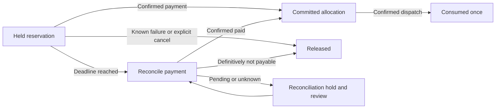
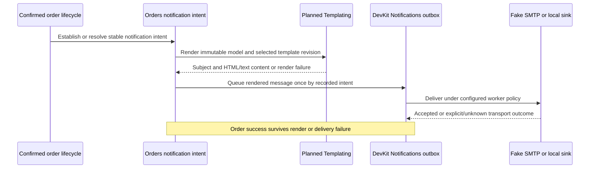
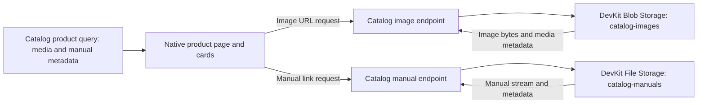
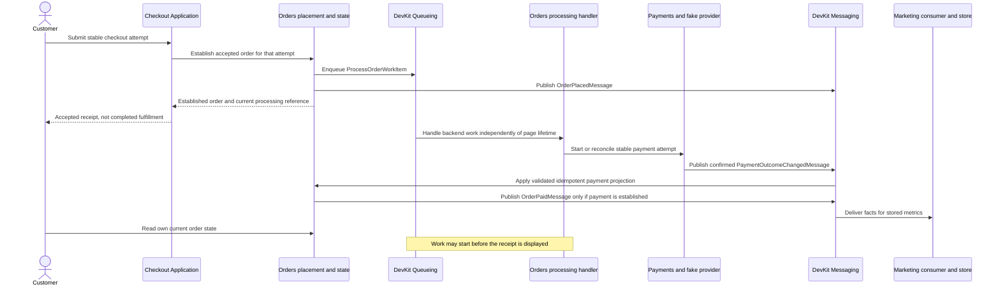
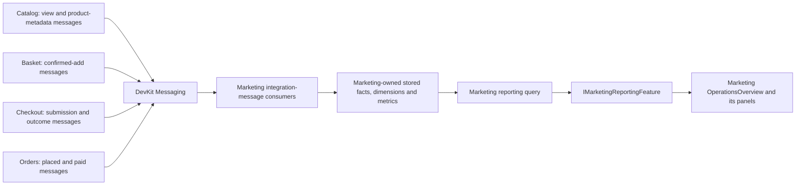
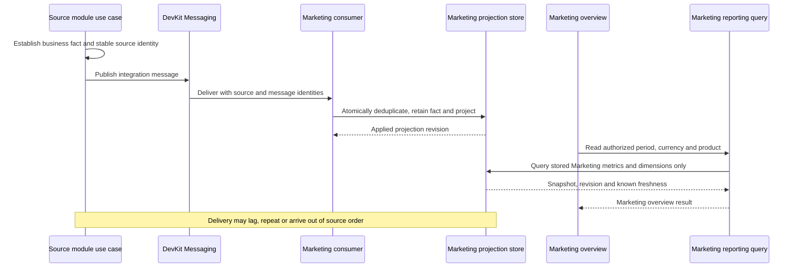
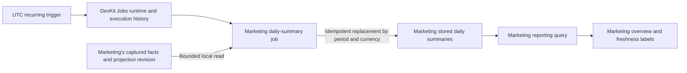
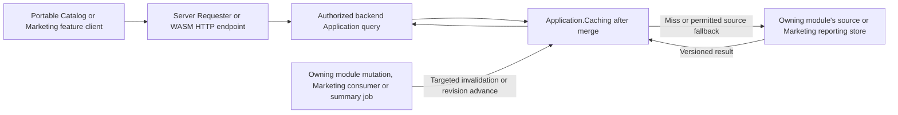

# ShopFiesta Backend Showcase Roadmap

Status: deferred ShopFiesta application design. Implement after the complete presentation framework has been validated with TaskFiesta and its independent consumer. Backend integration evidence remains pending.

The [ShopFiesta application specification](spec-shopfiesta.md) owns the customer/staff experience, module design, proposed presentation API usage and staged backend architecture. This companion roadmap details its backend integration contracts, provider sketches and evidence. The first frontend slice can validate pages, state, actions and service boundaries against small fixture-backed handlers. This roadmap is not a prerequisite for that slice or a claim that ShopFiesta has been implemented.

Catalog, Stock, Basket, Checkout, Marketing, Orders, Customers, Pricing, Payments and Fulfillment retain the same logical identities across frontend and backend. DoFiesta remains the presentation framework's reference migration. ShopFiesta is the separate greenfield application intended to become a broad DevKit showcase. Its first product fixtures are road/race and gravel bike components, while application contracts remain product-agnostic.

## Agreed backend direction

| Concern | Owner and intended DevKit integration |
| --- | --- |
| Business reporting | Marketing captures inter-module messages, stores reporting facts/projections and exposes all overview data, including product-selection metadata. The overview never aggregates source-module queries. |
| Business facts | Catalog, Basket, Checkout and Orders publish established facts through DevKit Messaging. Marketing consumes their public integration contracts. |
| Product identifiers and Stock | Catalog defines product/variant IDs, merchant SKUs, model designations, MPNs and optional GTINs. Stock owns availability/ordering policies for the exact same store/SKU. It is not mutable inventory embedded in the Catalog object. |
| Order processing | Orders enqueues work through DevKit Queueing and processes it in backend handlers. Acceptance, payment and fulfillment have distinct outcomes. |
| Customers | Seeded fake-auth subjects map to customer records and owned address books. No registration/credential workflows are required. |
| Discounts and pricing | Marketing owns product campaigns. Pricing owns quote/tax calculation over public Catalog, Marketing and delivery inputs. |
| Payments | Payments owns the provider boundary and one deterministic fake provider. Orders records confirmed outcomes as an order projection. |
| Shipping | Fulfillment owns rates, shipment/picking/packing state and one local fake carrier. Stock owns reservations and physical allocation consumption. |
| Transactional email | Orders renders versioned templates through planned Templating and queues messages through existing Notifications; fake SMTP is the local default. |
| Product images | Catalog owns media metadata and resolves content through Blob Storage. |
| Product manuals | Catalog owns applicability/version metadata and resolves documents through File Storage. |
| Staff data exports | Catalog, Orders and Marketing use DataPorter for their own catalog, order and sales-over-time exports. Marketing remains the only reporting source. |
| Recurring tasks | Business modules contribute Jobs to the backend scheduler. Marketing's daily-summary job is the first example. |
| Performance | The upcoming Application.Caching feature is a backend dependency, pending merge. It remains distinct from frontend AppState and existing Common.Caching. |
| Later capabilities | Rich domain models, transactional handoffs/outboxes, repositories, durable providers, caching, operational diagnostics, uploads and notifications extend the same journey. |

The integration sketches below describe a later backend showcase profile. Local in-process/in-memory providers can keep that profile easy to run. Its actual broker, worker, storage and scheduler paths require their own evidence. A frontend fixture validates only its stated presentation/feature contract and cannot establish those backend capabilities.

## Placement transactions and idempotency

The application's [backend architecture and delivery](spec-shopfiesta.md#backend-architecture-and-delivery) gives the end-to-end flow and execution profiles. The following boundaries apply when real backend state replaces fixtures. They reuse the existing module/Application/Domain model; they do not introduce a shell transaction coordinator.

| Boundary | Stable identity and recorded result | Failure and retry contract |
| --- | --- | --- |
| Checkout submission | Authorized store/customer or guest scope, attempt ID, submitted basket/review revision and input identity. | Repeated submission of the same accepted intent resolves the original outcome. Reusing an identity for different input is rejected. An unresolved acknowledgement is queried/reconciled, not assigned a fresh attempt automatically. |
| Order establishment | Orders records the originating attempt linkage with the order and its purchased snapshots. | Concurrent or repeated placement for that same authorized attempt cannot create a second order. Internal writes and identity constraints commit together in Orders' store. |
| Order work | Order ID, stable work ID, expected business revision and the recorded permitted transition/result. | Repeated delivery or a recovery action cannot apply a payment/release transition twice. Queue transport acknowledgement remains distinct from the business result. |
| Integration publication | Stable source-fact identity, occurrence time and source revision where relevant. | Retry preserves the business identity even if a transport envelope changes. A committed source mutation is not undone because Marketing capture failed. |
| Marketing consumption | Source module/store/fact identity, consumption receipt and corresponding projection update. | Receipt and projection commit atomically. Duplicate facts do not count again; delayed independent facts remain eligible under the cohort rules. |

Idempotency keys are scoped business identities, not trusted authorization supplied by a client. Every boundary authorizes its actor/store and validates its input before returning or changing private state. Retained outcomes contain enough information to reconcile work without exposing another customer's order or storing unnecessary checkout details in messages.

With persistent providers, order state and the intent to enqueue/publish cannot rely on a sequence of unrelated writes with no recovery record. Select a supported outbox/transactional arrangement or explicit recorded recovery workflow. Verify the queue integration itself: the existence of a Messaging outbox does not prove an atomic Queueing handoff. Until a recoverable scheduling step succeeds, retain a truthful scheduling state and stable reference. Process-local in-memory providers have no restart guarantee.

Cross-module reads use public Application contracts. They do not create an implicit transaction spanning Catalog prices, Stock, Checkout, Orders and a broker. The [full shop policies](spec-shopfiesta.md#full-shop-workflows-and-demonstration-policies) define proposed quote and reservation defaults. Their actual atomic writes, compensation and provider behavior still need evidence. A `CanOrder` read alone cannot establish overselling prevention.

Use the owning module's repositories/specifications for business writes and reads, with EF Core/provider details behind Infrastructure. Physical database sharing does not permit cross-module table writes or reporting joins. Persisted integration payloads are public immutable facts, not private aggregate serialization. The [module ownership table](spec-shopfiesta.md#backend-module-state-and-application-boundaries) identifies the relevant state owners.

## Product identity and Stock ownership

The frontend-facing product/variant shape and shared-SKU map are defined in [Product and variant identifiers](spec-shopfiesta.md#give-products-and-sellable-variants-explicit-identifiers). SKU is a merchant string within an explicit store/catalog namespace. GTIN is a separate optional trade-item identifier, MPN belongs to the manufacturer, and a technical model can span several SKUs. Do not join Stock by a model label, barcode artwork or a guessed product name. SKU retirement/remapping requires an explicit cross-module policy; it is not an ordinary label edit.

Stock registers/recognizes Catalog's sellable SKUs through public catalog contracts or SKU-definition integration messages. Quantity, reservations, sale thresholds, low-stock display thresholds, backorder/preorder permissions and unknown-quantity policy belong to Stock. Its response separates numeric quantity from the decision for a requested order quantity. A null quantity does not itself mean sold out, unlimited supply or permission to order. Known policy can allow a null-quantity SKU; unavailable Stock cannot be treated as that allowance.

Live stock changes and policy changes advance the Stock revision. Backend notification adapters deliver SKU/revision changes or refreshed decisions to active observers; frontend AppState alone does not bridge circuits. A future Stock integration message can communicate established availability/policy changes, with appropriately scoped payloads. If stock-derived metrics are added to the overview, Marketing captures those messages into its own reporting model; the reporting page still does not query Stock directly.

Basket/Checkout/Orders use authoritative Stock contracts at the relevant acceptance/processing boundary. The [reservation lifecycle](#stock-reservation-lifecycle) defines the proposed first policy. A displayed availability snapshot or revision is not a reservation. Orders' worker does not assume that an earlier product-page badge guarantees fulfillment. Catalog-owned identifier/description snapshots and Stock-owned inventory state remain separate.

Catalog cache entries do not become an alternative authority for mutable Stock. Stock-dependent filters need correct ordered counts/pages via public contracts or a deliberately maintained projection, with declared freshness. Purchase decisions still revalidate against Stock. Staff stock/policy commands enforce `Shop.Stock.Manage`, expected revisions and the selected store/SKU. The application specification first validates this UI boundary with fixtures, not a production inventory engine or real-time transport.

## Customer and catalog application state

Customers seeds its records against configured Fake Identity Provider issuer/subject pairs. Profile/contact and owned-address commands resolve the current customer on the backend, apply expected revisions and validate address fields. Default-address changes are atomic within Customers. Checkout receives an authorized address projection and copies accepted contact/delivery/billing values into Orders. Removing an address later does not remove or change that order snapshot.

The proposed sign-in basket merge is a Basket command keyed by guest basket/customer/merge identity. It processes compatible exact-SKU lines once, retains conflicts for review and invalidates only the relevant confirmed basket snapshot. Profile/account settings never become browser-authoritative identity or address state. Tests use at least two seeded customers and distinguish staff permissions from customer ownership.

Catalog owns product/category/variant persistence, base prices, tax-category references and publication rules. Use existing Domain/value-object/rule/repository patterns. Validate category cycles, scoped slug/SKU uniqueness, sale quantities and referenced variant changes in Application/Domain, not only in the editor. Published identifier retirement has an explicit compatibility policy; historical order rows do not depend on a current join to Catalog.

Product/category/campaign revisions support targeted invalidation and public metadata facts. Media/manual upload, metadata save and publication have distinct outcomes, so an upload failure cannot be hidden by an unrelated successful text edit. Use the established Blob/File Storage contracts below and ordinary authorized native upload/delivery endpoints. Inert staff previews generate no view or purchase facts.

## Discounts and authoritative price quotes

Marketing stores versioned campaigns, eligible product/variant targets, kind/value, currency where applicable, UTC windows and priority. It exposes a public eligible-discount business query, separate from its reporting query. The first policy is automatic percentage/fixed product discounts, one winner per line, ordered by priority, greatest eligible amount and stable ID. No stacking, coupon budget engine or loyalty model is implied.

Pricing resolves Catalog base prices/tax categories, Marketing campaign inputs and Fulfillment's shipping quote through public contracts. It returns the [declared immutable quote](spec-shopfiesta.md#pricing-makes-totals-explicit), including input revisions, discount references, tax/rate versions, expiry and totals. Quote reads, campaign previews and cache fills do not record redemption or create an order. A confirmed purchased order is the source of any later campaign-use reporting fact.

The demonstration policy is EUR, tax-inclusive base prices, fictional configurable 20% standard tax, per-line two-decimal midpoint-away-from-zero rounding and 15-minute quote validity. Discounts reduce gross before tax extraction. Shipping is a separate taxed line. Accepted order lines store original gross, discount, final net/tax/gross and applied policy versions. A required price/input change at submission returns a refreshed review for confirmation; it cannot silently change an accepted payment amount.

Publish a minimal `DiscountCampaignChangedMessage` for established campaign revisions when downstream invalidation/projections need it. It carries store, campaign ID/revision, affected product/variant IDs, validity and source occurrence metadata, not customer data. Pricing may cache public display inputs under an explicit freshness policy after Application.Caching is available, but acceptance validates the current quote/inputs and does not authorize from a stale display cache.

## Payment provider model and fake execution

Payments owns proposed `IPaymentProvider` and provider registration/options within ShopFiesta. This is an application boundary, not a new reusable DevKit payment framework. The provider descriptor identifies its name and supported operations. Attempts retain stable business/provider references, order ID, accepted amount/currency, source revision, status and correlation. Payment providers never depend on a Razor component or circuit lifetime.

The normalized contract covers start/resolve, status/reconciliation, supported confirm/capture, cancel and refund, plus incoming provider outcome mapping. A real adapter can later use hosted checkout or another supported mechanism without changing Orders' business interpretation. Required authenticity, idempotency and external SDK details belong to that future adapter; no actual payment system is integrated on dev boxes.

The single fake provider implements controlled Succeeded, Declined, Pending, Cancelled and Unknown acknowledgement scenarios. Persist fake provider state in its backend-owned fixture/provider store. Advancing a scenario requires an explicit authorized development/test operation or demo confirmation. `GetStatus`, Refresh and diagnostics are read-only. Fake success is labeled development payment throughout the shop.

| Case | Required outcome |
| --- | --- |
| Duplicate start/confirm | Resolve the same attempt/operation under the same order and amount/currency; do not create another charge or Paid fact. |
| Unknown browser acknowledgement | Reconcile the existing attempt with Payments/provider state. Do not infer Declined or start another payment automatically. |
| Pending or out-of-order outcome | Apply monotonic, validated transitions using provider/source identity and revision. Retain unresolved evidence for reconciliation rather than overwriting a known result with an old notification. |
| Amount/order mismatch | Reject or route to review. A return URL or caller-supplied success flag is not authoritative. |
| Confirmed payment | Payments records and publishes a stable `PaymentOutcomeChangedMessage`. Orders consumes it and records its payment projection before publishing `OrderPaidMessage`. Marketing counts that order fact once. |
| Refund/cancel capability | Model explicit supported operations and separate outcomes. The first customer journey does not imply a complete returns/refund UI or a real money movement. |

The public payment message contains store, order/attempt/source-operation identities, amount/currency, normalized state, occurrence time and version. Provider secrets and unrelated customer data remain private. Payments-to-Orders processing and notification/Stock handoffs use recorded idempotent steps with durable recovery in the persistent profile. The fake provider can test a late success after an earlier uncertainty; it must not conceal an order/allocation inconsistency.

## Stock reservation lifecycle

The proposed policy holds stock during accepted placement after quote validation and before payment scheduling. A Stock reservation groups the exact SKUs and quantities for one stable placement identity. Reserve all known finite-stock lines atomically within Stock or reject the group. A concurrent last-unit test must permit only the quantity allowed by the active policy. The checkout coordinator records successful reservation and any subsequent compensation/recovery step; its public calls are not a distributed transaction.

Separate physical `OnHand`, held quantity, committed allocation and available-to-promise quantity. For known physical stock, available-to-promise is on-hand minus active holds and allocations, subject to the per-SKU backorder/preorder policy. Public numeric availability describes that result; the management quantity input adjusts physical on-hand. The existing wireframe has no holds/allocations, so its numbers remain unchanged.

| Transition | Stock-owned effect |
| --- | --- |
| Reserve | Create/resume one Held reservation and subtract its finite quantity from availability. Capture the accepted policy/quantity revisions. Proposed hold duration is a configurable 15 minutes. |
| Confirmed payment | Commit the hold into an allocation for that order. Move held quantity to allocated quantity; do not subtract physical on-hand or availability twice. |
| Dispatch | Consume the committed allocation once and reduce physical on-hand once, recording shipment/operation identity. A repeated work item resolves the established result. |
| Confirmed failure/cancellation | Release the appropriate unconsumed hold or allocation through an explicit authorized business transition. A component disappearing is not cancellation. |
| Expiry | Start backend reconciliation. Release if payment is definitively not started, declined or cancelled under the order policy. If payment is confirmed, finish allocation. Pending/unknown payment moves to a reconciliation hold/review state rather than freeing stock blindly. |
| Late payment after released stock | Retain the confirmed financial fact and place the order in review. Do not invent an allocation or dispatch unavailable goods; subsequent refund/recovery is an explicit recorded operation. |

Unknown-quantity, preorder and backorder permissions create typed fulfillment obligations under the chosen SKU policy. They do not manufacture finite physical stock, and unknown quantity remains null. Record these separately from finite holds and expose their expected/unknown availability accurately. A Stock service outage is unavailable and cannot use the unknown-quantity allowance. Returning to known physical supply must account for outstanding obligations before promising it to new orders.



Jobs owns recurring expiry/reconciliation work through Stock/Orders Application services. A product read never expires a hold, reconciles payment or advances work. Persistent reservations and recovery records must survive restart in the persistent profile; the in-memory backend demonstration makes no such guarantee.

## Shipping and fulfillment execution

Fulfillment stores versioned shipping methods/rates and shipment state. Its public delivery quote includes method, destination/input reference, amount/currency, tax-category reference, availability/lead-time description, revision and validity. Pricing consumes that quote. The initial standard method costs EUR 5 in the baseline. A later address/method/rate change requires a refreshed review before acceptance.

Use one whole-order shipment initially. Orders Release authorizes the captured order versions and requests fulfillment through the public boundary. Fulfillment validates confirmed payment and the required Stock allocation, establishes one shipment/work identity and records Awaiting release/Picking/Packed/Dispatched/Delivered or explicit review/failure states. A successful release request is not a completed dispatch or delivery.

Stock's permission to order is distinct from readiness to ship. Paid preorder/unknown-supply obligations stay waiting until the public Stock/Fulfillment contract confirms physical fulfillment readiness. A fake carrier cannot turn an unknown supply promise into confirmed goods or bypass that check.

Fulfillment owns a proposed carrier adapter with one fake carrier, shipment/tracking references and controlled outcomes. The dev provider creates clearly labeled local demo tracking, not a real courier shipment. Staff transitions and fake carrier notifications are versioned/idempotent. Future real carrier adapters can implement the public meaning without putting SDKs, labels or credentials in frontend state.

Dispatch records the Stock consumption reference and a stable source fact. State-change/Stock/carrier handoffs need recorded recovery: a carrier acknowledgement alone cannot prove physical consumption, and an uncertain acknowledgement cannot justify another shipment. `ShipmentStatusChangedMessage` contains store/order/shipment identities, normalized state, safe tracking projection, source timestamp and revision. Orders consumes it into its customer projection and creates the appropriate email intent. No overview page queries Fulfillment for metrics; later shipment analytics must be captured by Marketing.

Picking/packing use the purchased line and accepted address snapshots. Customer address-book edits cannot retarget them. Partial shipments, split locations, customs and production carrier credentials remain later work. The default journey is complete for its declared one-shipment/local-provider policy.

## Templated transactional email

Orders creates intents for accepted-order confirmation, confirmed payment or post-placement payment failure, cancellation, dispatch/tracking and delivery where enabled. Confirmation says the order was accepted and clearly distinguishes unpaid/processing state. A shipped email requires the confirmed shipment fact, not a successful Release click.

The owning module builds a bounded immutable notification model from its authorized purchased/contact/address snapshots and confirmed source references. It records a stable intent identity per order/business transition/template purpose/recipient. This private model is not added to Marketing's public reporting messages. Template previews and operational reads do not send mail.

Rendering integrates with the planned [Application.Templating](spec-application-templating.md). Resolve the logical template by module, culture and configured ShopFiesta branding, using embedded defaults first. Produce a subject and HTML/plain-text alternatives through the supported renderer family/adapter design. Record template/model revisions and the output or equivalent immutable send snapshot so transport retries do not substitute today's product names, prices or address. Exact subject/multipart APIs follow the implemented Templating contracts; do not claim them shipped from this design.

Queue the rendered `EmailMessage` through the existing [Notifications](../features-notifications.md) outbox and `INotificationService<EmailMessage>`. Fake SMTP is the default dev-box transport. An optional local SMTP sink uses the same boundary. Backend composition selects a suitable outbox storage provider; in-memory storage resets with the process, and persistent delivery requires its own provider evidence. Do not expose SMTP credentials, delivery providers or raw mail models to the browser.

The current `EmailMessage` contract supports a single `Body` with `IsHtml`. Initial ShopFiesta delivery queues the rendered HTML body, while text rendering is validated/stored as a fallback artifact. True HTML/plain-text multipart delivery is an explicit later Notifications model/SMTP-adapter integration, not an assumed Templating feature. Notification intent/template/model metadata stays in Orders' own state rather than inventing fields on the existing email contract.



Rendering failure leaves an inspectable failed/pending intent; retry only that operation. Delivery failure retries the same rendered message according to Notifications' supported policy. An SMTP acknowledgement loss can leave actual delivery uncertain, so do not promise exactly-once recipient delivery. Duplicate business event handling must not create a new intent. A deliberate staff resend records a separate authorized resend identity and audit reason.

Use existing notification inspection/retry endpoints and dashboards under explicit staff policies. The shop may link from order history to the corresponding authorized delivery status; it does not implement a second mail administration platform. The first frontend fixtures can represent those states, but the actual rendering evidence remains pending until Templating is available.

## Product images and manuals

Spec references: [Product boundaries](spec-blazor-presentation-framework.md#product-boundaries), [Modular monolith across backend and frontend](spec-blazor-presentation-framework.md#modular-monolith-across-backend-and-frontend), [Module assets and JavaScript ownership](spec-blazor-presentation-framework.md#module-assets-and-javascript-ownership), [Initialization, failures and recovery](spec-blazor-presentation-framework.md#initialization-failures-and-recovery), and [Accessibility acceptance](spec-blazor-presentation-framework.md#accessibility-acceptance).

Catalog owns each product's media/manual metadata and its mapping to stored content. Product images come from DevKit Blob Storage. Installation manuals come from DevKit File Storage. They remain Catalog capabilities under the existing module identity, not new frontend storage modules. The presentation framework consumes ordinary product metadata, image URLs and download links.

The [ShopFiesta product-detail wireframe](spec-shopfiesta.md#open-a-product-with-a-local-purchase-context) shows the rotor image and an Installation manual (PDF) link. This is a conceptual screen; the future running sample must actually read those bytes through the selected providers. Drawing an image in the specification or serving the same file directly from `wwwroot` does not prove storage integration.

| Content | Catalog-owned metadata | Backend access and customer presentation |
| --- | --- | --- |
| Product image | Opaque asset ID, owning product/variant, revision, alt text, media type and optional dimensions. Internal metadata identifies its named blob client and blob key. | Catalog resolves `IBlobStoreClientFactory.CreateClient("catalog-images")` and reads through the blob client. The browser uses a Catalog-generated image URL in a normal `img` element. |
| Product manual | Opaque manual ID, owning product/model/variant applicability, language, document revision, friendly filename and media type. Internal metadata identifies its named file provider and path. | Catalog resolves `IFileStorageProviderFactory.CreateProvider("catalog-manuals")` and calls `ReadFileAsync`. A native link downloads the document through Catalog's delivery boundary. |

The local backend integration profile uses existing storage registrations with no external service:

```csharp
builder.Services.AddBlobStorage()
	.WithInMemoryClient("catalog-images");

builder.Services.AddFileStorage(factory => factory
	.RegisterProvider("catalog-manuals", storage => storage
		.UseInMemory("CatalogManuals")
		.WithLifetime(ServiceLifetime.Singleton)));
```

Catalog's startup fixture uploads the small demo image bytes through the named blob client and writes the fictional manual through the named file provider. Product metadata then references those stored objects. The seeds are repeatable; in-memory providers reset with the host. Persistent/local/cloud providers can replace those registrations later without changing the page's contract. [Blob Storage clients and stream ownership](../features-storage-blobs.md) and [File Storage providers and reads](../features-storage-files.md).

```razor


@foreach (var manual in this.product.Manuals)
{
	<a @key="manual.Id" href="@manual.DownloadUrl">@manual.Label</a>
}
```

The excerpt assumes available content. Catalog returns browser-safe metadata such as `Installation manual (PDF, English, revision 1)` and generates URLs that respect the application's base path. A content revision changes its generated URL so replacement bytes do not retain the old cache identity. Example native delivery routes are `/catalog/media/{AssetId:guid}` and `/catalog/manuals/{ManualId:guid}`. These are content endpoints, not routable Razor pages or shell destinations. They resolve current product publication/access and return the correct content type and download filename. The first fixture's published product content is public; restricted content would enforce its declared policy at delivery too. Raw provider keys, filesystem paths and credentials are not browser contracts, and a caller cannot choose an arbitrary storage path through the endpoint.

Stream content through the backend without loading a manual into component/AppState memory or returning it as a base64 feature DTO. Respect cancellation and the documented blob-download/file-stream disposal rules through response completion. Normal browser image/download HTTP is expected even in Interactive Server; Server feature commands/queries still use Requester in process. Storage factories/providers stay out of the browser dependency graph.



Absent imagery gets a deliberate accessible placeholder, while a provider/read failure remains observable and does not disable purchasing. A missing or unavailable manual has its own clear state rather than a broken silent link or successful empty PDF. Late metadata cannot attach the previous product's manual to a new product context. Manual applicability uses Catalog's explicit model/variant metadata; matching a manufacturer-code prefix is insufficient. Module CSS, scripts, icons and resources continue through native RCL/static-web-asset packaging. Product business content uses its blob/file boundary.

## Orders queue processing

Spec references: [Product boundaries](spec-blazor-presentation-framework.md#product-boundaries), [Modular monolith across backend and frontend](spec-blazor-presentation-framework.md#modular-monolith-across-backend-and-frontend), [Execution state and observation](spec-blazor-presentation-framework.md#execution-state-and-observation), [Operation outcomes and recovery](spec-blazor-presentation-framework.md#operation-outcomes-and-recovery), and [Frontend coordination with Requester and Notifier](spec-blazor-presentation-framework.md#frontend-coordination-with-requester-and-notifier).

An accepted checkout creates or resolves the same Orders record for its stable business attempt, then schedules processing through DevKit Queueing. Orders owns the queued work, its handlers and business state. The customer receipt confirms that the order exists; payment, processing and fulfillment have their own states and can complete later. The existing SF-1042 fixture is Paid for staff and Processing for the customer because backend processing has established payment while fulfillment is still pending.

Queueing carries work for an Orders handler. Messaging publishes facts for interested modules, including Marketing. A `ProcessOrderWorkItem` is a request to do work; `OrderPlacedMessage` and `OrderPaidMessage` report established facts. Neither the shell nor Marketing coordinates order execution. The Ready/Review tables in the application specification are independent UI query scopes, not the infrastructure work queues.

| Work or observation | Backend contract and meaning |
| --- | --- |
| Accept order | Orders validates the accepted placement, establishes a stable order ID and schedules a processing work ID. An enqueue acknowledgement alone is not payment or fulfillment completion. |
| `ProcessOrderWorkItem` | Orders-owned queue contract containing the order ID, stable processing-work ID, applicable processing revision and safe correlation. Its `IQueueMessageHandler<ProcessOrderWorkItem>` resolves Orders Application services in a backend scope and performs the permitted processing steps. |
| Establish payment/outcome | The Orders processing handler calls Payments' public boundary, which uses the deterministic fake provider. Payments owns authoritative outcomes; Orders applies the confirmed projection and publishes `OrderPaidMessage` for Marketing. A queued, running, failed or unresolved attempt cannot invent a Paid event. |
| Release for fulfillment | The staff Release action validates captured order IDs/versions and requests Fulfillment work through its public boundary. Its confirmed result establishes release/acceptance, not shipment or delivery. Fulfillment owns `FulfillOrderWorkItem` and its handler, shipment identity and carrier interaction. |
| Read progress | Receipt/history/staff views read Orders' authorized business state. Refresh and status inspection cannot enqueue another order, execute a handler, advance progress or cause a payment. No invented progress timer stands in for a backend transition. |
| Lose enqueue acknowledgement | Preserve the established order and processing reference and reconcile its backend state. Do not replay Checkout or assume that no work was scheduled. A known scheduling failure keeps a truthful Awaiting processing/recovery state rather than cancelling a committed order implicitly. |

The following uses existing Queueing APIs. Orders and Fulfillment declare their own backend subscriptions, shown together for readability, and the host selects the broker once. The work types are proposed example-owned contracts derived from `QueueMessageBase`:

```csharp
builder.Services.AddQueueing(builder.Configuration)
	.WithSubscription<ProcessOrderWorkItem, ProcessOrderHandler>()
	.WithSubscription<FulfillOrderWorkItem, FulfillOrderHandler>()
	.WithInProcessBroker(new InProcessQueueBrokerConfiguration
	{
		MaxDegreeOfParallelism = 1,
		EnsureOrdered = true
	});
```

Orders schedules work with `IQueueBroker.Enqueue(workItem, cancellationToken)`. The handler receives only its backend work contract, not a Razor component, action scope, Checkout draft or circuit cancellation token. Once accepted under backend ownership, leaving the page, signing out or disposing its binding detaches UI observation and does not cancel the order. Initial request cancellation and a potentially unknown acknowledgement still follow the placement/recovery contract. There is no generic shell job scheduler or frontend command relay.



Processing must be idempotent by stable order/work identity and business revision. A repeated delivery or deliberate retry does not charge twice, place another order or release fulfillment twice. Internal state transitions and integration-event identities retain their source authority. Marketing can receive placement/payment facts out of source order and projects them using the [capture rules below](#marketing-capture-and-reporting). The queue handler does not call Marketing's reporting services.

The later backend integration profile uses the real in-process queue and real Orders handler with small in-memory state. Its channels/tracking are process-local and do not survive restart or coordinate separate host instances. This provider does not automatically requeue a failed handler invocation; any configured handler retry or explicit backend recovery is demonstrated separately and preserves work identity. Later durable processing must address the state-change/enqueue/publication handoff with a supported transactional/outbox or reconciliation design and verify its selected provider's actual acknowledgement, retry and recovery semantics. Neither `Enqueue` nor `EnqueueAndWait` is presented as a universal handler-completion guarantee. [DevKit Queueing contracts and provider semantics](../features-queueing.md).

## Marketing capture and reporting

Marketing's frontend-owned page and `IMarketingReportingFeature` remain specified in [Staff reporting presentation](spec-shopfiesta.md#compose-staff-business-metrics-and-a-product-funnel). The following preserves the detailed metric, cohort and message-processing design behind that contract.

Reporting uses UTC half-open periods `[from, to)`, backend-validated bounds, authorized store context and bounded Marketing queries. Each panel identifies Marketing as its reporting source and the originating event stream as provenance. The currency selector filters Marketing's order counts and monetary values to that currency; checkout attempt counts and the product funnel are currency-independent and label that scope. The example performs no implicit conversion or cross-currency summation. Paid-order totals include the recorded order total, including delivery and any recorded tax. They are labeled paid order value rather than net revenue because this slice does not model refunds or revenue recognition.

| Measure | Marketing projection and authoritative source fact |
| --- | --- |
| Orders placed | Marketing counts distinct order IDs captured from Orders' placement messages, with source `CreatedAt` in the selected period and currency. Reading a receipt/history/report page creates no order. |
| Paid orders and paid order value | Marketing counts distinct captured first-paid order transitions with source `PaidAt` in the period and sums their recorded paid totals in the selected currency. Orders supplies the payment fact, including the explicitly simulated payment boundary in this slice. |
| Average paid order | Paid order value divided by paid order count for that same query. Zero paid orders displays an unavailable ratio, not a fabricated zero average. |
| Submitted checkout attempts | Marketing counts distinct attempt IDs from Checkout's submitted messages, first submitted in the period. Repeated UI clicks and retries/status reads do not create another submission. Message line snapshots identify the submitted products. |
| Confirmed, rejected and pending/unknown | Marketing applies Checkout's versioned outcome messages to that captured attempt cohort. Confirmed means an order was established, not that it was paid. Submitted attempts without a captured terminal outcome remain unresolved as observed. Known projection lag/gaps are shown separately; the page cannot infer a current backend state from silence. |
| Submission success | Confirmed attempts divided by submitted attempts for the same cohort, or unavailable when none were submitted. This measures submitted checkout outcomes, not visitor-to-purchase conversion. |
| Product views | Marketing captures Catalog's eligible detail-view messages using stable source view IDs. Rerendering, repeated delivery, card impressions, staff previews and diagnostic reads create no additional detail views. Raw view-event totals and distinct viewing journeys have separate labels. |
| Adds to basket | Marketing captures Basket's confirmed-add messages using stable operation IDs and actual product/variant/quantity. A failed add, duplicate delivery, quantity edit, remove or read is not another add. Units, add-event count and distinct adding journeys are separate measures. |
| Bought product | Marketing captures Orders' authoritative paid order lines and their originating Checkout linkage. Placed-but-unpaid, rejected and unresolved attempts do not satisfy Bought. Later refunds require a separately labeled measure and corresponding source messages. |

The initial aggregate fixture is deliberately small. Orders SF-1042 at EUR 180, SF-1043 at EUR 95 and SF-1044 at EUR 60 have their first paid transition in the period, producing EUR 335 and a rounded EUR 111.67 average. Five orders were placed. Checkout's seven attempts comprise five confirmed, one rejected and one pending/unknown, so submission success is `5 / 7 = 71.4%`. Different source timestamps and cohorts mean orders placed, paid orders and confirmed submissions need not match in general.

The product funnel follows a defined cohort, rather than dividing unrelated totals. Its key is the authorized store, an opaque shopping-journey ID and product ID, folding variants into the same product. The example keeps the journey across its explicitly supported basket/checkout flow; it does not infer cross-device identity or merge customers after sign-in. The feature's established session context supplies that correlation, rather than adding tracking fields to every shell action context. Identity/store changes follow the existing session and basket policy. The identifier is correlation data, never authorization or a source of payment truth.

The product selector shows Marketing's latest captured name, brand and model designation, such as `Gravel Brake Rotor / Aster / RT-G800`. Catalog's metadata messages update those stored dimensions by product ID/version. Until a correction is consumed, the old label is explicit projection data. Reporting groups by stable identity; two brands sharing a code remain distinct products, and a corrected label does not split historical stages. Deleted products retain historical dimensions. Missing metadata uses an explicit unknown-label state rather than a synchronous Catalog lookup.

| Funnel rule | Concrete interpretation |
| --- | --- |
| Cohort entry | The journey's first eligible detail view of this product falls within `[from, to)`. Repeated views in that journey contribute only one entry. A journey that first viewed it before `from` is not a new entrant because it viewed again in the period. |
| Ordered stages | Count distinct cohort journeys that subsequently have a confirmed add, then a checkout submission containing the product, then a paid order containing it. Each stage follows the qualifying previous stage and retains the linkage to the participating basket/attempt/order. Multiple quantities, adds or payment notifications do not multiply the journey. |
| Observation window | Each journey has up to 24 hours after cohort entry, bounded by the panel's explicit `asOf`. Journeys whose window has not closed are marked as still maturing. Future outcomes can revise that cohort's result on a later read; they do not create new entrants. |
| Denominators | View-to-basket is distinct qualifying adding journeys divided by entrants. View-to-bought is distinct qualifying paid journeys divided by entrants. Show stage counts, percentages and observation scope; zero entrants makes ratios unavailable. |
| Missing linkage | Show the uncorrelated/unsupported state or coverage separately. Do not infer a buyer from matching product/time, claim all-shop conversion, or turn missing telemetry into zero buying. Purchases without an eligible view remain valid orders and can contribute to aggregate sales without entering this funnel. |
| Late, duplicate or out-of-order records | Marketing deduplicates source event/fact IDs and correlates stored messages by source timestamps/references. Late delivery can update a later projection of the same cohort. Report known processing coverage; absence of recent messages does not prove complete source delivery. |

The Gravel Brake Rotor fixture has 20 entrant journeys, eight with a qualifying add, six with a qualifying checkout submission and three with a qualifying paid order by 12:00 UTC. View-to-basket is `8 / 20 = 40%`; view-to-bought is `3 / 20 = 15%`. These are distinct journeys, not product units or raw click counts. The fixture includes the required product-line/journey links and is still maturing under the 24-hour rule. Its paid journeys link to SF-1042's existing lines, SF-1043's one rotor plus one lockring at EUR 95, and SF-1044's one EUR 80 rotor with a recorded EUR 20 order discount. SF-1043 and SF-1044 have no delivery charge in their order snapshots. Current Catalog prices do not rewrite those snapshots. Other product cohorts can overlap; summing their conversions does not give a distinct whole-shop customer count.



`IMarketingReportingFeature` reads Marketing's stored model through an authorized Marketing query. There are no per-source reporting feature clients or host reporting aggregator for this overview. Backend producers use public integration-message contracts and the existing `IMessageBroker`; Marketing uses `IMessageHandler<TMessage>` consumers. Reuse DevKit Messaging rather than adding a shell event bus. [DevKit Messaging contracts, subscriptions and in-process transport](../features-messaging.md).

The initial message set is deliberately explicit. These are proposed commerce integration contracts, mapped at the owning module's Application boundary. Do not serialize private aggregates or assume every internal domain event is an appropriate public message.

These seven baseline reporting contracts remain valid in the fuller shop. Payments additionally publishes `PaymentOutcomeChangedMessage` to Orders; Fulfillment publishes `ShipmentStatusChangedMessage`; Marketing can publish `DiscountCampaignChangedMessage` for its established campaign revision. Those public contracts have their own consumers and are not automatically counted as extra sales. Customers' private address edits are not broadcast as full personal-data snapshots. Any added reporting dimension/stage must be captured into Marketing explicitly.

| Publisher | Proposed integration message | Trigger and minimum business payload |
| --- | --- | --- |
| Catalog | `CatalogProductChangedMessage` | Initial fixture publication or a product-metadata revision. Product ID/version, display name, brand, optional model designation and active/retired state populate Marketing's reporting dimensions. |
| Catalog | `ProductViewedMessage` | The current customer detail was presented successfully and its feature capture command accepted the view. Stable view ID, product/optional variant ID and opaque journey ID. No event for a rerender, card impression, admin preview or report read. |
| Basket | `ProductAddedToBasketMessage` | A confirmed add mutation. Stable operation ID, basket ID/revision, journey ID, product/variant IDs and quantity added. Failed adds and quantity edits/removals do not publish this fact. |
| Checkout | `CheckoutSubmittedMessage` | First accepted submission of a stable attempt. Attempt ID/version, basket ID/revision, journey ID, source submission time and product-line snapshot. |
| Checkout | `CheckoutOutcomeChangedMessage` | An authoritative attempt-status revision. Attempt ID/version, Pending, OrderEstablished or Rejected, with order reference when established and safe rejection classification where applicable. A lost browser acknowledgement is not a backend outcome event. |
| Orders | `OrderPlacedMessage` | A confirmed order placement. Order/attempt/journey references, source creation time, currency, recorded totals and product-line snapshots. |
| Orders | `OrderPaidMessage` | The first confirmed paid transition used by these gross metrics, established by Orders' backend processing path. Stable payment-transition ID, order/attempt/journey references, source paid time, currency, recorded paid total and product lines. Queue acceptance and duplicate provider notifications do not create another fact. |

Every contract carries the authorized store context, stable source-event identity, source occurrence time in UTC, correlation references and its documented schema version. Use DevKit's existing message identity/envelope and tracing conventions; `MessageBase.Timestamp` is message creation time and does not replace a distinct business occurrence time when the fact occurred earlier. Entity/attempt/metadata revisions order state updates where relevant. Include enough immutable data for Marketing to project without fetching source records. Contact addresses, payment credentials and unrelated customer data do not belong in these messages.

The following excerpt uses existing Messaging APIs, not proposed presentation infrastructure. Subscription declarations belong to Marketing's backend module registration, while the host selects one broker. It shows the effective registration together for readability:

```csharp
builder.Services.AddMessaging(builder.Configuration)
	.WithSubscription<CatalogProductChangedMessage, CaptureProductDimensionHandler>()
	.WithSubscription<ProductViewedMessage, CaptureProductViewHandler>()
	.WithSubscription<ProductAddedToBasketMessage, CaptureBasketAddHandler>()
	.WithSubscription<CheckoutSubmittedMessage, CaptureCheckoutSubmissionHandler>()
	.WithSubscription<CheckoutOutcomeChangedMessage, CaptureCheckoutOutcomeHandler>()
	.WithSubscription<OrderPlacedMessage, CaptureOrderPlacementHandler>()
	.WithSubscription<OrderPaidMessage, CaptureOrderPaymentHandler>()
	.WithBehavior<RetryMessageHandlerBehavior>()
	.WithInProcessBroker();
```

Source use cases publish via `IMessageBroker.Publish(message, cancellationToken)`. Marketing consumers own their deduplication receipts, retained facts, product dimensions and stored projections. Within that store, recording a consumed event and updating its projection must be one atomic unit. Delivery retries preserve message/source identities; a republished business fact with another envelope still cannot double-count. Versioned state ignores obsolete status/metadata updates without dropping older independent occurrence facts needed for the cohort. A payment or outcome arriving before its order/submission is retained and linked when the other message arrives. Marketing does not repair missing linkage by querying a producer during a report read.

The reporting model is eventually consistent. A successfully placed or paid order can appear in the customer receipt before its message has reached Marketing. Publication/handling completion follows the selected broker's semantics; the in-process provider can complete processing before publication returns. Neither that fast path nor a successful report query proves that every source stream is current. Record projection revision, last processed occurrence/receipt times and known gaps or supported source checkpoints. A latest-received timestamp alone is not a completeness watermark. Read-only Refresh observes the latest Marketing revision and never forces upstream delivery.

The later backend integration profile uses actual in-process publication/handling and a bounded in-memory Marketing store, including its deduplication records. Deterministic fixture messages populate the model through those consumers, not by assigning page totals or querying module services. The store resets with the demonstration process; durable recovery is a later, separately verified capability. Persistent source mutations later use the supported outbox pattern to avoid losing committed business facts between state change and publication. Persistent Marketing consumption likewise needs atomic receipt/projection updates and an explicit replay/rebuild policy. Do not claim exactly-once transport or durable delivery from the local backend integration profile.



Catalog requests view capture through its declared feature path only after the current detail is presented. Basket, Checkout and Orders publish confirmed facts rather than optimistic UI clicks. Marketing's capture failure does not reverse a committed source mutation or turn an actual order success into a retryable failure. The demo reports any known publication/capture gap honestly; it does not promise an in-memory recovery mechanism it lacks. The host owns collection policy and retention configuration; Marketing enforces them for its reporting store. Raw journey IDs and line-level correlation records stay out of shell diagnostics and default metric labels. Frontend AppState/Notifier can invalidate a currently observed Marketing snapshot when an explicit supported update arrives; they do not transport these backend integration events or bridge circuits automatically.

The page distinguishes loading, empty success, unavailable capability, failed Marketing query and explicitly stale prior data. A producer being offline does not prevent reads of facts Marketing already stored. A known capture gap in one stream marks its affected panels/funnel incomplete while retaining the last captured values with accurate labels. If Marketing's own store/query fails, show its failure or an explicitly stale last-good snapshot; do not fall back to producer reads or fabricate zeros. Last-good data keeps its original query/time label. Page disposal detaches reads/subscriptions, and stale filter/product/identity responses are rejected. Navigation, Refresh and diagnostics neither create business stages nor advance projection processing. This demonstrates module-owned presentation and truthful query lifecycle behavior while Marketing owns the business analytics.

## Recurring jobs

Spec references: [Product boundaries](spec-blazor-presentation-framework.md#product-boundaries), [Modular monolith across backend and frontend](spec-blazor-presentation-framework.md#modular-monolith-across-backend-and-frontend), [Execution state and observation](spec-blazor-presentation-framework.md#execution-state-and-observation), [Automatic refresh and explicit invalidation](spec-blazor-presentation-framework.md#automatic-refresh-and-explicit-invalidation), and [Production observability](spec-blazor-presentation-framework.md#production-observability).

Use DevKit Jobs for recurring backend tasks. Each business module registers its own jobs and calls its own Application services. The host composes those registrations into the existing scheduler runtime. The shell does not run cron expressions, start component timers for backend maintenance or own scheduled business execution. [DevKit Jobs registration, triggers and runtime](../features-jobs.md).

The first concrete example is Marketing's `RefreshMarketingDailySummaryJob`. At 00:05 UTC each day, it refreshes a bounded set of closed-day sales summaries from facts Marketing already captured through Messaging. It never queries Catalog, Basket, Checkout or Orders for reporting data. Current-period overview values continue to come from Marketing's captured projections without waiting for the next daily job. Daily summaries retain their own calculation time and captured projection revision.

```csharp
builder.Services.AddJobScheduler(builder.Configuration)
	.WithInMemoryStore()
	.WithBackgroundExecution(options => options.EnableBackgroundExecution = true)
	.WithJob<RefreshMarketingDailySummaryJob>("marketing.daily-sales-summary", job => job
		.Description("Refreshes closed-day sales summaries from Marketing facts.")
		.WithConcurrency(1)
		.AddTrigger("daily-utc", trigger => trigger
			.Cron("5 0 * * *")
			.InTimeZone(TimeZoneInfo.Utc)));
```

This excerpt uses existing Jobs APIs and a proposed example-owned `IJob` implementation. Marketing contributes the job definition from its backend registration. Modules can call `AddJobScheduler()` independently and still share one runtime; the host selects the store and execution options. Browser assemblies contain neither the scheduler nor the job implementation.

| Recurring task | Owning module and scope |
| --- | --- |
| Daily sales summaries, first slice | Marketing recalculates the last seven closed UTC days from its stored facts. The period comes from the scheduled occurrence's cutoff so retries retain the same meaning. Known source gaps/freshness remain visible in the resulting summary. |
| Reservation deadlines, full local backend | Stock scans a bounded set of due holds, with a proposed one-minute schedule. It records reconciliation/release transitions through public payment/order contracts and never frees an unresolved paid/unknown hold blindly. Repeated occurrences retain reservation/operation identity. |
| Pending payment/order reconciliation, full local backend | Payments/Orders reconcile existing attempts and incomplete handoffs with bounded work. Querying a provider may establish an outcome; the job does not create another payment merely because an attempt is old. |
| Expire abandoned baskets, later slice | Basket periodically checks its own expiry policy and updates only eligible inactive baskets. Active checkout/review and expiry conflicts are resolved by authoritative backend rules. |
| Refresh an external product feed, later slice | Catalog schedules bounded import work through its configured integration. Large imports can enqueue per-batch work. Actual product changes publish metadata messages for Marketing. No external feed is needed by the first demo. |
| Check stalled order processing, later slice | Orders inspects its own pending work and records actionable status. Any recovery enqueue preserves the original business/work identity and follows an explicit policy. An unresolved payment is never retried merely because a timer fired. |

Jobs decides when scheduled work becomes due. Queueing dispatches work to an owning backend handler. Messaging communicates established facts between modules. A small bounded job can execute its Application operation directly; large fan-out can enqueue bounded work and publish actual outcomes later. Finishing a scheduling job that only enqueued work confirms dispatch, not downstream completion. These are existing DevKit capabilities, not wrappers added by the presentation framework.



The daily job replaces each summary by store, UTC period, currency and metric-definition version rather than incrementing totals on every run. Repeating an occurrence or retry does not double-count. A summary computed from an older captured revision cannot overwrite a newer summary for the same key. Current-period projections and per-order facts remain independent. Late messages can change the next recalculation within the seven-day window; older backfill requires an explicit backend operation, not an overview read.

The scheduler owns the occurrence, execution, cancellation and history. Configure bounded work, timeout/retry and overlap through existing Jobs options. Document and verify the selected provider's actual missed-occurrence behavior. The example declares one concurrent execution for this job and UTC explicitly. It does not infer catch-up behavior, exactly-once side effects or coordinated multi-host execution from an in-memory store. The first store/history resets on process restart; persistent scheduling/recovery belongs to a later verified profile.

Opening, rendering, refreshing or inspecting the overview does not trigger, dispatch or advance a job. A failed job leaves the last-good summary labeled with its actual revision/time and any recorded failure/staleness state. Marketing stores the report's calculation/status metadata itself; the overview does not query the Jobs runtime for its data. Jobs keeps its separate execution history. A successful job cannot make missing source messages complete. Any later UI invalidation follows the existing explicit runtime/notification path; no automatic cross-circuit update is implied. Authorized operators can use the existing Jobs query/dashboard capabilities in an enabled operational profile; adding scheduled work does not require a new shell job-management page.

## Backend application caching, pending merge

Spec references: [Product boundaries](spec-blazor-presentation-framework.md#product-boundaries), [Low friction and native platform mechanisms](spec-blazor-presentation-framework.md#low-friction-and-native-platform-mechanisms), [Reference application access paths](spec-blazor-presentation-framework.md#reference-application-access-paths), [State, preferences and application context](spec-blazor-presentation-framework.md#state-preferences-and-application-context), and [Performance baselines and release acceptance](spec-blazor-presentation-framework.md#performance-baselines-and-release-acceptance).

The new DevKit `Application.Caching` feature is an upcoming backend dependency, pending merge. ShopFiesta will use it to improve selected read paths after it becomes available. This checkout has its [Application Caching design specification](spec-application-caching.md), but does not yet contain the runtime project. Final registration and policy examples must follow the merged public APIs; this roadmap does not invent a parallel cache implementation or treat an illustrative draft signature as shipped.

The frontend-first Server profile remains independent of this feature merge and cache integration. Add an explicit backend-cache profile afterward, using ordinary backend DI and the feature's supported fluent configuration/provider selection. Keep the existing portable `ICatalogFeature` and `IMarketingReportingFeature` contracts. Server still calls Application queries through Requester, and WASM still calls the corresponding HTTP endpoints. Cache lookup and source execution both occur in the backend. Browser code does not resolve the cache, its provider or its operational endpoints directly.

| Eligible path | Backend owner and correctness policy |
| --- | --- |
| Catalog category/facet/reference reads | Catalog owns the cached result and normalized query key. Include the store/catalog context and any culture/currency/query dimensions that change the response. Product/category metadata changes invalidate affected entries or advance their declared version. |
| Catalog product summaries | Reuse bounded public summary DTOs under a Catalog policy. Keep source product/version metadata and the feature's stated display freshness. Cached display data never authorizes a purchase or replaces authoritative stock/pricing/review validation. |
| Marketing aggregate/funnel queries | Marketing caches calculations over its own captured store. Keys include the authorized reporting scope, period, currency, product, metric-definition version and captured projection/daily-summary revisions where used. A miss reads Marketing alone, preserving its single reporting authority. |
| Live/private workflow state | Checkout attempts, payment/processing recovery, mutation results, permissions and customer-private order history stay on their existing authoritative paths in the first cache profile. Adding them later requires their own explicit partition/freshness policy and evidence. |

Marketing's message consumers advance the captured projection revision when they commit new facts. Its daily-summary job records the corresponding calculation revision when summaries change. Those revisions or targeted invalidation make dependent cached reads obsolete. A slow fill computed before an invalidating change cannot publish a result that supersedes the newer generation. Use the merged feature's supported invalidation/publication semantics rather than writing a shell-specific lock, event bus or cache coordinator.



A cache hit preserves the source projection/capture time and revision. It cannot relabel old data as newly captured, conceal a known message gap or imply that Marketing has queried a producer live. Authorization runs on warm reads too; keys/partitions include any context that changes the permitted result. A disabled or unavailable cache follows the owning feature's declared source/failure policy. Cache failure cannot turn source failure into a successful empty result or bypass access checks. The query remains usable uncached where that policy permits.

This feature is distinct from the toolkit's existing `Common.Caching`, browser HTTP caching of versioned product assets and frontend AppState/view restoration. AppState continues to hold scoped UI state, not backend result collections. Cache providers, codecs, budgets, expiry and invalidation stay in backend configuration. They are not shell extension-point metadata, page lifecycle hooks or new parameters on every action context.

Measure the enabled profile against the same uncached workload, including cold/warm reads, actual source calls, repeated filters and post-mutation/projection updates. Report real latency/resource observations, provider choice, bounds and limitations. A cache hit or a new package reference alone does not establish a performance improvement. The merge and executable evidence are required before claiming this integration works.

## DataPorter export execution

The application's [staff export design](spec-shopfiesta.md#staff-data-exports-with-dataporter) defines the three owners and frontend intent. Reuse [DataPorter](../features-application-dataporter.md) and its existing `IDataExporter`, module-owned export profiles, supported CSV/Excel providers and `ExportProgressReport`. Do not implement a second serializer/export framework in the shell.

The backend flow is an authorized module query, explicit export-row mapping, DataPorter generation and an authorized result artifact. `IDataExporter.ExportAsync` accepts synchronous or asynchronous rows and an output stream. Select bounded reads and provider/output handling appropriate to the actual dataset; an asynchronous input does not establish bounded memory for every format/provider. Small immediate downloads may use the existing file-content convenience API. Background exports retain the application-owned operation/status contract, rather than assuming DataPorter schedules or persists jobs.

Catalog exports query Catalog. Orders exports query Orders' purchased snapshots. Marketing's time-series export queries Marketing's captured facts/projections/daily summaries only. Marketing owns bucket boundaries, counts, monetary definitions, ratios and coverage; DataPorter formats the resulting rows rather than rebuilding analytics across source modules. Preserve currency, report revision, `asOf` and known incomplete coverage in the exported result and metadata.

Per-module profiles define included columns, formatting and readable names/model codes. Identifier columns retain string semantics and leading zeros. Exporting staff data requires the owning module's explicit access policy and store/query scope at start, observation and download. Download authorization and artifact expiry remain independent of confirmed operation completion. A failed generation does not expose a partial artifact as a successful complete file, and a retry/reconciliation does not silently export a different captured intent.

The Orders CSV wireframe and simulated operation do not prove DataPorter integration. The backend profile must actually generate and read back files for all three exports, including a bounded series of Marketing sales buckets. Real execution progress comes from that operation and DataPorter, never a UI timer.

## Deferred backend integration evidence

These checks apply when the backend showcase profile is implemented. They do not block the frontend-first Server slice. Record actual commands, profiles, concrete contracts and results; code sketches, figures and fixture handlers are not evidence of real messaging, queueing, storage, scheduling or caching. In-memory evidence does not imply persistence, multi-host coordination or restart recovery.

| Case | Exercise | Expected result and contracts validated |
| --- | --- | --- |
| BI-01 Messaging and projection boundary | Trace each proposed source message through the actual in-process broker and Marketing handler/store. Retry the same identity and republish the same fact, delay a consumer, deliver metadata/outcome revisions out of order and render/refresh/inspect reports and administrative previews. | One committed fact contributes once. Marketing stores and queries independently of producer reads. Delayed capture is visible as the supported lag/gap state, not a failed customer order or a forced page rebuild. Reads/previews produce no business messages, consumer invocations or projection writes. Validate existing `IMessageBroker`/`IMessageHandler<TMessage>` integration, atomic projection updates, event identity/versioning and separation from local AppState/Notifier. Record the in-memory restart/durability limit. |
| BI-02 Queued order lifetime | Accept an order through Checkout, hold its Orders consumer, leave the receipt and then process the queued work. Exercise repeated work identity, a failed handler, lost enqueue acknowledgement and staff release/fulfillment scheduling. | Accepted order, queued/running work, paid outcome and fulfillment are distinct. No UI-owned worker, duplicate placement/charge or implicit Checkout replay occurs. Only a confirmed paid transition reaches Marketing through Messaging. Validate the real `IQueueBroker`/`IQueueMessageHandler<TMessage>` path, backend lifetime, safe observation and the in-process provider's actual retry/restart limits. |
| BI-03 Blob-backed product images | Seed an image through `catalog-images`, open its Catalog URL and test missing/unavailable objects, a delayed product switch and a non-root app base path. | Actual image bytes come from the blob client; public metadata/alt text and cache/content identity remain correct. Failure stays local to media and does not retarget a purchase. Validate Catalog delivery, named-provider access, native image rendering, stream ownership and browser dependency boundaries. |
| BI-04 File-backed product manuals | Seed the fictional manual through `catalog-manuals`, follow the product's native download link and test language/revision applicability, missing/failed reads, unauthorized or arbitrary-path access and interrupted transfer. | The correct file streams with its declared type/name through the file provider. Access and product/variant applicability are enforced, streams close correctly and no raw path/provider credential becomes a browser contract. Validate native links, base-path-aware URLs, backend provider mapping and independent feedback. |
| BI-05 Recurring Marketing job | Exercise the real Jobs trigger/runtime with controlled time crossing 00:05 UTC after the fixture day. Repeat/retry an occurrence, attempt overlap, deliver a late captured fact and fail one execution while no overview is open. Then read/refresh/inspect reports. | Only due backend execution recalculates the bounded closed-day summaries. No doubled totals or older-revision overwrite; known gaps and last-good timestamps stay truthful. UI reads cause no dispatch. Validate actual Jobs registration/occurrence execution, module ownership, period identity, concurrency, history and reporting freshness. Record the in-memory restart limit; a direct mocked job invocation does not prove scheduling. |
| BI-06 Backend cache, conditional after merge | Compare uncached/cold/warm Catalog and Marketing queries. Change store/access/query context, consume a new Marketing fact, run the daily-summary job and complete an older fill after invalidation. Disable/fail the cache under its declared fallback policy. | Results retain correct ownership, authority, partition, revision and freshness without source-module reporting fan-out or authorization bypass. No obsolete fill replaces the newer generation. Validate the actual merged cache API/provider path and record source calls plus measured performance. Deferred until merge/profile enablement; baseline Server validation remains independent. |
| BI-07 Marketing product funnel | Publish the 20/8/6/3 linked message fixture and query Marketing's stored result. Include a purchase without a view, a prior-period entrant, delayed/out-of-order messages, unresolved payment, expired observation window and missing linkage/coverage. | Show 40% view-to-basket and 15% view-to-bought for the still-maturing cohort. Count distinct eligible ordered journeys from captured facts; unpaid/unresolved attempts do not satisfy Bought. Expose known incompleteness rather than invented zero/ratios. Validate Marketing correlation, stored product identity, report DTOs and truthful freshness. |

All backend integration evidence remains pending. The cache case additionally depends on the Application.Caching merge. Public APIs and provider behavior must be rechecked when this work starts.

### Additional backend evidence

| Case | Exercise | Expected result and contracts validated |
| --- | --- | --- |
| BI-08 Stock backend boundary | Register Catalog SKUs through the chosen public boundary. Query different requested quantities, change policies/revisions, exercise null quantity allowed/denied, disconnect the source and observe from two circuits. Include concurrent purchasing under the declared reservation policy. | The exact store/SKU remains consistent. Quantity and sellability remain separate, old updates cannot overwrite a new revision, and unavailable service does not become unknown quantity. Stock management access and the declared concurrency/reservation limits hold. Validate real backend handlers/update delivery rather than frontend fixture streams. |
| BI-09 Persistent placement handoff | Against selected persistent providers, submit the same attempt concurrently, reuse it with different input, interrupt after source commit but before scheduling/publication acknowledgement, restart and perform recorded recovery. Repeat work and fact delivery. | The same authorized intent resolves one order and stable work/fact identities. Recovery neither loses accepted work silently nor duplicates payment/release. Orders and Marketing preserve their atomic local writes. Validate the actual transaction/outbox/reconciliation arrangement and provider semantics. This case cannot pass against process-local fixtures or before the handoff design is selected. |
| BI-10 DataPorter staff exports | Generate CSV and Excel for filtered Catalog variants, matching staff Orders and Marketing sales buckets. Read the actual files; include model/SKU/MPN/leading-zero GTIN data, historical order prices, incomplete reporting coverage, query/revision changes, denied download, failed generation and page navigation. | Files match the authorized captured intent and declared row/consistency policy. Identifiers and historical prices remain correct. Sales buckets and metadata come from Marketing alone, with no source-module reporting reads. Progress and download readiness reflect actual DataPorter execution and artifact availability. Validate the real `IDataExporter` providers/profiles and the module-owned operation/access boundary; a fixture CSV is insufficient. |
| BI-11 Seeded customers and addresses | Authenticate two configured fake-provider subjects, mutate own/default addresses with concurrent versions, attempt cross-customer access, merge the guest basket twice and edit an address after order acceptance. | Auth/profile identities remain distinct, access and merge idempotency hold, conflicts retain valid state and accepted order/shipment snapshots do not change. No registration/credential system is required. |
| BI-12 Catalog management | Persist category hierarchy/product/variants, attempt a cycle/duplicate SKU/referenced identity rename, publish/retire with conflicts and upload media/manual content through real providers. | Application/Domain rules and revisions enforce the same behavior as the editor. Public queries respect publication; Stock identities and historical Orders remain consistent. Inert previews publish no analytics. |
| BI-13 Discounts and quotes | Activate/expire conflicting campaigns, exercise percentage/fixed values, calculate both EUR 180 and discounted EUR 164 fixtures, change address/shipping/tax/price and submit an expired or altered quote. | Marketing defines campaigns; Pricing applies the deterministic winner/rounding and immutable inputs. Included tax is EUR 30 or EUR 27.33 respectively. Changed review requires confirmation; accepted snapshots and historical reporting remain unchanged. |
| BI-14 Fake payment provider | Execute the actual provider model with success/decline/pending/unknown acknowledgement, duplicate/concurrent operations, an amount mismatch, reordered notifications and a late success after stock release. | One authorized payment attempt/operation retains its amount and identity. Payments is authoritative; Orders publishes one established Paid fact. Uncertainty reconciles without automatic repayment, and unavailable allocation triggers review rather than fabricated shipment. |
| BI-15 Reservation and allocation lifecycle | Race two finite-stock reservations for the last unit, fail multi-line/placement handoff, advance controlled deadlines with pending/unknown payment, commit paid stock and repeat consumption/release. Include allowed unknown/preorder obligations. | Stock's local atomic policy and compensation records prevent double allocation/consumption. Holds remain distinct from physical stock. Uncertain payment is not blindly expired; obligations do not invent quantity. The actual Jobs path performs expiry/reconciliation independently of UI reads. |
| BI-16 Fake-carrier fulfillment | Quote standard shipping, accept an immutable address, release with payment/allocation checks, pick/pack/dispatch/deliver through the fake carrier and replay work/notifications. Fail one handoff and recover. | Release, dispatch and delivery remain distinct. One shipment/tracking/consumption identity survives retries. Orders receives authorized customer projections, email triggers follow confirmed facts and no real courier account is required. |
| BI-17 Templated transactional email, conditional | Once Templating exists, render subject/HTML/text from embedded versioned templates, queue the supported single HTML body through Notifications and inspect fake SMTP/local sink output. Validate the text fallback separately. Fail rendering/delivery, duplicate a source fact, change template/catalog/address after queueing and deliberately resend. | Actual rendered content retains the accepted model/culture/template meaning. One source intent does not duplicate from event retry; transport uncertainty is truthful. Order/payment/fulfillment facts survive mail failure. Multipart delivery requires separate transport extension/evidence. Persistent outbox behavior has its own provider evidence. This case remains pending until real Templating integration is available. |
