# ShopFiesta Application Specification

> A complete customer-facing shop and staff application built on the bITdevKit presentation framework and DevKit backend features.

Status: deferred follow-on application design. Implement ShopFiesta after the presentation framework has been completed and validated with TaskFiesta and the independent consumer. Presentation API names and signatures are proposed, not implemented or stable contracts. Wireframes, diagrams and excerpts explain intended behavior; implementation must produce runnable evidence.

This is the single specification for the complete ShopFiesta application: storefront, staff workspace, frontend/backend module boundaries, business rules, provider integrations and acceptance evidence. Excerpts omit ordinary imports, handlers, DTO members and markup where those details do not explain integration. The presentation framework owns reusable framework requirements; this specification owns ShopFiesta's application behavior.

ShopFiesta is a planned greenfield DevKit example built after framework readiness. Its application validation can use small Application fixture handlers, but it does not validate or unblock the framework itself. The full application demonstrates backend modules, domain behavior, Messaging, Queueing, Blob/File Storage, Jobs, DataPorter, templated email and backend caching. Fixture-backed development profiles validate only their stated boundaries and do not establish completion of these integrations. DoFiesta remains unchanged and is not migrated. TaskFiesta and its technical/package-consumer hosts validate the framework.

The [presentation framework specification](spec-blazor-presentation-framework.md) defines the reusable requirements. Each presentation section links back to those contracts. The [backend architecture](#backend-architecture-and-delivery), detailed module/provider contracts and [backend integration evidence](#backend-integration-evidence) below complete the application specification.

Start with [Meet ShopFiesta](#meet-shopfiesta), then follow [module ownership and product identity](#follow-one-shop-across-its-business-modules), [host composition](#compose-one-application-with-ordinary-host-setup) and the screen walkthroughs. [Backend architecture and delivery](#backend-architecture-and-delivery) defines backend ownership, transactions and provider contracts. The [validation chapter](#turn-the-complete-journey-into-runnable-evidence-later) covers frontend and backend evidence. A fixture-backed profile supports early presentation work; full application acceptance requires the actual integrations and explicit results for applicable cases.

## Meet ShopFiesta

Spec references: [Purpose and developer promise](spec-blazor-presentation-framework.md#purpose-and-developer-promise), [Low friction and native platform mechanisms](spec-blazor-presentation-framework.md#low-friction-and-native-platform-mechanisms), [Modular monolith across backend and frontend](spec-blazor-presentation-framework.md#modular-monolith-across-backend-and-frontend), and [Deferred ShopFiesta consumer](spec-blazor-presentation-framework.md#deferred-shopfiesta-consumer).

ShopFiesta is a traditional online shop with a customer storefront and a protected staff workspace. Its first catalog contains road/race and gravel bicycle components. Customers shop by category, compare products, check availability, place an order and return to their order history. Staff manage recommendations and stock policies, handle orders and read commerce metrics.

The example makes the framework visible through ordinary application work. A product page combines contributions from Catalog, Stock, Basket and Marketing. The staff workspace uses the same module model for a different audience and layout. Product-specific rules stay in those modules, so another catalog can replace the bicycle components without changing the shell.

This introduction presents the intended experience. The existing wireframes are design concepts, and all amounts are fictional. The sections after it specify the proposed contracts and the evidence that an implementation must produce.

### A customer buys components and follows an order

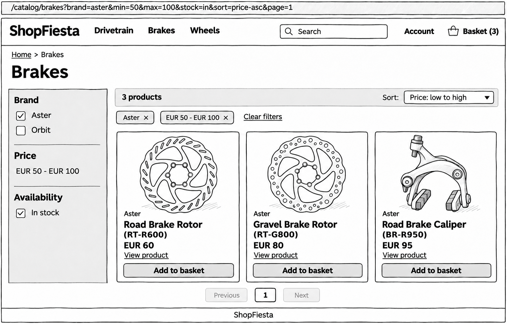

The customer starts in Brakes and filters by brand, price and availability. Product names include their technical model designation, such as `Gravel Brake Rotor (RT-G800)`. The selected filters, sort and page are represented in the URL, so a bookmarked view and a return from product detail describe the same query.

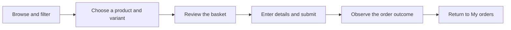

| Stop | What the customer sees | What the presentation design exercises |
| --- | --- | --- |
| [Catalog](#browse-filter-and-return-to-the-same-catalog-view) | Categories, breadcrumbs, filters, model codes and independently actionable product cards. | URL-owned queries, native navigation and a purchase context per card. |
| [Product detail](#open-a-product-with-a-local-purchase-context) | Aster's rotor, its 160 mm center-lock variant, merchant SKU, manual, availability and related components. | Catalog content, Stock availability, Basket's purchase contribution and Marketing's optional region on one page. |
| [Basket](#keep-the-basket-page-and-header-summary-consistent) | Two rotors and one lockring, editable quantities and a matching header badge of three units. | One confirmed Basket snapshot across the page and shell summary. |
| [Checkout](#use-native-checkout-forms-and-an-explicit-order-attempt) | Contact/delivery fields, validation, an order review and a recoverable submission outcome. | Native Blazor forms, submitted revisions and an attempt identity that prevents blind replay. |
| [My orders and order detail](#customer-history-and-order-detail) | The signed-in customer's past orders, purchased product details and fulfillment status. | Authorized deep links, customer-owned data and historical product/price snapshots. |

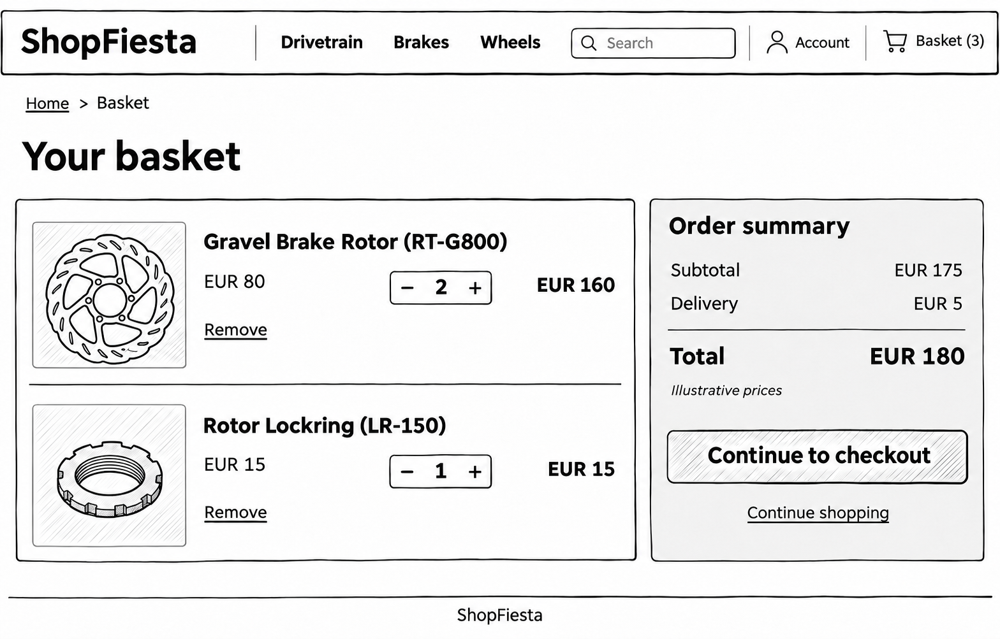

The basket totals EUR 175 in components and EUR 5 in delivery, for EUR 180. Checkout carries that review into a native form. An accepted submission provides an order reference; payment and fulfillment remain separate outcomes. The customer can later open that same order through My orders.

Availability follows the selected SKU and requested quantity. Stock can allow a preorder, reject an order below a configured threshold or allow ordering when quantity is unknown. A `null` quantity means unknown, and the per-SKU policy decides sellability. A Stock service failure is a separate unavailable state. The framework keeps the relevant component scope and updates current; Stock owns the ordering decision.

### Staff run the same shop through a different layout

The operations layout provides a protected workspace for the same logical modules. Permissions remain specific to reporting, recommendations, stock management and order actions. Access to one staff page does not grant every operational capability.

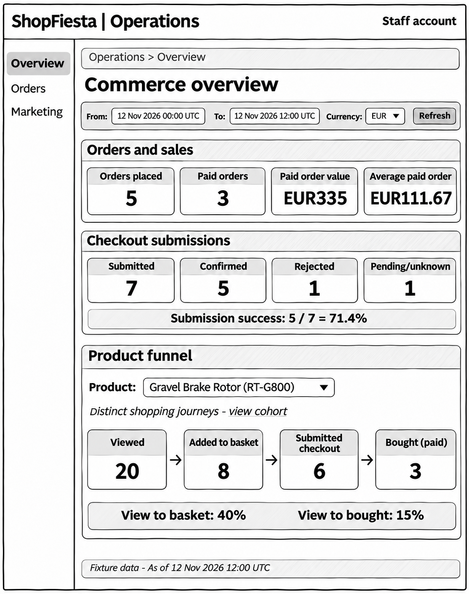

Marketing owns this complete overview. Its reporting result supplies the sales totals, checkout outcomes, product selector and funnel stages together with freshness and coverage. The example shows 20 product-view journeys, eight basket journeys, six submitted checkouts and three paid purchases. The page reads Marketing only. In the later backend showcase, Marketing captures inter-module messages into its reporting data.

| Staff screen | What staff do | What the presentation design exercises |
| --- | --- | --- |
| [Commerce overview](#compose-staff-business-metrics-and-a-product-funnel) | Read order/sales metrics, checkout outcomes and a product funnel. | One Marketing-owned query snapshot across ordinary Razor components, with honest stale, partial and unavailable states. |
| [Recommendation management](#let-marketing-fill-an-optional-product-region) | Choose an ordered set of related components for a source product and preview it. | A module-owned editor, inert previews, draft preservation and host authority over the public region. |
| [Stock management](#compose-stock-availability-and-manage-ordering-policy) | Inspect SKU availability and edit thresholds, preorder/backorder rules and the unknown-quantity policy. | A protected native form, versioned saves and live updates that target the matching SKU and quantity. |
| [Order operations](#staff-queues-and-safe-batch-actions) | Inspect Ready and Review queues and release selected orders. | Independent selection scopes, retained selection on paging, an external toolbar and explicit partial outcomes. |
| [Order export](#distinguish-partial-release-from-backend-owned-export) | Start an export of a captured query and revisit its progress. | Observation of backend-owned work that survives page navigation without resubmission. |
| [Preferences](#compose-settings-sections-and-restore-their-owned-preferences) | Change appearance, language and Orders display settings. | A shared packaged module plus independent feature-owned settings sections and persistence. |

### One modular monolith, with a frontend developers can follow

Ten commerce modules retain the same logical identities in the frontend and backend. The original Catalog/Stock/Basket/Checkout/Marketing/Orders journey is extended with Customers, Pricing, Payments and Fulfillment. The host selects their presentation contributions and maps native pages to the storefront or operations layout. A separate shared Preferences module supplies the reusable appearance/culture scenario.

| Logical module | Customer and staff presentation | Corresponding backend responsibility |
| --- | --- | --- |
| Catalog | Browsing, product content, filters, cards and breadcrumbs. | Products, variants, identifiers and content metadata. |
| Stock | Availability and stock-policy management. | SKU quantities and ordering decisions. |
| Basket | Purchase actions, basket editing and the header summary. | Current basket mutations and confirmed snapshots. |
| Checkout | Native checkout form, review, receipt and recovery. | Submission attempts and acceptance outcomes. |
| Marketing | Related products, recommendation/discount management and the complete commerce overview. | Recommendation sets, campaigns and captured reporting projections. |
| Orders | Customer history/detail, staff queues and operation status. | Order ownership/processing and confirmed payment/fulfillment projections. |
| Customers | Account/profile and address management for seeded users. | Customer records, owned addresses and defaults. |
| Pricing | Price breakdowns, versioned reviews and tax configuration. | Quotes, tax policies and calculation over Catalog/Marketing/shipping inputs. |
| Payments | Authorized fake-payment interaction and attempt status. | Payment attempts, provider adapters and authoritative outcomes. |
| Fulfillment | Shipping selection, staff picking/packing and tracking. | Shipping methods/rates, shipments and carrier execution. |

For a developer, the framework supplies the repeated application work: module composition, layouts, navigation contributions, typed extension points, action scopes, shared feedback and diagnostics. Pages still use ordinary Blazor routing, DI, parameters, callbacks and forms. MudBlazor supplies the default renderer. Fluent setup and conventions reduce declarations; discovery and optional generation must preserve the same explicit contracts. Business modules own product, stock, basket and order rules.

The [first connected validation slice](#first-interactive-server-validation-slice) uses Interactive Server with prerendering off to isolate live composition behavior. ShopFiesta's actual public website uses the required [server-rendered storefront profile](#public-storefront-rendering-and-first-load), validated separately against the same feature boundaries. Server feature services call Requester directly in process; a later optional WASM profile uses typed HTTP. AppState coordinates scoped presentation snapshots and preferences; it does not become an inventory authority or a reporting database.

ShopFiesta demonstrates queued order processing, inter-module Messaging, recurring Jobs, Blob Storage images, File Storage manuals and the existing backend Application.Caching feature. Those integrations and their evidence belong to the [backend architecture](#backend-architecture-and-delivery) in this specification. Initial fixture-backed presentation checks do not require real providers, and cannot establish full application readiness. DoFiesta remains unchanged; TaskFiesta is the framework validation application.

Continue with [module ownership and product identifiers](#follow-one-shop-across-its-business-modules), then [host composition](#compose-one-application-with-ordinary-host-setup). The remaining sections follows the same screens into their proposed APIs, lifetime rules and validation cases.

## Follow one shop across its business modules

Spec references: [Modular monolith across backend and frontend](spec-blazor-presentation-framework.md#modular-monolith-across-backend-and-frontend), [Vocabulary and ownership](spec-blazor-presentation-framework.md#vocabulary-and-ownership), and [Product boundaries](spec-blazor-presentation-framework.md#product-boundaries).

The customer browses Brakes, filters by brand and price, opens Gravel Brake Rotor, adds it to the basket and completes checkout. Marketing supplies related products on the detail page and manages their saved selection through its own protected staff pages. Signed-in customers can revisit their own order history and order details. Staff use a separate operations layout to inspect and release orders, read business metrics and examine a product's view-to-basket-to-purchase funnel. These are feature workflows within one composed application, with separate public, customer and staff access requirements.

The initial product data contains only road/race and gravel bicycle components. The application is not tied to those products. Product identity, category hierarchy, variant/attribute metadata, allowed facets and media belong to Catalog. Bike-specific values such as rotor diameter are data for this initial catalog, not shell types, hard-coded route branches or dependencies in Basket, Checkout, Marketing and Orders. Clothing, complete bicycles and general-purpose/computer hardware are outside the initial sample catalog.

Components also have manufacturer model designations alongside their customer-readable names. Shimano's naming illustrates the distinction: its technical catalog lists `FD-R8000-F` and `FD-R8000-B` front derailleurs, and `RT-CL800` disc brake rotors. These are naming references, not ShopFiesta fixture products, prices or compatibility claims. [Shimano front-derailleur designations](https://productinfo.shimano.com/index.html/spec/road-front-derailleur) and [Shimano rotor designations](https://productinfo.shimano.com/index.html/spec/general-rotor-center-lock).

The fictional Aster fixtures use the following codes without changing their existing names, routes or prices:

| Display name | Brand | Model designation | Illustrative price |
| --- | --- | --- | --- |
| Road Brake Rotor | Aster | `RT-R600` | EUR 60 |
| Gravel Brake Rotor | Aster | `RT-G800` | EUR 80 |
| Road Brake Caliper | Aster | `BR-R950` | EUR 95 |
| Rotor Lockring | Aster | `LR-150` | EUR 15 |
| Brake Adapter | Aster | `AD-200` | EUR 20 |

Catalog's public product summaries expose the display name, brand and optional `ModelDesignation`. A code can describe several variants, such as 140 mm and 160 mm rotors; the selected variant retains its own identity, attributes and merchant SKU. The example 160 mm center-lock `RT-G800` variant can use the fictional merchant SKU `AST-RTG800-160-CL`. A manufacturer model designation and a merchant SKU have separate meanings. Neither replaces `ProductId` or `VariantId`, and model codes need not be globally unique across manufacturers.

Whenever a product has a technical model designation, show it together with the product name. For example, render `Gravel Brake Rotor (RT-G800)` and `Rotor Lockring (LR-150)`. A narrow card or row can put `Model: RT-G800` directly beneath the name. Apply this to catalog/search cards, product headings/breadcrumbs, basket lines, checkout summaries, purchased order lines, recommendation selectors/editors/previews and reporting product selectors. Keep both parts readable and available to assistive technology; a tooltip alone does not satisfy the display rule.

Catalog search and Marketing lookup accept model designations as well as names and show brand/model/variant details to distinguish results. Basket/checkout DTOs include the applicable designation, and historical order lines use their recorded designation rather than a changed Catalog label. Keep the manufacturer's spelling and punctuation for display; search normalization belongs to Catalog. Use ordinary feature-owned Razor markup/templates for the combined label. No shell contract parses prefixes such as `FD`, requires a product-label abstraction or assumes every future catalog has a model code. When the optional value is absent, show the name without an empty suffix. Compact wireframes must retain available model designations too.

| Module | Frontend ownership | Published presentation integration | Service boundary |
| --- | --- | --- | --- |
| Catalog | Categories, filters, product details/cards, breadcrumbs and image/manual presentation. | Product/category destinations, public summaries, purchase-action target and related-products region. | Catalog owns product reads and content metadata. |
| Stock | Live SKU availability presentation, stock updates and protected stock/policy management. | Public SKU availability component/client and Stock-owned staff page. | Stock owns quantities and ordering decisions; Catalog supplies the SKU identity and public product labels. |
| Basket | Purchase contribution, header summary and basket editor. | Actions over Catalog's typed purchase target and confirmed basket snapshots. | Basket owns mutations, revisions and current-session scope. |
| Checkout | Native form, review, submission attempt, receipt and recovery presentation. | Checkout/receipt destinations and a narrow checkout feature contract. | The backend owns acceptance and subsequent processing; no worker runs in a component. |
| Marketing | Related products, staff recommendation/discount editors and the full reporting overview. | Catalog region contribution, management destinations, public campaign business contract and Marketing-only reporting contract. | Its backend owns recommendations, campaigns and captured reporting data. |
| Orders | Customer history/detail and staff queues/details/actions under one identity. | Audience-specific destinations, read/action contracts and backend-owned operation status. | Orders owns order state and per-record access. |
| Customers | Current profile, address book and address selection. | Customer/account destinations and versioned own-address forms. | Owns customer/address records for subjects supplied by fake auth. |
| Pricing | Selling-price breakdowns, checkout quote and staff tax settings. | Batch price/quote contracts and a native tax-policy editor. | Owns calculation/quote validity and tax policy; reads public price/discount/shipping inputs. |
| Payments | Fake-provider interaction, payment status and protected reconciliation views. | Authorized payment destination and provider-neutral feature contract. | Owns attempts/provider state and confirmed payment facts. |
| Fulfillment | Shipping options, shipment/tracking views and staff picking/packing. | Public rate/fulfillment contracts and module-owned staff pages. | Owns shipments/carriers and coordinates allocation consumption through Stock. |

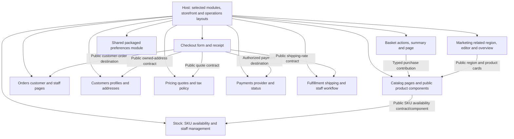

The module boundaries match the backend's logical ownership. Presentation integrates through public destinations, components and feature contracts, without private component-state access or another module's handlers/repositories. A Checkout link to customer history does not require the staff Orders assembly. The [backend architecture](#backend-architecture-and-delivery) defines delivery and storage mechanics for these same modules.

Public module identities are pinned once as `catalog`, `stock`, `basket`, `checkout`, `marketing`, `orders`, `customers`, `pricing`, `payments` and `fulfillment`. Each corresponding `<Module>Ui.Name` constant is shared by backend modules and portable presentation definitions. They are not separate frontend/backend identities. Customer and operations order views remain facets of Orders. Customers owns profiles/addresses rather than a duplicate order store.

The preferences scenario also selects a shared `PreferencesModule` under the stable identity `preferences`, using its corresponding server/portable registration and native preference providers. It is a proposed reusable package consumed by ShopFiesta and a separate clean application host. TaskFiesta validates the underlying settings contracts in its CoreModule rather than installing this additional application module. It is a cross-cutting capability alongside the commerce modules; its default local/scoped persistence does not require another business domain or an external service.

| Logical module | Minimal fixture-backed contract for frontend validation |
| --- | --- |
| Catalog | Product/category/facet/ancestry DTOs, model designations and working fixture content URLs. |
| Stock | Shared-SKU availability snapshots/updates, explicit ordering decisions and versioned stock/policy edit outcomes. |
| Basket | Current-session snapshots and deterministic versioned add/change/remove outcomes. |
| Checkout | Review, accepted/rejected/unknown attempt outcomes and status recovery. |
| Marketing | Versioned recommendation/campaign sets and authorized overview DTOs with revision, capture time and coverage states. |
| Orders | Own-customer history, separate staff projections, partial action outcomes and simulated backend-owned operation status. |
| Customers | Seeded profiles, owned addresses/defaults and versioned save/conflict outcomes. |
| Pricing | Immutable base/discount/tax/shipping quotes, expiry and changed-review rejection. |
| Payments | Provider-neutral attempts and controlled fake outcomes, with no real payment system. |
| Fulfillment | Shipping rates, authorized shipment views and controlled picking/dispatch/tracking outcomes. |

Fixture handlers keep those boundaries and access/concurrency rules. They do not merge module state or masquerade as real queue, message, storage or scheduler integration. Reads observe fixture state; they do not advance work. Test-owned controls can change it independently to exercise delayed results and transitions.

Marketing remains optional by declared capability. Without it, Catalog omits related products and campaign UI, and Pricing uses an explicitly configured no-campaign policy. A failed installed discount service is not silently treated as no discount. Catalog can run alone as read-only browsing with its base-price data and no Stock/Pricing client. The purchasing profile selects Stock, Basket and Pricing. Full checkout also selects Customers, Orders, Payments and Fulfillment capabilities. Recommendation-only Marketing does not make the whole commerce backend mandatory. Missing availability/coverage is not a successful zero.

Checkout requires Orders business services, not its staff UI. A host can suppress the operations presentation while retaining Orders backend capabilities and customer history. Customer history and operations declare their respective identity/access requirements. The immediate receipt page remains Checkout-owned and can link to Orders' authorized customer detail; neither exposes staff-only data.

| Journey | What the reader should see | Concepts demonstrated |
| --- | --- | --- |
| [Browse Brakes](#browse-filter-and-return-to-the-same-catalog-view) | Public top navigation, breadcrumbs, product filters, applied filters, sorting and paging. | Module ownership, native routing, dynamic navigation, query state and view restoration. |
| [Open Gravel Brake Rotor](#open-a-product-with-a-local-purchase-context) | A direct product URL, quantity input, purchase action and related products. | Typed destinations, component-owned context, optional component regions and cross-module contributions. |
| [Follow live SKU availability](#compose-stock-availability-and-manage-ordering-policy) | Stock changes for the selected SKU update its status and ordering decision without changing another card. Staff manage quantity and policy in Stock's own page. | Shared identifiers, public module components, live-context revisions, native forms and precise unknown/disabled states. |
| [Read product content](#present-product-images-and-manuals) | Product image, alt text and a native Installation manual link. | Public content metadata, base-path-aware URLs, accessibility and local missing/failure states. |
| [Add from either product area](#let-basket-contribute-purchasing-without-coupling-catalog-to-it) | The correct product and quantity are added, and the header basket summary changes. | Independent action scopes, immutable invocation inputs, confirmed-result updates and targeted invalidation. |
| [Manage related products](#manage-recommendations-in-the-marketing-module) | Marketing staff choose, order and save recommendations for a source product, with an inert draft preview. | Native editors, module-owned management, concurrency, targeted invalidation and host authority. |
| [Review the basket](#keep-the-basket-page-and-header-summary-consistent) | Quantity controls, removal, current totals and a checkout link. | Feature-owned shared state, backend authority, local feedback and optional destination availability. |
| [Submit checkout](#use-native-checkout-forms-and-an-explicit-order-attempt) | Native form validation, a stable order attempt and an accurate result or recovery choice. | Submitted revisions, duplicate suppression, idempotency owned by the application and uncertain-outcome handling. |
| [Observe the accepted order](#observe-backend-owned-order-processing) | Leave/revisit a receipt and observe the backend-owned status. | Acceptance versus completion, page lifetime, safe observation and recovery. |
| [Revisit my orders](#customer-history-and-order-detail) | Own past purchases, bounded history and directly loadable read-only order details. | Same-module customer/backend ownership, per-record authorization, private state partitioning and durable order snapshots. |
| [Work operational orders](#staff-queues-and-safe-batch-actions) | Protected list/detail routes, two independent queues and an external batch toolbar. | Authorization, explicit scope attachment, selection policy, safe confirmation and disposal. |
| [Use external queue controls](#bind-typed-query-controls-to-the-same-queue) | Change the Ready queue's status/search from its external toolbar without changing Review. | Typed control parameters/callbacks, original-owner dispatch and targeted query invalidation. |
| [Review mixed outcomes and exports](#distinguish-partial-release-from-backend-owned-export) | See one released order and one conflict; leave and revisit a submitted export. | Per-target outcomes, accepted versus completed work, backend ownership and scoped observation. |
| [Read business metrics and a product funnel](#compose-staff-business-metrics-and-a-product-funnel) | Marketing supplies one overview result with sales, checkout, funnel and freshness data. | Module-owned page/query, native component composition, query revisions and truthful stale/partial presentation. |
| [Restore preferences](#compose-settings-sections-and-restore-their-owned-preferences) | Save appearance/culture and Orders display settings, reload and switch identities. | Shared/module-owned settings sections, scoped persistence, schema fallback and native localization. |
| [Inspect host customization](#replace-a-contribution-and-inspect-the-effective-result) | Compare default, replaced and suppressed recommendation profiles through read-only diagnostics. | Host authority, compatible replacement, provenance and safe inspection. |

### Give products and sellable variants explicit identifiers

Spec references: [Product boundaries](spec-blazor-presentation-framework.md#product-boundaries), [Modular monolith across backend and frontend](spec-blazor-presentation-framework.md#modular-monolith-across-backend-and-frontend), [Published typed contracts](spec-blazor-presentation-framework.md#published-typed-contracts), and [Low friction and native platform mechanisms](spec-blazor-presentation-framework.md#low-friction-and-native-platform-mechanisms).

A product groups its description, brand/model, categories, media and selectable variants. Every sellable variant has a merchant SKU; a simple product has one default variant/SKU. Stock recognizes those same SKU strings within the same store/catalog namespace. A manufacturer model such as RT-G800 can cover several variants and is not the SKU or global trade identifier.

| Identifier | Placement and meaning |
| --- | --- |
| `ProductId` | Stable internal product identity for routes/relationships and product-level recommendations. |
| `VariantId` | Stable internal identity for the specific selectable sellable variant. |
| `Sku` | Required merchant-owned string per sellable variant, unique within the declared store/catalog namespace. Catalog defines it; Stock, Basket, Checkout and Orders use the same value. Do not change case/punctuation independently in each module or derive it from the display name. |
| `ModelDesignation` | Manufacturer's technical model/family label, normally displayed with the product name. It may be shared by several SKUs. |
| `ManufacturerPartNumber` | Optional manufacturer article/part number for the specific variant or supplied package. It can differ from both model designation and merchant SKU. |
| `Gtin` | Optional GS1 Global Trade Item Number for the relevant trade item/package, stored as a string. EAN/UPC are common GTIN formats; they do not replace the merchant SKU. |
| Supplier references | Optional supplier-scoped item/article numbers represented with their supplier identity. They are not another globally unique product key. |

Use `Gtin` for the trade-item identifier intended by the shorthand TIN. GTINs can have 8, 12, 13 or 14 digits. Keep leading zeros and validate supplied values at the Catalog boundary. Identifier editors use text inputs; do not parse SKU/MPN/GTIN values as numbers. Barcode artwork/symbology is a representation of an identifier rather than a separate SKU. Fixtures leave unassigned GTINs empty; do not manufacture apparently allocated GS1 numbers. [GS1 GTIN formats](https://support.gs1.org/support/solutions/articles/43000734124-what-is-the-difference-between-a-gs1-gtin-a-barcode-an-ean-and-a-upc-) and [GS1 product-identification overview](https://www.gs1us.org/upcs-barcodes-prefixes/what-is-a-gtin).

The ordinary product fields also have explicit homes:

| Product/variant data | Presentation contract |
| --- | --- |
| Product description | Display name, brand, manufacturer, technical model, short/full descriptions, publication state, categories, tags and typed/configured attributes. These remain Catalog data. |
| Sellable variant | Internal variant ID, SKU, manufacturer part number, optional GTIN, option values and sale unit/package quantity. A different saleable pack can have its own SKU/GTIN. |
| Purchase terms | Current display price/currency and the stated tax-display convention, minimum order quantity, quantity increment and optional maximum. Backend pricing/review remains authoritative. |
| Content and logistics | Product images/alt text and manual metadata; optional shipping weight/dimensions carry explicit units. Rich fulfillment data can be added later behind Catalog's boundary. |
| Stock | Separate Stock response by SKU, with availability, quantity if known, requested-quantity ordering decision, revision and freshness. Do not put a second mutable inventory count on the Catalog product object. |

These identifier-focused DTO excerpts illustrate the object shape. The full product view also contains the categories/content fields described above. They are ordinary feature contracts, not framework entities or a new generic product base class:

```csharp
public sealed record ProductView(
	Guid ProductId,
	string Slug,
	string DisplayName,
	string Brand,
	string Manufacturer,
	string ModelDesignation,
	string Description,
	ImmutableArray<ProductVariantView> Variants);

public sealed record ProductVariantView(
	Guid VariantId,
	string Sku,
	string ManufacturerPartNumber,
	string Gtin,
	ImmutableArray<SupplierItemReference> SupplierReferences,
	ImmutableDictionary<string, string> Options,
	decimal DisplayPrice,
	string Currency,
	string SaleUnit,
	int PackQuantity,
	int MinimumOrderQuantity,
	int OrderQuantityStep,
	int? MaximumOrderQuantity);

public sealed record SupplierItemReference(string SupplierId, string ItemNumber);
```

The initial component catalog sells whole units with `SaleUnit = EA`, pack quantity 1, minimum 1 and increment 1. Those are sample rules, not shell assumptions. For the selected 160 mm center-lock rotor, SKU is `AST-RTG800-160-CL`, model is `RT-G800`, fictional manufacturer part number is `RT-G800-160-CL`, and GTIN is unassigned. The SKU map used by Stock's fixtures is:

| Product label | Merchant SKU | Selected variant |
| --- | --- | --- |
| Road Brake Rotor (RT-R600) | `AST-RTR600-160-CL` | 160 mm, center-lock |
| Gravel Brake Rotor (RT-G800) | `AST-RTG800-160-CL` | 160 mm, center-lock |
| Road Brake Caliper (BR-R950) | `AST-BRR950-FRONT` | Front |
| Rotor Lockring (LR-150) | `AST-LR150-EA` | Single unit |
| Brake Adapter (AD-200) | `AST-AD200-EA` | Single unit |

SKU changes require an explicit cross-module remapping/alias policy; editing a model label never changes the SKU. Basket/checkout/order-line DTOs retain the selected SKU, part number and GTIN where supplied. Historical order lines retain their purchased identifier/description snapshot even if the live catalog changes. Technical model labels remain visible with names; secondary identifiers can appear in a normal product-details section and staff lookup without cluttering every card.

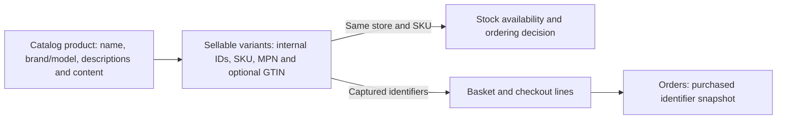

## Full shop workflows and demonstration policies

The full ShopFiesta scope extends the original six-module shopping journey with Customers, Pricing, Payments and Fulfillment. These are application business modules with corresponding frontend/backend identities, not additions to the presentation framework. Their pages and components use the same native routing, forms, typed contributions, scopes and feature-client rules as the original walkthrough.

The sections below distinguish required capabilities from proposed demonstration defaults. The defaults make a local example concrete and testable. They are configurable sample policies, not claims about real-world tax rates, payment providers or carrier rules. The existing wireframes remain the baseline fixture, not drawings of every new screen.

| Module identity | Additional ownership | Example public feature boundary |
| --- | --- | --- |
| `customers` | Seeded customer profiles, owned addresses and defaults. | Current profile/address reads and versioned address commands. |
| `pricing` | Quote calculation, tax policies, price breakdowns and quote validity. | Bounded display-price batches and authoritative basket/checkout quotes. |
| `payments` | Payment attempts, provider selection, normalized payment outcomes and reconciliation. | Start/read/reconcile the current authorized payment attempt. |
| `fulfillment` | Shipping methods/rates, shipments, picking/packing, dispatch and tracking. | Delivery quotes, authorized shipment views and staff transitions. |

Proposed names such as `ICustomersFeature`, `IPricingFeature`, `IPaymentsFeature` and `IFulfillmentFeature` describe application-owned contracts. They are not new DevKit services or stable API signatures. Catalog keeps base product/variant prices and tax-category references. Marketing owns discount campaigns. Pricing combines their public inputs with Fulfillment's delivery quote into a versioned price decision. Orders owns the purchased order and its projections, while Payments and Fulfillment own their respective execution state.

### Seeded customers manage their addresses

ShopFiesta uses the existing [Fake Identity Provider](../features-identityprovider.md) with configured customer and staff accounts. The initial full shop requires sign-in with one of those accounts before order placement. Public browsing and a guest basket still work. Registration, password recovery, email verification and customer credential storage are not ShopFiesta workflows.

Customers maps the authenticated issuer/subject to its seeded customer identity. It does not use an editable email address as the identity key. Customer A cannot read or mutate Customer B's profile/address by guessing an ID. Staff operational access does not silently permit impersonation.

| Customer screen/data | Required behavior |
| --- | --- |
| `/account/profile` | Show the current customer's profile and editable contact fields under the declared profile revision. Changing a contact email does not change the authentication subject. |
| `/account/addresses` | List, add, edit and delete owned addresses. Capture an address ID/revision for edits; conflicting saves retain the current draft and feedback. |
| Address shape | Stable ID, label, recipient name, address lines, postcode, city, optional region, country code, optional phone and revision. Use field-level validation and accessible native forms. |
| Defaults | At most one default delivery address and one default billing address per customer. Updating a default is one Customers-owned operation. Deleting a default clears that default explicitly. |
| Checkout selection | Choose a saved delivery/billing address or enter a one-off address. Saving a one-off address is an explicit separate choice, not a side effect of previewing a quote. |
| Historical orders | Checkout copies the accepted address/contact values into the order snapshot. A later address edit/delete never rewrites an existing order or shipment. |

The proposed basket sign-in policy merges the guest basket into the customer's current basket once by stable merge identity and exact SKU. It combines compatible quantities and requires review of quantity limits, unavailable variants or changed prices. Preserve and explain conflicting lines instead of silently discarding them. Basket owns this mutation and its confirmed revision. Switching to another seeded customer partitions private addresses, orders, attempts and drafts.

Use ordinary Blazor forms and the existing stale-result/dirty-state behavior. Account navigation is a Customers contribution in the storefront layout, alongside Orders' My orders contribution. Address management is customer-owned data, not a Preferences section or browser-local address book.

### Staff maintain a complete catalog

Catalog adds protected `/operations/catalog/products` and `/operations/catalog/categories` pages, plus native product/variant/category editors. `Shop.Catalog.Manage` protects their use cases and delivery/upload boundaries. The staff list supports name, model and SKU search, bounded filters/sort/paging, retained selection and its Catalog-owned DataPorter export action.

| Catalog concern | Required management behavior |
| --- | --- |
| Categories | Maintain a hierarchical tree with stable IDs, names, slugs, order, publication state and parent references. Reject cycles and invalid parent/deletion operations. Product membership can span categories without duplicating the product identity. |
| Products | Edit customer name, optional technical model designation, brand/manufacturer, description, categories, publication state and product-level content. Preserve readable name/model labels in selectors and previews. |
| Variants | Manage attributes/options, units/pack/quantity rules, base price/currency, tax-category reference and the identifiers already specified above. Reject duplicate merchant SKUs in the defined namespace. |
| Identity changes | A referenced SKU is not renamed through a normal text edit. Retirement/replacement uses an explicit policy and retains historical references in Basket, Stock and Orders. Label/model changes do not remap identity. |
| Media/manuals | Upload/reorder images, edit alt text and associate manuals with product/model/variant, language and revision. Backend delivery uses the existing Blob/File Storage boundaries. Upload failures remain separate from a successful metadata save. |
| Publication | Draft products stay out of public browsing/purchase queries. Publishing/retiring and changing a slug are versioned operations with declared redirects/link behavior. Validate incomplete variants and broken category references before publication. |
| Concurrent editing | Capture product/category revision. Conflicts retain the draft and require explicit review. A delayed save or lookup cannot update the next product selected in the same editor. |

Stock availability is a read-only contribution to Catalog management, with a public destination to Stock management for authorized staff. Catalog never writes Stock's quantities. Optional bulk imports can later reuse DataPorter, but exports are the already agreed first integration. Staff previews are inert and produce no product-view or basket analytics.

### Marketing manages product discounts

Marketing adds `/operations/marketing/discounts` and native campaign editors protected by `Shop.Marketing.ManageDiscounts`. A campaign has stable identity/revision, name, enabled state, UTC validity period, target product/variant IDs, discount kind/value, currency where applicable and deterministic priority. Its editor uses Catalog's public lookup with names, brands, model codes and variants.

The proposed first discount policy supports automatic percentage-off or fixed-amount-off product discounts. One campaign wins per line by highest priority, then greatest eligible discount, then stable campaign ID. There is no stacking in this initial policy. Validate negative values, percentages over 100, invalid periods/currency and self-inconsistent targets. Clamp the final line price at zero. Coupon codes, loyalty and complex campaign budgets remain separate later work.

Pricing reads eligible campaign definitions through Marketing's public business contract. Marketing remains the sole reporting source, but its reporting overview does not perform this price calculation. Accepted order lines record the applied campaign identity/version and amount. Changing a campaign invalidates affected current display prices/quotes under the declared freshness policy and never reprices a purchased order. Campaign previews and quote reads are not redemptions or new funnel stages.

Product cards/detail show a clearly labeled original and discounted selling price where applicable. Use Pricing-owned public values/components, not duplicated percentage arithmetic in Razor. Batch price reads for a list. An optional Marketing region replacement/suppression still controls related products only; it cannot suppress a previously accepted discount or alter backend pricing authority.

### Pricing makes totals explicit

Pricing calculates an immutable quote from the current basket revision, Catalog price/tax-category revisions, eligible Marketing campaigns, selected shipping rate, addresses and authorized store/currency. It returns a quote ID/version, expiry, item/quantity/base/discount/tax breakdown, shipping breakdown, totals, source references and relevant validation messages. The browser displays this result and does not submit trusted totals.

Proposed local defaults are one store, EUR, whole component units, a configurable 15-minute quote validity and gross-inclusive prices. A fictional standard tax category uses 20% solely to exercise inclusive tax calculations. Its label identifies a demonstration rate. Tax category, destination and rate configuration belong to Pricing. They are not production jurisdiction rules or shell metadata.

Calculate discounts on a line's gross amount, round the resulting line to currency precision, then derive inclusive tax as `lineGross * rate / (1 + rate)`, rounded per line. Treat delivery as its own priced/taxed line. The proposed EUR rounding is two decimals, midpoint away from zero. Sum the rounded lines; do not add already-included tax to gross again. Quotes and accepted snapshots retain the calculation/rate versions.

The unchanged baseline remains two EUR 80 rotors, a EUR 15 lockring and EUR 5 delivery: gross EUR 180, net EUR 150 and included demonstration tax EUR 30. A separate 10% rotor campaign produces rotor gross EUR 144, lockring EUR 15 and delivery EUR 5: gross EUR 164, included tax EUR 27.33 and net EUR 136.67. These are distinct fixtures. The existing EUR 180 screenshots and Marketing's historical EUR 335 paid value do not change.

On submit, reauthorize and validate the quote, basket revision, inputs and current availability. If a required change or expired quote prevents acceptance, return a refreshed review and require explicit customer confirmation. Do not silently charge a changed total. Once accepted, record the price/discount/tax/delivery snapshot. Downstream processing does not recalculate it from current catalog or campaign data.

### Payments use one fake provider through a real provider boundary

Payments owns an application provider model and registers one deterministic fake provider for development. The model is ready for later payment-system adapters, but ShopFiesta on dev boxes uses the fake provider only. No real charges, external payment credentials or card collection are required. Provider selection/configuration stays in backend composition.

Checkout obtains or resolves a payment attempt for an accepted order and links to a Payments-owned `/checkout/payment/{PaymentAttemptId:guid}` page when interaction is required. It clearly labels the development provider, shows the accepted amount/currency and offers a demo confirmation/cancel flow. It does not reinterpret a return URL as payment proof. A customer can revisit the same authorized attempt after disconnect/navigation.

The provider boundary covers creating/resolving an attempt, obtaining current status, supported confirmation/capture, cancellation and refund operations, and normalizing provider notifications. Exact signatures are proposed application contracts. Stable order/attempt/operation identities, amount/currency and correlation pass through the boundary; provider tokens/references stay in Payments. Capability differences are explicit rather than simulated with unsupported success results.

The fake provider supports controlled success, decline, pending, cancelled and unknown-acknowledgement scenarios, including repeated/out-of-order notifications and recovery. Normal page reads do not advance its state. A protected development/test control or explicit demo interaction advances a scenario. Later real adapters implement the same application meaning, including their authenticity, idempotency and reconciliation rules.

Payments is the authoritative payment owner. Orders consumes its confirmed outcomes, records the corresponding order projection and publishes the existing `OrderPaidMessage` once per established paid transition. Marketing continues to count that Orders fact rather than counting both a payment-provider message and an order message. A payment failure, timeout, accepted queue item or browser redirect cannot create a Paid fact.

### Stock reserves accepted checkout quantities

Basket additions and product-page reads reserve nothing. The proposed first backend policy creates an all-lines Stock reservation during accepted placement, after quote validation and before scheduling payment work. Known finite stock is held atomically within Stock for that reservation identity. An incomplete multi-module placement uses recorded recovery/compensation; it does not rely on an imaginary global transaction.

Stock owns reservation IDs, exact SKUs/quantities, held/committed/released/expired state, deadlines and revisions. A known-stock hold reduces available-to-promise quantity. Confirmed payment commits the allocation without deducting physical on-hand twice. Dispatch consumes the allocation and physical quantity. Confirmed cancellation or failed placement releases the appropriate unconsumed hold. Reservation expiry and payment uncertainty follow the [backend reservation rules](#stock-reservation-lifecycle).

Zero, preorder/backorder and unknown-quantity SKUs retain their explicit policy. An allowed unknown/preorder obligation is recorded as such rather than inventing physical stock. Stock service unavailability still blocks acceptance under this initial policy. Staff can inspect holds/allocations and exceptional states through Stock's management UI. A customer's displayed quantity remains a current observation, not their reservation identity or permission to override another hold.

### Fulfillment handles normal shipping

Fulfillment owns shipping methods, rates, shipment records and carrier integration. Start with one configured standard shipping method and a deterministic fake carrier so development needs no external account. Delivery quotes use destination and declared package/product metadata through public contracts. Pricing incorporates the selected versioned shipping quote; the baseline remains EUR 5.

Staff open `/operations/fulfillment/shipments` and native shipment detail/picking/packing views under `Shop.Fulfillment.Manage`. A releasable order must have the required confirmed payment and Stock allocation. The existing Orders Release action requests Fulfillment work through a public contract, retaining its per-order partial results and captured versions.

The first policy supports one complete shipment per order, with states Awaiting release, Picking, Packed, Dispatched and Delivered, plus explicit failure/review outcomes. Partial shipments and international carrier/customs logic are later extensions. Sellable preorder/unknown stock does not imply ready-to-ship stock; such orders wait for an explicit fulfillment/Stock readiness decision. Release acceptance is not dispatch. Dispatch records a carrier/tracking reference, source timestamp and the Stock-consumption result; customer order detail then shows an authorized tracking projection. Do not decrement stock or create a second shipment from duplicate dispatch work.

Customers can see their accepted shipping/billing snapshots, selected shipping method, shipment state and tracking from Orders' customer projection. A later address-book change cannot retarget an accepted shipment. Post-placement address changes require a separate authorized fulfillment policy; they are not an automatic profile sync. Picking, dispatch and delivery transitions come from backend/provider events or controlled fake outcomes, not UI timers.

### Transactional emails use Templating and Notifications

Orders owns order confirmation, payment outcome, cancellation and shipment messages for its customer-facing lifecycle. It creates a stable notification intent from confirmed source facts and captured order/contact/culture data. Customers does not need registration or password emails in the seeded-account profile. Marketing campaigns and transactional order messages retain separate purposes and recipients.

Rendering uses the planned [Application.Templating design](spec-application-templating.md); delivery uses the existing [DevKit Notifications](../features-notifications.md). Keep template resolution, culture/branding fallback and renderer selection in Templating rather than embedding mail string replacement in Orders. The template integration is a dependency proposal, not a claim that Templating is implemented.

Use logical template bundles for subject, HTML body and plain-text body, with typed immutable models, owning module, culture and template revision. The exact multipart/subject adapter follows the merged Templating API and its HTML/text or specialized whole-model renderer support. Start with embedded branded ShopFiesta templates. A template preview is inert and sends no message.

Current Notifications `EmailMessage` has one `Body` and an `IsHtml` flag. The initial delivery therefore sends the rendered HTML body; the text rendering is a separately validated fallback artifact. Sending true multipart alternatives requires an explicit Notifications model/SMTP-adapter extension and its own evidence. Templating alone does not add that transport capability, and the fallback is not a second customer email.

Queue rendered emails through Notifications' configured outbox. Fake SMTP is the default local/test transport; a configured local SMTP sink can exercise the same delivery boundary. Record template/model revision, notification intent and delivery status so failures can be inspected and deliberately retried. A rendering or SMTP failure does not undo the order, repeat a payment or re-run fulfillment. Reuse the existing authorized notification operations instead of creating a shell mail platform. Detailed triggers and evidence are in [Templated transactional email](#templated-transactional-email).

## Compose one application with ordinary host setup

Spec references: [Low friction and native platform mechanisms](spec-blazor-presentation-framework.md#low-friction-and-native-platform-mechanisms), [Presentation module composition](spec-blazor-presentation-framework.md#presentation-module-composition), [Extension contracts and host authority](spec-blazor-presentation-framework.md#extension-contracts-and-host-authority), and [Recommended business application profile](spec-blazor-presentation-framework.md#recommended-business-application-profile).

`WebModuleBase`, `AddModules`, `WithModule`, `UseModules`, `MapModules`, Requester, `Result<T>` and the native Blazor hosting APIs already exist. The following presentation contracts are proposed additions. They extend these foundations rather than replacing them.

| Proposed contract | Role in the shop |
| --- | --- |
| `IPresentationModule.RegisterPresentation(PresentationModuleBuilder)` | Optional presentation capability on an existing backend module, preserving its logical identity. |
| `WithPresentation(...)` | Collects presentation declarations from selected modules, applies host options and arranges composition validation. |
| `PresentationModuleBuilder` | Focused fluent registration for page assemblies, destinations, navigation, resources, action targets and component regions. |
| `AddPresentationMudBlazor()` | Selects the separately referenced default renderer and its shared services. |
| `IPresentationCatalog`, `PresentationRouteView`, `WithPresentationRoutes()` | Integrate effective ownership, assemblies and availability with native routing and initial endpoint processing. |
| `Destination<TParameters>` | A public typed link contract over an ordinary page route. |
| `ActionTarget<TContext>`, `IActionScopes`, `ActionScope<TContext>` | Publish a place for actions and bind them to a live component's immutable context and lifetime. |
| `IActionContributor<TContext>` | Optional reusable action contribution resolved through DI for a live target scope. Local feature callbacks can bind directly. |
| `RegionTarget<TContext>`, `ExtensionRegion` | Publish and render a typed component extension, such as related products, with normal Razor parameters. |
| `ActionToolbar` | Default renderer observing an explicitly supplied scope. It can appear as a compact purchase-action row or an operations toolbar. |
| `BindControl<TComponent, TValue>` | Bind normal typed Razor control parameters/callbacks to the same live owner used by an external toolbar. |
| `MapOutcome`, `OnConfirmedOutcome` | Map actual feature responses into the specified execution outcomes and apply confirmed receipts separately from refresh feedback. They do not replace feature result contracts. |
| `Settings.Add<TComponent>`, `SettingsSections` | Compose module-owned native settings components through the shared settings-section contract. |
| `PageLayouts` | Map ordinary page types to native layouts without changing module ownership. |

```csharp
builder.Services.AddModules(builder.Configuration, builder.Environment)
	.WithModule<CatalogModule>()
	.WithModule<StockModule>()
	.WithModule<BasketModule>()
	.WithModule<CheckoutModule>()
	.WithModule<MarketingModule>()
	.WithModule<OrdersModule>()
	.WithModule<CustomersModule>()
	.WithModule<PricingModule>()
	.WithModule<PaymentsModule>()
	.WithModule<FulfillmentModule>()
	.WithModule<PreferencesModule>()
	.WithPresentation(options =>
	{
		options.DefaultLayout = typeof(StorefrontLayout);
		options.PageLayouts[typeof(OperationsOverview)] = typeof(OperationsLayout);
		options.PageLayouts[typeof(StockManagement)] = typeof(OperationsLayout);
		options.PageLayouts[typeof(OperationsOrders)] = typeof(OperationsLayout);
		options.PageLayouts[typeof(OperationsOrderDetails)] = typeof(OperationsLayout);
		options.PageLayouts[typeof(OrderExportStatus)] = typeof(OperationsLayout);
		options.PageLayouts[typeof(RecommendationManagement)] = typeof(OperationsLayout);
		options.PageLayouts[typeof(RecommendationEditor)] = typeof(OperationsLayout);
		options.PageLayouts[typeof(DiscountManagement)] = typeof(OperationsLayout);
		options.PageLayouts[typeof(CatalogProductsManagement)] = typeof(OperationsLayout);
		options.PageLayouts[typeof(CatalogCategoriesManagement)] = typeof(OperationsLayout);
		options.PageLayouts[typeof(PricingTaxSettings)] = typeof(OperationsLayout);
		options.PageLayouts[typeof(PaymentOperations)] = typeof(OperationsLayout);
		options.PageLayouts[typeof(ShipmentManagement)] = typeof(OperationsLayout);
	});

builder.Services.AddRazorComponents()
	.AddInteractiveServerComponents();
builder.Services.AddPresentationMudBlazor();
builder.Services.AddRequester().AddHandlers();

var app = builder.Build();
app.UseModules();
app.UseAntiforgery();
app.MapStaticAssets();
app.MapModules();
app.MapRazorComponents<App>()
	.AddInteractiveServerRenderMode()
	.WithPresentationRoutes();
app.Run();
```

The layout types are ordinary application-owned Blazor layouts. Orders customer history/detail use the default `StorefrontLayout`; explicitly mapped staff pages use `OperationsLayout`. Marketing registers `OperationsOverview` alongside its management pages under the same module identity. Module pages retain their module owner regardless of layout. Default shell renderers consume contributions in either layout. A custom storefront can replace chrome without copying module workflows.

The excerpt omits normal authentication, authorization, logging and Application pipeline setup. For the first slice, register small fixture-backed feature handlers. Public catalog browsing needs no identity provider. The full shop uses the configured Fake Identity Provider and seeded customer/staff accounts without an external service. Registration and credential management are outside ShopFiesta. Messaging, queue, scheduler, cache, template rendering and storage registrations are specified in the [backend architecture](#backend-architecture-and-delivery); this excerpt shows only presentation setup.

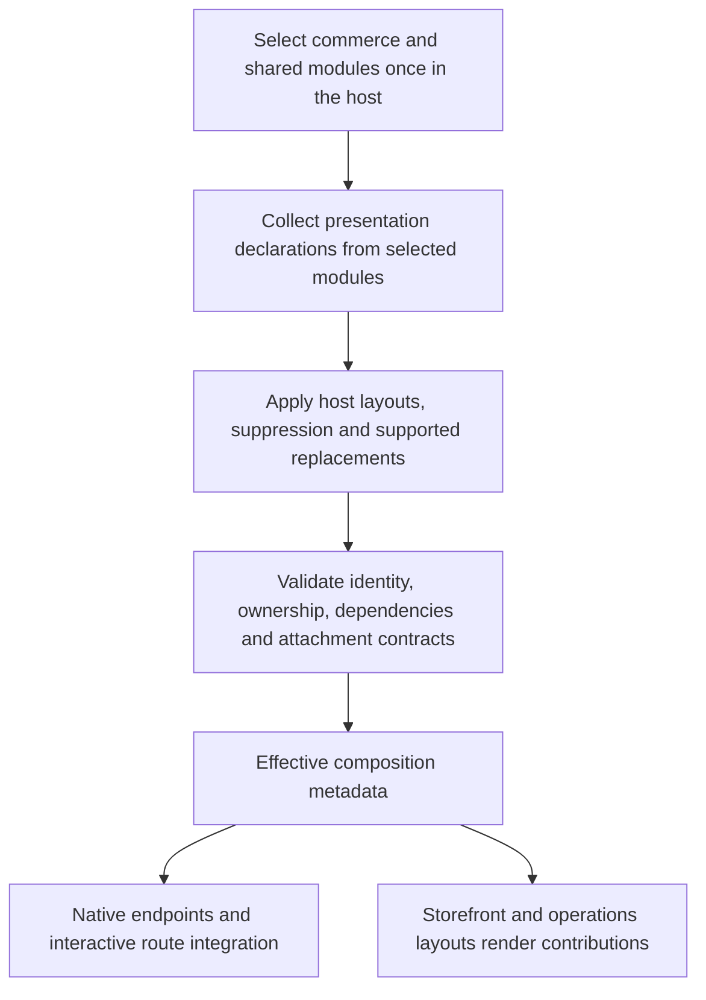

Discovery and optional generated registrations feed the same composition rules. Startup metadata holds no selected products, basket contents, component instances or scoped feature clients. Each live component creates its own runtime bindings later.

The isolated connected proof profile is Interactive Server with prerendering off. This excerpt is for that validation profile, not the public storefront's global rendering policy. Its `App.razor` uses the native boundary:

```razor
<HeadOutlet @rendermode="new InteractiveServerRenderMode(prerender: false)" />
<Routes @rendermode="new InteractiveServerRenderMode(prerender: false)" />
```

`Routes.razor` keeps Blazor's native router. The catalog supplies effective assemblies; the proposed route view applies the resolved ownership, availability, authorization integration and host layout options before constructing the page.

```razor
@inject IPresentationCatalog Presentation

<Router AppAssembly="typeof(App).Assembly"
        AdditionalAssemblies="this.Presentation.PageAssemblies">
	<Found Context="routeData">
		<PresentationRouteView RouteData="routeData" />
		<FocusOnNavigate RouteData="routeData" Selector="h1" />
	</Found>
</Router>
```

The normal host supplies not-found, denied and unavailable presentations. `WithPresentationRoutes()` applies the corresponding metadata and checks to initial server endpoint processing; the client route view alone is insufficient. Module-specific layouts are ordinary native layouts selected through the effective host options.

### Public storefront rendering and first load

ShopFiesta consumes the framework's [public website profile](spec-blazor-presentation-framework.md#recommended-public-website-profile) as its normal public-facing arrangement. This is a required application profile, not an optional future SEO exercise. Serve useful content on the first response and retain native baseline behavior while selectively adding interactivity. The connected proof profile above does not establish public-site readiness.

#### Framework support consumed by ShopFiesta

The repeated integration is delivered by the framework's [reusable hosting and startup support](spec-blazor-presentation-framework.md#reusable-hosting-and-startup-support). ShopFiesta consumes the proposed `UsePublicWebsite` profile through the proposed `WithPresentation` host extension alongside the existing `AddModules`/`WithModules` registration. Neither `WithPresentation` nor `UsePublicWebsite` is an existing shipped API. TaskFiesta validates that framework API before ShopFiesta implementation starts. ShopFiesta consumes the completed integration rather than providing its prerequisite validation. The earlier connected `App.razor` excerpt illustrates a different validation profile; it is not copied unchanged into the public host.

| Framework-owned integration | ShopFiesta-owned input |
| --- | --- |
| Profile service/endpoint integration and inspectable native root wiring | Selected modules, explicit static/interactive page choices and fake-auth host configuration. |
| Packaged static-compatible chrome/region rendering and compatibility checks | Storefront branding, public page content and module-specific render/form alternatives. |
| Phase/context integration and native read-state handoff conventions | Safe product/price/availability DTOs, store/customer/view keys, freshness and access rules. |
| Native form/Result feedback integration | Basket's form model, antiforgery-protected server use case and stable mutation identity. |
| Selected-renderer asset defaults and diagnostics/performance attribution | Product media, query bounds, cache policy and recorded storefront performance budgets. |

ShopFiesta does not build a separate host-wide initialization manager, hydration cache, renderer or generic command relay to make this work. Ordinary feature reads still batch/fail/defer under their own contracts. If this later consumer exposes another reusable hosting/lifecycle need, propose a compatible framework change and verify it with TaskFiesta and the independent consumer. Feature-specific stock, basket, pricing and identity policy remains in ShopFiesta.

#### Storefront rendering arrangement

| Area | Default rendering and behavior |
| --- | --- |
| Home `/` | Catalog-owned Static SSR landing page with the real ShopFiesta header, category navigation and bounded product content. Optional Marketing content does not hold back the page. |
| Categories/search | Static SSR for product results, model labels, prices, breadcrumbs, GET filters, sorting and pagination. URLs and ordinary links/forms work before JavaScript/interactivity. |
| Product detail | Static SSR for name/model, description, selected-variant data, image/manual metadata, available selling price and a truthful initial availability state. Optional recommendations and live updates are bounded/deferred. |
| Purchase and basket badge | Basket supplies the declared native purchase form and request-rendered summary. Add a prerender-compatible Interactive Server enhancement only where needed. Static request state is not a continuing circuit/AppState instance. |
| Basket, checkout, fake payment and account pages | Interactive Server for the richer private workflow. Native routing selects a legal boundary; use a deliberate full navigation when changing from the static route arrangement. Their prerender policy is explicit per area, not inherited from the connected proof excerpt. |
| Staff workspace | Interactive Server with prerendering off remains the ordinary initial operations profile. Staff grids, toolbars and editors stay within a compatible interactive composition. |

The public host does not wrap all routes in an unconditional interactive `Routes` boundary. Use the native static routing/page/component mode arrangement and matching `HeadOutlet` policy; public title, description and canonical metadata belong in the initial document. An interactive contribution cannot force the entire storefront into a global circuit. Static chrome uses ordinary Razor/HTML with framework semantic tokens. MudBlazor remains available inside the appropriate interactive areas.

No public browsing path requires a WebAssembly/.NET browser runtime download. Do not select Auto for the default storefront, since it introduces that background browser bundle. Blazor's small web script for enhanced navigation/forms and Interactive Server activation is a separate cost to measure. Any later browser-runtime area must have a measured need, explicit asset boundary and its own evidence; it cannot arrive through an unrelated default contribution.

Basket's static purchase component uses native form handling, such as `EditForm` with a unique `FormName` and supported form binding. Carry only the declared SKU/variant/quantity, applicable source revision and stable mutation intent, with antiforgery protection. The server resolves the visitor/store, revalidates Stock/pricing/purchase rules and dispatches the same Basket Application use case through Requester. It does not call its own HTTP API or serialize a live action callback. This feature-owned form is not a generic shell command relay.

Normal POST feedback/navigation returns the confirmed basket/header state. Enhanced forms are enabled only on supported Blazor endpoints; ordinary full-request behavior is the fallback. A duplicate or unknown form acknowledgement reconciles the same mutation intent and never adds again merely because enhancement or reconnection starts. The existing action-binding excerpts remain the connected implementation of the public purchase target. A profile selects one effective form/action presentation, not two independent add handlers.

Prerendered Server enhancements use safe native state handoff for initial public read results, then reconstruct their live scopes/observers. They avoid duplicate initial queries and a loading flash, while revalidating before mutation. Header, main purchase form and related-card forms coordinate through confirmed Basket state and their declared compatible runtime/backend path. Passing a callback or AppState instance through an SSR boundary is not that coordination path. A static page read never records a purchase/view analytics event or starts reservation work.

Catalog's eligible detail-view capture happens separately after the current detail is actually presented, using its explicit feature command through an activated component or a small Catalog-owned progressive browser module. That module can use the normal browser-to-server capture boundary without a WASM runtime or a permanent circuit. Native enhanced-navigation lifecycle/cleanup keeps one stable view intent per eligible presentation. It cannot capture staff previews, repeated renderer initialization or stale product contexts as new views. JavaScript-disabled/blocked capture has its declared incomplete coverage in Marketing; the UI never invents views to fill the gap.

Do not wait for a live Stock subscription, optional recommendation, personalized badge, diagnostics or browser preferences before rendering the primary page. Use bounded read-only batches, native streaming where it improves a declared noncritical region and honest placeholders. Unknown quantity, failed Stock and still-loading data remain different states. A purchase requires the normal current ordering validation even when the initial badge came from SSR or cache.

Serve appropriately sized product images with declared dimensions/alt text; prioritize the primary visible image and defer off-screen images. Keep critical CSS/fonts/JavaScript bounded and avoid loading staff widgets, diagnostics or unnecessary interactive providers on public routes. The conceptual PNG wireframes are not production product-media payloads or performance evidence. Public HTTP assets may use versioned native caching; server data caching uses Application.Caching under the owning module's policy.

Do not share-cache a personalized page containing a basket, antiforgery token or mutation-intent ID. Cache public data or eligible public fragments with the complete store/culture/query/price-revision policy. Keep current purchasing authority separate from a cached display price. Initial server-rendered content must remain useful with cold caches or when optional caching is disabled.

#### Public storefront performance and acceptance

Measure home, a category/filter URL and a product deep link under recorded cold/warm browser caches, constrained mobile CPU/network and a separate cold/warm server process. Record time-to-first-byte, first useful content/LCP, JavaScript/CSS/image bytes, layout shift, navigation/form response and Interactive Server readiness/round-trip costs. Diagnostics are off for the baseline. Slow optional dependencies cannot turn the page into an all-content spinner.

Use the published good Core Web Vitals thresholds as provisional ShopFiesta targets: LCP within 2.5 seconds, INP at most 200 ms and CLS at most 0.1. Evaluate real field results at the 75th percentile separately for mobile/desktop when such data exists. Controlled lab runs and interaction scripts provide reproducible development evidence; they do not establish a production field pass or turn another metric into INP. Record the workload/environment and revise limits only with explicit supporting evidence. [Core Web Vitals guidance](https://web.dev/articles/vitals)

| Case | Runnable evidence and contracts validated | Coverage |
| --- | --- | --- |
| PW-01 Useful initial HTML | Inspect actual home/category/product responses with JavaScript disabled/delayed. Verify heading, labels, core product content, head metadata and native navigation/filter/paging; no browser .NET runtime request is required. Validates static module composition, ownership/resources, destinations and public chrome. | Behavior and Reuse |
| PW-02 Native purchase | Add from the product and two different cards through real native POSTs, including denied/unavailable/duplicate/unknown outcomes. Verify backend identity, validation, stable mutation intent, correct quantity and confirmed basket/header feedback. Validates the feature-owned static form and common Application path without live action-scope transport. | Behavior and Hosting |
| PW-03 Enhancement and handoff | Delay Server activation and optional reads, navigate across static/interactive routes and switch product/store/identity during delayed work. Verify useful content, safe handoff, no duplicated initial query/write and reconstruction/cleanup of only the active scopes. | Behavior, Reuse and Hosting |
| PW-04 Payload and response | Record the declared mobile/cold/warm workload, resources, paint/layout/interaction measures and server/circuit timing, with diagnostics off/on as appropriate. Identify actual public payloads, no default WASM/staff bundle and optional-region isolation. Establish/compare workload-specific limits instead of claiming speed from a render-mode name. | Behavior, Reuse, Hosting and Quality |
| PW-05 Output and reuse safety | Exercise two baskets/users, token-bearing forms, cache/public-context changes and a clean consumer of the packaged public profile. Verify no private/token output reuse, the same shared profile services/renderers/handoff behavior and compatible contributions/static alternatives without copying ShopFiesta internals. Record actual consumer setup and a framework package upgrade. | Reuse, Hosting and Quality |

These checks are required alongside SV evidence before describing ShopFiesta as a validated public website. They can initially use small Application fixture handlers and content, but must execute the real native SSR/form/interactivity paths. Backend BI integrations and production field measurements retain their separate status.

## Let routes and breadcrumbs describe the customer's location

Spec references: [Page ownership and route availability](spec-blazor-presentation-framework.md#page-ownership-and-route-availability), [Destinations, availability and deep links](spec-blazor-presentation-framework.md#destinations-availability-and-deep-links), [Destination contracts and link generation](spec-blazor-presentation-framework.md#destination-contracts-and-link-generation), and [Navigation and page composition](spec-blazor-presentation-framework.md#navigation-and-page-composition).

| Owner | Native route | Purpose and access |
| --- | --- | --- |
| Catalog | `/` | Static SSR public home page with host branding and module-owned catalog/optional Marketing content. |
| Catalog | `/catalog` | Public catalog landing page. |
| Catalog | `/catalog/{CategorySlug}` | Public category listing with shareable filter, sort and page query values. |
| Catalog | `/products/{Slug}` | Public product detail, directly loadable without visiting a listing. |
| Basket | `/basket` | Current visitor's basket, resolved by the backend from the current session. |
| Checkout | `/checkout` | Review the current basket and enter contact/delivery details. |
| Checkout | `/checkout/complete/{OrderId:guid}` | Confirmed customer receipt, subject to access checks for that order. |
| Preferences | `/preferences` | Shared appearance/culture settings and eligible module-owned settings sections. Private sections apply their own identity requirements. |
| Orders | `/account/orders` | Signed-in current customer's bounded order history. |
| Orders | `/account/orders/{OrderId:guid}` | Read-only customer detail for an order owned by the current customer. |
| Customers | `/account/profile` and `/account/addresses` | Current seeded customer's profile and owned addresses/defaults. No arbitrary customer ID grants access. |
| Payments | `/checkout/payment/{PaymentAttemptId:guid}` | Authorized interaction/status for the development payment provider and that customer's attempt. |
| Catalog | `/operations/catalog/products` and `/operations/catalog/categories` | Catalog-owned staff lists and native editors under `Shop.Catalog.Manage`. |
| Pricing | `/operations/pricing/tax` | Native demonstration-tax configuration under `Shop.Pricing.Manage`. |
| Payments | `/operations/payments` | Staff payment status/reconciliation under `Shop.Payments.Manage`; scenario advancement also requires development/test authorization. |
| Fulfillment | `/operations/fulfillment/shipments` | Staff shipment/picking/packing/tracking workflow under `Shop.Fulfillment.Manage`. |
| Orders | `/operations/orders` | Staff-only queue, filter state and batch actions. |
| Orders | `/operations/orders/{OrderId:guid}/{View}` | Staff-only order details with allowed route-backed views such as overview and history. |
| Orders | `/operations/exports/{OperationId:guid}` | Staff-only observation of a previously submitted export, including after navigation. |
| Marketing | `/operations/overview` | Staff business reporting over Marketing's stored projections under `Shop.Operations.ViewMetrics`, with period, currency and product query state. |
| Stock | `/operations/stock` | Stock-owned availability/policy management under `Shop.Stock.Manage`; an optional native `sku` query parameter restores the selected SKU. |
| Marketing | `/operations/marketing/recommendations` | Product selection and recommendation-set overview under `Shop.Marketing.ManageRecommendations`. |
| Marketing | `/operations/marketing/recommendations/{ProductId:guid}` | Directly loadable recommendation editor for the source product under the same management policy. |
| Marketing | `/operations/marketing/discounts` | Campaign list/editor under `Shop.Marketing.ManageDiscounts`. Recommendation/reporting access does not grant campaign mutation. |

Product display names, manufacturer model designations, merchant SKUs, slugs and IDs have different jobs. `RT-G800` is the Aster rotor's model designation, and `gravel-brake-rotor` is its public slug; a backend-issued product/variant ID identifies the mutation target. Renaming a product or correcting its model label does not retarget an existing action, recommendation or funnel record. The order number `SF-1042` is a display reference; the order route uses its actual GUID. No wireframe substitutes a display number for a declared route parameter.

```csharp
public static class CatalogUi
{
	public const string Name = "catalog";

	public static Destination<CategoryRoute> Category { get; } =
		Destination.ForPage<CategoryProducts, CategoryRoute>("catalog.category");

	public static Destination<ProductRoute> Product { get; } =
		Destination.ForPage<ProductDetails, ProductRoute>("catalog.product");

	public static ActionTarget<ProductPurchaseContext> PurchaseActions { get; } =
		new("catalog.product.purchase-actions");

	public static RegionTarget<ProductContext> RelatedProducts { get; } =
		new("catalog.product.related-products");
}

public sealed record CategoryRoute(string CategorySlug);

public sealed record ProductRoute(string Slug);
```

`CategoryProducts.razor` owns `@page "/catalog/{CategorySlug}"`; `ProductDetails.razor` owns `@page "/products/{Slug}"`. Registration does not repeat those patterns. `CatalogUi.Product.Uri(navigationManager, new ProductRoute(product.Slug))` supplies an encoded link under the configured application base path. The host does not arbitrarily remap the module's route patterns.

`Home > Brakes > Gravel Brake Rotor (RT-G800)` comes from the current product's category ancestry and destination contracts. A direct visit queries that ancestry when needed; it does not reconstruct the breadcrumb from a previously expanded menu or split the URL into guessed labels. Category navigation uses the same published category destinations, with native active-link behavior and the shell's resolved path. The hierarchy and product labels change with the Catalog data rather than application/framework code.

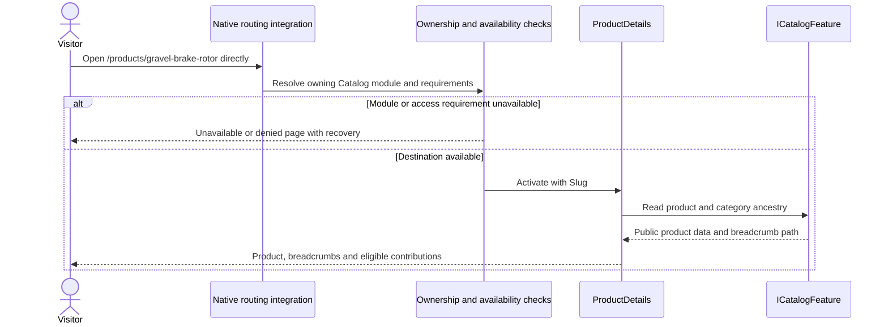

Apply the checks to initial server requests and interactive navigation before protected page construction and reads. A hidden operations link does not protect its route. Product-not-found, a failed product read and an unavailable module are different states with different recovery messages.

## Browse, filter and return to the same catalog view

Spec references: [Query and selection adapters](spec-blazor-presentation-framework.md#query-and-selection-adapters), [Navigation hook context](spec-blazor-presentation-framework.md#navigation-hook-context), [Dynamic hierarchy lifecycle](spec-blazor-presentation-framework.md#dynamic-hierarchy-lifecycle), and [View restoration policy](spec-blazor-presentation-framework.md#view-restoration-policy).


*Figure 1. Catalog owns the category query, filters, product cards and breadcrumbs. Each product card exposes its own purchase context. Basket contributes the Add to basket action; the shop header displays Basket's summary contribution.*

The view `/catalog/brakes?brand=aster&min=50&max=100&stock=in&sort=price-asc&page=1` illustrates a familiar browsing state. Its selected filters are shareable query values. The wireframe shows fictional in-stock products between EUR 50 and EUR 100, ordered by price. The sample prices explain the UI; they are not authoritative values submitted at checkout.

```razor
@page "/catalog/{CategorySlug}"
@inject ICatalogFeature Catalog

@code {
	[Parameter]
	public string CategorySlug { get; set; }

	[SupplyParameterFromQuery(Name = "brand")]
	public string Brand { get; set; }

	[SupplyParameterFromQuery(Name = "min")]
	public decimal? MinPrice { get; set; }

	[SupplyParameterFromQuery(Name = "max")]
	public decimal? MaxPrice { get; set; }

	[SupplyParameterFromQuery(Name = "stock")]
	public string Stock { get; set; }

	[SupplyParameterFromQuery(Name = "sort")]
	public string Sort { get; set; }

	[SupplyParameterFromQuery(Name = "page")]
	public int? Page { get; set; }
}
```

These are native route/query parameters. Catalog validates allowed filters, sort keys and page bounds and translates them into its feature query. Optional FilterModel adapters can translate the same meaning for a reusable grid or handwritten list. They must not invent a second search language or require a generic CRUD page to display products.

The header search is a Catalog-owned product-search contribution using that same query meaning. It is not a universal shell search or command-discovery system.

| Interaction | Owned behavior |
| --- | --- |
| Change brand or price range | Update shareable query state, reset the page as the feature declares, supersede the previous read and retain the controls' focus. |
| Type product search | Debounce when appropriate, cancel obsolete reads and accept only the latest applicable query/context result. Cancellation alone is insufficient if a provider returns late. |
| Change sorting or page | Navigate using native query values and reload the declared query. A pending Add to basket invocation keeps its original captured product and quantity. |
| Open a product and use Back | Restore the category, filters, sorting and page from the URL. Scroll restoration follows the feature's explicit policy; temporary purchase state is not inferred from browser history. |
| Expand category navigation | A bounded navigation provider receives parent/path, culture, paging and cancellation context and returns category descriptors through the published target. |
| Change category membership | Invalidate the affected category branch and query explicitly. Do not refresh the entire shop for an unrelated badge change. |
| No matching products | Show a successful empty result with clear filter-reset controls. A failed or unavailable query must not appear as zero products. |

Product cards use normal Razor parameters and templates. A customer does not need operational row-selection checkboxes to shop. The operations example later demonstrates the separate selection adapter and its retained-on-paging default.

## Open a product with a local purchase context

Spec references: [Published typed contracts](spec-blazor-presentation-framework.md#published-typed-contracts), [Action definition, placement, binding and execution](spec-blazor-presentation-framework.md#action-definition-placement-binding-and-execution), and [Typed scopes and explicit placement](spec-blazor-presentation-framework.md#typed-scopes-and-explicit-placement).

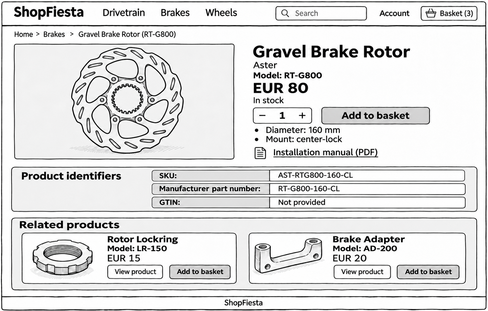

*Figure 2. The main Gravel Brake Rotor (RT-G800) and each related card are independent live owners. The selected variant also shows its SKU, manufacturer part number and unassigned GTIN in secondary details. Catalog supplies content/identifiers; Stock supplies the availability decision. Selecting quantity two on the rotor does not change another card's target. Marketing supplies the related-products region.*

```csharp
public sealed record ProductContext(
	Guid ProductId,
	string Slug,
	string CategorySlug,
	long Version);

public sealed record ProductPurchaseContext(
	Guid ProductId,
	Guid? VariantId,
	string Sku,
	int Quantity,
	long ProductVersion,
	long? StockRevision,
	bool CanPurchase);
```

The context is a small immutable public contract, not an entity or a reference to the component's mutable fields. It contains the product/variant and quantity needed to prepare an invocation. Backend services still check stock, access, current price and quantity constraints. Client-supplied totals never establish the amount to charge.

Names, brands and model designations remain display data. SKU is the public cross-module key for the selected sellable variant; it accompanies internal IDs and the observed Stock revision. `StockRevision` is absent before a valid Stock decision, which disables buying. An explicit valid decision may permit ordering with a null numeric quantity. No variant selected means no SKU to buy. The backend checks that the supplied SKU belongs to the submitted product/variant and revalidates Stock; a revision is not a reservation or a stock guarantee.

The portable Catalog declaration is authored once:

```csharp
public static class CatalogPresentation
{
	public static void Configure(PresentationModuleBuilder module)
	{
		module.Pages.FromAssembly<CategoryProducts>();
		module.Resources.Use<CatalogResources>();
		module.Destinations.Add(CatalogUi.Category);
		module.Destinations.Add(CatalogUi.Product);
		module.Navigation.Add("catalog", href: "catalog", labelKey: "Shop");
		module.Actions.Export(CatalogUi.PurchaseActions);
		module.Regions.Export(CatalogUi.RelatedProducts,
			required: false, maxContributions: 1);
	}
}

public partial class CatalogModule : WebModuleBase, IPresentationModule
{
	public CatalogModule() : base(CatalogUi.Name) { }

	public void RegisterPresentation(PresentationModuleBuilder module) =>
		CatalogPresentation.Configure(module);
}
```

The existing server module's `Register`, `Use` and `Map` methods are omitted. They keep their normal backend responsibilities. Its pinned public identity is shared with the portable definition. Local unpublished modules can use the existing type-name convention.

`Pages.FromAssembly` supplies default module ownership for all routed pages in that assembly. Ordinary pages need no repeated ownership annotation. Shared assemblies use explicit page mappings, and ambiguous ownership is rejected. `Resources.Use<T>()` selects a native localization resource base; it is not another localization engine.

A product component creates one scope and disposes it with its own lifetime. The same pattern works in a product card and in the main product purchase area:

```razor
@implements IDisposable
@inject IActionScopes ActionScopes

<ActionToolbar Scope="this.purchaseActions" />

@code {
	[Parameter]
	public ProductPurchaseContext Purchase { get; set; }

	private ActionScope<ProductPurchaseContext> purchaseActions;

	protected override void OnInitialized() =>
		this.purchaseActions = this.ActionScopes.CreateScope(
			owner: this,
			target: CatalogUi.PurchaseActions,
			context: this.Purchase);

	protected override void OnParametersSet() =>
		this.purchaseActions?.UpdateContext(this.Purchase);

	public void Dispose() => this.purchaseActions?.Dispose();
}
```

Quantity and variant controls remain normal feature-owned Razor controls. They replace `Purchase` with a new snapshot. The binding factory associates callbacks/change delivery with the owner's Blazor dispatcher, derives runtime identities and attaches eligible contributors for that target. It does not register a global current product.

An action scope is a live ownership object, not another DI container. Feature services retain the executing runtime's normal DI lifetimes. Disposing this scope releases its own bindings and subscriptions without disposing DI-owned shared services.

`ActionToolbar` is a proposed default presenter, not a requirement that a shopping button look like an administrative toolbar. The host may supply a compact purchase renderer or ordinary Razor buttons consuming the same bindings. It must preserve availability, duplicate suppression, invocation and accessible feedback behavior.

### Present product images and manuals

Spec references: [Product boundaries](spec-blazor-presentation-framework.md#product-boundaries), [Module assets and JavaScript ownership](spec-blazor-presentation-framework.md#module-assets-and-javascript-ownership), [Initialization, failures and recovery](spec-blazor-presentation-framework.md#initialization-failures-and-recovery), and [Accessibility acceptance](spec-blazor-presentation-framework.md#accessibility-acceptance).

Catalog's product DTO supplies a safe image URL, alt text and revision, plus manuals with title, language, revision, applicability and download URL. The page uses ordinary markup:

```razor


@foreach (var manual in this.product.Manuals)
{
	<a @key="manual.Id" href="@manual.DownloadUrl">@manual.Label</a>
}
```

The excerpt assumes available content. An absent image uses an accessible placeholder; a failed image/manual read stays local and does not disable purchasing. Manual labels identify the language/revision where useful. Catalog decides applicability to the selected product/model/variant. A late product DTO cannot attach the previous product's document to the new page context.

URLs respect the app base path and content revision. Native image/download requests are normal browser HTTP, including in Interactive Server. They do not change the rule that Server business feature commands/queries use Requester directly. The frontend sees no storage factory, credential, provider key or raw filesystem path. Content delivery enforces its declared publication/access policy independently of displaying a link.

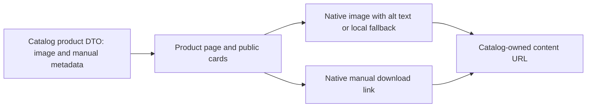

The agreed backend target is Blob Storage for images and File Storage for manuals. The first frontend slice can use tiny Catalog-owned fixture content endpoints. That validates URLs, markup, access and failure presentation, not provider integration. Provider setup and stream handling are specified in [Product images and manuals](#product-images-and-manuals). Module CSS/JS/resources retain their native RCL/static-web-asset packaging.

### Compose Stock availability and manage ordering policy

Spec references: [Modular monolith across backend and frontend](spec-blazor-presentation-framework.md#modular-monolith-across-backend-and-frontend), [Automatic refresh and explicit invalidation](spec-blazor-presentation-framework.md#automatic-refresh-and-explicit-invalidation), [Typed scopes and explicit placement](spec-blazor-presentation-framework.md#typed-scopes-and-explicit-placement), [Safe invocation and lifetime](spec-blazor-presentation-framework.md#safe-invocation-and-lifetime), and [Field validation and submitted revisions](spec-blazor-presentation-framework.md#field-validation-and-submitted-revisions).

Stock is a separate logical module under `stock`, with corresponding backend ownership and browser-safe presentation contracts. It recognizes Catalog's exact SKU within the authorized store context. Catalog owns descriptions/identifiers and the product page; Stock owns quantity, availability and the ordering decision for that SKU. Basket and Checkout revalidate through backend contracts. Neither product labels, GTINs nor client-side quantity arithmetic substitute for the shared SKU.

The proposed read/observation contract is ordinary feature code:

```csharp
public sealed record StockRequest(string Sku, int RequestedQuantity);

public sealed record SkuAvailabilityView(
	string Sku,
	int RequestedQuantity,
	int? AvailableQuantity,
	string StatusCode,
	bool CanOrder,
	string ReasonCode,
	DateTimeOffset? ExpectedAvailableAtUtc,
	long Revision,
	DateTimeOffset ObservedAtUtc);

public interface IStockFeature
{
	Task<Result<SkuAvailabilityView>> GetAsync(
		StockRequest request,
		CancellationToken cancellationToken = default);

	Task<Result<ImmutableArray<SkuAvailabilityView>>> GetManyAsync(
		ImmutableArray<StockRequest> requests,
		CancellationToken cancellationToken = default);

	IAsyncEnumerable<SkuAvailabilityView> ObserveAsync(
		StockRequest request,
		CancellationToken cancellationToken = default);
}
```

`StatusCode`/`ReasonCode` have Stock-defined meanings and resources. The response is an ordering decision for its exact SKU and requested quantity, not a promise that any quantity can be ordered. A listing uses `GetManyAsync` for its bounded page and passes the returned values to ordinary Stock presenters; shared adapters can coalesce observations instead of sending one HTTP request per card/render. The observation adapter supplies live updates for currently observed requests. Server and WASM adapters follow their respective in-process/HTTP and explicitly supported notification paths; local AppState/Notifier is not a cross-circuit transport. The frontend slice can use controlled fixture snapshots/streams without implementing the eventual notification infrastructure.

For the full shop profile, Catalog can consume Stock's public component through ordinary Razor:

```razor
@if (this.stockEnabled && this.selectedVariant is not null)
{
	<SkuAvailability Sku="this.selectedVariant.Sku"
	                 Quantity="this.quantity"
	                 AvailabilityChanged="this.ApplyAvailabilityAsync" />
}
```

`SkuAvailability` belongs to Stock, uses native parameters and a typed `EventCallback<SkuAvailabilityView>`, and presents Stock's label/reason. Catalog's callback combines the current product/variant, SKU, requested quantity and returned Stock revision into its live `ProductPurchaseContext`. `CanPurchase` requires an eligible Catalog variant and a usable current Stock decision whose `CanOrder` is true for that quantity. The read-only Catalog profile omits this capability and buying; it does not construct a Stock component without its registered services. Reference public contracts/components through the appropriate browser-safe packages, not another module's private implementation or a new framework inventory abstraction.

| Stock response/situation | Frontend behavior |
| --- | --- |
| In stock | Show the supplied status and allow the captured quantity only when `CanOrder` is true. |
| Low stock | Show Stock's low-stock label/optional public quantity. A display threshold does not itself prohibit ordering; respect the returned decision. |
| Zero or below a configured sale threshold | Show Sold out or Stock's supplied reason. Disable purchase unless Stock explicitly permits the requested backorder/preorder or another configured policy. |
| Coming soon | Show the supplied expected date/window. A date alone does not enable purchase; `CanOrder` reflects whether preordering is allowed. |
| Null numeric quantity with ordering allowed | No known number is available, but the SKU's explicit policy permits the requested quantity. Show Available to order or a truthful unknown-quantity explanation; do not label it physically In stock or invent an unlimited count. |
| Null numeric quantity with ordering denied | Show the supplied availability/reason and disable purchase. Null is not converted to zero and does not grant permission implicitly. |
| Stock read/connection unavailable | Treat the current decision as unavailable, rather than invoking the null-quantity policy. Mark any retained value as last-known/stale and keep affected buying unavailable until the feature re-establishes a usable decision. |

The default unknown-quantity policy denies ordering until explicitly enabled for that SKU. Quantity, availability label and `CanOrder` remain separate values. A known response with `AvailableQuantity = null` can therefore be sellable; an absent/failed response cannot. This is a Stock business policy, not the shell's permission/availability rule or a global `null > 0` shortcut.

On SKU/variant/quantity/store change, supersede the old request/observation. Match incoming SKU, requested quantity and context before accepting it; reject older revisions even if an initial read arrives after a newer update. Apply updates through the owning component's Blazor dispatcher. A live change updates only interested SKU consumers and the affected purchase scope, not a global current product. If it invalidates a pending confirmation, reevaluate/reject that decision. Already dispatched work keeps its captured identifiers/revisions and actual backend outcome. Dispose owned observations with the component without disposing its DI-owned shared feature service; share/coalesce backend feeds where useful without sharing product-card action ownership.

The existing `stock=in` Catalog filter means physically in-stock/low-stock results, not every backorderable or unknown-quantity SKU. An explicit orderable filter can use Stock's broader decision. Apply stock-dependent filtering/counting before paging through the feature query contract; the page must not remove sold-out rows after fetching a Catalog page and report a false count. A relevant stock update invalidates the affected query as well as its visible badge. The query can preserve its existing filters/sort/page policy; no backend query/join mechanism is prescribed here.

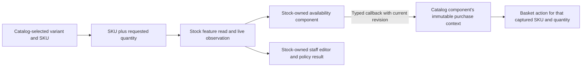

Stock also owns `/operations/stock`, mapped by the host to `OperationsLayout` and protected by `Shop.Stock.Manage` on direct routes, interactive activation and backend commands. Its SKU search/selection uses native URL query state. A separate `IStockManagementFeature` supplies authorized editor reads/commands; the public `IStockFeature` remains read/observation-only. Catalog's lookup supplies product names/model labels and SKU definitions; Stock manages quantity/policy against that existing identity. Staff cannot create an unrelated SKU by changing a text label, and read-only reporting access grants no stock-management permission.

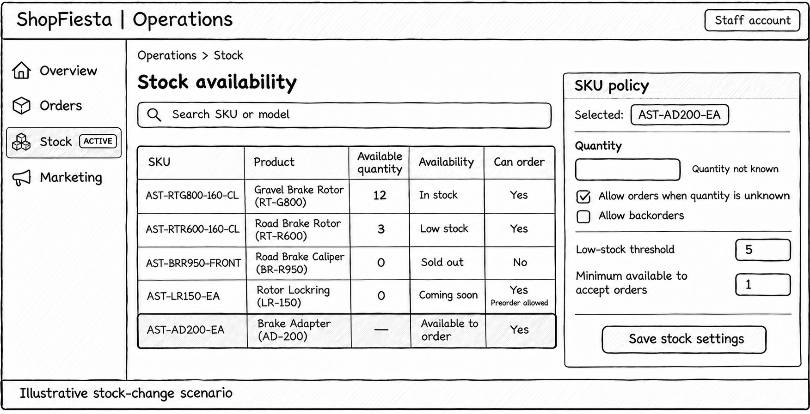

*Figure 3. A separate stock-change fixture demonstrates normal, low, sold-out, preorder and null-quantity outcomes. Brake Adapter (AD-200) has no known quantity but explicitly permits ordering. The earlier Catalog wireframe is its all-in-stock browsing fixture before these scenario changes.*

| Native editor field | Stock-owned meaning |
| --- | --- |
| Reported quantity | Optional numeric input for the selected SKU's fixture quantity/adjustment. Empty remains null. The backend derives any reserved/available calculation; the page does not overwrite another module's counter. |
| Sales enabled | Master business switch, distinct from staff authorization and numeric quantity. |
| Minimum available to sell | The configured sale threshold used by Stock's ordering policy. |
| Low-stock threshold | Presentation/alert threshold, independent of the permission to sell. |
| Allow backorders / preorders | Explicit policy for insufficient current stock and future availability, with an expected date/window where applicable. |
| Allow orders when quantity is unknown | Explicit permission to order despite a null numeric quantity; false by default in the demo policy. |

Use `EditForm`/`EditContext`, normal inputs and the existing validation/revision feedback. Save captures the selected SKU, expected Stock revision and immutable edit values. A confirmed save returns the resulting revision and invalidates that SKU's observation; even a policy-only change can alter sellability. Preserve the draft on validation/conflict and reconcile an unknown outcome instead of replaying automatically. A late save/load cannot update another selected SKU. Other circuits update only through the explicitly implemented notification adapter. The fixture can simulate those events for frontend evidence; actual stock storage, reservations and notification delivery require the [backend integration evidence](#backend-integration-evidence) defined in this specification.

## Let Basket contribute purchasing without coupling Catalog to it

Spec references: [Typed extension points as a design foundation](spec-blazor-presentation-framework.md#typed-extension-points-as-a-design-foundation), [Predictable attachment and customization](spec-blazor-presentation-framework.md#predictable-attachment-and-customization), [Composition and contextual execution](spec-blazor-presentation-framework.md#composition-and-contextual-execution), and [Safe invocation and lifetime](spec-blazor-presentation-framework.md#safe-invocation-and-lifetime).

Basket's presentation declaration attaches an action contributor to the public Catalog target. Catalog does not need to reference `IBasketFeature` or know how baskets are stored.

```csharp
module.Resources.Use<BasketResources>();
module.Actions.Contribute<AddToBasketActions>(
	CatalogUi.PurchaseActions,
	contributionId: "basket.catalog-purchase",
	required: true);
```

```csharp
public sealed class AddToBasketActions(IBasketFeature basket)
	: IActionContributor<ProductPurchaseContext>
{
	public void Bind(ActionScope<ProductPurchaseContext> scope) =>
		scope.Bind("add-to-basket", action => action
			.LabelKey("AddToBasket")
			.EnabledWhen(
				context => context.CanPurchase && context.Quantity > 0,
				disabledReasonKey: "ProductUnavailable")
			.ExecuteAsync((snapshot, cancellationToken) =>
				basket.AddAsync(new AddBasketItem(
					snapshot.ProductId,
					snapshot.VariantId,
					snapshot.Sku,
					snapshot.Quantity,
					snapshot.ProductVersion,
					snapshot.StockRevision), cancellationToken)));
}
```

`IBasketFeature`, `AddBasketItem`, the receipt and `BasketUiState` are feature-owned contracts/helpers. The presentation-side feature implementation accepts confirmed receipts into the current basket/session summary and invalidates relevant consumers as described below. `BasketUiState` uses existing scoped AppState and notification mechanisms. It is not another framework state store or a wrapper every feature must implement.

The contributor is resolved through normal DI for the live scope. Registration infers its service registration, module provenance and local identities. Its resource keys remain Basket-owned even though Catalog owns the target. Shared metadata does not retain the contributor, scoped basket client or component.

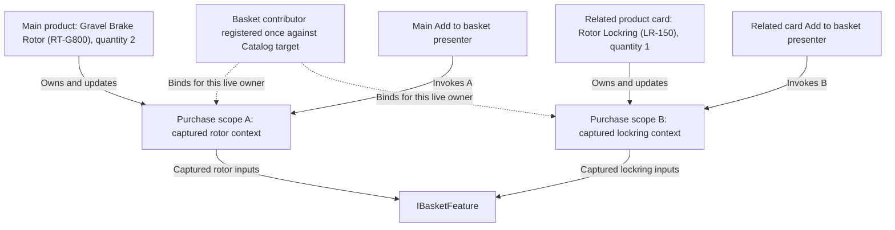

No confirmation is needed for the example's ordinary Add operation. Invocation still checks the owner and current required availability, reserves that binding's pending state and captures immutable inputs before dispatch. A quantity change after dispatch cannot retarget the accepted command. Duplicate clicks on the same binding are suppressed; independent cards are not serialized through a circuit-wide gate.

Backend basket concurrency/idempotency handles overlapping requests where required. UI suppression is not a transaction or a guarantee that two independent bindings can never affect the same product. An uncertain mutation result is not automatically retried. Disposal requests cancellation and prevents late UI updates without claiming to reverse an already committed basket change.

The same action binding can appear in a product's local purchase area and an explicitly attached sticky purchase bar. They share pending/busy state and feedback ownership. The sticky bar must retain its source when focus moves into it and must not silently select another product card.

## Let Marketing fill an optional product region

Spec references: [Published typed contracts](spec-blazor-presentation-framework.md#published-typed-contracts), [Common composition metadata](spec-blazor-presentation-framework.md#common-composition-metadata), [Host-supplied feature availability](spec-blazor-presentation-framework.md#host-supplied-feature-availability), and [Initialization, failures and recovery](spec-blazor-presentation-framework.md#initialization-failures-and-recovery).

Catalog publishes an optional, single-contribution region below the product details. Normal Razor supplies the typed context:

```razor
<ProductPurchase Purchase="this.currentPurchase" />

<ExtensionRegion Target="CatalogUi.RelatedProducts"
                 Context="this.productContext" />
```

Marketing registers a compatible component through that region:

```csharp
module.Regions.Contribute<RelatedProducts>(
	CatalogUi.RelatedProducts,
	contributionId: "marketing.related-products",
	required: true);
```

`RelatedProducts.razor` uses an ordinary `[Parameter] ProductContext Context` and an injected `IMarketingFeature`. Builder validation, and a generator diagnostic if supplied, checks the component's declared context parameter. No framework component base is required. C# generic handles do not by themselves prove every Razor parameter convention; composition must validate the remaining facts.

The feature queries recommendations for the current product and renders public Catalog `ProductCard` components from public product summaries. Each card creates its own purchase scope, so Basket's contributor works there without a Marketing-to-Basket dependency. `ProductCard` does not render the related-products region recursively; that region belongs to the product detail page.

| Situation | Visible and lifecycle behavior |
| --- | --- |
| Marketing not selected | The region collapses. Catalog browsing and purchasing remain usable. |
| One valid Marketing contribution | Render related products for the supplied product context, with Marketing provenance/resources. |
| Two competing replacements | Apply an explicit host replacement or reject the unresolved single-region conflict at composition. |
| Recommendation capability unavailable | Use the declared optional fallback. Do not block Add to basket or checkout. |
| Successful query with no recommendations | Collapse or show the feature's deliberate empty state. Do not label it a service failure. |
| Recommendation query fails | Contain failure to the region; show a local recovery affordance if the feature provides one. Do not turn failure into a successful zero result. |
| Navigate to another product during the read | Cancel/supersede the old read and reject its late result using the new product/context revision. |

The host can suppress or replace `marketing.related-products` through its published contribution ID. Ordinary integration does not require editing Catalog's source. Query evaluation does not start a purchase, subscribe to undeclared global state or enable personalization implicitly.

### Manage recommendations in the Marketing module

Spec references: [Page ownership and route availability](spec-blazor-presentation-framework.md#page-ownership-and-route-availability), [Field validation and submitted revisions](spec-blazor-presentation-framework.md#field-validation-and-submitted-revisions), [Minimal unsaved-change support](spec-blazor-presentation-framework.md#minimal-unsaved-change-support), [Automatic refresh and explicit invalidation](spec-blazor-presentation-framework.md#automatic-refresh-and-explicit-invalidation), and [Extension contracts and host authority](spec-blazor-presentation-framework.md#extension-contracts-and-host-authority).

Marketing staff manage the related-products data at `/operations/marketing/recommendations`. Selecting a source product opens `/operations/marketing/recommendations/{ProductId:guid}`. Both pages belong to the same Marketing module as the storefront contribution. They use `OperationsLayout` and the native `Shop.Marketing.ManageRecommendations` authorization policy. Hiding their navigation entries is only a presentation decision; initial requests, interactive activation and backend reads/writes enforce access independently. Permission to manage recommendations does not imply permission to release orders or view business reports.

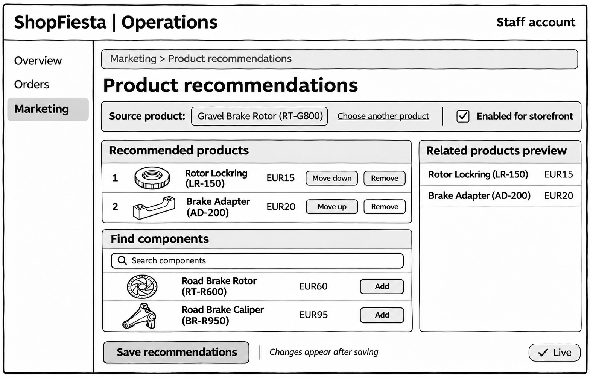

*Figure 4. Marketing manages the Gravel Brake Rotor's ordered recommendations: Rotor Lockring and Brake Adapter. Catalog supplies product lookup and public summaries. The preview displays the local draft without live purchase actions; only a confirmed save changes the published recommendation set.*

The first slice uses manually curated, bounded sets. Marketing owns the source product ID, enabled flag, ordered recommended product IDs and version. Catalog owns product identity and current public product data. The editor uses Catalog's public lookup contract rather than private queries or repositories. Staff can find `RT-G800` by its model designation and verify the Aster brand and variant metadata, while the saved recommendation still references the stable product ID. Nothing in these contracts depends on bike components. This workflow needs neither a recommendation algorithm nor a generic administration framework.

```csharp
public static class MarketingUi
{
	public const string Name = "marketing";

	public static Destination<RecommendationRoute> RecommendationEditor { get; } =
		Destination.ForPage<RecommendationEditor, RecommendationRoute>(
			"marketing.recommendations.edit");
}

public sealed record RecommendationRoute(Guid ProductId);

public sealed record RecommendationSet(
	Guid ProductId,
	long Version,
	bool Enabled,
	ImmutableArray<Guid> RecommendedProductIds);

public sealed record RecommendationUpdate(
	Guid SaveId,
	Guid ProductId,
	long ExpectedVersion,
	bool Enabled,
	ImmutableArray<Guid> RecommendedProductIds);

public interface IMarketingManagementFeature
{
	Task<Result<RecommendationSet>> LoadAsync(
		Guid productId,
		CancellationToken cancellationToken = default);

	Task<Result<RecommendationSet>> SaveAsync(
		RecommendationUpdate update,
		CancellationToken cancellationToken = default);
}
```

These proposed DTOs illustrate feature ownership, not new shell primitives. `SaveId` identifies the submitted mutation for backend reconciliation; it is distinct from the live action binding. The feature also provides a bounded status lookup by that reference when a save's acknowledgement is lost. The tiny backend can simulate this contract in memory and must identify that process-lifetime limitation.

Marketing's presentation registration includes its page assembly, management destination and staff navigation entry through the same builders used elsewhere. Native `@page` declarations define the URLs. Ordinary module-assembly ownership avoids annotations on each page; if the staff facet uses a separate assembly, Marketing registers that assembly under the same identity. Customer-facing service contracts expose published recommendation reads only. Staff drafts and management endpoints remain authorized even when their assembly is browser-downloadable.

| Editor interaction | Required behavior |
| --- | --- |
| Open a source product | Load its saved set and current Catalog summaries. Cancel/supersede older reads; a late load cannot replace another product's draft. Missing/deleted source products receive an explicit unavailable result. |
| Add, remove or reorder | Update a page-owned draft with stable product keys. Allow at most six distinct recommendations, exclude the source itself and validate current store/catalog membership through backend contracts. A deleted/unavailable recommended product is marked for correction; it does not silently become another product. |
| Preview | Render names, media and prices through read-only Catalog presentation. Do not create purchase scopes, record customer views or invoke Add to basket from an administrative preview. |
| Save | Use native `EditForm`/`EditContext` and the existing validation adapter. Capture an immutable update with the source ID, expected version and save reference. Disable draft editing while this save is pending. Backend validation and authorization remain authoritative. |
| Confirmed save | Establish the returned version as the baseline and invalidate the declared recommendation read for that source product. Reordering preserves item identity. The next eligible storefront read uses the saved enabled set and current public product summaries. |
| Version conflict | Preserve the draft, show the conflict and offer reload/review of the current saved version. Do not overwrite another editor's changes or silently retry with its version. |
| Unknown save outcome | Keep the submitted reference and reconcile its backend status. Loading a newer version alone does not establish which editor saved it. Do not blindly replay the mutation or show success. |
| Leave, change source or switch identity | Use the feature's native dirty-navigation policy for voluntary navigation. Revoke access immediately on forced identity change. A late save/result cannot establish another product's or user's baseline. |

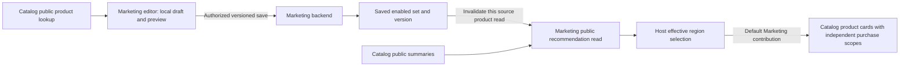

The save signal affects the source product's declared recommendation query, not every Catalog query, basket summary or checkout review. Local state/Notifier delivery reaches only its supported runtime/circuit. Other customers see the saved backend version on their next read or explicit refresh; automatic cross-circuit delivery requires a separately implemented backend broadcast path.

The host profiles in [Replace a contribution and inspect the effective result](#replace-a-contribution-and-inspect-the-effective-result) remain authoritative. Under `featured-related` or `no-related`, saving Marketing data does not restore or replace the host-selected presentation. The editor can explain that this set is not currently shown by the shop configuration, and authorized diagnostics identifies the effective provider. The default profile demonstrates the saved set appearing in the public region. Disabling the set produces a successful empty recommendation result, not a failed query.

## Keep the basket page and header summary consistent

Spec references: [State, preferences and application context](spec-blazor-presentation-framework.md#state-preferences-and-application-context), [AppState adaptation](spec-blazor-presentation-framework.md#appstate-adaptation), [State change subscriptions](spec-blazor-presentation-framework.md#state-change-subscriptions), and [Automatic refresh and explicit invalidation](spec-blazor-presentation-framework.md#automatic-refresh-and-explicit-invalidation).


*Figure 5. Two brakes at EUR 80 and one lockring at EUR 15 produce three units and a EUR 175 subtotal. Illustrative delivery is EUR 5 and the displayed total is EUR 180. Basket owns quantity/removal behavior and its confirmed summary; Checkout revalidates the payable review independently.*

The basket is backend-owned business state, including for an anonymous visitor. The backend resolves the current basket from the authenticated or guest session; the browser cannot establish ownership by supplying an arbitrary basket ID. A frontend AppState snapshot is a current presentation view, not the durable basket database.

Basket supplies the header badge through the shell's public header region, alongside its own `/basket` destination. The badge observes a narrow summary selector: unit count, display total, basket revision and load/availability status. It does not fetch on every render or subscribe to unrelated product filters.

The proposed registration targets a shell-owned region. Catalog can independently contribute its search component to the same multi-contribution region, with documented ordering.

```csharp
module.Regions.Contribute<BasketBadge>(
	ShellUi.HeaderEnd,
	contributionId: "basket.header-summary",
	required: true,
	order: 200);
```

`ShellUi.HeaderEnd` is a proposed public `RegionTarget<ShellContext>` exported by the headless shell. `BasketBadge` accepts the native context parameter and injects Basket's state. `StorefrontLayout` renders that region through `ExtensionRegion`; the operations layout can choose different chrome. Header placement does not change the badge's state owner or grant access to a basket.

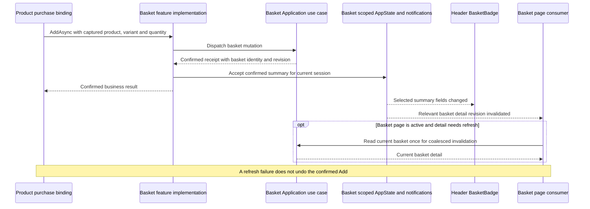

`BasketUiState.AcceptAsync` rejects an older summary for the same basket/session rather than letting out-of-order responses rewind the badge. The summary has explicit client/circuit ownership, independent of a product component. A known result can update that same-session summary after the product component disappears, while no callback updates the disposed component. Results for a previous identity/basket context are rejected. If completion remains unknown, recovery reads the original basket rather than replaying Add.

Confirmed mutation outcome and subscriber/read feedback are separate. A notification or refresh failure must not replace the returned success with a failed Add. Inactive detail consumers become stale and load on activation; unrelated catalog and Marketing reads do not restart.

| State | Owner and restoration policy |
| --- | --- |
| Category, filters, sort and page | Catalog query/URL. Shareable values remain in the URL. |
| Product quantity and variant being chosen | The live product component, transient unless the feature explicitly chooses otherwise. |
| Basket contents and revision | Backend Basket module, with a current scoped frontend snapshot. |
| Header basket count | A derived selector over Basket's confirmed summary. An unknown count is not displayed as zero. |
| Checkout form draft | Checkout page owner, private and transient by default. Contact/delivery data is not automatically persisted in browser preferences. |
| Customer history/detail snapshots | Orders presentation state scoped to the current customer, route/query and runtime context. Backend access checks remain authoritative. |
| Staff order selection | Each order-queue component instance. It is not shared with customer history, storefront state or another queue. |
| Theme, culture and benign view preferences | Explicitly scoped preferences using the framework's documented persistence policy. |

Refresh and state propagation use declared dependencies. Existing Notifier and AppState can carry typed local invalidation signals. Neither automatically crosses circuits, tabs, devices or a Server/browser boundary. Cross-device basket updates need an explicit backend notification or subsequent read; the example does not invent a global event bus.

Quantity and removal mutations keep their own captured line identities and versions. A backend price/stock change is presented as a current business result, not patched away by trusting the old summary. The checkout destination is hidden when its optional module is absent, or explicitly disabled with a reason where that presentation is chosen. A required but unknown checkout capability keeps that action unavailable until established.

## Use native checkout forms and an explicit order attempt

Spec references: [Shared interactions and operation feedback](spec-blazor-presentation-framework.md#shared-interactions-and-operation-feedback), [Field validation and submitted revisions](spec-blazor-presentation-framework.md#field-validation-and-submitted-revisions), [Minimal unsaved-change support](spec-blazor-presentation-framework.md#minimal-unsaved-change-support), [Operation outcomes and recovery](spec-blazor-presentation-framework.md#operation-outcomes-and-recovery), and [Session and workspace transitions](spec-blazor-presentation-framework.md#session-and-workspace-transitions).

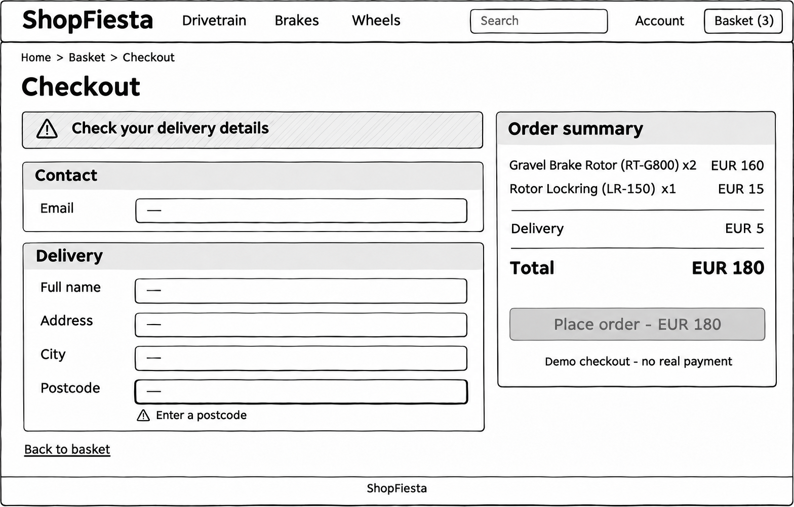

*Figure 6. Checkout owns the form and its submission revision. The current postcode error appears beside the field and in a summary. The order review contains server-established values; the disabled Place order button does not imply that a payment or order has already succeeded.*

Checkout uses ordinary `EditForm`, `EditContext`, validation controls and injected services. It does not need a framework form base or an action registration for each field. A shared result-to-field adapter supplies the specified feedback behavior where needed.

```razor
<EditForm EditContext="this.editContext" OnValidSubmit="this.SubmitAsync">
	<DataAnnotationsValidator />
	<ValidationSummary />
	<InputText @bind-Value="this.draft.Shipping.Postcode" />
	<ValidationMessage For="() => this.draft.Shipping.Postcode" />
	<button type="submit" disabled="@this.submitting">Place order</button>
</EditForm>
```

The feature owns the omitted fields, submission method and current review. Field-level validation is usability feedback; Application validation and authorization still run for direct Server and HTTP execution.

| Checkout step | Contract and ownership |
| --- | --- |
| Load review | Read the current basket, stock/pricing/delivery decision and a versioned review through `ICheckoutFeature`. Display its actual availability and totals. |
| Edit contact and delivery | Native `EditContext` tracks fields. Checkout tracks the submitted edit revision and immutable values. Benign view preferences do not absorb personal draft data. |
| Prepare submission | Validate, reserve this form's pending state and capture the draft, basket/review versions and feature-owned attempt key. Prevent duplicate submits while preparation/dispatch is pending. |
| Place order | Checkout invokes its backend feature contract against the captured basket/review. The backend establishes acceptance and owns payment/processing. The UI consumes the outcome and does not run a worker or wait for fulfillment. |
| Map known rejection | Map matching property paths, such as `Shipping.Postcode`, to the current submitted fields. Use explicit aliases for different names. Unmatched/model errors go to the summary. |
| Reject old feedback | A rejection for an older edit revision does not mark newer field values invalid or overwrite a newer submission's feedback. The summary may explain that an earlier submission was rejected. |
| Confirmed success | An established order/receipt confirms acceptance, not completed payment or fulfillment. Navigate to its authorized receipt and invalidate relevant basket/order views. Later queue/processing or badge-refresh failure does not erase the order or resubmit checkout. |
| Price, stock or review changed | Present the new review and require the feature's fresh decision. Do not silently accept a higher amount or substitute a different basket. |
| Completion uncertain | Retain the original attempt reference and show a status/recovery path. Query the backend before any deliberate retry. Do not label a disconnected UI as a rejected or cancelled order. |

The application supplies a durable attempt/idempotency contract for order placement where required. Its key identifies the same business attempt, not every click or every retry. UI duplicate suppression cannot replace that backend contract. No real payment provider or card collection is required for the local demo; a deterministic fake can produce known success, rejection and uncertain-completion scenarios.

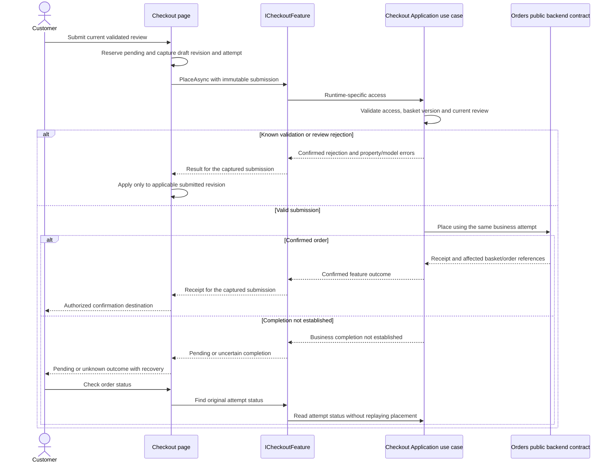

The checkout use case owns orchestration through the public backend contracts. The shell supplies feedback, lifetime and context rules without turning the workflow into a generic frontend command bus.

An unsaved-change helper can guard ordinary navigation away from a dirty draft. Forced sign-out or access revocation takes precedence. Disposing the page requests cancellation and rejects late UI updates, but cannot reverse a committed order. Recovery uses the backend attempt, not a recreated local component's guess.

### Observe backend-owned order processing

Spec references: [Execution state and observation](spec-blazor-presentation-framework.md#execution-state-and-observation), [Operation outcomes and recovery](spec-blazor-presentation-framework.md#operation-outcomes-and-recovery), and [Safe invocation and lifetime](spec-blazor-presentation-framework.md#safe-invocation-and-lifetime).

An accepted receipt confirms an established order, not completed payment or fulfillment. Checkout supplies its attempt/receipt reference; Orders supplies authorized customer/staff status. The frontend renders those outcomes and recovery choices through the existing feature contracts. The backend owns subsequent processing through Queueing in the full showcase.

| Frontend situation | Required presentation behavior |
| --- | --- |
| Order accepted | Display the established order/reference and its actual returned status. Do not infer Paid from successful submission. |
| Processing still pending | Show the feature's pending/processing state. Status reads observe it without advancing work or inventing progress. |
| Leave and revisit | Dispose the page's reads/subscriptions and reconstruct observation from the original authorized reference. Page disposal does not cancel accepted backend work. |
| Lost acknowledgement | Retain the submitted attempt/reference and use the feature's reconciliation path. Do not blindly repeat Checkout or Release. |
| Staff Release succeeds | Show the confirmed release/scheduling outcome, not shipment/delivery. Partial outcomes still belong to their captured targets. |

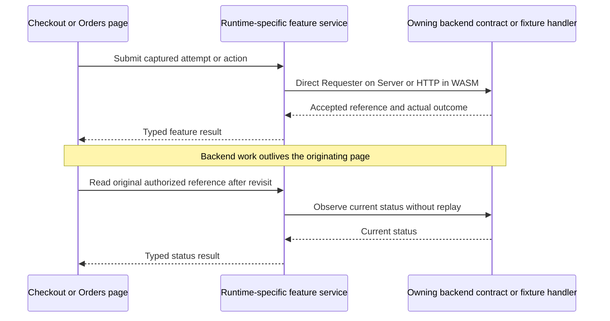

The first slice uses deterministic backend-owned fixture transitions, advanced by test control rather than page reads/timers. Queue contracts, workers, retry and durable handoff are specified in [Orders queue processing](#orders-queue-processing). The Ready/Review lists below remain independent UI scopes, not infrastructure queues.

## Show customer order history and protect staff operations

Spec references: [Optional authentication and authorization](spec-blazor-presentation-framework.md#optional-authentication-and-authorization), [Selection ownership and defaults](spec-blazor-presentation-framework.md#selection-ownership-and-defaults), [External toolbar and component-owned behavior](spec-blazor-presentation-framework.md#external-toolbar-and-component-owned-behavior), [Typed scopes and explicit placement](spec-blazor-presentation-framework.md#typed-scopes-and-explicit-placement), and [Safe invocation and lifetime](spec-blazor-presentation-framework.md#safe-invocation-and-lifetime).

Orders owns both customer and operational views over its backend business state. Audience-specific routes, DTOs, policies and layouts keep the capabilities distinct. They do not split the logical module or duplicate the source of truth.

### Customer history and order detail

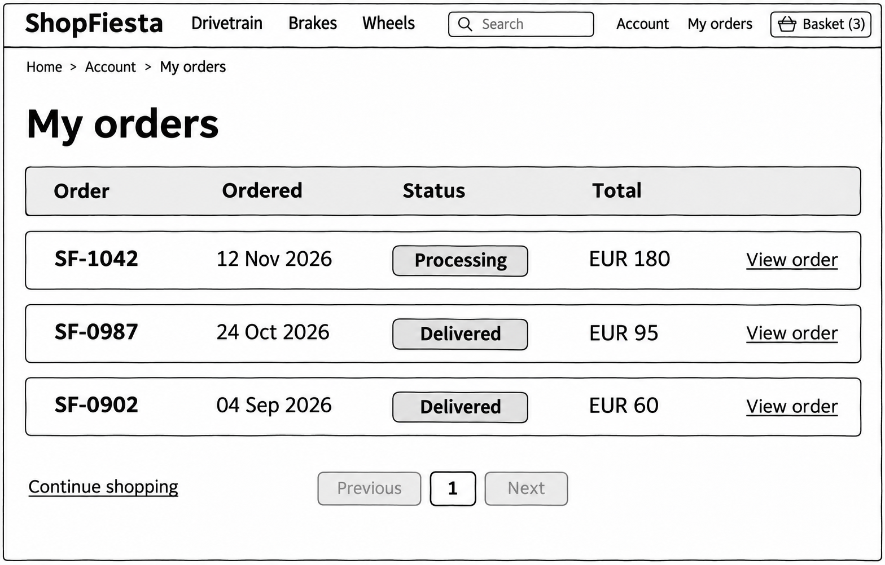

*Figure 7. My orders lists the current customer's purchases with their order date, customer-visible status and total. The customer can open an order; operational selection and Release actions do not appear in this view.*

```razor
@page "/account/orders"
@attribute [Authorize(Policy = "Shop.Customer.Orders")]
@inject ICustomerOrdersFeature Orders
```

```csharp
public interface ICustomerOrdersFeature
{
	Task<Result<CustomerOrderPage>> FindAsync(
		int page,
		int pageSize,
		CancellationToken cancellationToken = default);

	Task<Result<CustomerOrderDetailsModel>> FindOneAsync(
		Guid orderId,
		CancellationToken cancellationToken = default);
}

public static class OrdersUi
{
	public const string Name = "orders";

	public static Destination<CustomerOrderRoute> CustomerOrder { get; } =
		Destination.ForPage<CustomerOrderDetails, CustomerOrderRoute>(
			"orders.customer-detail");
}

public sealed record CustomerOrderRoute(Guid OrderId);
```

`CustomerOrderDetails.razor` declares `@page "/account/orders/{OrderId:guid}"` and the same customer policy. The query derives the customer identity from the authenticated backend context; the browser does not choose a trusted customer ID. A guessed order ID cannot return another customer's record. The Application use case enforces current-owner access for in-process and HTTP calls independently of navigation visibility.

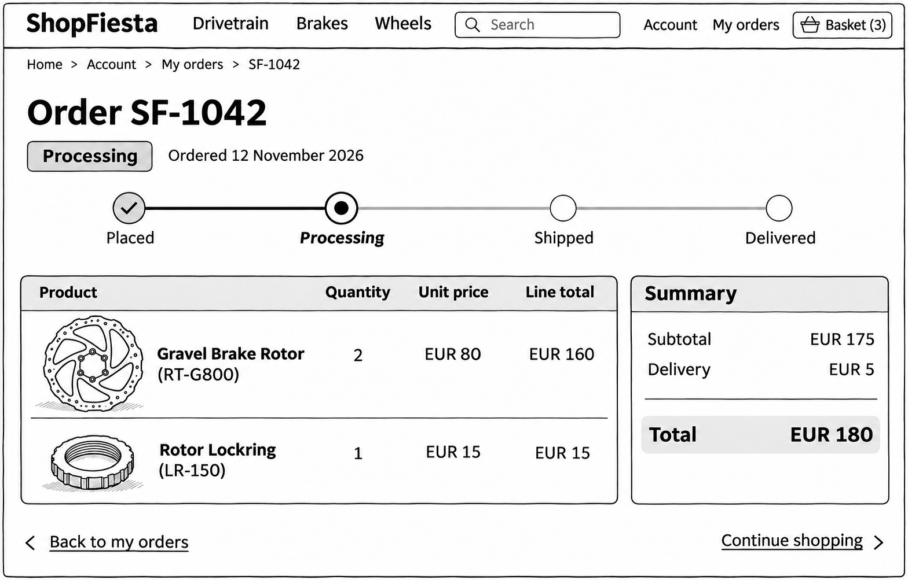

*Figure 8. The customer detail shows the order snapshot: two Gravel Brake Rotors, one Rotor Lockring, delivery and the EUR 180 total. The customer-visible Processing status belongs to Orders. No staff queue state, internal review data or fulfillment action is exposed.*

The customer-facing fulfillment status and the staff queue's payment-readiness filter are different projections of the same order. The sample SF-1042 can be Processing for the customer and Paid in the staff queue. Neither page maintains a separate business status or order copy.

| Customer interaction | Required behavior |
| --- | --- |
| Open My orders | Read a bounded page belonging to the current customer. Preserve the feature's page/filter policy in native query state where appropriate. |
| Open a bookmarked detail | Resolve Orders ownership and customer policy, then fetch that customer's order without first mounting history. Build breadcrumbs from the authorized order result and public destinations. |
| Finish checkout | The immediate Checkout receipt can link through `OrdersUi.CustomerOrder` when customer history is available and authorized. Orders remains the owner of the later history/detail view. |
| Revisit after catalog changes | Display the purchased names, brands, model designations, selected variant/SKU, amounts and other order-line snapshots owned by Orders. Missing optional metadata in older fixtures remains absent. Do not rewrite a past purchase using current catalog labels, prices or categories. |
| Product removed or catalog replaced | Keep the historical line readable. An optional current-product link can be omitted or shown unavailable without losing the order history. |
| Sign out or switch customer | Invalidate private reads/state and reject old-customer completions. An AppState snapshot or a stale browser cache does not authorize later access. |
| View as a customer | Use customer-specific projections. The backend does not return staff-only review/fulfillment data and rely on the page to hide it. |
| Guest purchase | Preserve the feature's authorized immediate receipt. Attaching a verified guest purchase to a later account requires an explicit application policy; matching an email or retaining a local ID alone does not grant history access. |

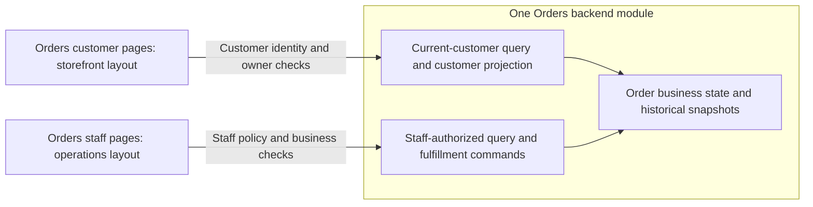

Orders can place customer and operations presentation in separate assemblies when runtime/dependency boundaries need it. The same module registers their assemblies/capabilities under `orders`; the browser customer profile includes only its declared portable customer presentation. This is not a second module registration or a reason to ship operational DTOs into the customer read path.

### Staff queues and safe batch actions

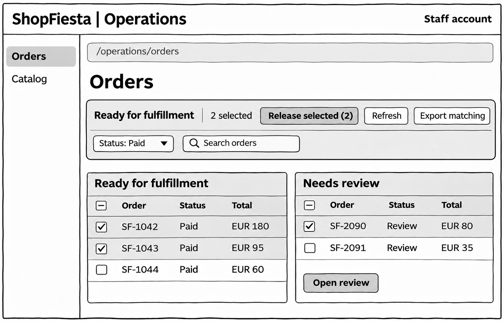

*Figure 9. The header releases the two selected orders in Ready for fulfillment. The selected order in Needs review belongs to a different component and is excluded. Customer history and the public shop do not expose these controls or grant their permissions.*

The operations page uses native authorization metadata and its selected module layout. Backend handlers independently enforce the same relevant access and business rules.

```razor
@page "/operations/orders"
@attribute [Authorize(Policy = "Shop.Orders.Operate")]

<ActionToolbar Scope="this.readyActions" />
<OrderQueue Kind="OrderQueueKind.Ready"
            ShowLocalToolbar="false"
            ActionsReady="scope => this.readyActions = scope" />
<OrderQueue Kind="OrderQueueKind.Review" />

@code {
	private ActionScope<OrderQueueContext> readyActions;
}
```

The callback is an ordinary `EventCallback` from the first component. Each `OrderQueue` creates and disposes its own `ActionScope<OrderQueueContext>`. A missing or disposed scope exposes no invokable actions. No global current-grid state or component lookup is required.

```csharp
public sealed record OrderTarget(Guid OrderId, long Version);

public sealed record OrderQueueContext(
	ImmutableArray<OrderTarget> Targets,
	bool AllReleasable,
	OrderQueueQuery Query);

public sealed record OrderQueueQuery(string Status, string SearchText, string Sort);
```

The Ready queue binds its local callback through the same action API used for product purchasing, with a different typed context and business behavior:

```csharp
this.actions.Bind("release", action => action
	.LabelKey("ReleaseSelected")
	.EnabledWhen(
		context => !context.Targets.IsEmpty && context.AllReleasable,
		disabledReasonKey: "SelectReleasableOrders")
	.ConfirmWith(context => this.Text["ConfirmRelease", context.Targets.Length])
	.ExecuteAsync((snapshot, cancellationToken) =>
		this.Orders.ReleaseAsync(snapshot.Targets, cancellationToken))
	.MapOutcome(ReleaseFeedback.FromResult)
	.OnConfirmedOutcome((receipt, cancellationToken) =>
		this.ApplyReleaseReceiptAsync(receipt, cancellationToken)));
```

No contributor class is necessary for this feature-local callback. The module publishes a stable target or definition only when another package needs to attach or reference it. Routine definition, scope, binding and execution identities are inferred with module/owner provenance.

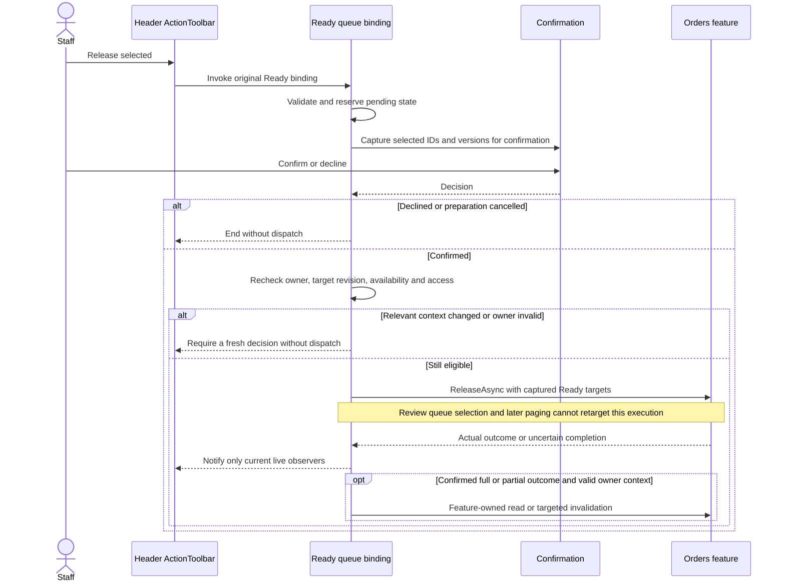

| Selection or lifecycle change | Required result |
| --- | --- |
| Page forward or back | Keep selected IDs by default. An explicit selection-adapter option can clear on paging. |
| Change search or filters | Clear the applicable selection under the established defaults. Sorting retains it. |
| Refresh the visible page | Refresh versions/eligibility for available records. An off-page absence is not proof of deletion. Remove only confirmed deleted or inaccessible targets. |
| Relevant target changes during confirmation | Invalidate the old decision. Do not replace the targets with current selection silently. |
| Selection changes after dispatch | Keep the accepted invocation's captured IDs and versions. Do not restart or automatically cancel it merely because selection changed. |
| Present the same binding locally and externally | Share pending/busy state, outcome observation and one feedback owner. |
| Switch the explicitly active queue | Change future header attachment. Already accepted work keeps its original owner and captured inputs. |
| Dispose the owner or lose access | Remove bindings, invalidate pending confirmation, request supported cancellation and prevent stale UI updates. Backend effects retain their actual outcome. |

Batch selection is explicit selected IDs, not an implicit select-all-matching query. Exporting all matching orders is a separate declared feature operation. Operational reads and actions can use optional FilterModel/data adapters without forcing the customer product listing into the same presentation.

### Bind typed query controls to the same queue

Spec references: [Published typed contracts](spec-blazor-presentation-framework.md#published-typed-contracts), [Action and control contribution requirements](spec-blazor-presentation-framework.md#action-and-control-contribution-requirements), [Typed scopes and explicit placement](spec-blazor-presentation-framework.md#typed-scopes-and-explicit-placement), and [Automatic refresh and explicit invalidation](spec-blazor-presentation-framework.md#automatic-refresh-and-explicit-invalidation).

The Status and Search controls in Figure 9 belong to the Ready queue's external toolbar. They are controls supplied by that live queue, not header-owned copies of its query. The header observes actions and controls from the same explicit `readyActions` source. Review retains its independent query and selection.

The proposed binding convenience uses an ordinary Razor control component with a typed `Value` and `EventCallback<T>`:

```csharp
this.actions.BindControl<OrderQueueFilterControls, OrderQueueQuery>(
	"filters",
	control => control
		.Value(context => context.Query)
		.ValueChanged(this.ApplyQueryAsync));
```

```csharp
[Parameter]
public OrderQueueQuery Value { get; set; }

[Parameter]
public EventCallback<OrderQueueQuery> ValueChanged { get; set; }
```

`OrderQueueFilterControls` renders normal input/select controls and emits a new immutable query, preserving unchanged values such as sorting. It requires no framework component base or service lookup. The binding convenience validates its parameter contract, supplies the live value and dispatches callbacks through the original owner's Blazor dispatcher. A local toolbar can use the same Razor component directly when external placement is unnecessary.

`ApplyQueryAsync` is an ordinary Ready-queue callback. It validates allowed query values, updates that queue's native URL/view state, applies the established filter-selection policy, advances the relevant context revision and coalesces/cancels obsolete reads. It does not execute Release. Ready URL keys such as `readyStatus`, `readySearch`, `readySort` and `readyPage` distinguish this instance from any independently restorable Review view.

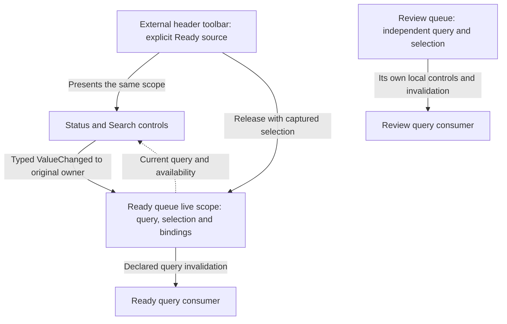

| Control interaction | Observable result |
| --- | --- |
| Change Ready status or search | Only Ready's declared query reloads. Its filter change clears the applicable selection; Review remains unchanged. |
| Change sorting | Reorder the Ready result using its query contract while retaining selected IDs under the established default. |
| Enter the toolbar or an overflow menu | Keep the Ready source. Native text editing and keyboard behavior do not activate another queue. |
| Switch the explicitly attached source | Future controls display the newly selected scope. An older delayed callback is rejected or remains with its eligible originating owner; it can never mutate the new source. |
| Remove the Ready component | Detach control subscriptions and reject later callbacks/results for its disposed owner. Do not retain the component in shared metadata. |
| Change filters during Release confirmation | Invalidate the relevant selection/context and require a fresh decision. A Release already dispatched keeps its original captured targets. |

`BindControl` participates in the existing interaction scope; it does not introduce another control registry or a new CQRS request for each input. Published control contributions use the same compatibility, ordering and host-override rules when reuse across packages warrants registration.

### Distinguish partial release from backend-owned export

Spec references: [Execution state and observation](spec-blazor-presentation-framework.md#execution-state-and-observation), [Approve Save and Export walkthroughs](spec-blazor-presentation-framework.md#approve-save-and-export-walkthroughs), [Operation outcomes and recovery](spec-blazor-presentation-framework.md#operation-outcomes-and-recovery), and [Selection ownership and defaults](spec-blazor-presentation-framework.md#selection-ownership-and-defaults).

Use two deterministic outcome cases in the minimal Orders backend. They expose presentation contracts without requiring a real broker, queue or file store.

**Partial release.** The submitted batch captures SF-1042 and SF-1043 with their versions. The first is released; the second conflicts with a newer backend version. The feature returns per-target facts rather than treating the entire batch as an atomic success or failure.

| Captured target | Reported result | Presentation and recovery |
| --- | --- | --- |
| SF-1042 | Confirmed released. | Preserve that success and update its known state/eligibility by ID. Do not release it again because another target failed. |
| SF-1043 | Confirmed concurrency conflict. | Show the conflict for that target and reload/review its current state. Any further release requires a fresh explicit selection/decision and current version. |
| Batch | Confirmed partial outcome. | Show one released and one requiring review. Do not retry the original batch automatically or show a generic all-or-nothing message. |

`ReleaseFeedback.FromResult` in the preceding action declaration is a pure feature-supplied mapping into the specified action outcome model. The proposed `MapOutcome` callback distinguishes confirmed full success, partial success and rejection from the actual response. It does not dispatch work or introduce a new business-result base class. A successful outer `Result<ReleaseReceipt>` can mean the batch was processed while the receipt still contains mixed per-target results. A missing authoritative response remains unknown, not a guessed partial result.

The proposed `OnConfirmedOutcome` callback receives the confirmed receipt only while its original owner/context can safely apply it. `ApplyReleaseReceiptAsync` applies known facts to the captured IDs, then refreshes/invalidates declared consumers as a separate feedback phase. A failed refresh cannot erase SF-1042's release or trigger another mutation. Selection follows its documented policy; reloading alone must not invent a new selection-clear rule. Single-target or all-success actions can continue to use `OnConfirmedSuccess`.

**Export matching orders.** The Export matching action in Figure 9 captures Ready's filter/sort intent and the feature's query options. It exports all records matching that authorized query, independently of the two explicitly selected release targets. It does not turn row selection into query-wide select-all. Backend validation and the feature's declared dataset-consistency policy determine the actual export set; capturing a query alone does not promise a frozen database snapshot.

The real backend implementation uses DevKit DataPorter for the export's row mapping and file generation. Orders owns the authorized query, captured request, operation status and result artifact. The initial simulated CSV source still validates presentation only. Catalog and Marketing use the same DevKit capability through their own [staff export boundaries](#staff-data-exports-with-dataporter).

| Boundary | Owner and response |
| --- | --- |
| Submission | The initiating binding calls the Orders export-start use case through the runtime-specific feature service. Duplicate submission is suppressed while that binding is pending. |
| Accepted response | The backend returns an operation reference. Feedback says the export was accepted, not completed. The local submission execution and the longer-lived backend operation are distinct observations. |
| Backend operation | The example-owned operation source reports actual accepted/running/completed/failed states and any progress it supports. A later real queue/job adapter can implement the same feature contract. |
| Navigation | Disposing the order page detaches its observation and subscriptions. It does not cancel or restart an already accepted backend operation. |
| Return/status link | `/operations/exports/{OperationId:guid}` loads status by the returned reference, with current staff/object access checks. It does not require the original queue component to remain mounted. |
| Result artifact | A completed operation exposes an authorized download only when its result is available. An expired or failed artifact read is distinct from the operation's confirmed completion. |
| Lost submission acknowledgement | Preserve the feature's original request/correlation reference and reconcile acceptance before any deliberate further submission. No generic automatic replay is allowed. |
| Cancellation | Show a backend Cancel action only when that feature actually supports it. Leaving the page or stopping observation is not confirmed cancellation. |

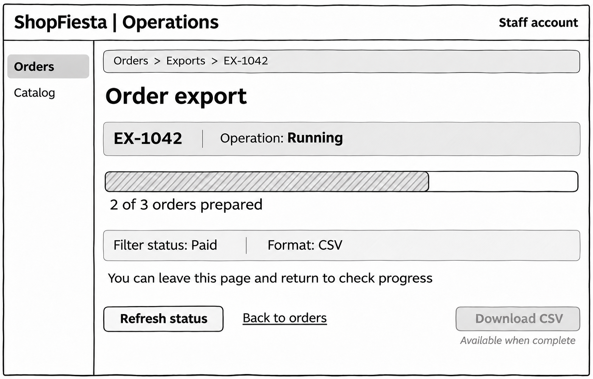

*Figure 10. The status page observes EX-1042 independently of the initiating queue. Two of three records prepared is progress reported by the example source. Download remains unavailable while the operation is Running.*

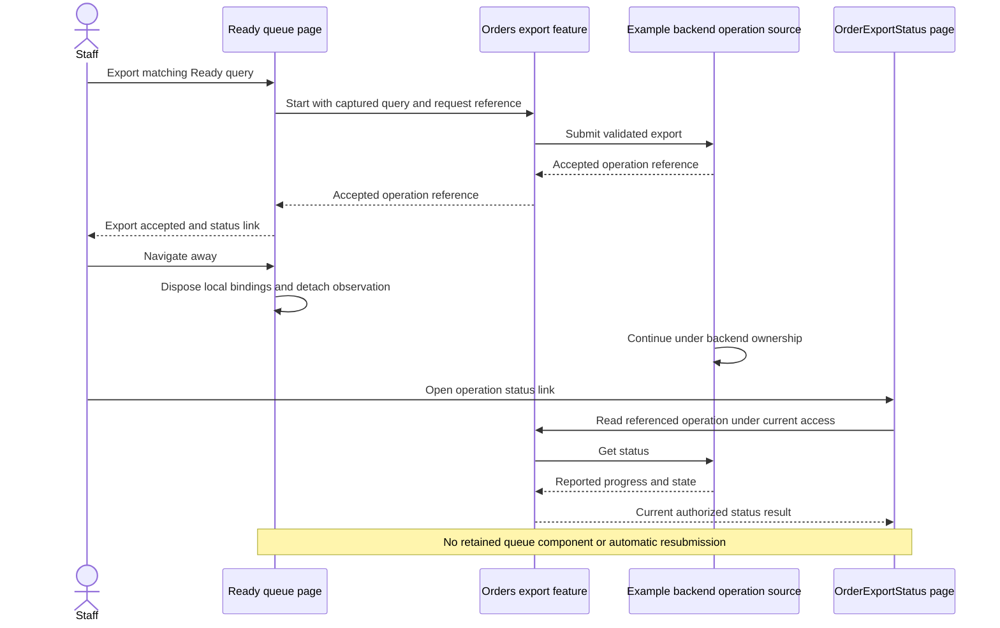

The first Server slice uses a clearly identified simulated export source with deterministic states and an optional fixture CSV artifact. Order-processing status likewise follows the observation contract in [Observe backend-owned order processing](#observe-backend-owned-order-processing). It proves page/operation ownership and response semantics, not durable export execution or survival of a backend process restart. Progress comes from that source, not elapsed UI time. Example-owned backend/test control advances the export fixture; status/diagnostic reads only observe it. No notification center, generic job scheduler or additional framework execution registry is required. Observation uses the existing feature access, scoped state and diagnostics contracts.

### Compose staff business metrics and a product funnel

Spec references: [Modular monolith across backend and frontend](spec-blazor-presentation-framework.md#modular-monolith-across-backend-and-frontend), [Page ownership and route availability](spec-blazor-presentation-framework.md#page-ownership-and-route-availability), [Low friction and native platform mechanisms](spec-blazor-presentation-framework.md#low-friction-and-native-platform-mechanisms), [Automatic refresh and explicit invalidation](spec-blazor-presentation-framework.md#automatic-refresh-and-explicit-invalidation), [Session and workspace transitions](spec-blazor-presentation-framework.md#session-and-workspace-transitions), and [Production observability](spec-blazor-presentation-framework.md#production-observability).

Staff open `/operations/overview` to read order/sales summaries, checkout outcomes and a product funnel. Marketing owns `OperationsOverview` and its reporting contract; its backend owns captured metrics. The agreed backend captures source-module messages into Marketing projections. The first frontend slice can use a Marketing fixture handler with the same response contract. The page obtains every reporting value from Marketing's backend read models. Neither the page nor its reporting query fans out to source-module services, components or databases.

Marketing registers the native route and page ownership normally. The host maps it to `OperationsLayout`; the `Shop.Operations.ViewMetrics` policy protects initial activation, interactive navigation and backend reporting reads. A read-only reporting identity need not have recommendation-management or order-release access. The Catalog-only profile omits Marketing and this page. The staff-reporting facet declares its reporting capability separately from Marketing's optional related-products contribution.


*Figure 11. Marketing supplies fictional overview data for 12 November 2026, 00:00 to 12:00 UTC: five placed orders, EUR 335 across three paid orders and seven submitted checkout attempts. Its product funnel shows 20/8/6/3 journeys. Every panel consumes Marketing's result, including its as-of/coverage metadata. A fixture handler can supply these values for frontend validation; the image does not establish backend message capture.*

Marketing uses ordinary Razor composition. Its page owns the period, currency, product selection, explicit refresh intent, reporting client and query lifetime. Its child components render the returned immutable report values; they have no Catalog, Basket, Checkout or Orders reporting clients. This needs no framework metrics registry, dashboard engine or additional state store.

```razor
@page "/operations/overview"
@attribute [Authorize(Policy = "Shop.Operations.ViewMetrics")]
@inject IMarketingReportingFeature Reporting

<SalesMetrics Value="this.snapshot.Sales" />
<CheckoutMetrics Value="this.snapshot.Checkout" />
<ProductFunnel Value="this.snapshot.ProductFunnel" />
```

`SalesMetrics`, `CheckoutMetrics` and `ProductFunnel` all belong to Marketing. The excerpt shows rendering after a successful read and omits ordinary loading/error markup. One narrow feature contract returns Marketing's stored overview snapshot:

```csharp
public sealed record MarketingOverviewQuery(
	DateTimeOffset FromUtc,
	DateTimeOffset ToUtc,
	string Currency,
	Guid? ProductId);

public interface IMarketingReportingFeature
{
	Task<Result<CommerceOverviewSnapshot>> ReadOverviewAsync(
		MarketingOverviewQuery query,
		CancellationToken cancellationToken = default);
}
```

The proposed `CommerceOverviewSnapshot` contains Marketing-owned sales, checkout and funnel DTOs, the applied query, projection revision, generation time and each stream's known freshness/coverage. Marketing also supplies bounded product-selection results from its stored product dimensions. Even the reporting selector's names, brands and model designations come from Marketing. Recommendation editing can still use Catalog's public product lookup; that separate management workflow does not change the reporting path.

The native query parameters `from`, `to`, `currency` and `product` describe shareable page state. A filter change or explicit Refresh advances the applicable query revision and asks Marketing for a new snapshot. An unrelated rerender does not reload it. All panels from that response describe the same returned projection revision. A read never triggers event publication, message consumption, projection rebuilding or source-module queries.

The frontend needs the response contract, not the message-processing algorithm:

| Returned data | Frontend responsibility |
| --- | --- |
| Applied period, currency and product | Keep controls/URL aligned with the result actually being shown. Supersede old reads when the query changes. |
| Projection revision and capture/calculation time | Display truthful freshness. A newer HTTP response does not imply newer captured facts. |
| Sales, checkout and funnel slices | Compose Marketing-owned native components. Show supplied measures with their labels/units/cohort scope; do not join Catalog, Basket or Orders data in the page. |
| Product-selection summaries | Render Marketing's product IDs, names, brands and model designations. Missing metadata gets an explicit unknown label instead of a Catalog lookup. |
| Coverage/warnings and unavailable ratios | Distinguish an empty result, still-maturing cohort, partial/stale data and failed read. Unknown stages are not zero; zero denominators do not fabricate percentages. |

The illustrative fixture shows EUR 335 across three paid orders, a EUR 111.67 average, and checkout success of 5/7 or 71.4%. Its product funnel is 20 viewing journeys, eight adding, six submitting and three buying, with 40% view-to-basket and 15% view-to-bought. Bought means a confirmed paid outcome. Those are Marketing-owned values/definitions supplied to the frontend, not counts inferred from UI clicks. Detailed cohorts, message payloads and calculation policies are specified in [Marketing capture and reporting](#marketing-capture-and-reporting).

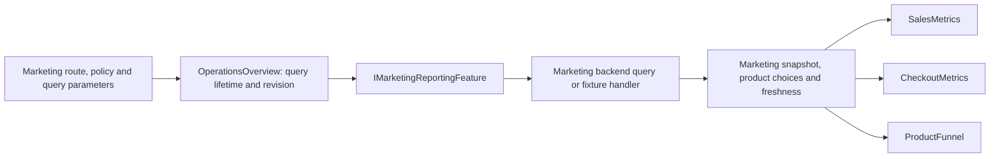

The page owns cancellation, loading/error state and the current query revision. Late results for another period/product/identity cannot replace it. All panels render the same returned snapshot revision. A refresh failure can leave the last-good snapshot explicitly stale, with its original filter/time labels. An unavailable slice retains its supplied warning without hiding other usable slices. Marketing query failure never falls back to source-module reads.

Opening, rendering, refreshing or inspecting the overview does not publish business events, start a job or advance backend processing. Fixture responses can exercise freshness/coverage transitions independently of a real messaging pipeline. AppState/Notifier can carry explicitly supported local invalidation, but imply no automatic cross-circuit delivery. This section validates native composition, module ownership, access and read lifecycle; backend capture and analytics have separate evidence.

## Keep Server and browser access honest

Spec references: [Reference application access paths](spec-blazor-presentation-framework.md#reference-application-access-paths), [Hosting and render-mode interoperability](spec-blazor-presentation-framework.md#hosting-and-render-mode-interoperability), [Prerendering policy and activation](spec-blazor-presentation-framework.md#prerendering-policy-and-activation), and [Frontend coordination with Requester and Notifier](spec-blazor-presentation-framework.md#frontend-coordination-with-requester-and-notifier).

Portable components consume narrow feature-owned contracts such as `ICatalogFeature`, `IStockFeature`, `IBasketFeature`, `ICheckoutFeature`, `IMarketingFeature`, `ICustomerOrdersFeature` and `IOperationsOrdersFeature`. The last two are audience-specific contracts of the same Orders module, not separate business modules. Reuse existing suitable contracts. A Server-only handwritten page may call Requester directly; participation in the shell does not require a new wrapper interface.

The same rule applies to `IMarketingManagementFeature` and `IMarketingReportingFeature`. On Server, the overview dispatches Marketing's reporting query directly through Requester to Marketing's store; WASM uses Marketing's typed HTTP reporting endpoint over that same read model. Reporting follows no query path to Catalog, Basket, Checkout or Orders. Backend event publication and Marketing consumers remain separate from these UI reads and from local AppState/Notifier. The browser cannot manufacture a paid stage, choose an unauthorized reporting context or bypass management authorization by supplying IDs.

```csharp
public interface ICheckoutFeature
{
	Task<Result<CheckoutReview>> ReviewAsync(
		CancellationToken cancellationToken = default);

	Task<Result<CheckoutOutcome>> PlaceAsync(
		CheckoutSubmission submission,
		CancellationToken cancellationToken = default);

	Task<Result<CheckoutAttemptStatus>> FindAttemptAsync(
		Guid attemptId,
		CancellationToken cancellationToken = default);
}

public sealed class ServerCheckoutFeature(IRequester requester) : ICheckoutFeature
{
	public Task<Result<CheckoutReview>> ReviewAsync(
		CancellationToken cancellationToken = default) =>
		requester.SendAsync(new CheckoutReviewQuery(),
			cancellationToken: cancellationToken);

	public Task<Result<CheckoutOutcome>> PlaceAsync(
		CheckoutSubmission submission,
		CancellationToken cancellationToken = default) =>
		requester.SendAsync(new CheckoutPlaceCommand(submission),
			cancellationToken: cancellationToken);

	public Task<Result<CheckoutAttemptStatus>> FindAttemptAsync(
		Guid attemptId,
		CancellationToken cancellationToken = default) =>
		requester.SendAsync(new CheckoutAttemptQuery(attemptId),
			cancellationToken: cancellationToken);
}
```

The query/command/outcome records are fictional Application contracts, not new shell result types. `CheckoutOutcome` carries the feature's reported business state where needed. Transport loss may still leave that state unknown. Use the named cancellation argument because Requester's preceding optional parameter is `SendOptions`.

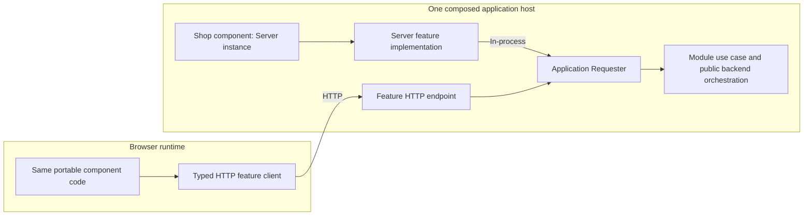

| Runtime | Registration and boundary |
| --- | --- |
| Interactive Server | Register scoped Server feature implementations in the server modules. Dispatch commands/queries directly; do not call the host's own HTTP API. Current user/session services must follow the circuit's actual context rather than a stale startup request. |
| Web App WASM or standalone WASM | Register browser-safe typed HTTP feature clients. Endpoints dispatch the same Application use cases. No handler, repository, server module or transaction behavior enters the browser graph. |
| Auto | Supply both registrations and validate cold Server and warm browser visits. Each live instance uses its executing runtime; services and in-flight operations do not migrate. |
| Explicit prerender | Permit only the declared read initialization and safe transfer payload. Reconstruct live scopes/subscriptions on activation. Do not duplicate writes or transfer private scoped services. |
| Mixed roots | Keep owners and presenters requiring direct interaction in a compatible interactive area. Declare any integration between roots/runtimes; local AppState or Notifier does not imply a bridge. |

For browser composition, the proposed `AddPresentation().WithModule(CatalogUi.Name, CatalogPresentation.Configure)` reuses Catalog's portable definition under the same identity. Equivalent selected definitions and the proper clients are registered for other browser features. A generator may derive these registrations from the shared selected composition, but must not execute server `Register`, `Use` or `Map` code in the browser.

Only browser-executed presentation capabilities enter that client composition. Customer order-history components use Orders' customer contracts; Checkout can depend on safe Orders backend availability. Neither needs to download or reference the staff operations UI. The application host still composes those facets under the same Orders module identity and backend ownership.

Backend Queueing, Messaging, Jobs, storage and Application.Caching remain behind these service/content contracts. They add no provider or scheduler dependency to a page. Their contracts are defined in the [backend architecture](#backend-architecture-and-delivery). AppState remains scoped presentation state; ShopFiesta's planned cache integration remains a backend concern.

## Make the two layouts consistent, accessible and replaceable

Spec references: [Headless behavior and opinionated defaults](spec-blazor-presentation-framework.md#headless-behavior-and-opinionated-defaults), [Shell layouts and application chrome](spec-blazor-presentation-framework.md#shell-layouts-and-application-chrome), [Visual consistency and styling](spec-blazor-presentation-framework.md#visual-consistency-and-styling), [Module assets and JavaScript ownership](spec-blazor-presentation-framework.md#module-assets-and-javascript-ownership), [Localization and culture](spec-blazor-presentation-framework.md#localization-and-culture), and [Accessibility acceptance](spec-blazor-presentation-framework.md#accessibility-acceptance).

`StorefrontLayout` uses the shop header, category navigation, search, account access, Basket's summary and a compact footer. `OperationsLayout` uses staff navigation, breadcrumbs and contextual toolbars, including Overview, Orders and Marketing links when their capabilities and policies allow them. Both consume the same headless composition/availability contracts. Neither owns product pricing, basket persistence or fulfillment decisions.

The storefront layout renders the published header region rather than hard-coding Basket into shared shell source. This proposed excerpt uses the normal shell context supplied through a native cascading value by route integration:

```razor
@inherits LayoutComponentBase

<header>
	<a href="catalog">ShopFiesta</a>
	<ShellNavigation Menu="Main" />
	<ExtensionRegion Target="ShellUi.HeaderEnd" Context="this.ShellContext" />
</header>
<main>@Body</main>

@code {
	[CascadingParameter]
	public ShellContext ShellContext { get; set; }
}
```

`ShellNavigation` is a proposed default navigation renderer. `ShellContext` is a browser-safe presentation context for this runtime/owner, not a global container for business state. Catalog search and Basket's badge can occupy the header through their own registered contributions. Installing Marketing adds its product region without changing this layout.

| Concern | Shop example |
| --- | --- |
| Native component use | Handwritten product cards, `EditForm`, ordinary parameters, `EventCallback` and layouts remain valid. Optional framework adapters supply repeated behavior only where needed. |
| Renderer replacement | Run the same purchase binding, related region and operational batch binding with plain Razor presenters. The headless consumer has no transitive MudBlazor dependency. |
| Shared look | Use the published design tokens and module-scoped CSS. The host can brand the storefront while operational pages retain consistent focus, spacing and feedback behavior. |
| Localization | Catalog, Basket, Marketing, Checkout and Orders own their resource keys. A Marketing contribution keeps its own resources in a Catalog region. Culture changes refresh declared presentation dependencies; actual currency/pricing choices remain feature/backend decisions. |
| Narrow screens | Product grids collapse, filters use an accessible compact presentation, basket lines remain readable and the operations toolbar uses predictable overflow. Retain the originating scope while opening menus or drawers. |
| Keyboard and focus | Labels and controls have accessible names. Filter changes, validation summaries, dialogs and navigation have explicit focus behavior. Opening an overflow menu never retargets a purchase or selected orders. |
| Feedback | Announce adding, successful basket changes, validation and unavailable states without duplicating feedback across presenters. A failed optional recommendation region does not seize focus from checkout. |
| Assets | Module resources/CSS/JS ship through RCL static web assets, CSS isolation and supported JS imports. Shared MudBlazor setup is documented once. A shop host does not edit its HTML for each newly installed module. |
| JavaScript lifetime | A filter drawer observer or sticky purchase-bar listener belongs to its live component. Dispose subscriptions/interop references and use browser-side DOM cleanup where required. Handle disconnected Server circuits without leaking owners. |

The wireframes show ownership and layout concepts, not completed responsive or accessibility evidence. Implementation must exercise narrow views, keyboard interaction, zoom/reflow and screen-reader behavior in the actual rendered flows.

### Compose settings sections and restore their owned preferences

Spec references: [Public core extension points and defaults](spec-blazor-presentation-framework.md#public-core-extension-points-and-defaults), [State, preferences and application context](spec-blazor-presentation-framework.md#state-preferences-and-application-context), [View restoration policy](spec-blazor-presentation-framework.md#view-restoration-policy), [Localization and culture](spec-blazor-presentation-framework.md#localization-and-culture), and [Compatibility and upgrades](spec-blazor-presentation-framework.md#compatibility-and-upgrades).

The shared `PreferencesModule` supplies the native `/preferences` page, appearance/culture section and the integration with existing preference/AppState providers. Orders contributes its display section. Both sections use normal forms/components; the shell supplies the settings-section contract, composition, localization and state ownership rather than a generated form language.

The shared appearance/culture package uses browser-safe contracts and ordinary Razor controls. Renderer-specific styling/adapters remain separate, so consuming the shared module does not force a MudBlazor dependency into the headless consumer.

```csharp
module.Settings.Add<OrderDisplaySettings>(
	"orders.display-settings",
	labelKey: "OrderDisplay",
	order: 200);
```

```razor
@page "/preferences"

<PageTitle>Preferences</PageTitle>
<h1>Preferences</h1>
<SettingsSections />
```

`SettingsSections` and `Settings.Add<TComponent>` are proposed conveniences over the published settings contract and native Razor components. They render the shell-owned settings-sections point with a browser-safe `SettingsContext`: the applicable owner, opaque identity/context partition, culture and context revision. A section uses the documented normal `[Parameter] SettingsContext Context` contract and constructor/injected services; composition validates that parameter contract. It does not receive a universal service/state dictionary.

`OrderDisplaySettings` uses its injected feature preferences and `EditForm` or the selected library's existing form. Each section owns its draft, save callback and feedback. Save appearance and Save order display are independent operations; composing the sections does not add a page-wide Save All, cross-module transaction or edit-session coordinator. Composition retains section identity, source module, resource base, order and availability without another settings store or a provider class for each control.

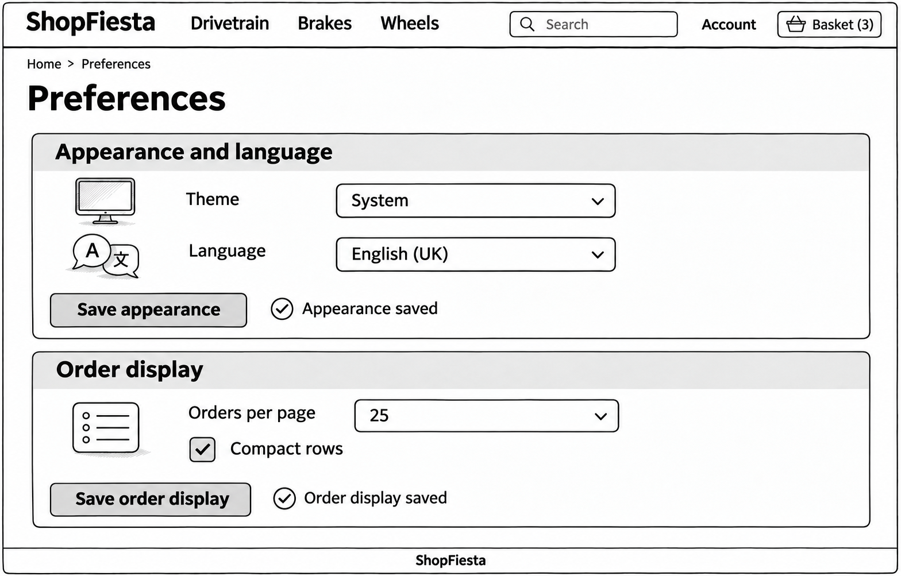

*Figure 12. The shared module supplies Theme and Language; Orders supplies Orders per page and Compact rows. Each section saves and reports its own result while retaining module/resource and persistence ownership.*

| Preference | Owner, scope and observable effect |
| --- | --- |
| Theme: light, dark or system | Shared preferences. Store an allowed choice, not arbitrary CSS. Apply through the selected renderer's theme integration. A system-theme listener belongs to its live component. |
| Culture: supported values such as `en-GB` and `nl-NL` | Shared preferences plus the host's native localization integration. Update labels and formatting, including module resources. Culture selection alone does not change the basket's currency or pricing market. |
| Customer orders per page: default 25 | Orders, partitioned by application, identity, customer-history view and schema version. Supported values are 10, 25 and 50 in the fixture. An explicit valid URL value takes precedence. |
| Compact customer rows | Orders-owned benign display preference. Update that declared presentation consumer without refetching unrelated Catalog, Basket or Marketing data. |
| Staff queue display choices | Orders-owned operations-view keys, separate from customer history and from the other live queue's transient selection/query context. |

Anonymous visitors can use available appearance/culture settings. Private Orders sections require their declared identity context. The local sample uses the configured browser/scoped preference provider and a minimal Orders preference adapter where needed; no external preference server is required. Keys use stable module/view identities, opaque identity/context partitions and schema versions. They do not use incidental component-instance names or store contact/delivery drafts, basket credentials or authorization decisions.

The first Server profile applies culture through the host's supported native culture provider and a deliberate reload when required to establish the new circuit culture. It preserves only declared safe view state, reconstructs scopes and does not replay mutations. User-specific choices must not change another Server circuit's culture. Browser/prerender profiles follow their own validated native activation rules.

A culture-triggered reload follows any active section's declared unsaved-change policy. It does not save or silently discard another section's draft. Each section still owns its result when another section saves or fails.

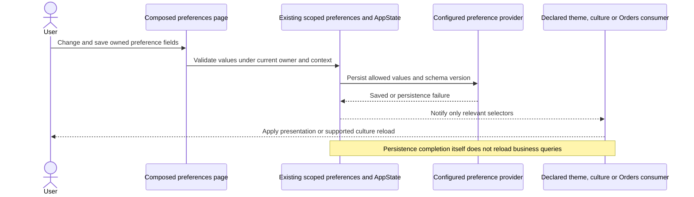

| Restoration case | Expected evidence |
| --- | --- |
| Save and reload | Theme/culture and applicable Orders values restore using their declared keys/defaults. Route query values still take precedence over saved view defaults. |
| Switch between two test customers | Each private Orders preference partition restores its own values. A late previous-user save/read cannot overwrite the new user's state. |
| Optional storage unavailable | Keep the documented in-memory/default behavior and report that persistence failed. Do not prevent the shop from starting or pretend that values were durably saved. |
| Old or corrupt optional payload | Apply the declared migration or safe defaults. For example, an unsupported historical page size falls back to 25 with an attributable diagnostic. Preserve unrelated module preferences. |
| Change culture | Shared, Catalog, Basket, Orders and Marketing resources follow the new culture, with supported native reload/activation behavior. Only explicitly culture-dependent queries rerun. |
| Reuse the package | ShopFiesta and a separate clean consumer host consume the same packed Preferences module and its assets through public APIs, while Orders contributes its ShopFiesta-specific section separately. DoFiesta is unchanged. |

## Keep availability, identity and diagnostics out of the wrong scope

Spec references: [Host-supplied feature availability](spec-blazor-presentation-framework.md#host-supplied-feature-availability), [Optional authentication and authorization](spec-blazor-presentation-framework.md#optional-authentication-and-authorization), [Session and workspace transitions](spec-blazor-presentation-framework.md#session-and-workspace-transitions), [Production hosting and rollout](spec-blazor-presentation-framework.md#production-hosting-and-rollout), [Developer diagnostics](spec-blazor-presentation-framework.md#developer-diagnostics), and [Agent-accessible diagnostics and discovery](spec-blazor-presentation-framework.md#agent-accessible-diagnostics-and-discovery).

| Event | Required behavior in ShopFiesta |
| --- | --- |
| Catalog available, Marketing absent | Browse and buy normally with the related region omitted. Installation and user permission remain distinct inputs. |
| Checkout's required capability unknown | Keep only dependent submission/activation pending or unavailable with a reason and bounded retry. Do not infer readiness from a previously enabled button. |
| Basket service fails | Show its actual unavailable/error state. Do not claim the basket is empty or silently discard known items. Unrelated product reads can remain usable. |
| Guest signs in | Apply the application's explicit guest-basket ownership/merge policy. Invalidate old-context reads and rebind private state to the new session. The shell does not invent the merge policy. |
| Sign-out or access revocation | Invalidate private bindings and pending confirmations, clear or partition basket/customer-order/draft snapshots and reject late old-context results. Dirty checkout state cannot block forced revocation. |
| Staff loses the operations policy | Deny further route activation and invocations, invalidate stale confirmations and preserve accurate already-dispatched outcomes. Backend checks remain authoritative. |
| Culture or store context changes | Update declared localized presentation and re-query pricing only if that context affects the query. Partition sensitive state where the application's store/workspace model requires it. |
| Circuit or network disappears during placement | Present recovery based on the original order attempt. Reconnect does not prove success, failure or cancellation. Never replay a purchase as a generic recovery action. |
| A deployment changes client/server compatibility | Use the declared compatibility/readiness integration. Unrelated compatible features remain usable. In-flight checkout uses its business recovery contract. |
| Optional region throws | Contain the region error, retain page/owner attribution and keep independent basket/checkout interactions available. |

Authorized developer diagnostics can explain why Add to basket is disabled, which product scope the sticky bar observes, why Marketing was omitted and which module supplied Release. A useful record includes stable contribution identity, live owner/binding/execution references, relevant context revision, availability reason and originating runtime. It does not need contact addresses, basket secrets or payment data.

The diagnostic overlay, popout and agent-readable facade use the existing specified discovery/query model. A read does not execute a purchase, enable capture or bypass staff authorization. Capture remains explicit, bounded and redacted. A browser view of Server-origin execution labels that origin rather than pretending all work ran in WASM.

Operational telemetry and performance baselines cover public route activation, category/read latency, action evaluation, basket mutation observation, per-circuit resources, browser download cost and diagnostic overhead where applicable. Framework overhead is distinguished from Catalog/Checkout backend work. This specification supplies scenarios, not invented performance numbers.

### Replace a contribution and inspect the effective result

Spec references: [Extension contracts and host authority](spec-blazor-presentation-framework.md#extension-contracts-and-host-authority), [Predictable attachment and customization](spec-blazor-presentation-framework.md#predictable-attachment-and-customization), [Developer diagnostics](spec-blazor-presentation-framework.md#developer-diagnostics), and [Agent-accessible diagnostics and discovery](spec-blazor-presentation-framework.md#agent-accessible-diagnostics-and-discovery).

Use three named startup profiles to make host authority visible. They are ordinary application configuration profiles, not a new runtime feature-management service or an end-user provider switcher.

| ShopFiesta presentation profile | Effective recommendation region |
| --- | --- |
| `default` | Marketing supplies `marketing.related-products` using the public Catalog context. |
| `featured-related` | Host-owned `FeaturedComponents` replaces that identified contribution while retaining its public target/identity and single-region cardinality. |
| `no-related` | The host suppresses the optional contribution; the region collapses and product purchasing remains usable. |

The proposed host override methods operate in the existing `WithPresentation` configuration callback:

```csharp
// featured-related profile
options.ReplaceContribution<FeaturedComponents>("marketing.related-products");

// Alternative no-related profile
options.DisableContribution("marketing.related-products");
```

These are alternative profiles. `FeaturedComponents` is an ordinary compatible Razor component with `[Parameter] ProductContext Context`, host-owned resources and a fixture-backed feature service. It renders public Catalog product cards and therefore retains their independent Basket purchase bindings. It references no Marketing private component, state or backend handler.

Replacement preserves the identified attachment instead of adding a second competing contribution. Effective provenance records the original Marketing registration and the host replacement. Host configuration is applied before compatibility/cardinality validation. An incompatible context parameter or an unresolved required override target produces a source-attributed composition error. Overrides cannot grant execution permission or bypass backend authorization.

The effective replacement keeps point-required availability/access rules and declares the dependencies its own provider actually uses. Diagnostics distinguish target requirements, provider requirements and the host decision rather than assuming a replacement uses Marketing's private services.

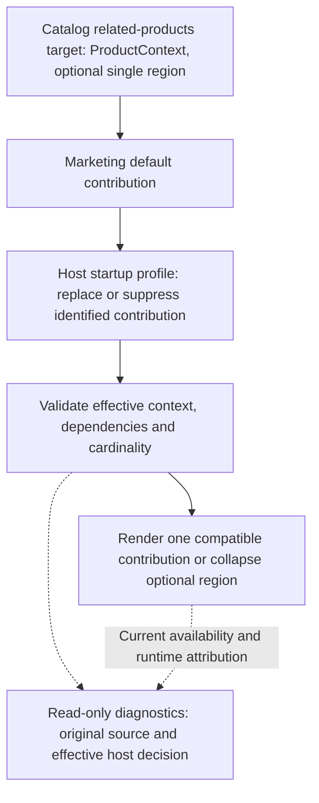

Walk through the following observations using the same product URL and the appropriate authorized development identity:

1. In `default`, inspect the region's published target, Marketing source, effective order and availability. Opening inspection does not reload recommendations or execute a purchase.
2. In `featured-related`, inspect the same contribution/target identity and its replacement provenance. The visible component changes while Catalog and Basket contracts remain unchanged.
3. In `no-related`, inspect the explicit host suppression reason and optional-region fallback. Its absence is distinguishable from a failed recommendation read.
4. Inspect the main product and a recommended card as two live purchase scopes. Their owner, binding/context revision and source runtime differ even though both use Basket's action definition.
5. Use an example fault profile to make the required purchase availability unknown or the product ineligible. Inspect the actual disabled reason without invoking Add to basket. The diagnostic query must not establish eligibility by dispatching the action.
6. Attach the diagnostic popout and inspect the same originating session. Failed attachment leaves the drawer usable. With the browser facade separately enabled, perform a read-only discovery/query with the drawer closed; drawer-only configuration leaves the facade disabled.

These observations use the existing specified diagnostic model, not a second registry or a new schema invented for ShopFiesta. Record composition/owner references, effective source and reason, evaluation status and runtime attribution. Capture is a separate explicit, bounded choice. Sign-out/revocation invalidates private inspection and attached views; no contact details, payment data, basket secrets or other customers' order payloads are needed. Non-development inspection remains off unless explicitly enabled and authorized.

## Use conventions, builders and generators to reduce actual setup

Spec references: [Fluent setup, conventions and discovery](spec-blazor-presentation-framework.md#fluent-setup-conventions-and-discovery), [Low friction and native platform mechanisms](spec-blazor-presentation-framework.md#low-friction-and-native-platform-mechanisms), [Publishing and consuming a module](spec-blazor-presentation-framework.md#publishing-and-consuming-a-module), [Reuse and developer-experience evidence](spec-blazor-presentation-framework.md#reuse-and-developer-experience-evidence), and [Compatibility and upgrades](spec-blazor-presentation-framework.md#compatibility-and-upgrades).

| Ordinary path | Explicit departure or published contract |
| --- | --- |
| Select a module once with the existing host builder. | Supply its supported options or host overrides; do not select the same module again in a parallel shell registry. |
| Infer a local module identity from its type. | Pin a public identity once before publishing destinations, persistence namespaces or extension targets. Share it between runtime adapters. |
| Declare a page assembly once and discover native routes. | Map page owners explicitly in a shared assembly or report ambiguity. Never infer ownership from URL naming alone. |
| Bind a local action with a semantic local key and ordinary callback. | Publish stable action/attachment identities when another package must reference them. Runtime IDs remain derived. |
| Use native Razor parameters and component lifetimes. | Publish a typed region/context when cross-module composition requires it. Do not wrap every child component in an extension abstraction. |
| Use feature services and existing AppState/Notifier. | Declare shared dependencies and invalidation targets where independent consumers need them. Do not introduce another state container or mandatory event bus. |
| Consume shipped assets through the standard RCL pipeline. | Document exceptional shared prerequisites once, such as renderer services/providers. |

Fluent builders group related declarations and preserve compile-time context types. They do not perform remote reads, invoke business operations or resolve live scoped clients at startup. Discovery is bounded to selected modules and their declared assemblies; a loaded assembly is not permission to install its module.

Generators may emit typed destination helpers, explicit page/contribution registrations, browser-safe selected definitions or actionable diagnostics for repeated conventions. Generated and explicit registrations use the same public contracts, validation and host-override precedence. Generated output must be inspectable and must not duplicate already registered contributions, invent a second router or leak server dependencies into WASM.

A generator cannot establish the current basket owner, staff permission, stock availability or a live component's context revision. Supported trimming must validate the actual registration strategy. A new mandatory generator/build tool is not a prerequisite for an ordinary handwritten page or callback.

Before claiming ShopFiesta package reuse, pack its proposed Preferences module and consume the actual `.nupkg` from a local source in ShopFiesta and a separate clean host with different branding/layouts and feature services. Do not copy its source or require changes to DoFiesta. Appearance/culture settings supply the concrete reuse case; Orders adds its own section in ShopFiesta. A plain Razor or browser profile of ShopFiesta alone does not establish independent application reuse. This later application evidence is separate from TaskFiesta's complete framework validation.

## Turn the complete journey into runnable evidence later

Spec references: [Validation and evidence requirements](spec-blazor-presentation-framework.md#validation-and-evidence-requirements), [Acceptance scenarios](spec-blazor-presentation-framework.md#acceptance-scenarios), [Independent module tests](spec-blazor-presentation-framework.md#independent-module-tests), [Performance baselines and release acceptance](spec-blazor-presentation-framework.md#performance-baselines-and-release-acceptance), and [Accessibility acceptance](spec-blazor-presentation-framework.md#accessibility-acceptance).

The first slice validates frontend design and architecture against small feature handlers and fixture content. Use ordinary .NET tools and deterministic data. It needs no real message broker, work queue, scheduler, blob/file provider or application cache. Fixture outcomes must still preserve module ownership, access, revisions and truthful loading/failure/recovery behavior. The [backend integration cases](#backend-integration-evidence) verify the actual providers, handlers and application boundaries. Passing fixture-based checks alone does not complete ShopFiesta.

| Scenario | Observable proof | Gate |
| --- | --- | --- |
| Minimal public shop | Catalog alone runs without auth integration or higher-level packages. Optional Basket/Marketing/Checkout absence follows the declared presentation. | Behavior |
| Frontend/backend correspondence | Each of the ten business modules shares its identity, ownership and contract boundary across presentation and backend. Catalog defines the SKU and Stock uses that exact identity for its independent availability/policy state. Customer and staff Orders facets remain in the same module; Customers, Pricing, Payments and Fulfillment keep their distinct authorities. | Behavior and Reuse |
| Replaceable product catalog | Replace the initial road/gravel-component fixtures, categories and attribute/facet metadata with another catalog without changing shell, Basket, Checkout, Marketing or Orders business-module boundaries. Existing order snapshots remain readable. | Reuse |
| Product names and model designations | Every displayed product label includes its available designation, inline or directly beneath the name, including basket/checkout/order lines, recommendations and report selectors. Search by name or code and distinguish brands/variants using public metadata and stable IDs. Label corrections preserve action/recommendation identity; historical lines retain their recorded values. No code means no empty suffix. Verify narrow layouts and accessible names too. | Behavior and Reuse |
| Modular composition | Selected modules register once. Required target/dependency failures, duplicate IDs, shared-assembly ownership and replacement conflicts identify their source. | Behavior |
| Native routes and deep links | Category, product, basket, receipt, customer-history/detail and operations URLs load directly with their declared access checks. Orders owns its customer/staff order pages; Marketing owns overview and recommendation-management pages. Customer pages use the storefront layout and mapped staff pages use the operations layout. Typed links respect a non-root base path and valid query encoding. | Behavior and Reuse |
| Catalog state | Filters, search, sorting, paging, breadcrumbs and Back reconstruct the right view. Late category/product results cannot replace a newer context. | Behavior |
| Product-content presentation | Catalog fixture URLs/metadata drive native images and manual links. Verify base paths, revision identity, alt text, applicability and local missing/failure states. This proves the frontend contract, not blob/file integration. | Behavior and Reuse |
| Stock composition and live updates | Catalog/Basket/Checkout use Stock's decisions for the same SKU and requested quantity. Render in-stock, low, sold-out, coming-soon and null-quantity policy states distinctly; reject stale SKU/quantity/revision updates and dispose subscriptions. Stock failure is not a null quantity or a sellable decision. | Behavior and Reuse |
| Stock management | A Stock-owned protected page edits quantity/policy for an existing Catalog SKU through native forms. Revision conflicts, delayed saves, identity changes and per-SKU updates preserve the originating context. Reporting permission alone cannot manage Stock. | Behavior and Reuse |
| Cross-module Add | The main product and related cards invoke Basket through the public target with the right captured product, variant, quantity and version. Catalog does not depend on Basket internals. | Behavior and Reuse |
| Shared binding presentation | A local purchase button and an explicitly attached sticky presenter share one pending state, result and feedback owner. Another product scope remains independent. | Behavior |
| Marketing region | Optional absence, empty success, failed read, host replacement and stale product results behave distinctly. Public product cards work without a Marketing-to-Basket dependency. | Reuse |
| Marketing management | Authorized staff load, order, enable/disable and save a source product's recommendations using public Catalog lookup. Draft preview is inert; conflicts/unknown outcomes preserve the right draft/reference. Successful save invalidates only that source read, and host replacement/suppression remains authoritative. | Behavior and Reuse |
| Basket summary | Confirmed revisions update the badge without out-of-order rewind. Targeted invalidation coalesces reads; inactive views become stale. A failed refresh does not undo a committed Add. | Behavior |
| Native form feedback | Default property paths, aliases, model errors and submitted-revision checks work with `EditContext`, including an old rejection arriving after a field edit or newer submit. | Behavior and Reuse |
| Checkout outcome | One pending submit, stable backend attempt identity, changed-review handling, known rejection, confirmed receipt and unknown-status recovery are distinct. No generic automatic replay occurs. | Behavior |
| Backend-owned processing presentation | Accepted receipt, payment, processing and fulfillment remain distinct in feature DTOs. Revisit the original reference after page disposal, reject stale reads and avoid replay/progress side effects. Fixture transitions stand in for backend execution. | Behavior and Reuse |
| Customer past orders | Two customer fixtures expose different bounded histories. A bookmarked or guessed ID cannot read another customer's order through either transport. Detail uses purchased snapshots, shows only customer projections and rejects late results after a customer switch. | Behavior and Reuse |
| Protected operations | Anonymous/customer access cannot activate protected pages or invoke Release. Current circuit identity and backend authorization agree. Revocation invalidates pending work. | Behavior and Hosting |
| Two queue scopes | Header targets only Ready selection. Review selection is independent. Paging retains selected IDs by default, explicit clear-on-paging works and off-page absence does not imply deletion. | Behavior and Reuse |
| Safe batch confirmation | Duplicate invocation is suppressed, relevant changes reject stale decisions and dispatch retains original IDs/versions. Disposal or late completion cannot update another owner. | Behavior |
| Typed external toolbar controls | Status/search controls render from the same Ready scope as its actions, dispatch native typed callbacks to that owner, and invalidate only its declared query. Review and a later retargeted header cannot receive the old control event. | Behavior and Reuse |
| Partial release | The fixture releases SF-1042 and returns a version conflict for SF-1043. Feedback preserves each known result, classifies the aggregate as partial and never retries the original batch automatically. | Behavior |
| Backend export observation | Export matching captures query intent, distinguishes acceptance from completion and survives page navigation under the example backend owner. The status link reauthorizes reads, reports source progress and exposes download only when ready; lost acknowledgement does not cause replay. | Behavior and Reuse |
| Staff reporting presentation | Marketing owns the page and every reporting read, including product choices. Fixture snapshots exercise filters, freshness/coverage, authorization, stale-result rejection and one response across panels. No source-module query fan-out. | Behavior and Reuse |
| Product funnel presentation | Render Marketing-provided stages, ratios and cohort/coverage labels. Unavailable or still-maturing data is distinct from zero. UI rendering and refresh neither create stages nor calculate cross-module analytics. | Behavior and Reuse |
| Honest runtime access | Server reaches Requester in-process; WASM uses real typed HTTP clients; Auto/mixed/prerender profiles preserve their declared boundaries and transfer rules. | Behavior, Reuse and Hosting |
| Session transitions | Guest/sign-in/store-context changes apply the feature's basket policy and partition private state. Forced revocation takes precedence over dirty-state prompts. | Hosting and Quality |
| Replaceable rendering | Product actions, typed regions, navigation and operational actions work in a MudBlazor-free consumer using the same headless contracts. | Reuse |
| Assets, culture and cleanup | Packaged CSS/resources/JS resolve without per-module host edits. Culture changes are targeted, and repeated mounting/disposal or circuit loss leaks no owned subscriptions/interop. | Reuse, Hosting and Quality |
| Composed settings and restoration | Shared appearance/culture settings and Orders display settings retain their source/resource/key ownership. Reload, per-user restoration, URL precedence, unsupported schema/value fallback and persistence failure preserve the declared behavior without unrelated query reloads. | Behavior and Reuse |
| Host customization profiles | Default, host-replaced and suppressed Marketing profiles preserve typed target/cardinality rules. The drawer/popout/facade explains original/effective provenance and availability without invoking actions or implicitly enabling capture. | Behavior, Reuse, Hosting and Quality |
| Publishing and reuse | ShopFiesta and its separate clean consumer host consume the same actual packed reusable presentation module through public APIs and ordinary tools, apply host customization and validate a shared package upgrade. ShopFiesta can keep its first backend minimal/mocked. | Reuse and Quality |
| Conventions and optional generation | Measure declarations/files against ordinary Blazor. Explicit/discovered/generated paths preserve effective composition, host authority and supported trimming. | Behavior and Reuse |
| Authorized diagnostics | Inspect source, availability, scope and outcome without exposing private checkout data. Popout/agent reads retain access rules, source attribution and bounded capture. | Hosting and Quality |
| Accessibility and performance | Exercise customer and staff flows on narrow screens, keyboard and screen reader. Record comparable baselines/limits and diagnose reproducible regressions before stable release. | Behavior, Reuse, Hosting and Quality |

Each check records its real commands, profile, build, result and exact preview signatures exercised. Missing or failing required evidence remains unresolved. The shop images, snippets and Mermaid diagrams explain what implementation must prove; they do not substitute for that proof.

### First Interactive Server validation slice

Spec references: [Recommended business application profile](spec-blazor-presentation-framework.md#recommended-business-application-profile), [Validation and evidence requirements](spec-blazor-presentation-framework.md#validation-and-evidence-requirements), [Out-of-the-box greenfield starter](spec-blazor-presentation-framework.md#out-of-the-box-greenfield-starter), [Independent module tests](spec-blazor-presentation-framework.md#independent-module-tests), and [Performance baselines and release acceptance](spec-blazor-presentation-framework.md#performance-baselines-and-release-acceptance).

Use one ShopFiesta host, Interactive Server with prerendering off, the ten commerce modules plus shared Preferences, two seeded Fake Identity Provider customers and scoped staff accounts. Small fixture handlers supply the original shopping/operations results plus owned addresses, catalog edits, campaign/quote revisions, payment attempts and shipment/reservation projections. Keep metrics, recommendations, campaigns, catalog, pricing, payments, fulfillment, Stock and Orders permissions distinct. No real inventory, reservation, payment system or broadcast backend is required for this frontend slice. The added screens use fixture-backed Application handlers while the backend BI cases remain pending.

The actual composition, route/access handling and Requester path are the subjects under test. Server feature services call Requester directly to the fixture Application handlers. Isolated component mocks do not establish that dispatch path. Fixtures can simulate processing/coverage and allow test control to advance outcomes independently of reads; they do not establish real Messaging, Queueing, Jobs, blob/file storage or caching. Those integrations have their own [backend evidence cases](#backend-integration-evidence) in this specification and are not established by this fixture profile.

Normal browser navigation, asset/download requests and native culture selection remain valid HTTP. Business feature commands/queries stay in process on Server. Later WASM evidence uses real typed HTTP clients over the same feature contracts. No backend-provider integration or enabled application cache is required to validate this first frontend slice.

| Case | Exercise | Expected result and preview contracts validated |
| --- | --- | --- |
| SV-01 Composition and startup | Build/start the documented local profile, then run missing-target, duplicate-ID and incompatible-component fixtures. | Ordinary public setup works; invalid composition identifies its source. Validate module identity, page ownership, native asset setup and parameter/cardinality validation. |
| SV-02 Direct feature access | Trace a product read, Add to basket, checkout submission and order read to small Application handlers. | Correct current context reaches Requester; no Server feature self-HTTP call occurs. Validate feature contracts, cancellation and normal DI lifetimes. |
| SV-03 Routes and access | Open product, customer detail and staff detail URLs directly and through interactive navigation, including a non-root base path and another customer's order ID. | Both activation paths enforce ownership/access; customer and operations layouts remain distinct. Validate destinations, initial endpoints, native router integration and current-owner reads. |
| SV-04 Catalog restoration | Change filters/sorting/page, find RT-G800 by model designation, open a product and go Back. Deliver an old response after a new query, correct fixture metadata and include same-code products from different brands and a product without a designation. | Restore the represented view and reject obsolete data. Labels do not replace stable action/recommendation identity. Marketing shows its own supplied metadata revision, and historical order snapshots remain unchanged. Validate public DTOs, URL precedence, breadcrumbs and state restoration. |
| SV-05 Independent purchases | Add from the main product and a related card; double-click one binding; change quantity or dispose the originating component during work. | Captured inputs remain stable, duplicate suppression is per binding and summary updates respect current basket/session ownership. Validate live scopes, dispatcher delivery and AppState selectors. |
| SV-06 Preferences | Save/reload theme/culture and Orders display values; switch customers; supply corrupt/old values and a failing optional persistence provider. | Restore only the appropriate partition/defaults with accurate feedback. Validate settings composition, native culture activation, persistence/schema policy and targeted state changes. |
| SV-07 Host authority and inspection | Run `default`, `featured-related` and `no-related`; inspect effective contributions and a disabled purchase reason. Query the separately enabled facade with the drawer closed. | Observe exact replacement/suppression and live provenance without dispatching business work or enabling capture. Validate host overrides and read-only diagnostic discovery; include attachment/access negatives for the popout when that capability is present. |
| SV-08 External query controls | Type/change Ready filters while Review is independently selected; move focus into the header; retarget or remove the source during a delayed callback. | Only the originating eligible queue changes. Filter changes apply its selection policy and invalidate pending confirmation where relevant. Validate `BindControl`, typed callbacks and explicit outlet ownership. |
| SV-09 Batch invocation and partial result | Confirm two Ready targets, change a relevant revision before dispatch in one run, and return the one-success/one-conflict receipt in another. | Reject the stale decision; preserve actual per-target/aggregate outcomes and never retry the original batch implicitly. Validate confirmation, `MapOutcome`, receipt application and separate refresh feedback. |
| SV-10 Checkout revisions and recovery | Return a field rejection after editing that field/newer submission; exercise known success, changed review and lost completion acknowledgement. | No stale invalid markers or replay. Receipt/recovery uses the original submission/attempt. Validate native form feedback, captured draft revisions and unknown-outcome handling. |
| SV-11 Export ownership | Submit Export matching, navigate away, open its status reference and advance the example backend fixture independently of reads. Exercise lost acknowledgement and unavailable result artifact. | Submission is not completion; page disposal does not cancel the backend operation; reads only observe and reauthorize. Validate operation-reference observation and artifact/outcome separation. |
| SV-12 Lifecycle and identity | Repeatedly mount/remove purchase, region, control and diagnostic consumers; revoke or switch identity with reads/confirmations pending. | Bindings/subscriptions detach and obsolete callbacks cannot update another owner/context. Validate cleanup and declared state/inspection isolation. |
| SV-13 Public developer path | Have an engineer unfamiliar with internals add a local action and consume the settings/contribution examples using public documentation. | Record actual declarations/files and undocumented knowledge. Simplify preview APIs when ordinary setup needs excess ceremony; do not claim productivity from the diagrams alone. |
| SV-14 Interaction and baseline | Exercise keyboard/narrow layouts for the slice and record repeatable startup, action-evaluation, circuit and diagnostic-overhead measurements where applicable. | Capture real accessibility observations and an initial comparable Server baseline. Validate renderer responsibilities and source-attributed measurements without inventing limits or broader hosting passes. |
| SV-15 Marketing metrics reads | Open the overview with authorized/unauthorized test identities. Return the fixture snapshot, change filters during a delayed read, and fail the next Marketing query. | All panels and product choices use Marketing alone. Preserve query/revision/time labels, reject stale results and distinguish failure from zero. Read-only access cannot release orders or save recommendations. Validate page ownership, the reporting feature contract, native composition and read lifecycle. |
| SV-16 Recommendation management | Use Catalog lookup to edit/save/reorder a set, conflict two editors and lose one save acknowledgement. Navigate to another source during delayed work, preview unsaved changes, then compare the default/replaced/suppressed host profiles. | Only authorized writes publish the correct versioned source set. Draft preview has no purchase/view side effects; no overwrite or blind replay. Only that source read becomes stale, and host configuration stays authoritative. Validate native forms, submitted context, management access, typed destinations and targeted invalidation. |
| SV-17 Report freshness and funnel presentation | Return the 20/8/6/3 fixture, then still-maturing, partial, stale, unavailable-ratio and failed-read responses. Render and refresh repeatedly. | Show supplied stages, 40%/15% and scope/freshness accurately without inferring purchases or joining source modules. Reads create no business work. Validate Marketing DTO presentation and feedback; this does not prove backend event correlation. |
| SV-18 Product-content presentation | Open fixture image/manual URLs from product details/cards under a non-root base path. Switch product during a delayed metadata read and exercise missing content, failure and access denial. | Preserve correct alt text, document labels/applicability, native link behavior and local failure feedback without changing a purchase target. Validate Catalog DTO/content boundaries and lifecycle; provider-backed delivery is deferred. |
| SV-19 Live Stock decisions | Deliver SKU/quantity-specific stock changes while the main product and cards are independently active. Include zero, low, coming-soon, null quantity allowed/denied, lost connection, and an old update after a SKU/quantity/store change. | Only the matching current scope changes. Explicit sellability drives buying; null never becomes zero/unlimited, and service failure does not invoke the unknown-quantity allowance. Pending decisions are reevaluated, dispatched targets remain captured and observations detach. Validate Stock's public contracts, native callbacks, AppState selectors and live revision handling. |
| SV-20 Stock management | Directly open the staff page with authorized/unauthorized identities, select a known SKU, edit quantity/policy, conflict two saves and switch selection during delayed work. | Only Stock management permission can save. Preserve correct SKU/revision/draft and field feedback, reconcile unknown outcomes and update only interested SKU consumers. Validate module ownership, layout/policy, native forms and targeted invalidation using fixture transitions. |
| SV-21 Product identifiers | Round-trip a multi-variant product with distinct SKUs/MPNs, optional GTIN, a leading-zero GTIN fixture and supplier-scoped references. Select another variant and exercise duplicate model labels across brands. | Stable IDs and the exact SKU remain consistent across Catalog, Stock, Basket and Checkout; MPN/model/GTIN are not substituted as SKU. Strings retain leading zeros and missing identifiers stay absent. Historical order lines keep their captured identifiers. Validate the product-view contract and propagation, not GS1 allocation or a full inventory backend. |
| SV-22 Customer addresses | Sign in through fake auth as two seeded customers, edit/delete defaults with conflicting revisions, select an address at checkout and switch account during a delayed response. | Native forms enforce ownership and revisions; stale/private state cannot cross accounts. Confirmed order addresses remain snapshots. No registration flow is required. |
| SV-23 Catalog administration | Manage a category tree/product/variants, reject a cycle/duplicate SKU, conflict a save and fail a media upload independently. | Field feedback and dirty-state behavior preserve the correct draft/owner. Stock remains read-only from Catalog. Public publication and label/model rules remain explicit. |
| SV-24 Discounts and quotes | Edit a product campaign, preview without side effects, display a batch price result, expire/change a quote and submit the old review. | Marketing owns campaign edits; Pricing owns calculations. The customer explicitly confirms a changed review, and current results do not overwrite an accepted snapshot. |
| SV-25 Fake payment presentation | Open/revisit an authorized fake-payment attempt, use success/decline/pending/unknown outcomes and deliver an old outcome after navigation. | The UI labels development payment and reports actual source state. No redirect/read invents success or a new payment. Actual provider execution is a separate BI case. |
| SV-26 Reservation presentation | Show held/allocated/preorder/unknown/review fixture states, expire a hold while payment is unresolved and replace the active order/SKU. | Correct owner/context and truthful quantities/status survive updates. No UI timer, read or disposal performs stock work. |
| SV-27 Shipping workflow | Select a delivery quote, change address/method, release a paid/allocated order, then observe picking/packing/dispatch/tracking fixtures. | Updated totals require review; release and dispatch remain distinct. Shipment and customer projections retain their access/identity scope. |
| SV-28 Email feedback | Show queued/render-failed/delivery-failed/unknown/sent fixture states, open an inert template preview and follow an authorized notification-inspection link. | Email status does not undo order/payment/fulfillment facts or trigger resends. No templating/SMTP integration pass is inferred from fixture state. |

Run normal .NET build/test commands and focused browser checks against the real implementation when it exists. Record the actual project/run commands, fixture/profile names, tested signatures, results and limitations outside the documentation tree with the application/task evidence. Do not publish fabricated commands or mark this checklist passed from a code excerpt or static image.

Passing this connected ShopFiesta slice validates its exercised Server preview contracts. The required public-storefront PW cases separately validate actual SSR, native forms and selected prerender/enhancement behavior before the shop is described as public-site ready. TaskFiesta owns complete framework evidence; these later application checks do not replace it. Optional WASM/Auto, additional mixed-runtime arrangements, clean package consumption, production inspection/reconnect and full stable-release accessibility/performance evidence retain their applicable application evidence. Until a runnable implementation exists and these checks execute, runtime validation remains pending.

### Backend integration evidence

These cases validate the complete application backend alongside the frontend/public-site cases above. Fixture-based presentation checks can pass independently during development, but do not complete the shop. Record actual commands, profiles, contracts, results and provider limits. Code sketches, images and fixture handlers do not prove Messaging, Queueing, storage, Jobs, DataPorter or caching. In-memory evidence does not establish persistence, multi-host coordination or restart recovery. Conditional cases remain explicitly pending until their feature/provider dependencies are available.

| Case | Exercise | Expected result and contracts validated |
| --- | --- | --- |
| BI-01 Messaging and projection boundary | Trace each proposed source message through the actual in-process broker and Marketing handler/store. Retry the same identity and republish the same fact, delay a consumer, deliver metadata/outcome revisions out of order and render/refresh/inspect reports and administrative previews. | One committed fact contributes once. Marketing stores and queries independently of producer reads. Delayed capture is visible as the supported lag/gap state, not a failed customer order or a forced page rebuild. Reads/previews produce no business messages, consumer invocations or projection writes. Validate existing `IMessageBroker`/`IMessageHandler<TMessage>` integration, atomic projection updates, event identity/versioning and separation from local AppState/Notifier. Record the in-memory restart/durability limit. |
| BI-02 Queued order lifetime | Accept an order through Checkout, hold its Orders consumer, leave the receipt and then process the queued work. Exercise repeated work identity, a failed handler, lost enqueue acknowledgement and staff release/fulfillment scheduling. | Accepted order, queued/running work, paid outcome and fulfillment are distinct. No UI-owned worker, duplicate placement/charge or implicit Checkout replay occurs. Only a confirmed paid transition reaches Marketing through Messaging. Validate the real `IQueueBroker`/`IQueueMessageHandler<TMessage>` path, backend lifetime, safe observation and the in-process provider's actual retry/restart limits. |
| BI-03 Blob-backed product images | Seed an image through `catalog-images`, open its Catalog URL and test missing/unavailable objects, a delayed product switch and a non-root app base path. | Actual image bytes come from the blob client; public metadata/alt text and cache/content identity remain correct. Failure stays local to media and does not retarget a purchase. Validate Catalog delivery, named-provider access, native image rendering, stream ownership and browser dependency boundaries. |
| BI-04 File-backed product manuals | Seed the fictional manual through `catalog-manuals`, follow the product's native download link and test language/revision applicability, missing/failed reads, unauthorized or arbitrary-path access and interrupted transfer. | The correct file streams with its declared type/name through the file provider. Access and product/variant applicability are enforced, streams close correctly and no raw path/provider credential becomes a browser contract. Validate native links, base-path-aware URLs, backend provider mapping and independent feedback. |
| BI-05 Recurring Marketing job | Exercise the real Jobs trigger/runtime with controlled time crossing 00:05 UTC after the fixture day. Repeat/retry an occurrence, attempt overlap, deliver a late captured fact and fail one execution while no overview is open. Then read/refresh/inspect reports. | Only due backend execution recalculates the bounded closed-day summaries. No doubled totals or older-revision overwrite; known gaps and last-good timestamps stay truthful. UI reads cause no dispatch. Validate actual Jobs registration/occurrence execution, module ownership, period identity, concurrency, history and reporting freshness. Record the in-memory restart limit; a direct mocked job invocation does not prove scheduling. |
| BI-06 Backend cache integration | Compare uncached/cold/warm Catalog and Marketing queries. Change store/access/query context, consume a new Marketing fact, run the daily-summary job and complete an older fill after invalidation. Disable/fail the cache under its declared fallback policy. | Results retain correct ownership, authority, partition, revision and freshness without source-module reporting fan-out or authorization bypass. No obsolete fill replaces the newer generation. Validate the existing cache API/provider path and record source calls plus measured performance. Evidence remains pending until the ShopFiesta cache profile is implemented and exercised; fixture-backed Server validation remains independent. |
| BI-07 Marketing product funnel | Publish the 20/8/6/3 linked message fixture and query Marketing's stored result. Include a purchase without a view, a prior-period entrant, delayed/out-of-order messages, unresolved payment, expired observation window and missing linkage/coverage. | Show 40% view-to-basket and 15% view-to-bought for the still-maturing cohort. Count distinct eligible ordered journeys from captured facts; unpaid/unresolved attempts do not satisfy Bought. Expose known incompleteness rather than invented zero/ratios. Validate Marketing correlation, stored product identity, report DTOs and truthful freshness. |
| BI-08 Stock backend boundary | Register Catalog SKUs through the chosen public boundary. Query different requested quantities, change policies/revisions, exercise null quantity allowed/denied, disconnect the source and observe from two circuits. Include concurrent purchasing under the declared reservation policy. | The exact store/SKU remains consistent. Quantity and sellability remain separate, old updates cannot overwrite a new revision, and unavailable service does not become unknown quantity. Stock management access and the declared concurrency/reservation limits hold. Validate real backend handlers/update delivery rather than frontend fixture streams. |
| BI-09 Persistent placement handoff | Against selected persistent providers, submit the same attempt concurrently, reuse it with different input, interrupt after source commit but before scheduling/publication acknowledgement, restart and perform recorded recovery. Repeat work and fact delivery. | The same authorized intent resolves one order and stable work/fact identities. Recovery neither loses accepted work silently nor duplicates payment/release. Orders and Marketing preserve their atomic local writes. Validate the actual transaction/outbox/reconciliation arrangement and provider semantics. This case cannot pass against process-local fixtures or before the handoff design is selected. |
| BI-10 DataPorter staff exports | Generate CSV and Excel for filtered Catalog variants, matching staff Orders and Marketing sales buckets. Read the actual files; include model/SKU/MPN/leading-zero GTIN data, historical order prices, incomplete reporting coverage, query/revision changes, denied download, failed generation and page navigation. | Files match the authorized captured intent and declared row/consistency policy. Identifiers and historical prices remain correct. Sales buckets and metadata come from Marketing alone, with no source-module reporting reads. Progress and download readiness reflect actual DataPorter execution and artifact availability. Validate the real `IDataExporter` providers/profiles and the module-owned operation/access boundary; a fixture CSV is insufficient. |
| BI-11 Seeded customers and addresses | Authenticate two configured fake-provider subjects, mutate own/default addresses with concurrent versions, attempt cross-customer access, merge the guest basket twice and edit an address after order acceptance. | Auth/profile identities remain distinct, access and merge idempotency hold, conflicts retain valid state and accepted order/shipment snapshots do not change. No registration/credential system is required. |
| BI-12 Catalog management | Persist category hierarchy/product/variants, attempt a cycle/duplicate SKU/referenced identity rename, publish/retire with conflicts and upload media/manual content through real providers. | Application/Domain rules and revisions enforce the same behavior as the editor. Public queries respect publication; Stock identities and historical Orders remain consistent. Inert previews publish no analytics. |
| BI-13 Discounts and quotes | Activate/expire conflicting campaigns, exercise percentage/fixed values, calculate both EUR 180 and discounted EUR 164 fixtures, change address/shipping/tax/price and submit an expired or altered quote. | Marketing defines campaigns; Pricing applies the deterministic winner/rounding and immutable inputs. Included tax is EUR 30 or EUR 27.33 respectively. Changed review requires confirmation; accepted snapshots and historical reporting remain unchanged. |
| BI-14 Fake payment provider | Execute the actual provider model with success/decline/pending/unknown acknowledgement, duplicate/concurrent operations, an amount mismatch, reordered notifications and a late success after stock release. | One authorized payment attempt/operation retains its amount and identity. Payments is authoritative; Orders publishes one established Paid fact. Uncertainty reconciles without automatic repayment, and unavailable allocation triggers review rather than fabricated shipment. |
| BI-15 Reservation and allocation lifecycle | Race two finite-stock reservations for the last unit, fail multi-line/placement handoff, advance controlled deadlines with pending/unknown payment, commit paid stock and repeat consumption/release. Include allowed unknown/preorder obligations. | Stock's local atomic policy and compensation records prevent double allocation/consumption. Holds remain distinct from physical stock. Uncertain payment is not blindly expired; obligations do not invent quantity. The actual Jobs path performs expiry/reconciliation independently of UI reads. |
| BI-16 Fake-carrier fulfillment | Quote standard shipping, accept an immutable address, release with payment/allocation checks, pick/pack/dispatch/deliver through the fake carrier and replay work/notifications. Fail one handoff and recover. | Release, dispatch and delivery remain distinct. One shipment/tracking/consumption identity survives retries. Orders receives authorized customer projections, email triggers follow confirmed facts and no real courier account is required. |
| BI-17 Templated transactional email, conditional | Once Templating exists, render subject/HTML/text from embedded versioned templates, queue the supported single HTML body through Notifications and inspect fake SMTP/local sink output. Validate the text fallback separately. Fail rendering/delivery, duplicate a source fact, change template/catalog/address after queueing and deliberately resend. | Actual rendered content retains the accepted model/culture/template meaning. One source intent does not duplicate from event retry; transport uncertainty is truthful. Order/payment/fulfillment facts survive mail failure. Multipart delivery requires separate transport extension/evidence. Persistent outbox behavior has its own provider evidence. This case remains pending until real Templating integration is available. |

Full application acceptance records the applicable frontend, public-storefront and BI results together. A fixture-backed Server pass proves only that profile. Provider-specific durability/recovery, planned Templating integration and ShopFiesta's cache integration retain their explicit evidence requirements; they cannot be silently marked complete or inferred from another profile.

## Backend architecture and delivery

ShopFiesta's backend implements the feature contracts used by the screens above. It follows the existing [Clean/Onion Architecture decision](../adr/0001-clean-onion-architecture.md) and [modular monolith decision](../adr/0003-modular-monolith-architecture.md). One host composes the ten commerce modules and their providers. They retain the same logical module identities as the frontend, with module-owned Domain, Application, Infrastructure and Presentation code.

This section defines the full application backend, including module-owned state, transaction boundaries, provider contracts and recovery. Native presentation/fixture validation is one execution profile. Completing it does not satisfy the backend integration cases or imply that the complete shop is implemented.

### Backend module state and application boundaries

The following names describe proposed application concepts, not shipped DevKit aggregate classes or a final database schema.

| Module | State it owns | Application boundary and business outcome | DevKit integration |
| --- | --- | --- | --- |
| Catalog | Products, variants, merchant SKUs, categories, public prices and media/manual metadata. | Read product/category/summary data and publish product dimensions or accepted detail-view facts. Product identifiers remain distinct from Stock quantities. | Domain rules/repositories, Messaging facts, Blob/File Storage, DataPorter and Application.Caching collections. |
| Stock | Store/SKU quantities, reservations/allocations, availability revision and ordering policy. | Decide sellability, reserve/commit/release/consume through versioned commands and deliver scoped changes under the declared lifecycle. | Atomic reservation/stock use cases, repositories and module-owned expiry/reconciliation Jobs. |
| Basket | Basket identity, lines, quantities, revision and its declared guest/customer ownership. | Apply an add/edit/remove and return the confirmed snapshot. A confirmed add publishes its own stable fact; rendering the header does not. | Domain/repository state, confirmed Messaging facts and idempotent guest/customer merge. |
| Checkout | Submission attempt, submitted basket/review revision, validated input and the outcome's order linkage. | Submit or reconcile the same attempt. Establishing an order is distinct from payment and fulfillment. | Requester-backed Application orchestration, stable attempt identity and established Messaging facts. |
| Marketing | Recommendation sets, discount campaigns, capture receipts, retained facts, product dimensions, reporting projections and daily summaries. | Manage recommendations/campaigns and query its own captured reporting state. Report reads never fetch missing facts from source modules. | Messaging consumers, owned facts/projections, recurring Jobs, DataPorter and Application.Caching collections. |
| Orders | Order identity, purchased line/price/identifier snapshots, customer ownership, confirmed payment/fulfillment projections and work references. | Establish the order, process queued work, authorize staff actions and expose customer/staff projections and operation status. | Queueing workers, Messaging facts, repositories, DataPorter, planned Templating and Notifications. |
| Customers | Profile/address identity, owned addresses and defaults. | Resolve seeded subjects, authorize own-customer edits and return accepted address snapshots. | Fake Identity Provider subject mapping, Domain rules and owned profile/address repositories. |
| Pricing | Tax policies, versioned quotes and captured calculation inputs. | Calculate display/basket/checkout values from public inputs and reject invalid/expired review. | Versioned quote/tax rules and public module contracts; no independent payment or inventory authority. |
| Payments | Payment/provider attempts, source operations/outcomes and reconciliation records. | Use the configured fake provider and publish confirmed normalized outcomes. | Application-owned provider contract and deterministic fake provider with reconciliation. |
| Fulfillment | Shipping rates, shipments, picking/packing/dispatch state and carrier/work references. | Quote delivery, establish/reconcile a shipment, consume Stock allocation and publish confirmed tracking/status. | Application-owned shipping/carrier boundary, fake carrier and Stock allocation consumption. |

Domain holds the corresponding rules and state transitions. Application commands/queries use the owning module's repositories and specifications. Infrastructure implements persistence, provider adapters and technical execution. Presentation maps the public service/HTTP boundaries to those use cases. A module cannot reach into another module's repository, EF Core context or private handler to bypass its public contract.

Host composition selects persistence and transport providers. The design does not require a database per module or a specific database engine. If modules share a physical database, their tables, mappings and writes still retain module ownership. Marketing maintains its own reporting data rather than joining source tables. A transaction in one module does not automatically include another module, a broker, a queue or a payment adapter.

### Trace one placement through the backend

The backend receives the same captured SKU/quantity and attempt identity that the frontend submitted. It reauthorizes the actor/store, validates Customers/Pricing/shipping inputs and obtains Stock's authoritative reservation through public contracts. A visible stock badge is neither a reservation nor a guarantee of fulfillment.

```mermaid
sequenceDiagram
    actor Customer
    participant UI as Checkout page
    participant Checkout as Checkout Application
    participant Inputs as Public Customers Pricing and shipping contracts
    participant Stock as Stock reservations
    participant Orders as Orders Application and state
    participant Work as DevKit Queueing and Orders worker
    participant Payments as Payments and fake provider
    participant Facts as DevKit Messaging
    participant Marketing as Marketing capture and store
    Customer->>UI: Submit reviewed basket
    UI->>Checkout: Stable attempt, basket revision and input
    Note over UI,Checkout: Server uses Requester in process<br/>WASM uses typed HTTP
    Checkout->>Checkout: Authorize and resolve attempt identity
    Checkout->>Inputs: Validate address quote and current review inputs
    Checkout->>Stock: Reserve exact lines for stable placement identity
    Checkout->>Orders: Establish or resolve the order for this attempt
    Orders->>Orders: Record immutable purchase snapshots and work identity
    Orders->>Work: Schedule order processing
    Orders->>Facts: Publish established placement fact
    Orders-->>Checkout: Order reference and current outcome
    Checkout-->>UI: Accepted receipt or explicit unresolved outcome
    Work->>Payments: Start or reconcile stable payment attempt
    Payments->>Facts: Publish confirmed payment outcome
    Facts->>Orders: Apply authoritative payment projection
    Orders->>Facts: Publish payment fact only after confirmed payment
    Facts->>Marketing: Capture source facts into owned projections
    Note over Orders,Facts: Persistent handoff needs verified outbox or reconciliation
```

This is a logical flow, not a guarantee that receipt display precedes worker execution or Marketing capture. The selected broker can deliver immediately or later. Checkout's submitted/outcome facts and Catalog/Basket facts follow the same [message ownership and capture rules](#marketing-capture-and-reporting).

The accepted attempt resolves to one order under its authorized scope. A lost acknowledgement produces reconciliation by that identity. It does not justify another placement, payment or fulfillment action. Orders' queue workers run under backend ownership; browser disconnect and component disposal only detach observation. Durable scheduling/publication and Stock reservation consistency have their own [transaction-boundary requirements](#placement-transactions-and-idempotency).

### Placement transactions and idempotency

The application's [backend architecture and delivery](#backend-architecture-and-delivery) gives the end-to-end flow and execution profiles. The following boundaries apply when real backend state replaces fixtures. They reuse the existing module/Application/Domain model; they do not introduce a shell transaction coordinator.

| Boundary | Stable identity and recorded result | Failure and retry contract |
| --- | --- | --- |
| Checkout submission | Authorized store/customer or guest scope, attempt ID, submitted basket/review revision and input identity. | Repeated submission of the same accepted intent resolves the original outcome. Reusing an identity for different input is rejected. An unresolved acknowledgement is queried/reconciled, not assigned a fresh attempt automatically. |
| Order establishment | Orders records the originating attempt linkage with the order and its purchased snapshots. | Concurrent or repeated placement for that same authorized attempt cannot create a second order. Internal writes and identity constraints commit together in Orders' store. |
| Order work | Order ID, stable work ID, expected business revision and the recorded permitted transition/result. | Repeated delivery or a recovery action cannot apply a payment/release transition twice. Queue transport acknowledgement remains distinct from the business result. |
| Integration publication | Stable source-fact identity, occurrence time and source revision where relevant. | Retry preserves the business identity even if a transport envelope changes. A committed source mutation is not undone because Marketing capture failed. |
| Marketing consumption | Source module/store/fact identity, consumption receipt and corresponding projection update. | Receipt and projection commit atomically. Duplicate facts do not count again; delayed independent facts remain eligible under the cohort rules. |

Idempotency keys are scoped business identities, not trusted authorization supplied by a client. Every boundary authorizes its actor/store and validates its input before returning or changing private state. Retained outcomes contain enough information to reconcile work without exposing another customer's order or storing unnecessary checkout details in messages.

With persistent providers, order state and the intent to enqueue/publish cannot rely on a sequence of unrelated writes with no recovery record. Select a supported outbox/transactional arrangement or explicit recorded recovery workflow. Verify the queue integration itself: the existence of a Messaging outbox does not prove an atomic Queueing handoff. Until a recoverable scheduling step succeeds, retain a truthful scheduling state and stable reference. Process-local in-memory providers have no restart guarantee.

Cross-module reads use public Application contracts. They do not create an implicit transaction spanning Catalog prices, Stock, Checkout, Orders and a broker. The [full shop policies](#full-shop-workflows-and-demonstration-policies) define proposed quote and reservation defaults. Their actual atomic writes, compensation and provider behavior still need evidence. A `CanOrder` read alone cannot establish overselling prevention.

Use the owning module's repositories/specifications for business writes and reads, with EF Core/provider details behind Infrastructure. Physical database sharing does not permit cross-module table writes or reporting joins. Persisted integration payloads are public immutable facts, not private aggregate serialization. The [module ownership table](#backend-module-state-and-application-boundaries) identifies the relevant state owners.

### Product identity and Stock ownership

The frontend-facing product/variant shape and shared-SKU map are defined in [Product and variant identifiers](#give-products-and-sellable-variants-explicit-identifiers). SKU is a merchant string within an explicit store/catalog namespace. GTIN is a separate optional trade-item identifier, MPN belongs to the manufacturer, and a technical model can span several SKUs. Do not join Stock by a model label, barcode artwork or a guessed product name. SKU retirement/remapping requires an explicit cross-module policy; it is not an ordinary label edit.

Stock registers/recognizes Catalog's sellable SKUs through public catalog contracts or SKU-definition integration messages. Quantity, reservations, sale thresholds, low-stock display thresholds, backorder/preorder permissions and unknown-quantity policy belong to Stock. Its response separates numeric quantity from the decision for a requested order quantity. A null quantity does not itself mean sold out, unlimited supply or permission to order. Known policy can allow a null-quantity SKU; unavailable Stock cannot be treated as that allowance.

Live stock changes and policy changes advance the Stock revision. Backend notification adapters deliver SKU/revision changes or refreshed decisions to active observers; frontend AppState alone does not bridge circuits. A future Stock integration message can communicate established availability/policy changes, with appropriately scoped payloads. If stock-derived metrics are added to the overview, Marketing captures those messages into its own reporting model; the reporting page still does not query Stock directly.

Basket/Checkout/Orders use authoritative Stock contracts at the relevant acceptance/processing boundary. The [reservation lifecycle](#stock-reservation-lifecycle) defines the proposed first policy. A displayed availability snapshot or revision is not a reservation. Orders' worker does not assume that an earlier product-page badge guarantees fulfillment. Catalog-owned identifier/description snapshots and Stock-owned inventory state remain separate.

Catalog cache entries do not become an alternative authority for mutable Stock. Stock-dependent filters need correct ordered counts/pages via public contracts or a deliberately maintained projection, with declared freshness. Purchase decisions still revalidate against Stock. Staff stock/policy commands enforce `Shop.Stock.Manage`, expected revisions and the selected store/SKU. The fixture-backed profile validates this UI boundary with fixtures, not a production inventory engine or real-time transport.

### Customer and catalog application state

Customers seeds its records against configured Fake Identity Provider issuer/subject pairs. Profile/contact and owned-address commands resolve the current customer on the backend, apply expected revisions and validate address fields. Default-address changes are atomic within Customers. Checkout receives an authorized address projection and copies accepted contact/delivery/billing values into Orders. Removing an address later does not remove or change that order snapshot.

The proposed sign-in basket merge is a Basket command keyed by guest basket/customer/merge identity. It processes compatible exact-SKU lines once, retains conflicts for review and invalidates only the relevant confirmed basket snapshot. Profile/account settings never become browser-authoritative identity or address state. Tests use at least two seeded customers and distinguish staff permissions from customer ownership.

Catalog owns product/category/variant persistence, base prices, tax-category references and publication rules. Use existing Domain/value-object/rule/repository patterns. Validate category cycles, scoped slug/SKU uniqueness, sale quantities and referenced variant changes in Application/Domain, not only in the editor. Published identifier retirement has an explicit compatibility policy; historical order rows do not depend on a current join to Catalog.

Product/category/campaign revisions support targeted invalidation and public metadata facts. Media/manual upload, metadata save and publication have distinct outcomes, so an upload failure cannot be hidden by an unrelated successful text edit. Use the established Blob/File Storage contracts below and ordinary authorized native upload/delivery endpoints. Inert staff previews generate no view or purchase facts.

### Discounts and authoritative price quotes

Marketing stores versioned campaigns, eligible product/variant targets, kind/value, currency where applicable, UTC windows and priority. It exposes a public eligible-discount business query, separate from its reporting query. The first policy is automatic percentage/fixed product discounts, one winner per line, ordered by priority, greatest eligible amount and stable ID. No stacking, coupon budget engine or loyalty model is implied.

Pricing resolves Catalog base prices/tax categories, Marketing campaign inputs and Fulfillment's shipping quote through public contracts. It returns the [declared immutable quote](#pricing-makes-totals-explicit), including input revisions, discount references, tax/rate versions, expiry and totals. Quote reads, campaign previews and cache fills do not record redemption or create an order. A confirmed purchased order is the source of any later campaign-use reporting fact.

The demonstration policy is EUR, tax-inclusive base prices, fictional configurable 20% standard tax, per-line two-decimal midpoint-away-from-zero rounding and 15-minute quote validity. Discounts reduce gross before tax extraction. Shipping is a separate taxed line. Accepted order lines store original gross, discount, final net/tax/gross and applied policy versions. A required price/input change at submission returns a refreshed review for confirmation; it cannot silently change an accepted payment amount.

Publish a minimal `DiscountCampaignChangedMessage` for established campaign revisions when downstream invalidation/projections need it. It carries store, campaign ID/revision, affected product/variant IDs, validity and source occurrence metadata, not customer data. Pricing may cache public display inputs under an explicit Application.Caching freshness policy, but acceptance validates the current quote/inputs and does not authorize from a stale display cache.

### Payment provider model and fake execution

Payments owns proposed `IPaymentProvider` and provider registration/options within ShopFiesta. This is an application boundary, not a new reusable DevKit payment framework. The provider descriptor identifies its name and supported operations. Attempts retain stable business/provider references, order ID, accepted amount/currency, source revision, status and correlation. Payment providers never depend on a Razor component or circuit lifetime.

The normalized contract covers start/resolve, status/reconciliation, supported confirm/capture, cancel and refund, plus incoming provider outcome mapping. A real adapter can later use hosted checkout or another supported mechanism without changing Orders' business interpretation. Required authenticity, idempotency and external SDK details belong to that future adapter; no actual payment system is integrated on dev boxes.

The single fake provider implements controlled Succeeded, Declined, Pending, Cancelled and Unknown acknowledgement scenarios. Persist fake provider state in its backend-owned fixture/provider store. Advancing a scenario requires an explicit authorized development/test operation or demo confirmation. `GetStatus`, Refresh and diagnostics are read-only. Fake success is labeled development payment throughout the shop.

| Case | Required outcome |
| --- | --- |
| Duplicate start/confirm | Resolve the same attempt/operation under the same order and amount/currency; do not create another charge or Paid fact. |
| Unknown browser acknowledgement | Reconcile the existing attempt with Payments/provider state. Do not infer Declined or start another payment automatically. |
| Pending or out-of-order outcome | Apply monotonic, validated transitions using provider/source identity and revision. Retain unresolved evidence for reconciliation rather than overwriting a known result with an old notification. |
| Amount/order mismatch | Reject or route to review. A return URL or caller-supplied success flag is not authoritative. |
| Confirmed payment | Payments records and publishes a stable `PaymentOutcomeChangedMessage`. Orders consumes it and records its payment projection before publishing `OrderPaidMessage`. Marketing counts that order fact once. |
| Refund/cancel capability | Model explicit supported operations and separate outcomes. The first customer journey does not imply a complete returns/refund UI or a real money movement. |

The public payment message contains store, order/attempt/source-operation identities, amount/currency, normalized state, occurrence time and version. Provider secrets and unrelated customer data remain private. Payments-to-Orders processing and notification/Stock handoffs use recorded idempotent steps with durable recovery in the persistent profile. The fake provider can test a late success after an earlier uncertainty; it must not conceal an order/allocation inconsistency.

### Stock reservation lifecycle

The proposed policy holds stock during accepted placement after quote validation and before payment scheduling. A Stock reservation groups the exact SKUs and quantities for one stable placement identity. Reserve all known finite-stock lines atomically within Stock or reject the group. A concurrent last-unit test must permit only the quantity allowed by the active policy. The checkout coordinator records successful reservation and any subsequent compensation/recovery step; its public calls are not a distributed transaction.

Separate physical `OnHand`, held quantity, committed allocation and available-to-promise quantity. For known physical stock, available-to-promise is on-hand minus active holds and allocations, subject to the per-SKU backorder/preorder policy. Public numeric availability describes that result; the management quantity input adjusts physical on-hand. The existing wireframe has no holds/allocations, so its numbers remain unchanged.

| Transition | Stock-owned effect |
| --- | --- |
| Reserve | Create/resume one Held reservation and subtract its finite quantity from availability. Capture the accepted policy/quantity revisions. Proposed hold duration is a configurable 15 minutes. |
| Confirmed payment | Commit the hold into an allocation for that order. Move held quantity to allocated quantity; do not subtract physical on-hand or availability twice. |
| Dispatch | Consume the committed allocation once and reduce physical on-hand once, recording shipment/operation identity. A repeated work item resolves the established result. |
| Confirmed failure/cancellation | Release the appropriate unconsumed hold or allocation through an explicit authorized business transition. A component disappearing is not cancellation. |
| Expiry | Start backend reconciliation. Release if payment is definitively not started, declined or cancelled under the order policy. If payment is confirmed, finish allocation. Pending/unknown payment moves to a reconciliation hold/review state rather than freeing stock blindly. |
| Late payment after released stock | Retain the confirmed financial fact and place the order in review. Do not invent an allocation or dispatch unavailable goods; subsequent refund/recovery is an explicit recorded operation. |

Unknown-quantity, preorder and backorder permissions create typed fulfillment obligations under the chosen SKU policy. They do not manufacture finite physical stock, and unknown quantity remains null. Record these separately from finite holds and expose their expected/unknown availability accurately. A Stock service outage is unavailable and cannot use the unknown-quantity allowance. Returning to known physical supply must account for outstanding obligations before promising it to new orders.

```mermaid
flowchart LR
    Held["Held reservation"] -->|"Confirmed payment"| Allocated["Committed allocation"]
    Held -->|"Known failure or explicit cancel"| Released["Released"]
    Held -->|"Deadline reached"| Reconcile["Reconcile payment"]
    Reconcile -->|"Confirmed paid"| Allocated
    Reconcile -->|"Definitively not payable"| Released
    Reconcile -->|"Pending or unknown"| Review["Reconciliation hold and review"]
    Review --> Reconcile
    Allocated -->|"Confirmed dispatch"| Consumed["Consumed once"]
```

Jobs owns recurring expiry/reconciliation work through Stock/Orders Application services. A product read never expires a hold, reconciles payment or advances work. Persistent reservations and recovery records must survive restart in the persistent profile; the in-memory backend demonstration makes no such guarantee.

### Shipping and fulfillment execution

Fulfillment stores versioned shipping methods/rates and shipment state. Its public delivery quote includes method, destination/input reference, amount/currency, tax-category reference, availability/lead-time description, revision and validity. Pricing consumes that quote. The initial standard method costs EUR 5 in the baseline. A later address/method/rate change requires a refreshed review before acceptance.

Use one whole-order shipment initially. Orders Release authorizes the captured order versions and requests fulfillment through the public boundary. Fulfillment validates confirmed payment and the required Stock allocation, establishes one shipment/work identity and records Awaiting release/Picking/Packed/Dispatched/Delivered or explicit review/failure states. A successful release request is not a completed dispatch or delivery.

Stock's permission to order is distinct from readiness to ship. Paid preorder/unknown-supply obligations stay waiting until the public Stock/Fulfillment contract confirms physical fulfillment readiness. A fake carrier cannot turn an unknown supply promise into confirmed goods or bypass that check.

Fulfillment owns a proposed carrier adapter with one fake carrier, shipment/tracking references and controlled outcomes. The dev provider creates clearly labeled local demo tracking, not a real courier shipment. Staff transitions and fake carrier notifications are versioned/idempotent. Future real carrier adapters can implement the public meaning without putting SDKs, labels or credentials in frontend state.

Dispatch records the Stock consumption reference and a stable source fact. State-change/Stock/carrier handoffs need recorded recovery: a carrier acknowledgement alone cannot prove physical consumption, and an uncertain acknowledgement cannot justify another shipment. `ShipmentStatusChangedMessage` contains store/order/shipment identities, normalized state, safe tracking projection, source timestamp and revision. Orders consumes it into its customer projection and creates the appropriate email intent. No overview page queries Fulfillment for metrics; later shipment analytics must be captured by Marketing.

Picking/packing use the purchased line and accepted address snapshots. Customer address-book edits cannot retarget them. Partial shipments, split locations, customs and production carrier credentials remain later work. The default journey is complete for its declared one-shipment/local-provider policy.

### Templated transactional email

Orders creates intents for accepted-order confirmation, confirmed payment or post-placement payment failure, cancellation, dispatch/tracking and delivery where enabled. Confirmation says the order was accepted and clearly distinguishes unpaid/processing state. A shipped email requires the confirmed shipment fact, not a successful Release click.

The owning module builds a bounded immutable notification model from its authorized purchased/contact/address snapshots and confirmed source references. It records a stable intent identity per order/business transition/template purpose/recipient. This private model is not added to Marketing's public reporting messages. Template previews and operational reads do not send mail.

Rendering integrates with the planned [Application.Templating](spec-application-templating.md). Resolve the logical template by module, culture and configured ShopFiesta branding, using embedded defaults first. Produce a subject and HTML/plain-text alternatives through the supported renderer family/adapter design. Record template/model revisions and the output or equivalent immutable send snapshot so transport retries do not substitute today's product names, prices or address. Exact subject/multipart APIs follow the implemented Templating contracts; do not claim them shipped from this design.

Queue the rendered `EmailMessage` through the existing [Notifications](../features-notifications.md) outbox and `INotificationService<EmailMessage>`. Fake SMTP is the default dev-box transport. An optional local SMTP sink uses the same boundary. Backend composition selects a suitable outbox storage provider; in-memory storage resets with the process, and persistent delivery requires its own provider evidence. Do not expose SMTP credentials, delivery providers or raw mail models to the browser.

The current `EmailMessage` contract supports a single `Body` with `IsHtml`. Initial ShopFiesta delivery queues the rendered HTML body, while text rendering is validated/stored as a fallback artifact. True HTML/plain-text multipart delivery is an explicit later Notifications model/SMTP-adapter integration, not an assumed Templating feature. Notification intent/template/model metadata stays in Orders' own state rather than inventing fields on the existing email contract.

```mermaid
sequenceDiagram
    participant Source as Confirmed order lifecycle
    participant Intent as Orders notification intent
    participant Templates as Planned Templating
    participant Outbox as DevKit Notifications outbox
    participant SMTP as Fake SMTP or local sink
    Source->>Intent: Establish or resolve stable notification intent
    Intent->>Templates: Render immutable model and selected template revision
    Templates-->>Intent: Subject and HTML/text content or render failure
    Intent->>Outbox: Queue rendered message once by recorded intent
    Outbox->>SMTP: Deliver under configured worker policy
    SMTP-->>Outbox: Accepted or explicit/unknown transport outcome
    Note over Intent,Outbox: Order success survives render or delivery failure
```

Rendering failure leaves an inspectable failed/pending intent; retry only that operation. Delivery failure retries the same rendered message according to Notifications' supported policy. An SMTP acknowledgement loss can leave actual delivery uncertain, so do not promise exactly-once recipient delivery. Duplicate business event handling must not create a new intent. A deliberate staff resend records a separate authorized resend identity and audit reason.

Use existing notification inspection/retry endpoints and dashboards under explicit staff policies. The shop may link from order history to the corresponding authorized delivery status; it does not implement a second mail administration platform. The first frontend fixtures can represent those states, but the actual rendering evidence remains pending until Templating is available.

### Product images and manuals

Spec references: [Product boundaries](spec-blazor-presentation-framework.md#product-boundaries), [Modular monolith across backend and frontend](spec-blazor-presentation-framework.md#modular-monolith-across-backend-and-frontend), [Module assets and JavaScript ownership](spec-blazor-presentation-framework.md#module-assets-and-javascript-ownership), [Initialization, failures and recovery](spec-blazor-presentation-framework.md#initialization-failures-and-recovery), and [Accessibility acceptance](spec-blazor-presentation-framework.md#accessibility-acceptance).

Catalog owns each product's media/manual metadata and its mapping to stored content. Product images come from DevKit Blob Storage. Installation manuals come from DevKit File Storage. They remain Catalog capabilities under the existing module identity, not new frontend storage modules. The presentation framework consumes ordinary product metadata, image URLs and download links.

The [ShopFiesta product-detail wireframe](#open-a-product-with-a-local-purchase-context) shows the rotor image and an Installation manual (PDF) link. This is a conceptual screen; the future running sample must actually read those bytes through the selected providers. Drawing an image in the specification or serving the same file directly from `wwwroot` does not prove storage integration.

| Content | Catalog-owned metadata | Backend access and customer presentation |
| --- | --- | --- |
| Product image | Opaque asset ID, owning product/variant, revision, alt text, media type and optional dimensions. Internal metadata identifies its named blob client and blob key. | Catalog resolves `IBlobStoreClientFactory.CreateClient("catalog-images")` and reads through the blob client. The browser uses a Catalog-generated image URL in a normal `img` element. |
| Product manual | Opaque manual ID, owning product/model/variant applicability, language, document revision, friendly filename and media type. Internal metadata identifies its named file provider and path. | Catalog resolves `IFileStorageProviderFactory.CreateProvider("catalog-manuals")` and calls `ReadFileAsync`. A native link downloads the document through Catalog's delivery boundary. |

The local backend integration profile uses existing storage registrations with no external service:

```csharp
builder.Services.AddBlobStorage()
	.WithInMemoryClient("catalog-images");

builder.Services.AddFileStorage(factory => factory
	.RegisterProvider("catalog-manuals", storage => storage
		.UseInMemory("CatalogManuals")
		.WithLifetime(ServiceLifetime.Singleton)));
```

Catalog's startup fixture uploads the small demo image bytes through the named blob client and writes the fictional manual through the named file provider. Product metadata then references those stored objects. The seeds are repeatable; in-memory providers reset with the host. Persistent/local/cloud providers can replace those registrations later without changing the page's contract. [Blob Storage clients and stream ownership](../features-storage-blobs.md) and [File Storage providers and reads](../features-storage-files.md).

```razor


@foreach (var manual in this.product.Manuals)
{
	<a @key="manual.Id" href="@manual.DownloadUrl">@manual.Label</a>
}
```

The excerpt assumes available content. Catalog returns browser-safe metadata such as `Installation manual (PDF, English, revision 1)` and generates URLs that respect the application's base path. A content revision changes its generated URL so replacement bytes do not retain the old cache identity. Example native delivery routes are `/catalog/media/{AssetId:guid}` and `/catalog/manuals/{ManualId:guid}`. These are content endpoints, not routable Razor pages or shell destinations. They resolve current product publication/access and return the correct content type and download filename. The first fixture's published product content is public; restricted content would enforce its declared policy at delivery too. Raw provider keys, filesystem paths and credentials are not browser contracts, and a caller cannot choose an arbitrary storage path through the endpoint.

Stream content through the backend without loading a manual into component/AppState memory or returning it as a base64 feature DTO. Respect cancellation and the documented blob-download/file-stream disposal rules through response completion. Normal browser image/download HTTP is expected even in Interactive Server; Server feature commands/queries still use Requester in process. Storage factories/providers stay out of the browser dependency graph.

```mermaid
flowchart LR
    Product["Catalog product query: media and manual metadata"] --> Page["Native product page and cards"]
    Page -->|"Image URL request"| Image["Catalog image endpoint"]
    Page -->|"Manual link request"| Manual["Catalog manual endpoint"]
    Image --> Blob["DevKit Blob Storage: catalog-images"]
    Manual --> File["DevKit File Storage: catalog-manuals"]
    Blob -->|"Image bytes and media metadata"| Image
    File -->|"Manual stream and metadata"| Manual
```

Absent imagery gets a deliberate accessible placeholder, while a provider/read failure remains observable and does not disable purchasing. A missing or unavailable manual has its own clear state rather than a broken silent link or successful empty PDF. Late metadata cannot attach the previous product's manual to a new product context. Manual applicability uses Catalog's explicit model/variant metadata; matching a manufacturer-code prefix is insufficient. Module CSS, scripts, icons and resources continue through native RCL/static-web-asset packaging. Product business content uses its blob/file boundary.

### Orders queue processing

Spec references: [Product boundaries](spec-blazor-presentation-framework.md#product-boundaries), [Modular monolith across backend and frontend](spec-blazor-presentation-framework.md#modular-monolith-across-backend-and-frontend), [Execution state and observation](spec-blazor-presentation-framework.md#execution-state-and-observation), [Operation outcomes and recovery](spec-blazor-presentation-framework.md#operation-outcomes-and-recovery), and [Frontend coordination with Requester and Notifier](spec-blazor-presentation-framework.md#frontend-coordination-with-requester-and-notifier).

An accepted checkout creates or resolves the same Orders record for its stable business attempt, then schedules processing through DevKit Queueing. Orders owns the queued work, its handlers and business state. The customer receipt confirms that the order exists; payment, processing and fulfillment have their own states and can complete later. The existing SF-1042 fixture is Paid for staff and Processing for the customer because backend processing has established payment while fulfillment is still pending.

Queueing carries work for an Orders handler. Messaging publishes facts for interested modules, including Marketing. A `ProcessOrderWorkItem` is a request to do work; `OrderPlacedMessage` and `OrderPaidMessage` report established facts. Neither the shell nor Marketing coordinates order execution. The Ready/Review tables in the application specification are independent UI query scopes, not the infrastructure work queues.

| Work or observation | Backend contract and meaning |
| --- | --- |
| Accept order | Orders validates the accepted placement, establishes a stable order ID and schedules a processing work ID. An enqueue acknowledgement alone is not payment or fulfillment completion. |
| `ProcessOrderWorkItem` | Orders-owned queue contract containing the order ID, stable processing-work ID, applicable processing revision and safe correlation. Its `IQueueMessageHandler<ProcessOrderWorkItem>` resolves Orders Application services in a backend scope and performs the permitted processing steps. |
| Establish payment/outcome | The Orders processing handler calls Payments' public boundary, which uses the deterministic fake provider. Payments owns authoritative outcomes; Orders applies the confirmed projection and publishes `OrderPaidMessage` for Marketing. A queued, running, failed or unresolved attempt cannot invent a Paid event. |
| Release for fulfillment | The staff Release action validates captured order IDs/versions and requests Fulfillment work through its public boundary. Its confirmed result establishes release/acceptance, not shipment or delivery. Fulfillment owns `FulfillOrderWorkItem` and its handler, shipment identity and carrier interaction. |
| Read progress | Receipt/history/staff views read Orders' authorized business state. Refresh and status inspection cannot enqueue another order, execute a handler, advance progress or cause a payment. No invented progress timer stands in for a backend transition. |
| Lose enqueue acknowledgement | Preserve the established order and processing reference and reconcile its backend state. Do not replay Checkout or assume that no work was scheduled. A known scheduling failure keeps a truthful Awaiting processing/recovery state rather than cancelling a committed order implicitly. |

The following uses existing Queueing APIs. Orders and Fulfillment declare their own backend subscriptions, shown together for readability, and the host selects the broker once. The work types are proposed example-owned contracts derived from `QueueMessageBase`:

```csharp
builder.Services.AddQueueing(builder.Configuration)
	.WithSubscription<ProcessOrderWorkItem, ProcessOrderHandler>()
	.WithSubscription<FulfillOrderWorkItem, FulfillOrderHandler>()
	.WithInProcessBroker(new InProcessQueueBrokerConfiguration
	{
		MaxDegreeOfParallelism = 1,
		EnsureOrdered = true
	});
```

Orders schedules work with `IQueueBroker.Enqueue(workItem, cancellationToken)`. The handler receives only its backend work contract, not a Razor component, action scope, Checkout draft or circuit cancellation token. Once accepted under backend ownership, leaving the page, signing out or disposing its binding detaches UI observation and does not cancel the order. Initial request cancellation and a potentially unknown acknowledgement still follow the placement/recovery contract. There is no generic shell job scheduler or frontend command relay.

```mermaid
sequenceDiagram
    actor Customer
    participant Checkout as Checkout Application
    participant Orders as Orders placement and state
    participant Queue as DevKit Queueing
    participant Worker as Orders processing handler
    participant Payments as Payments and fake provider
    participant Messaging as DevKit Messaging
    participant Marketing as Marketing consumer and store
    Customer->>Checkout: Submit stable checkout attempt
    Checkout->>Orders: Establish accepted order for that attempt
    Orders->>Queue: Enqueue ProcessOrderWorkItem
    Orders->>Messaging: Publish OrderPlacedMessage
    Orders-->>Checkout: Established order and current processing reference
    Checkout-->>Customer: Accepted receipt, not completed fulfillment
    Queue->>Worker: Handle backend work independently of page lifetime
    Worker->>Payments: Start or reconcile stable payment attempt
    Payments->>Messaging: Publish confirmed PaymentOutcomeChangedMessage
    Messaging->>Orders: Apply validated idempotent payment projection
    Orders->>Messaging: Publish OrderPaidMessage only if payment is established
    Messaging->>Marketing: Deliver facts for stored metrics
    Customer->>Orders: Read own current order state
    Note over Queue,Worker: Work may start before the receipt is displayed
```

Processing must be idempotent by stable order/work identity and business revision. A repeated delivery or deliberate retry does not charge twice, place another order or release fulfillment twice. Internal state transitions and integration-event identities retain their source authority. Marketing can receive placement/payment facts out of source order and projects them using the [capture rules below](#marketing-capture-and-reporting). The queue handler does not call Marketing's reporting services.

The local backend integration profile uses the real in-process queue and real Orders handler with small in-memory state. Its channels/tracking are process-local and do not survive restart or coordinate separate host instances. This provider does not automatically requeue a failed handler invocation; any configured handler retry or explicit backend recovery is demonstrated separately and preserves work identity. Later durable processing must address the state-change/enqueue/publication handoff with a supported transactional/outbox or reconciliation design and verify its selected provider's actual acknowledgement, retry and recovery semantics. Neither `Enqueue` nor `EnqueueAndWait` is presented as a universal handler-completion guarantee. [DevKit Queueing contracts and provider semantics](../features-queueing.md).

### Marketing capture and reporting

Marketing's frontend-owned page and `IMarketingReportingFeature` remain specified in [Staff reporting presentation](#compose-staff-business-metrics-and-a-product-funnel). The following preserves the detailed metric, cohort and message-processing design behind that contract.

Reporting uses UTC half-open periods `[from, to)`, backend-validated bounds, authorized store context and bounded Marketing queries. Each panel identifies Marketing as its reporting source and the originating event stream as provenance. The currency selector filters Marketing's order counts and monetary values to that currency; checkout attempt counts and the product funnel are currency-independent and label that scope. The example performs no implicit conversion or cross-currency summation. Paid-order totals include the recorded order total, including delivery and any recorded tax. They are labeled paid order value rather than net revenue because this slice does not model refunds or revenue recognition.

| Measure | Marketing projection and authoritative source fact |
| --- | --- |
| Orders placed | Marketing counts distinct order IDs captured from Orders' placement messages, with source `CreatedAt` in the selected period and currency. Reading a receipt/history/report page creates no order. |
| Paid orders and paid order value | Marketing counts distinct captured first-paid order transitions with source `PaidAt` in the period and sums their recorded paid totals in the selected currency. Orders supplies the payment fact, including the explicitly simulated payment boundary in this slice. |
| Average paid order | Paid order value divided by paid order count for that same query. Zero paid orders displays an unavailable ratio, not a fabricated zero average. |
| Submitted checkout attempts | Marketing counts distinct attempt IDs from Checkout's submitted messages, first submitted in the period. Repeated UI clicks and retries/status reads do not create another submission. Message line snapshots identify the submitted products. |
| Confirmed, rejected and pending/unknown | Marketing applies Checkout's versioned outcome messages to that captured attempt cohort. Confirmed means an order was established, not that it was paid. Submitted attempts without a captured terminal outcome remain unresolved as observed. Known projection lag/gaps are shown separately; the page cannot infer a current backend state from silence. |
| Submission success | Confirmed attempts divided by submitted attempts for the same cohort, or unavailable when none were submitted. This measures submitted checkout outcomes, not visitor-to-purchase conversion. |
| Product views | Marketing captures Catalog's eligible detail-view messages using stable source view IDs. Rerendering, repeated delivery, card impressions, staff previews and diagnostic reads create no additional detail views. Raw view-event totals and distinct viewing journeys have separate labels. |
| Adds to basket | Marketing captures Basket's confirmed-add messages using stable operation IDs and actual product/variant/quantity. A failed add, duplicate delivery, quantity edit, remove or read is not another add. Units, add-event count and distinct adding journeys are separate measures. |
| Bought product | Marketing captures Orders' authoritative paid order lines and their originating Checkout linkage. Placed-but-unpaid, rejected and unresolved attempts do not satisfy Bought. Later refunds require a separately labeled measure and corresponding source messages. |

The initial aggregate fixture is deliberately small. Orders SF-1042 at EUR 180, SF-1043 at EUR 95 and SF-1044 at EUR 60 have their first paid transition in the period, producing EUR 335 and a rounded EUR 111.67 average. Five orders were placed. Checkout's seven attempts comprise five confirmed, one rejected and one pending/unknown, so submission success is `5 / 7 = 71.4%`. Different source timestamps and cohorts mean orders placed, paid orders and confirmed submissions need not match in general.

The product funnel follows a defined cohort, rather than dividing unrelated totals. Its key is the authorized store, an opaque shopping-journey ID and product ID, folding variants into the same product. The example keeps the journey across its explicitly supported basket/checkout flow; it does not infer cross-device identity or merge customers after sign-in. The feature's established session context supplies that correlation, rather than adding tracking fields to every shell action context. Identity/store changes follow the existing session and basket policy. The identifier is correlation data, never authorization or a source of payment truth.

The product selector shows Marketing's latest captured name, brand and model designation, such as `Gravel Brake Rotor / Aster / RT-G800`. Catalog's metadata messages update those stored dimensions by product ID/version. Until a correction is consumed, the old label is explicit projection data. Reporting groups by stable identity; two brands sharing a code remain distinct products, and a corrected label does not split historical stages. Deleted products retain historical dimensions. Missing metadata uses an explicit unknown-label state rather than a synchronous Catalog lookup.

| Funnel rule | Concrete interpretation |
| --- | --- |
| Cohort entry | The journey's first eligible detail view of this product falls within `[from, to)`. Repeated views in that journey contribute only one entry. A journey that first viewed it before `from` is not a new entrant because it viewed again in the period. |
| Ordered stages | Count distinct cohort journeys that subsequently have a confirmed add, then a checkout submission containing the product, then a paid order containing it. Each stage follows the qualifying previous stage and retains the linkage to the participating basket/attempt/order. Multiple quantities, adds or payment notifications do not multiply the journey. |
| Observation window | Each journey has up to 24 hours after cohort entry, bounded by the panel's explicit `asOf`. Journeys whose window has not closed are marked as still maturing. Future outcomes can revise that cohort's result on a later read; they do not create new entrants. |
| Denominators | View-to-basket is distinct qualifying adding journeys divided by entrants. View-to-bought is distinct qualifying paid journeys divided by entrants. Show stage counts, percentages and observation scope; zero entrants makes ratios unavailable. |
| Missing linkage | Show the uncorrelated/unsupported state or coverage separately. Do not infer a buyer from matching product/time, claim all-shop conversion, or turn missing telemetry into zero buying. Purchases without an eligible view remain valid orders and can contribute to aggregate sales without entering this funnel. |
| Late, duplicate or out-of-order records | Marketing deduplicates source event/fact IDs and correlates stored messages by source timestamps/references. Late delivery can update a later projection of the same cohort. Report known processing coverage; absence of recent messages does not prove complete source delivery. |

The Gravel Brake Rotor fixture has 20 entrant journeys, eight with a qualifying add, six with a qualifying checkout submission and three with a qualifying paid order by 12:00 UTC. View-to-basket is `8 / 20 = 40%`; view-to-bought is `3 / 20 = 15%`. These are distinct journeys, not product units or raw click counts. The fixture includes the required product-line/journey links and is still maturing under the 24-hour rule. Its paid journeys link to SF-1042's existing lines, SF-1043's one rotor plus one lockring at EUR 95, and SF-1044's one EUR 80 rotor with a recorded EUR 20 order discount. SF-1043 and SF-1044 have no delivery charge in their order snapshots. Current Catalog prices do not rewrite those snapshots. Other product cohorts can overlap; summing their conversions does not give a distinct whole-shop customer count.

```mermaid
flowchart LR
    Catalog["Catalog: view and product-metadata messages"] --> Messaging["DevKit Messaging"]
    Basket["Basket: confirmed-add messages"] --> Messaging
    Checkout["Checkout: submission and outcome messages"] --> Messaging
    Orders["Orders: placed and paid messages"] --> Messaging
    Messaging --> Consumers["Marketing integration-message consumers"]
    Consumers --> Store["Marketing-owned stored facts, dimensions and metrics"]
    Store --> Query["Marketing reporting query"]
    Query --> Feature["IMarketingReportingFeature"]
    Feature --> Page["Marketing OperationsOverview and its panels"]
```

`IMarketingReportingFeature` reads Marketing's stored model through an authorized Marketing query. There are no per-source reporting feature clients or host reporting aggregator for this overview. Backend producers use public integration-message contracts and the existing `IMessageBroker`; Marketing uses `IMessageHandler<TMessage>` consumers. Reuse DevKit Messaging rather than adding a shell event bus. [DevKit Messaging contracts, subscriptions and in-process transport](../features-messaging.md).

The initial message set is deliberately explicit. These are proposed commerce integration contracts, mapped at the owning module's Application boundary. Do not serialize private aggregates or assume every internal domain event is an appropriate public message.

These seven baseline reporting contracts remain valid in the fuller shop. Payments additionally publishes `PaymentOutcomeChangedMessage` to Orders; Fulfillment publishes `ShipmentStatusChangedMessage`; Marketing can publish `DiscountCampaignChangedMessage` for its established campaign revision. Those public contracts have their own consumers and are not automatically counted as extra sales. Customers' private address edits are not broadcast as full personal-data snapshots. Any added reporting dimension/stage must be captured into Marketing explicitly.

| Publisher | Proposed integration message | Trigger and minimum business payload |
| --- | --- | --- |
| Catalog | `CatalogProductChangedMessage` | Initial fixture publication or a product-metadata revision. Product ID/version, display name, brand, optional model designation and active/retired state populate Marketing's reporting dimensions. |
| Catalog | `ProductViewedMessage` | The current customer detail was presented successfully and its feature capture command accepted the view. Stable view ID, product/optional variant ID and opaque journey ID. No event for a rerender, card impression, admin preview or report read. |
| Basket | `ProductAddedToBasketMessage` | A confirmed add mutation. Stable operation ID, basket ID/revision, journey ID, product/variant IDs and quantity added. Failed adds and quantity edits/removals do not publish this fact. |
| Checkout | `CheckoutSubmittedMessage` | First accepted submission of a stable attempt. Attempt ID/version, basket ID/revision, journey ID, source submission time and product-line snapshot. |
| Checkout | `CheckoutOutcomeChangedMessage` | An authoritative attempt-status revision. Attempt ID/version, Pending, OrderEstablished or Rejected, with order reference when established and safe rejection classification where applicable. A lost browser acknowledgement is not a backend outcome event. |
| Orders | `OrderPlacedMessage` | A confirmed order placement. Order/attempt/journey references, source creation time, currency, recorded totals and product-line snapshots. |
| Orders | `OrderPaidMessage` | The first confirmed paid transition used by these gross metrics, established by Orders' backend processing path. Stable payment-transition ID, order/attempt/journey references, source paid time, currency, recorded paid total and product lines. Queue acceptance and duplicate provider notifications do not create another fact. |

Every contract carries the authorized store context, stable source-event identity, source occurrence time in UTC, correlation references and its documented schema version. Use DevKit's existing message identity/envelope and tracing conventions; `MessageBase.Timestamp` is message creation time and does not replace a distinct business occurrence time when the fact occurred earlier. Entity/attempt/metadata revisions order state updates where relevant. Include enough immutable data for Marketing to project without fetching source records. Contact addresses, payment credentials and unrelated customer data do not belong in these messages.

The following excerpt uses existing Messaging APIs, not proposed presentation infrastructure. Subscription declarations belong to Marketing's backend module registration, while the host selects one broker. It shows the effective registration together for readability:

```csharp
builder.Services.AddMessaging(builder.Configuration)
	.WithSubscription<CatalogProductChangedMessage, CaptureProductDimensionHandler>()
	.WithSubscription<ProductViewedMessage, CaptureProductViewHandler>()
	.WithSubscription<ProductAddedToBasketMessage, CaptureBasketAddHandler>()
	.WithSubscription<CheckoutSubmittedMessage, CaptureCheckoutSubmissionHandler>()
	.WithSubscription<CheckoutOutcomeChangedMessage, CaptureCheckoutOutcomeHandler>()
	.WithSubscription<OrderPlacedMessage, CaptureOrderPlacementHandler>()
	.WithSubscription<OrderPaidMessage, CaptureOrderPaymentHandler>()
	.WithBehavior<RetryMessageHandlerBehavior>()
	.WithInProcessBroker();
```

Source use cases publish via `IMessageBroker.Publish(message, cancellationToken)`. Marketing consumers own their deduplication receipts, retained facts, product dimensions and stored projections. Within that store, recording a consumed event and updating its projection must be one atomic unit. Delivery retries preserve message/source identities; a republished business fact with another envelope still cannot double-count. Versioned state ignores obsolete status/metadata updates without dropping older independent occurrence facts needed for the cohort. A payment or outcome arriving before its order/submission is retained and linked when the other message arrives. Marketing does not repair missing linkage by querying a producer during a report read.

The reporting model is eventually consistent. A successfully placed or paid order can appear in the customer receipt before its message has reached Marketing. Publication/handling completion follows the selected broker's semantics; the in-process provider can complete processing before publication returns. Neither that fast path nor a successful report query proves that every source stream is current. Record projection revision, last processed occurrence/receipt times and known gaps or supported source checkpoints. A latest-received timestamp alone is not a completeness watermark. Read-only Refresh observes the latest Marketing revision and never forces upstream delivery.

The local backend integration profile uses actual in-process publication/handling and a bounded in-memory Marketing store, including its deduplication records. Deterministic fixture messages populate the model through those consumers, not by assigning page totals or querying module services. The store resets with the demonstration process; durable recovery is a later, separately verified capability. Persistent source mutations later use the supported outbox pattern to avoid losing committed business facts between state change and publication. Persistent Marketing consumption likewise needs atomic receipt/projection updates and an explicit replay/rebuild policy. Do not claim exactly-once transport or durable delivery from the local backend integration profile.

```mermaid
sequenceDiagram
    participant Source as Source module use case
    participant Broker as DevKit Messaging
    participant Capture as Marketing consumer
    participant Store as Marketing projection store
    participant Page as Marketing overview
    participant Query as Marketing reporting query
    Source->>Source: Establish business fact and stable source identity
    Source->>Broker: Publish integration message
    Broker->>Capture: Deliver with source and message identities
    Capture->>Store: Atomically deduplicate, retain fact and project
    Store-->>Capture: Applied projection revision
    Page->>Query: Read authorized period, currency and product
    Query->>Store: Query stored Marketing metrics and dimensions only
    Store-->>Query: Snapshot, revision and known freshness
    Query-->>Page: Marketing overview result
    Note over Source,Store: Delivery may lag, repeat or arrive out of source order
```

Catalog requests view capture through its declared feature path only after the current detail is presented. Basket, Checkout and Orders publish confirmed facts rather than optimistic UI clicks. Marketing's capture failure does not reverse a committed source mutation or turn an actual order success into a retryable failure. The demo reports any known publication/capture gap honestly; it does not promise an in-memory recovery mechanism it lacks. The host owns collection policy and retention configuration; Marketing enforces them for its reporting store. Raw journey IDs and line-level correlation records stay out of shell diagnostics and default metric labels. Frontend AppState/Notifier can invalidate a currently observed Marketing snapshot when an explicit supported update arrives; they do not transport these backend integration events or bridge circuits automatically.

The page distinguishes loading, empty success, unavailable capability, failed Marketing query and explicitly stale prior data. A producer being offline does not prevent reads of facts Marketing already stored. A known capture gap in one stream marks its affected panels/funnel incomplete while retaining the last captured values with accurate labels. If Marketing's own store/query fails, show its failure or an explicitly stale last-good snapshot; do not fall back to producer reads or fabricate zeros. Last-good data keeps its original query/time label. Page disposal detaches reads/subscriptions, and stale filter/product/identity responses are rejected. Navigation, Refresh and diagnostics neither create business stages nor advance projection processing. This demonstrates module-owned presentation and truthful query lifecycle behavior while Marketing owns the business analytics.

### Recurring jobs

Spec references: [Product boundaries](spec-blazor-presentation-framework.md#product-boundaries), [Modular monolith across backend and frontend](spec-blazor-presentation-framework.md#modular-monolith-across-backend-and-frontend), [Execution state and observation](spec-blazor-presentation-framework.md#execution-state-and-observation), [Automatic refresh and explicit invalidation](spec-blazor-presentation-framework.md#automatic-refresh-and-explicit-invalidation), and [Production observability](spec-blazor-presentation-framework.md#production-observability).

Use DevKit Jobs for recurring backend tasks. Each business module registers its own jobs and calls its own Application services. The host composes those registrations into the existing scheduler runtime. The shell does not run cron expressions, start component timers for backend maintenance or own scheduled business execution. [DevKit Jobs registration, triggers and runtime](../features-jobs.md).

The first concrete example is Marketing's `RefreshMarketingDailySummaryJob`. At 00:05 UTC each day, it refreshes a bounded set of closed-day sales summaries from facts Marketing already captured through Messaging. It never queries Catalog, Basket, Checkout or Orders for reporting data. Current-period overview values continue to come from Marketing's captured projections without waiting for the next daily job. Daily summaries retain their own calculation time and captured projection revision.

```csharp
builder.Services.AddJobScheduler(builder.Configuration)
	.WithInMemoryStore()
	.WithBackgroundExecution(options => options.EnableBackgroundExecution = true)
	.WithJob<RefreshMarketingDailySummaryJob>("marketing.daily-sales-summary", job => job
		.Description("Refreshes closed-day sales summaries from Marketing facts.")
		.WithConcurrency(1)
		.AddTrigger("daily-utc", trigger => trigger
			.Cron("5 0 * * *")
			.InTimeZone(TimeZoneInfo.Utc)));
```

This excerpt uses existing Jobs APIs and a proposed example-owned `IJob` implementation. Marketing contributes the job definition from its backend registration. Modules can call `AddJobScheduler()` independently and still share one runtime; the host selects the store and execution options. Browser assemblies contain neither the scheduler nor the job implementation.

| Recurring task | Owning module and scope |
| --- | --- |
| Daily sales summaries, first slice | Marketing recalculates the last seven closed UTC days from its stored facts. The period comes from the scheduled occurrence's cutoff so retries retain the same meaning. Known source gaps/freshness remain visible in the resulting summary. |
| Reservation deadlines, full local backend | Stock scans a bounded set of due holds, with a proposed one-minute schedule. It records reconciliation/release transitions through public payment/order contracts and never frees an unresolved paid/unknown hold blindly. Repeated occurrences retain reservation/operation identity. |
| Pending payment/order reconciliation, full local backend | Payments/Orders reconcile existing attempts and incomplete handoffs with bounded work. Querying a provider may establish an outcome; the job does not create another payment merely because an attempt is old. |
| Expire abandoned baskets, later slice | Basket periodically checks its own expiry policy and updates only eligible inactive baskets. Active checkout/review and expiry conflicts are resolved by authoritative backend rules. |
| Refresh an external product feed, later slice | Catalog schedules bounded import work through its configured integration. Large imports can enqueue per-batch work. Actual product changes publish metadata messages for Marketing. No external feed is needed by the first demo. |
| Check stalled order processing, later slice | Orders inspects its own pending work and records actionable status. Any recovery enqueue preserves the original business/work identity and follows an explicit policy. An unresolved payment is never retried merely because a timer fired. |

Jobs decides when scheduled work becomes due. Queueing dispatches work to an owning backend handler. Messaging communicates established facts between modules. A small bounded job can execute its Application operation directly; large fan-out can enqueue bounded work and publish actual outcomes later. Finishing a scheduling job that only enqueued work confirms dispatch, not downstream completion. These are existing DevKit capabilities, not wrappers added by the presentation framework.

```mermaid
flowchart LR
    Trigger["UTC recurring trigger"] --> Runtime["DevKit Jobs runtime and execution history"]
    Runtime --> Job["Marketing daily-summary job"]
    Facts["Marketing's captured facts and projection revision"] -->|"Bounded local read"| Job
    Job -->|"Idempotent replacement by period and currency"| Summary["Marketing stored daily summaries"]
    Summary --> Query["Marketing reporting query"]
    Query --> Page["Marketing overview and freshness labels"]
```

The daily job replaces each summary by store, UTC period, currency and metric-definition version rather than incrementing totals on every run. Repeating an occurrence or retry does not double-count. A summary computed from an older captured revision cannot overwrite a newer summary for the same key. Current-period projections and per-order facts remain independent. Late messages can change the next recalculation within the seven-day window; older backfill requires an explicit backend operation, not an overview read.

The scheduler owns the occurrence, execution, cancellation and history. Configure bounded work, timeout/retry and overlap through existing Jobs options. Document and verify the selected provider's actual missed-occurrence behavior. The example declares one concurrent execution for this job and UTC explicitly. It does not infer catch-up behavior, exactly-once side effects or coordinated multi-host execution from an in-memory store. The first store/history resets on process restart; persistent scheduling/recovery belongs to a later verified profile.

Opening, rendering, refreshing or inspecting the overview does not trigger, dispatch or advance a job. A failed job leaves the last-good summary labeled with its actual revision/time and any recorded failure/staleness state. Marketing stores the report's calculation/status metadata itself; the overview does not query the Jobs runtime for its data. Jobs keeps its separate execution history. A successful job cannot make missing source messages complete. Any later UI invalidation follows the existing explicit runtime/notification path; no automatic cross-circuit update is implied. Authorized operators can use the existing Jobs query/dashboard capabilities in an enabled operational profile; adding scheduled work does not require a new shell job-management page.

### Backend application caching

Spec references: [Product boundaries](spec-blazor-presentation-framework.md#product-boundaries), [Low friction and native platform mechanisms](spec-blazor-presentation-framework.md#low-friction-and-native-platform-mechanisms), [Reference application access paths](spec-blazor-presentation-framework.md#reference-application-access-paths), [State, preferences and application context](spec-blazor-presentation-framework.md#state-preferences-and-application-context), and [Performance baselines and release acceptance](spec-blazor-presentation-framework.md#performance-baselines-and-release-acceptance).

DevKit `Application.Caching` is available on main, with its runtime project and [feature guide](../features-application-caching.md). ShopFiesta's planned backend integration uses the existing `AddApplicationCaching` registration and collection/provider APIs to cache selected derived reads. Collection policies and source queries remain module-owned. The cache is a disposable copy, not the authority for inventory, payment, checkout or reporting facts. Availability of the DevKit feature does not establish that ShopFiesta has implemented or validated its integration.

The fixture-backed Server profile remains independent of cache integration. The explicit backend-cache profile uses ordinary backend DI and the feature's supported fluent configuration/provider selection. Keep the existing portable `ICatalogFeature` and `IMarketingReportingFeature` contracts. Server still calls Application queries through Requester, and WASM still calls the corresponding HTTP endpoints. Cache lookup and source execution both occur in the backend. Browser code does not resolve the cache, its provider or its operational endpoints directly.

| Eligible path | Backend owner and correctness policy |
| --- | --- |
| Catalog category/facet/reference reads | Catalog owns the cached result and normalized query key. Include the store/catalog context and any culture/currency/query dimensions that change the response. Product/category metadata changes invalidate affected entries or advance their declared version. |
| Catalog product summaries | Reuse bounded public summary DTOs under a Catalog policy. Keep source product/version metadata and the feature's stated display freshness. Cached display data never authorizes a purchase or replaces authoritative stock/pricing/review validation. |
| Marketing aggregate/funnel queries | Marketing caches calculations over its own captured store. Keys include the authorized reporting scope, period, currency, product, metric-definition version and captured projection/daily-summary revisions where used. A miss reads Marketing alone, preserving its single reporting authority. |
| Live/private workflow state | Checkout attempts, payment/processing recovery, mutation results, permissions and customer-private order history stay on their existing authoritative paths in the first cache profile. Adding them later requires their own explicit partition/freshness policy and evidence. |

Marketing's message consumers advance the captured projection revision when they commit new facts. Its daily-summary job records the corresponding calculation revision when summaries change. Those revisions or targeted invalidation make dependent cached reads obsolete. A slow fill computed before an invalidating change cannot publish a result that supersedes the newer generation. Use the merged feature's supported invalidation/publication semantics rather than writing a shell-specific lock, event bus or cache coordinator.

```mermaid
flowchart LR
    UI["Portable Catalog or Marketing feature client"] --> Access["Server Requester or WASM HTTP endpoint"]
    Access --> Query["Authorized backend Application query"]
    Query --> Cache["Application.Caching"]
    Cache -->|"Miss or permitted source fallback"| Store["Owning module's source or Marketing reporting store"]
    Store -->|"Versioned result"| Cache
    Cache --> Query
    Change["Owning module mutation, Marketing consumer or summary job"] -->|"Targeted invalidation or revision advance"| Cache
```

A cache hit preserves the source projection/capture time and revision. It cannot relabel old data as newly captured, conceal a known message gap or imply that Marketing has queried a producer live. Authorization runs on warm reads too; keys/partitions include any context that changes the permitted result. A disabled or unavailable cache follows the owning feature's declared source/failure policy. Cache failure cannot turn source failure into a successful empty result or bypass access checks. The query remains usable uncached where that policy permits.

This feature is distinct from the toolkit's existing `Common.Caching`, browser HTTP caching of versioned product assets and frontend AppState/view restoration. AppState continues to hold scoped UI state, not backend result collections. Cache providers, codecs, budgets, expiry and invalidation stay in backend configuration. They are not shell extension-point metadata, page lifecycle hooks or new parameters on every action context.

Measure the enabled profile against the same uncached workload, including cold/warm reads, actual source calls, repeated filters and post-mutation/projection updates. Report real latency/resource observations, provider choice, bounds and limitations. A cache hit or a new package reference alone does not establish a performance improvement. ShopFiesta's executable integration evidence is required before claiming this cache profile works.

### Deliver backend capabilities in explicit profiles

| Profile | Executable subject | Required limits and evidence |
| --- | --- | --- |
| Frontend-first Server | Native routes/forms, real Requester dispatch, fixture Application results and scoped UI behavior. | Run the SV cases and applicable framework contract coverage. No claim of actual Messaging, Queueing, Jobs, storage, inventory or caching. |
| Public storefront | Actual Static SSR public routes, native links/forms and selected prerender-compatible Server enhancements over small feature handlers. | Run PW-01 through PW-05 and applicable framework contract coverage. This profile is required for public-site readiness and has its own payload/content/performance evidence; it requires no WASM runtime or later backend showcase feature. |
| Local backend showcase | Actual handlers for addresses/catalog/campaigns/quotes, atomic local Stock reservations, fake Payments/carrier adapters, queued order work, Marketing capture, blob/file content and recurring jobs. | Run applicable BI cases against the real DevKit paths. In-memory state resets with the process; independent host/restart durability remains unproved. Templated-email execution additionally waits for the planned Templating feature. |
| Persistent backend | Owning-module persistence, transactional handoff/recovery, atomic capture receipts/projections and selected durable providers. | Exercise restart, duplicate delivery, lost acknowledgement and recovery. Record the provider's actual semantics rather than deriving them from a local demo pass. |
| Backend cache | Catalog and Marketing reads through the existing Application.Caching APIs. | Implement ShopFiesta's collection policies and run BI-06 through the actual cache/provider paths. Preserve authorized partitions and source revisions, and compare cached/uncached work. Integration evidence remains pending. |

These are application execution profiles, not delivery phases, separate microservices, additional shell modes or a new provider framework. Backend feature selection uses ordinary DevKit registration. The module/provider contracts in this chapter define [images/manuals](#product-images-and-manuals), [order work](#orders-queue-processing), [Marketing capture](#marketing-capture-and-reporting), [Jobs](#recurring-jobs) and [caching](#backend-application-caching). An implementation plan can sequence the work without changing the complete application scope.

### Staff data exports with DataPorter

Staff Catalog exports, staff Orders exports and sales-over-time exports use [DevKit DataPorter](../features-application-dataporter.md). The owning module supplies an authorized query and explicit export rows/profiles. DataPorter supplies format generation through its existing `IDataExporter` API. Start with CSV and Excel. No shell export engine, new module identity or direct browser dependency on DataPorter is required.

| Export | Owner and source | Captured intent and example content |
| --- | --- | --- |
| Catalog | Catalog queries its own product/variant data through a protected staff use case. | Capture staff filters/sort and format. Export product/variant IDs, name, brand, model designation, merchant SKU, optional MPN/GTIN, publication state and declared price/currency fields. It does not expose provider keys or treat a Catalog export as authoritative inventory. |
| Orders | Orders queries its authorized staff order projection. | Capture the matching query independently of selected Release targets. Export order numbers/dates, payment/fulfillment state, purchased line identifiers and recorded totals/currency. Use the module's declared row shape and historical snapshots rather than today's Catalog labels/prices. |
| Sales over time | Marketing queries its own captured reporting store. | Capture the authorized store, period, time-bucket granularity, currency and supported product filters. Export ordered period buckets with metric-definition/source revision, counts, paid order value and defined ratios. No Catalog/Orders/Checkout reporting query fan-out. |

Marketing defines the time buckets and business calculations before passing rows to DataPorter. Reports retain their UTC period boundaries, currency, `asOf`, projection revision and coverage. A missing/incomplete bucket is distinct from a confirmed zero. Paid order value retains its existing meaning; the export does not relabel it as net revenue. Define CSV companion metadata or Excel metadata sheets within the module's export profile so those qualifications survive download.

Each action captures its query and reconciles an unknown acknowledgement through its module-owned operation contract. The owning module defines whether the dataset is read from a captured snapshot/revision or under another explicit consistency policy. Capturing filters alone does not promise frozen source data. Report exports retain a coherent Marketing revision or report a conflict/failure under that policy.

For accepted background exports, the module owns work scheduling, status, access checks, result storage and expiry. DataPorter progress reflects actual processing; an unknown total stays unknown, and row generation is not completion until the result artifact is ready. Leaving the page detaches observation. Catalog/Marketing do not borrow Orders' private export feature or require a generic framework execution registry. The Catalog export entry point and Marketing export controls remain proposed additions to their staff UI, not controls already drawn in the existing wireframes.

The fixture-backed frontend profile may simulate these results. [DataPorter export execution](#dataporter-export-execution) and BI-10 require actual file generation and authorized downloads for application acceptance. Exporting identifier strings must preserve leading zeros and the distinction between SKU, MPN, GTIN and model designation.

#### DataPorter export execution

Reuse the existing `IDataExporter`, module-owned profiles, supported CSV/Excel providers and `ExportProgressReport`. The export table above defines the owner, query intent and dataset semantics; no shell export engine is introduced.

The backend flow is an authorized module query, explicit export-row mapping, DataPorter generation and an authorized result artifact. `IDataExporter.ExportAsync` accepts synchronous or asynchronous rows and an output stream. Select bounded reads and provider/output handling appropriate to the actual dataset; an asynchronous input does not establish bounded memory for every format/provider. Small immediate downloads may use the existing file-content convenience API. Background exports retain the application-owned operation/status contract, rather than assuming DataPorter schedules or persists jobs.

Per-module profiles define included columns, formatting and readable names/model codes. Identifier columns retain string semantics and leading zeros. Exporting staff data requires the owning module's explicit access policy and store/query scope at start, observation and download. Download authorization and artifact expiry remain independent of confirmed operation completion. A failed generation does not expose a partial artifact as a successful complete file, and a retry/reconciliation does not silently export a different captured intent.

The Orders CSV wireframe and simulated operation do not prove DataPorter integration. The backend profile must actually generate and read back files for all three exports, including a bounded series of Marketing sales buckets. Real execution progress comes from that operation and DataPorter, never a UI timer.

### Backend decisions still to settle

The full shop policies above specify the first proposed quote, reservation and fake-provider behavior. These remaining integration decisions do not reopen that ownership or block fixture-based Server validation.

| Decision | What must be specified | Why it cannot be inferred from the UI |
| --- | --- | --- |
| Persistent Stock recovery | Storage/provider choice and durable recovery for the specified hold/allocation/consumption transitions, including cross-module compensation. | The local atomic-reservation policy does not establish crash recovery across module stores. |
| Production commerce policy | Real tax/destination rules, more currencies, campaign stacking and accepted-quote policy beyond the declared EUR/demo defaults. | Fictional rates and deterministic example totals are demonstration policies. |
| Durable handoff and recovery | Selected providers and the supported transaction/outbox/reconciliation arrangement for placement, queued work and published facts. | In-process enqueue/publication does not establish restart recovery or atomic cross-module commit. |
| Future real payment/carrier adapters | Actual provider SDKs, authenticity, external idempotency/reconciliation and operational requirements. Dev boxes retain fake providers. | Preparing a provider boundary does not establish an external integration. |
| Templating integration | Implemented template resolution/rendering and exact subject/HTML/text adapter APIs from the planned feature. | Fixture email states and fake SMTP alone do not establish real template rendering. |

Resolve these within this application specification and its implementation plan, then add the required evidence before claiming the corresponding capability. Keep their business rules out of the presentation framework.
